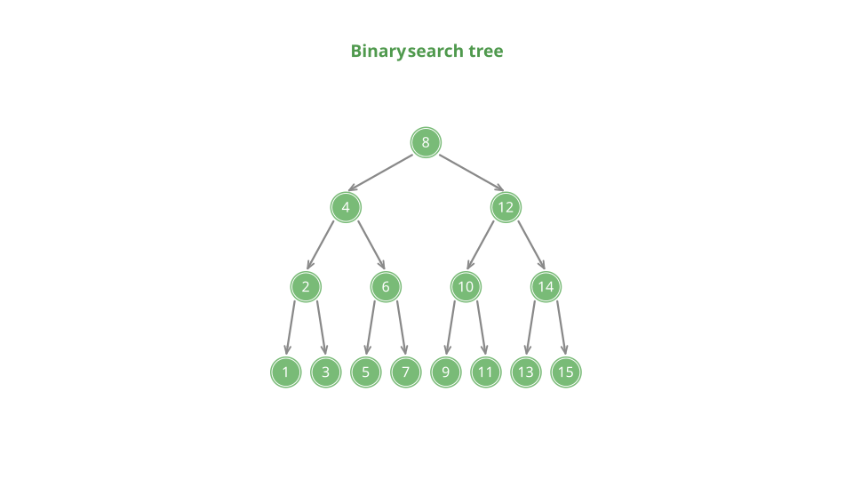
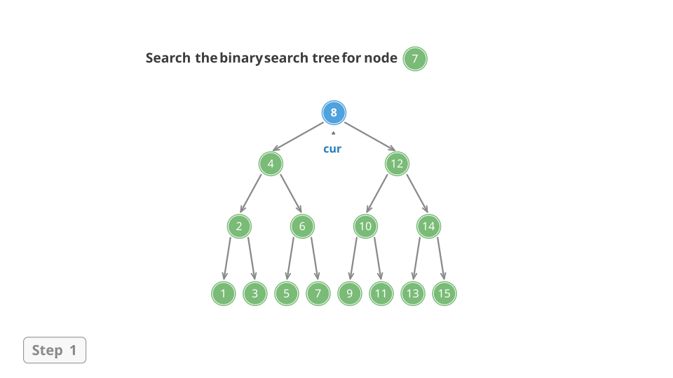
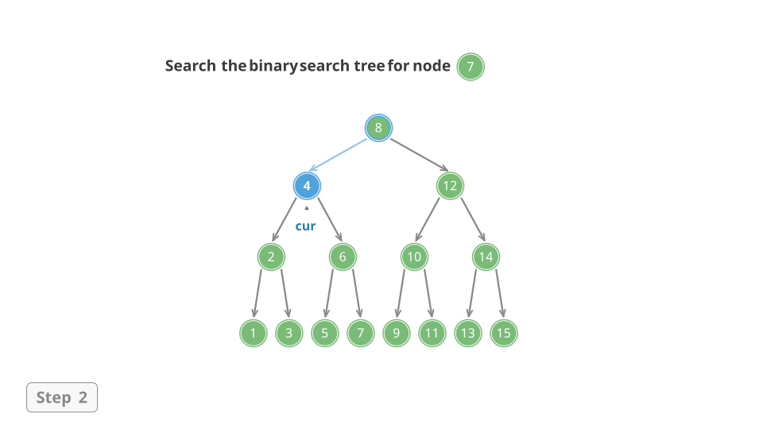
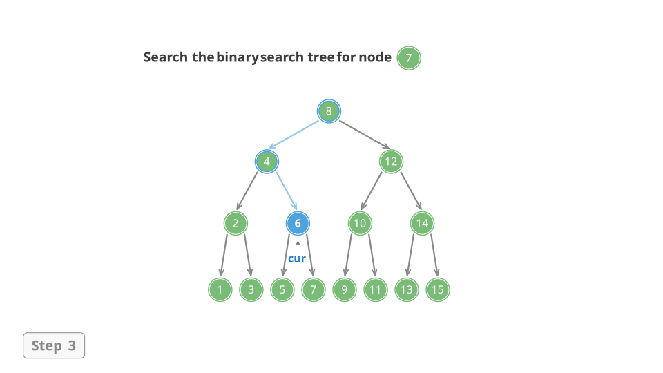
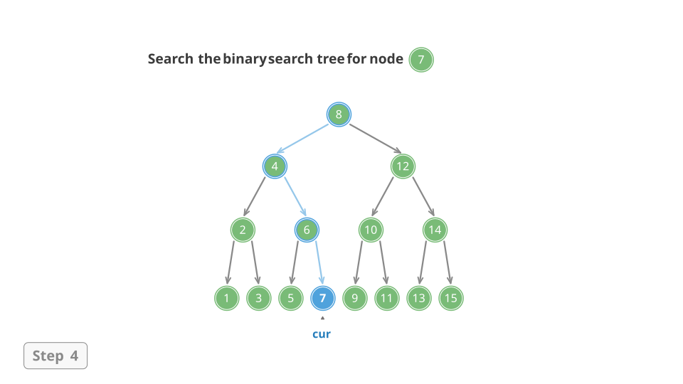
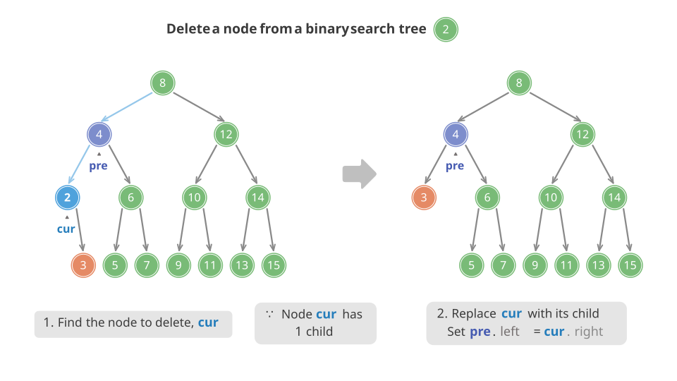
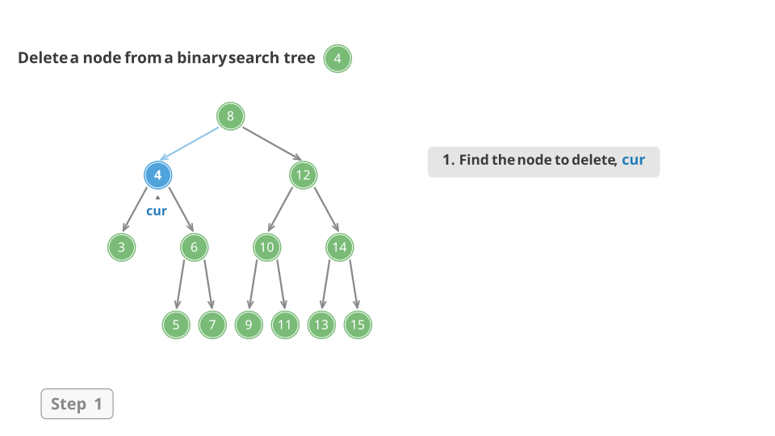
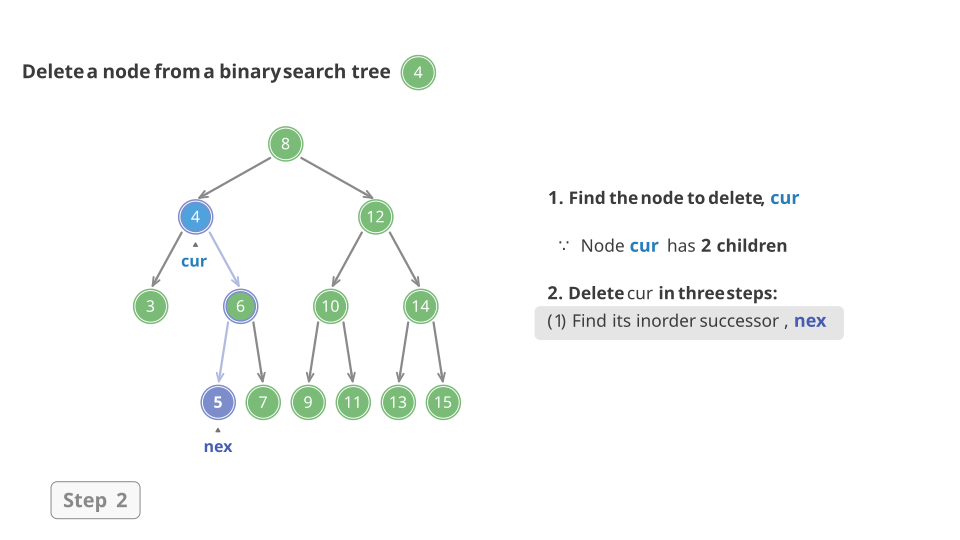
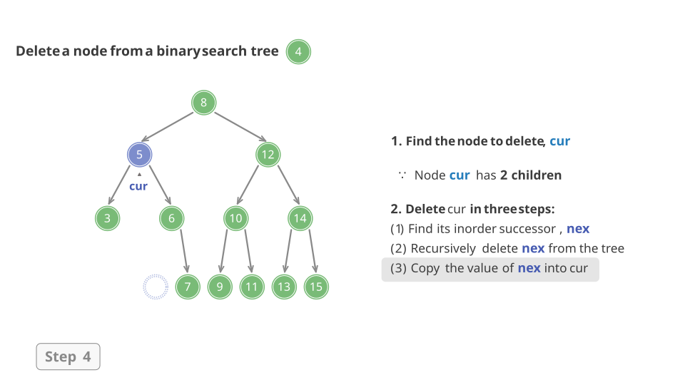
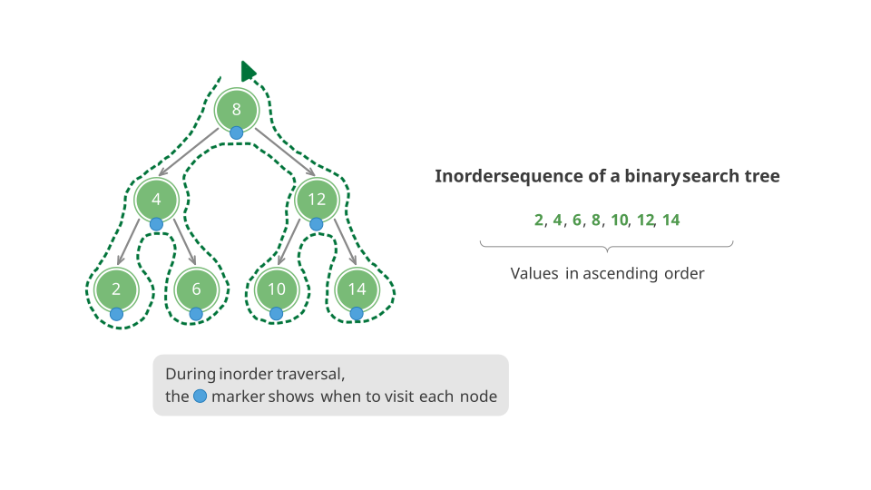

# Binary search tree

As the figure below shows, a <u>binary search tree</u> satisfies the following conditions.

1. At the root, every value in the left subtree $<$ the root value $<$ every value in the right subtree.
2. The left and right subtrees of every node are themselves binary search trees, so they too satisfy condition `1.`.



## Binary search tree operations

We implement the tree as a `BinarySearchTree` class with a member variable `root` that points to the root.

### Search for a node

Given a target value `num`, we can use the search tree property to find it. As shown below, start a node reference `cur` at the root `root` and repeatedly compare the current value `cur.val` with `num`.

- If `cur.val < num`, the target belongs in the right subtree of `cur`, so set `cur = cur.right`.
- If `cur.val > num`, the target belongs in the left subtree of `cur`, so set `cur = cur.left`.
- If `cur.val = num`, we have found the target. Exit the loop and return the node.

=== "<1>"
    

=== "<2>"
    

=== "<3>"
    

=== "<4>"
    

Searching a binary search tree uses the same principle as binary search: each round eliminates half the possibilities. The tree height bounds the number of iterations, and a balanced tree takes $O(\log n)$ time. Here is an implementation:

```src
[file]{binary_search_tree}-[class]{binary_search_tree}-[func]{search}
```

### Insert a node

To insert a value `num` while preserving the ordering “left subtree < root < right subtree,” follow the steps shown below.

1. **Find the insertion position**. As in a search, start at the root and compare each node's value with `num` to decide which way to go. Stop when you pass a leaf and reach `None`.
2. **Insert the node at that position**. Create a node with value `num` and put it in the position occupied by `None`.


Keep two points in mind when implementing insertion.

- Duplicate values would violate our definition of a binary search tree. If the value is already in the tree, return without inserting a node.
- Use `pre` to remember the node from the previous iteration. When you reach `None`, you will still have the parent reference you need to attach the new node.

```src
[file]{binary_search_tree}-[class]{binary_search_tree}-[func]{insert}
```

Like search, insertion takes $O(\log n)$ time.

### Delete a node

First find the target in the binary tree, then delete it. As with insertion, deletion must preserve the ordering “left subtree < root < right subtree.” How we delete the target depends on whether it has zero, one, or two children.

As shown below, a node of degree $0$ is a leaf and can be deleted directly.


As shown below, a node of degree $1$ can simply be replaced by its only child.



We cannot simply remove a node of degree $2$. We need a replacement. To preserve the ordering “left subtree $<$ root $<$ right subtree,” **we can use either the smallest node in the right subtree or the largest node in the left subtree**.

Suppose we choose the smallest node in the right subtree, which comes next in inorder traversal. The figure below shows the deletion.

1. Find the node immediately after the target in the inorder sequence and call it `tmp`.
2. Use the value of `tmp` to overwrite the target's value, and recursively delete node `tmp` from the tree.

=== "<1>"
    

=== "<2>"
    

=== "<3>"
    

=== "<4>"
    

Deletion also takes $O(\log n)$ time. Finding the target takes $O(\log n)$ time, and finding its inorder successor takes $O(\log n)$ time. Here is an implementation:

```src
[file]{binary_search_tree}-[class]{binary_search_tree}-[func]{remove}
```

### Inorder traversal yields sorted values

As the figure below shows, inorder traversal visits a binary tree in the order “left $\rightarrow$ root $\rightarrow$ right,” while a binary search tree satisfies “left child $<$ root $<$ right child.”

An inorder traversal of a binary search tree therefore always visits the next smallest node. This gives us an important property: **the inorder sequence of a binary search tree is in ascending order**.

This property lets us obtain sorted data from a binary search tree in just $O(n)$ time, without a separate sorting step.



## Efficiency of binary search trees

Suppose we want to store a collection of values in either an array or a binary search tree. In the table below, the search tree operations all take logarithmic time, giving consistent, efficient performance. An array is more efficient only when additions are frequent and searches and deletions are infrequent.

<p align="center"> Table <id> &nbsp; Efficiency of arrays and search trees </p>

|          | Unsorted array | Binary search tree  |
| -------- | -------- | ----------- |
| Find an element | $O(n)$   | $O(\log n)$ |
| Insert an element | $O(1)$   | $O(\log n)$ |
| Delete an element | $O(n)$   | $O(\log n)$ |

Ideally, a binary search tree is balanced, so we can find any node within $\log n$ iterations.

Repeated insertions and deletions, however, can turn a binary search tree into a linked list, as shown below. The time complexity of its operations then worsens to $O(n)$.


## Common applications of binary search trees

- Multilevel indexes that support efficient searches, insertions, and deletions.
- The underlying data structure for certain search algorithms.
- Storing streaming data in sorted order.
