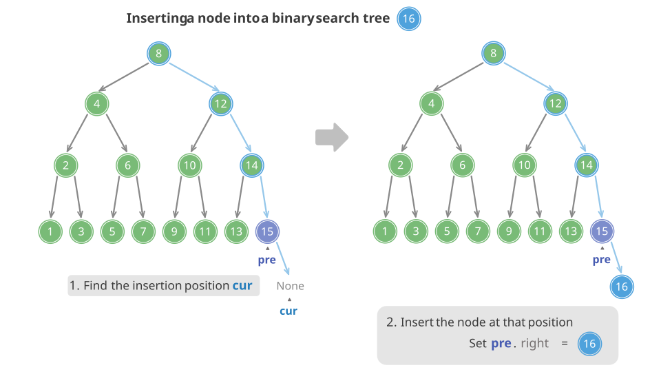
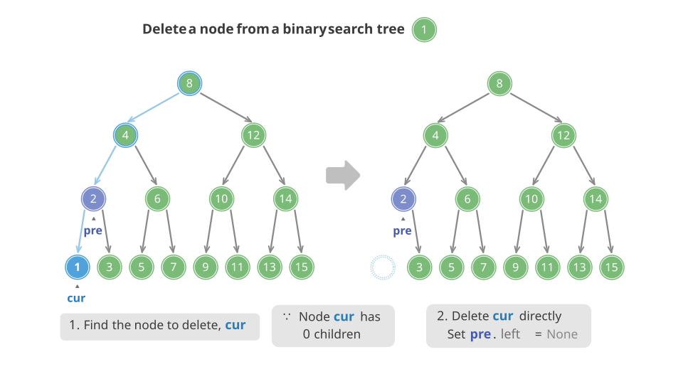
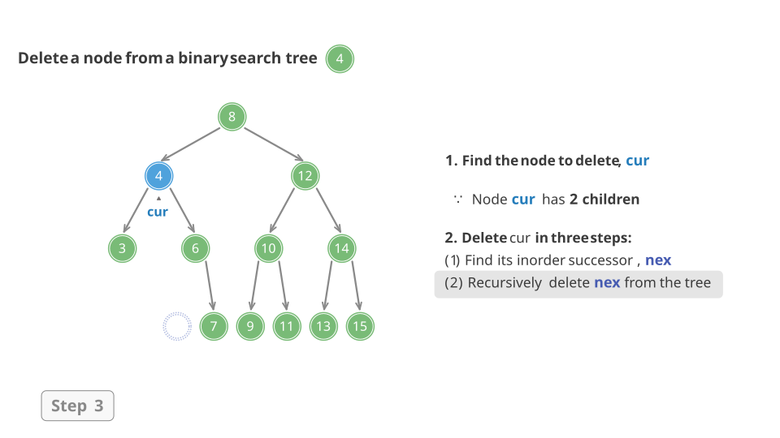
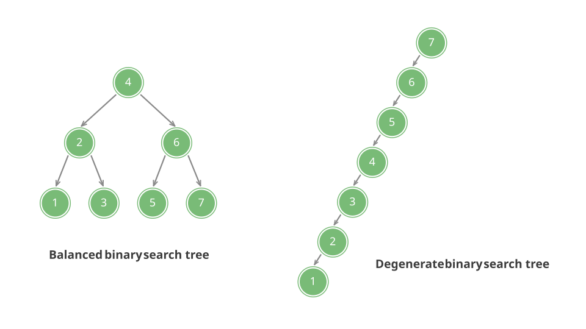

# 7.4 &nbsp; Binary search tree

As Figure 7-16 shows, a <u>binary search tree</u> satisfies the following conditions.

1. At the root, every value in the left subtree $<$ the root value $<$ every value in the right subtree.
2. The left and right subtrees of every node are themselves binary search trees, so they too satisfy condition `1.`.

{ class="animation-figure" }

<p align="center"> Figure 7-16 &nbsp; Binary search tree </p>

## 7.4.1 &nbsp; Binary search tree operations

We implement the tree as a `BinarySearchTree` class with a member variable `root` that points to the root.

### 1. &nbsp; Search for a node

Given a target value `num`, we can use the search tree property to find it. As shown below, start a node reference `cur` at the root `root` and repeatedly compare the current value `cur.val` with `num`.

- If `cur.val < num`, the target belongs in the right subtree of `cur`, so set `cur = cur.right`.
- If `cur.val > num`, the target belongs in the left subtree of `cur`, so set `cur = cur.left`.
- If `cur.val = num`, we have found the target. Exit the loop and return the node.

=== "<1>"
    { class="animation-figure" }

=== "<2>"
    { class="animation-figure" }

=== "<3>"
    { class="animation-figure" }

=== "<4>"
    { class="animation-figure" }

<p align="center"> Figure 7-17 &nbsp; Searching for a node in a binary search tree </p>

Searching a binary search tree uses the same principle as binary search: each round eliminates half the possibilities. The tree height bounds the number of iterations, and a balanced tree takes $O(\log n)$ time. Here is an implementation:

=== "Python"

    ```python title="binary_search_tree.py"
    def search(self, num: int) -> TreeNode | None:
        """Search for a node"""
        cur = self._root
        # Stop the search after passing a leaf
        while cur is not None:
            # The target is in the right subtree of cur
            if cur.val < num:
                cur = cur.right
            # The target is in the left subtree of cur
            elif cur.val > num:
                cur = cur.left
            # The target was found, so exit the loop
            else:
                break
        return cur
    ```

=== "C++"

    ```cpp title="binary_search_tree.cpp"
    /* Search for a node */
    TreeNode *search(int num) {
        TreeNode *cur = root;
        // Stop the search after passing a leaf
        while (cur != nullptr) {
            // The target is in the right subtree of cur
            if (cur->val < num)
                cur = cur->right;
            // The target is in the left subtree of cur
            else if (cur->val > num)
                cur = cur->left;
            // The target was found, so exit the loop
            else
                break;
        }
        // Return the target node
        return cur;
    }
    ```

=== "Java"

    ```java title="binary_search_tree.java"
    /* Search for a node */
    TreeNode search(int num) {
        TreeNode cur = root;
        // Stop the search after passing a leaf
        while (cur != null) {
            // The target is in the right subtree of cur
            if (cur.val < num)
                cur = cur.right;
            // The target is in the left subtree of cur
            else if (cur.val > num)
                cur = cur.left;
            // The target was found, so exit the loop
            else
                break;
        }
        // Return the target node
        return cur;
    }
    ```

=== "C#"

    ```csharp title="binary_search_tree.cs"
    /* Search for a node */
    TreeNode? Search(int num) {
        TreeNode? cur = root;
        // Stop the search after passing a leaf
        while (cur != null) {
            // The target is in the right subtree of cur
            if (cur.val < num) cur =
                cur.right;
            // The target is in the left subtree of cur
            else if (cur.val > num)
                cur = cur.left;
            // The target was found, so exit the loop
            else
                break;
        }
        // Return the target node
        return cur;
    }
    ```

=== "Go"

    ```go title="binary_search_tree.go"
    /* Search for a node */
    func (bst *binarySearchTree) search(num int) *TreeNode {
        node := bst.root
        // Stop the search after passing a leaf
        for node != nil {
            if node.Val.(int) < num {
                // The target is in the right subtree of cur
                node = node.Right
            } else if node.Val.(int) > num {
                // The target is in the left subtree of cur
                node = node.Left
            } else {
                // The target was found, so exit the loop
                break
            }
        }
        // Return the target node
        return node
    }
    ```

=== "Swift"

    ```swift title="binary_search_tree.swift"
    /* Search for a node */
    func search(num: Int) -> TreeNode? {
        var cur = root
        // Stop the search after passing a leaf
        while cur != nil {
            // The target is in the right subtree of cur
            if cur!.val < num {
                cur = cur?.right
            }
            // The target is in the left subtree of cur
            else if cur!.val > num {
                cur = cur?.left
            }
            // The target was found, so exit the loop
            else {
                break
            }
        }
        // Return the target node
        return cur
    }
    ```

=== "JS"

    ```javascript title="binary_search_tree.js"
    /* Search for a node */
    search(num) {
        let cur = this.root;
        // Stop the search after passing a leaf
        while (cur !== null) {
            // The target is in the right subtree of cur
            if (cur.val < num) cur = cur.right;
            // The target is in the left subtree of cur
            else if (cur.val > num) cur = cur.left;
            // The target was found, so exit the loop
            else break;
        }
        // Return the target node
        return cur;
    }
    ```

=== "TS"

    ```typescript title="binary_search_tree.ts"
    /* Search for a node */
    search(num: number): TreeNode | null {
        let cur = this.root;
        // Stop the search after passing a leaf
        while (cur !== null) {
            // The target is in the right subtree of cur
            if (cur.val < num) cur = cur.right;
            // The target is in the left subtree of cur
            else if (cur.val > num) cur = cur.left;
            // The target was found, so exit the loop
            else break;
        }
        // Return the target node
        return cur;
    }
    ```

=== "Dart"

    ```dart title="binary_search_tree.dart"
    /* Search for a node */
    TreeNode? search(int _num) {
      TreeNode? cur = _root;
      // Stop the search after passing a leaf
      while (cur != null) {
        // The target is in the right subtree of cur
        if (cur.val < _num)
          cur = cur.right;
        // The target is in the left subtree of cur
        else if (cur.val > _num)
          cur = cur.left;
        // The target was found, so exit the loop
        else
          break;
      }
      // Return the target node
      return cur;
    }
    ```

=== "Rust"

    ```rust title="binary_search_tree.rs"
    /* Search for a node */
    pub fn search(&self, num: i32) -> OptionTreeNodeRc {
        let mut cur = self.root.clone();
        // Stop the search after passing a leaf
        while let Some(node) = cur.clone() {
            match num.cmp(&node.borrow().val) {
                // The target is in the right subtree of cur
                Ordering::Greater => cur = node.borrow().right.clone(),
                // The target is in the left subtree of cur
                Ordering::Less => cur = node.borrow().left.clone(),
                // The target was found, so exit the loop
                Ordering::Equal => break,
            }
        }

        // Return the target node
        cur
    }
    ```

=== "C"

    ```c title="binary_search_tree.c"
    /* Search for a node */
    TreeNode *search(BinarySearchTree *bst, int num) {
        TreeNode *cur = bst->root;
        // Stop the search after passing a leaf
        while (cur != NULL) {
            if (cur->val < num) {
                // The target is in the right subtree of cur
                cur = cur->right;
            } else if (cur->val > num) {
                // The target is in the left subtree of cur
                cur = cur->left;
            } else {
                // The target was found, so exit the loop
                break;
            }
        }
        // Return the target node
        return cur;
    }
    ```

=== "Kotlin"

    ```kotlin title="binary_search_tree.kt"
    /* Search for a node */
    fun search(num: Int): TreeNode? {
        var cur = root
        // Stop the search after passing a leaf
        while (cur != null) {
            // The target is in the right subtree of cur
            cur = if (cur._val < num)
                cur.right
            // The target is in the left subtree of cur
            else if (cur._val > num)
                cur.left
            // The target was found, so exit the loop
            else
                break
        }
        // Return the target node
        return cur
    }
    ```

=== "Ruby"

    ```ruby title="binary_search_tree.rb"
    ### Search for a node ###
    def search(num)
      cur = @root

      # Stop the search after passing a leaf
      while !cur.nil?
        # The target is in the right subtree of cur
        if cur.val < num
          cur = cur.right
        # The target is in the left subtree of cur
        elsif cur.val > num
          cur = cur.left
        # The target was found, so exit the loop
        else
          break
        end
      end

      cur
    end
    ```

??? pythontutor "Visualize execution"

    <div style="height: 549px; width: 100%;"><iframe class="pythontutor-iframe" title="Visualize execution" src="https://pythontutor.com/iframe-embed.html#code=class%20TreeNode%3A%0A%20%20%20%20%22%22%22Binary%20tree%20node%20class%22%22%22%0A%20%20%20%20def%20__init__%28self,%20val%29%3A%0A%20%20%20%20%20%20%20%20self.val%20%3D%20val%0A%20%20%20%20%20%20%20%20self.left%20%3D%20None%0A%20%20%20%20%20%20%20%20self.right%20%3D%20None%0A%0A%0Aclass%20BinarySearchTree%3A%0A%20%20%20%20%22%22%22Binary%20search%20tree%22%22%22%0A%0A%20%20%20%20def%20__init__%28self%29%3A%0A%20%20%20%20%20%20%20%20%22%22%22Constructor%22%22%22%0A%20%20%20%20%20%20%20%20%23%20Initialize%20an%20empty%20tree%0A%20%20%20%20%20%20%20%20self._root%20%3D%20None%0A%0A%20%20%20%20def%20search%28self,%20num%3A%20int%29%20-%3E%20TreeNode%20%7C%20None%3A%0A%20%20%20%20%20%20%20%20%22%22%22Search%20for%20a%20node%22%22%22%0A%20%20%20%20%20%20%20%20cur%20%3D%20self._root%0A%20%20%20%20%20%20%20%20%23%20Stop%20the%20search%20after%20passing%20a%20leaf%0A%20%20%20%20%20%20%20%20while%20cur%20is%20not%20None%3A%0A%20%20%20%20%20%20%20%20%20%20%20%20%23%20The%20target%20is%20in%20the%20right%20subtree%20of%20cur%0A%20%20%20%20%20%20%20%20%20%20%20%20if%20cur.val%20%3C%20num%3A%0A%20%20%20%20%20%20%20%20%20%20%20%20%20%20%20%20cur%20%3D%20cur.right%0A%20%20%20%20%20%20%20%20%20%20%20%20%23%20The%20target%20is%20in%20the%20left%20subtree%20of%20cur%0A%20%20%20%20%20%20%20%20%20%20%20%20elif%20cur.val%20%3E%20num%3A%0A%20%20%20%20%20%20%20%20%20%20%20%20%20%20%20%20cur%20%3D%20cur.left%0A%20%20%20%20%20%20%20%20%20%20%20%20%23%20The%20target%20was%20found,%20so%20exit%20the%20loop%0A%20%20%20%20%20%20%20%20%20%20%20%20else%3A%0A%20%20%20%20%20%20%20%20%20%20%20%20%20%20%20%20break%0A%20%20%20%20%20%20%20%20return%20cur%0A%0A%20%20%20%20def%20insert%28self,%20num%3A%20int%29%3A%0A%20%20%20%20%20%20%20%20%22%22%22Insert%20a%20node%22%22%22%0A%20%20%20%20%20%20%20%20%23%20If%20the%20tree%20is%20empty,%20initialize%20the%20root%0A%20%20%20%20%20%20%20%20if%20self._root%20is%20None%3A%0A%20%20%20%20%20%20%20%20%20%20%20%20self._root%20%3D%20TreeNode%28num%29%0A%20%20%20%20%20%20%20%20%20%20%20%20return%0A%20%20%20%20%20%20%20%20%23%20Stop%20the%20search%20after%20passing%20a%20leaf%0A%20%20%20%20%20%20%20%20cur,%20pre%20%3D%20self._root,%20None%0A%20%20%20%20%20%20%20%20while%20cur%20is%20not%20None%3A%0A%20%20%20%20%20%20%20%20%20%20%20%20%23%20Return%20if%20a%20duplicate%20is%20found%0A%20%20%20%20%20%20%20%20%20%20%20%20if%20cur.val%20%3D%3D%20num%3A%0A%20%20%20%20%20%20%20%20%20%20%20%20%20%20%20%20return%0A%20%20%20%20%20%20%20%20%20%20%20%20pre%20%3D%20cur%0A%20%20%20%20%20%20%20%20%20%20%20%20%23%20The%20insertion%20position%20is%20in%20the%20right%20subtree%20of%20cur%0A%20%20%20%20%20%20%20%20%20%20%20%20if%20cur.val%20%3C%20num%3A%0A%20%20%20%20%20%20%20%20%20%20%20%20%20%20%20%20cur%20%3D%20cur.right%0A%20%20%20%20%20%20%20%20%20%20%20%20%23%20The%20insertion%20position%20is%20in%20the%20left%20subtree%20of%20cur%0A%20%20%20%20%20%20%20%20%20%20%20%20else%3A%0A%20%20%20%20%20%20%20%20%20%20%20%20%20%20%20%20cur%20%3D%20cur.left%0A%20%20%20%20%20%20%20%20%23%20Insert%20a%20node%0A%20%20%20%20%20%20%20%20node%20%3D%20TreeNode%28num%29%0A%20%20%20%20%20%20%20%20if%20pre.val%20%3C%20num%3A%0A%20%20%20%20%20%20%20%20%20%20%20%20pre.right%20%3D%20node%0A%20%20%20%20%20%20%20%20else%3A%0A%20%20%20%20%20%20%20%20%20%20%20%20pre.left%20%3D%20node%0A%0A%0A%22%22%22Driver%20Code%22%22%22%0Aif%20__name__%20%3D%3D%20%22__main__%22%3A%0A%20%20%20%20%23%20Initialize%20the%20binary%20search%20tree%0A%20%20%20%20bst%20%3D%20BinarySearchTree%28%29%0A%20%20%20%20nums%20%3D%20%5B4,%202,%206,%201,%203,%205,%207%5D%0A%20%20%20%20for%20num%20in%20nums%3A%0A%20%20%20%20%20%20%20%20bst.insert%28num%29%0A%0A%20%20%20%20%23%20Search%20for%20a%20node%0A%20%20%20%20node%20%3D%20bst.search%287%29%0A%20%20%20%20print%28%22%5CnNode%20found%3A%20%7B%7D,%20node%20value%20%3D%20%7B%7D%22.format%28node,%20node.val%29%29&codeDivHeight=472&codeDivWidth=350&cumulative=false&curInstr=162&heapPrimitives=nevernest&origin=opt-frontend.js&py=311&rawInputLstJSON=%5B%5D&textReferences=false"> </iframe></div>
    <div style="margin-top: 5px;"><a href="https://pythontutor.com/iframe-embed.html#code=class%20TreeNode%3A%0A%20%20%20%20%22%22%22Binary%20tree%20node%20class%22%22%22%0A%20%20%20%20def%20__init__%28self,%20val%29%3A%0A%20%20%20%20%20%20%20%20self.val%20%3D%20val%0A%20%20%20%20%20%20%20%20self.left%20%3D%20None%0A%20%20%20%20%20%20%20%20self.right%20%3D%20None%0A%0A%0Aclass%20BinarySearchTree%3A%0A%20%20%20%20%22%22%22Binary%20search%20tree%22%22%22%0A%0A%20%20%20%20def%20__init__%28self%29%3A%0A%20%20%20%20%20%20%20%20%22%22%22Constructor%22%22%22%0A%20%20%20%20%20%20%20%20%23%20Initialize%20an%20empty%20tree%0A%20%20%20%20%20%20%20%20self._root%20%3D%20None%0A%0A%20%20%20%20def%20search%28self,%20num%3A%20int%29%20-%3E%20TreeNode%20%7C%20None%3A%0A%20%20%20%20%20%20%20%20%22%22%22Search%20for%20a%20node%22%22%22%0A%20%20%20%20%20%20%20%20cur%20%3D%20self._root%0A%20%20%20%20%20%20%20%20%23%20Stop%20the%20search%20after%20passing%20a%20leaf%0A%20%20%20%20%20%20%20%20while%20cur%20is%20not%20None%3A%0A%20%20%20%20%20%20%20%20%20%20%20%20%23%20The%20target%20is%20in%20the%20right%20subtree%20of%20cur%0A%20%20%20%20%20%20%20%20%20%20%20%20if%20cur.val%20%3C%20num%3A%0A%20%20%20%20%20%20%20%20%20%20%20%20%20%20%20%20cur%20%3D%20cur.right%0A%20%20%20%20%20%20%20%20%20%20%20%20%23%20The%20target%20is%20in%20the%20left%20subtree%20of%20cur%0A%20%20%20%20%20%20%20%20%20%20%20%20elif%20cur.val%20%3E%20num%3A%0A%20%20%20%20%20%20%20%20%20%20%20%20%20%20%20%20cur%20%3D%20cur.left%0A%20%20%20%20%20%20%20%20%20%20%20%20%23%20The%20target%20was%20found,%20so%20exit%20the%20loop%0A%20%20%20%20%20%20%20%20%20%20%20%20else%3A%0A%20%20%20%20%20%20%20%20%20%20%20%20%20%20%20%20break%0A%20%20%20%20%20%20%20%20return%20cur%0A%0A%20%20%20%20def%20insert%28self,%20num%3A%20int%29%3A%0A%20%20%20%20%20%20%20%20%22%22%22Insert%20a%20node%22%22%22%0A%20%20%20%20%20%20%20%20%23%20If%20the%20tree%20is%20empty,%20initialize%20the%20root%0A%20%20%20%20%20%20%20%20if%20self._root%20is%20None%3A%0A%20%20%20%20%20%20%20%20%20%20%20%20self._root%20%3D%20TreeNode%28num%29%0A%20%20%20%20%20%20%20%20%20%20%20%20return%0A%20%20%20%20%20%20%20%20%23%20Stop%20the%20search%20after%20passing%20a%20leaf%0A%20%20%20%20%20%20%20%20cur,%20pre%20%3D%20self._root,%20None%0A%20%20%20%20%20%20%20%20while%20cur%20is%20not%20None%3A%0A%20%20%20%20%20%20%20%20%20%20%20%20%23%20Return%20if%20a%20duplicate%20is%20found%0A%20%20%20%20%20%20%20%20%20%20%20%20if%20cur.val%20%3D%3D%20num%3A%0A%20%20%20%20%20%20%20%20%20%20%20%20%20%20%20%20return%0A%20%20%20%20%20%20%20%20%20%20%20%20pre%20%3D%20cur%0A%20%20%20%20%20%20%20%20%20%20%20%20%23%20The%20insertion%20position%20is%20in%20the%20right%20subtree%20of%20cur%0A%20%20%20%20%20%20%20%20%20%20%20%20if%20cur.val%20%3C%20num%3A%0A%20%20%20%20%20%20%20%20%20%20%20%20%20%20%20%20cur%20%3D%20cur.right%0A%20%20%20%20%20%20%20%20%20%20%20%20%23%20The%20insertion%20position%20is%20in%20the%20left%20subtree%20of%20cur%0A%20%20%20%20%20%20%20%20%20%20%20%20else%3A%0A%20%20%20%20%20%20%20%20%20%20%20%20%20%20%20%20cur%20%3D%20cur.left%0A%20%20%20%20%20%20%20%20%23%20Insert%20a%20node%0A%20%20%20%20%20%20%20%20node%20%3D%20TreeNode%28num%29%0A%20%20%20%20%20%20%20%20if%20pre.val%20%3C%20num%3A%0A%20%20%20%20%20%20%20%20%20%20%20%20pre.right%20%3D%20node%0A%20%20%20%20%20%20%20%20else%3A%0A%20%20%20%20%20%20%20%20%20%20%20%20pre.left%20%3D%20node%0A%0A%0A%22%22%22Driver%20Code%22%22%22%0Aif%20__name__%20%3D%3D%20%22__main__%22%3A%0A%20%20%20%20%23%20Initialize%20the%20binary%20search%20tree%0A%20%20%20%20bst%20%3D%20BinarySearchTree%28%29%0A%20%20%20%20nums%20%3D%20%5B4,%202,%206,%201,%203,%205,%207%5D%0A%20%20%20%20for%20num%20in%20nums%3A%0A%20%20%20%20%20%20%20%20bst.insert%28num%29%0A%0A%20%20%20%20%23%20Search%20for%20a%20node%0A%20%20%20%20node%20%3D%20bst.search%287%29%0A%20%20%20%20print%28%22%5CnNode%20found%3A%20%7B%7D,%20node%20value%20%3D%20%7B%7D%22.format%28node,%20node.val%29%29&codeDivHeight=800&codeDivWidth=600&cumulative=false&curInstr=162&heapPrimitives=nevernest&origin=opt-frontend.js&py=311&rawInputLstJSON=%5B%5D&textReferences=false" target="_blank" rel="noopener noreferrer">View full screen ></a></div>

### 2. &nbsp; Insert a node

To insert a value `num` while preserving the ordering “left subtree < root < right subtree,” follow the steps shown below.

1. **Find the insertion position**. As in a search, start at the root and compare each node's value with `num` to decide which way to go. Stop when you pass a leaf and reach `None`.
2. **Insert the node at that position**. Create a node with value `num` and put it in the position occupied by `None`.

{ class="animation-figure" }

<p align="center"> Figure 7-18 &nbsp; Inserting a node into a binary search tree </p>

Keep two points in mind when implementing insertion.

- Duplicate values would violate our definition of a binary search tree. If the value is already in the tree, return without inserting a node.
- Use `pre` to remember the node from the previous iteration. When you reach `None`, you will still have the parent reference you need to attach the new node.

=== "Python"

    ```python title="binary_search_tree.py"
    def insert(self, num: int):
        """Insert a node"""
        # If the tree is empty, initialize the root
        if self._root is None:
            self._root = TreeNode(num)
            return
        # Stop the search after passing a leaf
        cur, pre = self._root, None
        while cur is not None:
            # Return if a duplicate is found
            if cur.val == num:
                return
            pre = cur
            # The insertion position is in the right subtree of cur
            if cur.val < num:
                cur = cur.right
            # The insertion position is in the left subtree of cur
            else:
                cur = cur.left
        # Insert a node
        node = TreeNode(num)
        if pre.val < num:
            pre.right = node
        else:
            pre.left = node
    ```

=== "C++"

    ```cpp title="binary_search_tree.cpp"
    /* Insert a node */
    void insert(int num) {
        // If the tree is empty, initialize the root
        if (root == nullptr) {
            root = new TreeNode(num);
            return;
        }
        TreeNode *cur = root, *pre = nullptr;
        // Stop the search after passing a leaf
        while (cur != nullptr) {
            // Return if a duplicate is found
            if (cur->val == num)
                return;
            pre = cur;
            // The insertion position is in the right subtree of cur
            if (cur->val < num)
                cur = cur->right;
            // The insertion position is in the left subtree of cur
            else
                cur = cur->left;
        }
        // Insert a node
        TreeNode *node = new TreeNode(num);
        if (pre->val < num)
            pre->right = node;
        else
            pre->left = node;
    }
    ```

=== "Java"

    ```java title="binary_search_tree.java"
    /* Insert a node */
    void insert(int num) {
        // If the tree is empty, initialize the root
        if (root == null) {
            root = new TreeNode(num);
            return;
        }
        TreeNode cur = root, pre = null;
        // Stop the search after passing a leaf
        while (cur != null) {
            // Return if a duplicate is found
            if (cur.val == num)
                return;
            pre = cur;
            // The insertion position is in the right subtree of cur
            if (cur.val < num)
                cur = cur.right;
            // The insertion position is in the left subtree of cur
            else
                cur = cur.left;
        }
        // Insert a node
        TreeNode node = new TreeNode(num);
        if (pre.val < num)
            pre.right = node;
        else
            pre.left = node;
    }
    ```

=== "C#"

    ```csharp title="binary_search_tree.cs"
    /* Insert a node */
    void Insert(int num) {
        // If the tree is empty, initialize the root
        if (root == null) {
            root = new TreeNode(num);
            return;
        }
        TreeNode? cur = root, pre = null;
        // Stop the search after passing a leaf
        while (cur != null) {
            // Return if a duplicate is found
            if (cur.val == num)
                return;
            pre = cur;
            // The insertion position is in the right subtree of cur
            if (cur.val < num)
                cur = cur.right;
            // The insertion position is in the left subtree of cur
            else
                cur = cur.left;
        }

        // Insert a node
        TreeNode node = new(num);
        if (pre != null) {
            if (pre.val < num)
                pre.right = node;
            else
                pre.left = node;
        }
    }
    ```

=== "Go"

    ```go title="binary_search_tree.go"
    /* Insert a node */
    func (bst *binarySearchTree) insert(num int) {
        cur := bst.root
        // If the tree is empty, initialize the root
        if cur == nil {
            bst.root = NewTreeNode(num)
            return
        }
        // Track the parent of the node to insert
        var pre *TreeNode = nil
        // Stop the search after passing a leaf
        for cur != nil {
            if cur.Val == num {
                return
            }
            pre = cur
            if cur.Val.(int) < num {
                cur = cur.Right
            } else {
                cur = cur.Left
            }
        }
        // Insert a node
        node := NewTreeNode(num)
        if pre.Val.(int) < num {
            pre.Right = node
        } else {
            pre.Left = node
        }
    }
    ```

=== "Swift"

    ```swift title="binary_search_tree.swift"
    /* Insert a node */
    func insert(num: Int) {
        // If the tree is empty, initialize the root
        if root == nil {
            root = TreeNode(x: num)
            return
        }
        var cur = root
        var pre: TreeNode?
        // Stop the search after passing a leaf
        while cur != nil {
            // Return if a duplicate is found
            if cur!.val == num {
                return
            }
            pre = cur
            // The insertion position is in the right subtree of cur
            if cur!.val < num {
                cur = cur?.right
            }
            // The insertion position is in the left subtree of cur
            else {
                cur = cur?.left
            }
        }
        // Insert a node
        let node = TreeNode(x: num)
        if pre!.val < num {
            pre?.right = node
        } else {
            pre?.left = node
        }
    }
    ```

=== "JS"

    ```javascript title="binary_search_tree.js"
    /* Insert a node */
    insert(num) {
        // If the tree is empty, initialize the root
        if (this.root === null) {
            this.root = new TreeNode(num);
            return;
        }
        let cur = this.root,
            pre = null;
        // Stop the search after passing a leaf
        while (cur !== null) {
            // Return if a duplicate is found
            if (cur.val === num) return;
            pre = cur;
            // The insertion position is in the right subtree of cur
            if (cur.val < num) cur = cur.right;
            // The insertion position is in the left subtree of cur
            else cur = cur.left;
        }
        // Insert a node
        const node = new TreeNode(num);
        if (pre.val < num) pre.right = node;
        else pre.left = node;
    }
    ```

=== "TS"

    ```typescript title="binary_search_tree.ts"
    /* Insert a node */
    insert(num: number): void {
        // If the tree is empty, initialize the root
        if (this.root === null) {
            this.root = new TreeNode(num);
            return;
        }
        let cur: TreeNode | null = this.root,
            pre: TreeNode | null = null;
        // Stop the search after passing a leaf
        while (cur !== null) {
            // Return if a duplicate is found
            if (cur.val === num) return;
            pre = cur;
            // The insertion position is in the right subtree of cur
            if (cur.val < num) cur = cur.right;
            // The insertion position is in the left subtree of cur
            else cur = cur.left;
        }
        // Insert a node
        const node = new TreeNode(num);
        if (pre!.val < num) pre!.right = node;
        else pre!.left = node;
    }
    ```

=== "Dart"

    ```dart title="binary_search_tree.dart"
    /* Insert a node */
    void insert(int _num) {
      // If the tree is empty, initialize the root
      if (_root == null) {
        _root = TreeNode(_num);
        return;
      }
      TreeNode? cur = _root;
      TreeNode? pre = null;
      // Stop the search after passing a leaf
      while (cur != null) {
        // Return if a duplicate is found
        if (cur.val == _num) return;
        pre = cur;
        // The insertion position is in the right subtree of cur
        if (cur.val < _num)
          cur = cur.right;
        // The insertion position is in the left subtree of cur
        else
          cur = cur.left;
      }
      // Insert a node
      TreeNode? node = TreeNode(_num);
      if (pre!.val < _num)
        pre.right = node;
      else
        pre.left = node;
    }
    ```

=== "Rust"

    ```rust title="binary_search_tree.rs"
    /* Insert a node */
    pub fn insert(&mut self, num: i32) {
        // If the tree is empty, initialize the root
        if self.root.is_none() {
            self.root = Some(TreeNode::new(num));
            return;
        }
        let mut cur = self.root.clone();
        let mut pre = None;
        // Stop the search after passing a leaf
        while let Some(node) = cur.clone() {
            match num.cmp(&node.borrow().val) {
                // Return if a duplicate is found
                Ordering::Equal => return,
                // The insertion position is in the right subtree of cur
                Ordering::Greater => {
                    pre = cur.clone();
                    cur = node.borrow().right.clone();
                }
                // The insertion position is in the left subtree of cur
                Ordering::Less => {
                    pre = cur.clone();
                    cur = node.borrow().left.clone();
                }
            }
        }
        // Insert a node
        let pre = pre.unwrap();
        let node = Some(TreeNode::new(num));
        if num > pre.borrow().val {
            pre.borrow_mut().right = node;
        } else {
            pre.borrow_mut().left = node;
        }
    }
    ```

=== "C"

    ```c title="binary_search_tree.c"
    /* Insert a node */
    void insert(BinarySearchTree *bst, int num) {
        // If the tree is empty, initialize the root
        if (bst->root == NULL) {
            bst->root = newTreeNode(num);
            return;
        }
        TreeNode *cur = bst->root, *pre = NULL;
        // Stop the search after passing a leaf
        while (cur != NULL) {
            // Return if a duplicate is found
            if (cur->val == num) {
                return;
            }
            pre = cur;
            if (cur->val < num) {
                // The insertion position is in the right subtree of cur
                cur = cur->right;
            } else {
                // The insertion position is in the left subtree of cur
                cur = cur->left;
            }
        }
        // Insert a node
        TreeNode *node = newTreeNode(num);
        if (pre->val < num) {
            pre->right = node;
        } else {
            pre->left = node;
        }
    }
    ```

=== "Kotlin"

    ```kotlin title="binary_search_tree.kt"
    /* Insert a node */
    fun insert(num: Int) {
        // If the tree is empty, initialize the root
        if (root == null) {
            root = TreeNode(num)
            return
        }
        var cur = root
        var pre: TreeNode? = null
        // Stop the search after passing a leaf
        while (cur != null) {
            // Return if a duplicate is found
            if (cur._val == num)
                return
            pre = cur
            // The insertion position is in the right subtree of cur
            cur = if (cur._val < num)
                cur.right
            // The insertion position is in the left subtree of cur
            else
                cur.left
        }
        // Insert a node
        val node = TreeNode(num)
        if (pre?._val!! < num)
            pre.right = node
        else
            pre.left = node
    }
    ```

=== "Ruby"

    ```ruby title="binary_search_tree.rb"
    ### Insert a node ###
    def insert(num)
      # If the tree is empty, initialize the root
      if @root.nil?
        @root = TreeNode.new(num)
        return
      end

      # Stop the search after passing a leaf
      cur, pre = @root, nil
      while !cur.nil?
        # Return if a duplicate is found
        return if cur.val == num

        pre = cur
        # The insertion position is in the right subtree of cur
        if cur.val < num
          cur = cur.right
        # The insertion position is in the left subtree of cur
        else
          cur = cur.left
        end
      end

      # Insert a node
      node = TreeNode.new(num)
      if pre.val < num
        pre.right = node
      else
        pre.left = node
      end
    end
    ```

??? pythontutor "Visualize execution"

    <div style="height: 549px; width: 100%;"><iframe class="pythontutor-iframe" title="Visualize execution" src="https://pythontutor.com/iframe-embed.html#code=class%20TreeNode%3A%0A%20%20%20%20%22%22%22Binary%20tree%20node%20class%22%22%22%0A%20%20%20%20def%20__init__%28self,%20val%29%3A%0A%20%20%20%20%20%20%20%20self.val%20%3D%20val%0A%20%20%20%20%20%20%20%20self.left%20%3D%20None%0A%20%20%20%20%20%20%20%20self.right%20%3D%20None%0A%0A%0Aclass%20BinarySearchTree%3A%0A%20%20%20%20%22%22%22Binary%20search%20tree%22%22%22%0A%0A%20%20%20%20def%20__init__%28self%29%3A%0A%20%20%20%20%20%20%20%20%22%22%22Constructor%22%22%22%0A%20%20%20%20%20%20%20%20%23%20Initialize%20an%20empty%20tree%0A%20%20%20%20%20%20%20%20self._root%20%3D%20None%0A%0A%20%20%20%20def%20insert%28self,%20num%3A%20int%29%3A%0A%20%20%20%20%20%20%20%20%22%22%22Insert%20a%20node%22%22%22%0A%20%20%20%20%20%20%20%20%23%20If%20the%20tree%20is%20empty,%20initialize%20the%20root%0A%20%20%20%20%20%20%20%20if%20self._root%20is%20None%3A%0A%20%20%20%20%20%20%20%20%20%20%20%20self._root%20%3D%20TreeNode%28num%29%0A%20%20%20%20%20%20%20%20%20%20%20%20return%0A%20%20%20%20%20%20%20%20%23%20Stop%20the%20search%20after%20passing%20a%20leaf%0A%20%20%20%20%20%20%20%20cur,%20pre%20%3D%20self._root,%20None%0A%20%20%20%20%20%20%20%20while%20cur%20is%20not%20None%3A%0A%20%20%20%20%20%20%20%20%20%20%20%20%23%20Return%20if%20a%20duplicate%20is%20found%0A%20%20%20%20%20%20%20%20%20%20%20%20if%20cur.val%20%3D%3D%20num%3A%0A%20%20%20%20%20%20%20%20%20%20%20%20%20%20%20%20return%0A%20%20%20%20%20%20%20%20%20%20%20%20pre%20%3D%20cur%0A%20%20%20%20%20%20%20%20%20%20%20%20%23%20The%20insertion%20position%20is%20in%20the%20right%20subtree%20of%20cur%0A%20%20%20%20%20%20%20%20%20%20%20%20if%20cur.val%20%3C%20num%3A%0A%20%20%20%20%20%20%20%20%20%20%20%20%20%20%20%20cur%20%3D%20cur.right%0A%20%20%20%20%20%20%20%20%20%20%20%20%23%20The%20insertion%20position%20is%20in%20the%20left%20subtree%20of%20cur%0A%20%20%20%20%20%20%20%20%20%20%20%20else%3A%0A%20%20%20%20%20%20%20%20%20%20%20%20%20%20%20%20cur%20%3D%20cur.left%0A%20%20%20%20%20%20%20%20%23%20Insert%20a%20node%0A%20%20%20%20%20%20%20%20node%20%3D%20TreeNode%28num%29%0A%20%20%20%20%20%20%20%20if%20pre.val%20%3C%20num%3A%0A%20%20%20%20%20%20%20%20%20%20%20%20pre.right%20%3D%20node%0A%20%20%20%20%20%20%20%20else%3A%0A%20%20%20%20%20%20%20%20%20%20%20%20pre.left%20%3D%20node%0A%0A%0A%22%22%22Driver%20Code%22%22%22%0Aif%20__name__%20%3D%3D%20%22__main__%22%3A%0A%20%20%20%20%23%20Initialize%20the%20binary%20search%20tree%0A%20%20%20%20bst%20%3D%20BinarySearchTree%28%29%0A%20%20%20%20nums%20%3D%20%5B4,%202,%206,%201,%203,%205,%207%5D%0A%20%20%20%20for%20num%20in%20nums%3A%0A%20%20%20%20%20%20%20%20bst.insert%28num%29%0A%0A%20%20%20%20%23%20Insert%20a%20node%0A%20%20%20%20bst.insert%2816%29&codeDivHeight=472&codeDivWidth=350&cumulative=false&curInstr=162&heapPrimitives=nevernest&origin=opt-frontend.js&py=311&rawInputLstJSON=%5B%5D&textReferences=false"> </iframe></div>
    <div style="margin-top: 5px;"><a href="https://pythontutor.com/iframe-embed.html#code=class%20TreeNode%3A%0A%20%20%20%20%22%22%22Binary%20tree%20node%20class%22%22%22%0A%20%20%20%20def%20__init__%28self,%20val%29%3A%0A%20%20%20%20%20%20%20%20self.val%20%3D%20val%0A%20%20%20%20%20%20%20%20self.left%20%3D%20None%0A%20%20%20%20%20%20%20%20self.right%20%3D%20None%0A%0A%0Aclass%20BinarySearchTree%3A%0A%20%20%20%20%22%22%22Binary%20search%20tree%22%22%22%0A%0A%20%20%20%20def%20__init__%28self%29%3A%0A%20%20%20%20%20%20%20%20%22%22%22Constructor%22%22%22%0A%20%20%20%20%20%20%20%20%23%20Initialize%20an%20empty%20tree%0A%20%20%20%20%20%20%20%20self._root%20%3D%20None%0A%0A%20%20%20%20def%20insert%28self,%20num%3A%20int%29%3A%0A%20%20%20%20%20%20%20%20%22%22%22Insert%20a%20node%22%22%22%0A%20%20%20%20%20%20%20%20%23%20If%20the%20tree%20is%20empty,%20initialize%20the%20root%0A%20%20%20%20%20%20%20%20if%20self._root%20is%20None%3A%0A%20%20%20%20%20%20%20%20%20%20%20%20self._root%20%3D%20TreeNode%28num%29%0A%20%20%20%20%20%20%20%20%20%20%20%20return%0A%20%20%20%20%20%20%20%20%23%20Stop%20the%20search%20after%20passing%20a%20leaf%0A%20%20%20%20%20%20%20%20cur,%20pre%20%3D%20self._root,%20None%0A%20%20%20%20%20%20%20%20while%20cur%20is%20not%20None%3A%0A%20%20%20%20%20%20%20%20%20%20%20%20%23%20Return%20if%20a%20duplicate%20is%20found%0A%20%20%20%20%20%20%20%20%20%20%20%20if%20cur.val%20%3D%3D%20num%3A%0A%20%20%20%20%20%20%20%20%20%20%20%20%20%20%20%20return%0A%20%20%20%20%20%20%20%20%20%20%20%20pre%20%3D%20cur%0A%20%20%20%20%20%20%20%20%20%20%20%20%23%20The%20insertion%20position%20is%20in%20the%20right%20subtree%20of%20cur%0A%20%20%20%20%20%20%20%20%20%20%20%20if%20cur.val%20%3C%20num%3A%0A%20%20%20%20%20%20%20%20%20%20%20%20%20%20%20%20cur%20%3D%20cur.right%0A%20%20%20%20%20%20%20%20%20%20%20%20%23%20The%20insertion%20position%20is%20in%20the%20left%20subtree%20of%20cur%0A%20%20%20%20%20%20%20%20%20%20%20%20else%3A%0A%20%20%20%20%20%20%20%20%20%20%20%20%20%20%20%20cur%20%3D%20cur.left%0A%20%20%20%20%20%20%20%20%23%20Insert%20a%20node%0A%20%20%20%20%20%20%20%20node%20%3D%20TreeNode%28num%29%0A%20%20%20%20%20%20%20%20if%20pre.val%20%3C%20num%3A%0A%20%20%20%20%20%20%20%20%20%20%20%20pre.right%20%3D%20node%0A%20%20%20%20%20%20%20%20else%3A%0A%20%20%20%20%20%20%20%20%20%20%20%20pre.left%20%3D%20node%0A%0A%0A%22%22%22Driver%20Code%22%22%22%0Aif%20__name__%20%3D%3D%20%22__main__%22%3A%0A%20%20%20%20%23%20Initialize%20the%20binary%20search%20tree%0A%20%20%20%20bst%20%3D%20BinarySearchTree%28%29%0A%20%20%20%20nums%20%3D%20%5B4,%202,%206,%201,%203,%205,%207%5D%0A%20%20%20%20for%20num%20in%20nums%3A%0A%20%20%20%20%20%20%20%20bst.insert%28num%29%0A%0A%20%20%20%20%23%20Insert%20a%20node%0A%20%20%20%20bst.insert%2816%29&codeDivHeight=800&codeDivWidth=600&cumulative=false&curInstr=162&heapPrimitives=nevernest&origin=opt-frontend.js&py=311&rawInputLstJSON=%5B%5D&textReferences=false" target="_blank" rel="noopener noreferrer">View full screen ></a></div>

Like search, insertion takes $O(\log n)$ time.

### 3. &nbsp; Delete a node

First find the target in the binary tree, then delete it. As with insertion, deletion must preserve the ordering “left subtree < root < right subtree.” How we delete the target depends on whether it has zero, one, or two children.

As shown below, a node of degree $0$ is a leaf and can be deleted directly.

{ class="animation-figure" }

<p align="center"> Figure 7-19 &nbsp; Deleting a node of degree 0 from a binary search tree </p>

As shown below, a node of degree $1$ can simply be replaced by its only child.

{ class="animation-figure" }

<p align="center"> Figure 7-20 &nbsp; Deleting a node of degree 1 from a binary search tree </p>

We cannot simply remove a node of degree $2$. We need a replacement. To preserve the ordering “left subtree $<$ root $<$ right subtree,” **we can use either the smallest node in the right subtree or the largest node in the left subtree**.

Suppose we choose the smallest node in the right subtree, which comes next in inorder traversal. Figure 7-21 shows the deletion.

1. Find the node immediately after the target in the inorder sequence and call it `tmp`.
2. Use the value of `tmp` to overwrite the target's value, and recursively delete node `tmp` from the tree.

=== "<1>"
    { class="animation-figure" }

=== "<2>"
    { class="animation-figure" }

=== "<3>"
    { class="animation-figure" }

=== "<4>"
    { class="animation-figure" }

<p align="center"> Figure 7-21 &nbsp; Deleting a node of degree 2 from a binary search tree </p>

Deletion also takes $O(\log n)$ time. Finding the target takes $O(\log n)$ time, and finding its inorder successor takes $O(\log n)$ time. Here is an implementation:

=== "Python"

    ```python title="binary_search_tree.py"
    def remove(self, num: int):
        """Delete a node"""
        # Return immediately if the tree is empty
        if self._root is None:
            return
        # Stop the search after passing a leaf
        cur, pre = self._root, None
        while cur is not None:
            # The node to delete was found, so exit the loop
            if cur.val == num:
                break
            pre = cur
            # The node to delete is in the right subtree of cur
            if cur.val < num:
                cur = cur.right
            # The node to delete is in the left subtree of cur
            else:
                cur = cur.left
        # Return if the node to delete does not exist
        if cur is None:
            return

        # Number of children = 0 or 1
        if cur.left is None or cur.right is None:
            # With no children, child = null. With one child, child is that child.
            child = cur.left or cur.right
            # Delete node cur
            if cur != self._root:
                if pre.left == cur:
                    pre.left = child
                else:
                    pre.right = child
            else:
                # If deleting the root, assign a new root
                self._root = child
        # Number of children = 2
        else:
            # Get the inorder successor of cur
            tmp: TreeNode = cur.right
            while tmp.left is not None:
                tmp = tmp.left
            # Recursively delete node tmp
            self.remove(tmp.val)
            # Replace the value of cur with that of tmp
            cur.val = tmp.val
    ```

=== "C++"

    ```cpp title="binary_search_tree.cpp"
    /* Delete a node */
    void remove(int num) {
        // Return immediately if the tree is empty
        if (root == nullptr)
            return;
        TreeNode *cur = root, *pre = nullptr;
        // Stop the search after passing a leaf
        while (cur != nullptr) {
            // The node to delete was found, so exit the loop
            if (cur->val == num)
                break;
            pre = cur;
            // The node to delete is in the right subtree of cur
            if (cur->val < num)
                cur = cur->right;
            // The node to delete is in the left subtree of cur
            else
                cur = cur->left;
        }
        // Return if the node to delete does not exist
        if (cur == nullptr)
            return;
        // Number of children = 0 or 1
        if (cur->left == nullptr || cur->right == nullptr) {
            // With no children, child = nullptr. With one child, child is that child.
            TreeNode *child = cur->left != nullptr ? cur->left : cur->right;
            // Delete node cur
            if (cur != root) {
                if (pre->left == cur)
                    pre->left = child;
                else
                    pre->right = child;
            } else {
                // If deleting the root, assign a new root
                root = child;
            }
            // Free memory
            delete cur;
        }
        // Number of children = 2
        else {
            // Get the inorder successor of cur
            TreeNode *tmp = cur->right;
            while (tmp->left != nullptr) {
                tmp = tmp->left;
            }
            int tmpVal = tmp->val;
            // Recursively delete node tmp
            remove(tmp->val);
            // Replace the value of cur with that of tmp
            cur->val = tmpVal;
        }
    }
    ```

=== "Java"

    ```java title="binary_search_tree.java"
    /* Delete a node */
    void remove(int num) {
        // Return immediately if the tree is empty
        if (root == null)
            return;
        TreeNode cur = root, pre = null;
        // Stop the search after passing a leaf
        while (cur != null) {
            // The node to delete was found, so exit the loop
            if (cur.val == num)
                break;
            pre = cur;
            // The node to delete is in the right subtree of cur
            if (cur.val < num)
                cur = cur.right;
            // The node to delete is in the left subtree of cur
            else
                cur = cur.left;
        }
        // Return if the node to delete does not exist
        if (cur == null)
            return;
        // Number of children = 0 or 1
        if (cur.left == null || cur.right == null) {
            // With no children, child = null. With one child, child is that child.
            TreeNode child = cur.left != null ? cur.left : cur.right;
            // Delete node cur
            if (cur != root) {
                if (pre.left == cur)
                    pre.left = child;
                else
                    pre.right = child;
            } else {
                // If deleting the root, assign a new root
                root = child;
            }
        }
        // Number of children = 2
        else {
            // Get the inorder successor of cur
            TreeNode tmp = cur.right;
            while (tmp.left != null) {
                tmp = tmp.left;
            }
            // Recursively delete node tmp
            remove(tmp.val);
            // Replace the value of cur with that of tmp
            cur.val = tmp.val;
        }
    }
    ```

=== "C#"

    ```csharp title="binary_search_tree.cs"
    /* Delete a node */
    void Remove(int num) {
        // Return immediately if the tree is empty
        if (root == null)
            return;
        TreeNode? cur = root, pre = null;
        // Stop the search after passing a leaf
        while (cur != null) {
            // The node to delete was found, so exit the loop
            if (cur.val == num)
                break;
            pre = cur;
            // The node to delete is in the right subtree of cur
            if (cur.val < num)
                cur = cur.right;
            // The node to delete is in the left subtree of cur
            else
                cur = cur.left;
        }
        // Return if the node to delete does not exist
        if (cur == null)
            return;
        // Number of children = 0 or 1
        if (cur.left == null || cur.right == null) {
            // With no children, child = null. With one child, child is that child.
            TreeNode? child = cur.left ?? cur.right;
            // Delete node cur
            if (cur != root) {
                if (pre!.left == cur)
                    pre.left = child;
                else
                    pre.right = child;
            } else {
                // If deleting the root, assign a new root
                root = child;
            }
        }
        // Number of children = 2
        else {
            // Get the inorder successor of cur
            TreeNode? tmp = cur.right;
            while (tmp.left != null) {
                tmp = tmp.left;
            }
            // Recursively delete node tmp
            Remove(tmp.val!.Value);
            // Replace the value of cur with that of tmp
            cur.val = tmp.val;
        }
    }
    ```

=== "Go"

    ```go title="binary_search_tree.go"
    /* Delete a node */
    func (bst *binarySearchTree) remove(num int) {
        cur := bst.root
        // Return immediately if the tree is empty
        if cur == nil {
            return
        }
        // Track the parent of the node to delete
        var pre *TreeNode = nil
        // Stop the search after passing a leaf
        for cur != nil {
            if cur.Val == num {
                break
            }
            pre = cur
            if cur.Val.(int) < num {
                // The node to delete is in the right subtree
                cur = cur.Right
            } else {
                // The node to delete is in the left subtree
                cur = cur.Left
            }
        }
        // Return if the node to delete does not exist
        if cur == nil {
            return
        }
        // Zero or one child
        if cur.Left == nil || cur.Right == nil {
            var child *TreeNode = nil
            // Get the child of the node to delete
            if cur.Left != nil {
                child = cur.Left
            } else {
                child = cur.Right
            }
            // Delete node cur
            if cur != bst.root {
                if pre.Left == cur {
                    pre.Left = child
                } else {
                    pre.Right = child
                }
            } else {
                // If deleting the root, assign a new root
                bst.root = child
            }
            // Two children
        } else {
            // Get the inorder successor of the node cur to be deleted
            tmp := cur.Right
            for tmp.Left != nil {
                tmp = tmp.Left
            }
            // Recursively delete node tmp
            bst.remove(tmp.Val.(int))
            // Replace the value of cur with that of tmp
            cur.Val = tmp.Val
        }
    }
    ```

=== "Swift"

    ```swift title="binary_search_tree.swift"
    /* Delete a node */
    func remove(num: Int) {
        // Return immediately if the tree is empty
        if root == nil {
            return
        }
        var cur = root
        var pre: TreeNode?
        // Stop the search after passing a leaf
        while cur != nil {
            // The node to delete was found, so exit the loop
            if cur!.val == num {
                break
            }
            pre = cur
            // The node to delete is in the right subtree of cur
            if cur!.val < num {
                cur = cur?.right
            }
            // The node to delete is in the left subtree of cur
            else {
                cur = cur?.left
            }
        }
        // Return if the node to delete does not exist
        if cur == nil {
            return
        }
        // Number of children = 0 or 1
        if cur?.left == nil || cur?.right == nil {
            // With no children, child = null. With one child, child is that child.
            let child = cur?.left ?? cur?.right
            // Delete node cur
            if cur !== root {
                if pre?.left === cur {
                    pre?.left = child
                } else {
                    pre?.right = child
                }
            } else {
                // If deleting the root, assign a new root
                root = child
            }
        }
        // Number of children = 2
        else {
            // Get the inorder successor of cur
            var tmp = cur?.right
            while tmp?.left != nil {
                tmp = tmp?.left
            }
            // Recursively delete node tmp
            remove(num: tmp!.val)
            // Replace the value of cur with that of tmp
            cur?.val = tmp!.val
        }
    }
    ```

=== "JS"

    ```javascript title="binary_search_tree.js"
    /* Delete a node */
    remove(num) {
        // Return immediately if the tree is empty
        if (this.root === null) return;
        let cur = this.root,
            pre = null;
        // Stop the search after passing a leaf
        while (cur !== null) {
            // The node to delete was found, so exit the loop
            if (cur.val === num) break;
            pre = cur;
            // The node to delete is in the right subtree of cur
            if (cur.val < num) cur = cur.right;
            // The node to delete is in the left subtree of cur
            else cur = cur.left;
        }
        // Return if the node to delete does not exist
        if (cur === null) return;
        // Number of children = 0 or 1
        if (cur.left === null || cur.right === null) {
            // With no children, child = null. With one child, child is that child.
            const child = cur.left !== null ? cur.left : cur.right;
            // Delete node cur
            if (cur !== this.root) {
                if (pre.left === cur) pre.left = child;
                else pre.right = child;
            } else {
                // If deleting the root, assign a new root
                this.root = child;
            }
        }
        // Number of children = 2
        else {
            // Get the inorder successor of cur
            let tmp = cur.right;
            while (tmp.left !== null) {
                tmp = tmp.left;
            }
            // Recursively delete node tmp
            this.remove(tmp.val);
            // Replace the value of cur with that of tmp
            cur.val = tmp.val;
        }
    }
    ```

=== "TS"

    ```typescript title="binary_search_tree.ts"
    /* Delete a node */
    remove(num: number): void {
        // Return immediately if the tree is empty
        if (this.root === null) return;
        let cur: TreeNode | null = this.root,
            pre: TreeNode | null = null;
        // Stop the search after passing a leaf
        while (cur !== null) {
            // The node to delete was found, so exit the loop
            if (cur.val === num) break;
            pre = cur;
            // The node to delete is in the right subtree of cur
            if (cur.val < num) cur = cur.right;
            // The node to delete is in the left subtree of cur
            else cur = cur.left;
        }
        // Return if the node to delete does not exist
        if (cur === null) return;
        // Number of children = 0 or 1
        if (cur.left === null || cur.right === null) {
            // With no children, child = null. With one child, child is that child.
            const child: TreeNode | null =
                cur.left !== null ? cur.left : cur.right;
            // Delete node cur
            if (cur !== this.root) {
                if (pre!.left === cur) pre!.left = child;
                else pre!.right = child;
            } else {
                // If deleting the root, assign a new root
                this.root = child;
            }
        }
        // Number of children = 2
        else {
            // Get the inorder successor of cur
            let tmp: TreeNode | null = cur.right;
            while (tmp!.left !== null) {
                tmp = tmp!.left;
            }
            // Recursively delete node tmp
            this.remove(tmp!.val);
            // Replace the value of cur with that of tmp
            cur.val = tmp!.val;
        }
    }
    ```

=== "Dart"

    ```dart title="binary_search_tree.dart"
    /* Delete a node */
    void remove(int _num) {
      // Return immediately if the tree is empty
      if (_root == null) return;
      TreeNode? cur = _root;
      TreeNode? pre = null;
      // Stop the search after passing a leaf
      while (cur != null) {
        // The node to delete was found, so exit the loop
        if (cur.val == _num) break;
        pre = cur;
        // The node to delete is in the right subtree of cur
        if (cur.val < _num)
          cur = cur.right;
        // The node to delete is in the left subtree of cur
        else
          cur = cur.left;
      }
      // Return if the node to delete does not exist
      if (cur == null) return;
      // Number of children = 0 or 1
      if (cur.left == null || cur.right == null) {
        // With no children, child = null. With one child, child is that child.
        TreeNode? child = cur.left ?? cur.right;
        // Delete node cur
        if (cur != _root) {
          if (pre!.left == cur)
            pre.left = child;
          else
            pre.right = child;
        } else {
          // If deleting the root, assign a new root
          _root = child;
        }
      } else {
        // Number of children = 2
        // Get the inorder successor of cur
        TreeNode? tmp = cur.right;
        while (tmp!.left != null) {
          tmp = tmp.left;
        }
        // Recursively delete node tmp
        remove(tmp.val);
        // Replace the value of cur with that of tmp
        cur.val = tmp.val;
      }
    }
    ```

=== "Rust"

    ```rust title="binary_search_tree.rs"
    /* Delete a node */
    pub fn remove(&mut self, num: i32) {
        // Return immediately if the tree is empty
        if self.root.is_none() {
            return;
        }
        let mut cur = self.root.clone();
        let mut pre = None;
        // Stop the search after passing a leaf
        while let Some(node) = cur.clone() {
            match num.cmp(&node.borrow().val) {
                // The node to delete was found, so exit the loop
                Ordering::Equal => break,
                // The node to delete is in the right subtree of cur
                Ordering::Greater => {
                    pre = cur.clone();
                    cur = node.borrow().right.clone();
                }
                // The node to delete is in the left subtree of cur
                Ordering::Less => {
                    pre = cur.clone();
                    cur = node.borrow().left.clone();
                }
            }
        }
        // Return if the node to delete does not exist
        if cur.is_none() {
            return;
        }
        let cur = cur.unwrap();
        let (left_child, right_child) = (cur.borrow().left.clone(), cur.borrow().right.clone());
        match (left_child.clone(), right_child.clone()) {
            // Number of children = 0 or 1
            (None, None) | (Some(_), None) | (None, Some(_)) => {
                // With no children, child = nullptr. With one child, child is that child.
                let child = left_child.or(right_child);
                // Delete node cur
                if !Rc::ptr_eq(&cur, self.root.as_ref().unwrap()) {
                    let pre = pre.unwrap();
                    let left = pre.borrow().left.clone();
                    if left.is_some() && Rc::ptr_eq(left.as_ref().unwrap(), &cur) {
                        pre.borrow_mut().left = child;
                    } else {
                        pre.borrow_mut().right = child;
                    }
                } else {
                    // If deleting the root, assign a new root
                    self.root = child;
                }
            }
            // Number of children = 2
            (Some(_), Some(_)) => {
                // Get the inorder successor of cur
                let mut tmp = cur.borrow().right.clone();
                while let Some(node) = tmp.clone() {
                    if node.borrow().left.is_some() {
                        tmp = node.borrow().left.clone();
                    } else {
                        break;
                    }
                }
                let tmp_val = tmp.unwrap().borrow().val;
                // Recursively delete node tmp
                self.remove(tmp_val);
                // Replace the value of cur with that of tmp
                cur.borrow_mut().val = tmp_val;
            }
        }
    }
    ```

=== "C"

    ```c title="binary_search_tree.c"
    /* Delete a node */
    // Including stdio.h prevents us from using the name remove here
    void removeItem(BinarySearchTree *bst, int num) {
        // Return immediately if the tree is empty
        if (bst->root == NULL)
            return;
        TreeNode *cur = bst->root, *pre = NULL;
        // Stop the search after passing a leaf
        while (cur != NULL) {
            // The node to delete was found, so exit the loop
            if (cur->val == num)
                break;
            pre = cur;
            if (cur->val < num) {
                // The node to delete is in the right subtree of root
                cur = cur->right;
            } else {
                // The node to delete is in the left subtree of root
                cur = cur->left;
            }
        }
        // Return if the node to delete does not exist
        if (cur == NULL)
            return;
        // Check whether the node to delete has children
        if (cur->left == NULL || cur->right == NULL) {
            /* Number of children = 0 or 1 */
            // With no children, child = nullptr. With one child, child is that child.
            TreeNode *child = cur->left != NULL ? cur->left : cur->right;
            // Delete node cur
            if (pre == NULL) {
                bst->root = child;
            } else if (pre->left == cur) {
                pre->left = child;
            } else {
                pre->right = child;
            }
            // Free memory
            free(cur);
        } else {
            /* Number of children = 2 */
            // Get the inorder successor of cur
            TreeNode *tmp = cur->right;
            while (tmp->left != NULL) {
                tmp = tmp->left;
            }
            int tmpVal = tmp->val;
            // Recursively delete node tmp
            removeItem(bst, tmp->val);
            // Replace the value of cur with that of tmp
            cur->val = tmpVal;
        }
    }
    ```

=== "Kotlin"

    ```kotlin title="binary_search_tree.kt"
    /* Delete a node */
    fun remove(num: Int) {
        // Return immediately if the tree is empty
        if (root == null)
            return
        var cur = root
        var pre: TreeNode? = null
        // Stop the search after passing a leaf
        while (cur != null) {
            // The node to delete was found, so exit the loop
            if (cur._val == num)
                break
            pre = cur
            // The node to delete is in the right subtree of cur
            cur = if (cur._val < num)
                cur.right
            // The node to delete is in the left subtree of cur
            else
                cur.left
        }
        // Return if the node to delete does not exist
        if (cur == null)
            return
        // Number of children = 0 or 1
        if (cur.left == null || cur.right == null) {
            // With no children, child = null. With one child, child is that child.
            val child = if (cur.left != null)
                cur.left
            else
                cur.right
            // Delete node cur
            if (cur != root) {
                if (pre!!.left == cur)
                    pre.left = child
                else
                    pre.right = child
            } else {
                // If deleting the root, assign a new root
                root = child
            }
            // Number of children = 2
        } else {
            // Get the inorder successor of cur
            var tmp = cur.right
            while (tmp!!.left != null) {
                tmp = tmp.left
            }
            // Recursively delete node tmp
            remove(tmp._val)
            // Replace the value of cur with that of tmp
            cur._val = tmp._val
        }
    }
    ```

=== "Ruby"

    ```ruby title="binary_search_tree.rb"
    ### Delete a node ###
    def remove(num)
      # Return immediately if the tree is empty
      return if @root.nil?

      # Stop the search after passing a leaf
      cur, pre = @root, nil
      while !cur.nil?
        # The node to delete was found, so exit the loop
        break if cur.val == num

        pre = cur
        # The node to delete is in the right subtree of cur
        if cur.val < num
          cur = cur.right
        # The node to delete is in the left subtree of cur
        else
          cur = cur.left
        end
      end
      # Return if the node to delete does not exist
      return if cur.nil?

      # Number of children = 0 or 1
      if cur.left.nil? || cur.right.nil?
        # With no children, child = null. With one child, child is that child.
        child = cur.left || cur.right
        # Delete node cur
        if cur != @root
          if pre.left == cur
            pre.left = child
          else
            pre.right = child
          end
        else
          # If deleting the root, assign a new root
          @root = child
        end
      # Number of children = 2
      else
        # Get the inorder successor of cur
        tmp = cur.right
        while !tmp.left.nil?
          tmp = tmp.left
        end
        # Recursively delete node tmp
        remove(tmp.val)
        # Replace the value of cur with that of tmp
        cur.val = tmp.val
      end
    end
    ```

??? pythontutor "Visualize execution"

    <div style="height: 549px; width: 100%;"><iframe class="pythontutor-iframe" title="Visualize execution" src="https://pythontutor.com/iframe-embed.html#code=class%20TreeNode%3A%0A%20%20%20%20%22%22%22Binary%20tree%20node%20class%22%22%22%0A%20%20%20%20def%20__init__%28self,%20val%29%3A%0A%20%20%20%20%20%20%20%20self.val%20%3D%20val%0A%20%20%20%20%20%20%20%20self.left%20%3D%20None%0A%20%20%20%20%20%20%20%20self.right%20%3D%20None%0A%0Aclass%20BinarySearchTree%3A%0A%20%20%20%20%22%22%22Binary%20search%20tree%22%22%22%0A%0A%20%20%20%20def%20__init__%28self%29%3A%0A%20%20%20%20%20%20%20%20%22%22%22Constructor%22%22%22%0A%20%20%20%20%20%20%20%20self._root%20%3D%20None%0A%0A%20%20%20%20def%20insert%28self,%20num%3A%20int%29%3A%0A%20%20%20%20%20%20%20%20%22%22%22Insert%20a%20node%22%22%22%0A%20%20%20%20%20%20%20%20if%20self._root%20is%20None%3A%0A%20%20%20%20%20%20%20%20%20%20%20%20self._root%20%3D%20TreeNode%28num%29%0A%20%20%20%20%20%20%20%20%20%20%20%20return%0A%20%20%20%20%20%20%20%20cur,%20pre%20%3D%20self._root,%20None%0A%20%20%20%20%20%20%20%20while%20cur%20is%20not%20None%3A%0A%20%20%20%20%20%20%20%20%20%20%20%20if%20cur.val%20%3D%3D%20num%3A%0A%20%20%20%20%20%20%20%20%20%20%20%20%20%20%20%20return%0A%20%20%20%20%20%20%20%20%20%20%20%20pre%20%3D%20cur%0A%20%20%20%20%20%20%20%20%20%20%20%20if%20cur.val%20%3C%20num%3A%0A%20%20%20%20%20%20%20%20%20%20%20%20%20%20%20%20cur%20%3D%20cur.right%0A%20%20%20%20%20%20%20%20%20%20%20%20else%3A%0A%20%20%20%20%20%20%20%20%20%20%20%20%20%20%20%20cur%20%3D%20cur.left%0A%20%20%20%20%20%20%20%20node%20%3D%20TreeNode%28num%29%0A%20%20%20%20%20%20%20%20if%20pre.val%20%3C%20num%3A%0A%20%20%20%20%20%20%20%20%20%20%20%20pre.right%20%3D%20node%0A%20%20%20%20%20%20%20%20else%3A%0A%20%20%20%20%20%20%20%20%20%20%20%20pre.left%20%3D%20node%0A%0A%20%20%20%20def%20remove%28self,%20num%3A%20int%29%3A%0A%20%20%20%20%20%20%20%20%22%22%22Delete%20a%20node%22%22%22%0A%20%20%20%20%20%20%20%20if%20self._root%20is%20None%3A%0A%20%20%20%20%20%20%20%20%20%20%20%20return%0A%20%20%20%20%20%20%20%20%23%20Search%20for%20a%20node%0A%20%20%20%20%20%20%20%20cur,%20pre%20%3D%20self._root,%20None%0A%20%20%20%20%20%20%20%20while%20cur%20is%20not%20None%3A%0A%20%20%20%20%20%20%20%20%20%20%20%20if%20cur.val%20%3D%3D%20num%3A%0A%20%20%20%20%20%20%20%20%20%20%20%20%20%20%20%20break%0A%20%20%20%20%20%20%20%20%20%20%20%20pre%20%3D%20cur%0A%20%20%20%20%20%20%20%20%20%20%20%20if%20cur.val%20%3C%20num%3A%0A%20%20%20%20%20%20%20%20%20%20%20%20%20%20%20%20cur%20%3D%20cur.right%0A%20%20%20%20%20%20%20%20%20%20%20%20else%3A%0A%20%20%20%20%20%20%20%20%20%20%20%20%20%20%20%20cur%20%3D%20cur.left%0A%20%20%20%20%20%20%20%20if%20cur%20is%20None%3A%0A%20%20%20%20%20%20%20%20%20%20%20%20return%0A%0A%20%20%20%20%20%20%20%20%23%20Number%20of%20children%20%3D%200%20or%201%0A%20%20%20%20%20%20%20%20if%20cur.left%20is%20None%20or%20cur.right%20is%20None%3A%0A%20%20%20%20%20%20%20%20%20%20%20%20%23%20With%20no%20children,%20child%20%3D%20null.%20With%20one%20child,%20child%20is%20that%20child.%0A%20%20%20%20%20%20%20%20%20%20%20%20child%20%3D%20cur.left%20or%20cur.right%0A%20%20%20%20%20%20%20%20%20%20%20%20%23%20Delete%20node%20cur%0A%20%20%20%20%20%20%20%20%20%20%20%20if%20cur%20%21%3D%20self._root%3A%0A%20%20%20%20%20%20%20%20%20%20%20%20%20%20%20%20if%20pre.left%20%3D%3D%20cur%3A%0A%20%20%20%20%20%20%20%20%20%20%20%20%20%20%20%20%20%20%20%20pre.left%20%3D%20child%0A%20%20%20%20%20%20%20%20%20%20%20%20%20%20%20%20else%3A%0A%20%20%20%20%20%20%20%20%20%20%20%20%20%20%20%20%20%20%20%20pre.right%20%3D%20child%0A%20%20%20%20%20%20%20%20%20%20%20%20else%3A%0A%20%20%20%20%20%20%20%20%20%20%20%20%20%20%20%20self._root%20%3D%20child%0A%20%20%20%20%20%20%20%20%23%20Number%20of%20children%20%3D%202%0A%20%20%20%20%20%20%20%20else%3A%0A%20%20%20%20%20%20%20%20%20%20%20%20%23%20Get%20the%20inorder%20successor%20of%20cur%0A%20%20%20%20%20%20%20%20%20%20%20%20tmp%3A%20TreeNode%20%3D%20cur.right%0A%20%20%20%20%20%20%20%20%20%20%20%20while%20tmp.left%20is%20not%20None%3A%0A%20%20%20%20%20%20%20%20%20%20%20%20%20%20%20%20tmp%20%3D%20tmp.left%0A%20%20%20%20%20%20%20%20%20%20%20%20%23%20Recursively%20delete%20node%20tmp%0A%20%20%20%20%20%20%20%20%20%20%20%20self.remove%28tmp.val%29%0A%20%20%20%20%20%20%20%20%20%20%20%20%23%20Replace%20the%20value%20of%20cur%20with%20that%20of%20tmp%0A%20%20%20%20%20%20%20%20%20%20%20%20cur.val%20%3D%20tmp.val%0A%0A%22%22%22Driver%20Code%22%22%22%0Aif%20__name__%20%3D%3D%20%22__main__%22%3A%0A%20%20%20%20%23%20Initialize%20the%20binary%20search%20tree%0A%20%20%20%20bst%20%3D%20BinarySearchTree%28%29%0A%20%20%20%20nums%20%3D%20%5B4,%202,%206,%201,%203,%205,%207%5D%0A%20%20%20%20for%20num%20in%20nums%3A%0A%20%20%20%20%20%20%20%20bst.insert%28num%29%0A%0A%20%20%20%20%23%20Delete%20a%20node%0A%20%20%20%20bst.remove%281%29%20%23%20Degree%200%0A%20%20%20%20bst.remove%282%29%20%23%20Degree%201%0A%20%20%20%20bst.remove%284%29%20%23%20Degree%202&codeDivHeight=472&codeDivWidth=350&cumulative=false&curInstr=162&heapPrimitives=nevernest&origin=opt-frontend.js&py=311&rawInputLstJSON=%5B%5D&textReferences=false"> </iframe></div>
    <div style="margin-top: 5px;"><a href="https://pythontutor.com/iframe-embed.html#code=class%20TreeNode%3A%0A%20%20%20%20%22%22%22Binary%20tree%20node%20class%22%22%22%0A%20%20%20%20def%20__init__%28self,%20val%29%3A%0A%20%20%20%20%20%20%20%20self.val%20%3D%20val%0A%20%20%20%20%20%20%20%20self.left%20%3D%20None%0A%20%20%20%20%20%20%20%20self.right%20%3D%20None%0A%0Aclass%20BinarySearchTree%3A%0A%20%20%20%20%22%22%22Binary%20search%20tree%22%22%22%0A%0A%20%20%20%20def%20__init__%28self%29%3A%0A%20%20%20%20%20%20%20%20%22%22%22Constructor%22%22%22%0A%20%20%20%20%20%20%20%20self._root%20%3D%20None%0A%0A%20%20%20%20def%20insert%28self,%20num%3A%20int%29%3A%0A%20%20%20%20%20%20%20%20%22%22%22Insert%20a%20node%22%22%22%0A%20%20%20%20%20%20%20%20if%20self._root%20is%20None%3A%0A%20%20%20%20%20%20%20%20%20%20%20%20self._root%20%3D%20TreeNode%28num%29%0A%20%20%20%20%20%20%20%20%20%20%20%20return%0A%20%20%20%20%20%20%20%20cur,%20pre%20%3D%20self._root,%20None%0A%20%20%20%20%20%20%20%20while%20cur%20is%20not%20None%3A%0A%20%20%20%20%20%20%20%20%20%20%20%20if%20cur.val%20%3D%3D%20num%3A%0A%20%20%20%20%20%20%20%20%20%20%20%20%20%20%20%20return%0A%20%20%20%20%20%20%20%20%20%20%20%20pre%20%3D%20cur%0A%20%20%20%20%20%20%20%20%20%20%20%20if%20cur.val%20%3C%20num%3A%0A%20%20%20%20%20%20%20%20%20%20%20%20%20%20%20%20cur%20%3D%20cur.right%0A%20%20%20%20%20%20%20%20%20%20%20%20else%3A%0A%20%20%20%20%20%20%20%20%20%20%20%20%20%20%20%20cur%20%3D%20cur.left%0A%20%20%20%20%20%20%20%20node%20%3D%20TreeNode%28num%29%0A%20%20%20%20%20%20%20%20if%20pre.val%20%3C%20num%3A%0A%20%20%20%20%20%20%20%20%20%20%20%20pre.right%20%3D%20node%0A%20%20%20%20%20%20%20%20else%3A%0A%20%20%20%20%20%20%20%20%20%20%20%20pre.left%20%3D%20node%0A%0A%20%20%20%20def%20remove%28self,%20num%3A%20int%29%3A%0A%20%20%20%20%20%20%20%20%22%22%22Delete%20a%20node%22%22%22%0A%20%20%20%20%20%20%20%20if%20self._root%20is%20None%3A%0A%20%20%20%20%20%20%20%20%20%20%20%20return%0A%20%20%20%20%20%20%20%20%23%20Search%20for%20a%20node%0A%20%20%20%20%20%20%20%20cur,%20pre%20%3D%20self._root,%20None%0A%20%20%20%20%20%20%20%20while%20cur%20is%20not%20None%3A%0A%20%20%20%20%20%20%20%20%20%20%20%20if%20cur.val%20%3D%3D%20num%3A%0A%20%20%20%20%20%20%20%20%20%20%20%20%20%20%20%20break%0A%20%20%20%20%20%20%20%20%20%20%20%20pre%20%3D%20cur%0A%20%20%20%20%20%20%20%20%20%20%20%20if%20cur.val%20%3C%20num%3A%0A%20%20%20%20%20%20%20%20%20%20%20%20%20%20%20%20cur%20%3D%20cur.right%0A%20%20%20%20%20%20%20%20%20%20%20%20else%3A%0A%20%20%20%20%20%20%20%20%20%20%20%20%20%20%20%20cur%20%3D%20cur.left%0A%20%20%20%20%20%20%20%20if%20cur%20is%20None%3A%0A%20%20%20%20%20%20%20%20%20%20%20%20return%0A%0A%20%20%20%20%20%20%20%20%23%20Number%20of%20children%20%3D%200%20or%201%0A%20%20%20%20%20%20%20%20if%20cur.left%20is%20None%20or%20cur.right%20is%20None%3A%0A%20%20%20%20%20%20%20%20%20%20%20%20%23%20With%20no%20children,%20child%20%3D%20null.%20With%20one%20child,%20child%20is%20that%20child.%0A%20%20%20%20%20%20%20%20%20%20%20%20child%20%3D%20cur.left%20or%20cur.right%0A%20%20%20%20%20%20%20%20%20%20%20%20%23%20Delete%20node%20cur%0A%20%20%20%20%20%20%20%20%20%20%20%20if%20cur%20%21%3D%20self._root%3A%0A%20%20%20%20%20%20%20%20%20%20%20%20%20%20%20%20if%20pre.left%20%3D%3D%20cur%3A%0A%20%20%20%20%20%20%20%20%20%20%20%20%20%20%20%20%20%20%20%20pre.left%20%3D%20child%0A%20%20%20%20%20%20%20%20%20%20%20%20%20%20%20%20else%3A%0A%20%20%20%20%20%20%20%20%20%20%20%20%20%20%20%20%20%20%20%20pre.right%20%3D%20child%0A%20%20%20%20%20%20%20%20%20%20%20%20else%3A%0A%20%20%20%20%20%20%20%20%20%20%20%20%20%20%20%20self._root%20%3D%20child%0A%20%20%20%20%20%20%20%20%23%20Number%20of%20children%20%3D%202%0A%20%20%20%20%20%20%20%20else%3A%0A%20%20%20%20%20%20%20%20%20%20%20%20%23%20Get%20the%20inorder%20successor%20of%20cur%0A%20%20%20%20%20%20%20%20%20%20%20%20tmp%3A%20TreeNode%20%3D%20cur.right%0A%20%20%20%20%20%20%20%20%20%20%20%20while%20tmp.left%20is%20not%20None%3A%0A%20%20%20%20%20%20%20%20%20%20%20%20%20%20%20%20tmp%20%3D%20tmp.left%0A%20%20%20%20%20%20%20%20%20%20%20%20%23%20Recursively%20delete%20node%20tmp%0A%20%20%20%20%20%20%20%20%20%20%20%20self.remove%28tmp.val%29%0A%20%20%20%20%20%20%20%20%20%20%20%20%23%20Replace%20the%20value%20of%20cur%20with%20that%20of%20tmp%0A%20%20%20%20%20%20%20%20%20%20%20%20cur.val%20%3D%20tmp.val%0A%0A%22%22%22Driver%20Code%22%22%22%0Aif%20__name__%20%3D%3D%20%22__main__%22%3A%0A%20%20%20%20%23%20Initialize%20the%20binary%20search%20tree%0A%20%20%20%20bst%20%3D%20BinarySearchTree%28%29%0A%20%20%20%20nums%20%3D%20%5B4,%202,%206,%201,%203,%205,%207%5D%0A%20%20%20%20for%20num%20in%20nums%3A%0A%20%20%20%20%20%20%20%20bst.insert%28num%29%0A%0A%20%20%20%20%23%20Delete%20a%20node%0A%20%20%20%20bst.remove%281%29%20%23%20Degree%200%0A%20%20%20%20bst.remove%282%29%20%23%20Degree%201%0A%20%20%20%20bst.remove%284%29%20%23%20Degree%202&codeDivHeight=800&codeDivWidth=600&cumulative=false&curInstr=162&heapPrimitives=nevernest&origin=opt-frontend.js&py=311&rawInputLstJSON=%5B%5D&textReferences=false" target="_blank" rel="noopener noreferrer">View full screen ></a></div>

### 4. &nbsp; Inorder traversal yields sorted values

As Figure 7-22 shows, inorder traversal visits a binary tree in the order “left $\rightarrow$ root $\rightarrow$ right,” while a binary search tree satisfies “left child $<$ root $<$ right child.”

An inorder traversal of a binary search tree therefore always visits the next smallest node. This gives us an important property: **the inorder sequence of a binary search tree is in ascending order**.

This property lets us obtain sorted data from a binary search tree in just $O(n)$ time, without a separate sorting step.

{ class="animation-figure" }

<p align="center"> Figure 7-22 &nbsp; Inorder sequence of a binary search tree </p>

## 7.4.2 &nbsp; Efficiency of binary search trees

Suppose we want to store a collection of values in either an array or a binary search tree. In Table 7-2, the search tree operations all take logarithmic time, giving consistent, efficient performance. An array is more efficient only when additions are frequent and searches and deletions are infrequent.

<p align="center"> Table 7-2 &nbsp; Efficiency of arrays and search trees </p>

<div class="center-table" markdown>

|          | Unsorted array | Binary search tree  |
| -------- | -------- | ----------- |
| Find an element | $O(n)$   | $O(\log n)$ |
| Insert an element | $O(1)$   | $O(\log n)$ |
| Delete an element | $O(n)$   | $O(\log n)$ |

</div>

Ideally, a binary search tree is balanced, so we can find any node within $\log n$ iterations.

Repeated insertions and deletions, however, can turn a binary search tree into a linked list, as shown below. The time complexity of its operations then worsens to $O(n)$.

{ class="animation-figure" }

<p align="center"> Figure 7-23 &nbsp; A binary search tree degenerates into a chain </p>

## 7.4.3 &nbsp; Common applications of binary search trees

- Multilevel indexes that support efficient searches, insertions, and deletions.
- The underlying data structure for certain search algorithms.
- Storing streaming data in sorted order.
