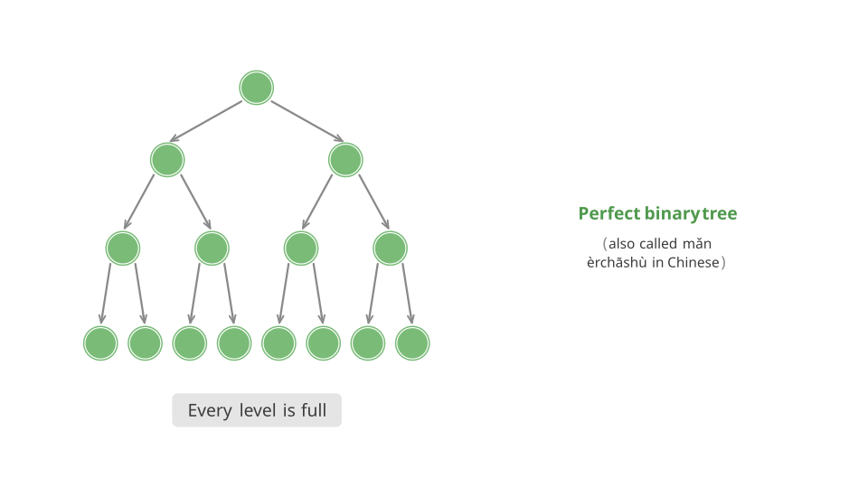

# Binary trees

A <u>binary tree</u> is a nonlinear data structure representing relationships between ancestors and descendants. It embodies the divide-and-conquer idea of splitting in two. Like a linked list, it is built from nodes, each containing a value and references to its left and right children.

```snippet
tree_node_class
```

Each node has two references or pointers, one to its <u>left child</u> and one to its <u>right child</u>. The node is their <u>parent</u>. Its left child and all nodes below that child form its <u>left subtree</u>; the <u>right subtree</u> is defined similarly.

**Every non-leaf node has children and at least one nonempty subtree**. In the figure below, if node 2 is the parent, its left and right children are nodes 4 and 5. Its left subtree consists of node 4 and everything below it, and its right subtree consists of node 5 and everything below it.


## Common terminology

The figure below illustrates common binary-tree terminology.

- <u>Root</u>: the topmost node, which has no parent.
- <u>Leaf</u>: a node with no children; both of its child references point to `None`.
- <u>Edge</u>: a connection between two nodes, represented by a reference or pointer.
- A node's <u>level</u>: levels increase from top to bottom, with the root at level 1.
- A node's <u>degree</u>: its number of children, which is 0, 1, or 2 in a binary tree.
- A tree's <u>height</u>: the number of edges from the root to its farthest leaf.
- A node's <u>depth</u>: the number of edges from the root to that node.
- A node's <u>height</u>: the number of edges from that node to its farthest leaf.


!!! tip

    Height and depth are usually measured in edges, but some problems or textbooks count nodes instead. Under that convention, add 1 to both height and depth.

## Basic operations

### Initializing a binary tree

As with a linked list, first create the nodes, then connect them with references or pointers.

```snippet
init_binary_tree
```

??? pythontutor "Visualize execution"

    @tutor init_binary_tree_tutor

### Inserting and deleting nodes

As with linked lists, insertion and deletion can be implemented by changing pointers. An example is shown below.


```snippet
insert_remove_node
```

??? pythontutor "Visualize execution"

    @tutor insert_remove_node_tutor

!!! tip

    Inserting a node may change the tree's logical structure, while deleting a node generally means deleting it and all its subtrees. Meaningful insertion and deletion operations therefore usually require several coordinated steps.

## Common types of binary trees

### Perfect binary trees

In a <u>perfect binary tree</u>, every level is completely filled, as shown below. Leaves have degree $0$, and all other nodes have degree $2$. A tree of height $h$ has $2^{h+1} - 1$ nodes, an exponential relationship reminiscent of cell division in nature.

!!! tip

    In Chinese-language resources, a perfect binary tree is often called <u>满二叉树</u>.



### Complete binary trees

Only the lowest level of a <u>complete binary tree</u> may be incomplete, and its nodes must fill that level consecutively from left to right, as shown below. Every perfect binary tree is also complete.


### Full binary trees

In a <u>full binary tree</u>, every node other than a leaf has exactly two children, as shown below.


### Balanced binary trees

In a <u>balanced binary tree</u>, the heights of the left and right subtrees of every node differ by at most 1, as shown below.


## Degeneration of a binary tree

The figure below shows ideal and degenerate tree structures. When every level is full, the tree is perfect. When every node lies along one side, the tree degenerates into a linked list.

- A perfect binary tree is the ideal case, making full use of divide and conquer.
- A linked list is the opposite extreme: operations become linear, with time complexity degrading to $O(n)$.


As the table below shows, quantities such as leaf count, total node count, and height reach their maximum or minimum values in these best and worst structures.

<p align="center"> Table <id> &nbsp; Best and worst binary-tree structures </p>

|                             | Perfect binary tree         | Linked list    |
| --------------------------- | ------------------ | ------- |
| Nodes at level $i$         | $2^{i-1}$          | $1$     |
| Leaves in a tree of height $h$ | $2^h$              | $1$     |
| Total nodes in a tree of height $h$   | $2^{h+1} - 1$      | $h + 1$ |
| Height of a tree with $n$ nodes   | $\log_2 (n+1) - 1$ | $n - 1$ |
