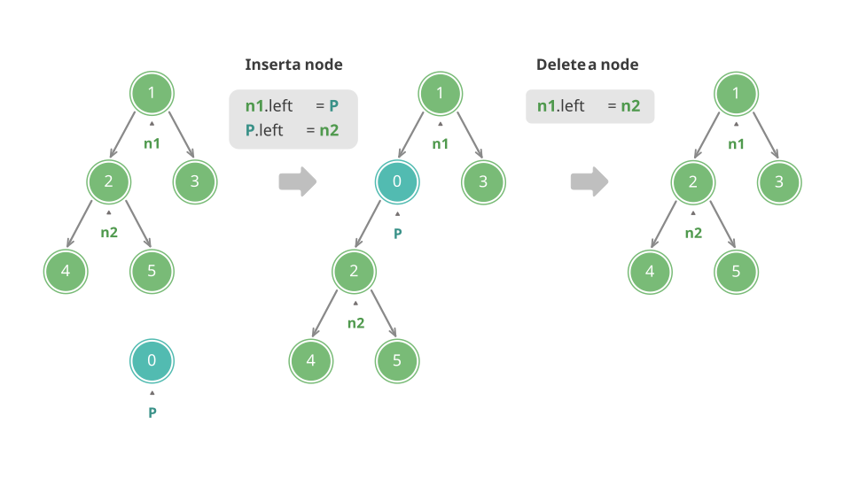
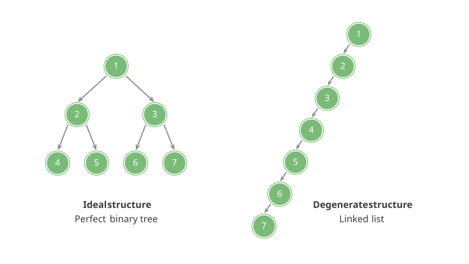

# Binary tree

A <u>binary tree</u> is a nonlinear data structure that represents relationships between ancestors and descendants. Its two branches reflect the divide-and-conquer idea of splitting a problem in two. As with a linked list, the basic unit is a node. Each node contains a value and references to its left and right children.

```snippet
tree_node_class
```

Each node has two references (pointers), one to its <u>left child</u> and one to its <u>right child</u>. The node is the <u>parent</u> of these children. For a given node, the tree consisting of its left child and all that child's descendants is its <u>left subtree</u>. Its <u>right subtree</u> is defined in the same way.

**Every node in a binary tree except a leaf has at least one child and a nonempty subtree**. For example, take node 2 as the parent in the figure below. Its left and right children are nodes 4 and 5. Its left subtree consists of node 4 and all its descendants, and its right subtree consists of node 5 and all its descendants.


## Binary tree terminology

The figure below illustrates common binary tree terms.

- The <u>root</u> is the node at the top of a binary tree. It has no parent.
- A <u>leaf</u> has no children. Both its pointers refer to `None`.
- An <u>edge</u> is a line connecting two nodes. It represents a node reference (pointer).
- A node's <u>level</u> increases from top to bottom. The root is at level 1.
- A node's <u>degree</u> is its number of children. In a binary tree, the possible degrees are 0, 1, and 2.
- The <u>height</u> of a binary tree is the number of edges from the root to the farthest leaf.
- A node's <u>depth</u> is the number of edges from the root to that node.
- A node's <u>height</u> is the number of edges between it and its farthest descendant leaf.


!!! tip

    We usually define height and depth by counting edges. Some problems and textbooks count nodes instead. Under that convention, add 1 to both height and depth.

## Basic binary tree operations

### Initialize the binary tree

As with a linked list, first initialize the nodes, then connect them with references (pointers).

```snippet
init_binary_tree
```

??? pythontutor "Visualize execution"

    @tutor init_binary_tree_tutor

### Insert and delete nodes

As with a linked list, we can insert and delete nodes in a binary tree by changing pointers. The figure below gives an example.



```snippet
insert_remove_node
```

??? pythontutor "Visualize execution"

    @tutor insert_remove_node_tutor

!!! tip

    Inserting a node can change the logical structure of a binary tree, and deleting a node usually means removing it along with all its subtrees. In practice, insertion and deletion in a binary tree therefore involve coordinating several operations to achieve the intended result.

## Common types of binary trees

### Perfect binary tree

In a <u>perfect binary tree</u>, every level is completely filled, as shown below. Leaves have degree $0$, and every other node has degree $2$. A tree of height $h$ has $2^{h+1} - 1$ nodes. This exponential relationship mirrors the familiar pattern of cell division in nature.

!!! tip

    In Chinese usage, a perfect binary tree is often called a <u>mǎn èrchāshù</u>.


### Complete binary tree

In a <u>complete binary tree</u>, only the bottom level may be partially filled, and its nodes must occupy consecutive positions from left to right, as shown below. Every perfect binary tree is also complete.


### Full binary tree

In a <u>full binary tree</u>, every node except a leaf has two children, as shown below.


### Balanced binary tree

In a <u>balanced binary tree</u>, the absolute difference between the heights of the left and right subtrees at every node is at most 1, as shown below.


## How a binary tree degenerates

The figure below shows the ideal and degenerate forms of a binary tree. When every level is full, the tree is perfect. When all nodes lean to one side, the tree degenerates into a linked list.

- A perfect binary tree is the ideal case. It takes full advantage of a binary tree's divide-and-conquer structure.
- A linked list is the other extreme. Operations become linear, with time complexity $O(n)$.



As the table below shows, quantities such as the number of leaves, total node count, and height reach their maximum or minimum values in the best- and worst-case shapes.

<p align="center"> Table <id> &nbsp; Best- and worst-case binary tree shapes </p>

|                             | Perfect binary tree         | Linked list    |
| --------------------------- | ------------------ | ------- |
| Number of nodes at level $i$         | $2^{i-1}$          | $1$     |
| Number of leaves in a tree of height $h$ | $2^h$              | $1$     |
| Total number of nodes in a tree of height $h$   | $2^{h+1} - 1$      | $h + 1$ |
| Height of a tree with $n$ nodes   | $\log_2 (n+1) - 1$ | $n - 1$ |
