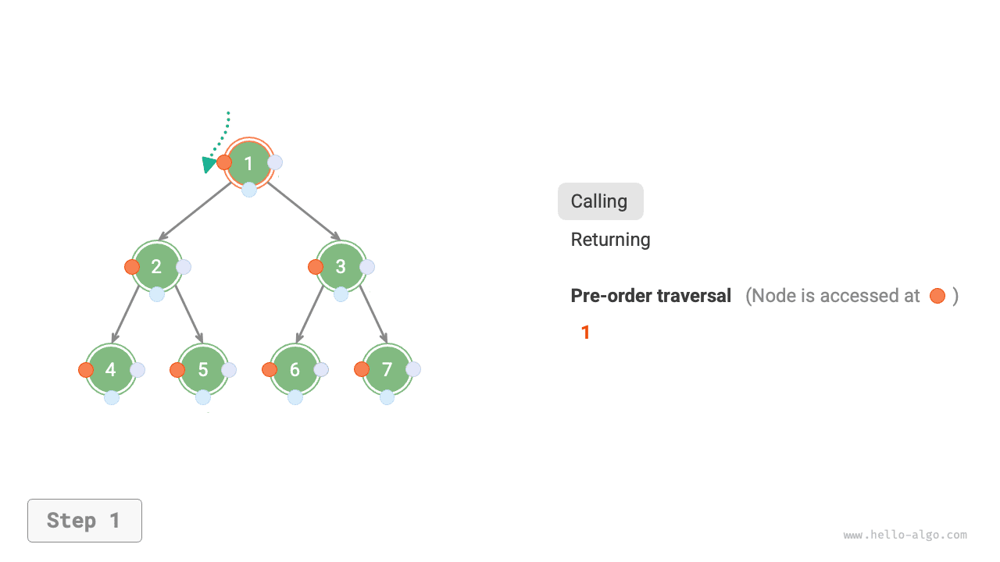
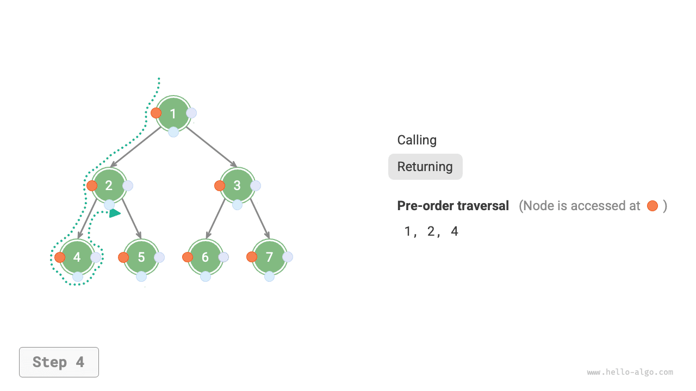
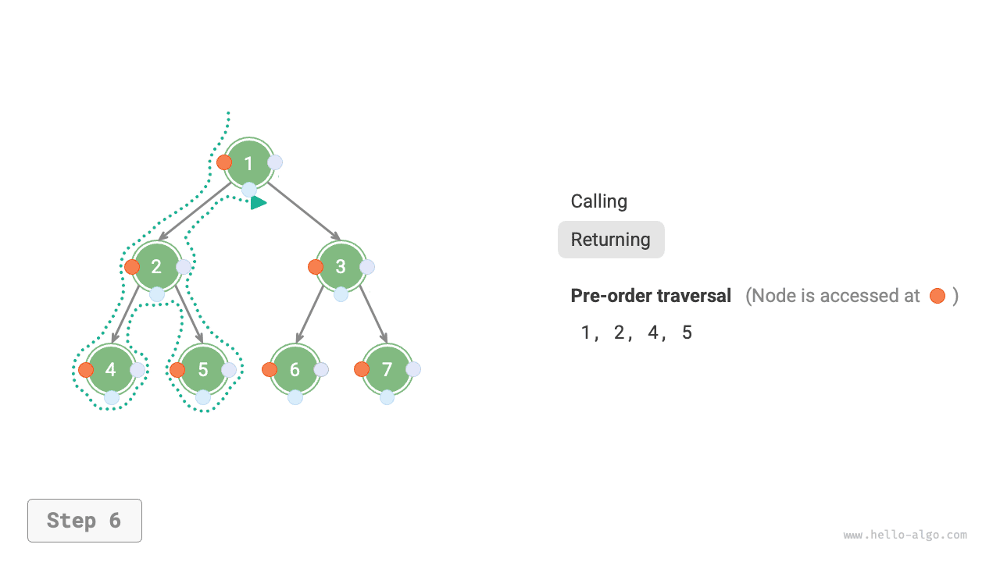
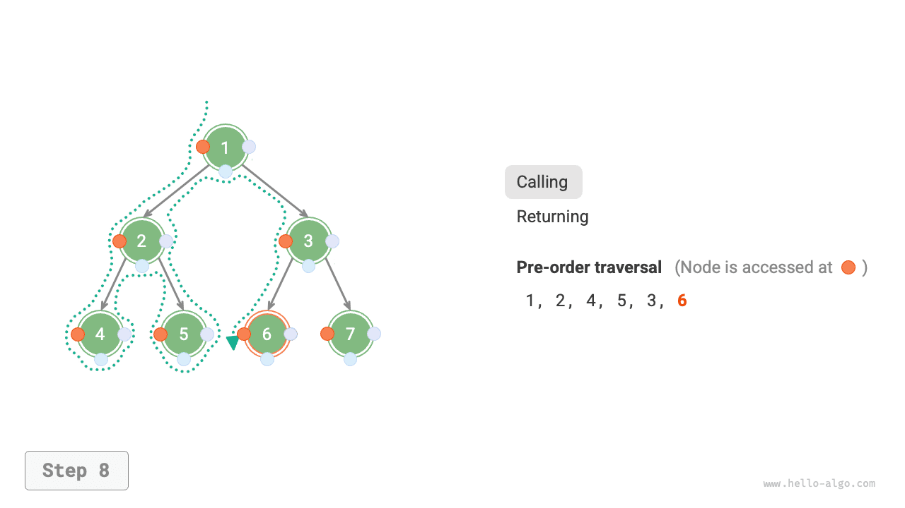

# 7.2 &nbsp; Traversing a binary tree

In its physical representation, a tree is a linked data structure, so traversal follows pointers from node to node. Unlike a linked list, however, a tree is nonlinear. Traversing it is more complex and requires a search algorithm.

Common binary-tree traversals include level-order, preorder, inorder, and postorder traversal.

## 7.2.1 &nbsp; Level-order traversal

As shown below, <u>level-order traversal</u> visits the tree level by level from top to bottom, moving from left to right within each level.

Level-order traversal is a form of <u>breadth-first traversal</u>, also called <u>breadth-first search (BFS)</u>. It explores outward one layer at a time.

{ class="animation-figure" }

<p align="center"> Figure 7-9 &nbsp; Level-order traversal of a binary tree </p>

### 1. &nbsp; Implementation

Breadth-first traversal usually uses a queue. A queue's first-in, first-out rule matches the traversal's level-by-level progression. The implementation follows:

=== "Python"

    ```python title="binary_tree_bfs.py"
    def level_order(root: TreeNode | None) -> list[int]:
        """Level-order traversal"""
        # Initialize a queue and enqueue the root
        queue: deque[TreeNode] = deque()
        queue.append(root)
        # Initialize a list to store the traversal sequence
        res = []
        while queue:
            node: TreeNode = queue.popleft()  # Dequeue from the queue
            res.append(node.val)  # Store the node value
            if node.left is not None:
                queue.append(node.left)  # Enqueue the left child
            if node.right is not None:
                queue.append(node.right)  # Enqueue the right child
        return res
    ```

=== "C++"

    ```cpp title="binary_tree_bfs.cpp"
    /* Level-order traversal */
    vector<int> levelOrder(TreeNode *root) {
        // Initialize a queue and enqueue the root
        queue<TreeNode *> queue;
        queue.push(root);
        // Initialize a list to store the traversal sequence
        vector<int> vec;
        while (!queue.empty()) {
            TreeNode *node = queue.front();
            queue.pop();              // Dequeue from the queue
            vec.push_back(node->val); // Store the node value
            if (node->left != nullptr)
                queue.push(node->left); // Enqueue the left child
            if (node->right != nullptr)
                queue.push(node->right); // Enqueue the right child
        }
        return vec;
    }
    ```

=== "Java"

    ```java title="binary_tree_bfs.java"
    /* Level-order traversal */
    List<Integer> levelOrder(TreeNode root) {
        // Initialize a queue and enqueue the root
        Queue<TreeNode> queue = new LinkedList<>();
        queue.add(root);
        // Initialize a list to store the traversal sequence
        List<Integer> list = new ArrayList<>();
        while (!queue.isEmpty()) {
            TreeNode node = queue.poll(); // Dequeue from the queue
            list.add(node.val);           // Store the node value
            if (node.left != null)
                queue.offer(node.left);   // Enqueue the left child
            if (node.right != null)
                queue.offer(node.right);  // Enqueue the right child
        }
        return list;
    }
    ```

=== "C#"

    ```csharp title="binary_tree_bfs.cs"
    /* Level-order traversal */
    List<int> LevelOrder(TreeNode root) {
        // Initialize a queue and enqueue the root
        Queue<TreeNode> queue = new();
        queue.Enqueue(root);
        // Initialize a list to store the traversal sequence
        List<int> list = [];
        while (queue.Count != 0) {
            TreeNode node = queue.Dequeue(); // Dequeue from the queue
            list.Add(node.val!.Value);       // Store the node value
            if (node.left != null)
                queue.Enqueue(node.left);    // Enqueue the left child
            if (node.right != null)
                queue.Enqueue(node.right);   // Enqueue the right child
        }
        return list;
    }
    ```

=== "Go"

    ```go title="binary_tree_bfs.go"
    /* Level-order traversal */
    func levelOrder(root *TreeNode) []any {
        // Initialize a queue and enqueue the root
        queue := list.New()
        queue.PushBack(root)
        // Initialize a slice to store the traversal sequence
        nums := make([]any, 0)
        for queue.Len() > 0 {
            // Dequeue from the queue
            node := queue.Remove(queue.Front()).(*TreeNode)
            // Store the node value
            nums = append(nums, node.Val)
            if node.Left != nil {
                // Enqueue the left child
                queue.PushBack(node.Left)
            }
            if node.Right != nil {
                // Enqueue the right child
                queue.PushBack(node.Right)
            }
        }
        return nums
    }
    ```

=== "Swift"

    ```swift title="binary_tree_bfs.swift"
    /* Level-order traversal */
    func levelOrder(root: TreeNode) -> [Int] {
        // Initialize a queue and enqueue the root
        var queue: [TreeNode] = [root]
        // Initialize a list to store the traversal sequence
        var list: [Int] = []
        while !queue.isEmpty {
            let node = queue.removeFirst() // Dequeue from the queue
            list.append(node.val) // Store the node value
            if let left = node.left {
                queue.append(left) // Enqueue the left child
            }
            if let right = node.right {
                queue.append(right) // Enqueue the right child
            }
        }
        return list
    }
    ```

=== "JS"

    ```javascript title="binary_tree_bfs.js"
    /* Level-order traversal */
    function levelOrder(root) {
        // Initialize a queue and enqueue the root
        const queue = [root];
        // Initialize a list to store the traversal sequence
        const list = [];
        while (queue.length) {
            let node = queue.shift(); // Dequeue from the queue
            list.push(node.val); // Store the node value
            if (node.left) queue.push(node.left); // Enqueue the left child
            if (node.right) queue.push(node.right); // Enqueue the right child
        }
        return list;
    }
    ```

=== "TS"

    ```typescript title="binary_tree_bfs.ts"
    /* Level-order traversal */
    function levelOrder(root: TreeNode | null): number[] {
        // Initialize a queue and enqueue the root
        const queue = [root];
        // Initialize a list to store the traversal sequence
        const list: number[] = [];
        while (queue.length) {
            let node = queue.shift() as TreeNode; // Dequeue from the queue
            list.push(node.val); // Store the node value
            if (node.left) {
                queue.push(node.left); // Enqueue the left child
            }
            if (node.right) {
                queue.push(node.right); // Enqueue the right child
            }
        }
        return list;
    }
    ```

=== "Dart"

    ```dart title="binary_tree_bfs.dart"
    /* Level-order traversal */
    List<int> levelOrder(TreeNode? root) {
      // Initialize a queue and enqueue the root
      Queue<TreeNode?> queue = Queue();
      queue.add(root);
      // Initialize a list to store the traversal sequence
      List<int> res = [];
      while (queue.isNotEmpty) {
        TreeNode? node = queue.removeFirst(); // Dequeue from the queue
        res.add(node!.val); // Store the node value
        if (node.left != null) queue.add(node.left); // Enqueue the left child
        if (node.right != null) queue.add(node.right); // Enqueue the right child
      }
      return res;
    }
    ```

=== "Rust"

    ```rust title="binary_tree_bfs.rs"
    /* Level-order traversal */
    fn level_order(root: &Rc<RefCell<TreeNode>>) -> Vec<i32> {
        // Initialize a queue and enqueue the root
        let mut que = VecDeque::new();
        que.push_back(root.clone());
        // Initialize a list to store the traversal sequence
        let mut vec = Vec::new();

        while let Some(node) = que.pop_front() {
            // Dequeue from the queue
            vec.push(node.borrow().val); // Store the node value
            if let Some(left) = node.borrow().left.as_ref() {
                que.push_back(left.clone()); // Enqueue the left child
            }
            if let Some(right) = node.borrow().right.as_ref() {
                que.push_back(right.clone()); // Enqueue the right child
            };
        }
        vec
    }
    ```

=== "C"

    ```c title="binary_tree_bfs.c"
    /* Level-order traversal */
    int *levelOrder(TreeNode *root, int *size) {
        /* Auxiliary queue */
        int front, rear;
        int index, *arr;
        TreeNode *node;
        TreeNode **queue;

        /* Auxiliary queue */
        queue = (TreeNode **)malloc(sizeof(TreeNode *) * MAX_SIZE);
        // Queue indices
        front = 0, rear = 0;
        // Enqueue the root node
        queue[rear++] = root;
        // Initialize a list to store the traversal sequence
        /* Auxiliary array */
        arr = (int *)malloc(sizeof(int) * MAX_SIZE);
        // Array index
        index = 0;
        while (front < rear) {
            // Dequeue from the queue
            node = queue[front++];
            // Store the node value
            arr[index++] = node->val;
            if (node->left != NULL) {
                // Enqueue the left child
                queue[rear++] = node->left;
            }
            if (node->right != NULL) {
                // Enqueue the right child
                queue[rear++] = node->right;
            }
        }
        // Update the array length
        *size = index;
        arr = realloc(arr, sizeof(int) * (*size));

        // Free the auxiliary queue array
        free(queue);
        return arr;
    }
    ```

=== "Kotlin"

    ```kotlin title="binary_tree_bfs.kt"
    /* Level-order traversal */
    fun levelOrder(root: TreeNode?): MutableList<Int> {
        // Initialize a queue and enqueue the root
        val queue = LinkedList<TreeNode?>()
        queue.add(root)
        // Initialize a list to store the traversal sequence
        val list = mutableListOf<Int>()
        while (queue.isNotEmpty()) {
            val node = queue.poll()      // Dequeue from the queue
            list.add(node?._val!!)       // Store the node value
            if (node.left != null)
                queue.offer(node.left)   // Enqueue the left child
            if (node.right != null)
                queue.offer(node.right)  // Enqueue the right child
        }
        return list
    }
    ```

=== "Ruby"

    ```ruby title="binary_tree_bfs.rb"
    ### Level-order traversal ###
    def level_order(root)
      # Initialize a queue and enqueue the root
      queue = [root]
      # Initialize a list to store the traversal sequence
      res = []
      while !queue.empty?
        node = queue.shift # Dequeue from the queue
        res << node.val # Store the node value
        queue << node.left unless node.left.nil? # Enqueue the left child
        queue << node.right unless node.right.nil? # Enqueue the right child
      end
      res
    end
    ```

??? pythontutor "Visualize execution"

    <div style="height: 549px; width: 100%;"><iframe class="pythontutor-iframe" title="Visualize execution" src="https://pythontutor.com/iframe-embed.html#code=from%20collections%20import%20deque%0A%0Aclass%20TreeNode%3A%0A%20%20%20%20%22%22%22Binary%20tree%20node%20class%22%22%22%0A%20%20%20%20def%20__init__%28self,%20val%3A%20int%29%3A%0A%20%20%20%20%20%20%20%20self.val%3A%20int%20%3D%20val%20%20%20%20%20%20%20%20%20%20%20%20%20%20%20%20%23%20Node%20value%0A%20%20%20%20%20%20%20%20self.left%3A%20TreeNode%20%7C%20None%20%3D%20None%20%20%23%20Reference%20to%20the%20left%20child%0A%20%20%20%20%20%20%20%20self.right%3A%20TreeNode%20%7C%20None%20%3D%20None%20%23%20Reference%20to%20the%20right%20child%0A%0Adef%20list_to_tree_dfs%28arr%3A%20list%5Bint%5D,%20i%3A%20int%29%20-%3E%20TreeNode%20%7C%20None%3A%0A%20%20%20%20%22%22%22Deserialize%20a%20list%20into%20a%20binary%20tree%3A%20recursion%22%22%22%0A%20%20%20%20%23%20Return%20None%20if%20the%20index%20is%20out%20of%20bounds%20or%20the%20corresponding%20element%20is%20None%0A%20%20%20%20if%20i%20%3C%200%20or%20i%20%3E%3D%20len%28arr%29%20or%20arr%5Bi%5D%20is%20None%3A%0A%20%20%20%20%20%20%20%20return%20None%0A%20%20%20%20%23%20Create%20the%20current%20node%0A%20%20%20%20root%20%3D%20TreeNode%28arr%5Bi%5D%29%0A%20%20%20%20%23%20Recursively%20build%20the%20left%20and%20right%20subtrees%0A%20%20%20%20root.left%20%3D%20list_to_tree_dfs%28arr,%202%20%2A%20i%20%2B%201%29%0A%20%20%20%20root.right%20%3D%20list_to_tree_dfs%28arr,%202%20%2A%20i%20%2B%202%29%0A%20%20%20%20return%20root%0A%0Adef%20list_to_tree%28arr%3A%20list%5Bint%5D%29%20-%3E%20TreeNode%20%7C%20None%3A%0A%20%20%20%20%22%22%22Deserialize%20a%20list%20into%20a%20binary%20tree%22%22%22%0A%20%20%20%20return%20list_to_tree_dfs%28arr,%200%29%0A%0A%0Adef%20level_order%28root%3A%20TreeNode%20%7C%20None%29%20-%3E%20list%5Bint%5D%3A%0A%20%20%20%20%22%22%22Level-order%20traversal%22%22%22%0A%20%20%20%20%23%20Initialize%20a%20queue%20and%20enqueue%20the%20root%0A%20%20%20%20queue%3A%20deque%5BTreeNode%5D%20%3D%20deque%28%29%0A%20%20%20%20queue.append%28root%29%0A%20%20%20%20%23%20Initialize%20a%20list%20to%20store%20the%20traversal%20sequence%0A%20%20%20%20res%20%3D%20%5B%5D%0A%20%20%20%20while%20queue%3A%0A%20%20%20%20%20%20%20%20node%3A%20TreeNode%20%3D%20queue.popleft%28%29%20%20%23%20Dequeue%20from%20the%20queue%0A%20%20%20%20%20%20%20%20res.append%28node.val%29%20%20%23%20Store%20the%20node%20value%0A%20%20%20%20%20%20%20%20if%20node.left%20is%20not%20None%3A%0A%20%20%20%20%20%20%20%20%20%20%20%20queue.append%28node.left%29%20%20%23%20Enqueue%20the%20left%20child%0A%20%20%20%20%20%20%20%20if%20node.right%20is%20not%20None%3A%0A%20%20%20%20%20%20%20%20%20%20%20%20queue.append%28node.right%29%20%20%23%20Enqueue%20the%20right%20child%0A%20%20%20%20return%20res%0A%0A%22%22%22Driver%20code%22%22%22%0Aif%20__name__%20%3D%3D%20%22__main__%22%3A%0A%20%20%20%20%23%20Initialize%20the%20binary%20tree%0A%20%20%20%20%23%20Use%20a%20helper%20function%20that%20builds%20a%20binary%20tree%20directly%20from%20an%20array%0A%20%20%20%20root%20%3D%20list_to_tree%28arr%3D%5B1,%202,%203,%204,%205,%206,%207%5D%29%0A%0A%20%20%20%20%23%20Level-order%20traversal%0A%20%20%20%20res%20%3D%20level_order%28root%29%0A%20%20%20%20print%28%22%5CnNode%20sequence%20from%20level-order%20traversal%20%3D%20%22,%20res%29&codeDivHeight=472&codeDivWidth=350&cumulative=false&curInstr=127&heapPrimitives=nevernest&origin=opt-frontend.js&py=311&rawInputLstJSON=%5B%5D&textReferences=false"> </iframe></div>
    <div style="margin-top: 5px;"><a href="https://pythontutor.com/iframe-embed.html#code=from%20collections%20import%20deque%0A%0Aclass%20TreeNode%3A%0A%20%20%20%20%22%22%22Binary%20tree%20node%20class%22%22%22%0A%20%20%20%20def%20__init__%28self,%20val%3A%20int%29%3A%0A%20%20%20%20%20%20%20%20self.val%3A%20int%20%3D%20val%20%20%20%20%20%20%20%20%20%20%20%20%20%20%20%20%23%20Node%20value%0A%20%20%20%20%20%20%20%20self.left%3A%20TreeNode%20%7C%20None%20%3D%20None%20%20%23%20Reference%20to%20the%20left%20child%0A%20%20%20%20%20%20%20%20self.right%3A%20TreeNode%20%7C%20None%20%3D%20None%20%23%20Reference%20to%20the%20right%20child%0A%0Adef%20list_to_tree_dfs%28arr%3A%20list%5Bint%5D,%20i%3A%20int%29%20-%3E%20TreeNode%20%7C%20None%3A%0A%20%20%20%20%22%22%22Deserialize%20a%20list%20into%20a%20binary%20tree%3A%20recursion%22%22%22%0A%20%20%20%20%23%20Return%20None%20if%20the%20index%20is%20out%20of%20bounds%20or%20the%20corresponding%20element%20is%20None%0A%20%20%20%20if%20i%20%3C%200%20or%20i%20%3E%3D%20len%28arr%29%20or%20arr%5Bi%5D%20is%20None%3A%0A%20%20%20%20%20%20%20%20return%20None%0A%20%20%20%20%23%20Create%20the%20current%20node%0A%20%20%20%20root%20%3D%20TreeNode%28arr%5Bi%5D%29%0A%20%20%20%20%23%20Recursively%20build%20the%20left%20and%20right%20subtrees%0A%20%20%20%20root.left%20%3D%20list_to_tree_dfs%28arr,%202%20%2A%20i%20%2B%201%29%0A%20%20%20%20root.right%20%3D%20list_to_tree_dfs%28arr,%202%20%2A%20i%20%2B%202%29%0A%20%20%20%20return%20root%0A%0Adef%20list_to_tree%28arr%3A%20list%5Bint%5D%29%20-%3E%20TreeNode%20%7C%20None%3A%0A%20%20%20%20%22%22%22Deserialize%20a%20list%20into%20a%20binary%20tree%22%22%22%0A%20%20%20%20return%20list_to_tree_dfs%28arr,%200%29%0A%0A%0Adef%20level_order%28root%3A%20TreeNode%20%7C%20None%29%20-%3E%20list%5Bint%5D%3A%0A%20%20%20%20%22%22%22Level-order%20traversal%22%22%22%0A%20%20%20%20%23%20Initialize%20a%20queue%20and%20enqueue%20the%20root%0A%20%20%20%20queue%3A%20deque%5BTreeNode%5D%20%3D%20deque%28%29%0A%20%20%20%20queue.append%28root%29%0A%20%20%20%20%23%20Initialize%20a%20list%20to%20store%20the%20traversal%20sequence%0A%20%20%20%20res%20%3D%20%5B%5D%0A%20%20%20%20while%20queue%3A%0A%20%20%20%20%20%20%20%20node%3A%20TreeNode%20%3D%20queue.popleft%28%29%20%20%23%20Dequeue%20from%20the%20queue%0A%20%20%20%20%20%20%20%20res.append%28node.val%29%20%20%23%20Store%20the%20node%20value%0A%20%20%20%20%20%20%20%20if%20node.left%20is%20not%20None%3A%0A%20%20%20%20%20%20%20%20%20%20%20%20queue.append%28node.left%29%20%20%23%20Enqueue%20the%20left%20child%0A%20%20%20%20%20%20%20%20if%20node.right%20is%20not%20None%3A%0A%20%20%20%20%20%20%20%20%20%20%20%20queue.append%28node.right%29%20%20%23%20Enqueue%20the%20right%20child%0A%20%20%20%20return%20res%0A%0A%22%22%22Driver%20code%22%22%22%0Aif%20__name__%20%3D%3D%20%22__main__%22%3A%0A%20%20%20%20%23%20Initialize%20the%20binary%20tree%0A%20%20%20%20%23%20Use%20a%20helper%20function%20that%20builds%20a%20binary%20tree%20directly%20from%20an%20array%0A%20%20%20%20root%20%3D%20list_to_tree%28arr%3D%5B1,%202,%203,%204,%205,%206,%207%5D%29%0A%0A%20%20%20%20%23%20Level-order%20traversal%0A%20%20%20%20res%20%3D%20level_order%28root%29%0A%20%20%20%20print%28%22%5CnNode%20sequence%20from%20level-order%20traversal%20%3D%20%22,%20res%29&codeDivHeight=800&codeDivWidth=600&cumulative=false&curInstr=127&heapPrimitives=nevernest&origin=opt-frontend.js&py=311&rawInputLstJSON=%5B%5D&textReferences=false" target="_blank" rel="noopener noreferrer">View full screen ></a></div>

### 2. &nbsp; Complexity analysis

- **Time complexity: $O(n)$**. Each of the $n$ nodes is visited once, taking $O(n)$ time.
- **Space complexity: $O(n)$**. In the worst case, a perfect binary tree, the queue holds up to $(n + 1) / 2$ nodes just before the lowest level is visited, requiring $O(n)$ space.

## 7.2.2 &nbsp; Preorder, inorder, and postorder traversal

Preorder, inorder, and postorder traversal are forms of <u>depth-first traversal</u>, also called <u>depth-first search (DFS)</u>. They follow a path to its end, then backtrack and continue.

Figure 7-10 illustrates depth-first traversal. **Imagine walking once around the outside of the entire binary tree**. At each node, you encounter three positions corresponding to preorder, inorder, and postorder visits.

{ class="animation-figure" }

<p align="center"> Figure 7-10 &nbsp; Preorder, inorder, and postorder traversal of a binary search tree </p>

### 1. &nbsp; Implementation

Depth-first search is usually implemented recursively:

=== "Python"

    ```python title="binary_tree_dfs.py"
    def pre_order(root: TreeNode | None):
        """Preorder traversal"""
        if root is None:
            return
        # Visit order: root -> left subtree -> right subtree
        res.append(root.val)
        pre_order(root=root.left)
        pre_order(root=root.right)

    def in_order(root: TreeNode | None):
        """Inorder traversal"""
        if root is None:
            return
        # Visit order: left subtree -> root -> right subtree
        in_order(root=root.left)
        res.append(root.val)
        in_order(root=root.right)

    def post_order(root: TreeNode | None):
        """Postorder traversal"""
        if root is None:
            return
        # Visit order: left subtree -> right subtree -> root
        post_order(root=root.left)
        post_order(root=root.right)
        res.append(root.val)
    ```

=== "C++"

    ```cpp title="binary_tree_dfs.cpp"
    /* Preorder traversal */
    void preOrder(TreeNode *root) {
        if (root == nullptr)
            return;
        // Visit order: root -> left subtree -> right subtree
        vec.push_back(root->val);
        preOrder(root->left);
        preOrder(root->right);
    }

    /* Inorder traversal */
    void inOrder(TreeNode *root) {
        if (root == nullptr)
            return;
        // Visit order: left subtree -> root -> right subtree
        inOrder(root->left);
        vec.push_back(root->val);
        inOrder(root->right);
    }

    /* Postorder traversal */
    void postOrder(TreeNode *root) {
        if (root == nullptr)
            return;
        // Visit order: left subtree -> right subtree -> root
        postOrder(root->left);
        postOrder(root->right);
        vec.push_back(root->val);
    }
    ```

=== "Java"

    ```java title="binary_tree_dfs.java"
    /* Preorder traversal */
    void preOrder(TreeNode root) {
        if (root == null)
            return;
        // Visit order: root -> left subtree -> right subtree
        list.add(root.val);
        preOrder(root.left);
        preOrder(root.right);
    }

    /* Inorder traversal */
    void inOrder(TreeNode root) {
        if (root == null)
            return;
        // Visit order: left subtree -> root -> right subtree
        inOrder(root.left);
        list.add(root.val);
        inOrder(root.right);
    }

    /* Postorder traversal */
    void postOrder(TreeNode root) {
        if (root == null)
            return;
        // Visit order: left subtree -> right subtree -> root
        postOrder(root.left);
        postOrder(root.right);
        list.add(root.val);
    }
    ```

=== "C#"

    ```csharp title="binary_tree_dfs.cs"
    /* Preorder traversal */
    void PreOrder(TreeNode? root) {
        if (root == null) return;
        // Visit order: root -> left subtree -> right subtree
        list.Add(root.val!.Value);
        PreOrder(root.left);
        PreOrder(root.right);
    }

    /* Inorder traversal */
    void InOrder(TreeNode? root) {
        if (root == null) return;
        // Visit order: left subtree -> root -> right subtree
        InOrder(root.left);
        list.Add(root.val!.Value);
        InOrder(root.right);
    }

    /* Postorder traversal */
    void PostOrder(TreeNode? root) {
        if (root == null) return;
        // Visit order: left subtree -> right subtree -> root
        PostOrder(root.left);
        PostOrder(root.right);
        list.Add(root.val!.Value);
    }
    ```

=== "Go"

    ```go title="binary_tree_dfs.go"
    /* Preorder traversal */
    func preOrder(node *TreeNode) {
        if node == nil {
            return
        }
        // Visit order: root -> left subtree -> right subtree
        nums = append(nums, node.Val)
        preOrder(node.Left)
        preOrder(node.Right)
    }

    /* Inorder traversal */
    func inOrder(node *TreeNode) {
        if node == nil {
            return
        }
        // Visit order: left subtree -> root -> right subtree
        inOrder(node.Left)
        nums = append(nums, node.Val)
        inOrder(node.Right)
    }

    /* Postorder traversal */
    func postOrder(node *TreeNode) {
        if node == nil {
            return
        }
        // Visit order: left subtree -> right subtree -> root
        postOrder(node.Left)
        postOrder(node.Right)
        nums = append(nums, node.Val)
    }
    ```

=== "Swift"

    ```swift title="binary_tree_dfs.swift"
    /* Preorder traversal */
    func preOrder(root: TreeNode?) {
        guard let root = root else {
            return
        }
        // Visit order: root -> left subtree -> right subtree
        list.append(root.val)
        preOrder(root: root.left)
        preOrder(root: root.right)
    }

    /* Inorder traversal */
    func inOrder(root: TreeNode?) {
        guard let root = root else {
            return
        }
        // Visit order: left subtree -> root -> right subtree
        inOrder(root: root.left)
        list.append(root.val)
        inOrder(root: root.right)
    }

    /* Postorder traversal */
    func postOrder(root: TreeNode?) {
        guard let root = root else {
            return
        }
        // Visit order: left subtree -> right subtree -> root
        postOrder(root: root.left)
        postOrder(root: root.right)
        list.append(root.val)
    }
    ```

=== "JS"

    ```javascript title="binary_tree_dfs.js"
    /* Preorder traversal */
    function preOrder(root) {
        if (root === null) return;
        // Visit order: root -> left subtree -> right subtree
        list.push(root.val);
        preOrder(root.left);
        preOrder(root.right);
    }

    /* Inorder traversal */
    function inOrder(root) {
        if (root === null) return;
        // Visit order: left subtree -> root -> right subtree
        inOrder(root.left);
        list.push(root.val);
        inOrder(root.right);
    }

    /* Postorder traversal */
    function postOrder(root) {
        if (root === null) return;
        // Visit order: left subtree -> right subtree -> root
        postOrder(root.left);
        postOrder(root.right);
        list.push(root.val);
    }
    ```

=== "TS"

    ```typescript title="binary_tree_dfs.ts"
    /* Preorder traversal */
    function preOrder(root: TreeNode | null): void {
        if (root === null) {
            return;
        }
        // Visit order: root -> left subtree -> right subtree
        list.push(root.val);
        preOrder(root.left);
        preOrder(root.right);
    }

    /* Inorder traversal */
    function inOrder(root: TreeNode | null): void {
        if (root === null) {
            return;
        }
        // Visit order: left subtree -> root -> right subtree
        inOrder(root.left);
        list.push(root.val);
        inOrder(root.right);
    }

    /* Postorder traversal */
    function postOrder(root: TreeNode | null): void {
        if (root === null) {
            return;
        }
        // Visit order: left subtree -> right subtree -> root
        postOrder(root.left);
        postOrder(root.right);
        list.push(root.val);
    }
    ```

=== "Dart"

    ```dart title="binary_tree_dfs.dart"
    /* Preorder traversal */
    void preOrder(TreeNode? node) {
      if (node == null) return;
      // Visit order: root -> left subtree -> right subtree
      list.add(node.val);
      preOrder(node.left);
      preOrder(node.right);
    }

    /* Inorder traversal */
    void inOrder(TreeNode? node) {
      if (node == null) return;
      // Visit order: left subtree -> root -> right subtree
      inOrder(node.left);
      list.add(node.val);
      inOrder(node.right);
    }

    /* Postorder traversal */
    void postOrder(TreeNode? node) {
      if (node == null) return;
      // Visit order: left subtree -> right subtree -> root
      postOrder(node.left);
      postOrder(node.right);
      list.add(node.val);
    }
    ```

=== "Rust"

    ```rust title="binary_tree_dfs.rs"
    /* Preorder traversal */
    fn pre_order(root: Option<&Rc<RefCell<TreeNode>>>) -> Vec<i32> {
        let mut result = vec![];

        fn dfs(root: Option<&Rc<RefCell<TreeNode>>>, res: &mut Vec<i32>) {
            if let Some(node) = root {
                // Visit order: root -> left subtree -> right subtree
                let node = node.borrow();
                res.push(node.val);
                dfs(node.left.as_ref(), res);
                dfs(node.right.as_ref(), res);
            }
        }
        dfs(root, &mut result);

        result
    }

    /* Inorder traversal */
    fn in_order(root: Option<&Rc<RefCell<TreeNode>>>) -> Vec<i32> {
        let mut result = vec![];

        fn dfs(root: Option<&Rc<RefCell<TreeNode>>>, res: &mut Vec<i32>) {
            if let Some(node) = root {
                // Visit order: left subtree -> root -> right subtree
                let node = node.borrow();
                dfs(node.left.as_ref(), res);
                res.push(node.val);
                dfs(node.right.as_ref(), res);
            }
        }
        dfs(root, &mut result);

        result
    }

    /* Postorder traversal */
    fn post_order(root: Option<&Rc<RefCell<TreeNode>>>) -> Vec<i32> {
        let mut result = vec![];

        fn dfs(root: Option<&Rc<RefCell<TreeNode>>>, res: &mut Vec<i32>) {
            if let Some(node) = root {
                // Visit order: left subtree -> right subtree -> root
                let node = node.borrow();
                dfs(node.left.as_ref(), res);
                dfs(node.right.as_ref(), res);
                res.push(node.val);
            }
        }

        dfs(root, &mut result);

        result
    }
    ```

=== "C"

    ```c title="binary_tree_dfs.c"
    /* Preorder traversal */
    void preOrder(TreeNode *root, int *size) {
        if (root == NULL)
            return;
        // Visit order: root -> left subtree -> right subtree
        arr[(*size)++] = root->val;
        preOrder(root->left, size);
        preOrder(root->right, size);
    }

    /* Inorder traversal */
    void inOrder(TreeNode *root, int *size) {
        if (root == NULL)
            return;
        // Visit order: left subtree -> root -> right subtree
        inOrder(root->left, size);
        arr[(*size)++] = root->val;
        inOrder(root->right, size);
    }

    /* Postorder traversal */
    void postOrder(TreeNode *root, int *size) {
        if (root == NULL)
            return;
        // Visit order: left subtree -> right subtree -> root
        postOrder(root->left, size);
        postOrder(root->right, size);
        arr[(*size)++] = root->val;
    }
    ```

=== "Kotlin"

    ```kotlin title="binary_tree_dfs.kt"
    /* Preorder traversal */
    fun preOrder(root: TreeNode?) {
        if (root == null) return
        // Visit order: root -> left subtree -> right subtree
        list.add(root._val)
        preOrder(root.left)
        preOrder(root.right)
    }

    /* Inorder traversal */
    fun inOrder(root: TreeNode?) {
        if (root == null) return
        // Visit order: left subtree -> root -> right subtree
        inOrder(root.left)
        list.add(root._val)
        inOrder(root.right)
    }

    /* Postorder traversal */
    fun postOrder(root: TreeNode?) {
        if (root == null) return
        // Visit order: left subtree -> right subtree -> root
        postOrder(root.left)
        postOrder(root.right)
        list.add(root._val)
    }
    ```

=== "Ruby"

    ```ruby title="binary_tree_dfs.rb"
    ### Preorder traversal ###
    def pre_order(root)
      return if root.nil?

      # Visit order: root -> left subtree -> right subtree
      $res << root.val
      pre_order(root.left)
      pre_order(root.right)
    end

    ### Inorder traversal ###
    def in_order(root)
      return if root.nil?

      # Visit order: left subtree -> root -> right subtree
      in_order(root.left)
      $res << root.val
      in_order(root.right)
    end

    ### Postorder traversal ###
    def post_order(root)
      return if root.nil?

      # Visit order: left subtree -> right subtree -> root
      post_order(root.left)
      post_order(root.right)
      $res << root.val
    end
    ```

??? pythontutor "Visualize execution"

    <div style="height: 549px; width: 100%;"><iframe class="pythontutor-iframe" title="Visualize execution" src="https://pythontutor.com/iframe-embed.html#code=class%20TreeNode%3A%0A%20%20%20%20%22%22%22Binary%20tree%20node%20class%22%22%22%0A%20%20%20%20def%20__init__%28self,%20val%3A%20int%29%3A%0A%20%20%20%20%20%20%20%20self.val%3A%20int%20%3D%20val%20%20%20%20%20%20%20%20%20%20%20%20%20%20%20%20%23%20Node%20value%0A%20%20%20%20%20%20%20%20self.left%3A%20TreeNode%20%7C%20None%20%3D%20None%20%20%23%20Reference%20to%20the%20left%20child%0A%20%20%20%20%20%20%20%20self.right%3A%20TreeNode%20%7C%20None%20%3D%20None%20%23%20Reference%20to%20the%20right%20child%0A%0Adef%20list_to_tree_dfs%28arr%3A%20list%5Bint%5D,%20i%3A%20int%29%20-%3E%20TreeNode%20%7C%20None%3A%0A%20%20%20%20%22%22%22Deserialize%20a%20list%20into%20a%20binary%20tree%3A%20recursion%22%22%22%0A%20%20%20%20%23%20Return%20None%20if%20the%20index%20is%20out%20of%20bounds%20or%20the%20corresponding%20element%20is%20None%0A%20%20%20%20if%20i%20%3C%200%20or%20i%20%3E%3D%20len%28arr%29%20or%20arr%5Bi%5D%20is%20None%3A%0A%20%20%20%20%20%20%20%20return%20None%0A%20%20%20%20%23%20Create%20the%20current%20node%0A%20%20%20%20root%20%3D%20TreeNode%28arr%5Bi%5D%29%0A%20%20%20%20%23%20Recursively%20build%20the%20left%20and%20right%20subtrees%0A%20%20%20%20root.left%20%3D%20list_to_tree_dfs%28arr,%202%20%2A%20i%20%2B%201%29%0A%20%20%20%20root.right%20%3D%20list_to_tree_dfs%28arr,%202%20%2A%20i%20%2B%202%29%0A%20%20%20%20return%20root%0A%0Adef%20list_to_tree%28arr%3A%20list%5Bint%5D%29%20-%3E%20TreeNode%20%7C%20None%3A%0A%20%20%20%20%22%22%22Deserialize%20a%20list%20into%20a%20binary%20tree%22%22%22%0A%20%20%20%20return%20list_to_tree_dfs%28arr,%200%29%0A%0A%0Adef%20pre_order%28root%3A%20TreeNode%20%7C%20None%29%3A%0A%20%20%20%20%22%22%22Preorder%20traversal%22%22%22%0A%20%20%20%20if%20root%20is%20None%3A%0A%20%20%20%20%20%20%20%20return%0A%20%20%20%20%23%20Visit%20order%3A%20root%20-%3E%20left%20subtree%20-%3E%20right%20subtree%0A%20%20%20%20res.append%28root.val%29%0A%20%20%20%20pre_order%28root%3Droot.left%29%0A%20%20%20%20pre_order%28root%3Droot.right%29%0A%0Adef%20in_order%28root%3A%20TreeNode%20%7C%20None%29%3A%0A%20%20%20%20%22%22%22Inorder%20traversal%22%22%22%0A%20%20%20%20if%20root%20is%20None%3A%0A%20%20%20%20%20%20%20%20return%0A%20%20%20%20%23%20Visit%20order%3A%20left%20subtree%20-%3E%20root%20-%3E%20right%20subtree%0A%20%20%20%20in_order%28root%3Droot.left%29%0A%20%20%20%20res.append%28root.val%29%0A%20%20%20%20in_order%28root%3Droot.right%29%0A%0Adef%20post_order%28root%3A%20TreeNode%20%7C%20None%29%3A%0A%20%20%20%20%22%22%22Postorder%20traversal%22%22%22%0A%20%20%20%20if%20root%20is%20None%3A%0A%20%20%20%20%20%20%20%20return%0A%20%20%20%20%23%20Visit%20order%3A%20left%20subtree%20-%3E%20right%20subtree%20-%3E%20root%0A%20%20%20%20post_order%28root%3Droot.left%29%0A%20%20%20%20post_order%28root%3Droot.right%29%0A%20%20%20%20res.append%28root.val%29%0A%0A%22%22%22Driver%20code%22%22%22%0Aif%20__name__%20%3D%3D%20%22__main__%22%3A%0A%20%20%20%20%23%20Initialize%20the%20binary%20tree%0A%20%20%20%20%23%20Use%20a%20helper%20function%20that%20builds%20a%20binary%20tree%20directly%20from%20an%20array%0A%20%20%20%20root%20%3D%20list_to_tree%28arr%3D%5B1,%202,%203,%204,%205,%206,%207%5D%29%0A%0A%20%20%20%20%23%20Preorder%20traversal%0A%20%20%20%20res%20%3D%20%5B%5D%0A%20%20%20%20pre_order%28root%29%0A%20%20%20%20print%28%22%5CnNode%20sequence%20from%20preorder%20traversal%20%3D%20%22,%20res%29%0A%0A%20%20%20%20%23%20Inorder%20traversal%0A%20%20%20%20res.clear%28%29%0A%20%20%20%20in_order%28root%29%0A%20%20%20%20print%28%22%5CnNode%20sequence%20from%20inorder%20traversal%20%3D%20%22,%20res%29%0A%0A%20%20%20%20%23%20Postorder%20traversal%0A%20%20%20%20res.clear%28%29%0A%20%20%20%20post_order%28root%29%0A%20%20%20%20print%28%22%5CnNode%20sequence%20from%20postorder%20traversal%20%3D%20%22,%20res%29&codeDivHeight=472&codeDivWidth=350&cumulative=false&curInstr=129&heapPrimitives=nevernest&origin=opt-frontend.js&py=311&rawInputLstJSON=%5B%5D&textReferences=false"> </iframe></div>
    <div style="margin-top: 5px;"><a href="https://pythontutor.com/iframe-embed.html#code=class%20TreeNode%3A%0A%20%20%20%20%22%22%22Binary%20tree%20node%20class%22%22%22%0A%20%20%20%20def%20__init__%28self,%20val%3A%20int%29%3A%0A%20%20%20%20%20%20%20%20self.val%3A%20int%20%3D%20val%20%20%20%20%20%20%20%20%20%20%20%20%20%20%20%20%23%20Node%20value%0A%20%20%20%20%20%20%20%20self.left%3A%20TreeNode%20%7C%20None%20%3D%20None%20%20%23%20Reference%20to%20the%20left%20child%0A%20%20%20%20%20%20%20%20self.right%3A%20TreeNode%20%7C%20None%20%3D%20None%20%23%20Reference%20to%20the%20right%20child%0A%0Adef%20list_to_tree_dfs%28arr%3A%20list%5Bint%5D,%20i%3A%20int%29%20-%3E%20TreeNode%20%7C%20None%3A%0A%20%20%20%20%22%22%22Deserialize%20a%20list%20into%20a%20binary%20tree%3A%20recursion%22%22%22%0A%20%20%20%20%23%20Return%20None%20if%20the%20index%20is%20out%20of%20bounds%20or%20the%20corresponding%20element%20is%20None%0A%20%20%20%20if%20i%20%3C%200%20or%20i%20%3E%3D%20len%28arr%29%20or%20arr%5Bi%5D%20is%20None%3A%0A%20%20%20%20%20%20%20%20return%20None%0A%20%20%20%20%23%20Create%20the%20current%20node%0A%20%20%20%20root%20%3D%20TreeNode%28arr%5Bi%5D%29%0A%20%20%20%20%23%20Recursively%20build%20the%20left%20and%20right%20subtrees%0A%20%20%20%20root.left%20%3D%20list_to_tree_dfs%28arr,%202%20%2A%20i%20%2B%201%29%0A%20%20%20%20root.right%20%3D%20list_to_tree_dfs%28arr,%202%20%2A%20i%20%2B%202%29%0A%20%20%20%20return%20root%0A%0Adef%20list_to_tree%28arr%3A%20list%5Bint%5D%29%20-%3E%20TreeNode%20%7C%20None%3A%0A%20%20%20%20%22%22%22Deserialize%20a%20list%20into%20a%20binary%20tree%22%22%22%0A%20%20%20%20return%20list_to_tree_dfs%28arr,%200%29%0A%0A%0Adef%20pre_order%28root%3A%20TreeNode%20%7C%20None%29%3A%0A%20%20%20%20%22%22%22Preorder%20traversal%22%22%22%0A%20%20%20%20if%20root%20is%20None%3A%0A%20%20%20%20%20%20%20%20return%0A%20%20%20%20%23%20Visit%20order%3A%20root%20-%3E%20left%20subtree%20-%3E%20right%20subtree%0A%20%20%20%20res.append%28root.val%29%0A%20%20%20%20pre_order%28root%3Droot.left%29%0A%20%20%20%20pre_order%28root%3Droot.right%29%0A%0Adef%20in_order%28root%3A%20TreeNode%20%7C%20None%29%3A%0A%20%20%20%20%22%22%22Inorder%20traversal%22%22%22%0A%20%20%20%20if%20root%20is%20None%3A%0A%20%20%20%20%20%20%20%20return%0A%20%20%20%20%23%20Visit%20order%3A%20left%20subtree%20-%3E%20root%20-%3E%20right%20subtree%0A%20%20%20%20in_order%28root%3Droot.left%29%0A%20%20%20%20res.append%28root.val%29%0A%20%20%20%20in_order%28root%3Droot.right%29%0A%0Adef%20post_order%28root%3A%20TreeNode%20%7C%20None%29%3A%0A%20%20%20%20%22%22%22Postorder%20traversal%22%22%22%0A%20%20%20%20if%20root%20is%20None%3A%0A%20%20%20%20%20%20%20%20return%0A%20%20%20%20%23%20Visit%20order%3A%20left%20subtree%20-%3E%20right%20subtree%20-%3E%20root%0A%20%20%20%20post_order%28root%3Droot.left%29%0A%20%20%20%20post_order%28root%3Droot.right%29%0A%20%20%20%20res.append%28root.val%29%0A%0A%22%22%22Driver%20code%22%22%22%0Aif%20__name__%20%3D%3D%20%22__main__%22%3A%0A%20%20%20%20%23%20Initialize%20the%20binary%20tree%0A%20%20%20%20%23%20Use%20a%20helper%20function%20that%20builds%20a%20binary%20tree%20directly%20from%20an%20array%0A%20%20%20%20root%20%3D%20list_to_tree%28arr%3D%5B1,%202,%203,%204,%205,%206,%207%5D%29%0A%0A%20%20%20%20%23%20Preorder%20traversal%0A%20%20%20%20res%20%3D%20%5B%5D%0A%20%20%20%20pre_order%28root%29%0A%20%20%20%20print%28%22%5CnNode%20sequence%20from%20preorder%20traversal%20%3D%20%22,%20res%29%0A%0A%20%20%20%20%23%20Inorder%20traversal%0A%20%20%20%20res.clear%28%29%0A%20%20%20%20in_order%28root%29%0A%20%20%20%20print%28%22%5CnNode%20sequence%20from%20inorder%20traversal%20%3D%20%22,%20res%29%0A%0A%20%20%20%20%23%20Postorder%20traversal%0A%20%20%20%20res.clear%28%29%0A%20%20%20%20post_order%28root%29%0A%20%20%20%20print%28%22%5CnNode%20sequence%20from%20postorder%20traversal%20%3D%20%22,%20res%29&codeDivHeight=800&codeDivWidth=600&cumulative=false&curInstr=129&heapPrimitives=nevernest&origin=opt-frontend.js&py=311&rawInputLstJSON=%5B%5D&textReferences=false" target="_blank" rel="noopener noreferrer">View full screen ></a></div>

!!! tip

    Depth-first search can also be implemented iteratively. Interested readers can explore this approach themselves.

Figure 7-11 shows the recursive process for preorder traversal, with two opposing phases: descending into calls and returning from them.

1. Descending starts a new function call and visits the next node.
2. Returning ends a function call, indicating that the current node has been fully processed.

=== "<1>"
    { class="animation-figure" }

=== "<2>"
    { class="animation-figure" }

=== "<3>"
    { class="animation-figure" }

=== "<4>"
    { class="animation-figure" }

=== "<5>"
    { class="animation-figure" }

=== "<6>"
    { class="animation-figure" }

=== "<7>"
    { class="animation-figure" }

=== "<8>"
    { class="animation-figure" }

=== "<9>"
    { class="animation-figure" }

=== "<10>"
    { class="animation-figure" }

=== "<11>"
    { class="animation-figure" }

<p align="center"> Figure 7-11 &nbsp; The recursive process of preorder traversal </p>

### 2. &nbsp; Complexity analysis

- **Time complexity: $O(n)$**. Every node is visited once, taking $O(n)$ time.
- **Space complexity: $O(n)$**. In the worst case, the tree degenerates into a linked list, recursion reaches depth $n$, and stack frames require $O(n)$ space.
