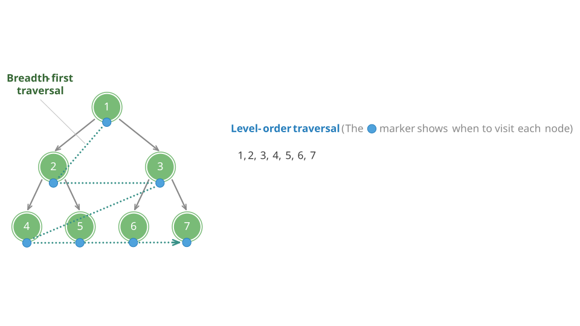
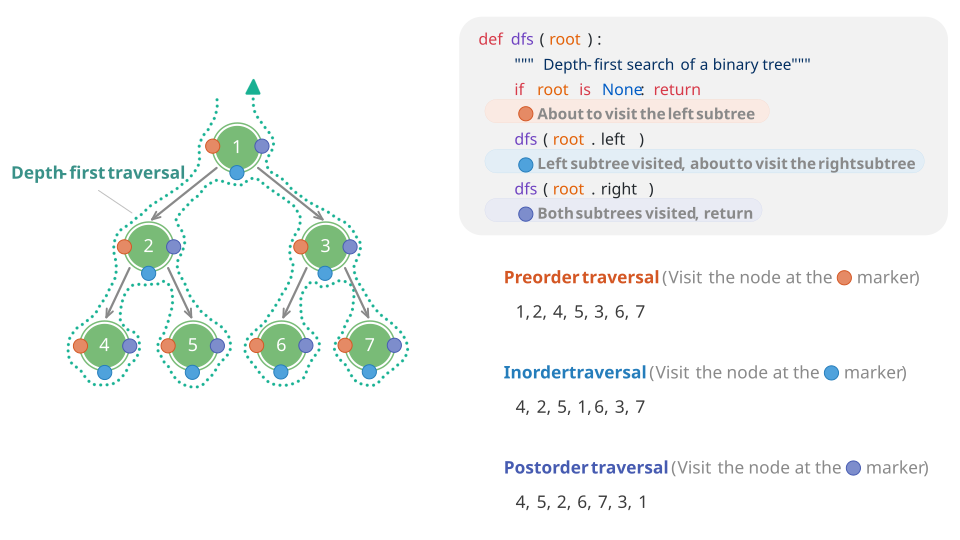
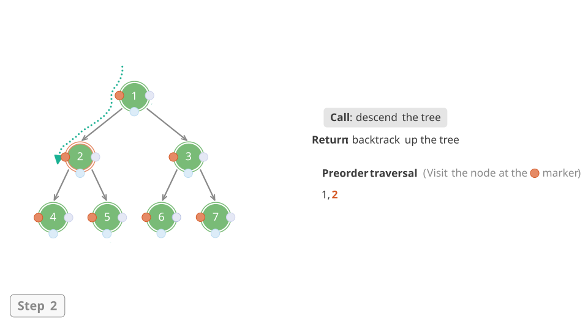
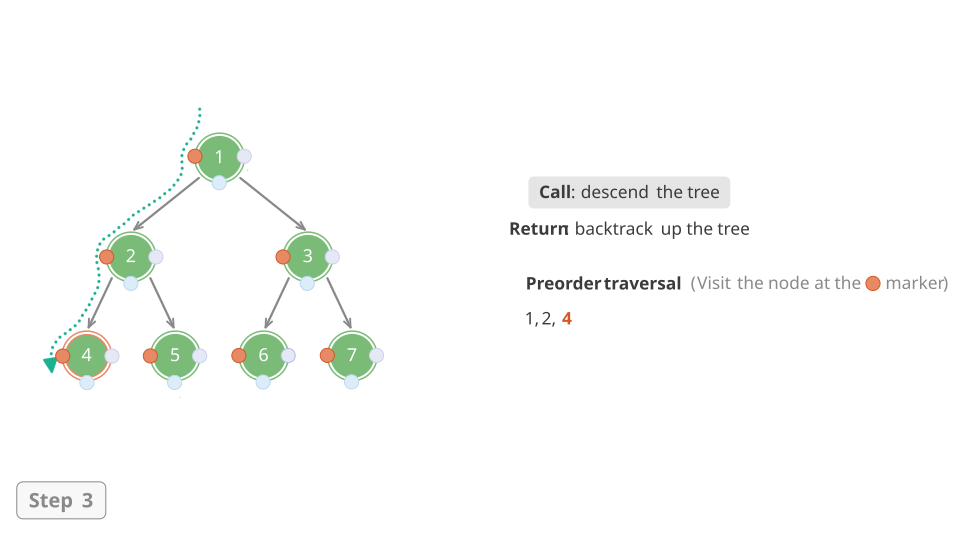
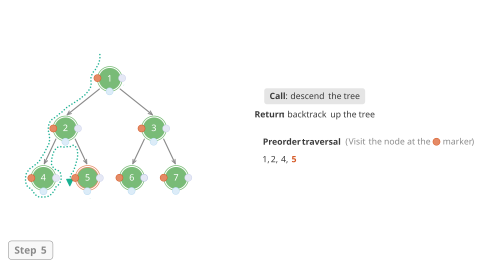
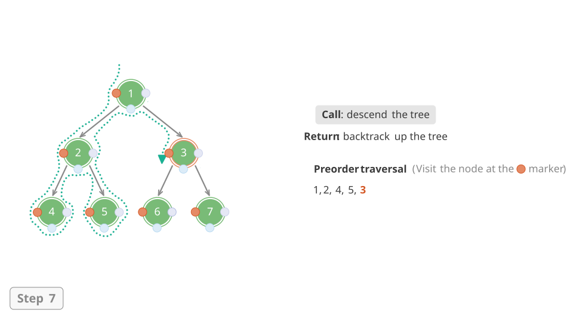
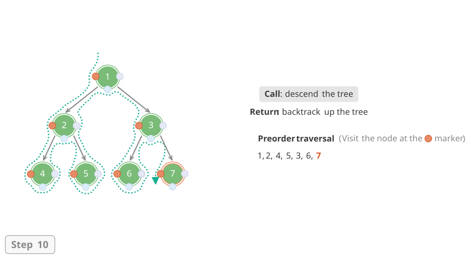

# Binary tree traversal

In its linked representation, a tree is built from nodes connected by pointers, much like a linked list. We follow those pointers to visit the nodes one by one. A tree is nonlinear, however, so traversing it is more involved than following a list and calls for a search algorithm.

Common ways to traverse a binary tree include level-order, preorder, inorder, and postorder traversal.

## Level-order traversal

As shown below, <u>level-order traversal</u> visits a binary tree one level at a time from top to bottom, moving from left to right within each level.

Level-order traversal is a <u>breadth-first traversal</u>, also called <u>breadth-first search (BFS)</u>. It expands outward one level at a time.



### Implementation

Breadth-first traversal usually uses a queue. Its first-in, first-out rule fits the level-by-level progression of the traversal. Here is an implementation:

```src
[file]{binary_tree_bfs}-[class]{}-[func]{level_order}
```

### Complexity analysis

- **Time complexity: $O(n)$**. Each node is visited once, taking $O(n)$ time, where $n$ is the number of nodes.
- **Space complexity: $O(n)$**. In the worst case, a perfect binary tree, the queue holds up to $(n + 1) / 2$ nodes at once just before the bottom level is visited, using $O(n)$ space.

## Preorder, inorder, and postorder traversal

Preorder, inorder, and postorder are all forms of <u>depth-first traversal</u>, also called <u>depth-first search (DFS)</u>. Each follows a branch to its end before backtracking to continue.

The figure below illustrates depth-first traversal of a binary tree. **Imagine walking around the entire outline of the tree**. You pass each node at three points, corresponding to preorder, inorder, and postorder.



### Implementation

Depth-first search is usually implemented recursively:

```src
[file]{binary_tree_dfs}-[class]{}-[func]{post_order}
```

!!! tip

    Depth-first search can also be implemented iteratively. You may wish to explore that approach on your own.

The figure below traces recursive preorder traversal of a binary tree. It shows two movements in opposite directions: making calls and returning from them.

1. A call starts a new invocation of the method, taking the program to the next node.
2. A return ends the function call, indicating that processing of the current node is complete.

=== "<1>"
    

=== "<2>"
    

=== "<3>"
    

=== "<4>"
    

=== "<5>"
    

=== "<6>"
    

=== "<7>"
    

=== "<8>"
    

=== "<9>"
    

=== "<10>"
    

=== "<11>"
    

### Complexity analysis

- **Time complexity: $O(n)$**. Each node is visited once, taking $O(n)$ time.
- **Space complexity: $O(n)$**. In the worst case, the tree degenerates into a linked list. Recursion reaches depth $n$, and the system uses $O(n)$ space for stack frames.
