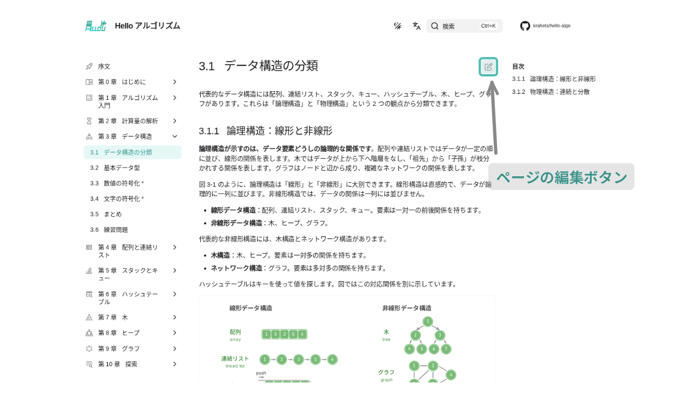

# 16.2 &nbsp; 本書の執筆に参加する

著者の力が及ばず、本書には記述の漏れや誤りがあるかもしれません。どうかご容赦ください。誤字や脱字、リンク切れ、内容の抜け、複数の意味に取れる表現、わかりにくい説明、文章の構成に無理がある箇所などにお気づきの際は、読者にとってよりよい教材になるよう、修正にご協力ください。

オープンソースコミュニティへの皆さんのご尽力に感謝を込めて、本書のリポジトリ、ウェブ版、PDF 版の各トップページに、[執筆にご協力くださった方](https://github.com/krahets/hello-algo/graphs/contributors)全員の GitHub ID を掲載します。

!!! success "オープンソースの魅力"

    紙の本は次の増刷まで時間がかかることが多く、内容を更新するのは容易ではありません。
    
    オープンソースの本書なら、数日で、早ければ数時間で内容を更新できます。

### 1. &nbsp; 文章やコードの小さな修正

図 16-3 のように、各ページの右上には編集アイコンがあります。次の手順で文章やコードを修正できます。

1. 編集アイコンをクリックします。リポジトリをフォークする必要があるというメッセージが表示されたら、フォークを承認します。
2. Markdown のソースファイルを編集し、内容に誤りがないか確認します。書式はできるだけ既存のものに合わせてください。
3. ページ下部に変更内容の説明を入力し、「Propose file change」をクリックします。次の画面で「Create pull request」をクリックすると、プルリクエストを作成できます。

{ class="animation-figure" }

 図 16-3 &nbsp; ページ右上の編集ボタン 

画像は直接編集できません。新しい[Issue](https://github.com/krahets/hello-algo/issues)を立てるか、コメントで問題の箇所をお知らせください。できるだけ早く図を描き直して差し替えます。

### 2. &nbsp; 新しいコンテンツの執筆

コードを別のプログラミング言語に移植したり、本文に説明を加えたりして、このオープンソースプロジェクトに参加したい方は、次の手順でプルリクエストを作成してください。

1. GitHub にログインし、本書の[コードリポジトリ](https://github.com/krahets/hello-algo)を自分のアカウントにフォークします。
2. フォークしたリポジトリのページを開き、`git clone` コマンドでリポジトリを手元のコンピュータにクローンします。
3. 手元でコンテンツを作成し、一通りテストしてコードが正しく動作することを確認します。
4. 手元での変更をコミットし、リモートリポジトリにプッシュします。
5. リポジトリのページを再読み込みし、「Create pull request」をクリックしてプルリクエストを作成します。
