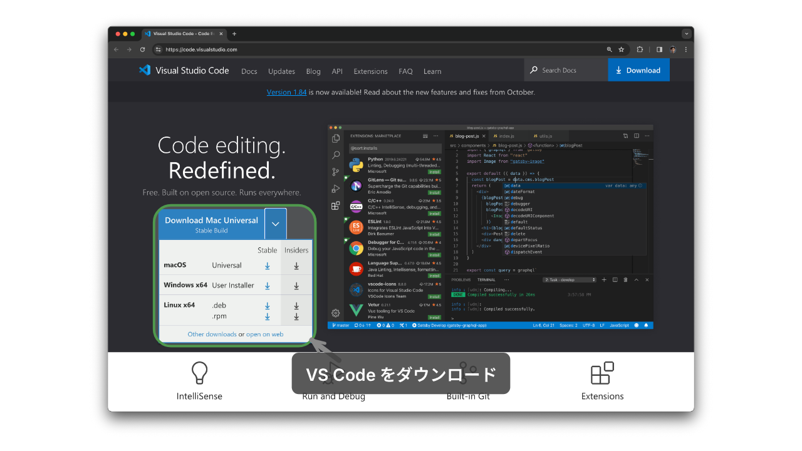
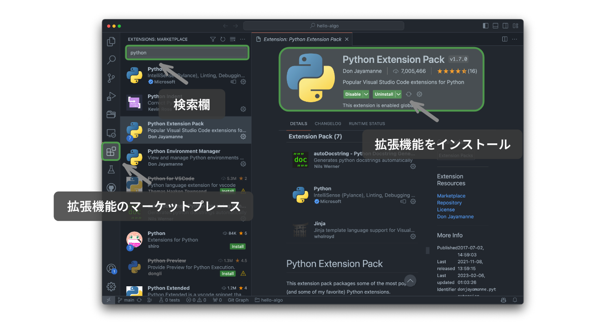

# 開発環境のセットアップ

## IDE のインストール

手元のコンピュータで使う統合開発環境（IDE）には、オープンソースで軽量な VS Code をおすすめします。[VS Code の公式サイト](https://code.visualstudio.com/)で、お使いの OS に合った版をダウンロードし、インストールしてください。

VS Code には豊富な拡張機能があり、ほとんどのプログラミング言語でコードを実行したりデバッグしたりできます。たとえば Python のコードは、拡張機能パック「Python Extension Pack」をインストールするとデバッグできます。インストール手順を下図に示します。

## 言語別の環境設定

### Python の環境

1. [Miniconda3](https://docs.conda.io/en/latest/miniconda.html) をダウンロードしてインストールします。Python 3.10 以降が必要です。
2. VS Code の拡張機能マーケットプレースで `python` を検索し、Python Extension Pack をインストールします。
3. （任意）コマンドラインで `pip install black` を実行し、コードの書式を整えるフォーマッターをインストールします。

### C/C++ の環境

1. Windows では [MinGW](https://sourceforge.net/projects/mingw-w64/files/) をインストールする必要があります（[中国語の設定ガイド](https://blog.csdn.net/qq_33698226/article/details/129031241)）。macOS には Clang が付属しているので、インストールは不要です。
2. VS Code の拡張機能マーケットプレースで `c++` を検索し、C/C++ Extension Pack をインストールします。
3. （任意）設定画面（Settings）を開き、コード整形の設定項目 `Clang_format_fallback Style` を検索して、値を `{ BasedOnStyle: Microsoft, BreakBeforeBraces: Attach }` に設定します。

### Java の環境

1. [OpenJDK](https://jdk.java.net/18/) をダウンロードしてインストールします。JDK 9 より新しいバージョンが必要です。
2. VS Code の拡張機能マーケットプレースで `java` を検索し、Extension Pack for Java をインストールします。

### C# の環境

1. [.NET 8.0](https://dotnet.microsoft.com/en-us/download) をダウンロードしてインストールします。
2. VS Code の拡張機能マーケットプレースで `C# Dev Kit` を検索し、C# Dev Kit をインストールします（[設定手順](https://code.visualstudio.com/docs/csharp/get-started)）。
3. Visual Studio も利用できます（[インストール手順](https://learn.microsoft.com/ja-jp/visualstudio/install/install-visual-studio?view=vs-2022)）。

### Go の環境

1. [Go](https://go.dev/dl/) をダウンロードしてインストールします。
2. VS Code の拡張機能マーケットプレースで `go` を検索し、Go 拡張機能をインストールします。
3. `Ctrl + Shift + P` でコマンドパレットを開き、go と入力して `Go: Install/Update Tools` を選びます。すべての項目にチェックを入れてインストールします。

### Swift の環境

1. [Swift](https://www.swift.org/download/) をダウンロードしてインストールします。
2. VS Code の拡張機能マーケットプレースで `swift` を検索し、[Swift for Visual Studio Code](https://marketplace.visualstudio.com/items?itemName=sswg.swift-lang) をインストールします。

### JavaScript の環境

1. [Node.js](https://nodejs.org/en/) をダウンロードしてインストールします。
2. （任意）VS Code の拡張機能マーケットプレースで `Prettier` を検索し、コードフォーマッターをインストールします。

### TypeScript の環境

1. まず、JavaScript の環境と同じ手順でセットアップします。
2. [TypeScript Execute (tsx)](https://github.com/privatenumber/tsx?tab=readme-ov-file#global-installation) をインストールします。
3. VS Code の拡張機能マーケットプレースで `typescript` を検索し、[Pretty TypeScript Errors](https://marketplace.visualstudio.com/items?itemName=yoavbls.pretty-ts-errors) をインストールします。

### Dart の環境

1. [Dart](https://dart.dev/get-dart) をダウンロードしてインストールします。
2. VS Code の拡張機能マーケットプレースで `dart` を検索し、[Dart](https://marketplace.visualstudio.com/items?itemName=Dart-Code.dart-code) 拡張機能をインストールします。

### Rust の環境

1. [Rust](https://www.rust-lang.org/tools/install) をダウンロードしてインストールします。
2. VS Code の拡張機能マーケットプレースで `rust` を検索し、[rust-analyzer](https://marketplace.visualstudio.com/items?itemName=rust-lang.rust-analyzer) をインストールします。
