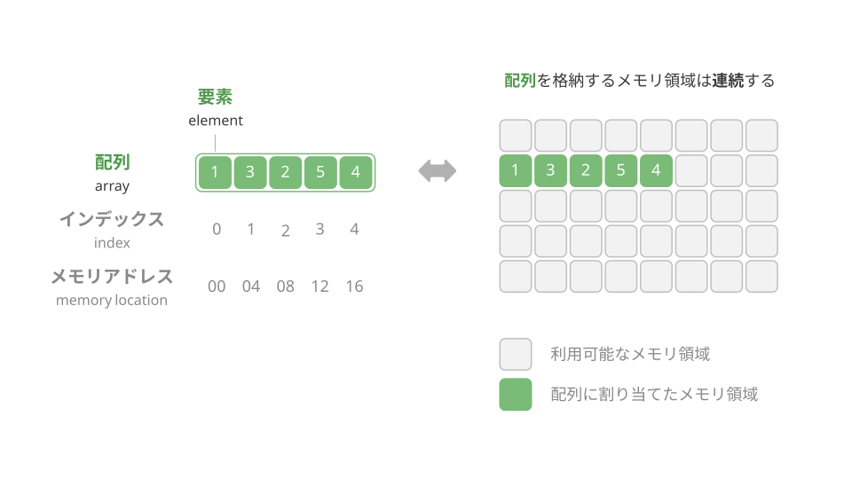
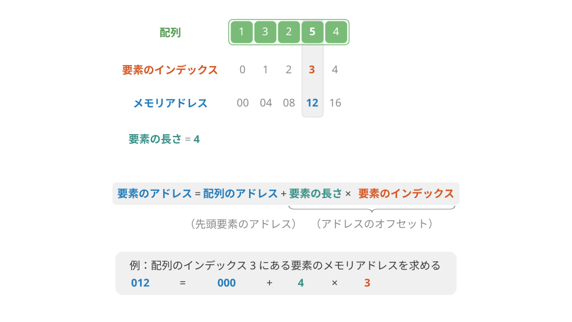
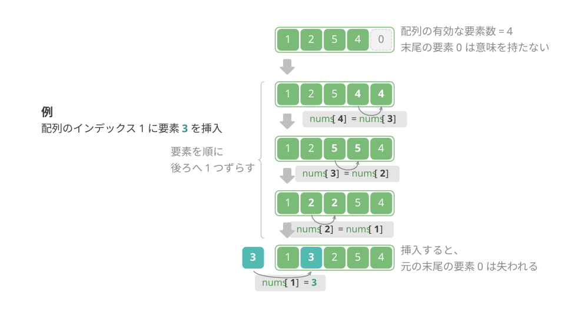
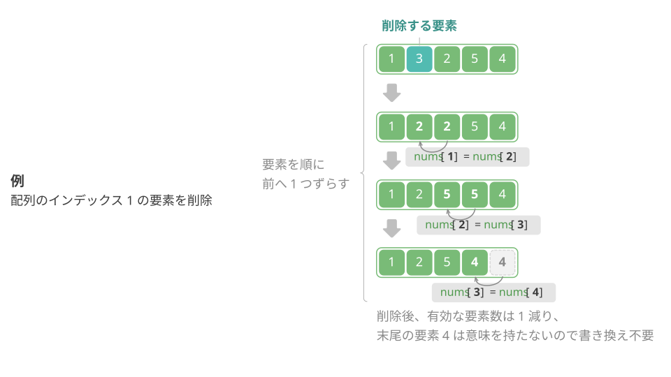

# 4.1 &nbsp; 配列

<u>配列（array）</u>は、同じ型の要素を連続したメモリ領域に格納する線形データ構造です。配列内での要素の位置を、その要素の<u>インデックス（index）</u>と呼びます。図 4-1 に、配列の基本概念と格納方法を示します。

{ class="animation-figure" }

<p align="center"> 図 4-1 &nbsp; 配列の定義と格納方法 </p>

## 4.1.1 &nbsp; 配列の基本操作

### 1. &nbsp; 配列を初期化する

配列の初期化方法は、初期値を指定しない方法と、初期値を与える方法の 2 つから用途に応じて選べます。初期値を指定しない場合、ほとんどのプログラミング言語では配列の要素が $0$ に初期化されます。

=== "Python"

    ```python title="array.py"
    # 配列を初期化する
    arr: list[int] = [0] * 5  # [ 0, 0, 0, 0, 0 ]
    nums: list[int] = [1, 3, 2, 5, 4]
    ```

=== "C++"

    ```cpp title="array.cpp"
    /* 配列を初期化する */
    // スタックに格納する
    int arr[5] = {};
    int nums[5] = {1, 3, 2, 5, 4};
    // ヒープに格納する（領域は手動で解放する）
    int *arr1 = new int[5]{};
    int *nums1 = new int[5]{1, 3, 2, 5, 4};
    ```

=== "Java"

    ```java title="array.java"
    /* 配列を初期化する */
    int[] arr = new int[5]; // { 0, 0, 0, 0, 0 }
    int[] nums = { 1, 3, 2, 5, 4 };
    ```

=== "C#"

    ```csharp title="array.cs"
    // 配列を初期化する
    int[] arr = new int[5]; // [ 0, 0, 0, 0, 0 ]
    int[] nums = [1, 3, 2, 5, 4];
    ```

=== "Go"

    ```go title="array.go"
    /* 配列を初期化する */
    var arr [5]int
    // Go では長さを指定すると配列（[5]int）、指定しないとスライス（[]int）になる
    // Go の配列はコンパイル時に長さが決まる設計なので、長さは定数で指定する
    // 容量を拡張する関数 extend() を実装しやすくするため、以下ではスライス（Slice）を配列（Array）として扱う
    nums := []int{1, 3, 2, 5, 4}
    ```

=== "Swift"

    ```swift title="array.swift"
    /* 配列を初期化する */
    let arr = Array(repeating: 0, count: 5) // [0, 0, 0, 0, 0]
    var nums = [1, 3, 2, 5, 4]
    ```

=== "JS"

    ```javascript title="array.js"
    /* 配列を初期化する */
    const arr = new Array(5).fill(0);
    let nums = [1, 3, 2, 5, 4];
    ```

=== "TS"

    ```typescript title="array.ts"
    /* 配列を初期化する */
    const arr: number[] = new Array(5).fill(0);
    let nums: number[] = [1, 3, 2, 5, 4];
    ```

=== "Dart"

    ```dart title="array.dart"
    /* 配列を初期化する */
    var arr = List.filled(5, 0); // [0, 0, 0, 0, 0]
    List<int> nums = [1, 3, 2, 5, 4];
    ```

=== "Rust"

    ```rust title="array.rs"
    /* 配列を初期化する */
    let arr: [i32; 5] = [0; 5]; // [0, 0, 0, 0, 0]
    // Rust では長さを指定すると配列（[i32; 5]）、指定しないとスライス（&[i32]）になる
    // Rust の配列はコンパイル時に長さが決まる設計なので、長さは定数で指定する
    // Vector は Rust で一般に動的配列として使う型
    // 容量を拡張するメソッド extend() を実装しやすくするため、以下では vector を配列（array）として扱う
    let nums: Vec<i32> = vec![1, 3, 2, 5, 4];
    ```

=== "C"

    ```c title="array.c"
    /* 配列を初期化する */
    int arr[5] = {0}; // { 0, 0, 0, 0, 0 }
    int nums[] = {1, 3, 2, 5, 4};
    ```

=== "Kotlin"

    ```kotlin title="array.kt"
    /* 配列を初期化する */
    val arr = IntArray(5) // { 0, 0, 0, 0, 0 }
    var nums = intArrayOf(1, 3, 2, 5, 4)
    ```

=== "Ruby"

    ```ruby title="array.rb"
    # 配列を初期化する
    arr = Array.new(5, 0)
    nums = [1, 3, 2, 5, 4]
    ```

??? pythontutor "実行の様子を見る"

    <div style="height: 243px; width: 100%;"><iframe class="pythontutor-iframe" title="実行の様子を見る" src="https://pythontutor.com/iframe-embed.html#code=%23%20%E9%85%8D%E5%88%97%E3%82%92%E5%88%9D%E6%9C%9F%E5%8C%96%0Aarr%20%3D%20%5B0%5D%20%2A%205%20%20%23%20%5B%200,%200,%200,%200,%200%20%5D%0Anums%20%3D%20%5B1,%203,%202,%205,%204%5D&codeDivHeight=472&codeDivWidth=350&cumulative=false&curInstr=0&heapPrimitives=nevernest&origin=opt-frontend.js&py=311&rawInputLstJSON=%5B%5D&textReferences=false"> </iframe></div>
    <div style="margin-top: 5px;"><a href="https://pythontutor.com/iframe-embed.html#code=%23%20%E9%85%8D%E5%88%97%E3%82%92%E5%88%9D%E6%9C%9F%E5%8C%96%0Aarr%20%3D%20%5B0%5D%20%2A%205%20%20%23%20%5B%200,%200,%200,%200,%200%20%5D%0Anums%20%3D%20%5B1,%203,%202,%205,%204%5D&codeDivHeight=800&codeDivWidth=600&cumulative=false&curInstr=0&heapPrimitives=nevernest&origin=opt-frontend.js&py=311&rawInputLstJSON=%5B%5D&textReferences=false" target="_blank" rel="noopener noreferrer">全画面で表示 ></a></div>

### 2. &nbsp; 要素にアクセスする

配列の要素は連続したメモリ領域に格納されるため、各要素のメモリアドレスは簡単に計算できます。配列のアドレス（先頭要素のメモリアドレス）と目的の要素のインデックスがわかれば、図 4-2 の式でその要素のアドレスを計算し、直接アクセスできます。

{ class="animation-figure" }

<p align="center"> 図 4-2 &nbsp; 配列要素のメモリアドレスの計算 </p>

図 4-2 では、配列の先頭要素のインデックスは $0$ です。ふだんは $1$ から数えるほうが自然なので、不思議に感じるかもしれません。しかしアドレスを求める式を見ると、**インデックスは本質的にメモリアドレスのオフセットを表しています**。先頭要素のアドレスのオフセットは $0$ なので、インデックスが $0$ なのも理にかなっています。

配列の要素には効率よくアクセスできます。配列内のどの要素にも $O(1)$ 時間でランダムアクセスできます。

=== "Python"

    ```python title="array.py"
    def random_access(nums: list[int]) -> int:
        """要素にランダムにアクセスする"""
        # 区間 [0, len(nums)-1] から数をランダムに選ぶ
        random_index = random.randint(0, len(nums) - 1)
        # ランダムに選んだ要素を取得して返す
        random_num = nums[random_index]
        return random_num
    ```

=== "C++"

    ```cpp title="array.cpp"
    /* 要素にランダムにアクセスする */
    int randomAccess(int *nums, int size) {
        // 区間 [0, size) から数をランダムに選ぶ
        int randomIndex = rand() % size;
        // ランダムに選んだ要素を取得して返す
        int randomNum = nums[randomIndex];
        return randomNum;
    }
    ```

=== "Java"

    ```java title="array.java"
    /* 要素にランダムにアクセスする */
    int randomAccess(int[] nums) {
        // 区間 [0, nums.length) から数をランダムに選ぶ
        int randomIndex = ThreadLocalRandom.current().nextInt(0, nums.length);
        // ランダムに選んだ要素を取得して返す
        int randomNum = nums[randomIndex];
        return randomNum;
    }
    ```

=== "C#"

    ```csharp title="array.cs"
    /* 要素にランダムにアクセスする */
    int RandomAccess(int[] nums) {
        Random random = new();
        // 区間 [0, nums.Length) から数をランダムに選ぶ
        int randomIndex = random.Next(nums.Length);
        // ランダムに選んだ要素を取得して返す
        int randomNum = nums[randomIndex];
        return randomNum;
    }
    ```

=== "Go"

    ```go title="array.go"
    /* 要素にランダムにアクセスする */
    func randomAccess(nums []int) (randomNum int) {
        // 区間 [0, nums.length) から数をランダムに選ぶ
        randomIndex := rand.Intn(len(nums))
        // ランダムに選んだ要素を取得して返す
        randomNum = nums[randomIndex]
        return
    }
    ```

=== "Swift"

    ```swift title="array.swift"
    /* 要素にランダムにアクセスする */
    func randomAccess(nums: [Int]) -> Int {
        // 区間 [0, nums.count) から数をランダムに選ぶ
        let randomIndex = nums.indices.randomElement()!
        // ランダムに選んだ要素を取得して返す
        let randomNum = nums[randomIndex]
        return randomNum
    }
    ```

=== "JS"

    ```javascript title="array.js"
    /* 要素にランダムにアクセスする */
    function randomAccess(nums) {
        // 区間 [0, nums.length) から数をランダムに選ぶ
        const random_index = Math.floor(Math.random() * nums.length);
        // ランダムに選んだ要素を取得して返す
        const random_num = nums[random_index];
        return random_num;
    }
    ```

=== "TS"

    ```typescript title="array.ts"
    /* 要素にランダムにアクセスする */
    function randomAccess(nums: number[]): number {
        // 区間 [0, nums.length) から数をランダムに選ぶ
        const random_index = Math.floor(Math.random() * nums.length);
        // ランダムに選んだ要素を取得して返す
        const random_num = nums[random_index];
        return random_num;
    }
    ```

=== "Dart"

    ```dart title="array.dart"
    /* 要素にランダムにアクセスする */
    int randomAccess(List<int> nums) {
      // 区間 [0, nums.length) から数をランダムに選ぶ
      int randomIndex = Random().nextInt(nums.length);
      // ランダムに選んだ要素を取得して返す
      int randomNum = nums[randomIndex];
      return randomNum;
    }
    ```

=== "Rust"

    ```rust title="array.rs"
    /* 要素にランダムにアクセスする */
    fn random_access(nums: &[i32]) -> i32 {
        // 区間 [0, nums.len()) から数をランダムに選ぶ
        let random_index = rand::thread_rng().gen_range(0..nums.len());
        // ランダムに選んだ要素を取得して返す
        let random_num = nums[random_index];
        random_num
    }
    ```

=== "C"

    ```c title="array.c"
    /* 要素にランダムにアクセスする */
    int randomAccess(int *nums, int size) {
        // 区間 [0, size) から数をランダムに選ぶ
        int randomIndex = rand() % size;
        // ランダムに選んだ要素を取得して返す
        int randomNum = nums[randomIndex];
        return randomNum;
    }
    ```

=== "Kotlin"

    ```kotlin title="array.kt"
    /* 要素にランダムにアクセスする */
    fun randomAccess(nums: IntArray): Int {
        // 区間 [0, nums.size) から数をランダムに選ぶ
        val randomIndex = ThreadLocalRandom.current().nextInt(0, nums.size)
        // ランダムに選んだ要素を取得して返す
        val randomNum = nums[randomIndex]
        return randomNum
    }
    ```

=== "Ruby"

    ```ruby title="array.rb"
    ### 要素にランダムにアクセスする ###
    def random_access(nums)
      # 区間 [0, nums.length) から数をランダムに選ぶ
      random_index = Random.rand(0...nums.length)

      # ランダムに選んだ要素を取得して返す
      nums[random_index]
    end
    ```

??? pythontutor "実行の様子を見る"

    <div style="height: 531px; width: 100%;"><iframe class="pythontutor-iframe" title="実行の様子を見る" src="https://pythontutor.com/iframe-embed.html#code=import%20random%0A%0Adef%20random_access%28nums%3A%20list%5Bint%5D%29%20-%3E%20int%3A%0A%20%20%20%20%22%22%22%E8%A6%81%E7%B4%A0%E3%81%AB%E3%83%A9%E3%83%B3%E3%83%80%E3%83%A0%E3%81%AB%E3%82%A2%E3%82%AF%E3%82%BB%E3%82%B9%E3%81%99%E3%82%8B%22%22%22%0A%20%20%20%20%23%20%E5%8C%BA%E9%96%93%20%5B0,%20len%28nums%29-1%5D%20%E3%81%8B%E3%82%89%E6%95%B0%E3%82%92%E3%83%A9%E3%83%B3%E3%83%80%E3%83%A0%E3%81%AB%E9%81%B8%E3%81%B6%0A%20%20%20%20random_index%20%3D%20random.randint%280,%20len%28nums%29%20-%201%29%0A%20%20%20%20%23%20%E3%83%A9%E3%83%B3%E3%83%80%E3%83%A0%E3%81%AB%E9%81%B8%E3%82%93%E3%81%A0%E8%A6%81%E7%B4%A0%E3%82%92%E5%8F%96%E5%BE%97%E3%81%97%E3%81%A6%E8%BF%94%E3%81%99%0A%20%20%20%20random_num%20%3D%20nums%5Brandom_index%5D%0A%20%20%20%20return%20random_num%0A%0A%22%22%22Driver%20Code%22%22%22%0Aif%20__name__%20%3D%3D%20%22__main__%22%3A%0A%20%20%20%20%23%20%E9%85%8D%E5%88%97%E3%82%92%E5%88%9D%E6%9C%9F%E5%8C%96%E3%81%99%E3%82%8B%0A%20%20%20%20nums%20%3D%20%5B1,%203,%202,%205,%204%5D%0A%20%20%20%20print%28%22%E9%85%8D%E5%88%97%20nums%20%3D%22,%20nums%29%0A%0A%20%20%20%20%23%20%E3%83%A9%E3%83%B3%E3%83%80%E3%83%A0%E3%82%A2%E3%82%AF%E3%82%BB%E3%82%B9%0A%20%20%20%20random_num%3A%20int%20%3D%20random_access%28nums%29%0A%20%20%20%20print%28%22nums%20%E3%81%8B%E3%82%89%E3%83%A9%E3%83%B3%E3%83%80%E3%83%A0%E3%81%AB%E9%81%B8%E3%82%93%E3%81%A0%E8%A6%81%E7%B4%A0%EF%BC%9A%22,%20random_num%29%0A&codeDivHeight=472&codeDivWidth=350&cumulative=false&curInstr=7&heapPrimitives=nevernest&origin=opt-frontend.js&py=311&rawInputLstJSON=%5B%5D&textReferences=false"> </iframe></div>
    <div style="margin-top: 5px;"><a href="https://pythontutor.com/iframe-embed.html#code=import%20random%0A%0Adef%20random_access%28nums%3A%20list%5Bint%5D%29%20-%3E%20int%3A%0A%20%20%20%20%22%22%22%E8%A6%81%E7%B4%A0%E3%81%AB%E3%83%A9%E3%83%B3%E3%83%80%E3%83%A0%E3%81%AB%E3%82%A2%E3%82%AF%E3%82%BB%E3%82%B9%E3%81%99%E3%82%8B%22%22%22%0A%20%20%20%20%23%20%E5%8C%BA%E9%96%93%20%5B0,%20len%28nums%29-1%5D%20%E3%81%8B%E3%82%89%E6%95%B0%E3%82%92%E3%83%A9%E3%83%B3%E3%83%80%E3%83%A0%E3%81%AB%E9%81%B8%E3%81%B6%0A%20%20%20%20random_index%20%3D%20random.randint%280,%20len%28nums%29%20-%201%29%0A%20%20%20%20%23%20%E3%83%A9%E3%83%B3%E3%83%80%E3%83%A0%E3%81%AB%E9%81%B8%E3%82%93%E3%81%A0%E8%A6%81%E7%B4%A0%E3%82%92%E5%8F%96%E5%BE%97%E3%81%97%E3%81%A6%E8%BF%94%E3%81%99%0A%20%20%20%20random_num%20%3D%20nums%5Brandom_index%5D%0A%20%20%20%20return%20random_num%0A%0A%22%22%22Driver%20Code%22%22%22%0Aif%20__name__%20%3D%3D%20%22__main__%22%3A%0A%20%20%20%20%23%20%E9%85%8D%E5%88%97%E3%82%92%E5%88%9D%E6%9C%9F%E5%8C%96%E3%81%99%E3%82%8B%0A%20%20%20%20nums%20%3D%20%5B1,%203,%202,%205,%204%5D%0A%20%20%20%20print%28%22%E9%85%8D%E5%88%97%20nums%20%3D%22,%20nums%29%0A%0A%20%20%20%20%23%20%E3%83%A9%E3%83%B3%E3%83%80%E3%83%A0%E3%82%A2%E3%82%AF%E3%82%BB%E3%82%B9%0A%20%20%20%20random_num%3A%20int%20%3D%20random_access%28nums%29%0A%20%20%20%20print%28%22nums%20%E3%81%8B%E3%82%89%E3%83%A9%E3%83%B3%E3%83%80%E3%83%A0%E3%81%AB%E9%81%B8%E3%82%93%E3%81%A0%E8%A6%81%E7%B4%A0%EF%BC%9A%22,%20random_num%29%0A&codeDivHeight=800&codeDivWidth=600&cumulative=false&curInstr=7&heapPrimitives=nevernest&origin=opt-frontend.js&py=311&rawInputLstJSON=%5B%5D&textReferences=false" target="_blank" rel="noopener noreferrer">全画面で表示 ></a></div>

### 3. &nbsp; 要素を挿入する

配列の要素はメモリ上でぴったり隣り合い、要素間にはほかのデータを置く隙間がありません。図 4-3 のように、途中に要素を挿入するには、挿入位置以降の要素をすべて後ろに 1 つずらしてから、そのインデックスに新しい要素を代入します。

{ class="animation-figure" }

<p align="center"> 図 4-3 &nbsp; 配列に要素を挿入する例 </p>

配列の長さは固定されているため、要素を挿入すると、末尾にあった要素は必ず「失われる」ことに注意してください。この問題の解決策は「リスト」の節で扱います。

=== "Python"

    ```python title="array.py"
    def insert(nums: list[int], num: int, index: int):
        """配列のインデックス index に要素 num を挿入する"""
        # インデックス index 以降の全要素を後ろに 1 つずらす
        for i in range(len(nums) - 1, index, -1):
            nums[i] = nums[i - 1]
        # インデックス index の要素に num を代入する
        nums[index] = num
    ```

=== "C++"

    ```cpp title="array.cpp"
    /* 配列のインデックス index に要素 num を挿入する */
    void insert(int *nums, int size, int num, int index) {
        // インデックス index 以降の全要素を後ろに 1 つずらす
        for (int i = size - 1; i > index; i--) {
            nums[i] = nums[i - 1];
        }
        // インデックス index の要素に num を代入する
        nums[index] = num;
    }
    ```

=== "Java"

    ```java title="array.java"
    /* 配列のインデックス index に要素 num を挿入する */
    void insert(int[] nums, int num, int index) {
        // インデックス index 以降の全要素を後ろに 1 つずらす
        for (int i = nums.length - 1; i > index; i--) {
            nums[i] = nums[i - 1];
        }
        // インデックス index の要素に num を代入する
        nums[index] = num;
    }
    ```

=== "C#"

    ```csharp title="array.cs"
    /* 配列のインデックス index に要素 num を挿入する */
    void Insert(int[] nums, int num, int index) {
        // インデックス index 以降の全要素を後ろに 1 つずらす
        for (int i = nums.Length - 1; i > index; i--) {
            nums[i] = nums[i - 1];
        }
        // インデックス index の要素に num を代入する
        nums[index] = num;
    }
    ```

=== "Go"

    ```go title="array.go"
    /* 配列のインデックス index に要素 num を挿入する */
    func insert(nums []int, num int, index int) {
        // インデックス index 以降の全要素を後ろに 1 つずらす
        for i := len(nums) - 1; i > index; i-- {
            nums[i] = nums[i-1]
        }
        // インデックス index の要素に num を代入する
        nums[index] = num
    }
    ```

=== "Swift"

    ```swift title="array.swift"
    /* 配列のインデックス index に要素 num を挿入する */
    func insert(nums: inout [Int], num: Int, index: Int) {
        // インデックス index 以降の全要素を後ろに 1 つずらす
        for i in stride(from: nums.count - 1, to: index, by: -1) {
            nums[i] = nums[i - 1]
        }
        // インデックス index の要素に num を代入する
        nums[index] = num
    }
    ```

=== "JS"

    ```javascript title="array.js"
    /* 配列のインデックス index に要素 num を挿入する */
    function insert(nums, num, index) {
        // インデックス index 以降の全要素を後ろに 1 つずらす
        for (let i = nums.length - 1; i > index; i--) {
            nums[i] = nums[i - 1];
        }
        // インデックス index の要素に num を代入する
        nums[index] = num;
    }
    ```

=== "TS"

    ```typescript title="array.ts"
    /* 配列のインデックス index に要素 num を挿入する */
    function insert(nums: number[], num: number, index: number): void {
        // インデックス index 以降の全要素を後ろに 1 つずらす
        for (let i = nums.length - 1; i > index; i--) {
            nums[i] = nums[i - 1];
        }
        // インデックス index の要素に num を代入する
        nums[index] = num;
    }
    ```

=== "Dart"

    ```dart title="array.dart"
    /* 配列のインデックス index に要素 _num を挿入する */
    void insert(List<int> nums, int _num, int index) {
      // インデックス index 以降の全要素を後ろに 1 つずらす
      for (var i = nums.length - 1; i > index; i--) {
        nums[i] = nums[i - 1];
      }
      // インデックス index の要素に _num を代入する
      nums[index] = _num;
    }
    ```

=== "Rust"

    ```rust title="array.rs"
    /* 配列のインデックス index に要素 num を挿入する */
    fn insert(nums: &mut [i32], num: i32, index: usize) {
        // インデックス index 以降の全要素を後ろに 1 つずらす
        for i in (index + 1..nums.len()).rev() {
            nums[i] = nums[i - 1];
        }
        // インデックス index の要素に num を代入する
        nums[index] = num;
    }
    ```

=== "C"

    ```c title="array.c"
    /* 配列のインデックス index に要素 num を挿入する */
    void insert(int *nums, int size, int num, int index) {
        // インデックス index 以降の全要素を後ろに 1 つずらす
        for (int i = size - 1; i > index; i--) {
            nums[i] = nums[i - 1];
        }
        // インデックス index の要素に num を代入する
        nums[index] = num;
    }
    ```

=== "Kotlin"

    ```kotlin title="array.kt"
    /* 配列のインデックス index に要素 num を挿入する */
    fun insert(nums: IntArray, num: Int, index: Int) {
        // インデックス index 以降の全要素を後ろに 1 つずらす
        for (i in nums.size - 1 downTo index + 1) {
            nums[i] = nums[i - 1]
        }
        // インデックス index の要素に num を代入する
        nums[index] = num
    }
    ```

=== "Ruby"

    ```ruby title="array.rb"
    ### 配列のインデックス index に要素 num を挿入する ###
    def insert(nums, num, index)
      # インデックス index 以降の全要素を後ろに 1 つずらす
      for i in (nums.length - 1).downto(index + 1)
        nums[i] = nums[i - 1]
      end

      # インデックス index の要素に num を代入する
      nums[index] = num
    end
    ```

??? pythontutor "実行の様子を見る"

    <div style="height: 495px; width: 100%;"><iframe class="pythontutor-iframe" title="実行の様子を見る" src="https://pythontutor.com/iframe-embed.html#code=def%20insert%28nums%3A%20list%5Bint%5D,%20num%3A%20int,%20index%3A%20int%29%3A%0A%20%20%20%20%22%22%22%E9%85%8D%E5%88%97%E3%81%AE%E3%82%A4%E3%83%B3%E3%83%87%E3%83%83%E3%82%AF%E3%82%B9%20index%20%E3%81%AB%E8%A6%81%E7%B4%A0%20num%20%E3%82%92%E6%8C%BF%E5%85%A5%E3%81%99%E3%82%8B%22%22%22%0A%20%20%20%20%23%20%E3%82%A4%E3%83%B3%E3%83%87%E3%83%83%E3%82%AF%E3%82%B9%20index%20%E4%BB%A5%E9%99%8D%E3%81%AE%E5%85%A8%E8%A6%81%E7%B4%A0%E3%82%92%E5%BE%8C%E3%82%8D%E3%81%AB%201%20%E3%81%A4%E3%81%9A%E3%82%89%E3%81%99%0A%20%20%20%20for%20i%20in%20range%28len%28nums%29%20-%201,%20index,%20-1%29%3A%0A%20%20%20%20%20%20%20%20nums%5Bi%5D%20%3D%20nums%5Bi%20-%201%5D%0A%20%20%20%20%23%20%E3%82%A4%E3%83%B3%E3%83%87%E3%83%83%E3%82%AF%E3%82%B9%20index%20%E3%81%AE%E8%A6%81%E7%B4%A0%E3%81%AB%20num%20%E3%82%92%E4%BB%A3%E5%85%A5%E3%81%99%E3%82%8B%0A%20%20%20%20nums%5Bindex%5D%20%3D%20num%0A%0A%22%22%22Driver%20Code%22%22%22%0Aif%20__name__%20%3D%3D%20%22__main__%22%3A%0A%20%20%20%20%23%20%E9%85%8D%E5%88%97%E3%82%92%E5%88%9D%E6%9C%9F%E5%8C%96%E3%81%99%E3%82%8B%0A%20%20%20%20nums%20%3D%20%5B1,%203,%202,%205,%204%5D%0A%20%20%20%20print%28%22%E9%85%8D%E5%88%97%20nums%20%3D%22,%20nums%29%0A%0A%20%20%20%20%23%20%E8%A6%81%E7%B4%A0%E3%82%92%E6%8C%BF%E5%85%A5%E3%81%99%E3%82%8B%0A%20%20%20%20insert%28nums,%206,%203%29%0A%20%20%20%20print%28%22%E3%82%A4%E3%83%B3%E3%83%87%E3%83%83%E3%82%AF%E3%82%B9%203%20%E3%81%AB%206%20%E3%82%92%E6%8C%BF%E5%85%A5%E3%81%97%E3%81%9F%E5%BE%8C%E3%81%AE%20nums%20%3D%22,%20nums%29&codeDivHeight=472&codeDivWidth=350&cumulative=false&curInstr=6&heapPrimitives=nevernest&origin=opt-frontend.js&py=311&rawInputLstJSON=%5B%5D&textReferences=false"> </iframe></div>
    <div style="margin-top: 5px;"><a href="https://pythontutor.com/iframe-embed.html#code=def%20insert%28nums%3A%20list%5Bint%5D,%20num%3A%20int,%20index%3A%20int%29%3A%0A%20%20%20%20%22%22%22%E9%85%8D%E5%88%97%E3%81%AE%E3%82%A4%E3%83%B3%E3%83%87%E3%83%83%E3%82%AF%E3%82%B9%20index%20%E3%81%AB%E8%A6%81%E7%B4%A0%20num%20%E3%82%92%E6%8C%BF%E5%85%A5%E3%81%99%E3%82%8B%22%22%22%0A%20%20%20%20%23%20%E3%82%A4%E3%83%B3%E3%83%87%E3%83%83%E3%82%AF%E3%82%B9%20index%20%E4%BB%A5%E9%99%8D%E3%81%AE%E5%85%A8%E8%A6%81%E7%B4%A0%E3%82%92%E5%BE%8C%E3%82%8D%E3%81%AB%201%20%E3%81%A4%E3%81%9A%E3%82%89%E3%81%99%0A%20%20%20%20for%20i%20in%20range%28len%28nums%29%20-%201,%20index,%20-1%29%3A%0A%20%20%20%20%20%20%20%20nums%5Bi%5D%20%3D%20nums%5Bi%20-%201%5D%0A%20%20%20%20%23%20%E3%82%A4%E3%83%B3%E3%83%87%E3%83%83%E3%82%AF%E3%82%B9%20index%20%E3%81%AE%E8%A6%81%E7%B4%A0%E3%81%AB%20num%20%E3%82%92%E4%BB%A3%E5%85%A5%E3%81%99%E3%82%8B%0A%20%20%20%20nums%5Bindex%5D%20%3D%20num%0A%0A%22%22%22Driver%20Code%22%22%22%0Aif%20__name__%20%3D%3D%20%22__main__%22%3A%0A%20%20%20%20%23%20%E9%85%8D%E5%88%97%E3%82%92%E5%88%9D%E6%9C%9F%E5%8C%96%E3%81%99%E3%82%8B%0A%20%20%20%20nums%20%3D%20%5B1,%203,%202,%205,%204%5D%0A%20%20%20%20print%28%22%E9%85%8D%E5%88%97%20nums%20%3D%22,%20nums%29%0A%0A%20%20%20%20%23%20%E8%A6%81%E7%B4%A0%E3%82%92%E6%8C%BF%E5%85%A5%E3%81%99%E3%82%8B%0A%20%20%20%20insert%28nums,%206,%203%29%0A%20%20%20%20print%28%22%E3%82%A4%E3%83%B3%E3%83%87%E3%83%83%E3%82%AF%E3%82%B9%203%20%E3%81%AB%206%20%E3%82%92%E6%8C%BF%E5%85%A5%E3%81%97%E3%81%9F%E5%BE%8C%E3%81%AE%20nums%20%3D%22,%20nums%29&codeDivHeight=800&codeDivWidth=600&cumulative=false&curInstr=6&heapPrimitives=nevernest&origin=opt-frontend.js&py=311&rawInputLstJSON=%5B%5D&textReferences=false" target="_blank" rel="noopener noreferrer">全画面で表示 ></a></div>

### 4. &nbsp; 要素を削除する

同様に、図 4-4 のようにインデックス $i$ の要素を削除するには、インデックス $i$ より後ろの要素をすべて前に 1 つずらします。

{ class="animation-figure" }

<p align="center"> 図 4-4 &nbsp; 配列から要素を削除する例 </p>

削除が完了すると、もともと末尾にあった要素は意味を持たなくなるので、わざわざ書き換える必要はありません。

=== "Python"

    ```python title="array.py"
    def remove(nums: list[int], index: int):
        """インデックス index の要素を削除する"""
        # インデックス index より後ろの全要素を前に 1 つずらす
        for i in range(index, len(nums) - 1):
            nums[i] = nums[i + 1]
    ```

=== "C++"

    ```cpp title="array.cpp"
    /* インデックス index の要素を削除する */
    void remove(int *nums, int size, int index) {
        // インデックス index より後ろの全要素を前に 1 つずらす
        for (int i = index; i < size - 1; i++) {
            nums[i] = nums[i + 1];
        }
    }
    ```

=== "Java"

    ```java title="array.java"
    /* インデックス index の要素を削除する */
    void remove(int[] nums, int index) {
        // インデックス index より後ろの全要素を前に 1 つずらす
        for (int i = index; i < nums.length - 1; i++) {
            nums[i] = nums[i + 1];
        }
    }
    ```

=== "C#"

    ```csharp title="array.cs"
    /* インデックス index の要素を削除する */
    void Remove(int[] nums, int index) {
        // インデックス index より後ろの全要素を前に 1 つずらす
        for (int i = index; i < nums.Length - 1; i++) {
            nums[i] = nums[i + 1];
        }
    }
    ```

=== "Go"

    ```go title="array.go"
    /* インデックス index の要素を削除する */
    func remove(nums []int, index int) {
        // インデックス index より後ろの全要素を前に 1 つずらす
        for i := index; i < len(nums)-1; i++ {
            nums[i] = nums[i+1]
        }
    }
    ```

=== "Swift"

    ```swift title="array.swift"
    /* インデックス index の要素を削除する */
    func remove(nums: inout [Int], index: Int) {
        // インデックス index より後ろの全要素を前に 1 つずらす
        for i in nums.indices.dropFirst(index).dropLast() {
            nums[i] = nums[i + 1]
        }
    }
    ```

=== "JS"

    ```javascript title="array.js"
    /* インデックス index の要素を削除する */
    function remove(nums, index) {
        // インデックス index より後ろの全要素を前に 1 つずらす
        for (let i = index; i < nums.length - 1; i++) {
            nums[i] = nums[i + 1];
        }
    }
    ```

=== "TS"

    ```typescript title="array.ts"
    /* インデックス index の要素を削除する */
    function remove(nums: number[], index: number): void {
        // インデックス index より後ろの全要素を前に 1 つずらす
        for (let i = index; i < nums.length - 1; i++) {
            nums[i] = nums[i + 1];
        }
    }
    ```

=== "Dart"

    ```dart title="array.dart"
    /* インデックス index の要素を削除する */
    void remove(List<int> nums, int index) {
      // インデックス index より後ろの全要素を前に 1 つずらす
      for (var i = index; i < nums.length - 1; i++) {
        nums[i] = nums[i + 1];
      }
    }
    ```

=== "Rust"

    ```rust title="array.rs"
    /* インデックス index の要素を削除する */
    fn remove(nums: &mut [i32], index: usize) {
        // インデックス index より後ろの全要素を前に 1 つずらす
        for i in index..nums.len() - 1 {
            nums[i] = nums[i + 1];
        }
    }
    ```

=== "C"

    ```c title="array.c"
    /* インデックス index の要素を削除する */
    // 注意：stdio.h では remove という名前がすでに使われている
    void removeItem(int *nums, int size, int index) {
        // インデックス index より後ろの全要素を前に 1 つずらす
        for (int i = index; i < size - 1; i++) {
            nums[i] = nums[i + 1];
        }
    }
    ```

=== "Kotlin"

    ```kotlin title="array.kt"
    /* インデックス index の要素を削除する */
    fun remove(nums: IntArray, index: Int) {
        // インデックス index より後ろの全要素を前に 1 つずらす
        for (i in index..<nums.size - 1) {
            nums[i] = nums[i + 1]
        }
    }
    ```

=== "Ruby"

    ```ruby title="array.rb"
    ### インデックス index の要素を削除する ###
    def remove(nums, index)
      # インデックス index より後ろの全要素を前に 1 つずらす
      for i in index...(nums.length - 1)
        nums[i] = nums[i + 1]
      end
    end
    ```

??? pythontutor "実行の様子を見る"

    <div style="height: 459px; width: 100%;"><iframe class="pythontutor-iframe" title="実行の様子を見る" src="https://pythontutor.com/iframe-embed.html#code=def%20remove%28nums%3A%20list%5Bint%5D,%20index%3A%20int%29%3A%0A%20%20%20%20%22%22%22%E3%82%A4%E3%83%B3%E3%83%87%E3%83%83%E3%82%AF%E3%82%B9%20index%20%E3%81%AE%E8%A6%81%E7%B4%A0%E3%82%92%E5%89%8A%E9%99%A4%E3%81%99%E3%82%8B%22%22%22%0A%20%20%20%20%23%20%E3%82%A4%E3%83%B3%E3%83%87%E3%83%83%E3%82%AF%E3%82%B9%20index%20%E3%82%88%E3%82%8A%E5%BE%8C%E3%82%8D%E3%81%AE%E5%85%A8%E8%A6%81%E7%B4%A0%E3%82%92%E5%89%8D%E3%81%AB%201%20%E3%81%A4%E3%81%9A%E3%82%89%E3%81%99%0A%20%20%20%20for%20i%20in%20range%28index,%20len%28nums%29%20-%201%29%3A%0A%20%20%20%20%20%20%20%20nums%5Bi%5D%20%3D%20nums%5Bi%20%2B%201%5D%0A%0A%22%22%22Driver%20Code%22%22%22%0Aif%20__name__%20%3D%3D%20%22__main__%22%3A%0A%20%20%20%20%23%20%E9%85%8D%E5%88%97%E3%82%92%E5%88%9D%E6%9C%9F%E5%8C%96%E3%81%99%E3%82%8B%0A%20%20%20%20nums%20%3D%20%5B1,%203,%202,%205,%204%5D%0A%20%20%20%20print%28%22%E9%85%8D%E5%88%97%20nums%20%3D%22,%20nums%29%0A%0A%20%20%20%20%23%20%E8%A6%81%E7%B4%A0%E3%82%92%E5%89%8A%E9%99%A4%E3%81%99%E3%82%8B%0A%20%20%20%20remove%28nums,%202%29%0A%20%20%20%20print%28%22%E3%82%A4%E3%83%B3%E3%83%87%E3%83%83%E3%82%AF%E3%82%B9%202%20%E3%81%AE%E8%A6%81%E7%B4%A0%E3%82%92%E5%89%8A%E9%99%A4%E3%81%97%E3%81%9F%E5%BE%8C%E3%81%AE%20nums%20%3D%22,%20nums%29&codeDivHeight=472&codeDivWidth=350&cumulative=false&curInstr=6&heapPrimitives=nevernest&origin=opt-frontend.js&py=311&rawInputLstJSON=%5B%5D&textReferences=false"> </iframe></div>
    <div style="margin-top: 5px;"><a href="https://pythontutor.com/iframe-embed.html#code=def%20remove%28nums%3A%20list%5Bint%5D,%20index%3A%20int%29%3A%0A%20%20%20%20%22%22%22%E3%82%A4%E3%83%B3%E3%83%87%E3%83%83%E3%82%AF%E3%82%B9%20index%20%E3%81%AE%E8%A6%81%E7%B4%A0%E3%82%92%E5%89%8A%E9%99%A4%E3%81%99%E3%82%8B%22%22%22%0A%20%20%20%20%23%20%E3%82%A4%E3%83%B3%E3%83%87%E3%83%83%E3%82%AF%E3%82%B9%20index%20%E3%82%88%E3%82%8A%E5%BE%8C%E3%82%8D%E3%81%AE%E5%85%A8%E8%A6%81%E7%B4%A0%E3%82%92%E5%89%8D%E3%81%AB%201%20%E3%81%A4%E3%81%9A%E3%82%89%E3%81%99%0A%20%20%20%20for%20i%20in%20range%28index,%20len%28nums%29%20-%201%29%3A%0A%20%20%20%20%20%20%20%20nums%5Bi%5D%20%3D%20nums%5Bi%20%2B%201%5D%0A%0A%22%22%22Driver%20Code%22%22%22%0Aif%20__name__%20%3D%3D%20%22__main__%22%3A%0A%20%20%20%20%23%20%E9%85%8D%E5%88%97%E3%82%92%E5%88%9D%E6%9C%9F%E5%8C%96%E3%81%99%E3%82%8B%0A%20%20%20%20nums%20%3D%20%5B1,%203,%202,%205,%204%5D%0A%20%20%20%20print%28%22%E9%85%8D%E5%88%97%20nums%20%3D%22,%20nums%29%0A%0A%20%20%20%20%23%20%E8%A6%81%E7%B4%A0%E3%82%92%E5%89%8A%E9%99%A4%E3%81%99%E3%82%8B%0A%20%20%20%20remove%28nums,%202%29%0A%20%20%20%20print%28%22%E3%82%A4%E3%83%B3%E3%83%87%E3%83%83%E3%82%AF%E3%82%B9%202%20%E3%81%AE%E8%A6%81%E7%B4%A0%E3%82%92%E5%89%8A%E9%99%A4%E3%81%97%E3%81%9F%E5%BE%8C%E3%81%AE%20nums%20%3D%22,%20nums%29&codeDivHeight=800&codeDivWidth=600&cumulative=false&curInstr=6&heapPrimitives=nevernest&origin=opt-frontend.js&py=311&rawInputLstJSON=%5B%5D&textReferences=false" target="_blank" rel="noopener noreferrer">全画面で表示 ></a></div>

配列への挿入や配列からの削除には、次の欠点があります。

- **時間計算量が大きい**：配列への挿入と配列からの削除の平均時間計算量は、どちらも $O(n)$ です。ここで $n$ は配列の長さです。
- **要素が失われる**：配列の長さは変わらないので、挿入によって配列の範囲からはみ出した要素は失われます。
- **メモリの無駄が生じる**：長めの配列を用意して先頭部分だけを使えば、挿入時に失われる末尾の値は常に意味のない値になります。ただし、メモリ領域の一部が無駄になります。

### 5. &nbsp; 配列を走査する

ほとんどのプログラミング言語では、インデックスを使って配列を走査することも、配列の各要素を直接順に取り出すこともできます。

=== "Python"

    ```python title="array.py"
    def traverse(nums: list[int]):
        """配列を走査する"""
        count = 0
        # インデックスを使って配列を走査する
        for i in range(len(nums)):
            count += nums[i]
        # 配列の要素を直接走査する
        for num in nums:
            count += num
        # インデックスと要素を同時にたどる
        for i, num in enumerate(nums):
            count += nums[i]
            count += num
    ```

=== "C++"

    ```cpp title="array.cpp"
    /* 配列を走査する */
    void traverse(int *nums, int size) {
        int count = 0;
        // インデックスを使って配列を走査する
        for (int i = 0; i < size; i++) {
            count += nums[i];
        }
    }
    ```

=== "Java"

    ```java title="array.java"
    /* 配列を走査する */
    void traverse(int[] nums) {
        int count = 0;
        // インデックスを使って配列を走査する
        for (int i = 0; i < nums.length; i++) {
            count += nums[i];
        }
        // 配列の要素を直接走査する
        for (int num : nums) {
            count += num;
        }
    }
    ```

=== "C#"

    ```csharp title="array.cs"
    /* 配列を走査する */
    void Traverse(int[] nums) {
        int count = 0;
        // インデックスを使って配列を走査する
        for (int i = 0; i < nums.Length; i++) {
            count += nums[i];
        }
        // 配列の要素を直接走査する
        foreach (int num in nums) {
            count += num;
        }
    }
    ```

=== "Go"

    ```go title="array.go"
    /* 配列を走査する */
    func traverse(nums []int) {
        count := 0
        // インデックスを使って配列を走査する
        for i := 0; i < len(nums); i++ {
            count += nums[i]
        }
        count = 0
        // 配列の要素を直接走査する
        for _, num := range nums {
            count += num
        }
        // インデックスと要素を同時にたどる
        for i, num := range nums {
            count += nums[i]
            count += num
        }
    }
    ```

=== "Swift"

    ```swift title="array.swift"
    /* 配列を走査する */
    func traverse(nums: [Int]) {
        var count = 0
        // インデックスを使って配列を走査する
        for i in nums.indices {
            count += nums[i]
        }
        // 配列の要素を直接走査する
        for num in nums {
            count += num
        }
        // インデックスと要素を同時にたどる
        for (i, num) in nums.enumerated() {
            count += nums[i]
            count += num
        }
    }
    ```

=== "JS"

    ```javascript title="array.js"
    /* 配列を走査する */
    function traverse(nums) {
        let count = 0;
        // インデックスを使って配列を走査する
        for (let i = 0; i < nums.length; i++) {
            count += nums[i];
        }
        // 配列の要素を直接走査する
        for (const num of nums) {
            count += num;
        }
    }
    ```

=== "TS"

    ```typescript title="array.ts"
    /* 配列を走査する */
    function traverse(nums: number[]): void {
        let count = 0;
        // インデックスを使って配列を走査する
        for (let i = 0; i < nums.length; i++) {
            count += nums[i];
        }
        // 配列の要素を直接走査する
        for (const num of nums) {
            count += num;
        }
    }
    ```

=== "Dart"

    ```dart title="array.dart"
    /* 配列の要素を走査する */
    void traverse(List<int> nums) {
      int count = 0;
      // インデックスを使って配列を走査する
      for (var i = 0; i < nums.length; i++) {
        count += nums[i];
      }
      // 配列の要素を直接走査する
      for (int _num in nums) {
        count += _num;
      }
      // forEach メソッドで配列を走査する
      nums.forEach((_num) {
        count += _num;
      });
    }
    ```

=== "Rust"

    ```rust title="array.rs"
    /* 配列を走査する */
    fn traverse(nums: &[i32]) {
        let mut _count = 0;
        // インデックスを使って配列を走査する
        for i in 0..nums.len() {
            _count += nums[i];
        }
        // 配列の要素を直接走査する
        _count = 0;
        for &num in nums {
            _count += num;
        }
    }
    ```

=== "C"

    ```c title="array.c"
    /* 配列を走査する */
    void traverse(int *nums, int size) {
        int count = 0;
        // インデックスを使って配列を走査する
        for (int i = 0; i < size; i++) {
            count += nums[i];
        }
    }
    ```

=== "Kotlin"

    ```kotlin title="array.kt"
    /* 配列を走査する */
    fun traverse(nums: IntArray) {
        var count = 0
        // インデックスを使って配列を走査する
        for (i in nums.indices) {
            count += nums[i]
        }
        // 配列の要素を直接走査する
        for (j in nums) {
            count += j
        }
    }
    ```

=== "Ruby"

    ```ruby title="array.rb"
    ### 配列を走査する ###
    def traverse(nums)
      count = 0

      # インデックスを使って配列を走査する
      for i in 0...nums.length
        count += nums[i]
      end

      # 配列の要素を直接走査する
      for num in nums
        count += num
      end
    end
    ```

??? pythontutor "実行の様子を見る"

    <div style="height: 549px; width: 100%;"><iframe class="pythontutor-iframe" title="実行の様子を見る" src="https://pythontutor.com/iframe-embed.html#code=def%20traverse%28nums%3A%20list%5Bint%5D%29%3A%0A%20%20%20%20%22%22%22%E9%85%8D%E5%88%97%E3%82%92%E8%B5%B0%E6%9F%BB%E3%81%99%E3%82%8B%22%22%22%0A%20%20%20%20count%20%3D%200%0A%20%20%20%20%23%20%E3%82%A4%E3%83%B3%E3%83%87%E3%83%83%E3%82%AF%E3%82%B9%E3%82%92%E4%BD%BF%E3%81%A3%E3%81%A6%E9%85%8D%E5%88%97%E3%82%92%E8%B5%B0%E6%9F%BB%E3%81%99%E3%82%8B%0A%20%20%20%20for%20i%20in%20range%28len%28nums%29%29%3A%0A%20%20%20%20%20%20%20%20count%20%2B%3D%20nums%5Bi%5D%0A%20%20%20%20%23%20%E9%85%8D%E5%88%97%E3%81%AE%E8%A6%81%E7%B4%A0%E3%82%92%E7%9B%B4%E6%8E%A5%E8%B5%B0%E6%9F%BB%E3%81%99%E3%82%8B%0A%20%20%20%20for%20num%20in%20nums%3A%0A%20%20%20%20%20%20%20%20count%20%2B%3D%20num%0A%20%20%20%20%23%20%E3%82%A4%E3%83%B3%E3%83%87%E3%83%83%E3%82%AF%E3%82%B9%E3%81%A8%E8%A6%81%E7%B4%A0%E3%82%92%E5%90%8C%E6%99%82%E3%81%AB%E3%81%9F%E3%81%A9%E3%82%8B%0A%20%20%20%20for%20i,%20num%20in%20enumerate%28nums%29%3A%0A%20%20%20%20%20%20%20%20count%20%2B%3D%20nums%5Bi%5D%0A%20%20%20%20%20%20%20%20count%20%2B%3D%20num%0A%0A%22%22%22Driver%20Code%22%22%22%0Aif%20__name__%20%3D%3D%20%22__main__%22%3A%0A%20%20%20%20%23%20%E9%85%8D%E5%88%97%E3%82%92%E5%88%9D%E6%9C%9F%E5%8C%96%E3%81%99%E3%82%8B%0A%20%20%20%20nums%20%3D%20%5B1,%203,%202,%205,%204%5D%0A%20%20%20%20print%28%22%E9%85%8D%E5%88%97%20nums%20%3D%22,%20nums%29%0A%0A%20%20%20%20%23%20%E9%85%8D%E5%88%97%E3%82%92%E8%B5%B0%E6%9F%BB%E3%81%99%E3%82%8B%0A%20%20%20%20traverse%28nums%29&codeDivHeight=472&codeDivWidth=350&cumulative=false&curInstr=6&heapPrimitives=nevernest&origin=opt-frontend.js&py=311&rawInputLstJSON=%5B%5D&textReferences=false"> </iframe></div>
    <div style="margin-top: 5px;"><a href="https://pythontutor.com/iframe-embed.html#code=def%20traverse%28nums%3A%20list%5Bint%5D%29%3A%0A%20%20%20%20%22%22%22%E9%85%8D%E5%88%97%E3%82%92%E8%B5%B0%E6%9F%BB%E3%81%99%E3%82%8B%22%22%22%0A%20%20%20%20count%20%3D%200%0A%20%20%20%20%23%20%E3%82%A4%E3%83%B3%E3%83%87%E3%83%83%E3%82%AF%E3%82%B9%E3%82%92%E4%BD%BF%E3%81%A3%E3%81%A6%E9%85%8D%E5%88%97%E3%82%92%E8%B5%B0%E6%9F%BB%E3%81%99%E3%82%8B%0A%20%20%20%20for%20i%20in%20range%28len%28nums%29%29%3A%0A%20%20%20%20%20%20%20%20count%20%2B%3D%20nums%5Bi%5D%0A%20%20%20%20%23%20%E9%85%8D%E5%88%97%E3%81%AE%E8%A6%81%E7%B4%A0%E3%82%92%E7%9B%B4%E6%8E%A5%E8%B5%B0%E6%9F%BB%E3%81%99%E3%82%8B%0A%20%20%20%20for%20num%20in%20nums%3A%0A%20%20%20%20%20%20%20%20count%20%2B%3D%20num%0A%20%20%20%20%23%20%E3%82%A4%E3%83%B3%E3%83%87%E3%83%83%E3%82%AF%E3%82%B9%E3%81%A8%E8%A6%81%E7%B4%A0%E3%82%92%E5%90%8C%E6%99%82%E3%81%AB%E3%81%9F%E3%81%A9%E3%82%8B%0A%20%20%20%20for%20i,%20num%20in%20enumerate%28nums%29%3A%0A%20%20%20%20%20%20%20%20count%20%2B%3D%20nums%5Bi%5D%0A%20%20%20%20%20%20%20%20count%20%2B%3D%20num%0A%0A%22%22%22Driver%20Code%22%22%22%0Aif%20__name__%20%3D%3D%20%22__main__%22%3A%0A%20%20%20%20%23%20%E9%85%8D%E5%88%97%E3%82%92%E5%88%9D%E6%9C%9F%E5%8C%96%E3%81%99%E3%82%8B%0A%20%20%20%20nums%20%3D%20%5B1,%203,%202,%205,%204%5D%0A%20%20%20%20print%28%22%E9%85%8D%E5%88%97%20nums%20%3D%22,%20nums%29%0A%0A%20%20%20%20%23%20%E9%85%8D%E5%88%97%E3%82%92%E8%B5%B0%E6%9F%BB%E3%81%99%E3%82%8B%0A%20%20%20%20traverse%28nums%29&codeDivHeight=800&codeDivWidth=600&cumulative=false&curInstr=6&heapPrimitives=nevernest&origin=opt-frontend.js&py=311&rawInputLstJSON=%5B%5D&textReferences=false" target="_blank" rel="noopener noreferrer">全画面で表示 ></a></div>

### 6. &nbsp; 要素を探す

配列から指定の要素を探すには、配列を走査して値が一致するかを順に調べ、一致したら対応するインデックスを出力します。

配列は線形データ構造なので、この探索操作を「線形探索」と呼びます。

=== "Python"

    ```python title="array.py"
    def find(nums: list[int], target: int) -> int:
        """配列から指定した要素を探す"""
        for i in range(len(nums)):
            if nums[i] == target:
                return i
        return -1
    ```

=== "C++"

    ```cpp title="array.cpp"
    /* 配列から指定した要素を探す */
    int find(int *nums, int size, int target) {
        for (int i = 0; i < size; i++) {
            if (nums[i] == target)
                return i;
        }
        return -1;
    }
    ```

=== "Java"

    ```java title="array.java"
    /* 配列から指定した要素を探す */
    int find(int[] nums, int target) {
        for (int i = 0; i < nums.length; i++) {
            if (nums[i] == target)
                return i;
        }
        return -1;
    }
    ```

=== "C#"

    ```csharp title="array.cs"
    /* 配列から指定した要素を探す */
    int Find(int[] nums, int target) {
        for (int i = 0; i < nums.Length; i++) {
            if (nums[i] == target)
                return i;
        }
        return -1;
    }
    ```

=== "Go"

    ```go title="array.go"
    /* 配列から指定した要素を探す */
    func find(nums []int, target int) (index int) {
        index = -1
        for i := 0; i < len(nums); i++ {
            if nums[i] == target {
                index = i
                break
            }
        }
        return
    }
    ```

=== "Swift"

    ```swift title="array.swift"
    /* 配列から指定した要素を探す */
    func find(nums: [Int], target: Int) -> Int {
        for i in nums.indices {
            if nums[i] == target {
                return i
            }
        }
        return -1
    }
    ```

=== "JS"

    ```javascript title="array.js"
    /* 配列から指定した要素を探す */
    function find(nums, target) {
        for (let i = 0; i < nums.length; i++) {
            if (nums[i] === target) return i;
        }
        return -1;
    }
    ```

=== "TS"

    ```typescript title="array.ts"
    /* 配列から指定した要素を探す */
    function find(nums: number[], target: number): number {
        for (let i = 0; i < nums.length; i++) {
            if (nums[i] === target) {
                return i;
            }
        }
        return -1;
    }
    ```

=== "Dart"

    ```dart title="array.dart"
    /* 配列から指定した要素を探す */
    int find(List<int> nums, int target) {
      for (var i = 0; i < nums.length; i++) {
        if (nums[i] == target) return i;
      }
      return -1;
    }
    ```

=== "Rust"

    ```rust title="array.rs"
    /* 配列から指定した要素を探す */
    fn find(nums: &[i32], target: i32) -> Option<usize> {
        for i in 0..nums.len() {
            if nums[i] == target {
                return Some(i);
            }
        }
        None
    }
    ```

=== "C"

    ```c title="array.c"
    /* 配列から指定した要素を探す */
    int find(int *nums, int size, int target) {
        for (int i = 0; i < size; i++) {
            if (nums[i] == target)
                return i;
        }
        return -1;
    }
    ```

=== "Kotlin"

    ```kotlin title="array.kt"
    /* 配列から指定した要素を探す */
    fun find(nums: IntArray, target: Int): Int {
        for (i in nums.indices) {
            if (nums[i] == target)
                return i
        }
        return -1
    }
    ```

=== "Ruby"

    ```ruby title="array.rb"
    ### 配列から指定した要素を探す ###
    def find(nums, target)
      for i in 0...nums.length
        return i if nums[i] == target
      end

      -1
    end
    ```

??? pythontutor "実行の様子を見る"

    <div style="height: 477px; width: 100%;"><iframe class="pythontutor-iframe" title="実行の様子を見る" src="https://pythontutor.com/iframe-embed.html#code=def%20find%28nums%3A%20list%5Bint%5D,%20target%3A%20int%29%20-%3E%20int%3A%0A%20%20%20%20%22%22%22%E9%85%8D%E5%88%97%E3%81%8B%E3%82%89%E6%8C%87%E5%AE%9A%E3%81%97%E3%81%9F%E8%A6%81%E7%B4%A0%E3%82%92%E6%8E%A2%E3%81%99%22%22%22%0A%20%20%20%20for%20i%20in%20range%28len%28nums%29%29%3A%0A%20%20%20%20%20%20%20%20if%20nums%5Bi%5D%20%3D%3D%20target%3A%0A%20%20%20%20%20%20%20%20%20%20%20%20return%20i%0A%20%20%20%20return%20-1%0A%0A%22%22%22Driver%20Code%22%22%22%0Aif%20__name__%20%3D%3D%20%22__main__%22%3A%0A%20%20%20%20%23%20%E9%85%8D%E5%88%97%E3%82%92%E5%88%9D%E6%9C%9F%E5%8C%96%E3%81%99%E3%82%8B%0A%20%20%20%20nums%20%3D%20%5B1,%203,%202,%205,%204%5D%0A%20%20%20%20print%28%22%E9%85%8D%E5%88%97%20nums%20%3D%22,%20nums%29%0A%0A%20%20%20%20%23%20%E8%A6%81%E7%B4%A0%E3%82%92%E6%8E%A2%E3%81%99%0A%20%20%20%20index%3A%20int%20%3D%20find%28nums,%203%29%0A%20%20%20%20print%28%22nums%20%E3%81%A7%E8%A6%81%E7%B4%A0%203%20%E3%81%8C%E8%A6%8B%E3%81%A4%E3%81%8B%E3%81%A3%E3%81%9F%E3%82%A4%E3%83%B3%E3%83%87%E3%83%83%E3%82%AF%E3%82%B9%20%3D%22,%20index%29&codeDivHeight=472&codeDivWidth=350&cumulative=false&curInstr=6&heapPrimitives=nevernest&origin=opt-frontend.js&py=311&rawInputLstJSON=%5B%5D&textReferences=false"> </iframe></div>
    <div style="margin-top: 5px;"><a href="https://pythontutor.com/iframe-embed.html#code=def%20find%28nums%3A%20list%5Bint%5D,%20target%3A%20int%29%20-%3E%20int%3A%0A%20%20%20%20%22%22%22%E9%85%8D%E5%88%97%E3%81%8B%E3%82%89%E6%8C%87%E5%AE%9A%E3%81%97%E3%81%9F%E8%A6%81%E7%B4%A0%E3%82%92%E6%8E%A2%E3%81%99%22%22%22%0A%20%20%20%20for%20i%20in%20range%28len%28nums%29%29%3A%0A%20%20%20%20%20%20%20%20if%20nums%5Bi%5D%20%3D%3D%20target%3A%0A%20%20%20%20%20%20%20%20%20%20%20%20return%20i%0A%20%20%20%20return%20-1%0A%0A%22%22%22Driver%20Code%22%22%22%0Aif%20__name__%20%3D%3D%20%22__main__%22%3A%0A%20%20%20%20%23%20%E9%85%8D%E5%88%97%E3%82%92%E5%88%9D%E6%9C%9F%E5%8C%96%E3%81%99%E3%82%8B%0A%20%20%20%20nums%20%3D%20%5B1,%203,%202,%205,%204%5D%0A%20%20%20%20print%28%22%E9%85%8D%E5%88%97%20nums%20%3D%22,%20nums%29%0A%0A%20%20%20%20%23%20%E8%A6%81%E7%B4%A0%E3%82%92%E6%8E%A2%E3%81%99%0A%20%20%20%20index%3A%20int%20%3D%20find%28nums,%203%29%0A%20%20%20%20print%28%22nums%20%E3%81%A7%E8%A6%81%E7%B4%A0%203%20%E3%81%8C%E8%A6%8B%E3%81%A4%E3%81%8B%E3%81%A3%E3%81%9F%E3%82%A4%E3%83%B3%E3%83%87%E3%83%83%E3%82%AF%E3%82%B9%20%3D%22,%20index%29&codeDivHeight=800&codeDivWidth=600&cumulative=false&curInstr=6&heapPrimitives=nevernest&origin=opt-frontend.js&py=311&rawInputLstJSON=%5B%5D&textReferences=false" target="_blank" rel="noopener noreferrer">全画面で表示 ></a></div>

### 7. &nbsp; 配列の容量の拡張

複雑なシステム環境では、配列の直後のメモリ領域が使えるとは限らず、安全に容量を増やせません。そのため、ほとんどのプログラミング言語で**配列の長さは固定されています**。

配列の容量を増やすには、より大きな配列を作り、元の配列の要素を順にコピーする必要があります。これは $O(n)$ の操作なので、配列が大きいと多くの時間がかかります。コードは以下のとおりです。

=== "Python"

    ```python title="array.py"
    def extend(nums: list[int], enlarge: int) -> list[int]:
        """配列の長さを増やす"""
        # 長さを増やした配列を初期化する
        res = [0] * (len(nums) + enlarge)
        # 元の配列の全要素を新しい配列にコピーする
        for i in range(len(nums)):
            res[i] = nums[i]
        # 長さを増やした新しい配列を返す
        return res
    ```

=== "C++"

    ```cpp title="array.cpp"
    /* 配列の長さを増やす */
    int *extend(int *nums, int size, int enlarge) {
        // 長さを増やした配列を初期化する
        int *res = new int[size + enlarge]{};
        // 元の配列の全要素を新しい配列にコピーする
        for (int i = 0; i < size; i++) {
            res[i] = nums[i];
        }
        // メモリを解放する
        delete[] nums;
        // 長さを増やした新しい配列を返す
        return res;
    }
    ```

=== "Java"

    ```java title="array.java"
    /* 配列の長さを増やす */
    int[] extend(int[] nums, int enlarge) {
        // 長さを増やした配列を初期化する
        int[] res = new int[nums.length + enlarge];
        // 元の配列の全要素を新しい配列にコピーする
        for (int i = 0; i < nums.length; i++) {
            res[i] = nums[i];
        }
        // 長さを増やした新しい配列を返す
        return res;
    }
    ```

=== "C#"

    ```csharp title="array.cs"
    /* 配列の長さを増やす */
    int[] Extend(int[] nums, int enlarge) {
        // 長さを増やした配列を初期化する
        int[] res = new int[nums.Length + enlarge];
        // 元の配列の全要素を新しい配列にコピーする
        for (int i = 0; i < nums.Length; i++) {
            res[i] = nums[i];
        }
        // 長さを増やした新しい配列を返す
        return res;
    }
    ```

=== "Go"

    ```go title="array.go"
    /* 配列の長さを増やす */
    func extend(nums []int, enlarge int) []int {
        // 長さを増やした配列を初期化する
        res := make([]int, len(nums)+enlarge)
        // 元の配列の全要素を新しい配列にコピーする
        for i, num := range nums {
            res[i] = num
        }
        // 長さを増やした新しい配列を返す
        return res
    }
    ```

=== "Swift"

    ```swift title="array.swift"
    /* 配列の長さを増やす */
    func extend(nums: [Int], enlarge: Int) -> [Int] {
        // 長さを増やした配列を初期化する
        var res = Array(repeating: 0, count: nums.count + enlarge)
        // 元の配列の全要素を新しい配列にコピーする
        for i in nums.indices {
            res[i] = nums[i]
        }
        // 長さを増やした新しい配列を返す
        return res
    }
    ```

=== "JS"

    ```javascript title="array.js"
    /* 配列の長さを増やす */
    // JavaScript の Array は動的配列なので、そのまま拡張できる
    // 学習しやすいように、この関数では Array を固定長の配列として扱う
    function extend(nums, enlarge) {
        // 長さを増やした配列を初期化する
        const res = new Array(nums.length + enlarge).fill(0);
        // 元の配列の全要素を新しい配列にコピーする
        for (let i = 0; i < nums.length; i++) {
            res[i] = nums[i];
        }
        // 長さを増やした新しい配列を返す
        return res;
    }
    ```

=== "TS"

    ```typescript title="array.ts"
    /* 配列の長さを増やす */
    // TypeScript の Array は動的配列なので、そのまま拡張できる
    // 学習しやすいように、この関数では Array を固定長の配列として扱う
    function extend(nums: number[], enlarge: number): number[] {
        // 長さを増やした配列を初期化する
        const res = new Array(nums.length + enlarge).fill(0);
        // 元の配列の全要素を新しい配列にコピーする
        for (let i = 0; i < nums.length; i++) {
            res[i] = nums[i];
        }
        // 長さを増やした新しい配列を返す
        return res;
    }
    ```

=== "Dart"

    ```dart title="array.dart"
    /* 配列の長さを増やす */
    List<int> extend(List<int> nums, int enlarge) {
      // 長さを増やした配列を初期化する
      List<int> res = List.filled(nums.length + enlarge, 0);
      // 元の配列の全要素を新しい配列にコピーする
      for (var i = 0; i < nums.length; i++) {
        res[i] = nums[i];
      }
      // 長さを増やした新しい配列を返す
      return res;
    }
    ```

=== "Rust"

    ```rust title="array.rs"
    /* 配列の長さを増やす */
    fn extend(nums: &[i32], enlarge: usize) -> Vec<i32> {
        // 長さを増やした配列を初期化する
        let mut res: Vec<i32> = vec![0; nums.len() + enlarge];
        // 元の配列の全要素を新しい配列にコピーする
        res[0..nums.len()].copy_from_slice(nums);

        // 長さを増やした新しい配列を返す
        res
    }
    ```

=== "C"

    ```c title="array.c"
    /* 配列の長さを増やす */
    int *extend(int *nums, int size, int enlarge) {
        // 長さを増やした配列を初期化する
        int *res = (int *)malloc(sizeof(int) * (size + enlarge));
        // 元の配列の全要素を新しい配列にコピーする
        for (int i = 0; i < size; i++) {
            res[i] = nums[i];
        }
        // 追加した領域を初期化する
        for (int i = size; i < size + enlarge; i++) {
            res[i] = 0;
        }
        // 長さを増やした新しい配列を返す
        return res;
    }
    ```

=== "Kotlin"

    ```kotlin title="array.kt"
    /* 配列の長さを増やす */
    fun extend(nums: IntArray, enlarge: Int): IntArray {
        // 長さを増やした配列を初期化する
        val res = IntArray(nums.size + enlarge)
        // 元の配列の全要素を新しい配列にコピーする
        for (i in nums.indices) {
            res[i] = nums[i]
        }
        // 長さを増やした新しい配列を返す
        return res
    }
    ```

=== "Ruby"

    ```ruby title="array.rb"
    ### 配列の長さを増やす ###
    # Ruby の Array は動的配列なので、そのまま拡張できる
    # 学習しやすいように、この関数では Array を固定長の配列として扱う
    def extend(nums, enlarge)
      # 長さを増やした配列を初期化する
      res = Array.new(nums.length + enlarge, 0)

      # 元の配列の全要素を新しい配列にコピーする
      for i in 0...nums.length
        res[i] = nums[i]
      end

      # 長さを増やした新しい配列を返す
      res
    end
    ```

??? pythontutor "実行の様子を見る"

    <div style="height: 549px; width: 100%;"><iframe class="pythontutor-iframe" title="実行の様子を見る" src="https://pythontutor.com/iframe-embed.html#code=%23%20Python%20%E3%81%AE%20list%20%E3%81%AF%E5%8B%95%E7%9A%84%E9%85%8D%E5%88%97%E3%81%AA%E3%81%AE%E3%81%A7%E3%80%81%E3%81%9D%E3%81%AE%E3%81%BE%E3%81%BE%E6%8B%A1%E5%BC%B5%E3%81%A7%E3%81%8D%E3%82%8B%0A%23%20%E5%AD%A6%E7%BF%92%E3%81%97%E3%82%84%E3%81%99%E3%81%84%E3%82%88%E3%81%86%E3%81%AB%E3%80%81%E3%81%93%E3%81%AE%E9%96%A2%E6%95%B0%E3%81%A7%E3%81%AF%20list%20%E3%82%92%E5%9B%BA%E5%AE%9A%E9%95%B7%E3%81%AE%E9%85%8D%E5%88%97%E3%81%A8%E3%81%97%E3%81%A6%E6%89%B1%E3%81%86%0Adef%20extend%28nums%3A%20list%5Bint%5D,%20enlarge%3A%20int%29%20-%3E%20list%5Bint%5D%3A%0A%20%20%20%20%22%22%22%E9%85%8D%E5%88%97%E3%81%AE%E9%95%B7%E3%81%95%E3%82%92%E5%A2%97%E3%82%84%E3%81%99%22%22%22%0A%20%20%20%20%23%20%E9%95%B7%E3%81%95%E3%82%92%E5%A2%97%E3%82%84%E3%81%97%E3%81%9F%E9%85%8D%E5%88%97%E3%82%92%E5%88%9D%E6%9C%9F%E5%8C%96%E3%81%99%E3%82%8B%0A%20%20%20%20res%20%3D%20%5B0%5D%20%2A%20%28len%28nums%29%20%2B%20enlarge%29%0A%20%20%20%20%23%20%E5%85%83%E3%81%AE%E9%85%8D%E5%88%97%E3%81%AE%E5%85%A8%E8%A6%81%E7%B4%A0%E3%82%92%E6%96%B0%E3%81%97%E3%81%84%E9%85%8D%E5%88%97%E3%81%AB%E3%82%B3%E3%83%94%E3%83%BC%E3%81%99%E3%82%8B%0A%20%20%20%20for%20i%20in%20range%28len%28nums%29%29%3A%0A%20%20%20%20%20%20%20%20res%5Bi%5D%20%3D%20nums%5Bi%5D%0A%20%20%20%20%23%20%E9%95%B7%E3%81%95%E3%82%92%E5%A2%97%E3%82%84%E3%81%97%E3%81%9F%E6%96%B0%E3%81%97%E3%81%84%E9%85%8D%E5%88%97%E3%82%92%E8%BF%94%E3%81%99%0A%20%20%20%20return%20res%0A%0A%22%22%22Driver%20Code%22%22%22%0Aif%20__name__%20%3D%3D%20%22__main__%22%3A%0A%20%20%20%20%23%20%E9%85%8D%E5%88%97%E3%82%92%E5%88%9D%E6%9C%9F%E5%8C%96%E3%81%99%E3%82%8B%0A%20%20%20%20nums%20%3D%20%5B1,%203,%202,%205,%204%5D%0A%20%20%20%20print%28%22%E9%85%8D%E5%88%97%20nums%20%3D%22,%20nums%29%0A%0A%20%20%20%20%23%20%E9%85%8D%E5%88%97%E3%81%AE%E9%95%B7%E3%81%95%E3%82%92%E5%A2%97%E3%82%84%E3%81%99%0A%20%20%20%20nums%20%3D%20extend%28nums,%203%29%0A%20%20%20%20print%28%22%E9%85%8D%E5%88%97%E3%81%AE%E9%95%B7%E3%81%95%E3%82%92%208%20%E3%81%AB%E5%A2%97%E3%82%84%E3%81%97%E3%81%9F%E5%BE%8C%E3%81%AE%20nums%20%3D%22,%20nums%29&codeDivHeight=472&codeDivWidth=350&cumulative=false&curInstr=6&heapPrimitives=nevernest&origin=opt-frontend.js&py=311&rawInputLstJSON=%5B%5D&textReferences=false"> </iframe></div>
    <div style="margin-top: 5px;"><a href="https://pythontutor.com/iframe-embed.html#code=%23%20Python%20%E3%81%AE%20list%20%E3%81%AF%E5%8B%95%E7%9A%84%E9%85%8D%E5%88%97%E3%81%AA%E3%81%AE%E3%81%A7%E3%80%81%E3%81%9D%E3%81%AE%E3%81%BE%E3%81%BE%E6%8B%A1%E5%BC%B5%E3%81%A7%E3%81%8D%E3%82%8B%0A%23%20%E5%AD%A6%E7%BF%92%E3%81%97%E3%82%84%E3%81%99%E3%81%84%E3%82%88%E3%81%86%E3%81%AB%E3%80%81%E3%81%93%E3%81%AE%E9%96%A2%E6%95%B0%E3%81%A7%E3%81%AF%20list%20%E3%82%92%E5%9B%BA%E5%AE%9A%E9%95%B7%E3%81%AE%E9%85%8D%E5%88%97%E3%81%A8%E3%81%97%E3%81%A6%E6%89%B1%E3%81%86%0Adef%20extend%28nums%3A%20list%5Bint%5D,%20enlarge%3A%20int%29%20-%3E%20list%5Bint%5D%3A%0A%20%20%20%20%22%22%22%E9%85%8D%E5%88%97%E3%81%AE%E9%95%B7%E3%81%95%E3%82%92%E5%A2%97%E3%82%84%E3%81%99%22%22%22%0A%20%20%20%20%23%20%E9%95%B7%E3%81%95%E3%82%92%E5%A2%97%E3%82%84%E3%81%97%E3%81%9F%E9%85%8D%E5%88%97%E3%82%92%E5%88%9D%E6%9C%9F%E5%8C%96%E3%81%99%E3%82%8B%0A%20%20%20%20res%20%3D%20%5B0%5D%20%2A%20%28len%28nums%29%20%2B%20enlarge%29%0A%20%20%20%20%23%20%E5%85%83%E3%81%AE%E9%85%8D%E5%88%97%E3%81%AE%E5%85%A8%E8%A6%81%E7%B4%A0%E3%82%92%E6%96%B0%E3%81%97%E3%81%84%E9%85%8D%E5%88%97%E3%81%AB%E3%82%B3%E3%83%94%E3%83%BC%E3%81%99%E3%82%8B%0A%20%20%20%20for%20i%20in%20range%28len%28nums%29%29%3A%0A%20%20%20%20%20%20%20%20res%5Bi%5D%20%3D%20nums%5Bi%5D%0A%20%20%20%20%23%20%E9%95%B7%E3%81%95%E3%82%92%E5%A2%97%E3%82%84%E3%81%97%E3%81%9F%E6%96%B0%E3%81%97%E3%81%84%E9%85%8D%E5%88%97%E3%82%92%E8%BF%94%E3%81%99%0A%20%20%20%20return%20res%0A%0A%22%22%22Driver%20Code%22%22%22%0Aif%20__name__%20%3D%3D%20%22__main__%22%3A%0A%20%20%20%20%23%20%E9%85%8D%E5%88%97%E3%82%92%E5%88%9D%E6%9C%9F%E5%8C%96%E3%81%99%E3%82%8B%0A%20%20%20%20nums%20%3D%20%5B1,%203,%202,%205,%204%5D%0A%20%20%20%20print%28%22%E9%85%8D%E5%88%97%20nums%20%3D%22,%20nums%29%0A%0A%20%20%20%20%23%20%E9%85%8D%E5%88%97%E3%81%AE%E9%95%B7%E3%81%95%E3%82%92%E5%A2%97%E3%82%84%E3%81%99%0A%20%20%20%20nums%20%3D%20extend%28nums,%203%29%0A%20%20%20%20print%28%22%E9%85%8D%E5%88%97%E3%81%AE%E9%95%B7%E3%81%95%E3%82%92%208%20%E3%81%AB%E5%A2%97%E3%82%84%E3%81%97%E3%81%9F%E5%BE%8C%E3%81%AE%20nums%20%3D%22,%20nums%29&codeDivHeight=800&codeDivWidth=600&cumulative=false&curInstr=6&heapPrimitives=nevernest&origin=opt-frontend.js&py=311&rawInputLstJSON=%5B%5D&textReferences=false" target="_blank" rel="noopener noreferrer">全画面で表示 ></a></div>

## 4.1.2 &nbsp; 配列の利点と制約

配列では同じ型の要素が連続したメモリ領域に格納されます。この配置からは多くのことがあらかじめわかるので、システムはその情報を利用してデータ構造の操作を効率化できます。

- **空間効率が高い**：データには連続したメモリ領域を割り当てるので、構造を管理するための追加領域が必要ありません。
- **ランダムアクセスが可能**：配列内のどの要素にも $O(1)$ 時間でアクセスできます。
- **キャッシュの局所性**：配列の要素にアクセスすると、コンピュータはその要素を読み込むと同時に周囲のデータもキャッシュします。その後の操作は高速なキャッシュを利用して速く実行できます。

連続した領域に格納することには、次のような制約もあります。

- **挿入と削除の効率が低い**：配列の要素数が多いと、挿入や削除で多数の要素を移動する必要があります。
- **長さを変えられない**：配列の長さは初期化した時点で決まります。容量を拡張するにはデータをすべて新しい配列にコピーする必要があり、大きなコストがかかります。
- **領域の無駄が生じる**：実際に必要なサイズより大きな配列を確保すると、余分な領域が無駄になります。

## 4.1.3 &nbsp; 配列の代表的な用途

配列は基本的でよく使われるデータ構造です。さまざまなアルゴリズムで頻繁に使われるほか、複雑なデータ構造の実装にも利用できます。

- **ランダムアクセス**：標本を無作為に抽出したいときは、データを配列に格納し、ランダムに生成したインデックスの列を使って標本を取り出せます。
- **ソートと探索**：配列はソートや探索のアルゴリズムで最もよく使われるデータ構造です。クイックソート、マージソート、二分探索などは主に配列上で実行します。
- **ルックアップテーブル**：要素や対応関係をすばやく調べたいときは、配列をルックアップテーブルとして使えます。たとえば、文字から ASCII コードへの対応を表すには、文字の ASCII コード値をインデックスとし、対応する要素を配列のその位置に格納します。
- **機械学習**：ニューラルネットワークではベクトル、行列、テンソルを扱う線形代数の演算を多用します。これらのデータは配列の形で構築されます。配列はニューラルネットワークのプログラミングで最もよく使われるデータ構造です。
- **データ構造の実装**：配列を使って、スタック、キュー、ハッシュテーブル、ヒープ、グラフなどを実装できます。たとえば、グラフを表す隣接行列は、実際には二次元配列です。
