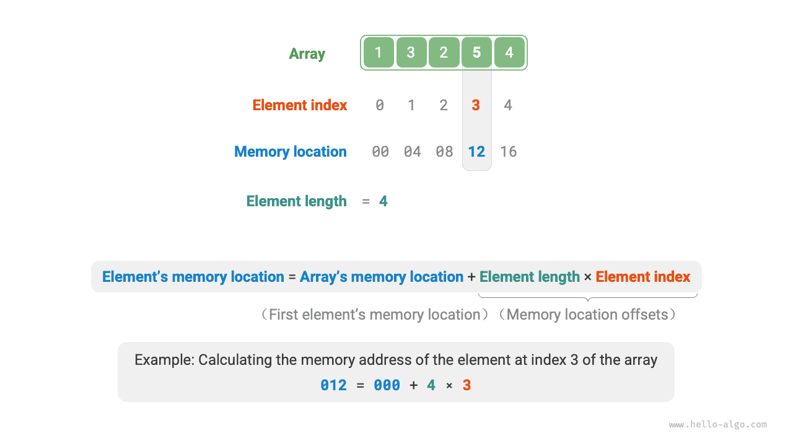

# 配列

<u>配列（array）</u>は、同じ型の要素を連続したメモリ領域に格納する線形データ構造です。配列内での要素の位置を、その要素の<u>インデックス（index）</u>と呼びます。下図に、配列の主な概念と格納方法を示します。


## 配列の主な操作

### 配列の初期化

配列の初期化には、初期値を指定しない方法と、初期値を指定する方法があり、必要に応じて選べます。初期値を指定しない場合、多くのプログラミング言語では要素が $0$ で初期化されます。

=== "Python"

    ```python title="array.py"
    # 配列を初期化
    arr: list[int] = [0] * 5  # [ 0, 0, 0, 0, 0 ]
    nums: list[int] = [1, 3, 2, 5, 4]
    ```

=== "C++"

    ```cpp title="array.cpp"
    /* 配列を初期化 */
    // スタック上に格納
    int arr[5] = {};
    int nums[5] = { 1, 3, 2, 5, 4 };
    // ヒープ上に格納（領域を手動で解放する必要がある）
    int* arr1 = new int[5] {};
    int* nums1 = new int[5] { 1, 3, 2, 5, 4 };
    ```

=== "Java"

    ```java title="array.java"
    /* 配列を初期化 */
    int[] arr = new int[5]; // { 0, 0, 0, 0, 0 }
    int[] nums = { 1, 3, 2, 5, 4 };
    ```

=== "C#"

    ```csharp title="array.cs"
    /* 配列を初期化 */
    int[] arr = new int[5]; // [ 0, 0, 0, 0, 0 ]
    int[] nums = [1, 3, 2, 5, 4];
    ```

=== "Go"

    ```go title="array.go"
    /* 配列を初期化 */
    var arr [5]int
    // Go では、長さを指定すると（[5]int）配列、指定しないと（[]int）スライスになる
    // Go の配列はコンパイル時に長さが決まる設計のため、長さには定数しか指定できない
    // 容量を拡張する extend() メソッドを実装しやすくするため、以下ではスライス（Slice）を配列（Array）として扱う
    nums := []int{1, 3, 2, 5, 4}
    ```

=== "Swift"

    ```swift title="array.swift"
    /* 配列を初期化 */
    let arr = Array(repeating: 0, count: 5) // [0, 0, 0, 0, 0]
    let nums = [1, 3, 2, 5, 4]
    ```

=== "JS"

    ```javascript title="array.js"
    /* 配列を初期化 */
    var arr = new Array(5).fill(0);
    var nums = [1, 3, 2, 5, 4];
    ```

=== "TS"

    ```typescript title="array.ts"
    /* 配列を初期化 */
    let arr: number[] = new Array(5).fill(0);
    let nums: number[] = [1, 3, 2, 5, 4];
    ```

=== "Dart"

    ```dart title="array.dart"
    /* 配列を初期化 */
    List<int> arr = List.filled(5, 0); // [0, 0, 0, 0, 0]
    List<int> nums = [1, 3, 2, 5, 4];
    ```

=== "Rust"

    ```rust title="array.rs"
    /* 配列を初期化 */
    let arr: [i32; 5] = [0; 5]; // [0, 0, 0, 0, 0]
    let slice: &[i32] = &[0; 5];
    // Rust では、長さを指定すると（[i32; 5]）配列、指定しないと（&[i32]）スライスになる
    // Rust の配列はコンパイル時に長さが決まる設計のため、長さには定数しか指定できない
    // Vector は、Rust で通常、動的配列として使う型
    // 容量を拡張する extend() メソッドを実装しやすくするため、以下では vector を配列（array）として扱う
    let nums: Vec<i32> = vec![1, 3, 2, 5, 4];
    ```

=== "C"

    ```c title="array.c"
    /* 配列を初期化 */
    int arr[5] = { 0 }; // { 0, 0, 0, 0, 0 }
    int nums[5] = { 1, 3, 2, 5, 4 };
    ```

=== "Kotlin"

    ```kotlin title="array.kt"
    /* 配列を初期化 */
    var arr = IntArray(5) // { 0, 0, 0, 0, 0 }
    var nums = intArrayOf(1, 3, 2, 5, 4)
    ```

=== "Ruby"

    ```ruby title="array.rb"
    # 配列を初期化
    arr = Array.new(5, 0)
    nums = [1, 3, 2, 5, 4]
    ```

??? pythontutor "実行の可視化"

    https://pythontutor.com/render.html#code=%23%20%E9%85%8D%E5%88%97%E3%82%92%E5%88%9D%E6%9C%9F%E5%8C%96%0Aarr%20%3D%20%5B0%5D%20%2A%205%20%20%23%20%5B%200%2C%200%2C%200%2C%200%2C%200%20%5D%0Anums%20%3D%20%5B1%2C%203%2C%202%2C%205%2C%204%5D&cumulative=false&curInstr=0&heapPrimitives=nevernest&mode=display&origin=opt-frontend.js&py=311&rawInputLstJSON=%5B%5D&textReferences=false

### 要素へのアクセス

配列の要素は連続したメモリ領域に格納されるため、各要素のメモリアドレスは簡単に計算できます。配列のメモリアドレス（先頭要素のメモリアドレス）と要素のインデックスがわかれば、下図の式でその要素のメモリアドレスを求め、直接アクセスできます。



上図では、配列の先頭要素のインデックスが $0$ になっています。数えるなら $1$ から始める方が自然なので、少し直感に反するかもしれません。しかし、アドレスの計算式から見ると、**インデックスは本質的にメモリアドレスのオフセットを表します**。先頭要素のアドレスのオフセットは $0$ なので、インデックスが $0$ であるのは理にかなっています。

配列の要素へのアクセスは非常に効率的で、任意の要素に $O(1)$ 時間でランダムアクセスできます。

```src
[file]{array}-[class]{}-[func]{random_access}
```

### 要素の挿入

配列の要素はメモリ内で「隙間なく並んで」おり、その間にほかのデータを入れる余地はありません。下図のように、配列の途中に要素を挿入するには、その位置以降の要素をすべて一つ後ろへずらしてから、そのインデックスに要素を代入します。


配列の長さは固定されているため、要素を挿入すると、末尾の要素が必ず「失われる」ことに注意してください。この問題の解決方法は「リスト」の節で説明します。

```src
[file]{array}-[class]{}-[func]{insert}
```

### 要素の削除

同様に、下図のようにインデックス $i$ の要素を削除するには、インデックス $i$ より後ろにある要素をすべて一つ前へずらします。


削除後、元の末尾の要素は「意味を持たなくなる」ので、わざわざ変更する必要はありません。

```src
[file]{array}-[class]{}-[func]{remove}
```

配列への挿入と削除には、全体として次の欠点があります。

- **時間計算量が大きい**：配列への挿入と削除の平均時間計算量は、どちらも $O(n)$ です。ここで $n$ は配列の長さです。
- **要素が失われる**：配列の長さは変更できないため、要素を挿入すると、配列の長さを超えた要素は失われます。
- **メモリが無駄になる**：長めの配列を初期化し、前半だけを使えば、挿入時に失われる末尾の要素を「意味のない」ものにできます。ただし、この方法ではメモリ領域の一部が無駄になります。

### 配列の走査

多くのプログラミング言語では、インデックスを使って配列を走査することも、各要素を直接取り出しながら走査することもできます。

```src
[file]{array}-[class]{}-[func]{traverse}
```

### 要素の探索

配列内で指定した要素を探すには、配列を走査し、各要素の値が一致するかを調べます。一致したら、そのインデックスを返します。

配列は線形データ構造であるため、この探索を「線形探索」と呼びます。

```src
[file]{array}-[class]{}-[func]{find}
```

### 配列の容量拡張

複雑なシステム環境では、配列の直後のメモリ領域が空いているとは限らないため、安全に容量を増やすことができません。そのため、多くのプログラミング言語では、**配列の長さは変更できません**。

配列の容量を増やしたい場合は、より大きな配列を新しく作り、元の配列の要素を順にコピーする必要があります。これは $O(n)$ の操作であり、配列が大きいと非常に時間がかかります。コードを次に示します。

```src
[file]{array}-[class]{}-[func]{extend}
```

## 配列の利点と制約

配列は連続したメモリ領域に格納され、要素の型も同じです。この性質には豊富な事前情報が含まれており、システムはそれを利用して操作の効率を高められます。

- **空間効率が高い**：データに連続したメモリ領域を割り当てるため、構造を管理する追加のコストが不要です。
- **ランダムアクセスに対応する**：任意の要素に $O(1)$ 時間でアクセスできます。
- **キャッシュの局所性を活かせる**：配列の要素にアクセスすると、コンピュータはその要素だけでなく周辺のデータもキャッシュに読み込みます。高速なキャッシュにより、その後の操作が速くなります。

連続した領域への格納には、利点だけでなく、次の制約もあります。

- **挿入と削除の効率が低い**：要素が多い場合、挿入や削除の際に大量の要素を移動する必要があります。
- **長さを変更できない**：配列の長さは初期化後に固定されます。容量を増やすには全データを新しい配列へコピーする必要があり、大きなコストがかかります。
- **空間が無駄になる**：実際に必要な量より大きな配列を確保すると、余った空間は無駄になります。

## 配列の代表的な用途

配列は基本的で広く使われるデータ構造です。各種アルゴリズムに頻繁に使われるほか、複雑なデータ構造の実装にも使えます。

- **ランダムアクセス**：無作為にサンプルを抽出したい場合は、データを配列に格納し、乱数列を生成して、その値をインデックスに使えばランダムサンプリングができます。
- **ソートと探索**：配列はソートや探索のアルゴリズムで最もよく使われるデータ構造です。クイックソート、マージソート、二分探索などは、主に配列上で行います。
- **参照表**：要素やその対応関係をすばやく調べたい場合、配列を参照表として使えます。たとえば文字から ASCII コードへの対応を実装するには、文字の ASCII コード値をインデックスとし、配列の対応する位置に要素を格納します。
- **機械学習**：ニューラルネットワークでは、ベクトル、行列、テンソル間の線形代数演算を大量に使い、それらのデータは配列として構成されます。配列はニューラルネットワークのプログラミングで最もよく使われるデータ構造です。
- **データ構造の実装**：配列はスタック、キュー、ハッシュテーブル、ヒープ、グラフなどの実装に使えます。たとえば、グラフの隣接行列は実際には二次元配列です。
