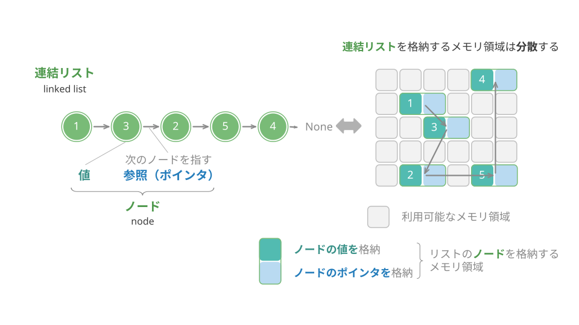

# 連結リスト

メモリ領域はすべてのプログラムが利用する資源です。複雑なシステム環境では空き領域がメモリのあちこちに散らばることがあります。配列を格納する領域は連続していなければならないため、非常に大きな配列では、必要な長さの連続領域を確保できないかもしれません。こんなときに連結リストの柔軟性が生きます。

<u>連結リスト（linked list）</u>は線形データ構造の一種で、各要素はノードというオブジェクトです。ノードどうしは「参照」でつながっています。参照には次のノードのメモリアドレスが記録されており、現在のノードから次のノードにアクセスできます。

この仕組みにより、連結リストのノードはメモリのあちこちに分けて配置できます。アドレスが連続している必要はありません。



上の図で連結リストを構成する単位は、<u>ノード（node）</u>と呼ばれるオブジェクトです。各ノードは自分の「値」と、次のノードを指す「参照」の 2 つを持ちます。

- リストの最初のノードを「先頭ノード」、最後のノードを「末尾ノード」と呼びます。
- 末尾ノードが指すのは「空」で、Java、C++、Python ではそれぞれ `null`、`nullptr`、`None` と書きます。
- C、C++、Go、Rust など、ポインタを扱う言語では、ここでの「参照」を「ポインタ」と読み替えます。

次のコードのように、連結リストのノード `ListNode` は値に加えて参照（ポインタ）を 1 つ保持します。そのため、データ量が同じなら、**連結リストは配列より多くのメモリを使います**。

```snippet
list_node_class
```

## 連結リストの基本操作

### 連結リストを初期化する

連結リストを作るには、まず個々のノードを初期化し、次に参照でノードどうしをつなぎます。初期化が済んだら、先頭ノードから参照 `next` をたどってすべてのノードを順に訪問できます。

```snippet
init_linked_list
```

??? pythontutor "実行の様子を見る"

    @tutor init_linked_list_tutor

配列は全体で 1 つの変数です。たとえば、配列 `nums` には `nums[0]` や `nums[1]` といった要素が含まれます。一方、連結リストは独立した複数のノードオブジェクトで構成されます。**通常は先頭ノードで連結リスト全体を表します**。たとえば、上のコードのリストは「連結リスト `n0`」と書けます。

### ノードを挿入する

連結リストへのノードの挿入は簡単です。次の図のように、隣り合うノード `n0` と `n1` の間に新しいノード `P` を挿入するには、**ノードの参照（ポインタ）を 2 つ書き換えるだけで済みます**。時間計算量は $O(1)$ です。

これに対し、配列への要素の挿入は時間計算量が $O(n)$ で、データ量が大きいと効率が低くなります。


```src
[file]{linked_list}-[class]{}-[func]{insert}
```

### ノードを削除する

次の図のように、連結リストからノードを削除するのも簡単です。**ノードの参照（ポインタ）を 1 つ書き換えるだけで済みます**。

削除が済んでもノード `P` はまだ `n1` を指しています。しかし、このリストをたどっても `P` にはもう到達できません。つまり `P` はすでにリストから外れています。


```src
[file]{linked_list}-[class]{}-[func]{remove}
```

### ノードにアクセスする

**連結リストで指定位置のノードにアクセスする効率は高くありません**。前節のように、配列ならどの要素にも $O(1)$ 時間でアクセスできます。連結リストでは、先頭ノードから出発し、目的のノードが見つかるまで 1 つずつたどる必要があります。つまり $i$ 番目のノードにアクセスするにはループを $i - 1$ 回繰り返すので、時間計算量は $O(n)$ です。

```src
[file]{linked_list}-[class]{}-[func]{access}
```

### ノードを探す

連結リストを走査して、値が `target` のノードを探し、リスト内でのインデックスを出力します。これも線形探索です。コードは以下のとおりです。

```src
[file]{linked_list}-[class]{}-[func]{find}
```

## 配列と連結リストの比較

次の表は、配列と連結リストの特徴と操作の効率を比較したものです。両者は対照的な格納方法を取るので、性質や操作の効率にも対照的な特徴が現れます。

<p align="center"> 表 <id> &nbsp; 配列と連結リストの効率の比較 </p>

|          | 配列                           | 連結リスト           |
| -------- | ------------------------------ | -------------- |
| 格納方法 | 連続したメモリ領域                   | 分散したメモリ領域   |
| 容量の拡張 | 長さは固定                     | 柔軟に拡張可能     |
| メモリ効率 | 要素あたりのメモリは少ないが、領域が無駄になることがある | 要素あたりのメモリが多い |
| 要素にアクセスする | $O(1)$                         | $O(n)$         |
| 要素の追加 | $O(n)$                         | $O(1)$         |
| 要素を削除する | $O(n)$                         | $O(1)$         |

## 代表的な連結リストの種類

次の図に示すように、代表的な連結リストには 3 つの種類があります。

- **単方向連結リスト**：これまでに説明した通常の連結リストです。各ノードが持つのは、値と次のノードへの参照の 2 つです。最初のノードを先頭ノード、最後のノードを末尾ノードと呼び、末尾ノードは空を表す `None` を指します。
- **循環連結リスト**：単方向連結リストの末尾ノードが先頭ノードを指すようにして両端をつなぐと、循環連結リストになります。循環連結リストでは、どのノードも先頭とみなせます。
- **双方向連結リスト**：単方向連結リストと違い、双方向連結リストは 2 方向の参照を記録します。各ノードの定義には、後続ノード（次のノード）と先行ノード（前のノード）への参照（ポインタ）が含まれます。単方向連結リストより柔軟で、どちらの方向にもたどれますが、その分多くのメモリを使います。

```snippet
doubly_list_node_class
```


## 連結リストの代表的な用途

単方向連結リストは、スタック、キュー、ハッシュテーブル、グラフなどの実装によく使われます。

- **スタックとキュー**：挿入と削除をどちらもリストの同じ端で行うと、先に入れたものが後で出るスタックになります。一方の端で挿入し、もう一方の端で削除すると、先に入れたものが先に出るキューになります。
- **ハッシュテーブル**：ハッシュの衝突を解決する代表的な方法の 1 つがチェイン法です。この方法では、衝突したすべての要素を 1 つの連結リストに格納します。
- **グラフ**：グラフを表す一般的な方法に隣接リストがあります。各頂点に連結リストを対応付け、リストの各要素で、その頂点とつながるほかの頂点を表します。

双方向連結リストは、前後の要素をすばやく見つけたい場面でよく使われます。

- **高度なデータ構造**：たとえば赤黒木や B 木では、ノードからその親ノードにアクセスする必要があります。双方向連結リストと同じように、ノードに親ノードへの参照を持たせることで実現できます。
- **ブラウザの履歴**：利用者が「進む」や「戻る」を押したとき、ブラウザは訪問履歴の前後のページを特定する必要があります。双方向連結リストの性質を利用すると、この操作を簡単に実現できます。
- **LRU アルゴリズム**：キャッシュからデータを追い出す LRU アルゴリズムでは、最後に使われてから最も時間がたったデータをすばやく見つけ、ノードを高速に追加・削除する必要があります。双方向連結リストが適した場面です。

循環連結リストは、OS の資源スケジューリングなど、周期的な操作が必要な場面でよく使われます。

- **ラウンドロビン・スケジューリング**：OS で広く使われる CPU スケジューリング方式で、一連のプロセスを順に繰り返し処理します。各プロセスに一定の実行時間（タイムスライス）を割り当て、使い切ったら CPU は次のプロセスに切り替わります。この巡回は循環連結リストで実現できます。
- **データバッファ**：データバッファの実装にも循環連結リストを使うことがあります。たとえば音声や動画のプレーヤーでは、ストリームを複数のバッファブロックに分けて循環連結リストに格納することで、途切れのない再生を実現できます。
