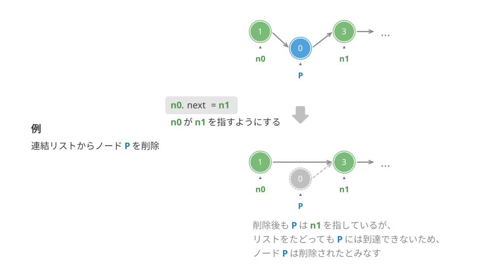

# 4.2 &nbsp; 連結リスト

メモリ領域はすべてのプログラムが利用する資源です。複雑なシステム環境では空き領域がメモリのあちこちに散らばることがあります。配列を格納する領域は連続していなければならないため、非常に大きな配列では、必要な長さの連続領域を確保できないかもしれません。こんなときに連結リストの柔軟性が生きます。

<u>連結リスト（linked list）</u>は線形データ構造の一種で、各要素はノードというオブジェクトです。ノードどうしは「参照」でつながっています。参照には次のノードのメモリアドレスが記録されており、現在のノードから次のノードにアクセスできます。

この仕組みにより、連結リストのノードはメモリのあちこちに分けて配置できます。アドレスが連続している必要はありません。

{ class="animation-figure" }

<p align="center"> 図 4-5 &nbsp; 連結リストの定義と格納方法 </p>

図 4-5 で連結リストを構成する単位は、<u>ノード（node）</u>と呼ばれるオブジェクトです。各ノードは自分の「値」と、次のノードを指す「参照」の 2 つを持ちます。

- リストの最初のノードを「先頭ノード」、最後のノードを「末尾ノード」と呼びます。
- 末尾ノードが指すのは「空」で、Java、C++、Python ではそれぞれ `null`、`nullptr`、`None` と書きます。
- C、C++、Go、Rust など、ポインタを扱う言語では、ここでの「参照」を「ポインタ」と読み替えます。

次のコードのように、連結リストのノード `ListNode` は値に加えて参照（ポインタ）を 1 つ保持します。そのため、データ量が同じなら、**連結リストは配列より多くのメモリを使います**。

=== "Python"

    ```python title=""
    class ListNode:
        """連結リストのノードクラス"""

        def __init__(self, val: int):
            self.val: int = val  # ノードの値
            self.next: ListNode | None = None  # 次のノードへの参照
    ```

=== "C++"

    ```cpp title=""
    /* 連結リストのノード */
    struct ListNode {
        int val;        // ノードの値
        ListNode *next; // 次のノードへのポインタ
        ListNode(int x) : val(x), next(nullptr) {
        }
    };
    ```

=== "Java"

    ```java title=""
    /* 連結リストのノード */
    public class ListNode {
        public int val;       // ノードの値
        public ListNode next; // 次のノードへの参照

        public ListNode(int x) {
            val = x;
        }
    }
    ```

=== "C#"

    ```csharp title=""
    /* 連結リストのノード */
    public class ListNode(int x) {
        public int val = x;    // ノードの値
        public ListNode? next; // 次のノードへの参照
    }
    ```

=== "Go"

    ```go title=""
    // ListNode は連結リストのノード
    type ListNode struct {
        Val  int       // ノードの値
        Next *ListNode // 次のノードへのポインタ
    }

    // NewListNode は連結リストのノードを作るコンストラクタ
    func NewListNode(v int) *ListNode {
        return &ListNode{
            Val:  v,
            Next: nil,
        }
    }
    ```

=== "Swift"

    ```swift title=""
    /* 連結リストのノードクラス */
    class ListNode {
        var val: Int // ノードの値
        var next: ListNode? // 次のノードへの参照

        init(x: Int) { // コンストラクタ
            val = x
        }
    }
    ```

=== "JS"

    ```javascript title=""
    /* 連結リストのノード */
    class ListNode {
        val; // ノードの値
        next; // 次のノードへの参照（ポインタ）
        constructor(val, next) {
            this.val = val === undefined ? 0 : val;
            this.next = next === undefined ? null : next;
        }
    }
    ```

=== "TS"

    ```typescript title=""
    /* 連結リストのノード */
    class ListNode {
        val: number; // ノードの値
        next: ListNode | null; // 次のノードへの参照
        constructor(val?: number, next?: ListNode | null) {
            this.val = val === undefined ? 0 : val;
            this.next = next === undefined ? null : next;
        }
    }
    ```

=== "Dart"

    ```dart title=""
    /* 連結リストのノード */
    class ListNode {
      int val; // ノードの値
      ListNode? next; // 次のノードへの参照

      ListNode(this.val, [this.next]); // コンストラクタ
    }
    ```

=== "Rust"

    ```rust title=""
    use std::cell::RefCell;
    use std::rc::Rc;

    /* 連結リストのノード */
    #[derive(Debug)]
    pub struct ListNode<T> {
        pub val: T, // ノードの値
        pub next: Option<Rc<RefCell<ListNode<T>>>>, // 次のノードへのポインタ
    }

    impl<T> ListNode<T> {
        pub fn new(val: T) -> Rc<RefCell<ListNode<T>>> {
            Rc::new(RefCell::new(ListNode { val, next: None }))
        }
    }
    ```

=== "C"

    ```c title=""
    /* 連結リストのノードを表す構造体 */
    typedef struct ListNode {
        int val;               // ノードの値
        struct ListNode *next; // 次のノードへのポインタ
    } ListNode;

    /* 新しいノードを初期化するコンストラクタ */
    ListNode *newListNode(int val) {
        ListNode *node;
        node = (ListNode *)malloc(sizeof(ListNode));
        node->val = val;
        node->next = NULL;
        return node;
    }
    ```

=== "Kotlin"

    ```kotlin title=""
    /* 連結リストのノード */
    class ListNode(var _val: Int) {
        var next: ListNode? = null // 次のノードへの参照
    }
    ```

=== "Ruby"

    ```ruby title=""
    ### 連結リストのノードクラス ###
    class ListNode
      attr_accessor :val  # ノードの値
      attr_accessor :next # 次のノードへの参照

      def initialize(val=0, next_node=nil)
        @val = val
        @next = next_node
      end
    end
    ```

## 4.2.1 &nbsp; 連結リストの基本操作

### 1. &nbsp; 連結リストを初期化する

連結リストを作るには、まず個々のノードを初期化し、次に参照でノードどうしをつなぎます。初期化が済んだら、先頭ノードから参照 `next` をたどってすべてのノードを順に訪問できます。

=== "Python"

    ```python title="linked_list.py"
    # 連結リスト 1 -> 3 -> 2 -> 5 -> 4 を初期化する
    # 各ノードを初期化する
    n0 = ListNode(1)
    n1 = ListNode(3)
    n2 = ListNode(2)
    n3 = ListNode(5)
    n4 = ListNode(4)
    # ノード間の参照を設定する
    n0.next = n1
    n1.next = n2
    n2.next = n3
    n3.next = n4
    ```

=== "C++"

    ```cpp title="linked_list.cpp"
    /* 連結リスト 1 -> 3 -> 2 -> 5 -> 4 を初期化する */
    // 各ノードを初期化する
    ListNode *n0 = new ListNode(1);
    ListNode *n1 = new ListNode(3);
    ListNode *n2 = new ListNode(2);
    ListNode *n3 = new ListNode(5);
    ListNode *n4 = new ListNode(4);
    // ノード間の参照を設定する
    n0->next = n1;
    n1->next = n2;
    n2->next = n3;
    n3->next = n4;
    ```

=== "Java"

    ```java title="linked_list.java"
    /* 連結リスト 1 -> 3 -> 2 -> 5 -> 4 を初期化する */
    // 各ノードを初期化する
    ListNode n0 = new ListNode(1);
    ListNode n1 = new ListNode(3);
    ListNode n2 = new ListNode(2);
    ListNode n3 = new ListNode(5);
    ListNode n4 = new ListNode(4);
    // ノード間の参照を設定する
    n0.next = n1;
    n1.next = n2;
    n2.next = n3;
    n3.next = n4;
    ```

=== "C#"

    ```csharp title="linked_list.cs"
    // 連結リスト 1 -> 3 -> 2 -> 5 -> 4 を初期化する
    // 各ノードを初期化する
    ListNode n0 = new(1);
    ListNode n1 = new(3);
    ListNode n2 = new(2);
    ListNode n3 = new(5);
    ListNode n4 = new(4);
    // ノード間の参照を設定する
    n0.next = n1;
    n1.next = n2;
    n2.next = n3;
    n3.next = n4;
    ```

=== "Go"

    ```go title="linked_list.go"
    /* 連結リスト 1 -> 3 -> 2 -> 5 -> 4 を初期化する */
    // 各ノードを初期化する
    n0 := NewListNode(1)
    n1 := NewListNode(3)
    n2 := NewListNode(2)
    n3 := NewListNode(5)
    n4 := NewListNode(4)

    // ノード間の参照を設定する
    n0.Next = n1
    n1.Next = n2
    n2.Next = n3
    n3.Next = n4
    ```

=== "Swift"

    ```swift title="linked_list.swift"
    /* 連結リスト 1 -> 3 -> 2 -> 5 -> 4 を初期化する */
    // 各ノードを初期化する
    let n0 = ListNode(x: 1)
    let n1 = ListNode(x: 3)
    let n2 = ListNode(x: 2)
    let n3 = ListNode(x: 5)
    let n4 = ListNode(x: 4)
    // ノード間の参照を設定する
    n0.next = n1
    n1.next = n2
    n2.next = n3
    n3.next = n4
    ```

=== "JS"

    ```javascript title="linked_list.js"
    /* 連結リスト 1 -> 3 -> 2 -> 5 -> 4 を初期化する */
    // 各ノードを初期化する
    const n0 = new ListNode(1);
    const n1 = new ListNode(3);
    const n2 = new ListNode(2);
    const n3 = new ListNode(5);
    const n4 = new ListNode(4);
    // ノード間の参照を設定する
    n0.next = n1;
    n1.next = n2;
    n2.next = n3;
    n3.next = n4;
    ```

=== "TS"

    ```typescript title="linked_list.ts"
    /* 連結リスト 1 -> 3 -> 2 -> 5 -> 4 を初期化する */
    // 各ノードを初期化する
    const n0 = new ListNode(1);
    const n1 = new ListNode(3);
    const n2 = new ListNode(2);
    const n3 = new ListNode(5);
    const n4 = new ListNode(4);
    // ノード間の参照を設定する
    n0.next = n1;
    n1.next = n2;
    n2.next = n3;
    n3.next = n4;
    ```

=== "Dart"

    ```dart title="linked_list.dart"
    // 連結リスト 1 -> 3 -> 2 -> 5 -> 4 を初期化する
    // 各ノードを初期化する
    ListNode n0 = ListNode(1);
    ListNode n1 = ListNode(3);
    ListNode n2 = ListNode(2);
    ListNode n3 = ListNode(5);
    ListNode n4 = ListNode(4);
    // ノード間の参照を設定する
    n0.next = n1;
    n1.next = n2;
    n2.next = n3;
    n3.next = n4;
    ```

=== "Rust"

    ```rust title="linked_list.rs"
    /* 連結リスト 1 -> 3 -> 2 -> 5 -> 4 を初期化する */
    // 各ノードを初期化する
    let n0 = ListNode::new(1);
    let n1 = ListNode::new(3);
    let n2 = ListNode::new(2);
    let n3 = ListNode::new(5);
    let n4 = ListNode::new(4);

    // ノード間の参照を設定する
    n0.borrow_mut().next = Some(n1.clone());
    n1.borrow_mut().next = Some(n2.clone());
    n2.borrow_mut().next = Some(n3.clone());
    n3.borrow_mut().next = Some(n4.clone());
    ```

=== "C"

    ```c title="linked_list.c"
    /* 連結リスト 1 -> 3 -> 2 -> 5 -> 4 を初期化する */
    // 各ノードを初期化する
    ListNode *n0 = newListNode(1);
    ListNode *n1 = newListNode(3);
    ListNode *n2 = newListNode(2);
    ListNode *n3 = newListNode(5);
    ListNode *n4 = newListNode(4);
    // ノード間の参照を設定する
    n0->next = n1;
    n1->next = n2;
    n2->next = n3;
    n3->next = n4;
    ```

=== "Kotlin"

    ```kotlin title="linked_list.kt"
    /* 連結リスト 1 -> 3 -> 2 -> 5 -> 4 を初期化する */
    // 各ノードを初期化する
    val n0 = ListNode(1)
    val n1 = ListNode(3)
    val n2 = ListNode(2)
    val n3 = ListNode(5)
    val n4 = ListNode(4)

    // ノード間の参照を設定する
    n0.next = n1
    n1.next = n2
    n2.next = n3
    n3.next = n4
    ```

=== "Ruby"

    ```ruby title="linked_list.rb"
    # 連結リスト 1 -> 3 -> 2 -> 5 -> 4 を初期化する
    # 各ノードを初期化する
    n0 = ListNode.new(1)
    n1 = ListNode.new(3)
    n2 = ListNode.new(2)
    n3 = ListNode.new(5)
    n4 = ListNode.new(4)
    # ノード間の参照を設定する
    n0.next = n1
    n1.next = n2
    n2.next = n3
    n3.next = n4
    ```

??? pythontutor "実行の様子を見る"

    <div style="height: 549px; width: 100%;"><iframe class="pythontutor-iframe" title="実行の様子を見る" src="https://pythontutor.com/iframe-embed.html#code=class%20ListNode%3A%0A%20%20%20%20%22%22%22%E9%80%A3%E7%B5%90%E3%83%AA%E3%82%B9%E3%83%88%E3%81%AE%E3%83%8E%E3%83%BC%E3%83%89%E3%82%92%E8%A1%A8%E3%81%99%E3%82%AF%E3%83%A9%E3%82%B9%22%22%22%0A%20%20%20%20def%20__init__%28self,%20val%3A%20int%29%3A%0A%20%20%20%20%20%20%20%20self.val%3A%20int%20%3D%20val%20%20%23%20%E3%83%8E%E3%83%BC%E3%83%89%E3%81%AE%E5%80%A4%0A%20%20%20%20%20%20%20%20self.next%3A%20ListNode%20%7C%20None%20%3D%20None%20%20%23%20%E6%AC%A1%E3%81%AE%E3%83%8E%E3%83%BC%E3%83%89%E3%81%B8%E3%81%AE%E5%8F%82%E7%85%A7%0A%0A%22%22%22Driver%20Code%22%22%22%0Aif%20__name__%20%3D%3D%20%22__main__%22%3A%0A%20%20%20%20%23%20%E9%80%A3%E7%B5%90%E3%83%AA%E3%82%B9%E3%83%88%201%20-%3E%203%20-%3E%202%20-%3E%205%20-%3E%204%20%E3%82%92%E5%88%9D%E6%9C%9F%E5%8C%96%0A%20%20%20%20%23%20%E5%90%84%E3%83%8E%E3%83%BC%E3%83%89%E3%82%92%E5%88%9D%E6%9C%9F%E5%8C%96%0A%20%20%20%20n0%20%3D%20ListNode%281%29%0A%20%20%20%20n1%20%3D%20ListNode%283%29%0A%20%20%20%20n2%20%3D%20ListNode%282%29%0A%20%20%20%20n3%20%3D%20ListNode%285%29%0A%20%20%20%20n4%20%3D%20ListNode%284%29%0A%20%20%20%20%23%20%E5%8F%82%E7%85%A7%E3%81%A7%E3%83%8E%E3%83%BC%E3%83%89%E3%82%92%E3%81%A4%E3%81%AA%E3%81%90%0A%20%20%20%20n0.next%20%3D%20n1%0A%20%20%20%20n1.next%20%3D%20n2%0A%20%20%20%20n2.next%20%3D%20n3%0A%20%20%20%20n3.next%20%3D%20n4&codeDivHeight=472&codeDivWidth=350&cumulative=false&curInstr=3&heapPrimitives=nevernest&origin=opt-frontend.js&py=311&rawInputLstJSON=%5B%5D&textReferences=false"> </iframe></div>
    <div style="margin-top: 5px;"><a href="https://pythontutor.com/iframe-embed.html#code=class%20ListNode%3A%0A%20%20%20%20%22%22%22%E9%80%A3%E7%B5%90%E3%83%AA%E3%82%B9%E3%83%88%E3%81%AE%E3%83%8E%E3%83%BC%E3%83%89%E3%82%92%E8%A1%A8%E3%81%99%E3%82%AF%E3%83%A9%E3%82%B9%22%22%22%0A%20%20%20%20def%20__init__%28self,%20val%3A%20int%29%3A%0A%20%20%20%20%20%20%20%20self.val%3A%20int%20%3D%20val%20%20%23%20%E3%83%8E%E3%83%BC%E3%83%89%E3%81%AE%E5%80%A4%0A%20%20%20%20%20%20%20%20self.next%3A%20ListNode%20%7C%20None%20%3D%20None%20%20%23%20%E6%AC%A1%E3%81%AE%E3%83%8E%E3%83%BC%E3%83%89%E3%81%B8%E3%81%AE%E5%8F%82%E7%85%A7%0A%0A%22%22%22Driver%20Code%22%22%22%0Aif%20__name__%20%3D%3D%20%22__main__%22%3A%0A%20%20%20%20%23%20%E9%80%A3%E7%B5%90%E3%83%AA%E3%82%B9%E3%83%88%201%20-%3E%203%20-%3E%202%20-%3E%205%20-%3E%204%20%E3%82%92%E5%88%9D%E6%9C%9F%E5%8C%96%0A%20%20%20%20%23%20%E5%90%84%E3%83%8E%E3%83%BC%E3%83%89%E3%82%92%E5%88%9D%E6%9C%9F%E5%8C%96%0A%20%20%20%20n0%20%3D%20ListNode%281%29%0A%20%20%20%20n1%20%3D%20ListNode%283%29%0A%20%20%20%20n2%20%3D%20ListNode%282%29%0A%20%20%20%20n3%20%3D%20ListNode%285%29%0A%20%20%20%20n4%20%3D%20ListNode%284%29%0A%20%20%20%20%23%20%E5%8F%82%E7%85%A7%E3%81%A7%E3%83%8E%E3%83%BC%E3%83%89%E3%82%92%E3%81%A4%E3%81%AA%E3%81%90%0A%20%20%20%20n0.next%20%3D%20n1%0A%20%20%20%20n1.next%20%3D%20n2%0A%20%20%20%20n2.next%20%3D%20n3%0A%20%20%20%20n3.next%20%3D%20n4&codeDivHeight=800&codeDivWidth=600&cumulative=false&curInstr=3&heapPrimitives=nevernest&origin=opt-frontend.js&py=311&rawInputLstJSON=%5B%5D&textReferences=false" target="_blank" rel="noopener noreferrer">全画面で表示 ></a></div>

配列は全体で 1 つの変数です。たとえば、配列 `nums` には `nums[0]` や `nums[1]` といった要素が含まれます。一方、連結リストは独立した複数のノードオブジェクトで構成されます。**通常は先頭ノードで連結リスト全体を表します**。たとえば、上のコードのリストは「連結リスト `n0`」と書けます。

### 2. &nbsp; ノードを挿入する

連結リストへのノードの挿入は簡単です。図 4-6 のように、隣り合うノード `n0` と `n1` の間に新しいノード `P` を挿入するには、**ノードの参照（ポインタ）を 2 つ書き換えるだけで済みます**。時間計算量は $O(1)$ です。

これに対し、配列への要素の挿入は時間計算量が $O(n)$ で、データ量が大きいと効率が低くなります。

{ class="animation-figure" }

<p align="center"> 図 4-6 &nbsp; 連結リストにノードを挿入する例 </p>

=== "Python"

    ```python title="linked_list.py"
    def insert(n0: ListNode, P: ListNode):
        """連結リストのノード n0 の直後にノード P を挿入する"""
        n1 = n0.next
        P.next = n1
        n0.next = P
    ```

=== "C++"

    ```cpp title="linked_list.cpp"
    /* 連結リストのノード n0 の直後にノード P を挿入する */
    void insert(ListNode *n0, ListNode *P) {
        ListNode *n1 = n0->next;
        P->next = n1;
        n0->next = P;
    }
    ```

=== "Java"

    ```java title="linked_list.java"
    /* 連結リストのノード n0 の直後にノード P を挿入する */
    void insert(ListNode n0, ListNode P) {
        ListNode n1 = n0.next;
        P.next = n1;
        n0.next = P;
    }
    ```

=== "C#"

    ```csharp title="linked_list.cs"
    /* 連結リストのノード n0 の直後にノード P を挿入する */
    void Insert(ListNode n0, ListNode P) {
        ListNode? n1 = n0.next;
        P.next = n1;
        n0.next = P;
    }
    ```

=== "Go"

    ```go title="linked_list.go"
    /* 連結リストのノード n0 の直後にノード P を挿入する */
    func insertNode(n0 *ListNode, P *ListNode) {
        n1 := n0.Next
        P.Next = n1
        n0.Next = P
    }
    ```

=== "Swift"

    ```swift title="linked_list.swift"
    /* 連結リストのノード n0 の直後にノード P を挿入する */
    func insert(n0: ListNode, P: ListNode) {
        let n1 = n0.next
        P.next = n1
        n0.next = P
    }
    ```

=== "JS"

    ```javascript title="linked_list.js"
    /* 連結リストのノード n0 の直後にノード P を挿入する */
    function insert(n0, P) {
        const n1 = n0.next;
        P.next = n1;
        n0.next = P;
    }
    ```

=== "TS"

    ```typescript title="linked_list.ts"
    /* 連結リストのノード n0 の直後にノード P を挿入する */
    function insert(n0: ListNode, P: ListNode): void {
        const n1 = n0.next;
        P.next = n1;
        n0.next = P;
    }
    ```

=== "Dart"

    ```dart title="linked_list.dart"
    /* 連結リストのノード n0 の直後にノード P を挿入する */
    void insert(ListNode n0, ListNode P) {
      ListNode? n1 = n0.next;
      P.next = n1;
      n0.next = P;
    }
    ```

=== "Rust"

    ```rust title="linked_list.rs"
    /* 連結リストのノード n0 の直後にノード P を挿入する */
    #[allow(non_snake_case)]
    pub fn insert<T>(n0: &Rc<RefCell<ListNode<T>>>, P: Rc<RefCell<ListNode<T>>>) {
        let n1 = n0.borrow_mut().next.take();
        P.borrow_mut().next = n1;
        n0.borrow_mut().next = Some(P);
    }
    ```

=== "C"

    ```c title="linked_list.c"
    /* 連結リストのノード n0 の直後にノード P を挿入する */
    void insert(ListNode *n0, ListNode *P) {
        ListNode *n1 = n0->next;
        P->next = n1;
        n0->next = P;
    }
    ```

=== "Kotlin"

    ```kotlin title="linked_list.kt"
    /* 連結リストのノード n0 の直後にノード P を挿入する */
    fun insert(n0: ListNode?, p: ListNode?) {
        val n1 = n0?.next
        p?.next = n1
        n0?.next = p
    }
    ```

=== "Ruby"

    ```ruby title="linked_list.rb"
    ### 連結リストのノード n0 の直後にノード _p を挿入する ###
    # Ruby の `p` は組み込み関数、`P` は定数なので、代わりに `_p` を使える
    def insert(n0, _p)
      n1 = n0.next
      _p.next = n1
      n0.next = _p
    end
    ```

??? pythontutor "実行の様子を見る"

    <div style="height: 549px; width: 100%;"><iframe class="pythontutor-iframe" title="実行の様子を見る" src="https://pythontutor.com/iframe-embed.html#code=class%20ListNode%3A%0A%20%20%20%20%22%22%22%E9%80%A3%E7%B5%90%E3%83%AA%E3%82%B9%E3%83%88%E3%81%AE%E3%83%8E%E3%83%BC%E3%83%89%E3%82%AF%E3%83%A9%E3%82%B9%22%22%22%0A%20%20%20%20def%20__init__%28self,%20val%3A%20int%29%3A%0A%20%20%20%20%20%20%20%20self.val%3A%20int%20%3D%20val%20%20%23%20%E3%83%8E%E3%83%BC%E3%83%89%E3%81%AE%E5%80%A4%0A%20%20%20%20%20%20%20%20self.next%3A%20ListNode%20%7C%20None%20%3D%20None%20%20%23%20%E6%AC%A1%E3%81%AE%E3%83%8E%E3%83%BC%E3%83%89%E3%81%B8%E3%81%AE%E5%8F%82%E7%85%A7%0A%0Adef%20insert%28n0%3A%20ListNode,%20P%3A%20ListNode%29%3A%0A%20%20%20%20%22%22%22%E9%80%A3%E7%B5%90%E3%83%AA%E3%82%B9%E3%83%88%E3%81%AE%E3%83%8E%E3%83%BC%E3%83%89%20n0%20%E3%81%AE%E7%9B%B4%E5%BE%8C%E3%81%AB%E3%83%8E%E3%83%BC%E3%83%89%20P%20%E3%82%92%E6%8C%BF%E5%85%A5%E3%81%99%E3%82%8B%22%22%22%0A%20%20%20%20n1%20%3D%20n0.next%0A%20%20%20%20P.next%20%3D%20n1%0A%20%20%20%20n0.next%20%3D%20P%0A%0A%22%22%22Driver%20Code%22%22%22%0Aif%20__name__%20%3D%3D%20%22__main__%22%3A%0A%20%20%20%20%23%20%E9%80%A3%E7%B5%90%E3%83%AA%E3%82%B9%E3%83%88%E3%82%92%E5%88%9D%E6%9C%9F%E5%8C%96%E3%81%99%E3%82%8B%0A%20%20%20%20%23%20%E5%90%84%E3%83%8E%E3%83%BC%E3%83%89%E3%82%92%E5%88%9D%E6%9C%9F%E5%8C%96%E3%81%99%E3%82%8B%0A%20%20%20%20n0%20%3D%20ListNode%281%29%0A%20%20%20%20n1%20%3D%20ListNode%283%29%0A%20%20%20%20n2%20%3D%20ListNode%282%29%0A%20%20%20%20n3%20%3D%20ListNode%285%29%0A%20%20%20%20n4%20%3D%20ListNode%284%29%0A%20%20%20%20%23%20%E3%83%8E%E3%83%BC%E3%83%89%E9%96%93%E3%81%AE%E5%8F%82%E7%85%A7%E3%82%92%E8%A8%AD%E5%AE%9A%E3%81%99%E3%82%8B%0A%20%20%20%20n0.next%20%3D%20n1%0A%20%20%20%20n1.next%20%3D%20n2%0A%20%20%20%20n2.next%20%3D%20n3%0A%20%20%20%20n3.next%20%3D%20n4%0A%0A%20%20%20%20%23%20%E3%83%8E%E3%83%BC%E3%83%89%E3%82%92%E6%8C%BF%E5%85%A5%E3%81%99%E3%82%8B%0A%20%20%20%20p%20%3D%20ListNode%280%29%0A%20%20%20%20insert%28n0,%20p%29&codeDivHeight=472&codeDivWidth=350&cumulative=false&curInstr=39&heapPrimitives=nevernest&origin=opt-frontend.js&py=311&rawInputLstJSON=%5B%5D&textReferences=false"> </iframe></div>
    <div style="margin-top: 5px;"><a href="https://pythontutor.com/iframe-embed.html#code=class%20ListNode%3A%0A%20%20%20%20%22%22%22%E9%80%A3%E7%B5%90%E3%83%AA%E3%82%B9%E3%83%88%E3%81%AE%E3%83%8E%E3%83%BC%E3%83%89%E3%82%AF%E3%83%A9%E3%82%B9%22%22%22%0A%20%20%20%20def%20__init__%28self,%20val%3A%20int%29%3A%0A%20%20%20%20%20%20%20%20self.val%3A%20int%20%3D%20val%20%20%23%20%E3%83%8E%E3%83%BC%E3%83%89%E3%81%AE%E5%80%A4%0A%20%20%20%20%20%20%20%20self.next%3A%20ListNode%20%7C%20None%20%3D%20None%20%20%23%20%E6%AC%A1%E3%81%AE%E3%83%8E%E3%83%BC%E3%83%89%E3%81%B8%E3%81%AE%E5%8F%82%E7%85%A7%0A%0Adef%20insert%28n0%3A%20ListNode,%20P%3A%20ListNode%29%3A%0A%20%20%20%20%22%22%22%E9%80%A3%E7%B5%90%E3%83%AA%E3%82%B9%E3%83%88%E3%81%AE%E3%83%8E%E3%83%BC%E3%83%89%20n0%20%E3%81%AE%E7%9B%B4%E5%BE%8C%E3%81%AB%E3%83%8E%E3%83%BC%E3%83%89%20P%20%E3%82%92%E6%8C%BF%E5%85%A5%E3%81%99%E3%82%8B%22%22%22%0A%20%20%20%20n1%20%3D%20n0.next%0A%20%20%20%20P.next%20%3D%20n1%0A%20%20%20%20n0.next%20%3D%20P%0A%0A%22%22%22Driver%20Code%22%22%22%0Aif%20__name__%20%3D%3D%20%22__main__%22%3A%0A%20%20%20%20%23%20%E9%80%A3%E7%B5%90%E3%83%AA%E3%82%B9%E3%83%88%E3%82%92%E5%88%9D%E6%9C%9F%E5%8C%96%E3%81%99%E3%82%8B%0A%20%20%20%20%23%20%E5%90%84%E3%83%8E%E3%83%BC%E3%83%89%E3%82%92%E5%88%9D%E6%9C%9F%E5%8C%96%E3%81%99%E3%82%8B%0A%20%20%20%20n0%20%3D%20ListNode%281%29%0A%20%20%20%20n1%20%3D%20ListNode%283%29%0A%20%20%20%20n2%20%3D%20ListNode%282%29%0A%20%20%20%20n3%20%3D%20ListNode%285%29%0A%20%20%20%20n4%20%3D%20ListNode%284%29%0A%20%20%20%20%23%20%E3%83%8E%E3%83%BC%E3%83%89%E9%96%93%E3%81%AE%E5%8F%82%E7%85%A7%E3%82%92%E8%A8%AD%E5%AE%9A%E3%81%99%E3%82%8B%0A%20%20%20%20n0.next%20%3D%20n1%0A%20%20%20%20n1.next%20%3D%20n2%0A%20%20%20%20n2.next%20%3D%20n3%0A%20%20%20%20n3.next%20%3D%20n4%0A%0A%20%20%20%20%23%20%E3%83%8E%E3%83%BC%E3%83%89%E3%82%92%E6%8C%BF%E5%85%A5%E3%81%99%E3%82%8B%0A%20%20%20%20p%20%3D%20ListNode%280%29%0A%20%20%20%20insert%28n0,%20p%29&codeDivHeight=800&codeDivWidth=600&cumulative=false&curInstr=39&heapPrimitives=nevernest&origin=opt-frontend.js&py=311&rawInputLstJSON=%5B%5D&textReferences=false" target="_blank" rel="noopener noreferrer">全画面で表示 ></a></div>

### 3. &nbsp; ノードを削除する

図 4-7 のように、連結リストからノードを削除するのも簡単です。**ノードの参照（ポインタ）を 1 つ書き換えるだけで済みます**。

削除が済んでもノード `P` はまだ `n1` を指しています。しかし、このリストをたどっても `P` にはもう到達できません。つまり `P` はすでにリストから外れています。

{ class="animation-figure" }

<p align="center"> 図 4-7 &nbsp; 連結リストからのノードの削除 </p>

=== "Python"

    ```python title="linked_list.py"
    def remove(n0: ListNode):
        """連結リストのノード n0 の直後にあるノードを削除する"""
        if not n0.next:
            return
        # n0 -> P -> n1
        P = n0.next
        n1 = P.next
        n0.next = n1
    ```

=== "C++"

    ```cpp title="linked_list.cpp"
    /* 連結リストのノード n0 の直後にあるノードを削除する */
    void remove(ListNode *n0) {
        if (n0->next == nullptr)
            return;
        // n0 -> P -> n1
        ListNode *P = n0->next;
        ListNode *n1 = P->next;
        n0->next = n1;
        // メモリを解放する
        delete P;
    }
    ```

=== "Java"

    ```java title="linked_list.java"
    /* 連結リストのノード n0 の直後にあるノードを削除する */
    void remove(ListNode n0) {
        if (n0.next == null)
            return;
        // n0 -> P -> n1
        ListNode P = n0.next;
        ListNode n1 = P.next;
        n0.next = n1;
    }
    ```

=== "C#"

    ```csharp title="linked_list.cs"
    /* 連結リストのノード n0 の直後にあるノードを削除する */
    void Remove(ListNode n0) {
        if (n0.next == null)
            return;
        // n0 -> P -> n1
        ListNode P = n0.next;
        ListNode? n1 = P.next;
        n0.next = n1;
    }
    ```

=== "Go"

    ```go title="linked_list.go"
    /* 連結リストのノード n0 の直後にあるノードを削除する */
    func removeItem(n0 *ListNode) {
        if n0.Next == nil {
            return
        }
        // n0 -> P -> n1
        P := n0.Next
        n1 := P.Next
        n0.Next = n1
    }
    ```

=== "Swift"

    ```swift title="linked_list.swift"
    /* 連結リストのノード n0 の直後にあるノードを削除する */
    func remove(n0: ListNode) {
        if n0.next == nil {
            return
        }
        // n0 -> P -> n1
        let P = n0.next
        let n1 = P?.next
        n0.next = n1
    }
    ```

=== "JS"

    ```javascript title="linked_list.js"
    /* 連結リストのノード n0 の直後にあるノードを削除する */
    function remove(n0) {
        if (!n0.next) return;
        // n0 -> P -> n1
        const P = n0.next;
        const n1 = P.next;
        n0.next = n1;
    }
    ```

=== "TS"

    ```typescript title="linked_list.ts"
    /* 連結リストのノード n0 の直後にあるノードを削除する */
    function remove(n0: ListNode): void {
        if (!n0.next) {
            return;
        }
        // n0 -> P -> n1
        const P = n0.next;
        const n1 = P.next;
        n0.next = n1;
    }
    ```

=== "Dart"

    ```dart title="linked_list.dart"
    /* 連結リストのノード n0 の直後にあるノードを削除する */
    void remove(ListNode n0) {
      if (n0.next == null) return;
      // n0 -> P -> n1
      ListNode P = n0.next!;
      ListNode? n1 = P.next;
      n0.next = n1;
    }
    ```

=== "Rust"

    ```rust title="linked_list.rs"
    /* 連結リストのノード n0 の直後にあるノードを削除する */
    #[allow(non_snake_case)]
    pub fn remove<T>(n0: &Rc<RefCell<ListNode<T>>>) {
        // n0 -> P -> n1
        let P = n0.borrow_mut().next.take();
        if let Some(node) = P {
            let n1 = node.borrow_mut().next.take();
            n0.borrow_mut().next = n1;
        }
    }
    ```

=== "C"

    ```c title="linked_list.c"
    /* 連結リストのノード n0 の直後にあるノードを削除する */
    // 注意：stdio.h では remove という名前がすでに使われている
    void removeItem(ListNode *n0) {
        if (!n0->next)
            return;
        // n0 -> P -> n1
        ListNode *P = n0->next;
        ListNode *n1 = P->next;
        n0->next = n1;
        // メモリを解放する
        free(P);
    }
    ```

=== "Kotlin"

    ```kotlin title="linked_list.kt"
    /* 連結リストのノード n0 の直後にあるノードを削除する */
    fun remove(n0: ListNode?) {
        if (n0?.next == null)
            return
        // n0 -> P -> n1
        val p = n0.next
        val n1 = p?.next
        n0.next = n1
    }
    ```

=== "Ruby"

    ```ruby title="linked_list.rb"
    ### 連結リストのノード n0 の直後にあるノードを削除する ###
    def remove(n0)
      return if n0.next.nil?

      # n0 -> remove_node -> n1
      remove_node = n0.next
      n1 = remove_node.next
      n0.next = n1
    end
    ```

??? pythontutor "実行の様子を見る"

    <div style="height: 549px; width: 100%;"><iframe class="pythontutor-iframe" title="実行の様子を見る" src="https://pythontutor.com/iframe-embed.html#code=class%20ListNode%3A%0A%20%20%20%20%22%22%22%E9%80%A3%E7%B5%90%E3%83%AA%E3%82%B9%E3%83%88%E3%81%AE%E3%83%8E%E3%83%BC%E3%83%89%E3%82%AF%E3%83%A9%E3%82%B9%22%22%22%0A%20%20%20%20def%20__init__%28self,%20val%3A%20int%29%3A%0A%20%20%20%20%20%20%20%20self.val%3A%20int%20%3D%20val%20%20%23%20%E3%83%8E%E3%83%BC%E3%83%89%E3%81%AE%E5%80%A4%0A%20%20%20%20%20%20%20%20self.next%3A%20ListNode%20%7C%20None%20%3D%20None%20%20%23%20%E6%AC%A1%E3%81%AE%E3%83%8E%E3%83%BC%E3%83%89%E3%81%B8%E3%81%AE%E5%8F%82%E7%85%A7%0A%0Adef%20remove%28n0%3A%20ListNode%29%3A%0A%20%20%20%20%22%22%22%E9%80%A3%E7%B5%90%E3%83%AA%E3%82%B9%E3%83%88%E3%81%AE%E3%83%8E%E3%83%BC%E3%83%89%20n0%20%E3%81%AE%E7%9B%B4%E5%BE%8C%E3%81%AB%E3%81%82%E3%82%8B%E3%83%8E%E3%83%BC%E3%83%89%E3%82%92%E5%89%8A%E9%99%A4%E3%81%99%E3%82%8B%22%22%22%0A%20%20%20%20if%20not%20n0.next%3A%0A%20%20%20%20%20%20%20%20return%0A%20%20%20%20%23%20n0%20-%3E%20P%20-%3E%20n1%0A%20%20%20%20P%20%3D%20n0.next%0A%20%20%20%20n1%20%3D%20P.next%0A%20%20%20%20n0.next%20%3D%20n1%0A%0A%22%22%22Driver%20Code%22%22%22%0Aif%20__name__%20%3D%3D%20%22__main__%22%3A%0A%20%20%20%20%23%20%E9%80%A3%E7%B5%90%E3%83%AA%E3%82%B9%E3%83%88%E3%82%92%E5%88%9D%E6%9C%9F%E5%8C%96%E3%81%99%E3%82%8B%0A%20%20%20%20%23%20%E5%90%84%E3%83%8E%E3%83%BC%E3%83%89%E3%82%92%E5%88%9D%E6%9C%9F%E5%8C%96%E3%81%99%E3%82%8B%0A%20%20%20%20n0%20%3D%20ListNode%281%29%0A%20%20%20%20n1%20%3D%20ListNode%283%29%0A%20%20%20%20n2%20%3D%20ListNode%282%29%0A%20%20%20%20n3%20%3D%20ListNode%285%29%0A%20%20%20%20n4%20%3D%20ListNode%284%29%0A%20%20%20%20%23%20%E3%83%8E%E3%83%BC%E3%83%89%E9%96%93%E3%81%AE%E5%8F%82%E7%85%A7%E3%82%92%E8%A8%AD%E5%AE%9A%E3%81%99%E3%82%8B%0A%20%20%20%20n0.next%20%3D%20n1%0A%20%20%20%20n1.next%20%3D%20n2%0A%20%20%20%20n2.next%20%3D%20n3%0A%20%20%20%20n3.next%20%3D%20n4%0A%0A%20%20%20%20%23%20%E3%83%8E%E3%83%BC%E3%83%89%E3%82%92%E5%89%8A%E9%99%A4%E3%81%99%E3%82%8B%0A%20%20%20%20remove%28n0%29&codeDivHeight=472&codeDivWidth=350&cumulative=false&curInstr=34&heapPrimitives=nevernest&origin=opt-frontend.js&py=311&rawInputLstJSON=%5B%5D&textReferences=false"> </iframe></div>
    <div style="margin-top: 5px;"><a href="https://pythontutor.com/iframe-embed.html#code=class%20ListNode%3A%0A%20%20%20%20%22%22%22%E9%80%A3%E7%B5%90%E3%83%AA%E3%82%B9%E3%83%88%E3%81%AE%E3%83%8E%E3%83%BC%E3%83%89%E3%82%AF%E3%83%A9%E3%82%B9%22%22%22%0A%20%20%20%20def%20__init__%28self,%20val%3A%20int%29%3A%0A%20%20%20%20%20%20%20%20self.val%3A%20int%20%3D%20val%20%20%23%20%E3%83%8E%E3%83%BC%E3%83%89%E3%81%AE%E5%80%A4%0A%20%20%20%20%20%20%20%20self.next%3A%20ListNode%20%7C%20None%20%3D%20None%20%20%23%20%E6%AC%A1%E3%81%AE%E3%83%8E%E3%83%BC%E3%83%89%E3%81%B8%E3%81%AE%E5%8F%82%E7%85%A7%0A%0Adef%20remove%28n0%3A%20ListNode%29%3A%0A%20%20%20%20%22%22%22%E9%80%A3%E7%B5%90%E3%83%AA%E3%82%B9%E3%83%88%E3%81%AE%E3%83%8E%E3%83%BC%E3%83%89%20n0%20%E3%81%AE%E7%9B%B4%E5%BE%8C%E3%81%AB%E3%81%82%E3%82%8B%E3%83%8E%E3%83%BC%E3%83%89%E3%82%92%E5%89%8A%E9%99%A4%E3%81%99%E3%82%8B%22%22%22%0A%20%20%20%20if%20not%20n0.next%3A%0A%20%20%20%20%20%20%20%20return%0A%20%20%20%20%23%20n0%20-%3E%20P%20-%3E%20n1%0A%20%20%20%20P%20%3D%20n0.next%0A%20%20%20%20n1%20%3D%20P.next%0A%20%20%20%20n0.next%20%3D%20n1%0A%0A%22%22%22Driver%20Code%22%22%22%0Aif%20__name__%20%3D%3D%20%22__main__%22%3A%0A%20%20%20%20%23%20%E9%80%A3%E7%B5%90%E3%83%AA%E3%82%B9%E3%83%88%E3%82%92%E5%88%9D%E6%9C%9F%E5%8C%96%E3%81%99%E3%82%8B%0A%20%20%20%20%23%20%E5%90%84%E3%83%8E%E3%83%BC%E3%83%89%E3%82%92%E5%88%9D%E6%9C%9F%E5%8C%96%E3%81%99%E3%82%8B%0A%20%20%20%20n0%20%3D%20ListNode%281%29%0A%20%20%20%20n1%20%3D%20ListNode%283%29%0A%20%20%20%20n2%20%3D%20ListNode%282%29%0A%20%20%20%20n3%20%3D%20ListNode%285%29%0A%20%20%20%20n4%20%3D%20ListNode%284%29%0A%20%20%20%20%23%20%E3%83%8E%E3%83%BC%E3%83%89%E9%96%93%E3%81%AE%E5%8F%82%E7%85%A7%E3%82%92%E8%A8%AD%E5%AE%9A%E3%81%99%E3%82%8B%0A%20%20%20%20n0.next%20%3D%20n1%0A%20%20%20%20n1.next%20%3D%20n2%0A%20%20%20%20n2.next%20%3D%20n3%0A%20%20%20%20n3.next%20%3D%20n4%0A%0A%20%20%20%20%23%20%E3%83%8E%E3%83%BC%E3%83%89%E3%82%92%E5%89%8A%E9%99%A4%E3%81%99%E3%82%8B%0A%20%20%20%20remove%28n0%29&codeDivHeight=800&codeDivWidth=600&cumulative=false&curInstr=34&heapPrimitives=nevernest&origin=opt-frontend.js&py=311&rawInputLstJSON=%5B%5D&textReferences=false" target="_blank" rel="noopener noreferrer">全画面で表示 ></a></div>

### 4. &nbsp; ノードにアクセスする

**連結リストで指定位置のノードにアクセスする効率は高くありません**。前節のように、配列ならどの要素にも $O(1)$ 時間でアクセスできます。連結リストでは、先頭ノードから出発し、目的のノードが見つかるまで 1 つずつたどる必要があります。つまり $i$ 番目のノードにアクセスするにはループを $i - 1$ 回繰り返すので、時間計算量は $O(n)$ です。

=== "Python"

    ```python title="linked_list.py"
    def access(head: ListNode, index: int) -> ListNode | None:
        """連結リストのインデックス index にあるノードにアクセスする"""
        for _ in range(index):
            if not head:
                return None
            head = head.next
        return head
    ```

=== "C++"

    ```cpp title="linked_list.cpp"
    /* 連結リストのインデックス index にあるノードにアクセスする */
    ListNode *access(ListNode *head, int index) {
        for (int i = 0; i < index; i++) {
            if (head == nullptr)
                return nullptr;
            head = head->next;
        }
        return head;
    }
    ```

=== "Java"

    ```java title="linked_list.java"
    /* 連結リストのインデックス index にあるノードにアクセスする */
    ListNode access(ListNode head, int index) {
        for (int i = 0; i < index; i++) {
            if (head == null)
                return null;
            head = head.next;
        }
        return head;
    }
    ```

=== "C#"

    ```csharp title="linked_list.cs"
    /* 連結リストのインデックス index にあるノードにアクセスする */
    ListNode? Access(ListNode? head, int index) {
        for (int i = 0; i < index; i++) {
            if (head == null)
                return null;
            head = head.next;
        }
        return head;
    }
    ```

=== "Go"

    ```go title="linked_list.go"
    /* 連結リストのインデックス index にあるノードにアクセスする */
    func access(head *ListNode, index int) *ListNode {
        for i := 0; i < index; i++ {
            if head == nil {
                return nil
            }
            head = head.Next
        }
        return head
    }
    ```

=== "Swift"

    ```swift title="linked_list.swift"
    /* 連結リストのインデックス index にあるノードにアクセスする */
    func access(head: ListNode, index: Int) -> ListNode? {
        var head: ListNode? = head
        for _ in 0 ..< index {
            if head == nil {
                return nil
            }
            head = head?.next
        }
        return head
    }
    ```

=== "JS"

    ```javascript title="linked_list.js"
    /* 連結リストのインデックス index にあるノードにアクセスする */
    function access(head, index) {
        for (let i = 0; i < index; i++) {
            if (!head) {
                return null;
            }
            head = head.next;
        }
        return head;
    }
    ```

=== "TS"

    ```typescript title="linked_list.ts"
    /* 連結リストのインデックス index にあるノードにアクセスする */
    function access(head: ListNode | null, index: number): ListNode | null {
        for (let i = 0; i < index; i++) {
            if (!head) {
                return null;
            }
            head = head.next;
        }
        return head;
    }
    ```

=== "Dart"

    ```dart title="linked_list.dart"
    /* 連結リストのインデックス index にあるノードにアクセスする */
    ListNode? access(ListNode? head, int index) {
      for (var i = 0; i < index; i++) {
        if (head == null) return null;
        head = head.next;
      }
      return head;
    }
    ```

=== "Rust"

    ```rust title="linked_list.rs"
    /* 連結リストのインデックス index にあるノードにアクセスする */
    pub fn access<T>(head: Rc<RefCell<ListNode<T>>>, index: i32) -> Option<Rc<RefCell<ListNode<T>>>> {
        fn dfs<T>(
            head: Option<&Rc<RefCell<ListNode<T>>>>,
            index: i32,
        ) -> Option<Rc<RefCell<ListNode<T>>>> {
            if index <= 0 {
                return head.cloned();
            }

            if let Some(node) = head {
                dfs(node.borrow().next.as_ref(), index - 1)
            } else {
                None
            }
        }

        dfs(Some(head).as_ref(), index)
    }
    ```

=== "C"

    ```c title="linked_list.c"
    /* 連結リストのインデックス index にあるノードにアクセスする */
    ListNode *access(ListNode *head, int index) {
        for (int i = 0; i < index; i++) {
            if (head == NULL)
                return NULL;
            head = head->next;
        }
        return head;
    }
    ```

=== "Kotlin"

    ```kotlin title="linked_list.kt"
    /* 連結リストのインデックス index にあるノードにアクセスする */
    fun access(head: ListNode?, index: Int): ListNode? {
        var h = head
        for (i in 0..<index) {
            if (h == null)
                return null
            h = h.next
        }
        return h
    }
    ```

=== "Ruby"

    ```ruby title="linked_list.rb"
    ### 連結リストのインデックス index にあるノードにアクセスする ###
    def access(head, index)
      for i in 0...index
        return nil if head.nil?
        head = head.next
      end

      head
    end
    ```

??? pythontutor "実行の様子を見る"

    <div style="height: 549px; width: 100%;"><iframe class="pythontutor-iframe" title="実行の様子を見る" src="https://pythontutor.com/iframe-embed.html#code=class%20ListNode%3A%0A%20%20%20%20%22%22%22%E9%80%A3%E7%B5%90%E3%83%AA%E3%82%B9%E3%83%88%E3%81%AE%E3%83%8E%E3%83%BC%E3%83%89%E3%82%AF%E3%83%A9%E3%82%B9%22%22%22%0A%20%20%20%20def%20__init__%28self,%20val%3A%20int%29%3A%0A%20%20%20%20%20%20%20%20self.val%3A%20int%20%3D%20val%20%20%23%20%E3%83%8E%E3%83%BC%E3%83%89%E3%81%AE%E5%80%A4%0A%20%20%20%20%20%20%20%20self.next%3A%20ListNode%20%7C%20None%20%3D%20None%20%20%23%20%E6%AC%A1%E3%81%AE%E3%83%8E%E3%83%BC%E3%83%89%E3%81%B8%E3%81%AE%E5%8F%82%E7%85%A7%0A%0Adef%20access%28head%3A%20ListNode,%20index%3A%20int%29%20-%3E%20ListNode%20%7C%20None%3A%0A%20%20%20%20%22%22%22%E9%80%A3%E7%B5%90%E3%83%AA%E3%82%B9%E3%83%88%E3%81%AE%E3%82%A4%E3%83%B3%E3%83%87%E3%83%83%E3%82%AF%E3%82%B9%20index%20%E3%81%AB%E3%81%82%E3%82%8B%E3%83%8E%E3%83%BC%E3%83%89%E3%81%AB%E3%82%A2%E3%82%AF%E3%82%BB%E3%82%B9%E3%81%99%E3%82%8B%22%22%22%0A%20%20%20%20for%20_%20in%20range%28index%29%3A%0A%20%20%20%20%20%20%20%20if%20not%20head%3A%0A%20%20%20%20%20%20%20%20%20%20%20%20return%20None%0A%20%20%20%20%20%20%20%20head%20%3D%20head.next%0A%20%20%20%20return%20head%0A%0A%22%22%22Driver%20Code%22%22%22%0Aif%20__name__%20%3D%3D%20%22__main__%22%3A%0A%20%20%20%20%23%20%E9%80%A3%E7%B5%90%E3%83%AA%E3%82%B9%E3%83%88%E3%82%92%E5%88%9D%E6%9C%9F%E5%8C%96%E3%81%99%E3%82%8B%0A%20%20%20%20%23%20%E5%90%84%E3%83%8E%E3%83%BC%E3%83%89%E3%82%92%E5%88%9D%E6%9C%9F%E5%8C%96%E3%81%99%E3%82%8B%0A%20%20%20%20n0%20%3D%20ListNode%281%29%0A%20%20%20%20n1%20%3D%20ListNode%283%29%0A%20%20%20%20n2%20%3D%20ListNode%282%29%0A%20%20%20%20n3%20%3D%20ListNode%285%29%0A%20%20%20%20n4%20%3D%20ListNode%284%29%0A%20%20%20%20%23%20%E3%83%8E%E3%83%BC%E3%83%89%E9%96%93%E3%81%AE%E5%8F%82%E7%85%A7%E3%82%92%E8%A8%AD%E5%AE%9A%E3%81%99%E3%82%8B%0A%20%20%20%20n0.next%20%3D%20n1%0A%20%20%20%20n1.next%20%3D%20n2%0A%20%20%20%20n2.next%20%3D%20n3%0A%20%20%20%20n3.next%20%3D%20n4%0A%0A%20%20%20%20%23%20%E3%83%8E%E3%83%BC%E3%83%89%E3%81%AB%E3%82%A2%E3%82%AF%E3%82%BB%E3%82%B9%E3%81%99%E3%82%8B%0A%20%20%20%20node%20%3D%20access%28n0,%203%29%0A%20%20%20%20print%28%22%E9%80%A3%E7%B5%90%E3%83%AA%E3%82%B9%E3%83%88%E3%81%AE%E3%82%A4%E3%83%B3%E3%83%87%E3%83%83%E3%82%AF%E3%82%B9%203%20%E3%81%AB%E3%81%82%E3%82%8B%E3%83%8E%E3%83%BC%E3%83%89%E3%81%AE%E5%80%A4%20%3D%20%7B%7D%22.format%28node.val%29%29&codeDivHeight=472&codeDivWidth=350&cumulative=false&curInstr=34&heapPrimitives=nevernest&origin=opt-frontend.js&py=311&rawInputLstJSON=%5B%5D&textReferences=false"> </iframe></div>
    <div style="margin-top: 5px;"><a href="https://pythontutor.com/iframe-embed.html#code=class%20ListNode%3A%0A%20%20%20%20%22%22%22%E9%80%A3%E7%B5%90%E3%83%AA%E3%82%B9%E3%83%88%E3%81%AE%E3%83%8E%E3%83%BC%E3%83%89%E3%82%AF%E3%83%A9%E3%82%B9%22%22%22%0A%20%20%20%20def%20__init__%28self,%20val%3A%20int%29%3A%0A%20%20%20%20%20%20%20%20self.val%3A%20int%20%3D%20val%20%20%23%20%E3%83%8E%E3%83%BC%E3%83%89%E3%81%AE%E5%80%A4%0A%20%20%20%20%20%20%20%20self.next%3A%20ListNode%20%7C%20None%20%3D%20None%20%20%23%20%E6%AC%A1%E3%81%AE%E3%83%8E%E3%83%BC%E3%83%89%E3%81%B8%E3%81%AE%E5%8F%82%E7%85%A7%0A%0Adef%20access%28head%3A%20ListNode,%20index%3A%20int%29%20-%3E%20ListNode%20%7C%20None%3A%0A%20%20%20%20%22%22%22%E9%80%A3%E7%B5%90%E3%83%AA%E3%82%B9%E3%83%88%E3%81%AE%E3%82%A4%E3%83%B3%E3%83%87%E3%83%83%E3%82%AF%E3%82%B9%20index%20%E3%81%AB%E3%81%82%E3%82%8B%E3%83%8E%E3%83%BC%E3%83%89%E3%81%AB%E3%82%A2%E3%82%AF%E3%82%BB%E3%82%B9%E3%81%99%E3%82%8B%22%22%22%0A%20%20%20%20for%20_%20in%20range%28index%29%3A%0A%20%20%20%20%20%20%20%20if%20not%20head%3A%0A%20%20%20%20%20%20%20%20%20%20%20%20return%20None%0A%20%20%20%20%20%20%20%20head%20%3D%20head.next%0A%20%20%20%20return%20head%0A%0A%22%22%22Driver%20Code%22%22%22%0Aif%20__name__%20%3D%3D%20%22__main__%22%3A%0A%20%20%20%20%23%20%E9%80%A3%E7%B5%90%E3%83%AA%E3%82%B9%E3%83%88%E3%82%92%E5%88%9D%E6%9C%9F%E5%8C%96%E3%81%99%E3%82%8B%0A%20%20%20%20%23%20%E5%90%84%E3%83%8E%E3%83%BC%E3%83%89%E3%82%92%E5%88%9D%E6%9C%9F%E5%8C%96%E3%81%99%E3%82%8B%0A%20%20%20%20n0%20%3D%20ListNode%281%29%0A%20%20%20%20n1%20%3D%20ListNode%283%29%0A%20%20%20%20n2%20%3D%20ListNode%282%29%0A%20%20%20%20n3%20%3D%20ListNode%285%29%0A%20%20%20%20n4%20%3D%20ListNode%284%29%0A%20%20%20%20%23%20%E3%83%8E%E3%83%BC%E3%83%89%E9%96%93%E3%81%AE%E5%8F%82%E7%85%A7%E3%82%92%E8%A8%AD%E5%AE%9A%E3%81%99%E3%82%8B%0A%20%20%20%20n0.next%20%3D%20n1%0A%20%20%20%20n1.next%20%3D%20n2%0A%20%20%20%20n2.next%20%3D%20n3%0A%20%20%20%20n3.next%20%3D%20n4%0A%0A%20%20%20%20%23%20%E3%83%8E%E3%83%BC%E3%83%89%E3%81%AB%E3%82%A2%E3%82%AF%E3%82%BB%E3%82%B9%E3%81%99%E3%82%8B%0A%20%20%20%20node%20%3D%20access%28n0,%203%29%0A%20%20%20%20print%28%22%E9%80%A3%E7%B5%90%E3%83%AA%E3%82%B9%E3%83%88%E3%81%AE%E3%82%A4%E3%83%B3%E3%83%87%E3%83%83%E3%82%AF%E3%82%B9%203%20%E3%81%AB%E3%81%82%E3%82%8B%E3%83%8E%E3%83%BC%E3%83%89%E3%81%AE%E5%80%A4%20%3D%20%7B%7D%22.format%28node.val%29%29&codeDivHeight=800&codeDivWidth=600&cumulative=false&curInstr=34&heapPrimitives=nevernest&origin=opt-frontend.js&py=311&rawInputLstJSON=%5B%5D&textReferences=false" target="_blank" rel="noopener noreferrer">全画面で表示 ></a></div>

### 5. &nbsp; ノードを探す

連結リストを走査して、値が `target` のノードを探し、リスト内でのインデックスを出力します。これも線形探索です。コードは以下のとおりです。

=== "Python"

    ```python title="linked_list.py"
    def find(head: ListNode, target: int) -> int:
        """連結リストから値が target の最初のノードを探す"""
        index = 0
        while head:
            if head.val == target:
                return index
            head = head.next
            index += 1
        return -1
    ```

=== "C++"

    ```cpp title="linked_list.cpp"
    /* 連結リストから値が target の最初のノードを探す */
    int find(ListNode *head, int target) {
        int index = 0;
        while (head != nullptr) {
            if (head->val == target)
                return index;
            head = head->next;
            index++;
        }
        return -1;
    }
    ```

=== "Java"

    ```java title="linked_list.java"
    /* 連結リストから値が target の最初のノードを探す */
    int find(ListNode head, int target) {
        int index = 0;
        while (head != null) {
            if (head.val == target)
                return index;
            head = head.next;
            index++;
        }
        return -1;
    }
    ```

=== "C#"

    ```csharp title="linked_list.cs"
    /* 連結リストから値が target の最初のノードを探す */
    int Find(ListNode? head, int target) {
        int index = 0;
        while (head != null) {
            if (head.val == target)
                return index;
            head = head.next;
            index++;
        }
        return -1;
    }
    ```

=== "Go"

    ```go title="linked_list.go"
    /* 連結リストから値が target の最初のノードを探す */
    func findNode(head *ListNode, target int) int {
        index := 0
        for head != nil {
            if head.Val == target {
                return index
            }
            head = head.Next
            index++
        }
        return -1
    }
    ```

=== "Swift"

    ```swift title="linked_list.swift"
    /* 連結リストから値が target の最初のノードを探す */
    func find(head: ListNode, target: Int) -> Int {
        var head: ListNode? = head
        var index = 0
        while head != nil {
            if head?.val == target {
                return index
            }
            head = head?.next
            index += 1
        }
        return -1
    }
    ```

=== "JS"

    ```javascript title="linked_list.js"
    /* 連結リストから値が target の最初のノードを探す */
    function find(head, target) {
        let index = 0;
        while (head !== null) {
            if (head.val === target) {
                return index;
            }
            head = head.next;
            index += 1;
        }
        return -1;
    }
    ```

=== "TS"

    ```typescript title="linked_list.ts"
    /* 連結リストから値が target の最初のノードを探す */
    function find(head: ListNode | null, target: number): number {
        let index = 0;
        while (head !== null) {
            if (head.val === target) {
                return index;
            }
            head = head.next;
            index += 1;
        }
        return -1;
    }
    ```

=== "Dart"

    ```dart title="linked_list.dart"
    /* 連結リストから値が target の最初のノードを探す */
    int find(ListNode? head, int target) {
      int index = 0;
      while (head != null) {
        if (head.val == target) {
          return index;
        }
        head = head.next;
        index++;
      }
      return -1;
    }
    ```

=== "Rust"

    ```rust title="linked_list.rs"
    /* 連結リストから値が target の最初のノードを探す */
    pub fn find<T: PartialEq>(head: Rc<RefCell<ListNode<T>>>, target: T) -> i32 {
        fn find<T: PartialEq>(head: Option<&Rc<RefCell<ListNode<T>>>>, target: T, idx: i32) -> i32 {
            if let Some(node) = head {
                if node.borrow().val == target {
                    return idx;
                }
                return find(node.borrow().next.as_ref(), target, idx + 1);
            } else {
                -1
            }
        }

        find(Some(head).as_ref(), target, 0)
    }
    ```

=== "C"

    ```c title="linked_list.c"
    /* 連結リストから値が target の最初のノードを探す */
    int find(ListNode *head, int target) {
        int index = 0;
        while (head) {
            if (head->val == target)
                return index;
            head = head->next;
            index++;
        }
        return -1;
    }
    ```

=== "Kotlin"

    ```kotlin title="linked_list.kt"
    /* 連結リストから値が target の最初のノードを探す */
    fun find(head: ListNode?, target: Int): Int {
        var index = 0
        var h = head
        while (h != null) {
            if (h._val == target)
                return index
            h = h.next
            index++
        }
        return -1
    }
    ```

=== "Ruby"

    ```ruby title="linked_list.rb"
    ### 連結リストから値が target の最初のノードを探す ###
    def find(head, target)
      index = 0
      while head
        return index if head.val == target
        head = head.next
        index += 1
      end

      -1
    end
    ```

??? pythontutor "実行の様子を見る"

    <div style="height: 549px; width: 100%;"><iframe class="pythontutor-iframe" title="実行の様子を見る" src="https://pythontutor.com/iframe-embed.html#code=class%20ListNode%3A%0A%20%20%20%20%22%22%22%E9%80%A3%E7%B5%90%E3%83%AA%E3%82%B9%E3%83%88%E3%81%AE%E3%83%8E%E3%83%BC%E3%83%89%E3%82%AF%E3%83%A9%E3%82%B9%22%22%22%0A%20%20%20%20def%20__init__%28self,%20val%3A%20int%29%3A%0A%20%20%20%20%20%20%20%20self.val%3A%20int%20%3D%20val%20%20%23%20%E3%83%8E%E3%83%BC%E3%83%89%E3%81%AE%E5%80%A4%0A%20%20%20%20%20%20%20%20self.next%3A%20ListNode%20%7C%20None%20%3D%20None%20%20%23%20%E6%AC%A1%E3%81%AE%E3%83%8E%E3%83%BC%E3%83%89%E3%81%B8%E3%81%AE%E5%8F%82%E7%85%A7%0A%0Adef%20find%28head%3A%20ListNode,%20target%3A%20int%29%20-%3E%20int%3A%0A%20%20%20%20%22%22%22%E9%80%A3%E7%B5%90%E3%83%AA%E3%82%B9%E3%83%88%E3%81%8B%E3%82%89%E5%80%A4%E3%81%8C%20target%20%E3%81%AE%E6%9C%80%E5%88%9D%E3%81%AE%E3%83%8E%E3%83%BC%E3%83%89%E3%82%92%E6%8E%A2%E3%81%99%22%22%22%0A%20%20%20%20index%20%3D%200%0A%20%20%20%20while%20head%3A%0A%20%20%20%20%20%20%20%20if%20head.val%20%3D%3D%20target%3A%0A%20%20%20%20%20%20%20%20%20%20%20%20return%20index%0A%20%20%20%20%20%20%20%20head%20%3D%20head.next%0A%20%20%20%20%20%20%20%20index%20%2B%3D%201%0A%20%20%20%20return%20-1%0A%0A%22%22%22Driver%20Code%22%22%22%0Aif%20__name__%20%3D%3D%20%22__main__%22%3A%0A%20%20%20%20%23%20%E9%80%A3%E7%B5%90%E3%83%AA%E3%82%B9%E3%83%88%E3%82%92%E5%88%9D%E6%9C%9F%E5%8C%96%E3%81%99%E3%82%8B%0A%20%20%20%20%23%20%E5%90%84%E3%83%8E%E3%83%BC%E3%83%89%E3%82%92%E5%88%9D%E6%9C%9F%E5%8C%96%E3%81%99%E3%82%8B%0A%20%20%20%20n0%20%3D%20ListNode%281%29%0A%20%20%20%20n1%20%3D%20ListNode%283%29%0A%20%20%20%20n2%20%3D%20ListNode%282%29%0A%20%20%20%20n3%20%3D%20ListNode%285%29%0A%20%20%20%20n4%20%3D%20ListNode%284%29%0A%20%20%20%20%23%20%E3%83%8E%E3%83%BC%E3%83%89%E9%96%93%E3%81%AE%E5%8F%82%E7%85%A7%E3%82%92%E8%A8%AD%E5%AE%9A%E3%81%99%E3%82%8B%0A%20%20%20%20n0.next%20%3D%20n1%0A%20%20%20%20n1.next%20%3D%20n2%0A%20%20%20%20n2.next%20%3D%20n3%0A%20%20%20%20n3.next%20%3D%20n4%0A%0A%20%20%20%20%23%20%E3%83%8E%E3%83%BC%E3%83%89%E3%82%92%E6%8E%A2%E3%81%99%0A%20%20%20%20index%20%3D%20find%28n0,%202%29%0A%20%20%20%20print%28%22%E9%80%A3%E7%B5%90%E3%83%AA%E3%82%B9%E3%83%88%E3%81%A7%E5%80%A4%E3%81%8C%202%20%E3%81%AE%E3%83%8E%E3%83%BC%E3%83%89%E3%81%AE%E3%82%A4%E3%83%B3%E3%83%87%E3%83%83%E3%82%AF%E3%82%B9%20%3D%20%7B%7D%22.format%28index%29%29&codeDivHeight=472&codeDivWidth=350&cumulative=false&curInstr=34&heapPrimitives=nevernest&origin=opt-frontend.js&py=311&rawInputLstJSON=%5B%5D&textReferences=false"> </iframe></div>
    <div style="margin-top: 5px;"><a href="https://pythontutor.com/iframe-embed.html#code=class%20ListNode%3A%0A%20%20%20%20%22%22%22%E9%80%A3%E7%B5%90%E3%83%AA%E3%82%B9%E3%83%88%E3%81%AE%E3%83%8E%E3%83%BC%E3%83%89%E3%82%AF%E3%83%A9%E3%82%B9%22%22%22%0A%20%20%20%20def%20__init__%28self,%20val%3A%20int%29%3A%0A%20%20%20%20%20%20%20%20self.val%3A%20int%20%3D%20val%20%20%23%20%E3%83%8E%E3%83%BC%E3%83%89%E3%81%AE%E5%80%A4%0A%20%20%20%20%20%20%20%20self.next%3A%20ListNode%20%7C%20None%20%3D%20None%20%20%23%20%E6%AC%A1%E3%81%AE%E3%83%8E%E3%83%BC%E3%83%89%E3%81%B8%E3%81%AE%E5%8F%82%E7%85%A7%0A%0Adef%20find%28head%3A%20ListNode,%20target%3A%20int%29%20-%3E%20int%3A%0A%20%20%20%20%22%22%22%E9%80%A3%E7%B5%90%E3%83%AA%E3%82%B9%E3%83%88%E3%81%8B%E3%82%89%E5%80%A4%E3%81%8C%20target%20%E3%81%AE%E6%9C%80%E5%88%9D%E3%81%AE%E3%83%8E%E3%83%BC%E3%83%89%E3%82%92%E6%8E%A2%E3%81%99%22%22%22%0A%20%20%20%20index%20%3D%200%0A%20%20%20%20while%20head%3A%0A%20%20%20%20%20%20%20%20if%20head.val%20%3D%3D%20target%3A%0A%20%20%20%20%20%20%20%20%20%20%20%20return%20index%0A%20%20%20%20%20%20%20%20head%20%3D%20head.next%0A%20%20%20%20%20%20%20%20index%20%2B%3D%201%0A%20%20%20%20return%20-1%0A%0A%22%22%22Driver%20Code%22%22%22%0Aif%20__name__%20%3D%3D%20%22__main__%22%3A%0A%20%20%20%20%23%20%E9%80%A3%E7%B5%90%E3%83%AA%E3%82%B9%E3%83%88%E3%82%92%E5%88%9D%E6%9C%9F%E5%8C%96%E3%81%99%E3%82%8B%0A%20%20%20%20%23%20%E5%90%84%E3%83%8E%E3%83%BC%E3%83%89%E3%82%92%E5%88%9D%E6%9C%9F%E5%8C%96%E3%81%99%E3%82%8B%0A%20%20%20%20n0%20%3D%20ListNode%281%29%0A%20%20%20%20n1%20%3D%20ListNode%283%29%0A%20%20%20%20n2%20%3D%20ListNode%282%29%0A%20%20%20%20n3%20%3D%20ListNode%285%29%0A%20%20%20%20n4%20%3D%20ListNode%284%29%0A%20%20%20%20%23%20%E3%83%8E%E3%83%BC%E3%83%89%E9%96%93%E3%81%AE%E5%8F%82%E7%85%A7%E3%82%92%E8%A8%AD%E5%AE%9A%E3%81%99%E3%82%8B%0A%20%20%20%20n0.next%20%3D%20n1%0A%20%20%20%20n1.next%20%3D%20n2%0A%20%20%20%20n2.next%20%3D%20n3%0A%20%20%20%20n3.next%20%3D%20n4%0A%0A%20%20%20%20%23%20%E3%83%8E%E3%83%BC%E3%83%89%E3%82%92%E6%8E%A2%E3%81%99%0A%20%20%20%20index%20%3D%20find%28n0,%202%29%0A%20%20%20%20print%28%22%E9%80%A3%E7%B5%90%E3%83%AA%E3%82%B9%E3%83%88%E3%81%A7%E5%80%A4%E3%81%8C%202%20%E3%81%AE%E3%83%8E%E3%83%BC%E3%83%89%E3%81%AE%E3%82%A4%E3%83%B3%E3%83%87%E3%83%83%E3%82%AF%E3%82%B9%20%3D%20%7B%7D%22.format%28index%29%29&codeDivHeight=800&codeDivWidth=600&cumulative=false&curInstr=34&heapPrimitives=nevernest&origin=opt-frontend.js&py=311&rawInputLstJSON=%5B%5D&textReferences=false" target="_blank" rel="noopener noreferrer">全画面で表示 ></a></div>

## 4.2.2 &nbsp; 配列と連結リストの比較

表 4-1 は、配列と連結リストの特徴と操作の効率を比較したものです。両者は対照的な格納方法を取るので、性質や操作の効率にも対照的な特徴が現れます。

<p align="center"> 表 4-1 &nbsp; 配列と連結リストの効率の比較 </p>

<div class="center-table" markdown>

|          | 配列                           | 連結リスト           |
| -------- | ------------------------------ | -------------- |
| 格納方法 | 連続したメモリ領域                   | 分散したメモリ領域   |
| 容量の拡張 | 長さは固定                     | 柔軟に拡張可能     |
| メモリ効率 | 要素あたりのメモリは少ないが、領域が無駄になることがある | 要素あたりのメモリが多い |
| 要素にアクセスする | $O(1)$                         | $O(n)$         |
| 要素の追加 | $O(n)$                         | $O(1)$         |
| 要素を削除する | $O(n)$                         | $O(1)$         |

</div>

## 4.2.3 &nbsp; 代表的な連結リストの種類

図 4-8 に示すように、代表的な連結リストには 3 つの種類があります。

- **単方向連結リスト**：これまでに説明した通常の連結リストです。各ノードが持つのは、値と次のノードへの参照の 2 つです。最初のノードを先頭ノード、最後のノードを末尾ノードと呼び、末尾ノードは空を表す `None` を指します。
- **循環連結リスト**：単方向連結リストの末尾ノードが先頭ノードを指すようにして両端をつなぐと、循環連結リストになります。循環連結リストでは、どのノードも先頭とみなせます。
- **双方向連結リスト**：単方向連結リストと違い、双方向連結リストは 2 方向の参照を記録します。各ノードの定義には、後続ノード（次のノード）と先行ノード（前のノード）への参照（ポインタ）が含まれます。単方向連結リストより柔軟で、どちらの方向にもたどれますが、その分多くのメモリを使います。

=== "Python"

    ```python title=""
    class ListNode:
        """双方向連結リストのノード"""

        def __init__(self, val: int):
            """コンストラクタ"""
            self.val: int = val  # ノードの値
            self.next: ListNode | None = None  # 次のノードへの参照
            self.prev: ListNode | None = None  # 前のノードへの参照
    ```

=== "C++"

    ```cpp title=""
    /* 双方向連結リストのノード */
    struct DoublyListNode {
        int val;              // ノードの値
        DoublyListNode *next; // 次のノードへのポインタ
        DoublyListNode *prev; // 前のノードへのポインタ
        DoublyListNode(int val) : val(val), prev(nullptr), next(nullptr) {
        }
    };
    ```

=== "Java"

    ```java title=""
    /* 双方向連結リストのノード */
    class ListNode {
        int val;       // ノードの値
        ListNode next; // 次のノードへの参照
        ListNode prev; // 前のノードへの参照

        ListNode(int val) {
            this.val = val;
            prev = next = null;
        }
    }
    ```

=== "C#"

    ```csharp title=""
    /* 双方向連結リストのノード */
    public class ListNode(int val) {
        public int val = val;         // ノードの値
        public ListNode? next = null; // 次のノードへの参照
        public ListNode? prev = null; // 前のノードへの参照
    }
    ```

=== "Go"

    ```go title=""
    /* 双方向連結リストのノードを表す構造体 */
    type DoublyListNode struct {
        Val  int             // ノードの値
        Next *DoublyListNode // 次のノードへのポインタ
        Prev *DoublyListNode // 前のノードへのポインタ
    }

    // NewDoublyListNode で初期化する
    func NewDoublyListNode(val int) *DoublyListNode {
        return &DoublyListNode{
            Val:  val,
            Next: nil,
            Prev: nil,
        }
    }
    ```

=== "Swift"

    ```swift title=""
    /* 双方向連結リストのノード */
    class ListNode {
        var val: Int // ノードの値
        var next: ListNode? // 次のノードへの参照
        weak var prev: ListNode? // 前のノードへの参照

        init(val: Int) {
            self.val = val
        }
    }
    ```

=== "JS"

    ```javascript title=""
    /* 双方向連結リストのノード */
    class ListNode {
        prev; // 前のノードへの参照（ポインタ）
        next; // 次のノードへの参照（ポインタ）
        val; // ノードの値

        constructor(val) {
            this.val = val;
            this.next = null;
            this.prev = null;
        }
    }
    ```

=== "TS"

    ```typescript title=""
    /* 双方向連結リストのノード */
    class ListNode {
        prev: ListNode | null; // 前のノードへの参照（ポインタ）
        next: ListNode | null; // 次のノードへの参照（ポインタ）
        val: number; // ノードの値

        constructor(val: number) {
            this.val = val;
            this.next = null;
            this.prev = null;
        }
    }
    ```

=== "Dart"

    ```dart title=""
    /* 双方向連結リストのノード */
    class ListNode {
      int val; // ノードの値
      ListNode? next; // 次のノードへの参照
      ListNode? prev; // 前のノードへの参照

      ListNode(this.val, {this.next, this.prev});
    }
    ```

=== "Rust"

    ```rust title=""
    use std::cell::RefCell;
    use std::rc::Rc;

    /* 双方向連結リストのノード */
    pub struct ListNode<T> {
        pub val: T,                                 // ノードの値
        pub next: Option<Rc<RefCell<ListNode<T>>>>, // 次のノードへのポインタ
        pub prev: Option<Rc<RefCell<ListNode<T>>>>, // 前のノードへのポインタ
    }

    impl<T> ListNode<T> {
        pub fn new(val: T) -> Rc<RefCell<ListNode<T>>> {
            Rc::new(RefCell::new(ListNode {
                val,
                next: None,
                prev: None,
            }))
        }
    }
    ```

=== "C"

    ```c title=""
    /* 双方向連結リストのノード */
    typedef struct DoublyListNode {
        int val;                     // ノードの値
        struct DoublyListNode *next; // 次のノードへのポインタ
        struct DoublyListNode *prev; // 前のノードへのポインタ
    } DoublyListNode;

    /* コンストラクタ */
    DoublyListNode *newDoublyListNode(int num) {
        DoublyListNode *new = (DoublyListNode *)malloc(sizeof(DoublyListNode));
        new->val = num;
        new->next = NULL;
        new->prev = NULL;
        return new;
    }
    ```

=== "Kotlin"

    ```kotlin title=""
    /* 双方向連結リストのノード */
    class ListNode(
        var _val: Int // ノードの値
    ) {
        var next: ListNode? = null // 次のノードへの参照
        var prev: ListNode? = null // 前のノードへの参照
    }
    ```

=== "Ruby"

    ```ruby title=""
    ### 双方向連結リストのノード ###
    class ListNode
      attr_accessor :val  # ノードの値
      attr_accessor :next # 次のノードへの参照
      attr_accessor :prev # 前のノードへの参照

      ### コンストラクタ ###
      def initialize(val)
        @val = val
      end
    end
    ```

{ class="animation-figure" }

<p align="center"> 図 4-8 &nbsp; 代表的な連結リストの種類 </p>

## 4.2.4 &nbsp; 連結リストの代表的な用途

単方向連結リストは、スタック、キュー、ハッシュテーブル、グラフなどの実装によく使われます。

- **スタックとキュー**：挿入と削除をどちらもリストの同じ端で行うと、先に入れたものが後で出るスタックになります。一方の端で挿入し、もう一方の端で削除すると、先に入れたものが先に出るキューになります。
- **ハッシュテーブル**：ハッシュの衝突を解決する代表的な方法の 1 つがチェイン法です。この方法では、衝突したすべての要素を 1 つの連結リストに格納します。
- **グラフ**：グラフを表す一般的な方法に隣接リストがあります。各頂点に連結リストを対応付け、リストの各要素で、その頂点とつながるほかの頂点を表します。

双方向連結リストは、前後の要素をすばやく見つけたい場面でよく使われます。

- **高度なデータ構造**：たとえば赤黒木や B 木では、ノードからその親ノードにアクセスする必要があります。双方向連結リストと同じように、ノードに親ノードへの参照を持たせることで実現できます。
- **ブラウザの履歴**：利用者が「進む」や「戻る」を押したとき、ブラウザは訪問履歴の前後のページを特定する必要があります。双方向連結リストの性質を利用すると、この操作を簡単に実現できます。
- **LRU アルゴリズム**：キャッシュからデータを追い出す LRU アルゴリズムでは、最後に使われてから最も時間がたったデータをすばやく見つけ、ノードを高速に追加・削除する必要があります。双方向連結リストが適した場面です。

循環連結リストは、OS の資源スケジューリングなど、周期的な操作が必要な場面でよく使われます。

- **ラウンドロビン・スケジューリング**：OS で広く使われる CPU スケジューリング方式で、一連のプロセスを順に繰り返し処理します。各プロセスに一定の実行時間（タイムスライス）を割り当て、使い切ったら CPU は次のプロセスに切り替わります。この巡回は循環連結リストで実現できます。
- **データバッファ**：データバッファの実装にも循環連結リストを使うことがあります。たとえば音声や動画のプレーヤーでは、ストリームを複数のバッファブロックに分けて循環連結リストに格納することで、途切れのない再生を実現できます。
