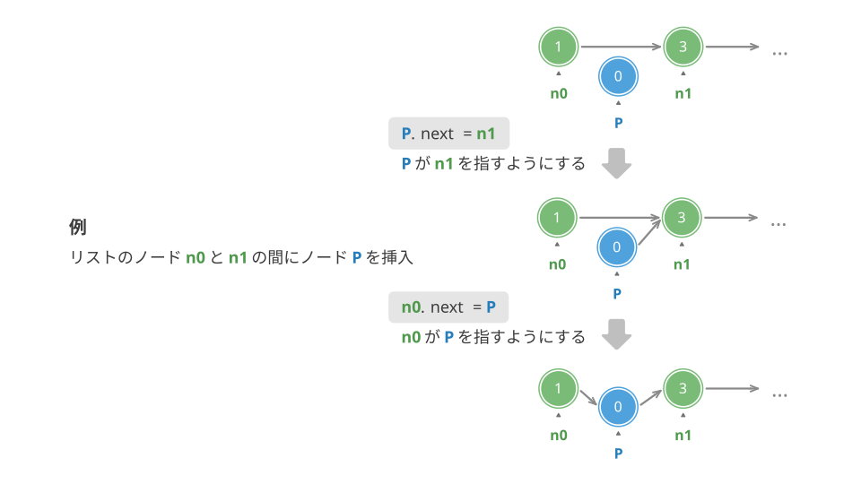
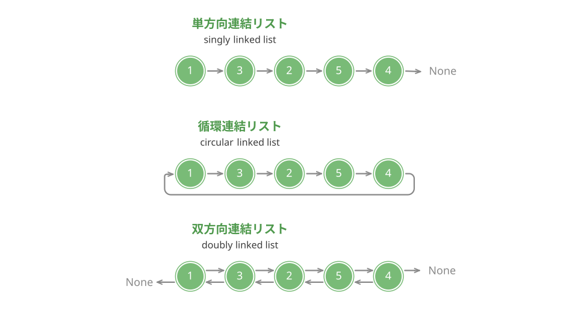

# 連結リスト

メモリ空間はすべてのプログラムが利用する共通の資源です。複雑なシステムの実行環境では、空き領域がメモリの各所に散らばっていることがあります。配列には連続したメモリ領域が必要ですが、配列が非常に大きいと、それだけの連続領域を確保できないかもしれません。このようなとき、連結リストの柔軟性が活きてきます。

<u>連結リスト（linked list）</u>は、各要素がノードオブジェクトであり、ノード同士が「参照」でつながる線形データ構造です。参照には次のノードのメモリアドレスが記録されており、それを使って現在のノードから次のノードへアクセスできます。

この設計により、各ノードをメモリの各所に分散して格納でき、メモリアドレスが連続している必要はありません。


上図のように、連結リストを構成する単位は<u>ノード（node）</u>オブジェクトです。各ノードは、ノードの「値」と次のノードを指す「参照」という二つのデータを持ちます。

- 最初のノードを「先頭ノード」、最後のノードを「末尾ノード」と呼びます。
- 末尾ノードは「空」を指します。これは Java、C++、Python でそれぞれ `null`、`nullptr`、`None` と表します。
- C、C++、Go、Rust などのポインタをサポートする言語では、上記の「参照」は「ポインタ」と読み替えます。

次のコードのように、連結リストのノード `ListNode` は、値に加えて参照（ポインタ）も保存する必要があります。そのため、同じデータ量なら、**連結リストは配列より多くのメモリを使います**。

```snippet
list_node_class
```

## 連結リストの主な操作

### 連結リストの初期化

連結リストは二つの手順で作ります。まず各ノードオブジェクトを初期化し、次にノード間の参照関係を構築します。初期化後は、先頭ノードから `next` の参照をたどり、すべてのノードを順に訪問できます。

```snippet
init_linked_list
```

??? pythontutor "実行の可視化"

    @tutor init_linked_list_tutor

配列は全体で一つの変数です。たとえば配列 `nums` は、`nums[0]` や `nums[1]` などの要素を含みます。一方、連結リストは複数の独立したノードオブジェクトからなります。**通常は先頭ノードで連結リスト全体を表します**。たとえば、上のコードの連結リストは、連結リスト `n0` と呼べます。

### ノードの挿入

連結リストへのノードの挿入は簡単です。下図のように、隣り合うノード `n0` と `n1` の間に新しいノード `P` を挿入するには、**二つのノード参照（ポインタ）を変更するだけ**で済み、時間計算量は $O(1)$ です。

対して、配列への要素の挿入は時間計算量が $O(n)$ であり、データ量が大きいと非効率になります。



```src
[file]{linked_list}-[class]{}-[func]{insert}
```

### ノードの削除

下図のように、連結リストからのノードの削除も簡単で、**一つのノードの参照（ポインタ）を変更するだけ**です。

削除後もノード `P` は `n1` を指していますが、この連結リストを走査しても `P` には到達できなくなることに注意してください。つまり、`P` はもはやこの連結リストに属していません。


```src
[file]{linked_list}-[class]{}-[func]{remove}
```

### ノードへのアクセス

**連結リストのノードへのアクセスは効率が低くなります**。前の節で説明したように、配列では任意の要素に $O(1)$ 時間でアクセスできます。連結リストでは、先頭ノードから順にたどり、目的のノードを見つける必要があります。つまり、$i$ 番目のノードにアクセスするには $i - 1$ 回ループする必要があり、時間計算量は $O(n)$ です。

```src
[file]{linked_list}-[class]{}-[func]{access}
```

### ノードの探索

連結リストを走査して値が `target` のノードを探し、そのノードのインデックスを返します。これも線形探索です。コードを次に示します。

```src
[file]{linked_list}-[class]{}-[func]{find}
```

## 配列と連結リストの比較

下表に、配列と連結リストの特徴と操作効率をまとめます。両者は対照的な格納戦略を取るため、性質や操作効率も対照的になります。

<p align="center"> 表 <id> &nbsp; 配列と連結リストの効率の比較 </p>

|          | 配列                           | 連結リスト           |
| -------- | ------------------------------ | -------------- |
| 格納方法 | 連続したメモリ領域                   | 分散したメモリ領域   |
| 容量の拡張 | 長さは変更できない                     | 柔軟に拡張できる     |
| メモリ効率 | 要素の使用量は少ないが、空間が無駄になることもある | 要素のメモリ使用量が多い |
| 要素へのアクセス | $O(1)$                         | $O(n)$         |
| 要素の追加 | $O(n)$                         | $O(1)$         |
| 要素の削除 | $O(n)$                         | $O(1)$         |

## 連結リストの主な種類

下図のように、代表的な連結リストには 3 種類あります。

- **単方向連結リスト**：これまで説明した通常の連結リストです。各ノードは、値と次のノードへの参照の二つを持ちます。最初のノードを先頭ノード、最後のノードを末尾ノードと呼び、末尾ノードは空の `None` を指します。
- **循環連結リスト**：単方向連結リストの末尾ノードを先頭ノードに向け、末尾と先頭をつなぐと、循環連結リストになります。循環連結リストでは、任意のノードを先頭とみなせます。
- **双方向連結リスト**：単方向連結リストと異なり、両方向の参照を記録します。ノードには、後続ノード（次のノード）と先行ノード（前のノード）の両方への参照（ポインタ）を持たせます。単方向連結リストより柔軟で、どちらの方向にも走査できますが、その分メモリ使用量も増えます。

```snippet
doubly_list_node_class
```



## 連結リストの代表的な用途

単方向連結リストは、スタック、キュー、ハッシュテーブル、グラフなどの実装によく使われます。

- **スタックとキュー**：挿入と削除をどちらも同じ端で行うと、先入れ後出しの性質になり、スタックに対応します。一方の端で挿入し、もう一方の端で削除すると、先入れ先出しの性質になり、キューに対応します。
- **ハッシュテーブル**：チェイン法は、ハッシュ衝突を解決する代表的な方法の一つです。衝突したすべての要素を、一つの連結リストに格納します。
- **グラフ**：隣接リストは、グラフを表す代表的な方法です。各頂点に連結リストを対応させ、その各要素で、当該頂点につながる別の頂点を表します。

双方向連結リストは、前後の要素をすばやく見つける必要がある場面でよく使われます。

- **高度なデータ構造**：たとえば赤黒木や B 木では、ノードの親にアクセスする必要があります。ノードに親への参照を保存すれば実現でき、双方向連結リストと似た考え方です。
- **ブラウザの履歴**：ユーザーが進むボタンや戻るボタンを押すと、Web ブラウザは前後に閲覧したページを知る必要があります。双方向連結リストの性質により、この操作を簡単に実現できます。
- **LRU アルゴリズム**：キャッシュの置換（LRU）アルゴリズムでは、最後に使われてから最も時間がたったデータをすばやく見つけ、ノードを高速に追加・削除する必要があります。双方向連結リストはこの用途に適しています。

循環連結リストは、OS の資源スケジューリングなど、周期的な操作が必要な場面でよく使われます。

- **ラウンドロビンスケジューリング**：OS でよく使われる CPU スケジューリングの方法で、一群のプロセスを順に繰り返し処理します。各プロセスにタイムスライスを割り当て、それを使い切ると CPU は次のプロセスに切り替わります。この循環的な操作は、循環連結リストで実装できます。
- **データバッファ**：データバッファの実装にも循環連結リストを使うことがあります。たとえば音声や動画のプレイヤーでは、データストリームを複数のバッファブロックに分け、循環連結リストに格納して、途切れない再生を実現できます。
