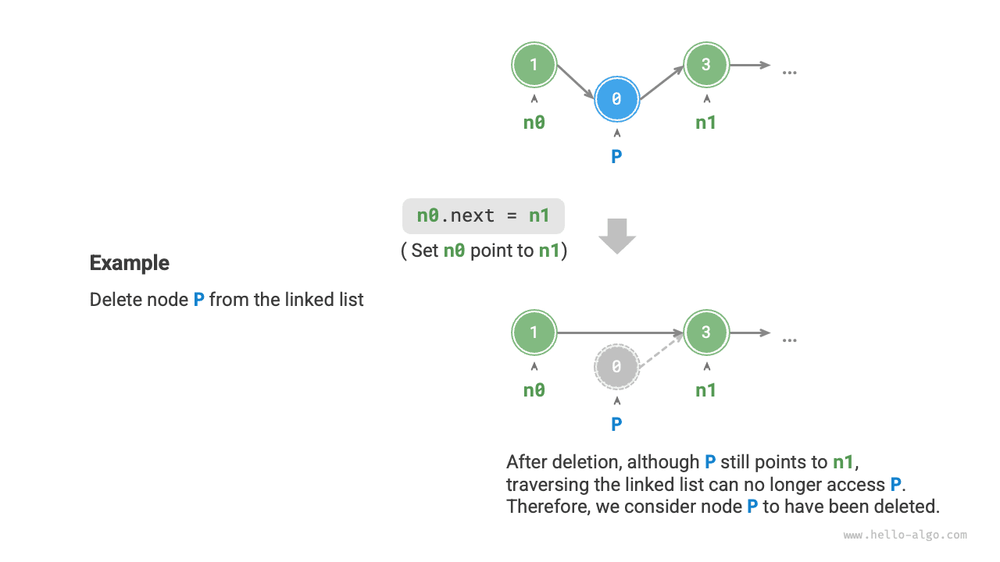

# 連結リスト

メモリ空間はすべてのプログラムが利用する共通の資源です。複雑なシステムの実行環境では、空き領域がメモリの各所に散らばっていることがあります。配列には連続したメモリ領域が必要ですが、配列が非常に大きいと、それだけの連続領域を確保できないかもしれません。このようなとき、連結リストの柔軟性が活きてきます。

<u>連結リスト（linked list）</u>は、各要素がノードオブジェクトであり、ノード同士が「参照」でつながる線形データ構造です。参照には次のノードのメモリアドレスが記録されており、それを使って現在のノードから次のノードへアクセスできます。

この設計により、各ノードをメモリの各所に分散して格納でき、メモリアドレスが連続している必要はありません。


上図のように、連結リストを構成する単位は<u>ノード（node）</u>オブジェクトです。各ノードは、ノードの「値」と次のノードを指す「参照」という二つのデータを持ちます。

- 最初のノードを「先頭ノード」、最後のノードを「末尾ノード」と呼びます。
- 末尾ノードは「空」を指します。これは Java、C++、Python でそれぞれ `null`、`nullptr`、`None` と表します。
- C、C++、Go、Rust などのポインタをサポートする言語では、上記の「参照」は「ポインタ」と読み替えます。

次のコードのように、連結リストのノード `ListNode` は、値に加えて参照（ポインタ）も保存する必要があります。そのため、同じデータ量なら、**連結リストは配列より多くのメモリを使います**。

=== "Python"

    ```python title=""
    class ListNode:
        """連結リストのノードクラス"""
        def __init__(self, val: int):
            self.val: int = val               # ノードの値
            self.next: ListNode | None = None # 次のノードへの参照
    ```

=== "C++"

    ```cpp title=""
    /* 連結リストのノード構造体 */
    struct ListNode {
        int val;         // ノードの値
        ListNode *next;  // 次のノードへのポインタ
        ListNode(int x) : val(x), next(nullptr) {}  // コンストラクタ
    };
    ```

=== "Java"

    ```java title=""
    /* 連結リストのノードクラス */
    class ListNode {
        int val;        // ノードの値
        ListNode next;  // 次のノードへの参照
        ListNode(int x) { val = x; }  // コンストラクタ
    }
    ```

=== "C#"

    ```csharp title=""
    /* 連結リストのノードクラス */
    class ListNode(int x) {  //コンストラクタ
        int val = x;         // ノードの値
        ListNode? next;      // 次のノードへの参照
    }
    ```

=== "Go"

    ```go title=""
    /* 連結リストのノード構造体 */
    type ListNode struct {
        Val  int       // ノードの値
        Next *ListNode // 次のノードへのポインタ
    }

    // NewListNode コンストラクタで、新しい連結リストを作る
    func NewListNode(val int) *ListNode {
        return &ListNode{
            Val:  val,
            Next: nil,
        }
    }
    ```

=== "Swift"

    ```swift title=""
    /* 連結リストのノードクラス */
    class ListNode {
        var val: Int // ノードの値
        var next: ListNode? // 次のノードへの参照

        init(x: Int) { // コンストラクタ
            val = x
        }
    }
    ```

=== "JS"

    ```javascript title=""
    /* 連結リストのノードクラス */
    class ListNode {
        constructor(val, next) {
            this.val = (val === undefined ? 0 : val);       // ノードの値
            this.next = (next === undefined ? null : next); // 次のノードへの参照
        }
    }
    ```

=== "TS"

    ```typescript title=""
    /* 連結リストのノードクラス */
    class ListNode {
        val: number;
        next: ListNode | null;
        constructor(val?: number, next?: ListNode | null) {
            this.val = val === undefined ? 0 : val;        // ノードの値
            this.next = next === undefined ? null : next;  // 次のノードへの参照
        }
    }
    ```

=== "Dart"

    ```dart title=""
    /* 連結リストのノードクラス */
    class ListNode {
      int val; // ノードの値
      ListNode? next; // 次のノードへの参照
      ListNode(this.val, [this.next]); // コンストラクタ
    }
    ```

=== "Rust"

    ```rust title=""
    use std::rc::Rc;
    use std::cell::RefCell;
    /* 連結リストのノードクラス */
    #[derive(Debug)]
    struct ListNode {
        val: i32, // ノードの値
        next: Option<Rc<RefCell<ListNode>>>, // 次のノードへのポインタ
    }
    ```

=== "C"

    ```c title=""
    /* 連結リストのノード構造体 */
    typedef struct ListNode {
        int val;               // ノードの値
        struct ListNode *next; // 次のノードへのポインタ
    } ListNode;

    /* コンストラクタ */
    ListNode *newListNode(int val) {
        ListNode *node;
        node = (ListNode *) malloc(sizeof(ListNode));
        node->val = val;
        node->next = NULL;
        return node;
    }
    ```

=== "Kotlin"

    ```kotlin title=""
    /* 連結リストのノードクラス */
    // コンストラクタ
    class ListNode(x: Int) {
        val _val: Int = x          // ノードの値
        var next: ListNode? = null // 次のノードへの参照
    }
    ```

=== "Ruby"

    ```ruby title=""
    # 連結リストのノードクラス
    class ListNode
      attr_accessor :val  # ノードの値
      attr_accessor :next # 次のノードへの参照

      def initialize(val=0, next_node=nil)
        @val = val
        @next = next_node
      end
    end
    ```

## 連結リストの主な操作

### 連結リストの初期化

連結リストは二つの手順で作ります。まず各ノードオブジェクトを初期化し、次にノード間の参照関係を構築します。初期化後は、先頭ノードから `next` の参照をたどり、すべてのノードを順に訪問できます。

=== "Python"

    ```python title="linked_list.py"
    # 連結リスト 1 -> 3 -> 2 -> 5 -> 4 を初期化
    # 各ノードを初期化
    n0 = ListNode(1)
    n1 = ListNode(3)
    n2 = ListNode(2)
    n3 = ListNode(5)
    n4 = ListNode(4)
    # ノード間の参照を設定
    n0.next = n1
    n1.next = n2
    n2.next = n3
    n3.next = n4
    ```

=== "C++"

    ```cpp title="linked_list.cpp"
    /* 連結リスト 1 -> 3 -> 2 -> 5 -> 4 を初期化 */
    // 各ノードを初期化
    ListNode* n0 = new ListNode(1);
    ListNode* n1 = new ListNode(3);
    ListNode* n2 = new ListNode(2);
    ListNode* n3 = new ListNode(5);
    ListNode* n4 = new ListNode(4);
    // ノード間の参照を設定
    n0->next = n1;
    n1->next = n2;
    n2->next = n3;
    n3->next = n4;
    ```

=== "Java"

    ```java title="linked_list.java"
    /* 連結リスト 1 -> 3 -> 2 -> 5 -> 4 を初期化 */
    // 各ノードを初期化
    ListNode n0 = new ListNode(1);
    ListNode n1 = new ListNode(3);
    ListNode n2 = new ListNode(2);
    ListNode n3 = new ListNode(5);
    ListNode n4 = new ListNode(4);
    // ノード間の参照を設定
    n0.next = n1;
    n1.next = n2;
    n2.next = n3;
    n3.next = n4;
    ```

=== "C#"

    ```csharp title="linked_list.cs"
    /* 連結リスト 1 -> 3 -> 2 -> 5 -> 4 を初期化 */
    // 各ノードを初期化
    ListNode n0 = new(1);
    ListNode n1 = new(3);
    ListNode n2 = new(2);
    ListNode n3 = new(5);
    ListNode n4 = new(4);
    // ノード間の参照を設定
    n0.next = n1;
    n1.next = n2;
    n2.next = n3;
    n3.next = n4;
    ```

=== "Go"

    ```go title="linked_list.go"
    /* 連結リスト 1 -> 3 -> 2 -> 5 -> 4 を初期化 */
    // 各ノードを初期化
    n0 := NewListNode(1)
    n1 := NewListNode(3)
    n2 := NewListNode(2)
    n3 := NewListNode(5)
    n4 := NewListNode(4)
    // ノード間の参照を設定
    n0.Next = n1
    n1.Next = n2
    n2.Next = n3
    n3.Next = n4
    ```

=== "Swift"

    ```swift title="linked_list.swift"
    /* 連結リスト 1 -> 3 -> 2 -> 5 -> 4 を初期化 */
    // 各ノードを初期化
    let n0 = ListNode(x: 1)
    let n1 = ListNode(x: 3)
    let n2 = ListNode(x: 2)
    let n3 = ListNode(x: 5)
    let n4 = ListNode(x: 4)
    // ノード間の参照を設定
    n0.next = n1
    n1.next = n2
    n2.next = n3
    n3.next = n4
    ```

=== "JS"

    ```javascript title="linked_list.js"
    /* 連結リスト 1 -> 3 -> 2 -> 5 -> 4 を初期化 */
    // 各ノードを初期化
    const n0 = new ListNode(1);
    const n1 = new ListNode(3);
    const n2 = new ListNode(2);
    const n3 = new ListNode(5);
    const n4 = new ListNode(4);
    // ノード間の参照を設定
    n0.next = n1;
    n1.next = n2;
    n2.next = n3;
    n3.next = n4;
    ```

=== "TS"

    ```typescript title="linked_list.ts"
    /* 連結リスト 1 -> 3 -> 2 -> 5 -> 4 を初期化 */
    // 各ノードを初期化
    const n0 = new ListNode(1);
    const n1 = new ListNode(3);
    const n2 = new ListNode(2);
    const n3 = new ListNode(5);
    const n4 = new ListNode(4);
    // ノード間の参照を設定
    n0.next = n1;
    n1.next = n2;
    n2.next = n3;
    n3.next = n4;
    ```

=== "Dart"

    ```dart title="linked_list.dart"
    /* 連結リスト 1 -> 3 -> 2 -> 5 -> 4 を初期化 */\
    // 各ノードを初期化
    ListNode n0 = ListNode(1);
    ListNode n1 = ListNode(3);
    ListNode n2 = ListNode(2);
    ListNode n3 = ListNode(5);
    ListNode n4 = ListNode(4);
    // ノード間の参照を設定
    n0.next = n1;
    n1.next = n2;
    n2.next = n3;
    n3.next = n4;
    ```

=== "Rust"

    ```rust title="linked_list.rs"
    /* 連結リスト 1 -> 3 -> 2 -> 5 -> 4 を初期化 */
    // 各ノードを初期化
    let n0 = Rc::new(RefCell::new(ListNode { val: 1, next: None }));
    let n1 = Rc::new(RefCell::new(ListNode { val: 3, next: None }));
    let n2 = Rc::new(RefCell::new(ListNode { val: 2, next: None }));
    let n3 = Rc::new(RefCell::new(ListNode { val: 5, next: None }));
    let n4 = Rc::new(RefCell::new(ListNode { val: 4, next: None }));

    // ノード間の参照を設定
    n0.borrow_mut().next = Some(n1.clone());
    n1.borrow_mut().next = Some(n2.clone());
    n2.borrow_mut().next = Some(n3.clone());
    n3.borrow_mut().next = Some(n4.clone());
    ```

=== "C"

    ```c title="linked_list.c"
    /* 連結リスト 1 -> 3 -> 2 -> 5 -> 4 を初期化 */
    // 各ノードを初期化
    ListNode* n0 = newListNode(1);
    ListNode* n1 = newListNode(3);
    ListNode* n2 = newListNode(2);
    ListNode* n3 = newListNode(5);
    ListNode* n4 = newListNode(4);
    // ノード間の参照を設定
    n0->next = n1;
    n1->next = n2;
    n2->next = n3;
    n3->next = n4;
    ```

=== "Kotlin"

    ```kotlin title="linked_list.kt"
    /* 連結リスト 1 -> 3 -> 2 -> 5 -> 4 を初期化 */
    // 各ノードを初期化
    val n0 = ListNode(1)
    val n1 = ListNode(3)
    val n2 = ListNode(2)
    val n3 = ListNode(5)
    val n4 = ListNode(4)
    // ノード間の参照を設定
    n0.next = n1;
    n1.next = n2;
    n2.next = n3;
    n3.next = n4;
    ```

=== "Ruby"

    ```ruby title="linked_list.rb"
    # 連結リスト 1 -> 3 -> 2 -> 5 -> 4 を初期化
    # 各ノードを初期化
    n0 = ListNode.new(1)
    n1 = ListNode.new(3)
    n2 = ListNode.new(2)
    n3 = ListNode.new(5)
    n4 = ListNode.new(4)
    # ノード間の参照を設定
    n0.next = n1
    n1.next = n2
    n2.next = n3
    n3.next = n4
    ```

??? pythontutor "実行の可視化"

    https://pythontutor.com/render.html#code=class%20ListNode%3A%0A%20%20%20%20%22%22%22%E9%80%A3%E7%B5%90%E3%83%AA%E3%82%B9%E3%83%88%E3%81%AE%E3%83%8E%E3%83%BC%E3%83%89%E3%82%AF%E3%83%A9%E3%82%B9%22%22%22%0A%20%20%20%20def%20__init__(self%2C%20val%3A%20int)%3A%0A%20%20%20%20%20%20%20%20self.val%3A%20int%20%3D%20val%20%20%23%20%E3%83%8E%E3%83%BC%E3%83%89%E3%81%AE%E5%80%A4%0A%20%20%20%20%20%20%20%20self.next%3A%20ListNode%20%7C%20None%20%3D%20None%20%20%23%20%E6%AC%A1%E3%81%AE%E3%83%8E%E3%83%BC%E3%83%89%E3%81%B8%E3%81%AE%E5%8F%82%E7%85%A7%0A%0A%22%22%22%E5%AE%9F%E8%A1%8C%E7%94%A8%E3%82%B3%E3%83%BC%E3%83%89%22%22%22%0Aif%20__name__%20%3D%3D%20%22__main__%22%3A%0A%20%20%20%20%23%20%E9%80%A3%E7%B5%90%E3%83%AA%E3%82%B9%E3%83%88%201%20-%3E%203%20-%3E%202%20-%3E%205%20-%3E%204%20%E3%82%92%E5%88%9D%E6%9C%9F%E5%8C%96%0A%20%20%20%20%23%20%E5%90%84%E3%83%8E%E3%83%BC%E3%83%89%E3%82%92%E5%88%9D%E6%9C%9F%E5%8C%96%0A%20%20%20%20n0%20%3D%20ListNode(1)%0A%20%20%20%20n1%20%3D%20ListNode(3)%0A%20%20%20%20n2%20%3D%20ListNode(2)%0A%20%20%20%20n3%20%3D%20ListNode(5)%0A%20%20%20%20n4%20%3D%20ListNode(4)%0A%20%20%20%20%23%20%E3%83%8E%E3%83%BC%E3%83%89%E9%96%93%E3%81%AE%E5%8F%82%E7%85%A7%E3%82%92%E8%A8%AD%E5%AE%9A%0A%20%20%20%20n0.next%20%3D%20n1%0A%20%20%20%20n1.next%20%3D%20n2%0A%20%20%20%20n2.next%20%3D%20n3%0A%20%20%20%20n3.next%20%3D%20n4&cumulative=false&curInstr=3&heapPrimitives=nevernest&mode=display&origin=opt-frontend.js&py=311&rawInputLstJSON=%5B%5D&textReferences=false

配列は全体で一つの変数です。たとえば配列 `nums` は、`nums[0]` や `nums[1]` などの要素を含みます。一方、連結リストは複数の独立したノードオブジェクトからなります。**通常は先頭ノードで連結リスト全体を表します**。たとえば、上のコードの連結リストは、連結リスト `n0` と呼べます。

### ノードの挿入

連結リストへのノードの挿入は簡単です。下図のように、隣り合うノード `n0` と `n1` の間に新しいノード `P` を挿入するには、**二つのノード参照（ポインタ）を変更するだけ**で済み、時間計算量は $O(1)$ です。

対して、配列への要素の挿入は時間計算量が $O(n)$ であり、データ量が大きいと非効率になります。


```src
[file]{linked_list}-[class]{}-[func]{insert}
```

### ノードの削除

下図のように、連結リストからのノードの削除も簡単で、**一つのノードの参照（ポインタ）を変更するだけ**です。

削除後もノード `P` は `n1` を指していますが、この連結リストを走査しても `P` には到達できなくなることに注意してください。つまり、`P` はもはやこの連結リストに属していません。



```src
[file]{linked_list}-[class]{}-[func]{remove}
```

### ノードへのアクセス

**連結リストのノードへのアクセスは効率が低くなります**。前の節で説明したように、配列では任意の要素に $O(1)$ 時間でアクセスできます。連結リストでは、先頭ノードから順にたどり、目的のノードを見つける必要があります。つまり、$i$ 番目のノードにアクセスするには $i - 1$ 回ループする必要があり、時間計算量は $O(n)$ です。

```src
[file]{linked_list}-[class]{}-[func]{access}
```

### ノードの探索

連結リストを走査して値が `target` のノードを探し、そのノードのインデックスを返します。これも線形探索です。コードを次に示します。

```src
[file]{linked_list}-[class]{}-[func]{find}
```

## 配列と連結リストの比較

下表に、配列と連結リストの特徴と操作効率をまとめます。両者は対照的な格納戦略を取るため、性質や操作効率も対照的になります。

<p align="center"> 表 <id> &nbsp; 配列と連結リストの効率の比較 </p>

|          | 配列                           | 連結リスト           |
| -------- | ------------------------------ | -------------- |
| 格納方法 | 連続したメモリ領域                   | 分散したメモリ領域   |
| 容量の拡張 | 長さは変更できない                     | 柔軟に拡張できる     |
| メモリ効率 | 要素の使用量は少ないが、空間が無駄になることもある | 要素のメモリ使用量が多い |
| 要素へのアクセス | $O(1)$                         | $O(n)$         |
| 要素の追加 | $O(n)$                         | $O(1)$         |
| 要素の削除 | $O(n)$                         | $O(1)$         |

## 連結リストの主な種類

下図のように、代表的な連結リストには 3 種類あります。

- **単方向連結リスト**：これまで説明した通常の連結リストです。各ノードは、値と次のノードへの参照の二つを持ちます。最初のノードを先頭ノード、最後のノードを末尾ノードと呼び、末尾ノードは空の `None` を指します。
- **循環連結リスト**：単方向連結リストの末尾ノードを先頭ノードに向け、末尾と先頭をつなぐと、循環連結リストになります。循環連結リストでは、任意のノードを先頭とみなせます。
- **双方向連結リスト**：単方向連結リストと異なり、両方向の参照を記録します。ノードには、後続ノード（次のノード）と先行ノード（前のノード）の両方への参照（ポインタ）を持たせます。単方向連結リストより柔軟で、どちらの方向にも走査できますが、その分メモリ使用量も増えます。

=== "Python"

    ```python title=""
    class ListNode:
        """双方向連結リストのノードクラス"""
        def __init__(self, val: int):
            self.val: int = val                # ノードの値
            self.next: ListNode | None = None  # 後続ノードへの参照
            self.prev: ListNode | None = None  # 先行ノードへの参照
    ```

=== "C++"

    ```cpp title=""
    /* 双方向連結リストのノード構造体 */
    struct ListNode {
        int val;         // ノードの値
        ListNode *next;  // 後続ノードへのポインタ
        ListNode *prev;  // 先行ノードへのポインタ
        ListNode(int x) : val(x), next(nullptr), prev(nullptr) {}  // コンストラクタ
    };
    ```

=== "Java"

    ```java title=""
    /* 双方向連結リストのノードクラス */
    class ListNode {
        int val;        // ノードの値
        ListNode next;  // 後続ノードへの参照
        ListNode prev;  // 先行ノードへの参照
        ListNode(int x) { val = x; }  // コンストラクタ
    }
    ```

=== "C#"

    ```csharp title=""
    /* 双方向連結リストのノードクラス */
    class ListNode(int x) {  // コンストラクタ
        int val = x;    // ノードの値
        ListNode next;  // 後続ノードへの参照
        ListNode prev;  // 先行ノードへの参照
    }
    ```

=== "Go"

    ```go title=""
    /* 双方向連結リストのノード構造体 */
    type DoublyListNode struct {
        Val  int             // ノードの値
        Next *DoublyListNode // 後続ノードへのポインタ
        Prev *DoublyListNode // 先行ノードへのポインタ
    }

    // NewDoublyListNode で初期化
    func NewDoublyListNode(val int) *DoublyListNode {
        return &DoublyListNode{
            Val:  val,
            Next: nil,
            Prev: nil,
        }
    }
    ```

=== "Swift"

    ```swift title=""
    /* 双方向連結リストのノードクラス */
    class ListNode {
        var val: Int // ノードの値
        var next: ListNode? // 後続ノードへの参照
        var prev: ListNode? // 先行ノードへの参照

        init(x: Int) { // コンストラクタ
            val = x
        }
    }
    ```

=== "JS"

    ```javascript title=""
    /* 双方向連結リストのノードクラス */
    class ListNode {
        constructor(val, next, prev) {
            this.val = val  ===  undefined ? 0 : val;        // ノードの値
            this.next = next  ===  undefined ? null : next;  // 後続ノードへの参照
            this.prev = prev  ===  undefined ? null : prev;  // 先行ノードへの参照
        }
    }
    ```

=== "TS"

    ```typescript title=""
    /* 双方向連結リストのノードクラス */
    class ListNode {
        val: number;
        next: ListNode | null;
        prev: ListNode | null;
        constructor(val?: number, next?: ListNode | null, prev?: ListNode | null) {
            this.val = val  ===  undefined ? 0 : val;        // ノードの値
            this.next = next  ===  undefined ? null : next;  // 後続ノードへの参照
            this.prev = prev  ===  undefined ? null : prev;  // 先行ノードへの参照
        }
    }
    ```

=== "Dart"

    ```dart title=""
    /* 双方向連結リストのノードクラス */
    class ListNode {
        int val;        // ノードの値
        ListNode? next;  // 後続ノードへの参照
        ListNode? prev;  // 先行ノードへの参照
        ListNode(this.val, [this.next, this.prev]);  // コンストラクタ
    }
    ```

=== "Rust"

    ```rust title=""
    use std::rc::Rc;
    use std::cell::RefCell;

    /* 双方向連結リストのノード型 */
    #[derive(Debug)]
    struct ListNode {
        val: i32, // ノードの値
        next: Option<Rc<RefCell<ListNode>>>, // 後続ノードへのポインタ
        prev: Option<Rc<RefCell<ListNode>>>, // 先行ノードへのポインタ
    }

    /* コンストラクタ */
    impl ListNode {
        fn new(val: i32) -> Self {
            ListNode {
                val,
                next: None,
                prev: None,
            }
        }
    }
    ```

=== "C"

    ```c title=""
    /* 双方向連結リストのノード構造体 */
    typedef struct ListNode {
        int val;               // ノードの値
        struct ListNode *next; // 後続ノードへのポインタ
        struct ListNode *prev; // 先行ノードへのポインタ
    } ListNode;

    /* コンストラクタ */
    ListNode *newListNode(int val) {
        ListNode *node;
        node = (ListNode *) malloc(sizeof(ListNode));
        node->val = val;
        node->next = NULL;
        node->prev = NULL;
        return node;
    }
    ```

=== "Kotlin"

    ```kotlin title=""
    /* 双方向連結リストのノードクラス */
    // コンストラクタ
    class ListNode(x: Int) {
        val _val: Int = x           // ノードの値
        var next: ListNode? = null  // 後続ノードへの参照
        var prev: ListNode? = null  // 先行ノードへの参照
    }
    ```

=== "Ruby"

    ```ruby title=""
    # 双方向連結リストのノードクラス
    class ListNode
      attr_accessor :val    # ノードの値
      attr_accessor :next   # 後続ノードへの参照
      attr_accessor :prev   # 先行ノードへの参照

      def initialize(val=0, next_node=nil, prev_node=nil)
        @val = val
        @next = next_node
        @prev = prev_node
      end
    end
    ```


## 連結リストの代表的な用途

単方向連結リストは、スタック、キュー、ハッシュテーブル、グラフなどの実装によく使われます。

- **スタックとキュー**：挿入と削除をどちらも同じ端で行うと、先入れ後出しの性質になり、スタックに対応します。一方の端で挿入し、もう一方の端で削除すると、先入れ先出しの性質になり、キューに対応します。
- **ハッシュテーブル**：チェイン法は、ハッシュ衝突を解決する代表的な方法の一つです。衝突したすべての要素を、一つの連結リストに格納します。
- **グラフ**：隣接リストは、グラフを表す代表的な方法です。各頂点に連結リストを対応させ、その各要素で、当該頂点につながる別の頂点を表します。

双方向連結リストは、前後の要素をすばやく見つける必要がある場面でよく使われます。

- **高度なデータ構造**：たとえば赤黒木や B 木では、ノードの親にアクセスする必要があります。ノードに親への参照を保存すれば実現でき、双方向連結リストと似た考え方です。
- **ブラウザの履歴**：ユーザーが進むボタンや戻るボタンを押すと、Web ブラウザは前後に閲覧したページを知る必要があります。双方向連結リストの性質により、この操作を簡単に実現できます。
- **LRU アルゴリズム**：キャッシュの置換（LRU）アルゴリズムでは、最後に使われてから最も時間がたったデータをすばやく見つけ、ノードを高速に追加・削除する必要があります。双方向連結リストはこの用途に適しています。

循環連結リストは、OS の資源スケジューリングなど、周期的な操作が必要な場面でよく使われます。

- **ラウンドロビンスケジューリング**：OS でよく使われる CPU スケジューリングの方法で、一群のプロセスを順に繰り返し処理します。各プロセスにタイムスライスを割り当て、それを使い切ると CPU は次のプロセスに切り替わります。この循環的な操作は、循環連結リストで実装できます。
- **データバッファ**：データバッファの実装にも循環連結リストを使うことがあります。たとえば音声や動画のプレイヤーでは、データストリームを複数のバッファブロックに分け、循環連結リストに格納して、途切れない再生を実現できます。
