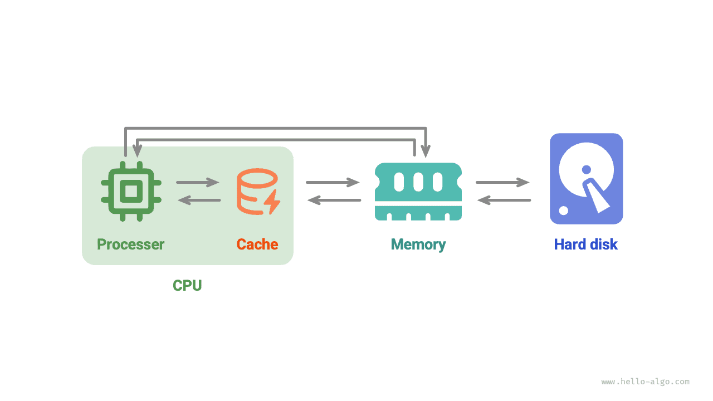

# 4.4 &nbsp; メモリとキャッシュ *

この章の最初の 2 節では、基本的で重要なデータ構造である配列と連結リストを取り上げました。これらはそれぞれ、「連続した格納」と「分散した格納」という二つの物理構造を表しています。

実際には、**物理構造によって、プログラムがメモリとキャッシュをどれだけ効率よく使えるかが大きく決まり**、ひいてはアルゴリズムを実装したプログラム全体の性能にも影響します。

## 4.4.1 &nbsp; コンピュータの記憶装置

コンピュータには、<u>ハードディスク（hard disk）</u>、<u>メモリ（random-access memory, RAM）</u>、<u>キャッシュ（cache memory）</u>という 3 種類の記憶装置があります。表 4-2 に、コンピュータシステムにおけるそれぞれの役割と性能上の特徴を示します。

 表 4-2 &nbsp; コンピュータの記憶装置 

|                | ハードディスク                                     | メモリ                                   | キャッシュ                                              |
| -------------- | ---------------------------------------- | -------------------------------------- | ------------------------------------------------- |
| 用途           | OS、プログラム、ファイルなどのデータを長期間保存する | 実行中のプログラムと処理中のデータを一時的に保存する | 頻繁にアクセスするデータや命令を保存し、CPU がメモリにアクセスする回数を減らす |
| 揮発性         | 電源を切ってもデータは失われない                       | 電源を切るとデータが失われる                       | 電源を切るとデータが失われる                                  |
| 容量           | 大きい、TB 単位                            | 小さい、GB 単位                          | 非常に小さい、MB 単位                                   |
| 速度           | 遅い、数百〜数千 MB/s                    | 速い、数十 GB/s                        | 非常に速い、数十〜数百 GB/s                           |
| 価格（人民元） | 安い、1 GB 当たり数角〜数元                  | 高い、1 GB 当たり数十〜数百元                | 非常に高い、CPU に含めて価格が設定される                           |

コンピュータの記憶システムは、図 4-9 のようなピラミッドとして捉えられます。頂点に近い記憶装置ほど高速で、容量が小さく、コストが高くなります。この階層的な設計は偶然生まれたものではなく、コンピュータ科学者や技術者が十分に考え抜いた結果です。

- **ハードディスクをメモリで置き換えるのは困難です**。まず、メモリのデータは電源を切ると失われるため、長期保存には適していません。また、メモリのコストはハードディスクの数十倍であり、一般消費者向けに普及させるのが難しくなります。
- **キャッシュの大容量化と高速化は両立が困難です**。L1、L2、L3 とキャッシュの容量が増えるにつれて物理的なサイズも大きくなり、CPU コアからの物理的な距離が遠くなります。その結果、データ転送にかかる時間が増え、要素へのアクセスの遅延も大きくなります。現在の技術では、キャッシュを階層化する構造が、容量、速度、コストの最もよいバランスを実現しています。

{ class="animation-figure" }

 図 4-9 &nbsp; コンピュータの記憶システム 

!!! tip "ヒント"

    コンピュータの記憶階層は、速度、容量、コストの絶妙なバランスを表しています。実際、このようなトレードオフはあらゆる産業分野に存在し、それぞれの利点と制約の間で最適なバランスを見つけることが求められます。

全体として、**ハードディスクは大量のデータの長期保存に、メモリはプログラムの実行中に処理しているデータの一時保存に、キャッシュは頻繁にアクセスするデータや命令の保存に使われます**。これらが連携してプログラムの実行効率を高め、コンピュータシステムの効率的な動作を支えます。

図 4-10 のように、プログラムの実行時にはデータがハードディスクからメモリへ読み込まれ、CPU の計算に使われます。キャッシュは CPU の一部と考えることができます。**メモリから適切にデータを読み込むことで**、CPU に高速なデータ読み出しを提供し、プログラムの実行効率を大きく高め、比較的遅いメモリへの依存を減らします。

{ class="animation-figure" }

 図 4-10 &nbsp; ハードディスク、メモリ、キャッシュ間のデータの流れ 

## 4.4.2 &nbsp; データ構造のメモリ効率

メモリ空間の利用という点では、配列と連結リストにはそれぞれ利点と制約があります。

一つには、**メモリは有限であり、同じメモリ領域を複数のプログラムで共有することはできない**ため、データ構造にはできるだけ効率よく空間を使ってほしいものです。配列の要素は隙間なく並んでおり、連結リストのノード間の参照（ポインタ）を保存する追加の空間が必要ないため、空間効率が高くなります。ただし、配列は十分な連続メモリ領域を一度に確保する必要があり、メモリを無駄にする可能性があります。また、配列の容量拡張には追加の時間と空間のコストがかかります。一方、連結リストは「ノード」単位でメモリを動的に確保・解放できるため、柔軟性に優れています。

もう一つには、プログラムの実行中、**メモリの確保と解放を繰り返すにつれて、空きメモリの断片化が進み**、メモリの利用効率が低下します。配列は連続して格納されるため、比較的断片化を起こしにくくなります。対して連結リストの要素は分散して格納されるため、挿入と削除を頻繁に行うと、メモリの断片化が起きやすくなります。

## 4.4.3 &nbsp; データ構造のキャッシュ効率

キャッシュはメモリより容量がはるかに小さいものの、非常に高速であり、プログラムの実行速度に決定的な役割を果たします。容量が限られているため、頻繁にアクセスするデータの一部しか保存できません。CPU がアクセスしようとしたデータがキャッシュにないと、<u>キャッシュミス（cache miss）</u>が発生し、CPU は必要なデータを比較的遅いメモリから読み込まなければなりません。

当然、**「キャッシュミス」が少ないほど CPU のデータ読み書きの効率が高くなり**、プログラムの性能も向上します。CPU がキャッシュからデータを取得できた割合を<u>キャッシュヒット率（cache hit rate）</u>といい、通常はキャッシュの効率を測る指標として使います。

効率をできるだけ高めるため、キャッシュは次のような仕組みでデータを読み込みます。

- **キャッシュライン**：キャッシュはデータを 1 バイトずつ保存・読み込みするのではなく、キャッシュライン単位で扱います。1 バイトずつ転送するよりも、キャッシュライン単位で転送する方が効率的です。
- **プリフェッチ**：プロセッサはデータへのアクセスパターン（順次アクセス、一定間隔で飛び飛びに行うアクセスなど）を予測し、そのパターンに基づいてデータをキャッシュに読み込み、ヒット率を高めます。
- **空間的局所性**：あるデータにアクセスすると、その近くのデータにも近いうちにアクセスする可能性があります。そのため、キャッシュはあるデータを読み込むときに周辺のデータも読み込み、ヒット率を高めます。
- **時間的局所性**：あるデータにアクセスすると、近い将来に再びアクセスする可能性が高くなります。キャッシュはこの性質を利用し、最近アクセスしたデータを保持してヒット率を高めます。

実際、**配列と連結リストではキャッシュの利用効率が異なります**。主な違いは次のとおりです。

- **使用する空間**：連結リストの要素は配列の要素より多くの空間を使うため、キャッシュに収まる有効なデータの量が少なくなります。
- **キャッシュライン**：連結リストのデータはメモリの各所に分散していますが、キャッシュは「ライン単位で読み込む」ため、不要なデータを読み込む割合が高くなります。
- **プリフェッチ**：配列のデータアクセスパターンは連結リストより「予測しやすく」、次に読み込むデータをシステムが推測しやすくなります。
- **空間的局所性**：配列はまとまったメモリ領域に格納されるため、読み込んだデータの近くにあるデータにも、まもなくアクセスする可能性が高くなります。

全体として、**配列はキャッシュヒット率が高いため、通常は連結リストより操作効率に優れています**。そのため、アルゴリズムの問題を解く際には、配列を使って実装したデータ構造が好まれる傾向にあります。

ただし、**キャッシュ効率が高いからといって、あらゆる場合に配列が連結リストより優れているわけではありません**。実際の用途では、具体的な要件に応じてデータ構造を選ぶ必要があります。たとえば、「スタック」というデータ構造（次の章で詳しく説明します）は配列でも連結リストでも実装できますが、それぞれに適した場面は異なります。

- アルゴリズムの問題を解くときは、操作効率が高くランダムアクセスも可能な、配列によるスタックを選ぶことが多いです。その代わりに必要なのは、あらかじめ配列用のメモリ領域をある程度確保しておくことだけです。
- データ量が非常に大きく、変動が激しく、スタックの大きさを予測しにくい場合には、連結リストによるスタックが適しています。連結リストなら大量のデータをメモリの各所に分散して格納でき、配列の容量拡張に伴う追加のコストも避けられます。
