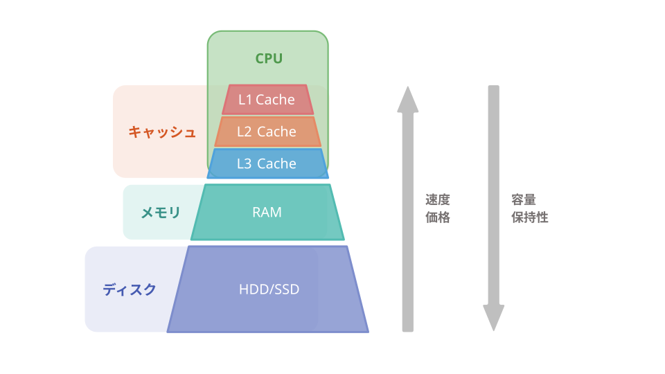
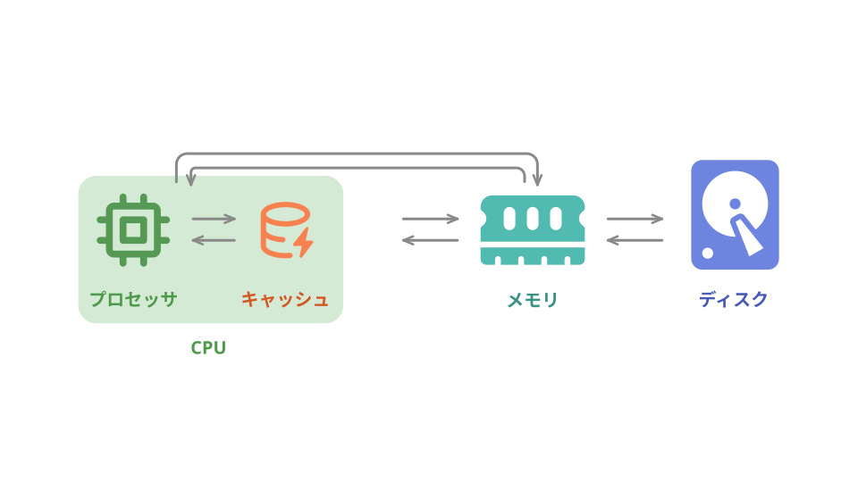

# メモリとキャッシュ *

この章の最初の 2 節では、基本的で重要なデータ構造である配列と連結リストを見てきました。配列は「連続した領域への格納」を、連結リストは「分散した領域への格納」を代表する物理構造です。

実は、**プログラムがメモリやキャッシュをどれだけ効率よく使えるかは、物理構造に大きく左右されます**。それがアルゴリズムを実装したプログラム全体の性能にも影響します。

## コンピュータの記憶装置

コンピュータには、<u>ディスク（hard disk）</u>、<u>メモリ（random-access memory, RAM）</u>、<u>キャッシュ（cache memory）</u>という 3 種類の記憶装置があります。次の表に、それぞれの役割と性能上の特徴を示します。

 表 <id> &nbsp; コンピュータの記憶装置 

|                | ディスク                                     | メモリ                                   | キャッシュ                                              |
| -------------- | ---------------------------------------- | -------------------------------------- | ------------------------------------------------- |
| 用途           | OS、プログラム、ファイルなどのデータを長期保存する | 実行中のプログラムと処理中のデータを一時的に格納する | よく使うデータや命令を格納し、CPU がメモリにアクセスする回数を減らす |
| 揮発性         | 電源を切ってもデータは残る                       | 電源を切るとデータは失われる                       | 電源を切るとデータは失われる                                  |
| 容量           | 大（TB 単位）                            | 小（GB 単位）                          | 非常に小（MB 単位）                                   |
| 速度           | 比較的遅い（数百～数千 MB/s）                    | 比較的速い（数十 GB/s）                        | 非常に速い（数十～数百 GB/s）                           |
| 価格（人民元） | 比較的安価（1 GB あたり数角～数元。1 角は 0.1 元）                  | 比較的高価（1 GB あたり数十～数百元）                | 非常に高価（CPU の価格に含まれる）                           |

コンピュータの記憶システムは、次の図のようなピラミッドとしてとらえられます。頂点に近い記憶装置ほど高速で、容量は小さく、コストは高くなります。この多層構造は偶然の産物ではなく、計算機科学者や技術者が考え抜いた結果です。

- **ディスクをメモリで置き換えるのは困難です**。まず、メモリは電源を切るとデータが失われるので長期保存には向きません。また、メモリのコストはディスクの数十倍に上るため、消費者向け市場での置き換えは普及しにくいのです。
- **キャッシュでは大容量と高速性の両立が困難です**。L1、L2、L3 と容量が増すにつれ、物理的なサイズが大きくなり、CPU コアからの距離も長くなります。そのためデータの転送に時間がかかり、要素へのアクセスの遅延も増えます。現在の技術では、多層のキャッシュ構造が容量、速度、コストの最適なバランスを実現します。

!!! tip

    コンピュータの記憶階層には、速度、容量、コストの絶妙なバランスが表れています。このようなトレードオフはあらゆる産業に見られ、それぞれの利点と制約を踏まえて最適なバランスを見つける必要があります。

まとめると、**ディスクは大量のデータを長期間保存し、メモリは実行中のプログラムが処理するデータを一時的に格納し、キャッシュはよく使うデータや命令を保持します**。これによりプログラムの実行効率が上がります。3 者の連携がコンピュータシステムの効率的な動作を支えています。

次の図のように、プログラムの実行時にはデータがディスクからメモリに読み込まれ、CPU の計算に使われます。キャッシュは CPU の一部とみなせます。**必要になりそうなデータをメモリから取り込んでおく**ことで、CPU は高速にデータを読み出せます。低速なメモリに頼る場面が減り、プログラムの実行効率が大きく向上します。

## データ構造のメモリ効率

メモリ領域の利用という観点では、配列と連結リストにそれぞれ利点と制約があります。

一方で、**メモリには限りがあり、同じメモリ領域を複数のプログラムで共用することはできません**。そのため、データ構造にはできるだけ効率よく領域を使ってほしいところです。配列は要素が密に並び、連結リストのようにノード間の参照（ポインタ）を格納する追加領域が不要なので、空間効率が高くなります。ただし、十分な広さの連続領域を一度に確保するため、メモリを無駄にすることがあります。容量の拡張にも追加の時間と領域が必要です。連結リストはノード単位で動的に領域を確保・解放できるため、より柔軟です。

もう一方で、プログラムの実行中に**メモリの確保と解放を繰り返すと、空き領域の断片化が進み**、メモリの利用効率が下がります。配列は連続した領域に格納するため、比較的断片化を起こしにくい構造です。連結リストは要素を分散して格納するため、挿入と削除を頻繁に行うと断片化を起こしやすくなります。

## データ構造のキャッシュ効率

キャッシュはメモリよりはるかに小容量ですが、はるかに高速で、プログラムの実行速度を大きく左右します。容量に限りがあり、よくアクセスするデータの一部しか格納できません。CPU が必要とするデータがキャッシュにないと、<u>キャッシュミス（cache miss）</u>が発生し、CPU は低速なメモリからデータを読み込む必要があります。

**キャッシュミスが少ないほど、CPU は効率よくデータを読み書きでき**、プログラムの性能も向上します。CPU が必要なデータをキャッシュから取得できた割合を<u>キャッシュヒット率（cache hit rate）</u>と呼びます。キャッシュ効率を測る際によく使う指標です。

キャッシュはできるだけ効率を高めるために、次のような仕組みでデータを読み込みます。

- **キャッシュライン**：キャッシュは 1 バイトずつではなく、キャッシュライン単位でデータを格納し、読み込みます。1 バイトずつ転送するよりも、キャッシュライン単位のほうが効率的です。
- **プリフェッチ**：プロセッサは、順次アクセスや一定の間隔で飛びながらアクセスするパターンなどを予測し、そのパターンに従ってあらかじめデータをキャッシュに読み込むことでヒット率を高めます。
- **空間的局所性**：あるデータにアクセスすると、近くのデータにもまもなくアクセスする可能性があります。そのため、キャッシュはあるデータを読み込むときに近くのデータも取り込み、ヒット率を高めます。
- **時間的局所性**：一度アクセスしたデータには、近いうちに再びアクセスする可能性が高くなります。キャッシュはこの性質を利用し、最近アクセスしたデータを保持することでヒット率を高めます。

実際、**配列と連結リストではキャッシュの利用効率が異なります**。主な違いは次のとおりです。

- **使用領域**：連結リストの要素は配列の要素よりも大きな領域を使うため、キャッシュに収まる有効なデータの量が少なくなります。
- **キャッシュライン**：連結リストのデータはメモリの各所に散らばっています。キャッシュはライン単位で読み込むため、使わないデータまで読み込む割合が高くなります。
- **プリフェッチ**：配列のアクセスパターンは連結リストよりも予測しやすく、システムは次に読み込むデータを推測しやすくなります。
- **空間的局所性**：配列はまとまったメモリ領域に格納されるため、読み込んだデータの近くにあるデータにも、まもなくアクセスする可能性が高くなります。

全体として、**配列はキャッシュヒット率が高く、通常は連結リストより効率よく操作できます**。このため、アルゴリズムの問題を解く際には、配列で実装したデータ構造がよく選ばれます。

ただし、**キャッシュ効率が高いからといって、どの状況でも配列が連結リストより優れているわけではありません**。実際に使うデータ構造は具体的な要件に応じて選びます。たとえば配列と連結リストはいずれも「スタック」（次章で詳しく説明します）を実装できますが、適した場面は異なります。

- アルゴリズムの問題を解くときは、配列で実装したスタックを選ぶことが多いでしょう。あらかじめある程度のメモリを配列用に確保するだけで、効率よく操作でき、ランダムアクセスも可能になるからです。
- データ量が非常に多く、増減が激しくてスタックの大きさを見積もりにくい場合は、連結リストで実装したスタックのほうが適しています。大量のデータをメモリの異なる場所に分散して格納でき、配列の容量拡張に伴う追加コストも避けられます。
