# 13.1 &nbsp; バックトラッキング

<u>バックトラッキング（backtracking algorithm）</u>は、可能性を総当たりで調べて問題を解く方法です。初期状態から出発し、考えられる解を片端から探索して、正しい解に出会えば記録します。解が見つかるか、すべての選択肢を試しても解がないと分かるまで探索します。

バックトラッキングでは通常、深さ優先探索で解空間をたどります。「二分木」の章で見たように、行きがけ順、通りがけ順、帰りがけ順の走査はいずれも深さ優先探索です。ここでは行きがけ順走査を使った問題を通して、バックトラッキングの仕組みを順に見ていきます。

!!! question "例題 1"

    二分木が与えられます。値が $7$ のノードをすべて探して記録し、ノードのリストを返してください。

木を行きがけ順にたどり、現在のノードの値が $7$ かどうかを調べます。一致したら、その値を結果のリスト `res` に加えます。図 13-1 とコードに、その過程を示します。

=== "Python"

    ```python title="preorder_traversal_i_compact.py"
    def pre_order(root: TreeNode):
        """行きがけ順走査：例題 1"""
        if root is None:
            return
        if root.val == 7:
            # 解を記録する
            res.append(root)
        pre_order(root.left)
        pre_order(root.right)
    ```

=== "C++"

    ```cpp title="preorder_traversal_i_compact.cpp"
    /* 行きがけ順走査：例題 1 */
    void preOrder(TreeNode *root) {
        if (root == nullptr) {
            return;
        }
        if (root->val == 7) {
            // 解を記録する
            res.push_back(root);
        }
        preOrder(root->left);
        preOrder(root->right);
    }
    ```

=== "Java"

    ```java title="preorder_traversal_i_compact.java"
    /* 行きがけ順走査：例題 1 */
    void preOrder(TreeNode root) {
        if (root == null) {
            return;
        }
        if (root.val == 7) {
            // 解を記録する
            res.add(root);
        }
        preOrder(root.left);
        preOrder(root.right);
    }
    ```

=== "C#"

    ```csharp title="preorder_traversal_i_compact.cs"
    /* 行きがけ順走査：例題 1 */
    void PreOrder(TreeNode? root) {
        if (root == null) {
            return;
        }
        if (root.val == 7) {
            // 解を記録する
            res.Add(root);
        }
        PreOrder(root.left);
        PreOrder(root.right);
    }
    ```

=== "Go"

    ```go title="preorder_traversal_i_compact.go"
    /* 行きがけ順走査：例題 1 */
    func preOrderI(root *TreeNode, res *[]*TreeNode) {
        if root == nil {
            return
        }
        if (root.Val).(int) == 7 {
            // 解を記録する
            *res = append(*res, root)
        }
        preOrderI(root.Left, res)
        preOrderI(root.Right, res)
    }
    ```

=== "Swift"

    ```swift title="preorder_traversal_i_compact.swift"
    /* 行きがけ順走査：例題 1 */
    func preOrder(root: TreeNode?) {
        guard let root = root else {
            return
        }
        if root.val == 7 {
            // 解を記録する
            res.append(root)
        }
        preOrder(root: root.left)
        preOrder(root: root.right)
    }
    ```

=== "JS"

    ```javascript title="preorder_traversal_i_compact.js"
    /* 行きがけ順走査：例題 1 */
    function preOrder(root, res) {
        if (root === null) {
            return;
        }
        if (root.val === 7) {
            // 解を記録する
            res.push(root);
        }
        preOrder(root.left, res);
        preOrder(root.right, res);
    }
    ```

=== "TS"

    ```typescript title="preorder_traversal_i_compact.ts"
    /* 行きがけ順走査：例題 1 */
    function preOrder(root: TreeNode | null, res: TreeNode[]): void {
        if (root === null) {
            return;
        }
        if (root.val === 7) {
            // 解を記録する
            res.push(root);
        }
        preOrder(root.left, res);
        preOrder(root.right, res);
    }
    ```

=== "Dart"

    ```dart title="preorder_traversal_i_compact.dart"
    /* 行きがけ順走査：例題 1 */
    void preOrder(TreeNode? root, List<TreeNode> res) {
      if (root == null) {
        return;
      }
      if (root.val == 7) {
        // 解を記録する
        res.add(root);
      }
      preOrder(root.left, res);
      preOrder(root.right, res);
    }
    ```

=== "Rust"

    ```rust title="preorder_traversal_i_compact.rs"
    /* 行きがけ順走査：例題 1 */
    fn pre_order(res: &mut Vec<Rc<RefCell<TreeNode>>>, root: Option<&Rc<RefCell<TreeNode>>>) {
        if root.is_none() {
            return;
        }
        if let Some(node) = root {
            if node.borrow().val == 7 {
                // 解を記録する
                res.push(node.clone());
            }
            pre_order(res, node.borrow().left.as_ref());
            pre_order(res, node.borrow().right.as_ref());
        }
    }
    ```

=== "C"

    ```c title="preorder_traversal_i_compact.c"
    /* 行きがけ順走査：例題 1 */
    void preOrder(TreeNode *root) {
        if (root == NULL) {
            return;
        }
        if (root->val == 7) {
            // 解を記録する
            res[resSize++] = root;
        }
        preOrder(root->left);
        preOrder(root->right);
    }
    ```

=== "Kotlin"

    ```kotlin title="preorder_traversal_i_compact.kt"
    /* 行きがけ順走査：例題 1 */
    fun preOrder(root: TreeNode?) {
        if (root == null) {
            return
        }
        if (root._val == 7) {
            // 解を記録する
            res!!.add(root)
        }
        preOrder(root.left)
        preOrder(root.right)
    }
    ```

=== "Ruby"

    ```ruby title="preorder_traversal_i_compact.rb"
    ### 行きがけ順走査：例題 1 ###
    def pre_order(root)
      return unless root

      # 解を記録する
      $res << root if root.val == 7

      pre_order(root.left)
      pre_order(root.right)
    end
    ```

??? pythontutor "実行の様子を見る"

    <div style="height: 549px; width: 100%;"><iframe class="pythontutor-iframe" title="実行の様子を見る" src="https://pythontutor.com/iframe-embed.html#code=class%20TreeNode%3A%0A%20%20%20%20%22%22%22%E4%BA%8C%E5%88%86%E6%9C%A8%E3%81%AE%E3%83%8E%E3%83%BC%E3%83%89%E3%82%92%E8%A1%A8%E3%81%99%E3%82%AF%E3%83%A9%E3%82%B9%22%22%22%0A%0A%20%20%20%20def%20__init__%28self,%20val%3A%20int%20%3D%200%29%3A%0A%20%20%20%20%20%20%20%20self.val%3A%20int%20%3D%20val%20%20%23%20%E3%83%8E%E3%83%BC%E3%83%89%E3%81%AE%E5%80%A4%0A%20%20%20%20%20%20%20%20self.left%3A%20TreeNode%20%7C%20None%20%3D%20None%20%20%23%20%E5%B7%A6%E3%81%AE%E5%AD%90%E3%81%B8%E3%81%AE%E5%8F%82%E7%85%A7%0A%20%20%20%20%20%20%20%20self.right%3A%20TreeNode%20%7C%20None%20%3D%20None%20%20%23%20%E5%8F%B3%E3%81%AE%E5%AD%90%E3%81%B8%E3%81%AE%E5%8F%82%E7%85%A7%0A%0Adef%20list_to_tree_dfs%28arr%3A%20list%5Bint%5D,%20i%3A%20int%29%20-%3E%20TreeNode%20%7C%20None%3A%0A%20%20%20%20%22%22%22%E3%83%AA%E3%82%B9%E3%83%88%E3%81%8B%E3%82%89%E4%BA%8C%E5%88%86%E6%9C%A8%E3%82%92%E5%BE%A9%E5%85%83%E3%81%99%E3%82%8B%EF%BC%9A%E5%86%8D%E5%B8%B0%22%22%22%0A%20%20%20%20%23%20%E3%82%A4%E3%83%B3%E3%83%87%E3%83%83%E3%82%AF%E3%82%B9%E3%81%8C%E9%85%8D%E5%88%97%E3%81%AE%E7%AF%84%E5%9B%B2%E5%A4%96%E3%81%8B%E3%80%81%E5%AF%BE%E5%BF%9C%E3%81%99%E3%82%8B%E8%A6%81%E7%B4%A0%E3%81%8C%20None%20%E3%81%AA%E3%82%89%20None%20%E3%82%92%E8%BF%94%E3%81%99%0A%20%20%20%20if%20i%20%3C%200%20or%20i%20%3E%3D%20len%28arr%29%20or%20arr%5Bi%5D%20is%20None%3A%0A%20%20%20%20%20%20%20%20return%20None%0A%20%20%20%20%23%20%E7%8F%BE%E5%9C%A8%E3%81%AE%E3%83%8E%E3%83%BC%E3%83%89%E3%82%92%E4%BD%9C%E3%82%8B%0A%20%20%20%20root%20%3D%20TreeNode%28arr%5Bi%5D%29%0A%20%20%20%20%23%20%E5%B7%A6%E5%8F%B3%E3%81%AE%E9%83%A8%E5%88%86%E6%9C%A8%E3%82%92%E5%86%8D%E5%B8%B0%E7%9A%84%E3%81%AB%E6%A7%8B%E7%AF%89%E3%81%99%E3%82%8B%0A%20%20%20%20root.left%20%3D%20list_to_tree_dfs%28arr,%202%20%2A%20i%20%2B%201%29%0A%20%20%20%20root.right%20%3D%20list_to_tree_dfs%28arr,%202%20%2A%20i%20%2B%202%29%0A%20%20%20%20return%20root%0A%0Adef%20list_to_tree%28arr%3A%20list%5Bint%5D%29%20-%3E%20TreeNode%20%7C%20None%3A%0A%20%20%20%20%22%22%22%E3%83%AA%E3%82%B9%E3%83%88%E3%81%8B%E3%82%89%E4%BA%8C%E5%88%86%E6%9C%A8%E3%82%92%E5%BE%A9%E5%85%83%E3%81%99%E3%82%8B%22%22%22%0A%20%20%20%20return%20list_to_tree_dfs%28arr,%200%29%0A%0A%0Adef%20pre_order%28root%3A%20TreeNode%29%3A%0A%20%20%20%20%22%22%22%E8%A1%8C%E3%81%8D%E3%81%8C%E3%81%91%E9%A0%86%E8%B5%B0%E6%9F%BB%EF%BC%9A%E4%BE%8B%E9%A1%8C%201%22%22%22%0A%20%20%20%20if%20root%20is%20None%3A%0A%20%20%20%20%20%20%20%20return%0A%20%20%20%20if%20root.val%20%3D%3D%207%3A%0A%20%20%20%20%20%20%20%20%23%20%E8%A7%A3%E3%82%92%E8%A8%98%E9%8C%B2%E3%81%99%E3%82%8B%0A%20%20%20%20%20%20%20%20res.append%28root%29%0A%20%20%20%20pre_order%28root.left%29%0A%20%20%20%20pre_order%28root.right%29%0A%0A%0A%22%22%22Driver%20Code%22%22%22%0Aif%20__name__%20%3D%3D%20%22__main__%22%3A%0A%20%20%20%20root%20%3D%20list_to_tree%28%5B1,%207,%203,%204,%205,%206,%207%5D%29%0A%0A%20%20%20%20%23%20%E8%A1%8C%E3%81%8D%E3%81%8C%E3%81%91%E9%A0%86%E8%B5%B0%E6%9F%BB%0A%20%20%20%20res%20%3D%20list%5BTreeNode%5D%28%29%0A%20%20%20%20pre_order%28root%29%0A%0A%20%20%20%20print%28%22%5Cn%E5%80%A4%E3%81%8C%207%20%E3%81%AE%E3%83%8E%E3%83%BC%E3%83%89%E3%82%92%E3%81%99%E3%81%B9%E3%81%A6%E5%87%BA%E5%8A%9B%22%29%0A%20%20%20%20print%28%5Bnode.val%20for%20node%20in%20res%5D%29&codeDivHeight=472&codeDivWidth=350&cumulative=false&curInstr=126&heapPrimitives=nevernest&origin=opt-frontend.js&py=311&rawInputLstJSON=%5B%5D&textReferences=false"> </iframe></div>
    <div style="margin-top: 5px;"><a href="https://pythontutor.com/iframe-embed.html#code=class%20TreeNode%3A%0A%20%20%20%20%22%22%22%E4%BA%8C%E5%88%86%E6%9C%A8%E3%81%AE%E3%83%8E%E3%83%BC%E3%83%89%E3%82%92%E8%A1%A8%E3%81%99%E3%82%AF%E3%83%A9%E3%82%B9%22%22%22%0A%0A%20%20%20%20def%20__init__%28self,%20val%3A%20int%20%3D%200%29%3A%0A%20%20%20%20%20%20%20%20self.val%3A%20int%20%3D%20val%20%20%23%20%E3%83%8E%E3%83%BC%E3%83%89%E3%81%AE%E5%80%A4%0A%20%20%20%20%20%20%20%20self.left%3A%20TreeNode%20%7C%20None%20%3D%20None%20%20%23%20%E5%B7%A6%E3%81%AE%E5%AD%90%E3%81%B8%E3%81%AE%E5%8F%82%E7%85%A7%0A%20%20%20%20%20%20%20%20self.right%3A%20TreeNode%20%7C%20None%20%3D%20None%20%20%23%20%E5%8F%B3%E3%81%AE%E5%AD%90%E3%81%B8%E3%81%AE%E5%8F%82%E7%85%A7%0A%0Adef%20list_to_tree_dfs%28arr%3A%20list%5Bint%5D,%20i%3A%20int%29%20-%3E%20TreeNode%20%7C%20None%3A%0A%20%20%20%20%22%22%22%E3%83%AA%E3%82%B9%E3%83%88%E3%81%8B%E3%82%89%E4%BA%8C%E5%88%86%E6%9C%A8%E3%82%92%E5%BE%A9%E5%85%83%E3%81%99%E3%82%8B%EF%BC%9A%E5%86%8D%E5%B8%B0%22%22%22%0A%20%20%20%20%23%20%E3%82%A4%E3%83%B3%E3%83%87%E3%83%83%E3%82%AF%E3%82%B9%E3%81%8C%E9%85%8D%E5%88%97%E3%81%AE%E7%AF%84%E5%9B%B2%E5%A4%96%E3%81%8B%E3%80%81%E5%AF%BE%E5%BF%9C%E3%81%99%E3%82%8B%E8%A6%81%E7%B4%A0%E3%81%8C%20None%20%E3%81%AA%E3%82%89%20None%20%E3%82%92%E8%BF%94%E3%81%99%0A%20%20%20%20if%20i%20%3C%200%20or%20i%20%3E%3D%20len%28arr%29%20or%20arr%5Bi%5D%20is%20None%3A%0A%20%20%20%20%20%20%20%20return%20None%0A%20%20%20%20%23%20%E7%8F%BE%E5%9C%A8%E3%81%AE%E3%83%8E%E3%83%BC%E3%83%89%E3%82%92%E4%BD%9C%E3%82%8B%0A%20%20%20%20root%20%3D%20TreeNode%28arr%5Bi%5D%29%0A%20%20%20%20%23%20%E5%B7%A6%E5%8F%B3%E3%81%AE%E9%83%A8%E5%88%86%E6%9C%A8%E3%82%92%E5%86%8D%E5%B8%B0%E7%9A%84%E3%81%AB%E6%A7%8B%E7%AF%89%E3%81%99%E3%82%8B%0A%20%20%20%20root.left%20%3D%20list_to_tree_dfs%28arr,%202%20%2A%20i%20%2B%201%29%0A%20%20%20%20root.right%20%3D%20list_to_tree_dfs%28arr,%202%20%2A%20i%20%2B%202%29%0A%20%20%20%20return%20root%0A%0Adef%20list_to_tree%28arr%3A%20list%5Bint%5D%29%20-%3E%20TreeNode%20%7C%20None%3A%0A%20%20%20%20%22%22%22%E3%83%AA%E3%82%B9%E3%83%88%E3%81%8B%E3%82%89%E4%BA%8C%E5%88%86%E6%9C%A8%E3%82%92%E5%BE%A9%E5%85%83%E3%81%99%E3%82%8B%22%22%22%0A%20%20%20%20return%20list_to_tree_dfs%28arr,%200%29%0A%0A%0Adef%20pre_order%28root%3A%20TreeNode%29%3A%0A%20%20%20%20%22%22%22%E8%A1%8C%E3%81%8D%E3%81%8C%E3%81%91%E9%A0%86%E8%B5%B0%E6%9F%BB%EF%BC%9A%E4%BE%8B%E9%A1%8C%201%22%22%22%0A%20%20%20%20if%20root%20is%20None%3A%0A%20%20%20%20%20%20%20%20return%0A%20%20%20%20if%20root.val%20%3D%3D%207%3A%0A%20%20%20%20%20%20%20%20%23%20%E8%A7%A3%E3%82%92%E8%A8%98%E9%8C%B2%E3%81%99%E3%82%8B%0A%20%20%20%20%20%20%20%20res.append%28root%29%0A%20%20%20%20pre_order%28root.left%29%0A%20%20%20%20pre_order%28root.right%29%0A%0A%0A%22%22%22Driver%20Code%22%22%22%0Aif%20__name__%20%3D%3D%20%22__main__%22%3A%0A%20%20%20%20root%20%3D%20list_to_tree%28%5B1,%207,%203,%204,%205,%206,%207%5D%29%0A%0A%20%20%20%20%23%20%E8%A1%8C%E3%81%8D%E3%81%8C%E3%81%91%E9%A0%86%E8%B5%B0%E6%9F%BB%0A%20%20%20%20res%20%3D%20list%5BTreeNode%5D%28%29%0A%20%20%20%20pre_order%28root%29%0A%0A%20%20%20%20print%28%22%5Cn%E5%80%A4%E3%81%8C%207%20%E3%81%AE%E3%83%8E%E3%83%BC%E3%83%89%E3%82%92%E3%81%99%E3%81%B9%E3%81%A6%E5%87%BA%E5%8A%9B%22%29%0A%20%20%20%20print%28%5Bnode.val%20for%20node%20in%20res%5D%29&codeDivHeight=800&codeDivWidth=600&cumulative=false&curInstr=126&heapPrimitives=nevernest&origin=opt-frontend.js&py=311&rawInputLstJSON=%5B%5D&textReferences=false" target="_blank" rel="noopener noreferrer">全画面で表示 ></a></div>

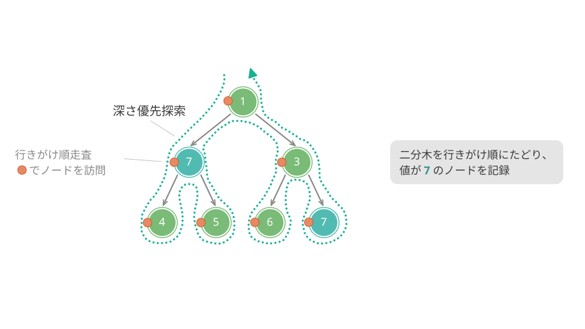{ class="animation-figure" }

<p align="center"> 図 13-1 &nbsp; 行きがけ順走査でノードを探す </p>

## 13.1.1 &nbsp; 試行と後戻り

**バックトラッキングという名前は、解空間を探索するときに「試行」と「後戻り」を繰り返すことに由来します**。それ以上進めない状態や、条件を満たす解が得られない状態に達したら、直前の選択を取り消して元の状態に戻り、別の選択肢を試します。

例題 1 では、各ノードを訪れることが「試行」に当たり、葉の先に達したときや親ノードに戻るときの `return` が「後戻り」に当たります。

ここで注意したいのは、**後戻りには関数から戻る以外の操作も含まれる**ことです。例題 1 を少し発展させて考えてみましょう。

!!! question "例題 2"

    二分木で値が $7$ のノードをすべて探し、**根からそれぞれのノードまでの経路を返してください**。

例題 1 のコードにリスト `path` を加え、訪れたノードを経路として記録します。値が $7$ のノードに到達したら、`path` のコピーを結果のリスト `res` に加えます。走査が終わると、`res` にすべての解がそろいます。コードは次のとおりです。

=== "Python"

    ```python title="preorder_traversal_ii_compact.py"
    def pre_order(root: TreeNode):
        """行きがけ順走査：例題 2"""
        if root is None:
            return
        # 試行
        path.append(root)
        if root.val == 7:
            # 解を記録する
            res.append(list(path))
        pre_order(root.left)
        pre_order(root.right)
        # 後戻り
        path.pop()
    ```

=== "C++"

    ```cpp title="preorder_traversal_ii_compact.cpp"
    /* 行きがけ順走査：例題 2 */
    void preOrder(TreeNode *root) {
        if (root == nullptr) {
            return;
        }
        // 試行
        path.push_back(root);
        if (root->val == 7) {
            // 解を記録する
            res.push_back(path);
        }
        preOrder(root->left);
        preOrder(root->right);
        // 後戻り
        path.pop_back();
    }
    ```

=== "Java"

    ```java title="preorder_traversal_ii_compact.java"
    /* 行きがけ順走査：例題 2 */
    void preOrder(TreeNode root) {
        if (root == null) {
            return;
        }
        // 試行
        path.add(root);
        if (root.val == 7) {
            // 解を記録する
            res.add(new ArrayList<>(path));
        }
        preOrder(root.left);
        preOrder(root.right);
        // 後戻り
        path.remove(path.size() - 1);
    }
    ```

=== "C#"

    ```csharp title="preorder_traversal_ii_compact.cs"
    /* 行きがけ順走査：例題 2 */
    void PreOrder(TreeNode? root) {
        if (root == null) {
            return;
        }
        // 試行
        path.Add(root);
        if (root.val == 7) {
            // 解を記録する
            res.Add(new List<TreeNode>(path));
        }
        PreOrder(root.left);
        PreOrder(root.right);
        // 後戻り
        path.RemoveAt(path.Count - 1);
    }
    ```

=== "Go"

    ```go title="preorder_traversal_ii_compact.go"
    /* 行きがけ順走査：例題 2 */
    func preOrderII(root *TreeNode, res *[][]*TreeNode, path *[]*TreeNode) {
        if root == nil {
            return
        }
        // 試行
        *path = append(*path, root)
        if root.Val.(int) == 7 {
            // 解を記録する
            *res = append(*res, append([]*TreeNode{}, *path...))
        }
        preOrderII(root.Left, res, path)
        preOrderII(root.Right, res, path)
        // 後戻り
        *path = (*path)[:len(*path)-1]
    }
    ```

=== "Swift"

    ```swift title="preorder_traversal_ii_compact.swift"
    /* 行きがけ順走査：例題 2 */
    func preOrder(root: TreeNode?) {
        guard let root = root else {
            return
        }
        // 試行
        path.append(root)
        if root.val == 7 {
            // 解を記録する
            res.append(path)
        }
        preOrder(root: root.left)
        preOrder(root: root.right)
        // 後戻り
        path.removeLast()
    }
    ```

=== "JS"

    ```javascript title="preorder_traversal_ii_compact.js"
    /* 行きがけ順走査：例題 2 */
    function preOrder(root, path, res) {
        if (root === null) {
            return;
        }
        // 試行
        path.push(root);
        if (root.val === 7) {
            // 解を記録する
            res.push([...path]);
        }
        preOrder(root.left, path, res);
        preOrder(root.right, path, res);
        // 後戻り
        path.pop();
    }
    ```

=== "TS"

    ```typescript title="preorder_traversal_ii_compact.ts"
    /* 行きがけ順走査：例題 2 */
    function preOrder(
        root: TreeNode | null,
        path: TreeNode[],
        res: TreeNode[][]
    ): void {
        if (root === null) {
            return;
        }
        // 試行
        path.push(root);
        if (root.val === 7) {
            // 解を記録する
            res.push([...path]);
        }
        preOrder(root.left, path, res);
        preOrder(root.right, path, res);
        // 後戻り
        path.pop();
    }
    ```

=== "Dart"

    ```dart title="preorder_traversal_ii_compact.dart"
    /* 行きがけ順走査：例題 2 */
    void preOrder(
      TreeNode? root,
      List<TreeNode> path,
      List<List<TreeNode>> res,
    ) {
      if (root == null) {
        return;
      }

      // 試行
      path.add(root);
      if (root.val == 7) {
        // 解を記録する
        res.add(List.from(path));
      }
      preOrder(root.left, path, res);
      preOrder(root.right, path, res);
      // 後戻り
      path.removeLast();
    }
    ```

=== "Rust"

    ```rust title="preorder_traversal_ii_compact.rs"
    /* 行きがけ順走査：例題 2 */
    fn pre_order(
        res: &mut Vec<Vec<Rc<RefCell<TreeNode>>>>,
        path: &mut Vec<Rc<RefCell<TreeNode>>>,
        root: Option<&Rc<RefCell<TreeNode>>>,
    ) {
        if root.is_none() {
            return;
        }
        if let Some(node) = root {
            // 試行
            path.push(node.clone());
            if node.borrow().val == 7 {
                // 解を記録する
                res.push(path.clone());
            }
            pre_order(res, path, node.borrow().left.as_ref());
            pre_order(res, path, node.borrow().right.as_ref());
            // 後戻り
            path.pop();
        }
    }
    ```

=== "C"

    ```c title="preorder_traversal_ii_compact.c"
    /* 行きがけ順走査：例題 2 */
    void preOrder(TreeNode *root) {
        if (root == NULL) {
            return;
        }
        // 試行
        path[pathSize++] = root;
        if (root->val == 7) {
            // 解を記録する
            for (int i = 0; i < pathSize; ++i) {
                res[resSize][i] = path[i];
            }
            resSize++;
        }
        preOrder(root->left);
        preOrder(root->right);
        // 後戻り
        pathSize--;
    }
    ```

=== "Kotlin"

    ```kotlin title="preorder_traversal_ii_compact.kt"
    /* 行きがけ順走査：例題 2 */
    fun preOrder(root: TreeNode?) {
        if (root == null) {
            return
        }
        // 試行
        path!!.add(root)
        if (root._val == 7) {
            // 解を記録する
            res!!.add(path!!.toMutableList())
        }
        preOrder(root.left)
        preOrder(root.right)
        // 後戻り
        path!!.removeAt(path!!.size - 1)
    }
    ```

=== "Ruby"

    ```ruby title="preorder_traversal_ii_compact.rb"
    ### 行きがけ順走査：例題 2 ###
    def pre_order(root)
      return unless root

      # 試行
      $path << root

      # 解を記録する
      $res << $path.dup if root.val == 7

      pre_order(root.left)
      pre_order(root.right)

      # 後戻り
      $path.pop
    end
    ```

??? pythontutor "実行の様子を見る"

    <div style="height: 549px; width: 100%;"><iframe class="pythontutor-iframe" title="実行の様子を見る" src="https://pythontutor.com/iframe-embed.html#code=class%20TreeNode%3A%0A%20%20%20%20%22%22%22%E4%BA%8C%E5%88%86%E6%9C%A8%E3%81%AE%E3%83%8E%E3%83%BC%E3%83%89%E3%82%92%E8%A1%A8%E3%81%99%E3%82%AF%E3%83%A9%E3%82%B9%22%22%22%0A%0A%20%20%20%20def%20__init__%28self,%20val%3A%20int%20%3D%200%29%3A%0A%20%20%20%20%20%20%20%20self.val%3A%20int%20%3D%20val%20%20%23%20%E3%83%8E%E3%83%BC%E3%83%89%E3%81%AE%E5%80%A4%0A%20%20%20%20%20%20%20%20self.left%3A%20TreeNode%20%7C%20None%20%3D%20None%20%20%23%20%E5%B7%A6%E3%81%AE%E5%AD%90%E3%81%B8%E3%81%AE%E5%8F%82%E7%85%A7%0A%20%20%20%20%20%20%20%20self.right%3A%20TreeNode%20%7C%20None%20%3D%20None%20%20%23%20%E5%8F%B3%E3%81%AE%E5%AD%90%E3%81%B8%E3%81%AE%E5%8F%82%E7%85%A7%0A%0Adef%20list_to_tree_dfs%28arr%3A%20list%5Bint%5D,%20i%3A%20int%29%20-%3E%20TreeNode%20%7C%20None%3A%0A%20%20%20%20%22%22%22%E3%83%AA%E3%82%B9%E3%83%88%E3%81%8B%E3%82%89%E4%BA%8C%E5%88%86%E6%9C%A8%E3%82%92%E5%BE%A9%E5%85%83%E3%81%99%E3%82%8B%EF%BC%9A%E5%86%8D%E5%B8%B0%22%22%22%0A%20%20%20%20%23%20%E3%82%A4%E3%83%B3%E3%83%87%E3%83%83%E3%82%AF%E3%82%B9%E3%81%8C%E9%85%8D%E5%88%97%E3%81%AE%E7%AF%84%E5%9B%B2%E5%A4%96%E3%81%8B%E3%80%81%E5%AF%BE%E5%BF%9C%E3%81%99%E3%82%8B%E8%A6%81%E7%B4%A0%E3%81%8C%20None%20%E3%81%AA%E3%82%89%20None%20%E3%82%92%E8%BF%94%E3%81%99%0A%20%20%20%20if%20i%20%3C%200%20or%20i%20%3E%3D%20len%28arr%29%20or%20arr%5Bi%5D%20is%20None%3A%0A%20%20%20%20%20%20%20%20return%20None%0A%20%20%20%20%23%20%E7%8F%BE%E5%9C%A8%E3%81%AE%E3%83%8E%E3%83%BC%E3%83%89%E3%82%92%E4%BD%9C%E3%82%8B%0A%20%20%20%20root%20%3D%20TreeNode%28arr%5Bi%5D%29%0A%20%20%20%20%23%20%E5%B7%A6%E5%8F%B3%E3%81%AE%E9%83%A8%E5%88%86%E6%9C%A8%E3%82%92%E5%86%8D%E5%B8%B0%E7%9A%84%E3%81%AB%E6%A7%8B%E7%AF%89%E3%81%99%E3%82%8B%0A%20%20%20%20root.left%20%3D%20list_to_tree_dfs%28arr,%202%20%2A%20i%20%2B%201%29%0A%20%20%20%20root.right%20%3D%20list_to_tree_dfs%28arr,%202%20%2A%20i%20%2B%202%29%0A%20%20%20%20return%20root%0A%0Adef%20list_to_tree%28arr%3A%20list%5Bint%5D%29%20-%3E%20TreeNode%20%7C%20None%3A%0A%20%20%20%20%22%22%22%E3%83%AA%E3%82%B9%E3%83%88%E3%81%8B%E3%82%89%E4%BA%8C%E5%88%86%E6%9C%A8%E3%82%92%E5%BE%A9%E5%85%83%E3%81%99%E3%82%8B%22%22%22%0A%20%20%20%20return%20list_to_tree_dfs%28arr,%200%29%0A%0A%0Adef%20pre_order%28root%3A%20TreeNode%29%3A%0A%20%20%20%20%22%22%22%E8%A1%8C%E3%81%8D%E3%81%8C%E3%81%91%E9%A0%86%E8%B5%B0%E6%9F%BB%EF%BC%9A%E4%BE%8B%E9%A1%8C%202%22%22%22%0A%20%20%20%20if%20root%20is%20None%3A%0A%20%20%20%20%20%20%20%20return%0A%20%20%20%20%23%20%E8%A9%A6%E8%A1%8C%0A%20%20%20%20path.append%28root%29%0A%20%20%20%20if%20root.val%20%3D%3D%207%3A%0A%20%20%20%20%20%20%20%20%23%20%E8%A7%A3%E3%82%92%E8%A8%98%E9%8C%B2%E3%81%99%E3%82%8B%0A%20%20%20%20%20%20%20%20res.append%28list%28path%29%29%0A%20%20%20%20pre_order%28root.left%29%0A%20%20%20%20pre_order%28root.right%29%0A%20%20%20%20%23%20%E5%BE%8C%E6%88%BB%E3%82%8A%0A%20%20%20%20path.pop%28%29%0A%0A%0A%22%22%22Driver%20Code%22%22%22%0Aif%20__name__%20%3D%3D%20%22__main__%22%3A%0A%20%20%20%20root%20%3D%20list_to_tree%28%5B1,%207,%203,%204,%205,%206,%207%5D%29%0A%0A%20%20%20%20%23%20%E8%A1%8C%E3%81%8D%E3%81%8C%E3%81%91%E9%A0%86%E8%B5%B0%E6%9F%BB%0A%20%20%20%20path%20%3D%20list%5BTreeNode%5D%28%29%0A%20%20%20%20res%20%3D%20list%5Blist%5BTreeNode%5D%5D%28%29%0A%20%20%20%20pre_order%28root%29%0A%0A%20%20%20%20print%28%22%5Cn%E6%A0%B9%E3%81%8B%E3%82%89%E5%80%A4%E3%81%8C%207%20%E3%81%AE%E3%83%8E%E3%83%BC%E3%83%89%E3%81%BE%E3%81%A7%E3%81%AE%E7%B5%8C%E8%B7%AF%E3%82%92%E3%81%99%E3%81%B9%E3%81%A6%E5%87%BA%E5%8A%9B%22%29%0A%20%20%20%20for%20path%20in%20res%3A%0A%20%20%20%20%20%20%20%20print%28%5Bnode.val%20for%20node%20in%20path%5D%29&codeDivHeight=472&codeDivWidth=350&cumulative=false&curInstr=126&heapPrimitives=nevernest&origin=opt-frontend.js&py=311&rawInputLstJSON=%5B%5D&textReferences=false"> </iframe></div>
    <div style="margin-top: 5px;"><a href="https://pythontutor.com/iframe-embed.html#code=class%20TreeNode%3A%0A%20%20%20%20%22%22%22%E4%BA%8C%E5%88%86%E6%9C%A8%E3%81%AE%E3%83%8E%E3%83%BC%E3%83%89%E3%82%92%E8%A1%A8%E3%81%99%E3%82%AF%E3%83%A9%E3%82%B9%22%22%22%0A%0A%20%20%20%20def%20__init__%28self,%20val%3A%20int%20%3D%200%29%3A%0A%20%20%20%20%20%20%20%20self.val%3A%20int%20%3D%20val%20%20%23%20%E3%83%8E%E3%83%BC%E3%83%89%E3%81%AE%E5%80%A4%0A%20%20%20%20%20%20%20%20self.left%3A%20TreeNode%20%7C%20None%20%3D%20None%20%20%23%20%E5%B7%A6%E3%81%AE%E5%AD%90%E3%81%B8%E3%81%AE%E5%8F%82%E7%85%A7%0A%20%20%20%20%20%20%20%20self.right%3A%20TreeNode%20%7C%20None%20%3D%20None%20%20%23%20%E5%8F%B3%E3%81%AE%E5%AD%90%E3%81%B8%E3%81%AE%E5%8F%82%E7%85%A7%0A%0Adef%20list_to_tree_dfs%28arr%3A%20list%5Bint%5D,%20i%3A%20int%29%20-%3E%20TreeNode%20%7C%20None%3A%0A%20%20%20%20%22%22%22%E3%83%AA%E3%82%B9%E3%83%88%E3%81%8B%E3%82%89%E4%BA%8C%E5%88%86%E6%9C%A8%E3%82%92%E5%BE%A9%E5%85%83%E3%81%99%E3%82%8B%EF%BC%9A%E5%86%8D%E5%B8%B0%22%22%22%0A%20%20%20%20%23%20%E3%82%A4%E3%83%B3%E3%83%87%E3%83%83%E3%82%AF%E3%82%B9%E3%81%8C%E9%85%8D%E5%88%97%E3%81%AE%E7%AF%84%E5%9B%B2%E5%A4%96%E3%81%8B%E3%80%81%E5%AF%BE%E5%BF%9C%E3%81%99%E3%82%8B%E8%A6%81%E7%B4%A0%E3%81%8C%20None%20%E3%81%AA%E3%82%89%20None%20%E3%82%92%E8%BF%94%E3%81%99%0A%20%20%20%20if%20i%20%3C%200%20or%20i%20%3E%3D%20len%28arr%29%20or%20arr%5Bi%5D%20is%20None%3A%0A%20%20%20%20%20%20%20%20return%20None%0A%20%20%20%20%23%20%E7%8F%BE%E5%9C%A8%E3%81%AE%E3%83%8E%E3%83%BC%E3%83%89%E3%82%92%E4%BD%9C%E3%82%8B%0A%20%20%20%20root%20%3D%20TreeNode%28arr%5Bi%5D%29%0A%20%20%20%20%23%20%E5%B7%A6%E5%8F%B3%E3%81%AE%E9%83%A8%E5%88%86%E6%9C%A8%E3%82%92%E5%86%8D%E5%B8%B0%E7%9A%84%E3%81%AB%E6%A7%8B%E7%AF%89%E3%81%99%E3%82%8B%0A%20%20%20%20root.left%20%3D%20list_to_tree_dfs%28arr,%202%20%2A%20i%20%2B%201%29%0A%20%20%20%20root.right%20%3D%20list_to_tree_dfs%28arr,%202%20%2A%20i%20%2B%202%29%0A%20%20%20%20return%20root%0A%0Adef%20list_to_tree%28arr%3A%20list%5Bint%5D%29%20-%3E%20TreeNode%20%7C%20None%3A%0A%20%20%20%20%22%22%22%E3%83%AA%E3%82%B9%E3%83%88%E3%81%8B%E3%82%89%E4%BA%8C%E5%88%86%E6%9C%A8%E3%82%92%E5%BE%A9%E5%85%83%E3%81%99%E3%82%8B%22%22%22%0A%20%20%20%20return%20list_to_tree_dfs%28arr,%200%29%0A%0A%0Adef%20pre_order%28root%3A%20TreeNode%29%3A%0A%20%20%20%20%22%22%22%E8%A1%8C%E3%81%8D%E3%81%8C%E3%81%91%E9%A0%86%E8%B5%B0%E6%9F%BB%EF%BC%9A%E4%BE%8B%E9%A1%8C%202%22%22%22%0A%20%20%20%20if%20root%20is%20None%3A%0A%20%20%20%20%20%20%20%20return%0A%20%20%20%20%23%20%E8%A9%A6%E8%A1%8C%0A%20%20%20%20path.append%28root%29%0A%20%20%20%20if%20root.val%20%3D%3D%207%3A%0A%20%20%20%20%20%20%20%20%23%20%E8%A7%A3%E3%82%92%E8%A8%98%E9%8C%B2%E3%81%99%E3%82%8B%0A%20%20%20%20%20%20%20%20res.append%28list%28path%29%29%0A%20%20%20%20pre_order%28root.left%29%0A%20%20%20%20pre_order%28root.right%29%0A%20%20%20%20%23%20%E5%BE%8C%E6%88%BB%E3%82%8A%0A%20%20%20%20path.pop%28%29%0A%0A%0A%22%22%22Driver%20Code%22%22%22%0Aif%20__name__%20%3D%3D%20%22__main__%22%3A%0A%20%20%20%20root%20%3D%20list_to_tree%28%5B1,%207,%203,%204,%205,%206,%207%5D%29%0A%0A%20%20%20%20%23%20%E8%A1%8C%E3%81%8D%E3%81%8C%E3%81%91%E9%A0%86%E8%B5%B0%E6%9F%BB%0A%20%20%20%20path%20%3D%20list%5BTreeNode%5D%28%29%0A%20%20%20%20res%20%3D%20list%5Blist%5BTreeNode%5D%5D%28%29%0A%20%20%20%20pre_order%28root%29%0A%0A%20%20%20%20print%28%22%5Cn%E6%A0%B9%E3%81%8B%E3%82%89%E5%80%A4%E3%81%8C%207%20%E3%81%AE%E3%83%8E%E3%83%BC%E3%83%89%E3%81%BE%E3%81%A7%E3%81%AE%E7%B5%8C%E8%B7%AF%E3%82%92%E3%81%99%E3%81%B9%E3%81%A6%E5%87%BA%E5%8A%9B%22%29%0A%20%20%20%20for%20path%20in%20res%3A%0A%20%20%20%20%20%20%20%20print%28%5Bnode.val%20for%20node%20in%20path%5D%29&codeDivHeight=800&codeDivWidth=600&cumulative=false&curInstr=126&heapPrimitives=nevernest&origin=opt-frontend.js&py=311&rawInputLstJSON=%5B%5D&textReferences=false" target="_blank" rel="noopener noreferrer">全画面で表示 ></a></div>

各「試行」では、現在のノードを `path` に加えて経路を記録します。「後戻り」の前には、そのノードを `path` の末尾から取り除き、**今回の試行の前の状態に戻します**。

図 13-2 から、**試行は「先へ進む」操作、後戻りはそれを「取り消す」操作**と考えられます。両者は互いに逆の操作です。

=== "<1>"
    { class="animation-figure" }

=== "<2>"
    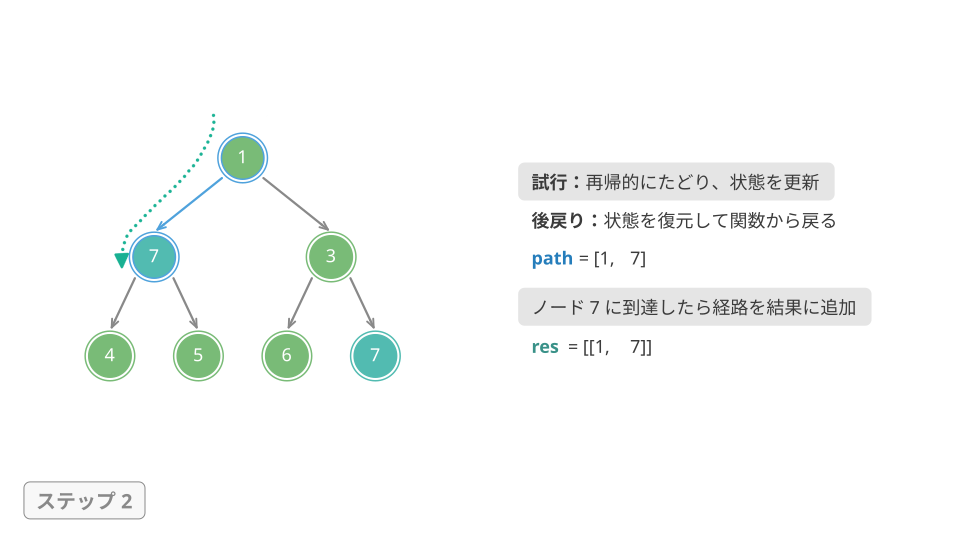{ class="animation-figure" }

=== "<3>"
    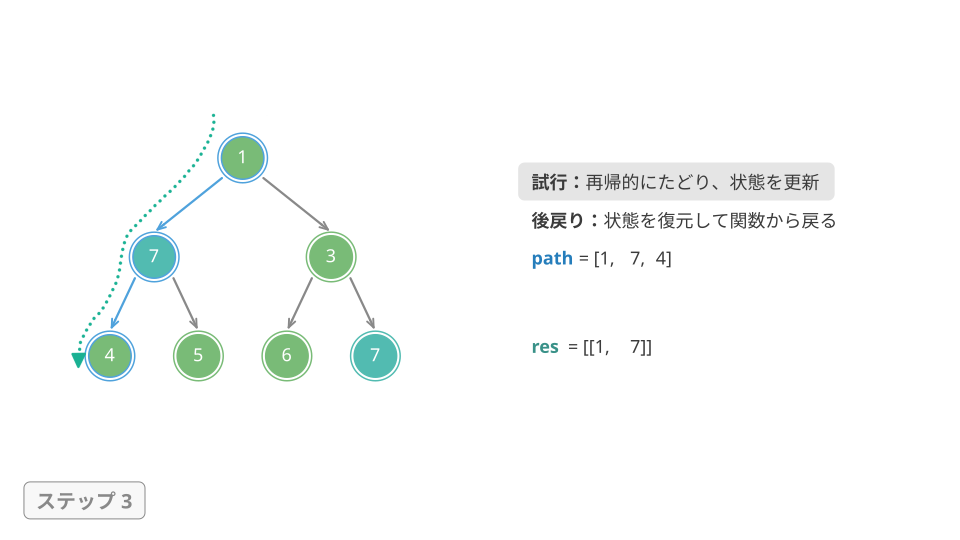{ class="animation-figure" }

=== "<4>"
    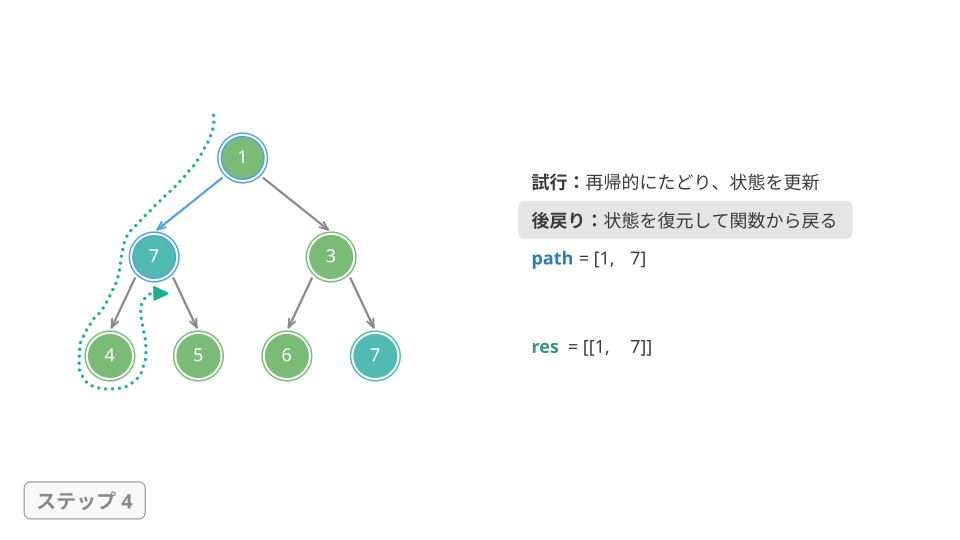{ class="animation-figure" }

=== "<5>"
    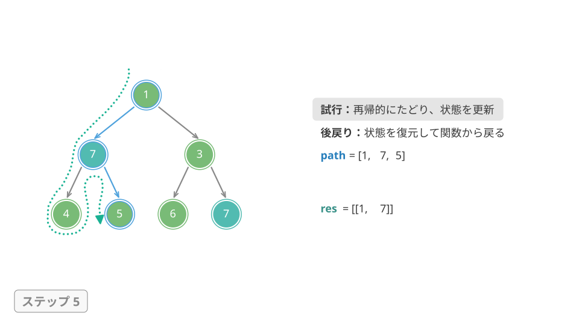{ class="animation-figure" }

=== "<6>"
    { class="animation-figure" }

=== "<7>"
    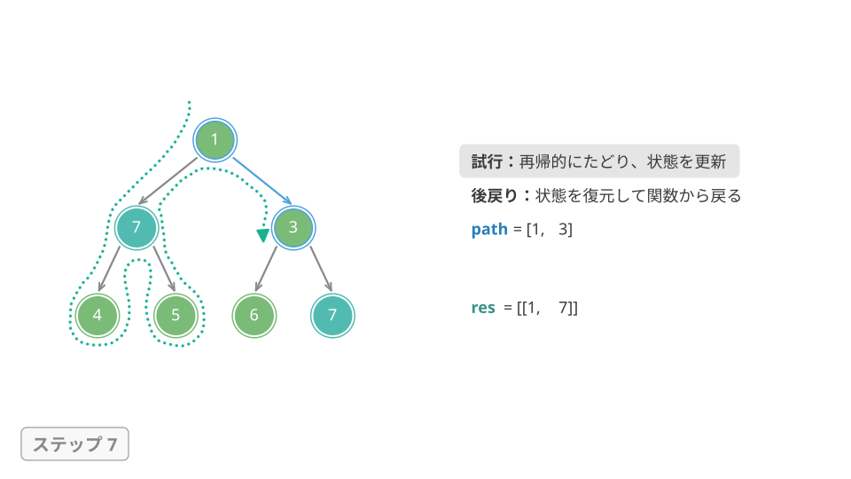{ class="animation-figure" }

=== "<8>"
    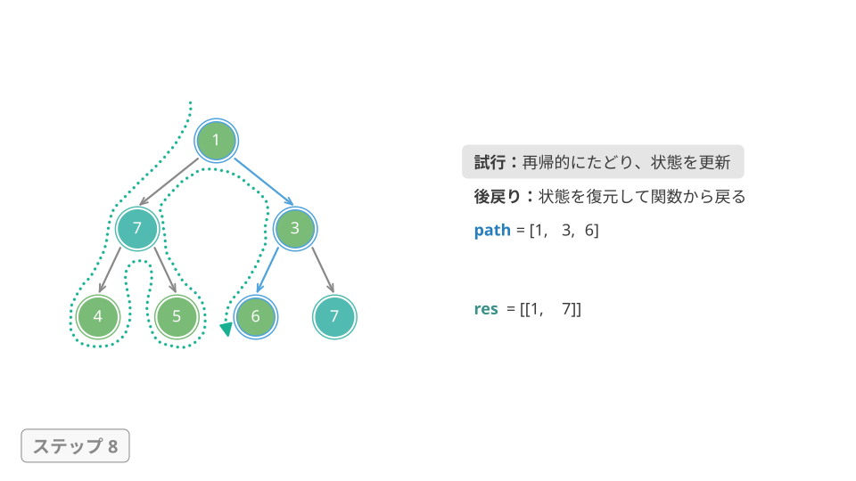{ class="animation-figure" }

=== "<9>"
    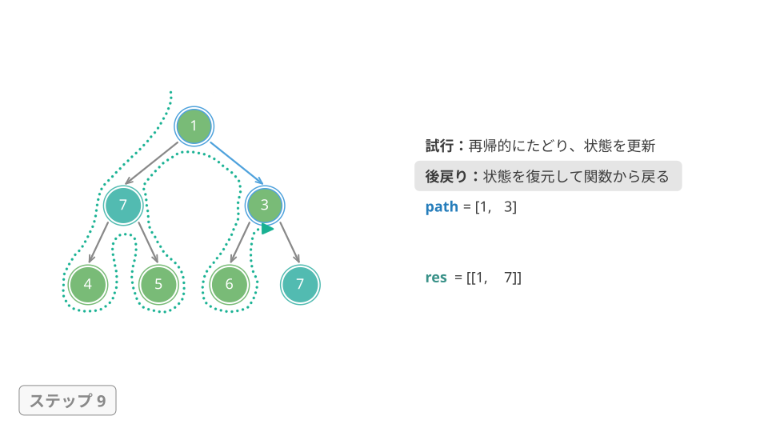{ class="animation-figure" }

=== "<10>"
    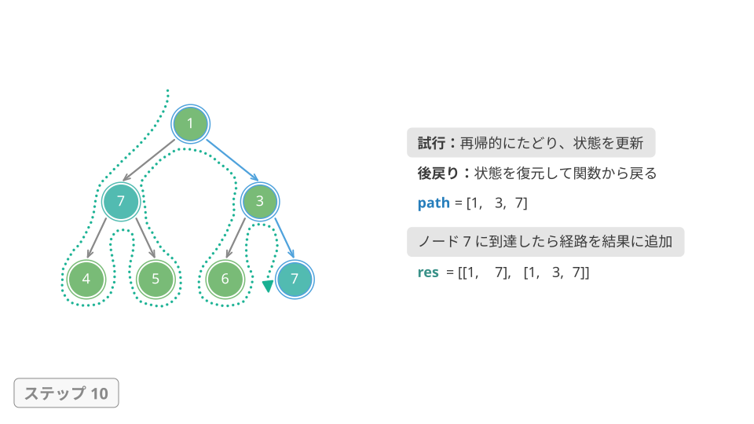{ class="animation-figure" }

=== "<11>"
    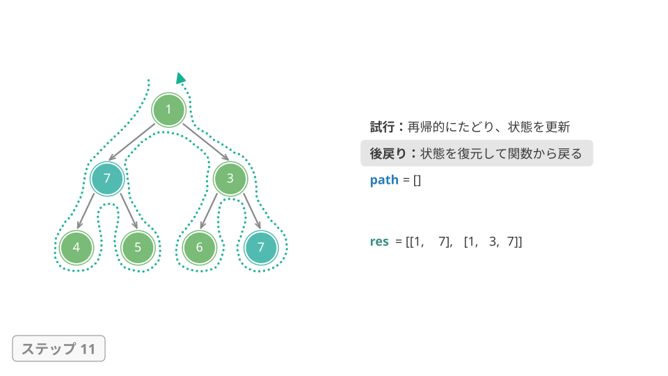{ class="animation-figure" }

<p align="center"> 図 13-2 &nbsp; 試行と後戻り </p>

## 13.1.2 &nbsp; 枝刈り

複雑なバックトラッキングの問題には通常、一つ以上の制約があり、**その制約を「枝刈り」に使えることがよくあります**。

!!! question "例題 3"

    二分木で値が $7$ のノードをすべて探し、根からそれぞれのノードまでの経路を返してください。**ただし、経路には値が $3$ のノードを含めてはいけません**。

この制約を満たすために、**枝刈りを加えます**。探索中に値が $3$ のノードに出会ったら、そこで関数から戻り、その先は探索しません。コードは次のとおりです。

=== "Python"

    ```python title="preorder_traversal_iii_compact.py"
    def pre_order(root: TreeNode):
        """行きがけ順走査：例題 3"""
        # 枝刈り
        if root is None or root.val == 3:
            return
        # 試行
        path.append(root)
        if root.val == 7:
            # 解を記録する
            res.append(list(path))
        pre_order(root.left)
        pre_order(root.right)
        # 後戻り
        path.pop()
    ```

=== "C++"

    ```cpp title="preorder_traversal_iii_compact.cpp"
    /* 行きがけ順走査：例題 3 */
    void preOrder(TreeNode *root) {
        // 枝刈り
        if (root == nullptr || root->val == 3) {
            return;
        }
        // 試行
        path.push_back(root);
        if (root->val == 7) {
            // 解を記録する
            res.push_back(path);
        }
        preOrder(root->left);
        preOrder(root->right);
        // 後戻り
        path.pop_back();
    }
    ```

=== "Java"

    ```java title="preorder_traversal_iii_compact.java"
    /* 行きがけ順走査：例題 3 */
    void preOrder(TreeNode root) {
        // 枝刈り
        if (root == null || root.val == 3) {
            return;
        }
        // 試行
        path.add(root);
        if (root.val == 7) {
            // 解を記録する
            res.add(new ArrayList<>(path));
        }
        preOrder(root.left);
        preOrder(root.right);
        // 後戻り
        path.remove(path.size() - 1);
    }
    ```

=== "C#"

    ```csharp title="preorder_traversal_iii_compact.cs"
    /* 行きがけ順走査：例題 3 */
    void PreOrder(TreeNode? root) {
        // 枝刈り
        if (root == null || root.val == 3) {
            return;
        }
        // 試行
        path.Add(root);
        if (root.val == 7) {
            // 解を記録する
            res.Add(new List<TreeNode>(path));
        }
        PreOrder(root.left);
        PreOrder(root.right);
        // 後戻り
        path.RemoveAt(path.Count - 1);
    }
    ```

=== "Go"

    ```go title="preorder_traversal_iii_compact.go"
    /* 行きがけ順走査：例題 3 */
    func preOrderIII(root *TreeNode, res *[][]*TreeNode, path *[]*TreeNode) {
        // 枝刈り
        if root == nil || root.Val == 3 {
            return
        }
        // 試行
        *path = append(*path, root)
        if root.Val.(int) == 7 {
            // 解を記録する
            *res = append(*res, append([]*TreeNode{}, *path...))
        }
        preOrderIII(root.Left, res, path)
        preOrderIII(root.Right, res, path)
        // 後戻り
        *path = (*path)[:len(*path)-1]
    }
    ```

=== "Swift"

    ```swift title="preorder_traversal_iii_compact.swift"
    /* 行きがけ順走査：例題 3 */
    func preOrder(root: TreeNode?) {
        // 枝刈り
        guard let root = root, root.val != 3 else {
            return
        }
        // 試行
        path.append(root)
        if root.val == 7 {
            // 解を記録する
            res.append(path)
        }
        preOrder(root: root.left)
        preOrder(root: root.right)
        // 後戻り
        path.removeLast()
    }
    ```

=== "JS"

    ```javascript title="preorder_traversal_iii_compact.js"
    /* 行きがけ順走査：例題 3 */
    function preOrder(root, path, res) {
        // 枝刈り
        if (root === null || root.val === 3) {
            return;
        }
        // 試行
        path.push(root);
        if (root.val === 7) {
            // 解を記録する
            res.push([...path]);
        }
        preOrder(root.left, path, res);
        preOrder(root.right, path, res);
        // 後戻り
        path.pop();
    }
    ```

=== "TS"

    ```typescript title="preorder_traversal_iii_compact.ts"
    /* 行きがけ順走査：例題 3 */
    function preOrder(
        root: TreeNode | null,
        path: TreeNode[],
        res: TreeNode[][]
    ): void {
        // 枝刈り
        if (root === null || root.val === 3) {
            return;
        }
        // 試行
        path.push(root);
        if (root.val === 7) {
            // 解を記録する
            res.push([...path]);
        }
        preOrder(root.left, path, res);
        preOrder(root.right, path, res);
        // 後戻り
        path.pop();
    }
    ```

=== "Dart"

    ```dart title="preorder_traversal_iii_compact.dart"
    /* 行きがけ順走査：例題 3 */
    void preOrder(
      TreeNode? root,
      List<TreeNode> path,
      List<List<TreeNode>> res,
    ) {
      if (root == null || root.val == 3) {
        return;
      }

      // 試行
      path.add(root);
      if (root.val == 7) {
        // 解を記録する
        res.add(List.from(path));
      }
      preOrder(root.left, path, res);
      preOrder(root.right, path, res);
      // 後戻り
      path.removeLast();
    }
    ```

=== "Rust"

    ```rust title="preorder_traversal_iii_compact.rs"
    /* 行きがけ順走査：例題 3 */
    fn pre_order(
        res: &mut Vec<Vec<Rc<RefCell<TreeNode>>>>,
        path: &mut Vec<Rc<RefCell<TreeNode>>>,
        root: Option<&Rc<RefCell<TreeNode>>>,
    ) {
        // 枝刈り
        if root.is_none() || root.as_ref().unwrap().borrow().val == 3 {
            return;
        }
        if let Some(node) = root {
            // 試行
            path.push(node.clone());
            if node.borrow().val == 7 {
                // 解を記録する
                res.push(path.clone());
            }
            pre_order(res, path, node.borrow().left.as_ref());
            pre_order(res, path, node.borrow().right.as_ref());
            // 後戻り
            path.pop();
        }
    }
    ```

=== "C"

    ```c title="preorder_traversal_iii_compact.c"
    /* 行きがけ順走査：例題 3 */
    void preOrder(TreeNode *root) {
        // 枝刈り
        if (root == NULL || root->val == 3) {
            return;
        }
        // 試行
        path[pathSize++] = root;
        if (root->val == 7) {
            // 解を記録する
            for (int i = 0; i < pathSize; i++) {
                res[resSize][i] = path[i];
            }
            resSize++;
        }
        preOrder(root->left);
        preOrder(root->right);
        // 後戻り
        pathSize--;
    }
    ```

=== "Kotlin"

    ```kotlin title="preorder_traversal_iii_compact.kt"
    /* 行きがけ順走査：例題 3 */
    fun preOrder(root: TreeNode?) {
        // 枝刈り
        if (root == null || root._val == 3) {
            return
        }
        // 試行
        path!!.add(root)
        if (root._val == 7) {
            // 解を記録する
            res!!.add(path!!.toMutableList())
        }
        preOrder(root.left)
        preOrder(root.right)
        // 後戻り
        path!!.removeAt(path!!.size - 1)
    }
    ```

=== "Ruby"

    ```ruby title="preorder_traversal_iii_compact.rb"
    ### 行きがけ順走査：例題 3 ###
    def pre_order(root)
      # 枝刈り
      return if !root || root.val == 3

      # 試行
      $path.append(root)

      # 解を記録する
      $res << $path.dup if root.val == 7

      pre_order(root.left)
      pre_order(root.right)

      # 後戻り
      $path.pop
    end
    ```

??? pythontutor "実行の様子を見る"

    <div style="height: 549px; width: 100%;"><iframe class="pythontutor-iframe" title="実行の様子を見る" src="https://pythontutor.com/iframe-embed.html#code=class%20TreeNode%3A%0A%20%20%20%20%22%22%22%E4%BA%8C%E5%88%86%E6%9C%A8%E3%81%AE%E3%83%8E%E3%83%BC%E3%83%89%E3%82%92%E8%A1%A8%E3%81%99%E3%82%AF%E3%83%A9%E3%82%B9%22%22%22%0A%0A%20%20%20%20def%20__init__%28self,%20val%3A%20int%20%3D%200%29%3A%0A%20%20%20%20%20%20%20%20self.val%3A%20int%20%3D%20val%20%20%23%20%E3%83%8E%E3%83%BC%E3%83%89%E3%81%AE%E5%80%A4%0A%20%20%20%20%20%20%20%20self.left%3A%20TreeNode%20%7C%20None%20%3D%20None%20%20%23%20%E5%B7%A6%E3%81%AE%E5%AD%90%E3%81%B8%E3%81%AE%E5%8F%82%E7%85%A7%0A%20%20%20%20%20%20%20%20self.right%3A%20TreeNode%20%7C%20None%20%3D%20None%20%20%23%20%E5%8F%B3%E3%81%AE%E5%AD%90%E3%81%B8%E3%81%AE%E5%8F%82%E7%85%A7%0A%0Adef%20list_to_tree_dfs%28arr%3A%20list%5Bint%5D,%20i%3A%20int%29%20-%3E%20TreeNode%20%7C%20None%3A%0A%20%20%20%20%22%22%22%E3%83%AA%E3%82%B9%E3%83%88%E3%81%8B%E3%82%89%E4%BA%8C%E5%88%86%E6%9C%A8%E3%82%92%E5%BE%A9%E5%85%83%E3%81%99%E3%82%8B%EF%BC%9A%E5%86%8D%E5%B8%B0%22%22%22%0A%20%20%20%20%23%20%E3%82%A4%E3%83%B3%E3%83%87%E3%83%83%E3%82%AF%E3%82%B9%E3%81%8C%E9%85%8D%E5%88%97%E3%81%AE%E7%AF%84%E5%9B%B2%E5%A4%96%E3%81%8B%E3%80%81%E5%AF%BE%E5%BF%9C%E3%81%99%E3%82%8B%E8%A6%81%E7%B4%A0%E3%81%8C%20None%20%E3%81%AA%E3%82%89%20None%20%E3%82%92%E8%BF%94%E3%81%99%0A%20%20%20%20if%20i%20%3C%200%20or%20i%20%3E%3D%20len%28arr%29%20or%20arr%5Bi%5D%20is%20None%3A%0A%20%20%20%20%20%20%20%20return%20None%0A%20%20%20%20%23%20%E7%8F%BE%E5%9C%A8%E3%81%AE%E3%83%8E%E3%83%BC%E3%83%89%E3%82%92%E4%BD%9C%E3%82%8B%0A%20%20%20%20root%20%3D%20TreeNode%28arr%5Bi%5D%29%0A%20%20%20%20%23%20%E5%B7%A6%E5%8F%B3%E3%81%AE%E9%83%A8%E5%88%86%E6%9C%A8%E3%82%92%E5%86%8D%E5%B8%B0%E7%9A%84%E3%81%AB%E6%A7%8B%E7%AF%89%E3%81%99%E3%82%8B%0A%20%20%20%20root.left%20%3D%20list_to_tree_dfs%28arr,%202%20%2A%20i%20%2B%201%29%0A%20%20%20%20root.right%20%3D%20list_to_tree_dfs%28arr,%202%20%2A%20i%20%2B%202%29%0A%20%20%20%20return%20root%0A%0Adef%20list_to_tree%28arr%3A%20list%5Bint%5D%29%20-%3E%20TreeNode%20%7C%20None%3A%0A%20%20%20%20%22%22%22%E3%83%AA%E3%82%B9%E3%83%88%E3%81%8B%E3%82%89%E4%BA%8C%E5%88%86%E6%9C%A8%E3%82%92%E5%BE%A9%E5%85%83%E3%81%99%E3%82%8B%22%22%22%0A%20%20%20%20return%20list_to_tree_dfs%28arr,%200%29%0A%0A%0Adef%20pre_order%28root%3A%20TreeNode%29%3A%0A%20%20%20%20%22%22%22%E8%A1%8C%E3%81%8D%E3%81%8C%E3%81%91%E9%A0%86%E8%B5%B0%E6%9F%BB%EF%BC%9A%E4%BE%8B%E9%A1%8C%203%22%22%22%0A%20%20%20%20%23%20%E6%9E%9D%E5%88%88%E3%82%8A%0A%20%20%20%20if%20root%20is%20None%20or%20root.val%20%3D%3D%203%3A%0A%20%20%20%20%20%20%20%20return%0A%20%20%20%20%23%20%E8%A9%A6%E8%A1%8C%0A%20%20%20%20path.append%28root%29%0A%20%20%20%20if%20root.val%20%3D%3D%207%3A%0A%20%20%20%20%20%20%20%20%23%20%E8%A7%A3%E3%82%92%E8%A8%98%E9%8C%B2%E3%81%99%E3%82%8B%0A%20%20%20%20%20%20%20%20res.append%28list%28path%29%29%0A%20%20%20%20pre_order%28root.left%29%0A%20%20%20%20pre_order%28root.right%29%0A%20%20%20%20%23%20%E5%BE%8C%E6%88%BB%E3%82%8A%0A%20%20%20%20path.pop%28%29%0A%0A%0A%22%22%22Driver%20Code%22%22%22%0Aif%20__name__%20%3D%3D%20%22__main__%22%3A%0A%20%20%20%20root%20%3D%20list_to_tree%28%5B1,%207,%203,%204,%205,%206,%207%5D%29%0A%0A%20%20%20%20%23%20%E8%A1%8C%E3%81%8D%E3%81%8C%E3%81%91%E9%A0%86%E8%B5%B0%E6%9F%BB%0A%20%20%20%20path%20%3D%20list%5BTreeNode%5D%28%29%0A%20%20%20%20res%20%3D%20list%5Blist%5BTreeNode%5D%5D%28%29%0A%20%20%20%20pre_order%28root%29%0A%0A%20%20%20%20print%28%22%5Cn%E6%A0%B9%E3%81%8B%E3%82%89%E5%80%A4%E3%81%8C%207%20%E3%81%AE%E3%83%8E%E3%83%BC%E3%83%89%E3%81%BE%E3%81%A7%E3%81%AE%E7%B5%8C%E8%B7%AF%E3%81%AE%E3%81%86%E3%81%A1%E3%80%81%E5%80%A4%E3%81%8C%203%20%E3%81%AE%E3%83%8E%E3%83%BC%E3%83%89%E3%82%92%E5%90%AB%E3%81%BE%E3%81%AA%E3%81%84%E3%82%82%E3%81%AE%E3%82%92%E3%81%99%E3%81%B9%E3%81%A6%E5%87%BA%E5%8A%9B%22%29%0A%20%20%20%20for%20path%20in%20res%3A%0A%20%20%20%20%20%20%20%20print%28%5Bnode.val%20for%20node%20in%20path%5D%29&codeDivHeight=472&codeDivWidth=350&cumulative=false&curInstr=126&heapPrimitives=nevernest&origin=opt-frontend.js&py=311&rawInputLstJSON=%5B%5D&textReferences=false"> </iframe></div>
    <div style="margin-top: 5px;"><a href="https://pythontutor.com/iframe-embed.html#code=class%20TreeNode%3A%0A%20%20%20%20%22%22%22%E4%BA%8C%E5%88%86%E6%9C%A8%E3%81%AE%E3%83%8E%E3%83%BC%E3%83%89%E3%82%92%E8%A1%A8%E3%81%99%E3%82%AF%E3%83%A9%E3%82%B9%22%22%22%0A%0A%20%20%20%20def%20__init__%28self,%20val%3A%20int%20%3D%200%29%3A%0A%20%20%20%20%20%20%20%20self.val%3A%20int%20%3D%20val%20%20%23%20%E3%83%8E%E3%83%BC%E3%83%89%E3%81%AE%E5%80%A4%0A%20%20%20%20%20%20%20%20self.left%3A%20TreeNode%20%7C%20None%20%3D%20None%20%20%23%20%E5%B7%A6%E3%81%AE%E5%AD%90%E3%81%B8%E3%81%AE%E5%8F%82%E7%85%A7%0A%20%20%20%20%20%20%20%20self.right%3A%20TreeNode%20%7C%20None%20%3D%20None%20%20%23%20%E5%8F%B3%E3%81%AE%E5%AD%90%E3%81%B8%E3%81%AE%E5%8F%82%E7%85%A7%0A%0Adef%20list_to_tree_dfs%28arr%3A%20list%5Bint%5D,%20i%3A%20int%29%20-%3E%20TreeNode%20%7C%20None%3A%0A%20%20%20%20%22%22%22%E3%83%AA%E3%82%B9%E3%83%88%E3%81%8B%E3%82%89%E4%BA%8C%E5%88%86%E6%9C%A8%E3%82%92%E5%BE%A9%E5%85%83%E3%81%99%E3%82%8B%EF%BC%9A%E5%86%8D%E5%B8%B0%22%22%22%0A%20%20%20%20%23%20%E3%82%A4%E3%83%B3%E3%83%87%E3%83%83%E3%82%AF%E3%82%B9%E3%81%8C%E9%85%8D%E5%88%97%E3%81%AE%E7%AF%84%E5%9B%B2%E5%A4%96%E3%81%8B%E3%80%81%E5%AF%BE%E5%BF%9C%E3%81%99%E3%82%8B%E8%A6%81%E7%B4%A0%E3%81%8C%20None%20%E3%81%AA%E3%82%89%20None%20%E3%82%92%E8%BF%94%E3%81%99%0A%20%20%20%20if%20i%20%3C%200%20or%20i%20%3E%3D%20len%28arr%29%20or%20arr%5Bi%5D%20is%20None%3A%0A%20%20%20%20%20%20%20%20return%20None%0A%20%20%20%20%23%20%E7%8F%BE%E5%9C%A8%E3%81%AE%E3%83%8E%E3%83%BC%E3%83%89%E3%82%92%E4%BD%9C%E3%82%8B%0A%20%20%20%20root%20%3D%20TreeNode%28arr%5Bi%5D%29%0A%20%20%20%20%23%20%E5%B7%A6%E5%8F%B3%E3%81%AE%E9%83%A8%E5%88%86%E6%9C%A8%E3%82%92%E5%86%8D%E5%B8%B0%E7%9A%84%E3%81%AB%E6%A7%8B%E7%AF%89%E3%81%99%E3%82%8B%0A%20%20%20%20root.left%20%3D%20list_to_tree_dfs%28arr,%202%20%2A%20i%20%2B%201%29%0A%20%20%20%20root.right%20%3D%20list_to_tree_dfs%28arr,%202%20%2A%20i%20%2B%202%29%0A%20%20%20%20return%20root%0A%0Adef%20list_to_tree%28arr%3A%20list%5Bint%5D%29%20-%3E%20TreeNode%20%7C%20None%3A%0A%20%20%20%20%22%22%22%E3%83%AA%E3%82%B9%E3%83%88%E3%81%8B%E3%82%89%E4%BA%8C%E5%88%86%E6%9C%A8%E3%82%92%E5%BE%A9%E5%85%83%E3%81%99%E3%82%8B%22%22%22%0A%20%20%20%20return%20list_to_tree_dfs%28arr,%200%29%0A%0A%0Adef%20pre_order%28root%3A%20TreeNode%29%3A%0A%20%20%20%20%22%22%22%E8%A1%8C%E3%81%8D%E3%81%8C%E3%81%91%E9%A0%86%E8%B5%B0%E6%9F%BB%EF%BC%9A%E4%BE%8B%E9%A1%8C%203%22%22%22%0A%20%20%20%20%23%20%E6%9E%9D%E5%88%88%E3%82%8A%0A%20%20%20%20if%20root%20is%20None%20or%20root.val%20%3D%3D%203%3A%0A%20%20%20%20%20%20%20%20return%0A%20%20%20%20%23%20%E8%A9%A6%E8%A1%8C%0A%20%20%20%20path.append%28root%29%0A%20%20%20%20if%20root.val%20%3D%3D%207%3A%0A%20%20%20%20%20%20%20%20%23%20%E8%A7%A3%E3%82%92%E8%A8%98%E9%8C%B2%E3%81%99%E3%82%8B%0A%20%20%20%20%20%20%20%20res.append%28list%28path%29%29%0A%20%20%20%20pre_order%28root.left%29%0A%20%20%20%20pre_order%28root.right%29%0A%20%20%20%20%23%20%E5%BE%8C%E6%88%BB%E3%82%8A%0A%20%20%20%20path.pop%28%29%0A%0A%0A%22%22%22Driver%20Code%22%22%22%0Aif%20__name__%20%3D%3D%20%22__main__%22%3A%0A%20%20%20%20root%20%3D%20list_to_tree%28%5B1,%207,%203,%204,%205,%206,%207%5D%29%0A%0A%20%20%20%20%23%20%E8%A1%8C%E3%81%8D%E3%81%8C%E3%81%91%E9%A0%86%E8%B5%B0%E6%9F%BB%0A%20%20%20%20path%20%3D%20list%5BTreeNode%5D%28%29%0A%20%20%20%20res%20%3D%20list%5Blist%5BTreeNode%5D%5D%28%29%0A%20%20%20%20pre_order%28root%29%0A%0A%20%20%20%20print%28%22%5Cn%E6%A0%B9%E3%81%8B%E3%82%89%E5%80%A4%E3%81%8C%207%20%E3%81%AE%E3%83%8E%E3%83%BC%E3%83%89%E3%81%BE%E3%81%A7%E3%81%AE%E7%B5%8C%E8%B7%AF%E3%81%AE%E3%81%86%E3%81%A1%E3%80%81%E5%80%A4%E3%81%8C%203%20%E3%81%AE%E3%83%8E%E3%83%BC%E3%83%89%E3%82%92%E5%90%AB%E3%81%BE%E3%81%AA%E3%81%84%E3%82%82%E3%81%AE%E3%82%92%E3%81%99%E3%81%B9%E3%81%A6%E5%87%BA%E5%8A%9B%22%29%0A%20%20%20%20for%20path%20in%20res%3A%0A%20%20%20%20%20%20%20%20print%28%5Bnode.val%20for%20node%20in%20path%5D%29&codeDivHeight=800&codeDivWidth=600&cumulative=false&curInstr=126&heapPrimitives=nevernest&origin=opt-frontend.js&py=311&rawInputLstJSON=%5B%5D&textReferences=false" target="_blank" rel="noopener noreferrer">全画面で表示 ></a></div>

「枝刈り」という名前は、この操作をよく表しています。図 13-3 のように、探索中に**制約を満たさない枝を「切り落とす」**ことで、多くの無駄な試行を省き、探索効率を高めます。

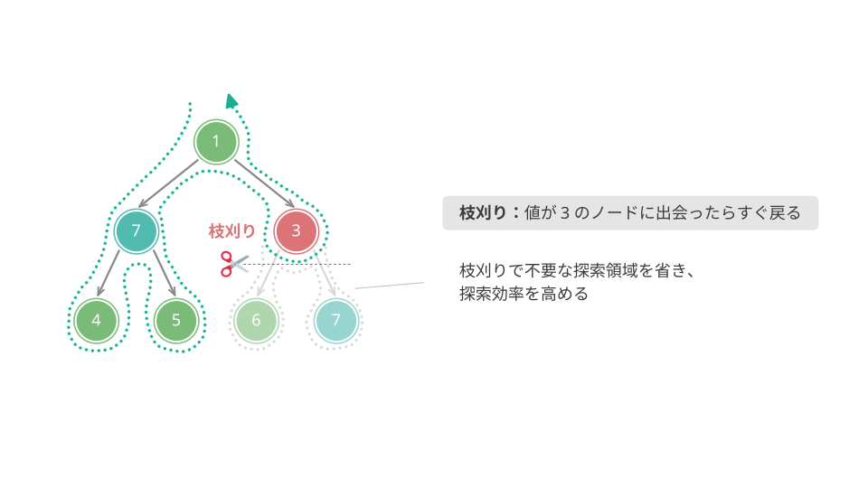{ class="animation-figure" }

<p align="center"> 図 13-3 &nbsp; 制約に基づく枝刈り </p>

## 13.1.3 &nbsp; コードの基本形

試行、後戻り、枝刈りという共通の構造を取り出し、さまざまな問題で使える形にまとめてみましょう。

次のコードでは、`state` は問題の現在の状態、`choices` はその状態で取り得る選択肢を表します。

=== "Python"

    ```python title=""
    def backtrack(state: State, choices: list[Choice], res: list[State]):
        """バックトラッキングの基本形"""
        # 解かどうか判定する
        if is_solution(state):
            # 解を記録する
            record_solution(state, res)
            # 探索を打ち切る
            return
        # すべての選択肢を調べる
        for choice in choices:
            # 枝刈り：その選択が可能か判定する
            if is_valid(state, choice):
                # 試行：選択して状態を更新する
                make_choice(state, choice)
                backtrack(state, choices, res)
                # 後戻り：選択を取り消し、元の状態に戻す
                undo_choice(state, choice)
    ```

=== "C++"

    ```cpp title=""
    /* バックトラッキングの基本形 */
    void backtrack(State *state, vector<Choice *> &choices, vector<State *> &res) {
        // 解かどうか判定する
        if (isSolution(state)) {
            // 解を記録する
            recordSolution(state, res);
            // 探索を打ち切る
            return;
        }
        // すべての選択肢を調べる
        for (Choice *choice : choices) {
            // 枝刈り：その選択が可能か判定する
            if (isValid(state, choice)) {
                // 試行：選択して状態を更新する
                makeChoice(state, choice);
                backtrack(state, choices, res);
                // 後戻り：選択を取り消し、元の状態に戻す
                undoChoice(state, choice);
            }
        }
    }
    ```

=== "Java"

    ```java title=""
    /* バックトラッキングの基本形 */
    void backtrack(State state, List<Choice> choices, List<State> res) {
        // 解かどうか判定する
        if (isSolution(state)) {
            // 解を記録する
            recordSolution(state, res);
            // 探索を打ち切る
            return;
        }
        // すべての選択肢を調べる
        for (Choice choice : choices) {
            // 枝刈り：その選択が可能か判定する
            if (isValid(state, choice)) {
                // 試行：選択して状態を更新する
                makeChoice(state, choice);
                backtrack(state, choices, res);
                // 後戻り：選択を取り消し、元の状態に戻す
                undoChoice(state, choice);
            }
        }
    }
    ```

=== "C#"

    ```csharp title=""
    /* バックトラッキングの基本形 */
    void Backtrack(State state, List<Choice> choices, List<State> res) {
        // 解かどうか判定する
        if (IsSolution(state)) {
            // 解を記録する
            RecordSolution(state, res);
            // 探索を打ち切る
            return;
        }
        // すべての選択肢を調べる
        foreach (Choice choice in choices) {
            // 枝刈り：その選択が可能か判定する
            if (IsValid(state, choice)) {
                // 試行：選択して状態を更新する
                MakeChoice(state, choice);
                Backtrack(state, choices, res);
                // 後戻り：選択を取り消し、元の状態に戻す
                UndoChoice(state, choice);
            }
        }
    }
    ```

=== "Go"

    ```go title=""
    /* バックトラッキングの基本形 */
    func backtrack(state *State, choices []Choice, res *[]State) {
        // 解かどうか判定する
        if isSolution(state) {
            // 解を記録する
            recordSolution(state, res)
            // 探索を打ち切る
            return
        }
        // すべての選択肢を調べる
        for _, choice := range choices {
            // 枝刈り：その選択が可能か判定する
            if isValid(state, choice) {
                // 試行：選択して状態を更新する
                makeChoice(state, choice)
                backtrack(state, choices, res)
                // 後戻り：選択を取り消し、元の状態に戻す
                undoChoice(state, choice)
            }
        }
    }
    ```

=== "Swift"

    ```swift title=""
    /* バックトラッキングの基本形 */
    func backtrack(state: inout State, choices: [Choice], res: inout [State]) {
        // 解かどうか判定する
        if isSolution(state: state) {
            // 解を記録する
            recordSolution(state: state, res: &res)
            // 探索を打ち切る
            return
        }
        // すべての選択肢を調べる
        for choice in choices {
            // 枝刈り：その選択が可能か判定する
            if isValid(state: state, choice: choice) {
                // 試行：選択して状態を更新する
                makeChoice(state: &state, choice: choice)
                backtrack(state: &state, choices: choices, res: &res)
                // 後戻り：選択を取り消し、元の状態に戻す
                undoChoice(state: &state, choice: choice)
            }
        }
    }
    ```

=== "JS"

    ```javascript title=""
    /* バックトラッキングの基本形 */
    function backtrack(state, choices, res) {
        // 解かどうか判定する
        if (isSolution(state)) {
            // 解を記録する
            recordSolution(state, res);
            // 探索を打ち切る
            return;
        }
        // すべての選択肢を調べる
        for (let choice of choices) {
            // 枝刈り：その選択が可能か判定する
            if (isValid(state, choice)) {
                // 試行：選択して状態を更新する
                makeChoice(state, choice);
                backtrack(state, choices, res);
                // 後戻り：選択を取り消し、元の状態に戻す
                undoChoice(state, choice);
            }
        }
    }
    ```

=== "TS"

    ```typescript title=""
    /* バックトラッキングの基本形 */
    function backtrack(state: State, choices: Choice[], res: State[]): void {
        // 解かどうか判定する
        if (isSolution(state)) {
            // 解を記録する
            recordSolution(state, res);
            // 探索を打ち切る
            return;
        }
        // すべての選択肢を調べる
        for (let choice of choices) {
            // 枝刈り：その選択が可能か判定する
            if (isValid(state, choice)) {
                // 試行：選択して状態を更新する
                makeChoice(state, choice);
                backtrack(state, choices, res);
                // 後戻り：選択を取り消し、元の状態に戻す
                undoChoice(state, choice);
            }
        }
    }
    ```

=== "Dart"

    ```dart title=""
    /* バックトラッキングの基本形 */
    void backtrack(State state, List<Choice> choices, List<State> res) {
      // 解かどうか判定する
      if (isSolution(state)) {
        // 解を記録する
        recordSolution(state, res);
        // 探索を打ち切る
        return;
      }
      // すべての選択肢を調べる
      for (Choice choice in choices) {
        // 枝刈り：その選択が可能か判定する
        if (isValid(state, choice)) {
          // 試行：選択して状態を更新する
          makeChoice(state, choice);
          backtrack(state, choices, res);
          // 後戻り：選択を取り消し、元の状態に戻す
          undoChoice(state, choice);
        }
      }
    }
    ```

=== "Rust"

    ```rust title=""
    /* バックトラッキングの基本形 */
    fn backtrack(state: &mut State, choices: &Vec<Choice>, res: &mut Vec<State>) {
        // 解かどうか判定する
        if is_solution(state) {
            // 解を記録する
            record_solution(state, res);
            // 探索を打ち切る
            return;
        }
        // すべての選択肢を調べる
        for choice in choices {
            // 枝刈り：その選択が可能か判定する
            if is_valid(state, choice) {
                // 試行：選択して状態を更新する
                make_choice(state, choice);
                backtrack(state, choices, res);
                // 後戻り：選択を取り消し、元の状態に戻す
                undo_choice(state, choice);
            }
        }
    }
    ```

=== "C"

    ```c title=""
    /* バックトラッキングの基本形 */
    void backtrack(State *state, Choice *choices, int numChoices, State *res, int numRes) {
        // 解かどうか判定する
        if (isSolution(state)) {
            // 解を記録する
            recordSolution(state, res, numRes);
            // 探索を打ち切る
            return;
        }
        // すべての選択肢を調べる
        for (int i = 0; i < numChoices; i++) {
            // 枝刈り：その選択が可能か判定する
            if (isValid(state, &choices[i])) {
                // 試行：選択して状態を更新する
                makeChoice(state, &choices[i]);
                backtrack(state, choices, numChoices, res, numRes);
                // 後戻り：選択を取り消し、元の状態に戻す
                undoChoice(state, &choices[i]);
            }
        }
    }
    ```

=== "Kotlin"

    ```kotlin title=""
    /* バックトラッキングの基本形 */
    fun backtrack(state: State?, choices: List<Choice?>, res: List<State?>?) {
        // 解かどうか判定する
        if (isSolution(state)) {
            // 解を記録する
            recordSolution(state, res)
            // 探索を打ち切る
            return
        }
        // すべての選択肢を調べる
        for (choice in choices) {
            // 枝刈り：その選択が可能か判定する
            if (isValid(state, choice)) {
                // 試行：選択して状態を更新する
                makeChoice(state, choice)
                backtrack(state, choices, res)
                // 後戻り：選択を取り消し、元の状態に戻す
                undoChoice(state, choice)
            }
        }
    }
    ```

=== "Ruby"

    ```ruby title=""
    ### バックトラッキングの基本形 ###
    def backtrack(state, choices, res)
        # 解かどうか判定する
        if is_solution?(state)
            # 解を記録する
            record_solution(state, res)
            return
        end

        # すべての選択肢を調べる
        for choice in choices
            # 枝刈り：その選択が可能か判定する
            if is_valid?(state, choice)
                # 試行：選択して状態を更新する
                make_choice(state, choice)
                backtrack(state, choices, res)
                # 後戻り：選択を取り消し、元の状態に戻す
                undo_choice(state, choice)
            end
        end
    end
    ```

この基本形を使って例題 3 を解きます。状態 `state` はたどったノードの経路、選択肢 `choices` は現在のノードの左の子と右の子、結果 `res` は経路のリストです。

=== "Python"

    ```python title="preorder_traversal_iii_template.py"
    def is_solution(state: list[TreeNode]) -> bool:
        """現在の状態が解かどうか判定する"""
        return state and state[-1].val == 7

    def record_solution(state: list[TreeNode], res: list[list[TreeNode]]):
        """解を記録する"""
        res.append(list(state))

    def is_valid(state: list[TreeNode], choice: TreeNode) -> bool:
        """現在の状態でその選択が可能か判定する"""
        return choice is not None and choice.val != 3

    def make_choice(state: list[TreeNode], choice: TreeNode):
        """状態を更新する"""
        state.append(choice)

    def undo_choice(state: list[TreeNode], choice: TreeNode):
        """状態を元に戻す"""
        state.pop()

    def backtrack(
        state: list[TreeNode], choices: list[TreeNode], res: list[list[TreeNode]]
    ):
        """バックトラッキング：例題 3"""
        # 解かどうか調べる
        if is_solution(state):
            # 解を記録する
            record_solution(state, res)
        # すべての選択肢を調べる
        for choice in choices:
            # 枝刈り：その選択が可能か調べる
            if is_valid(state, choice):
                # 試行：選択して状態を更新する
                make_choice(state, choice)
                # 次の選択に進む
                backtrack(state, [choice.left, choice.right], res)
                # 後戻り：選択を取り消し、元の状態に戻す
                undo_choice(state, choice)
    ```

=== "C++"

    ```cpp title="preorder_traversal_iii_template.cpp"
    /* 現在の状態が解かどうか判定する */
    bool isSolution(vector<TreeNode *> &state) {
        return !state.empty() && state.back()->val == 7;
    }

    /* 解を記録する */
    void recordSolution(vector<TreeNode *> &state, vector<vector<TreeNode *>> &res) {
        res.push_back(state);
    }

    /* 現在の状態でその選択が可能か判定する */
    bool isValid(vector<TreeNode *> &state, TreeNode *choice) {
        return choice != nullptr && choice->val != 3;
    }

    /* 状態を更新する */
    void makeChoice(vector<TreeNode *> &state, TreeNode *choice) {
        state.push_back(choice);
    }

    /* 状態を元に戻す */
    void undoChoice(vector<TreeNode *> &state, TreeNode *choice) {
        state.pop_back();
    }

    /* バックトラッキング：例題 3 */
    void backtrack(vector<TreeNode *> &state, vector<TreeNode *> &choices, vector<vector<TreeNode *>> &res) {
        // 解かどうか調べる
        if (isSolution(state)) {
            // 解を記録する
            recordSolution(state, res);
        }
        // すべての選択肢を調べる
        for (TreeNode *choice : choices) {
            // 枝刈り：その選択が可能か調べる
            if (isValid(state, choice)) {
                // 試行：選択して状態を更新する
                makeChoice(state, choice);
                // 次の選択に進む
                vector<TreeNode *> nextChoices{choice->left, choice->right};
                backtrack(state, nextChoices, res);
                // 後戻り：選択を取り消し、元の状態に戻す
                undoChoice(state, choice);
            }
        }
    }
    ```

=== "Java"

    ```java title="preorder_traversal_iii_template.java"
    /* 現在の状態が解かどうか判定する */
    boolean isSolution(List<TreeNode> state) {
        return !state.isEmpty() && state.get(state.size() - 1).val == 7;
    }

    /* 解を記録する */
    void recordSolution(List<TreeNode> state, List<List<TreeNode>> res) {
        res.add(new ArrayList<>(state));
    }

    /* 現在の状態でその選択が可能か判定する */
    boolean isValid(List<TreeNode> state, TreeNode choice) {
        return choice != null && choice.val != 3;
    }

    /* 状態を更新する */
    void makeChoice(List<TreeNode> state, TreeNode choice) {
        state.add(choice);
    }

    /* 状態を元に戻す */
    void undoChoice(List<TreeNode> state, TreeNode choice) {
        state.remove(state.size() - 1);
    }

    /* バックトラッキング：例題 3 */
    void backtrack(List<TreeNode> state, List<TreeNode> choices, List<List<TreeNode>> res) {
        // 解かどうか調べる
        if (isSolution(state)) {
            // 解を記録する
            recordSolution(state, res);
        }
        // すべての選択肢を調べる
        for (TreeNode choice : choices) {
            // 枝刈り：その選択が可能か調べる
            if (isValid(state, choice)) {
                // 試行：選択して状態を更新する
                makeChoice(state, choice);
                // 次の選択に進む
                backtrack(state, Arrays.asList(choice.left, choice.right), res);
                // 後戻り：選択を取り消し、元の状態に戻す
                undoChoice(state, choice);
            }
        }
    }
    ```

=== "C#"

    ```csharp title="preorder_traversal_iii_template.cs"
    /* 現在の状態が解かどうか判定する */
    bool IsSolution(List<TreeNode> state) {
        return state.Count != 0 && state[^1].val == 7;
    }

    /* 解を記録する */
    void RecordSolution(List<TreeNode> state, List<List<TreeNode>> res) {
        res.Add(new List<TreeNode>(state));
    }

    /* 現在の状態でその選択が可能か判定する */
    bool IsValid(List<TreeNode> state, TreeNode choice) {
        return choice != null && choice.val != 3;
    }

    /* 状態を更新する */
    void MakeChoice(List<TreeNode> state, TreeNode choice) {
        state.Add(choice);
    }

    /* 状態を元に戻す */
    void UndoChoice(List<TreeNode> state, TreeNode choice) {
        state.RemoveAt(state.Count - 1);
    }

    /* バックトラッキング：例題 3 */
    void Backtrack(List<TreeNode> state, List<TreeNode> choices, List<List<TreeNode>> res) {
        // 解かどうか調べる
        if (IsSolution(state)) {
            // 解を記録する
            RecordSolution(state, res);
        }
        // すべての選択肢を調べる
        foreach (TreeNode choice in choices) {
            // 枝刈り：その選択が可能か調べる
            if (IsValid(state, choice)) {
                // 試行：選択して状態を更新する
                MakeChoice(state, choice);
                // 次の選択に進む
                Backtrack(state, [choice.left!, choice.right!], res);
                // 後戻り：選択を取り消し、元の状態に戻す
                UndoChoice(state, choice);
            }
        }
    }
    ```

=== "Go"

    ```go title="preorder_traversal_iii_template.go"
    /* 現在の状態が解かどうか判定する */
    func isSolution(state *[]*TreeNode) bool {
        return len(*state) != 0 && (*state)[len(*state)-1].Val == 7
    }

    /* 解を記録する */
    func recordSolution(state *[]*TreeNode, res *[][]*TreeNode) {
        *res = append(*res, append([]*TreeNode{}, *state...))
    }

    /* 現在の状態でその選択が可能か判定する */
    func isValid(state *[]*TreeNode, choice *TreeNode) bool {
        return choice != nil && choice.Val != 3
    }

    /* 状態を更新する */
    func makeChoice(state *[]*TreeNode, choice *TreeNode) {
        *state = append(*state, choice)
    }

    /* 状態を元に戻す */
    func undoChoice(state *[]*TreeNode, choice *TreeNode) {
        *state = (*state)[:len(*state)-1]
    }

    /* バックトラッキング：例題 3 */
    func backtrackIII(state *[]*TreeNode, choices *[]*TreeNode, res *[][]*TreeNode) {
        // 解かどうか調べる
        if isSolution(state) {
            // 解を記録する
            recordSolution(state, res)
        }
        // すべての選択肢を調べる
        for _, choice := range *choices {
            // 枝刈り：その選択が可能か調べる
            if isValid(state, choice) {
                // 試行：選択して状態を更新する
                makeChoice(state, choice)
                // 次の選択に進む
                temp := make([]*TreeNode, 0)
                temp = append(temp, choice.Left, choice.Right)
                backtrackIII(state, &temp, res)
                // 後戻り：選択を取り消し、元の状態に戻す
                undoChoice(state, choice)
            }
        }
    }
    ```

=== "Swift"

    ```swift title="preorder_traversal_iii_template.swift"
    /* 現在の状態が解かどうか判定する */
    func isSolution(state: [TreeNode]) -> Bool {
        !state.isEmpty && state.last!.val == 7
    }

    /* 解を記録する */
    func recordSolution(state: [TreeNode], res: inout [[TreeNode]]) {
        res.append(state)
    }

    /* 現在の状態でその選択が可能か判定する */
    func isValid(state: [TreeNode], choice: TreeNode?) -> Bool {
        choice != nil && choice!.val != 3
    }

    /* 状態を更新する */
    func makeChoice(state: inout [TreeNode], choice: TreeNode) {
        state.append(choice)
    }

    /* 状態を元に戻す */
    func undoChoice(state: inout [TreeNode], choice: TreeNode) {
        state.removeLast()
    }

    /* バックトラッキング：例題 3 */
    func backtrack(state: inout [TreeNode], choices: [TreeNode], res: inout [[TreeNode]]) {
        // 解かどうか調べる
        if isSolution(state: state) {
            recordSolution(state: state, res: &res)
        }
        // すべての選択肢を調べる
        for choice in choices {
            // 枝刈り：その選択が可能か調べる
            if isValid(state: state, choice: choice) {
                // 試行：選択して状態を更新する
                makeChoice(state: &state, choice: choice)
                // 次の選択に進む
                backtrack(state: &state, choices: [choice.left, choice.right].compactMap { $0 }, res: &res)
                // 後戻り：選択を取り消し、元の状態に戻す
                undoChoice(state: &state, choice: choice)
            }
        }
    }
    ```

=== "JS"

    ```javascript title="preorder_traversal_iii_template.js"
    /* 現在の状態が解かどうか判定する */
    function isSolution(state) {
        return state && state[state.length - 1]?.val === 7;
    }

    /* 解を記録する */
    function recordSolution(state, res) {
        res.push([...state]);
    }

    /* 現在の状態でその選択が可能か判定する */
    function isValid(state, choice) {
        return choice !== null && choice.val !== 3;
    }

    /* 状態を更新する */
    function makeChoice(state, choice) {
        state.push(choice);
    }

    /* 状態を元に戻す */
    function undoChoice(state) {
        state.pop();
    }

    /* バックトラッキング：例題 3 */
    function backtrack(state, choices, res) {
        // 解かどうか調べる
        if (isSolution(state)) {
            // 解を記録する
            recordSolution(state, res);
        }
        // すべての選択肢を調べる
        for (const choice of choices) {
            // 枝刈り：その選択が可能か調べる
            if (isValid(state, choice)) {
                // 試行：選択して状態を更新する
                makeChoice(state, choice);
                // 次の選択に進む
                backtrack(state, [choice.left, choice.right], res);
                // 後戻り：選択を取り消し、元の状態に戻す
                undoChoice(state);
            }
        }
    }
    ```

=== "TS"

    ```typescript title="preorder_traversal_iii_template.ts"
    /* 現在の状態が解かどうか判定する */
    function isSolution(state: TreeNode[]): boolean {
        return state && state[state.length - 1]?.val === 7;
    }

    /* 解を記録する */
    function recordSolution(state: TreeNode[], res: TreeNode[][]): void {
        res.push([...state]);
    }

    /* 現在の状態でその選択が可能か判定する */
    function isValid(state: TreeNode[], choice: TreeNode): boolean {
        return choice !== null && choice.val !== 3;
    }

    /* 状態を更新する */
    function makeChoice(state: TreeNode[], choice: TreeNode): void {
        state.push(choice);
    }

    /* 状態を元に戻す */
    function undoChoice(state: TreeNode[]): void {
        state.pop();
    }

    /* バックトラッキング：例題 3 */
    function backtrack(
        state: TreeNode[],
        choices: TreeNode[],
        res: TreeNode[][]
    ): void {
        // 解かどうか調べる
        if (isSolution(state)) {
            // 解を記録する
            recordSolution(state, res);
        }
        // すべての選択肢を調べる
        for (const choice of choices) {
            // 枝刈り：その選択が可能か調べる
            if (isValid(state, choice)) {
                // 試行：選択して状態を更新する
                makeChoice(state, choice);
                // 次の選択に進む
                backtrack(state, [choice.left, choice.right], res);
                // 後戻り：選択を取り消し、元の状態に戻す
                undoChoice(state);
            }
        }
    }
    ```

=== "Dart"

    ```dart title="preorder_traversal_iii_template.dart"
    /* 現在の状態が解かどうか判定する */
    bool isSolution(List<TreeNode> state) {
      return state.isNotEmpty && state.last.val == 7;
    }

    /* 解を記録する */
    void recordSolution(List<TreeNode> state, List<List<TreeNode>> res) {
      res.add(List.from(state));
    }

    /* 現在の状態でその選択が可能か判定する */
    bool isValid(List<TreeNode> state, TreeNode? choice) {
      return choice != null && choice.val != 3;
    }

    /* 状態を更新する */
    void makeChoice(List<TreeNode> state, TreeNode? choice) {
      state.add(choice!);
    }

    /* 状態を元に戻す */
    void undoChoice(List<TreeNode> state, TreeNode? choice) {
      state.removeLast();
    }

    /* バックトラッキング：例題 3 */
    void backtrack(
      List<TreeNode> state,
      List<TreeNode?> choices,
      List<List<TreeNode>> res,
    ) {
      // 解かどうか調べる
      if (isSolution(state)) {
        // 解を記録する
        recordSolution(state, res);
      }
      // すべての選択肢を調べる
      for (TreeNode? choice in choices) {
        // 枝刈り：その選択が可能か調べる
        if (isValid(state, choice)) {
          // 試行：選択して状態を更新する
          makeChoice(state, choice);
          // 次の選択に進む
          backtrack(state, [choice!.left, choice.right], res);
          // 後戻り：選択を取り消し、元の状態に戻す
          undoChoice(state, choice);
        }
      }
    }
    ```

=== "Rust"

    ```rust title="preorder_traversal_iii_template.rs"
    /* 現在の状態が解かどうか判定する */
    fn is_solution(state: &mut Vec<Rc<RefCell<TreeNode>>>) -> bool {
        return !state.is_empty() && state.last().unwrap().borrow().val == 7;
    }

    /* 解を記録する */
    fn record_solution(
        state: &mut Vec<Rc<RefCell<TreeNode>>>,
        res: &mut Vec<Vec<Rc<RefCell<TreeNode>>>>,
    ) {
        res.push(state.clone());
    }

    /* 現在の状態でその選択が可能か判定する */
    fn is_valid(_: &mut Vec<Rc<RefCell<TreeNode>>>, choice: Option<&Rc<RefCell<TreeNode>>>) -> bool {
        return choice.is_some() && choice.unwrap().borrow().val != 3;
    }

    /* 状態を更新する */
    fn make_choice(state: &mut Vec<Rc<RefCell<TreeNode>>>, choice: Rc<RefCell<TreeNode>>) {
        state.push(choice);
    }

    /* 状態を元に戻す */
    fn undo_choice(state: &mut Vec<Rc<RefCell<TreeNode>>>, _: Rc<RefCell<TreeNode>>) {
        state.pop();
    }

    /* バックトラッキング：例題 3 */
    fn backtrack(
        state: &mut Vec<Rc<RefCell<TreeNode>>>,
        choices: &Vec<Option<&Rc<RefCell<TreeNode>>>>,
        res: &mut Vec<Vec<Rc<RefCell<TreeNode>>>>,
    ) {
        // 解かどうか調べる
        if is_solution(state) {
            // 解を記録する
            record_solution(state, res);
        }
        // すべての選択肢を調べる
        for &choice in choices.iter() {
            // 枝刈り：その選択が可能か調べる
            if is_valid(state, choice) {
                // 試行：選択して状態を更新する
                make_choice(state, choice.unwrap().clone());
                // 次の選択に進む
                backtrack(
                    state,
                    &vec![
                        choice.unwrap().borrow().left.as_ref(),
                        choice.unwrap().borrow().right.as_ref(),
                    ],
                    res,
                );
                // 後戻り：選択を取り消し、元の状態に戻す
                undo_choice(state, choice.unwrap().clone());
            }
        }
    }
    ```

=== "C"

    ```c title="preorder_traversal_iii_template.c"
    /* 現在の状態が解かどうか判定する */
    bool isSolution(void) {
        return pathSize > 0 && path[pathSize - 1]->val == 7;
    }

    /* 解を記録する */
    void recordSolution(void) {
        for (int i = 0; i < pathSize; i++) {
            res[resSize][i] = path[i];
        }
        resSize++;
    }

    /* 現在の状態でその選択が可能か判定する */
    bool isValid(TreeNode *choice) {
        return choice != NULL && choice->val != 3;
    }

    /* 状態を更新する */
    void makeChoice(TreeNode *choice) {
        path[pathSize++] = choice;
    }

    /* 状態を元に戻す */
    void undoChoice(void) {
        pathSize--;
    }

    /* バックトラッキング：例題 3 */
    void backtrack(TreeNode *choices[2]) {
        // 解かどうか調べる
        if (isSolution()) {
            // 解を記録する
            recordSolution();
        }
        // すべての選択肢を調べる
        for (int i = 0; i < 2; i++) {
            TreeNode *choice = choices[i];
            // 枝刈り：その選択が可能か調べる
            if (isValid(choice)) {
                // 試行：選択して状態を更新する
                makeChoice(choice);
                // 次の選択に進む
                TreeNode *nextChoices[2] = {choice->left, choice->right};
                backtrack(nextChoices);
                // 後戻り：選択を取り消し、元の状態に戻す
                undoChoice();
            }
        }
    }
    ```

=== "Kotlin"

    ```kotlin title="preorder_traversal_iii_template.kt"
    /* 現在の状態が解かどうか判定する */
    fun isSolution(state: MutableList<TreeNode?>): Boolean {
        return state.isNotEmpty() && state[state.size - 1]?._val == 7
    }

    /* 解を記録する */
    fun recordSolution(state: MutableList<TreeNode?>?, res: MutableList<MutableList<TreeNode?>?>) {
        res.add(state!!.toMutableList())
    }

    /* 現在の状態でその選択が可能か判定する */
    fun isValid(state: MutableList<TreeNode?>?, choice: TreeNode?): Boolean {
        return choice != null && choice._val != 3
    }

    /* 状態を更新する */
    fun makeChoice(state: MutableList<TreeNode?>, choice: TreeNode?) {
        state.add(choice)
    }

    /* 状態を元に戻す */
    fun undoChoice(state: MutableList<TreeNode?>, choice: TreeNode?) {
        state.removeLast()
    }

    /* バックトラッキング：例題 3 */
    fun backtrack(
        state: MutableList<TreeNode?>,
        choices: MutableList<TreeNode?>,
        res: MutableList<MutableList<TreeNode?>?>
    ) {
        // 解かどうか調べる
        if (isSolution(state)) {
            // 解を記録する
            recordSolution(state, res)
        }
        // すべての選択肢を調べる
        for (choice in choices) {
            // 枝刈り：その選択が可能か調べる
            if (isValid(state, choice)) {
                // 試行：選択して状態を更新する
                makeChoice(state, choice)
                // 次の選択に進む
                backtrack(state, mutableListOf(choice!!.left, choice.right), res)
                // 後戻り：選択を取り消し、元の状態に戻す
                undoChoice(state, choice)
            }
        }
    }
    ```

=== "Ruby"

    ```ruby title="preorder_traversal_iii_template.rb"
    ### 現在の状態が解かどうか判定する ###
    def is_solution?(state)
      !state.empty? && state.last.val == 7
    end

    ### 解を記録する ###
    def record_solution(state, res)
      res << state.dup
    end

    ### 現在の状態でその選択が可能か判定する ###
    def is_valid?(state, choice)
      choice && choice.val != 3
    end

    ### 状態を更新する ###
    def make_choice(state, choice)
      state << choice
    end

    ### 状態を元に戻す ###
    def undo_choice(state, choice)
      state.pop
    end

    ### バックトラッキング：例題 3 ###
    def backtrack(state, choices, res)
      # 解かどうか調べる
      record_solution(state, res) if is_solution?(state)

      # すべての選択肢を調べる
      for choice in choices
        # 枝刈り：その選択が可能か調べる
        if is_valid?(state, choice)
          # 試行：選択して状態を更新する
          make_choice(state, choice)
          # 次の選択に進む
          backtrack(state, [choice.left, choice.right], res)
          # 後戻り：選択を取り消し、元の状態に戻す
          undo_choice(state, choice)
        end
      end
    end
    ```

??? pythontutor "実行の様子を見る"

    <div style="height: 549px; width: 100%;"><iframe class="pythontutor-iframe" title="実行の様子を見る" src="https://pythontutor.com/iframe-embed.html#code=class%20TreeNode%3A%0A%20%22%22%22%E4%BA%8C%E5%88%86%E6%9C%A8%E3%81%AE%E3%83%8E%E3%83%BC%E3%83%89%E3%82%92%E8%A1%A8%E3%81%99%E3%82%AF%E3%83%A9%E3%82%B9%22%22%22%0A%0A%20def%20__init__%28self,%20val%3A%20int%20%3D%200%29%3A%0A%20%20self.val%3A%20int%20%3D%20val%20%20%23%20%E3%83%8E%E3%83%BC%E3%83%89%E3%81%AE%E5%80%A4%0A%20%20self.left%3A%20TreeNode%20%7C%20None%20%3D%20None%20%20%23%20%E5%B7%A6%E3%81%AE%E5%AD%90%E3%81%B8%E3%81%AE%E5%8F%82%E7%85%A7%0A%20%20self.right%3A%20TreeNode%20%7C%20None%20%3D%20None%20%20%23%20%E5%8F%B3%E3%81%AE%E5%AD%90%E3%81%B8%E3%81%AE%E5%8F%82%E7%85%A7%0A%0Adef%20list_to_tree_dfs%28arr%3A%20list%5Bint%5D,%20i%3A%20int%29%20-%3E%20TreeNode%20%7C%20None%3A%0A%20%22%22%22%E3%83%AA%E3%82%B9%E3%83%88%E3%81%8B%E3%82%89%E4%BA%8C%E5%88%86%E6%9C%A8%E3%82%92%E5%BE%A9%E5%85%83%E3%81%99%E3%82%8B%EF%BC%9A%E5%86%8D%E5%B8%B0%22%22%22%0A%20%23%20%E3%82%A4%E3%83%B3%E3%83%87%E3%83%83%E3%82%AF%E3%82%B9%E3%81%8C%E9%85%8D%E5%88%97%E3%81%AE%E7%AF%84%E5%9B%B2%E5%A4%96%E3%81%8B%E3%80%81%E5%AF%BE%E5%BF%9C%E3%81%99%E3%82%8B%E8%A6%81%E7%B4%A0%E3%81%8C%20None%20%E3%81%AA%E3%82%89%20None%20%E3%82%92%E8%BF%94%E3%81%99%0A%20if%20i%20%3C%200%20or%20i%20%3E%3D%20len%28arr%29%20or%20arr%5Bi%5D%20is%20None%3A%0A%20%20return%20None%0A%20%23%20%E7%8F%BE%E5%9C%A8%E3%81%AE%E3%83%8E%E3%83%BC%E3%83%89%E3%82%92%E4%BD%9C%E3%82%8B%0A%20root%20%3D%20TreeNode%28arr%5Bi%5D%29%0A%20%23%20%E5%B7%A6%E5%8F%B3%E3%81%AE%E9%83%A8%E5%88%86%E6%9C%A8%E3%82%92%E5%86%8D%E5%B8%B0%E7%9A%84%E3%81%AB%E6%A7%8B%E7%AF%89%E3%81%99%E3%82%8B%0A%20root.left%20%3D%20list_to_tree_dfs%28arr,%202%20%2A%20i%20%2B%201%29%0A%20root.right%20%3D%20list_to_tree_dfs%28arr,%202%20%2A%20i%20%2B%202%29%0A%20return%20root%0A%0Adef%20list_to_tree%28arr%3A%20list%5Bint%5D%29%20-%3E%20TreeNode%20%7C%20None%3A%0A%20%22%22%22%E3%83%AA%E3%82%B9%E3%83%88%E3%81%8B%E3%82%89%E4%BA%8C%E5%88%86%E6%9C%A8%E3%82%92%E5%BE%A9%E5%85%83%E3%81%99%E3%82%8B%22%22%22%0A%20return%20list_to_tree_dfs%28arr,%200%29%0A%0A%0Adef%20is_solution%28state%3A%20list%5BTreeNode%5D%29%20-%3E%20bool%3A%0A%20%22%22%22%E7%8F%BE%E5%9C%A8%E3%81%AE%E7%8A%B6%E6%85%8B%E3%81%8C%E8%A7%A3%E3%81%8B%E3%81%A9%E3%81%86%E3%81%8B%E5%88%A4%E5%AE%9A%E3%81%99%E3%82%8B%22%22%22%0A%20return%20state%20and%20state%5B-1%5D.val%20%3D%3D%207%0A%0Adef%20record_solution%28state%3A%20list%5BTreeNode%5D,%20res%3A%20list%5Blist%5BTreeNode%5D%5D%29%3A%0A%20%22%22%22%E8%A7%A3%E3%82%92%E8%A8%98%E9%8C%B2%E3%81%99%E3%82%8B%22%22%22%0A%20res.append%28list%28state%29%29%0A%0Adef%20is_valid%28state%3A%20list%5BTreeNode%5D,%20choice%3A%20TreeNode%29%20-%3E%20bool%3A%0A%20%22%22%22%E7%8F%BE%E5%9C%A8%E3%81%AE%E7%8A%B6%E6%85%8B%E3%81%A7%E3%81%9D%E3%81%AE%E9%81%B8%E6%8A%9E%E3%81%8C%E5%8F%AF%E8%83%BD%E3%81%8B%E5%88%A4%E5%AE%9A%E3%81%99%E3%82%8B%22%22%22%0A%20return%20choice%20is%20not%20None%20and%20choice.val%20%21%3D%203%0A%0Adef%20make_choice%28state%3A%20list%5BTreeNode%5D,%20choice%3A%20TreeNode%29%3A%0A%20%22%22%22%E7%8A%B6%E6%85%8B%E3%82%92%E6%9B%B4%E6%96%B0%E3%81%99%E3%82%8B%22%22%22%0A%20state.append%28choice%29%0A%0Adef%20undo_choice%28state%3A%20list%5BTreeNode%5D,%20choice%3A%20TreeNode%29%3A%0A%20%22%22%22%E7%8A%B6%E6%85%8B%E3%82%92%E5%85%83%E3%81%AB%E6%88%BB%E3%81%99%22%22%22%0A%20state.pop%28%29%0A%0Adef%20backtrack%28%0A%20state%3A%20list%5BTreeNode%5D,%20choices%3A%20list%5BTreeNode%5D,%20res%3A%20list%5Blist%5BTreeNode%5D%5D%0A%29%3A%0A%20%22%22%22%E3%83%90%E3%83%83%E3%82%AF%E3%83%88%E3%83%A9%E3%83%83%E3%82%AD%E3%83%B3%E3%82%B0%EF%BC%9A%E4%BE%8B%E9%A1%8C%203%22%22%22%0A%20%23%20%E8%A7%A3%E3%81%8B%E3%81%A9%E3%81%86%E3%81%8B%E8%AA%BF%E3%81%B9%E3%82%8B%0A%20if%20is_solution%28state%29%3A%0A%20%20%23%20%E8%A7%A3%E3%82%92%E8%A8%98%E9%8C%B2%E3%81%99%E3%82%8B%0A%20%20record_solution%28state,%20res%29%0A%20%23%20%E3%81%99%E3%81%B9%E3%81%A6%E3%81%AE%E9%81%B8%E6%8A%9E%E8%82%A2%E3%82%92%E8%AA%BF%E3%81%B9%E3%82%8B%0A%20for%20choice%20in%20choices%3A%0A%20%20%23%20%E6%9E%9D%E5%88%88%E3%82%8A%EF%BC%9A%E3%81%9D%E3%81%AE%E9%81%B8%E6%8A%9E%E3%81%8C%E5%8F%AF%E8%83%BD%E3%81%8B%E8%AA%BF%E3%81%B9%E3%82%8B%0A%20%20if%20is_valid%28state,%20choice%29%3A%0A%20%20%20%23%20%E8%A9%A6%E8%A1%8C%EF%BC%9A%E9%81%B8%E6%8A%9E%E3%81%97%E3%81%A6%E7%8A%B6%E6%85%8B%E3%82%92%E6%9B%B4%E6%96%B0%E3%81%99%E3%82%8B%0A%20%20%20make_choice%28state,%20choice%29%0A%20%20%20%23%20%E6%AC%A1%E3%81%AE%E9%81%B8%E6%8A%9E%E3%81%AB%E9%80%B2%E3%82%80%0A%20%20%20backtrack%28state,%20%5Bchoice.left,%20choice.right%5D,%20res%29%0A%20%20%20%23%20%E5%BE%8C%E6%88%BB%E3%82%8A%EF%BC%9A%E9%81%B8%E6%8A%9E%E3%82%92%E5%8F%96%E3%82%8A%E6%B6%88%E3%81%97%E3%80%81%E5%85%83%E3%81%AE%E7%8A%B6%E6%85%8B%E3%81%AB%E6%88%BB%E3%81%99%0A%20%20%20undo_choice%28state,%20choice%29%0A%0A%22%22%22Driver%20Code%22%22%22%0Aif%20__name__%20%3D%3D%20%22__main__%22%3A%0A%20root%20%3D%20list_to_tree%28%5B1,%207,%203,%204,%205,%206,%207%5D%29%0A%0A%20%23%20%E3%83%90%E3%83%83%E3%82%AF%E3%83%88%E3%83%A9%E3%83%83%E3%82%AD%E3%83%B3%E3%82%B0%0A%20res%20%3D%20%5B%5D%0A%20backtrack%28state%3D%5B%5D,%20choices%3D%5Broot%5D,%20res%3Dres%29%0A%20print%28%22%5Cn%E3%81%99%E3%81%B9%E3%81%A6%E3%81%AE%E7%B5%8C%E8%B7%AF%E3%82%92%E5%87%BA%E5%8A%9B%22%29%0A%20for%20path%20in%20res%3A%0A%20%20print%28%5Bnode.val%20for%20node%20in%20path%5D%29&codeDivHeight=472&codeDivWidth=350&cumulative=false&curInstr=138&heapPrimitives=nevernest&origin=opt-frontend.js&py=311&rawInputLstJSON=%5B%5D&textReferences=false"> </iframe></div>
    <div style="margin-top: 5px;"><a href="https://pythontutor.com/iframe-embed.html#code=class%20TreeNode%3A%0A%20%22%22%22%E4%BA%8C%E5%88%86%E6%9C%A8%E3%81%AE%E3%83%8E%E3%83%BC%E3%83%89%E3%82%92%E8%A1%A8%E3%81%99%E3%82%AF%E3%83%A9%E3%82%B9%22%22%22%0A%0A%20def%20__init__%28self,%20val%3A%20int%20%3D%200%29%3A%0A%20%20self.val%3A%20int%20%3D%20val%20%20%23%20%E3%83%8E%E3%83%BC%E3%83%89%E3%81%AE%E5%80%A4%0A%20%20self.left%3A%20TreeNode%20%7C%20None%20%3D%20None%20%20%23%20%E5%B7%A6%E3%81%AE%E5%AD%90%E3%81%B8%E3%81%AE%E5%8F%82%E7%85%A7%0A%20%20self.right%3A%20TreeNode%20%7C%20None%20%3D%20None%20%20%23%20%E5%8F%B3%E3%81%AE%E5%AD%90%E3%81%B8%E3%81%AE%E5%8F%82%E7%85%A7%0A%0Adef%20list_to_tree_dfs%28arr%3A%20list%5Bint%5D,%20i%3A%20int%29%20-%3E%20TreeNode%20%7C%20None%3A%0A%20%22%22%22%E3%83%AA%E3%82%B9%E3%83%88%E3%81%8B%E3%82%89%E4%BA%8C%E5%88%86%E6%9C%A8%E3%82%92%E5%BE%A9%E5%85%83%E3%81%99%E3%82%8B%EF%BC%9A%E5%86%8D%E5%B8%B0%22%22%22%0A%20%23%20%E3%82%A4%E3%83%B3%E3%83%87%E3%83%83%E3%82%AF%E3%82%B9%E3%81%8C%E9%85%8D%E5%88%97%E3%81%AE%E7%AF%84%E5%9B%B2%E5%A4%96%E3%81%8B%E3%80%81%E5%AF%BE%E5%BF%9C%E3%81%99%E3%82%8B%E8%A6%81%E7%B4%A0%E3%81%8C%20None%20%E3%81%AA%E3%82%89%20None%20%E3%82%92%E8%BF%94%E3%81%99%0A%20if%20i%20%3C%200%20or%20i%20%3E%3D%20len%28arr%29%20or%20arr%5Bi%5D%20is%20None%3A%0A%20%20return%20None%0A%20%23%20%E7%8F%BE%E5%9C%A8%E3%81%AE%E3%83%8E%E3%83%BC%E3%83%89%E3%82%92%E4%BD%9C%E3%82%8B%0A%20root%20%3D%20TreeNode%28arr%5Bi%5D%29%0A%20%23%20%E5%B7%A6%E5%8F%B3%E3%81%AE%E9%83%A8%E5%88%86%E6%9C%A8%E3%82%92%E5%86%8D%E5%B8%B0%E7%9A%84%E3%81%AB%E6%A7%8B%E7%AF%89%E3%81%99%E3%82%8B%0A%20root.left%20%3D%20list_to_tree_dfs%28arr,%202%20%2A%20i%20%2B%201%29%0A%20root.right%20%3D%20list_to_tree_dfs%28arr,%202%20%2A%20i%20%2B%202%29%0A%20return%20root%0A%0Adef%20list_to_tree%28arr%3A%20list%5Bint%5D%29%20-%3E%20TreeNode%20%7C%20None%3A%0A%20%22%22%22%E3%83%AA%E3%82%B9%E3%83%88%E3%81%8B%E3%82%89%E4%BA%8C%E5%88%86%E6%9C%A8%E3%82%92%E5%BE%A9%E5%85%83%E3%81%99%E3%82%8B%22%22%22%0A%20return%20list_to_tree_dfs%28arr,%200%29%0A%0A%0Adef%20is_solution%28state%3A%20list%5BTreeNode%5D%29%20-%3E%20bool%3A%0A%20%22%22%22%E7%8F%BE%E5%9C%A8%E3%81%AE%E7%8A%B6%E6%85%8B%E3%81%8C%E8%A7%A3%E3%81%8B%E3%81%A9%E3%81%86%E3%81%8B%E5%88%A4%E5%AE%9A%E3%81%99%E3%82%8B%22%22%22%0A%20return%20state%20and%20state%5B-1%5D.val%20%3D%3D%207%0A%0Adef%20record_solution%28state%3A%20list%5BTreeNode%5D,%20res%3A%20list%5Blist%5BTreeNode%5D%5D%29%3A%0A%20%22%22%22%E8%A7%A3%E3%82%92%E8%A8%98%E9%8C%B2%E3%81%99%E3%82%8B%22%22%22%0A%20res.append%28list%28state%29%29%0A%0Adef%20is_valid%28state%3A%20list%5BTreeNode%5D,%20choice%3A%20TreeNode%29%20-%3E%20bool%3A%0A%20%22%22%22%E7%8F%BE%E5%9C%A8%E3%81%AE%E7%8A%B6%E6%85%8B%E3%81%A7%E3%81%9D%E3%81%AE%E9%81%B8%E6%8A%9E%E3%81%8C%E5%8F%AF%E8%83%BD%E3%81%8B%E5%88%A4%E5%AE%9A%E3%81%99%E3%82%8B%22%22%22%0A%20return%20choice%20is%20not%20None%20and%20choice.val%20%21%3D%203%0A%0Adef%20make_choice%28state%3A%20list%5BTreeNode%5D,%20choice%3A%20TreeNode%29%3A%0A%20%22%22%22%E7%8A%B6%E6%85%8B%E3%82%92%E6%9B%B4%E6%96%B0%E3%81%99%E3%82%8B%22%22%22%0A%20state.append%28choice%29%0A%0Adef%20undo_choice%28state%3A%20list%5BTreeNode%5D,%20choice%3A%20TreeNode%29%3A%0A%20%22%22%22%E7%8A%B6%E6%85%8B%E3%82%92%E5%85%83%E3%81%AB%E6%88%BB%E3%81%99%22%22%22%0A%20state.pop%28%29%0A%0Adef%20backtrack%28%0A%20state%3A%20list%5BTreeNode%5D,%20choices%3A%20list%5BTreeNode%5D,%20res%3A%20list%5Blist%5BTreeNode%5D%5D%0A%29%3A%0A%20%22%22%22%E3%83%90%E3%83%83%E3%82%AF%E3%83%88%E3%83%A9%E3%83%83%E3%82%AD%E3%83%B3%E3%82%B0%EF%BC%9A%E4%BE%8B%E9%A1%8C%203%22%22%22%0A%20%23%20%E8%A7%A3%E3%81%8B%E3%81%A9%E3%81%86%E3%81%8B%E8%AA%BF%E3%81%B9%E3%82%8B%0A%20if%20is_solution%28state%29%3A%0A%20%20%23%20%E8%A7%A3%E3%82%92%E8%A8%98%E9%8C%B2%E3%81%99%E3%82%8B%0A%20%20record_solution%28state,%20res%29%0A%20%23%20%E3%81%99%E3%81%B9%E3%81%A6%E3%81%AE%E9%81%B8%E6%8A%9E%E8%82%A2%E3%82%92%E8%AA%BF%E3%81%B9%E3%82%8B%0A%20for%20choice%20in%20choices%3A%0A%20%20%23%20%E6%9E%9D%E5%88%88%E3%82%8A%EF%BC%9A%E3%81%9D%E3%81%AE%E9%81%B8%E6%8A%9E%E3%81%8C%E5%8F%AF%E8%83%BD%E3%81%8B%E8%AA%BF%E3%81%B9%E3%82%8B%0A%20%20if%20is_valid%28state,%20choice%29%3A%0A%20%20%20%23%20%E8%A9%A6%E8%A1%8C%EF%BC%9A%E9%81%B8%E6%8A%9E%E3%81%97%E3%81%A6%E7%8A%B6%E6%85%8B%E3%82%92%E6%9B%B4%E6%96%B0%E3%81%99%E3%82%8B%0A%20%20%20make_choice%28state,%20choice%29%0A%20%20%20%23%20%E6%AC%A1%E3%81%AE%E9%81%B8%E6%8A%9E%E3%81%AB%E9%80%B2%E3%82%80%0A%20%20%20backtrack%28state,%20%5Bchoice.left,%20choice.right%5D,%20res%29%0A%20%20%20%23%20%E5%BE%8C%E6%88%BB%E3%82%8A%EF%BC%9A%E9%81%B8%E6%8A%9E%E3%82%92%E5%8F%96%E3%82%8A%E6%B6%88%E3%81%97%E3%80%81%E5%85%83%E3%81%AE%E7%8A%B6%E6%85%8B%E3%81%AB%E6%88%BB%E3%81%99%0A%20%20%20undo_choice%28state,%20choice%29%0A%0A%22%22%22Driver%20Code%22%22%22%0Aif%20__name__%20%3D%3D%20%22__main__%22%3A%0A%20root%20%3D%20list_to_tree%28%5B1,%207,%203,%204,%205,%206,%207%5D%29%0A%0A%20%23%20%E3%83%90%E3%83%83%E3%82%AF%E3%83%88%E3%83%A9%E3%83%83%E3%82%AD%E3%83%B3%E3%82%B0%0A%20res%20%3D%20%5B%5D%0A%20backtrack%28state%3D%5B%5D,%20choices%3D%5Broot%5D,%20res%3Dres%29%0A%20print%28%22%5Cn%E3%81%99%E3%81%B9%E3%81%A6%E3%81%AE%E7%B5%8C%E8%B7%AF%E3%82%92%E5%87%BA%E5%8A%9B%22%29%0A%20for%20path%20in%20res%3A%0A%20%20print%28%5Bnode.val%20for%20node%20in%20path%5D%29&codeDivHeight=800&codeDivWidth=600&cumulative=false&curInstr=138&heapPrimitives=nevernest&origin=opt-frontend.js&py=311&rawInputLstJSON=%5B%5D&textReferences=false" target="_blank" rel="noopener noreferrer">全画面で表示 ></a></div>

この問題では、値が $7$ のノードを見つけた後も探索を続けます。**そのため、解を記録した直後の `return` 文を削除します**。図 13-4 は、`return` 文の有無による探索過程の違いを示しています。

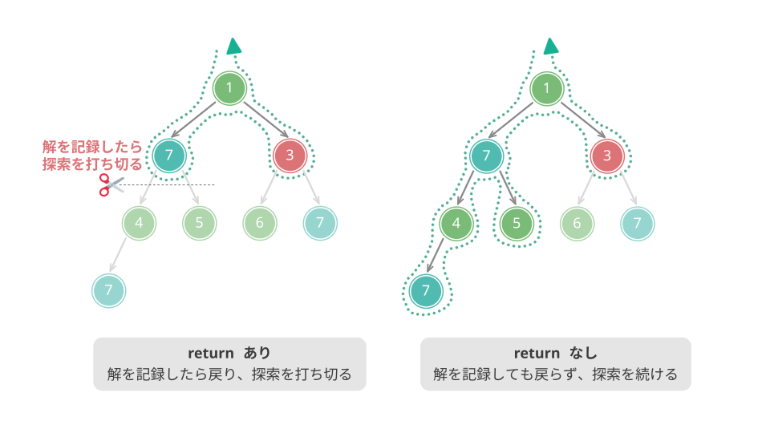{ class="animation-figure" }

<p align="center"> 図 13-4 &nbsp; return の有無による探索過程の違い </p>

行きがけ順走査で直接書いたコードに比べると、この基本形による実装は少し長くなりますが、ほかの問題にも応用しやすくなります。実際、**多くのバックトラッキング問題がこの基本形で解けます**。問題に合わせて `state` と `choices` を定め、各メソッドを実装すればよいのです。

## 13.1.4 &nbsp; よく使う用語

問題を整理して考えられるよう、バックトラッキングでよく使う用語の意味と、例題 3 での具体例を表 13-1 にまとめます。

<p align="center"> 表 13-1 &nbsp; バックトラッキングでよく使う用語 </p>

<div class="center-table" markdown>

| 用語                   | 定義                                                                       | 例題 3                                                               |
| ---------------------- | -------------------------------------------------------------------------- | -------------------------------------------------------------------- |
| 解（solution）         | 問題で指定された条件を満たす答えです。一つのことも複数のこともあります                               | 根からノード $7$ までの、制約を満たすすべての経路                            |
| 制約（constraint） | 何を解として認めるかを制限する条件です。通常、枝刈りに利用します                         | 経路にノード $3$ を含めないこと                                                 |
| 状態（state）          | ある時点での問題の状況を表し、それまでの選択を含みます                           | 現在までにたどった経路を表すノードのリスト `path`                             |
| 試行（attempt）        | 選べる手を使って解空間を調べる過程です。選択、状態の更新、解かどうかの判定を含みます | 左（右）の子を再帰的に訪れ、ノードを `path` に加え、値が $7$ か調べること |
| 後戻り（backtracking）   | 制約を満たさない状態に達したとき、それまでの選択を取り消して直前の状態に戻ることです       | 葉の先に達したとき、ノードの訪問を終えたとき、または値が $3$ のノードに出会ったときに、その探索を終えて関数から戻ること  |
| 枝刈り（pruning）        | 問題の性質や制約を使い、意味のない経路の探索を省いて効率を高める方法です     | 値が $3$ のノードに出会ったら、その先を探索しないこと                              |

</div>

!!! tip "ヒント"

    問題、解、状態などは、分割統治法、バックトラッキング、動的計画法、貪欲法などに共通する概念です。

## 13.1.5 &nbsp; 利点と限界

バックトラッキングは本質的には深さ優先探索であり、条件を満たす解が見つかるまで、考えられる候補を順に試します。可能な解をすべて見つけられること、また、適切に枝刈りすれば高い効率で探索できることが利点です。

ただし、大規模な問題や複雑な問題では、**バックトラッキングの実行効率が実用に堪えない場合があります**。

- **時間**：通常は状態空間のあらゆる可能性を調べる必要があり、時間計算量が指数オーダーや階乗オーダーに達することがあります。
- **空間**：再帰呼び出しでは、経路や枝刈り用の補助変数など、現在の状態を保存します。再帰が深くなると、多くのメモリが必要になる場合があります。

それでも、**探索問題や制約充足問題の中には、バックトラッキングが最適な解法となるものがあります**。どの選択から有効な解が得られるか予測できず、取り得る選択肢をすべて調べる必要があるからです。こうした場合には、**探索効率をどう高めるかが重要です**。代表的な方法は二つあります。

- **枝刈り**：解が得られないと分かっている経路の探索を省き、時間とメモリを節約します。
- **ヒューリスティック探索**：方針や推定値を探索に取り入れ、有効な解が得られそうな経路を優先して調べます。

## 13.1.6 &nbsp; バックトラッキングの代表的な問題

バックトラッキングは、多くの探索問題、制約充足問題、組合せ最適化問題に使えます。

**探索問題**：指定された条件を満たす解を見つけます。

- 全順列問題：与えられた集合の要素から作れる順列をすべて求めます。
- 部分和問題：集合と目標値が与えられます。要素の和が目標値になる部分集合をすべて求めます。
- ハノイの塔：3 本の棒と大きさの異なる円盤が与えられます。円盤をある棒から別の棒へすべて移します。一度に移せるのは 1 枚だけで、小さい円盤の上に大きい円盤を置くことはできません。

**制約充足問題**：すべての制約を満たす解を見つけます。

- $n$ クイーン問題：$n \times n$ の盤面に $n$ 個のクイーンを置き、どのクイーンも互いに攻撃できないようにします。
- 数独：$9 \times 9$ のマス目に $1$ から $9$ までの数字を入れ、各行、各列、各 $3 \times 3$ の小区画で数字が重複しないようにします。
- グラフ彩色問題：無向グラフの隣接する頂点が異なる色になるように、できるだけ少ない色で各頂点を塗ります。

**組合せ最適化問題**：組み合わせの中から、条件を満たす最適な解を見つけます。

- 0-1 ナップサック問題：価値と重さの決まった品物とナップサックが与えられます。容量を超えない範囲で、価値の合計が最大になるように品物を選びます。
- 巡回セールスマン問題：グラフのある頂点を出発し、ほかのすべての頂点をちょうど 1 回ずつ訪れて出発点に戻る最短経路を求めます。
- 最大クリーク問題：無向グラフで最大の完全部分グラフを見つけます。完全部分グラフでは、どの 2 頂点の間にも辺があります。

多くの組合せ最適化問題では、バックトラッキングが最適な解法とは限りません。

- 0-1 ナップサック問題では、より短い時間で解くために通常は動的計画法を使います。
- 巡回セールスマン問題は有名な NP 困難問題です。遺伝的アルゴリズムや蟻コロニー最適化法などがよく使われます。
- 最大クリーク問題はグラフ理論の古典的な問題で、貪欲法などのヒューリスティックなアルゴリズムも利用できます。
