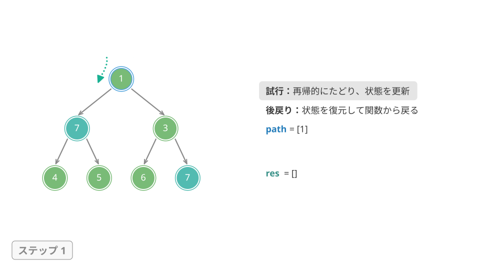
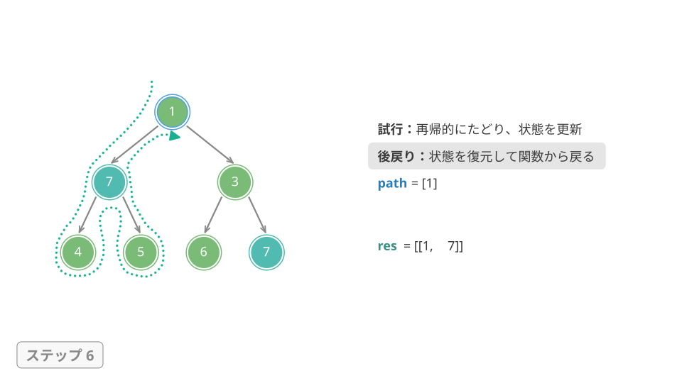

# バックトラッキング

<u>バックトラッキング（backtracking algorithm）</u>は、可能性を総当たりで調べて問題を解く方法です。初期状態から出発し、考えられる解を片端から探索して、正しい解に出会えば記録します。解が見つかるか、すべての選択肢を試しても解がないと分かるまで探索します。

バックトラッキングでは通常、深さ優先探索で解空間をたどります。「二分木」の章で見たように、行きがけ順、通りがけ順、帰りがけ順の走査はいずれも深さ優先探索です。ここでは行きがけ順走査を使った問題を通して、バックトラッキングの仕組みを順に見ていきます。

!!! question "例題 1"

    二分木が与えられます。値が $7$ のノードをすべて探して記録し、ノードのリストを返してください。

木を行きがけ順にたどり、現在のノードの値が $7$ かどうかを調べます。一致したら、その値を結果のリスト `res` に加えます。次の図とコードに、その過程を示します。

```src
[file]{preorder_traversal_i_compact}-[class]{}-[func]{pre_order}
```


## 試行と後戻り

**バックトラッキングという名前は、解空間を探索するときに「試行」と「後戻り」を繰り返すことに由来します**。それ以上進めない状態や、条件を満たす解が得られない状態に達したら、直前の選択を取り消して元の状態に戻り、別の選択肢を試します。

例題 1 では、各ノードを訪れることが「試行」に当たり、葉の先に達したときや親ノードに戻るときの `return` が「後戻り」に当たります。

ここで注意したいのは、**後戻りには関数から戻る以外の操作も含まれる**ことです。例題 1 を少し発展させて考えてみましょう。

!!! question "例題 2"

    二分木で値が $7$ のノードをすべて探し、**根からそれぞれのノードまでの経路を返してください**。

例題 1 のコードにリスト `path` を加え、訪れたノードを経路として記録します。値が $7$ のノードに到達したら、`path` のコピーを結果のリスト `res` に加えます。走査が終わると、`res` にすべての解がそろいます。コードは次のとおりです。

```src
[file]{preorder_traversal_ii_compact}-[class]{}-[func]{pre_order}
```

各「試行」では、現在のノードを `path` に加えて経路を記録します。「後戻り」の前には、そのノードを `path` の末尾から取り除き、**今回の試行の前の状態に戻します**。

次の図から、**試行は「先へ進む」操作、後戻りはそれを「取り消す」操作**と考えられます。両者は互いに逆の操作です。

=== "<1>"
    

=== "<2>"
    

=== "<3>"
    

=== "<4>"
    

=== "<5>"
    

=== "<6>"
    

=== "<7>"
    

=== "<8>"
    

=== "<9>"
    

=== "<10>"
    

=== "<11>"
    

## 枝刈り

複雑なバックトラッキングの問題には通常、一つ以上の制約があり、**その制約を「枝刈り」に使えることがよくあります**。

!!! question "例題 3"

    二分木で値が $7$ のノードをすべて探し、根からそれぞれのノードまでの経路を返してください。**ただし、経路には値が $3$ のノードを含めてはいけません**。

この制約を満たすために、**枝刈りを加えます**。探索中に値が $3$ のノードに出会ったら、そこで関数から戻り、その先は探索しません。コードは次のとおりです。

```src
[file]{preorder_traversal_iii_compact}-[class]{}-[func]{pre_order}
```

「枝刈り」という名前は、この操作をよく表しています。次の図のように、探索中に**制約を満たさない枝を「切り落とす」**ことで、多くの無駄な試行を省き、探索効率を高めます。


## コードの基本形

試行、後戻り、枝刈りという共通の構造を取り出し、さまざまな問題で使える形にまとめてみましょう。

次のコードでは、`state` は問題の現在の状態、`choices` はその状態で取り得る選択肢を表します。

```snippet
backtrack_framework
```

この基本形を使って例題 3 を解きます。状態 `state` はたどったノードの経路、選択肢 `choices` は現在のノードの左の子と右の子、結果 `res` は経路のリストです。

```src
[file]{preorder_traversal_iii_template}-[class]{}-[func]{backtrack}
```

この問題では、値が $7$ のノードを見つけた後も探索を続けます。**そのため、解を記録した直後の `return` 文を削除します**。次の図は、`return` 文の有無による探索過程の違いを示しています。


行きがけ順走査で直接書いたコードに比べると、この基本形による実装は少し長くなりますが、ほかの問題にも応用しやすくなります。実際、**多くのバックトラッキング問題がこの基本形で解けます**。問題に合わせて `state` と `choices` を定め、各メソッドを実装すればよいのです。

## よく使う用語

問題を整理して考えられるよう、バックトラッキングでよく使う用語の意味と、例題 3 での具体例を次の表にまとめます。

<p align="center"> 表 <id> &nbsp; バックトラッキングでよく使う用語 </p>

| 用語                   | 定義                                                                       | 例題 3                                                               |
| ---------------------- | -------------------------------------------------------------------------- | -------------------------------------------------------------------- |
| 解（solution）         | 問題で指定された条件を満たす答えです。一つのことも複数のこともあります                               | 根からノード $7$ までの、制約を満たすすべての経路                            |
| 制約（constraint） | 何を解として認めるかを制限する条件です。通常、枝刈りに利用します                         | 経路にノード $3$ を含めないこと                                                 |
| 状態（state）          | ある時点での問題の状況を表し、それまでの選択を含みます                           | 現在までにたどった経路を表すノードのリスト `path`                             |
| 試行（attempt）        | 選べる手を使って解空間を調べる過程です。選択、状態の更新、解かどうかの判定を含みます | 左（右）の子を再帰的に訪れ、ノードを `path` に加え、値が $7$ か調べること |
| 後戻り（backtracking）   | 制約を満たさない状態に達したとき、それまでの選択を取り消して直前の状態に戻ることです       | 葉の先に達したとき、ノードの訪問を終えたとき、または値が $3$ のノードに出会ったときに、その探索を終えて関数から戻ること  |
| 枝刈り（pruning）        | 問題の性質や制約を使い、意味のない経路の探索を省いて効率を高める方法です     | 値が $3$ のノードに出会ったら、その先を探索しないこと                              |

!!! tip

    問題、解、状態などは、分割統治法、バックトラッキング、動的計画法、貪欲法などに共通する概念です。

## 利点と限界

バックトラッキングは本質的には深さ優先探索であり、条件を満たす解が見つかるまで、考えられる候補を順に試します。可能な解をすべて見つけられること、また、適切に枝刈りすれば高い効率で探索できることが利点です。

ただし、大規模な問題や複雑な問題では、**バックトラッキングの実行効率が実用に堪えない場合があります**。

- **時間**：通常は状態空間のあらゆる可能性を調べる必要があり、時間計算量が指数オーダーや階乗オーダーに達することがあります。
- **空間**：再帰呼び出しでは、経路や枝刈り用の補助変数など、現在の状態を保存します。再帰が深くなると、多くのメモリが必要になる場合があります。

それでも、**探索問題や制約充足問題の中には、バックトラッキングが最適な解法となるものがあります**。どの選択から有効な解が得られるか予測できず、取り得る選択肢をすべて調べる必要があるからです。こうした場合には、**探索効率をどう高めるかが重要です**。代表的な方法は二つあります。

- **枝刈り**：解が得られないと分かっている経路の探索を省き、時間とメモリを節約します。
- **ヒューリスティック探索**：方針や推定値を探索に取り入れ、有効な解が得られそうな経路を優先して調べます。

## バックトラッキングの代表的な問題

バックトラッキングは、多くの探索問題、制約充足問題、組合せ最適化問題に使えます。

**探索問題**：指定された条件を満たす解を見つけます。

- 全順列問題：与えられた集合の要素から作れる順列をすべて求めます。
- 部分和問題：集合と目標値が与えられます。要素の和が目標値になる部分集合をすべて求めます。
- ハノイの塔：3 本の棒と大きさの異なる円盤が与えられます。円盤をある棒から別の棒へすべて移します。一度に移せるのは 1 枚だけで、小さい円盤の上に大きい円盤を置くことはできません。

**制約充足問題**：すべての制約を満たす解を見つけます。

- $n$ クイーン問題：$n \times n$ の盤面に $n$ 個のクイーンを置き、どのクイーンも互いに攻撃できないようにします。
- 数独：$9 \times 9$ のマス目に $1$ から $9$ までの数字を入れ、各行、各列、各 $3 \times 3$ の小区画で数字が重複しないようにします。
- グラフ彩色問題：無向グラフの隣接する頂点が異なる色になるように、できるだけ少ない色で各頂点を塗ります。

**組合せ最適化問題**：組み合わせの中から、条件を満たす最適な解を見つけます。

- 0-1 ナップサック問題：価値と重さの決まった品物とナップサックが与えられます。容量を超えない範囲で、価値の合計が最大になるように品物を選びます。
- 巡回セールスマン問題：グラフのある頂点を出発し、ほかのすべての頂点をちょうど 1 回ずつ訪れて出発点に戻る最短経路を求めます。
- 最大クリーク問題：無向グラフで最大の完全部分グラフを見つけます。完全部分グラフでは、どの 2 頂点の間にも辺があります。

多くの組合せ最適化問題では、バックトラッキングが最適な解法とは限りません。

- 0-1 ナップサック問題では、より短い時間で解くために通常は動的計画法を使います。
- 巡回セールスマン問題は有名な NP 困難問題です。遺伝的アルゴリズムや蟻コロニー最適化法などがよく使われます。
- 最大クリーク問題はグラフ理論の古典的な問題で、貪欲法などのヒューリスティックなアルゴリズムも利用できます。
