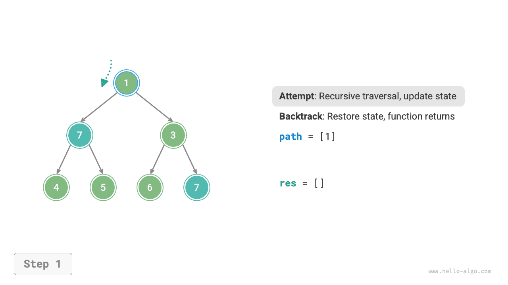
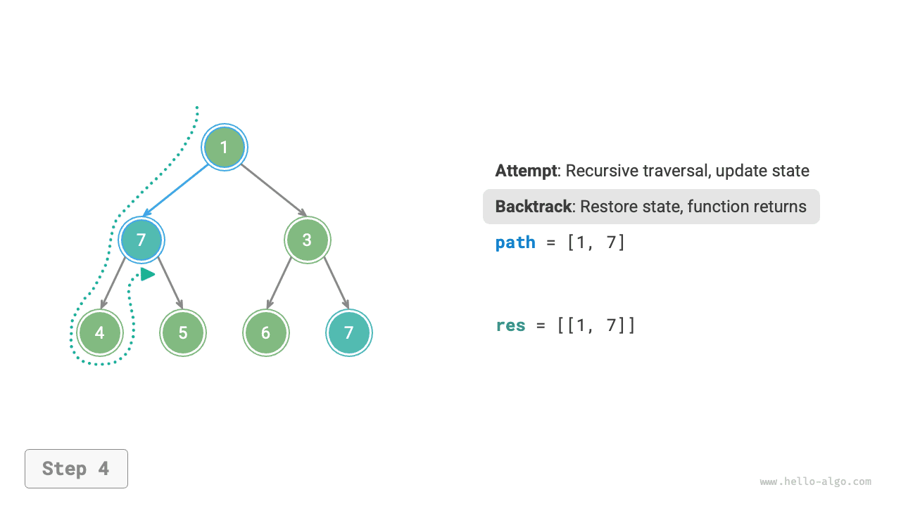
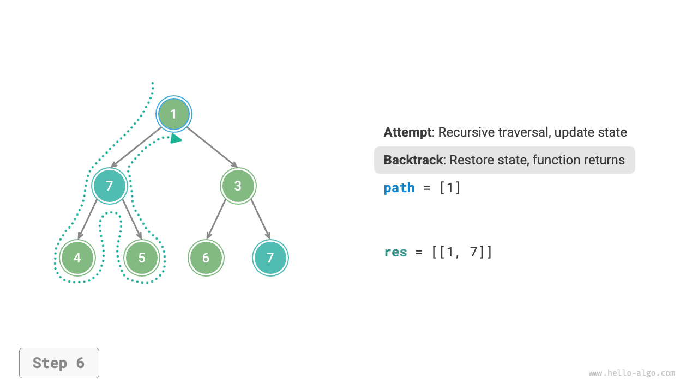
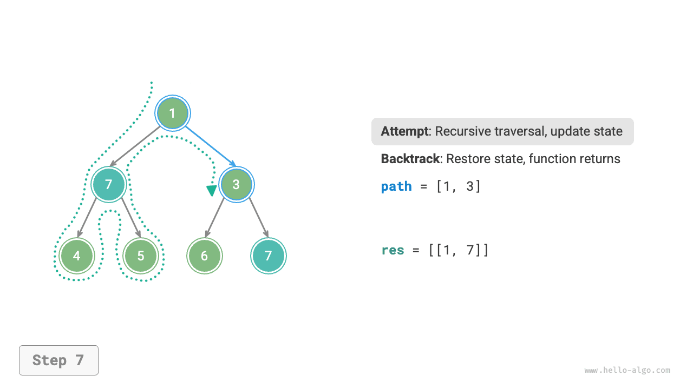
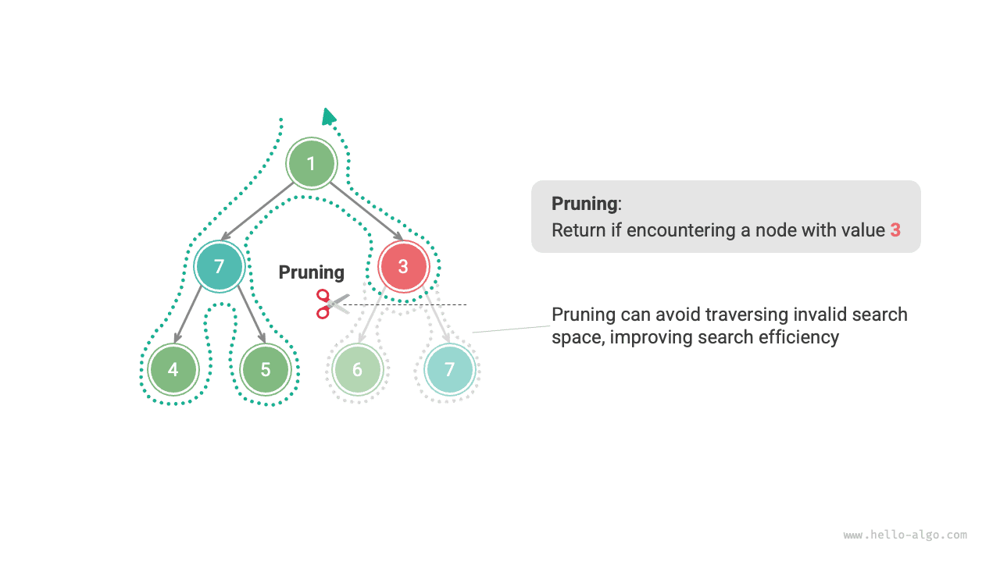

# バックトラッキングアルゴリズム

<u>バックトラッキングアルゴリズム（backtracking algorithm）</u>は、総当たりで問題を解く方法です。初期状態から出発し、可能な解をすべて探索して、条件に合う解が見つかれば記録します。解が見つかるか、すべての選択肢を試しても解がないとわかるまで続けることが、その基本的な考え方です。

通常は「深さ優先探索」で解の空間を走査します。「二分木」の章では、行きがけ順、通りがけ順、帰りがけ順の走査が、いずれも深さ優先探索に属すると説明しました。ここでは行きがけ順走査を使ってバックトラッキングの問題を作り、仕組みを段階的に理解していきます。

!!! question "例題 1"

    二分木が与えられます。値が $7$ のノードをすべて探して記録し、ノードのリストを返してください。

この問題では、木を行きがけ順に走査し、現在のノードの値が $7$ かを調べます。そうなら、そのノードの値を結果リスト `res` に追加します。処理の流れと実装を、下図と次のコードに示します。

```src
[file]{preorder_traversal_i_compact}-[class]{}-[func]{pre_order}
```


## 試行と後戻り

**バックトラッキングと呼ぶのは、解の空間を探す際に「試行」と「後戻り」を行うためです**。探索中に、それ以上進めない状態や、条件を満たす解が得られない状態に出会うと、直前の選択を取り消して元の状態に戻り、ほかの可能な選択肢を試します。

例題 1 では、各ノードへの訪問が一つの「試行」に対応し、葉ノードの先へ進んだときや、親ノードへ戻るときの `return` が「後戻り」に対応します。

ただし、**後戻りは単に関数から戻ることだけではありません**。これを説明するため、例題 1 を少し拡張します。

!!! question "例題 2"

    二分木で値が $7$ のノードをすべて探し、**根ノードからそれらのノードまでの経路を返してください**。

例題 1 のコードに加え、リスト `path` で訪問したノードの経路を記録します。値が $7$ のノードに到達したら、`path` をコピーして結果リスト `res` に追加します。走査が終わると、`res` にすべての解が保存されています。コードは次のとおりです。

```src
[file]{preorder_traversal_ii_compact}-[class]{}-[func]{pre_order}
```

各「試行」では、現在のノードを `path` に追加して経路を記録します。「後戻り」の前には、そのノードを `path` から取り出し、**今回の試行前の状態を復元する**必要があります。

下図の流れを見ると、**試行と後戻りは「前進」と「取り消し」と考えられ**、互いに逆の操作だとわかります。

=== "<1>"
    

=== "<2>"
    

=== "<3>"
    

=== "<4>"
    

=== "<5>"
    

=== "<6>"
    

=== "<7>"
    

=== "<8>"
    

=== "<9>"
    

=== "<10>"
    

=== "<11>"
    

## 枝刈り

複雑なバックトラッキングの問題には、一つ以上の制約条件があります。**制約条件は通常、「枝刈り」に使えます**。

!!! question "例題 3"

    二分木で値が $7$ のノードをすべて探し、根ノードからそれらまでの経路を返してください。ただし、**経路に値が $3$ のノードを含めてはいけません**。

この制約を満たすため、**枝刈りの操作を加えます**。探索中に値が $3$ のノードに出会ったら、そこで戻り、それ以上探索しません。コードは次のとおりです。

```src
[file]{preorder_traversal_iii_compact}-[class]{}-[func]{pre_order}
```

「枝刈り」は仕組みをよく表す名前です。下図のように、**制約を満たさない探索の枝を「刈り取る」ことで**、無意味な試行を多く避け、探索効率を高めます。



## 基本形のコード

ここからは、「試行・後戻り・枝刈り」という中心となる構造を取り出し、より汎用的なコードにしてみましょう。

次の基本形では、`state` が問題の現在の状態を、`choices` がその状態で取れる選択肢を表します。

=== "Python"

    ```python title=""
    def backtrack(state: State, choices: list[choice], res: list[state]):
        """バックトラッキングの基本形"""
        # 解かどうかを判定
        if is_solution(state):
            # 解を記録
            record_solution(state, res)
            # これ以上探索しない
            return
        # すべての選択肢を調べる
        for choice in choices:
            # 枝刈り：選択が有効かを判定
            if is_valid(state, choice):
                # 試行：選択して状態を更新
                make_choice(state, choice)
                backtrack(state, choices, res)
                # 後戻り：選択を取り消し、前の状態に戻す
                undo_choice(state, choice)
    ```

=== "C++"

    ```cpp title=""
    /* バックトラッキングの基本形 */
    void backtrack(State *state, vector<Choice *> &choices, vector<State *> &res) {
        // 解かどうかを判定
        if (isSolution(state)) {
            // 解を記録
            recordSolution(state, res);
            // これ以上探索しない
            return;
        }
        // すべての選択肢を調べる
        for (Choice choice : choices) {
            // 枝刈り：選択が有効かを判定
            if (isValid(state, choice)) {
                // 試行：選択して状態を更新
                makeChoice(state, choice);
                backtrack(state, choices, res);
                // 後戻り：選択を取り消し、前の状態に戻す
                undoChoice(state, choice);
            }
        }
    }
    ```

=== "Java"

    ```java title=""
    /* バックトラッキングの基本形 */
    void backtrack(State state, List<Choice> choices, List<State> res) {
        // 解かどうかを判定
        if (isSolution(state)) {
            // 解を記録
            recordSolution(state, res);
            // これ以上探索しない
            return;
        }
        // すべての選択肢を調べる
        for (Choice choice : choices) {
            // 枝刈り：選択が有効かを判定
            if (isValid(state, choice)) {
                // 試行：選択して状態を更新
                makeChoice(state, choice);
                backtrack(state, choices, res);
                // 後戻り：選択を取り消し、前の状態に戻す
                undoChoice(state, choice);
            }
        }
    }
    ```

=== "C#"

    ```csharp title=""
    /* バックトラッキングの基本形 */
    void Backtrack(State state, List<Choice> choices, List<State> res) {
        // 解かどうかを判定
        if (IsSolution(state)) {
            // 解を記録
            RecordSolution(state, res);
            // これ以上探索しない
            return;
        }
        // すべての選択肢を調べる
        foreach (Choice choice in choices) {
            // 枝刈り：選択が有効かを判定
            if (IsValid(state, choice)) {
                // 試行：選択して状態を更新
                MakeChoice(state, choice);
                Backtrack(state, choices, res);
                // 後戻り：選択を取り消し、前の状態に戻す
                UndoChoice(state, choice);
            }
        }
    }
    ```

=== "Go"

    ```go title=""
    /* バックトラッキングの基本形 */
    func backtrack(state *State, choices []Choice, res *[]State) {
        // 解かどうかを判定
        if isSolution(state) {
            // 解を記録
            recordSolution(state, res)
            // これ以上探索しない
            return
        }
        // すべての選択肢を調べる
        for _, choice := range choices {
            // 枝刈り：選択が有効かを判定
            if isValid(state, choice) {
                // 試行：選択して状態を更新
                makeChoice(state, choice)
                backtrack(state, choices, res)
                // 後戻り：選択を取り消し、前の状態に戻す
                undoChoice(state, choice)
            }
        }
    }
    ```

=== "Swift"

    ```swift title=""
    /* バックトラッキングの基本形 */
    func backtrack(state: inout State, choices: [Choice], res: inout [State]) {
        // 解かどうかを判定
        if isSolution(state: state) {
            // 解を記録
            recordSolution(state: state, res: &res)
            // これ以上探索しない
            return
        }
        // すべての選択肢を調べる
        for choice in choices {
            // 枝刈り：選択が有効かを判定
            if isValid(state: state, choice: choice) {
                // 試行：選択して状態を更新
                makeChoice(state: &state, choice: choice)
                backtrack(state: &state, choices: choices, res: &res)
                // 後戻り：選択を取り消し、前の状態に戻す
                undoChoice(state: &state, choice: choice)
            }
        }
    }
    ```

=== "JS"

    ```javascript title=""
    /* バックトラッキングの基本形 */
    function backtrack(state, choices, res) {
        // 解かどうかを判定
        if (isSolution(state)) {
            // 解を記録
            recordSolution(state, res);
            // これ以上探索しない
            return;
        }
        // すべての選択肢を調べる
        for (let choice of choices) {
            // 枝刈り：選択が有効かを判定
            if (isValid(state, choice)) {
                // 試行：選択して状態を更新
                makeChoice(state, choice);
                backtrack(state, choices, res);
                // 後戻り：選択を取り消し、前の状態に戻す
                undoChoice(state, choice);
            }
        }
    }
    ```

=== "TS"

    ```typescript title=""
    /* バックトラッキングの基本形 */
    function backtrack(state: State, choices: Choice[], res: State[]): void {
        // 解かどうかを判定
        if (isSolution(state)) {
            // 解を記録
            recordSolution(state, res);
            // これ以上探索しない
            return;
        }
        // すべての選択肢を調べる
        for (let choice of choices) {
            // 枝刈り：選択が有効かを判定
            if (isValid(state, choice)) {
                // 試行：選択して状態を更新
                makeChoice(state, choice);
                backtrack(state, choices, res);
                // 後戻り：選択を取り消し、前の状態に戻す
                undoChoice(state, choice);
            }
        }
    }
    ```

=== "Dart"

    ```dart title=""
    /* バックトラッキングの基本形 */
    void backtrack(State state, List<Choice>, List<State> res) {
      // 解かどうかを判定
      if (isSolution(state)) {
        // 解を記録
        recordSolution(state, res);
        // これ以上探索しない
        return;
      }
      // すべての選択肢を調べる
      for (Choice choice in choices) {
        // 枝刈り：選択が有効かを判定
        if (isValid(state, choice)) {
          // 試行：選択して状態を更新
          makeChoice(state, choice);
          backtrack(state, choices, res);
          // 後戻り：選択を取り消し、前の状態に戻す
          undoChoice(state, choice);
        }
      }
    }
    ```

=== "Rust"

    ```rust title=""
    /* バックトラッキングの基本形 */
    fn backtrack(state: &mut State, choices: &Vec<Choice>, res: &mut Vec<State>) {
        // 解かどうかを判定
        if is_solution(state) {
            // 解を記録
            record_solution(state, res);
            // これ以上探索しない
            return;
        }
        // すべての選択肢を調べる
        for choice in choices {
            // 枝刈り：選択が有効かを判定
            if is_valid(state, choice) {
                // 試行：選択して状態を更新
                make_choice(state, choice);
                backtrack(state, choices, res);
                // 後戻り：選択を取り消し、前の状態に戻す
                undo_choice(state, choice);
            }
        }
    }
    ```

=== "C"

    ```c title=""
    /* バックトラッキングの基本形 */
    void backtrack(State *state, Choice *choices, int numChoices, State *res, int numRes) {
        // 解かどうかを判定
        if (isSolution(state)) {
            // 解を記録
            recordSolution(state, res, numRes);
            // これ以上探索しない
            return;
        }
        // すべての選択肢を調べる
        for (int i = 0; i < numChoices; i++) {
            // 枝刈り：選択が有効かを判定
            if (isValid(state, &choices[i])) {
                // 試行：選択して状態を更新
                makeChoice(state, &choices[i]);
                backtrack(state, choices, numChoices, res, numRes);
                // 後戻り：選択を取り消し、前の状態に戻す
                undoChoice(state, &choices[i]);
            }
        }
    }
    ```

=== "Kotlin"

    ```kotlin title=""
    /* バックトラッキングの基本形 */
    fun backtrack(state: State?, choices: List<Choice?>, res: List<State?>?) {
        // 解かどうかを判定
        if (isSolution(state)) {
            // 解を記録
            recordSolution(state, res)
            // これ以上探索しない
            return
        }
        // すべての選択肢を調べる
        for (choice in choices) {
            // 枝刈り：選択が有効かを判定
            if (isValid(state, choice)) {
                // 試行：選択して状態を更新
                makeChoice(state, choice)
                backtrack(state, choices, res)
                // 後戻り：選択を取り消し、前の状態に戻す
                undoChoice(state, choice)
            }
        }
    }
    ```

=== "Ruby"

    ```ruby title=""
    ### バックトラッキングの基本形 ###
    def backtrack(state, choices, res)
        # 解かどうかを判定
        if is_solution?(state)
            # 解を記録
            record_solution(state, res)
            return
        end

        # すべての選択肢を調べる
        for choice in choices
            # 枝刈り：選択が有効かを判定
            if is_valid?(state, choice)
                # 試行：選択して状態を更新
                make_choice(state, choice)
                backtrack(state, choices, res)
                # 後戻り：選択を取り消し、前の状態に戻す
                undo_choice(state, choice)
            end
        end
    end
    ```

次に、この基本形を使って例題 3 を解きます。状態 `state` はノードをたどった経路、選択肢 `choices` は現在のノードの左右の子ノード、結果 `res` は経路のリストです。

```src
[file]{preorder_traversal_iii_template}-[class]{}-[func]{backtrack}
```

問題の条件から、値が $7$ のノードが見つかっても探索を続ける必要があります。**そのため、解を記録した直後の `return` 文を削除します**。下図に、`return` を残す場合と削除する場合の探索の違いを示します。


行きがけ順走査を使った実装に比べると、基本形に沿ったコードは冗長に見えますが、汎用性に優れています。実際、**多くのバックトラッキングの問題はこの基本形で解けます**。問題に応じて `state` と `choices` を定義し、各メソッドを実装すればよいのです。

## 主な用語

問題をより明確に分析できるよう、バックトラッキングの主な用語を整理します。下表に、例題 3 での対応も示します。

<p align="center"> 表 <id> &nbsp; バックトラッキングの主な用語 </p>

| 用語                   | 定義                                                                       | 例題 3                                                               |
| ---------------------- | -------------------------------------------------------------------------- | -------------------------------------------------------------------- |
| 解（solution）         | 問題の特定の条件を満たす答え。一つの場合も複数の場合もある                               | 根ノードからノード $7$ までの、制約を満たすすべての経路                            |
| 制約条件（constraint） | 解が実行可能であるための条件。通常は枝刈りに使う                         | 経路にノード $3$ を含めない                                                 |
| 状態（state）          | それまでの選択を含む、ある時点での問題の状況                           | 現在までに訪問した経路、すなわちノードのリスト `path`                             |
| 試行（attempt）        | 利用可能な選択肢で解の空間を探索する過程。選択、状態更新、解の判定を含む | 左（右）の子ノードを再帰的に訪問し、`path` に追加して、値が $7$ かを調べる |
| 後戻り（backtracking）   | 制約を満たさない状態に出会ったとき、前の選択を取り消して一つ前の状態へ戻ること       | 葉ノードの先へ進んだとき、訪問を終えたとき、値が $3$ のノードに出会ったときに探索を終えて関数から戻る  |
| 枝刈り（pruning）        | 問題の性質や制約を使って無意味な探索経路を避け、効率を高める方法     | 値が $3$ のノードに出会ったら、それ以上探索しない                              |

!!! tip

    問題、解、状態などの概念は共通のもので、分割統治、バックトラッキング、動的計画法、貪欲法などにも登場します。

## 利点と制約

バックトラッキングは本質的に深さ優先探索であり、条件を満たす解が見つかるまで、可能な候補をすべて試します。すべての解を見つけられることが利点であり、適切な枝刈りをすれば高い効率を得られます。

ただし、大規模または複雑な問題では、**実行時間が許容できないほど長くなる可能性があります**。

- **時間**：状態空間のすべての可能性を調べる必要があることが多く、時間計算量は指数や階乗のオーダーになる場合があります。
- **空間**：再帰呼び出しでは現在の状態（経路や枝刈り用の補助変数など）を保持するため、深さが大きいと必要な空間も大きくなる場合があります。

それでも、**一部の探索問題や制約充足問題には、バックトラッキングが最も適した解法です**。どの選択が有効な解につながるか予測できないため、すべての選択肢を調べる必要があるからです。この場合、**重要なのは効率をどう高めるか**であり、代表的な方法には二つあります。

- **枝刈り**：解が得られないと確実にわかる経路を探索せず、時間と空間を節約します。
- **ヒューリスティック探索**：戦略や推定値を取り入れ、有効な解が得られそうな経路を優先して探索します。

## バックトラッキングの代表的な問題

バックトラッキングは、多くの探索問題、制約充足問題、組合せ最適化問題に使えます。

**探索問題**：特定の条件を満たす解を見つけることが目標です。

- 順列列挙問題：集合が与えられ、その要素の可能な並べ方をすべて求めます。
- 部分集合和問題：集合と目標の和が与えられ、和が目標に一致するすべての部分集合を求めます。
- ハノイの塔の問題：3 本の柱と大きさの異なる円盤があり、すべての円盤を一つの柱から別の柱へ移します。一度に動かせるのは 1 枚だけで、小さな円盤の上に大きな円盤を置いてはいけません。

**制約充足問題**：すべての制約条件を満たす解を見つけることが目標です。

- $n$ クイーン：$n \times n$ の盤面に $n$ 個のクイーンを、互いに攻撃できないように配置します。
- 数独：$9 \times 9$ のマスに $1$ ~ $9$ を入れ、各行、各列、各 $3 \times 3$ の領域で数字が重複しないようにします。
- グラフ彩色問題：無向グラフの各頂点を、隣接する頂点が同じ色にならないよう、最少の色数で塗ります。

**組合せ最適化問題**：組合せの空間から、条件を満たす最適解を見つけることが目標です。

- 0-1 ナップサック問題：価値と重さを持つ品物の集合とナップサックが与えられ、容量の制限内で総価値が最大になるよう品物を選びます。
- 巡回セールスマン問題：グラフのある頂点から出発し、ほかのすべての頂点をちょうど 1 回ずつ訪問して出発点に戻る、最短の経路を求めます。
- 最大クリーク問題：無向グラフから、任意の 2 頂点の間に辺がある完全部分グラフのうち、最大のものを求めます。

ただし、多くの組合せ最適化問題では、バックトラッキングが最良の解法とは限りません。

- 0-1 ナップサック問題は通常、時間効率の高い動的計画法で解きます。
- 巡回セールスマン問題は有名な NP-Hard 問題で、遺伝的アルゴリズムや蟻コロニー最適化などがよく使われます。
- 最大クリーク問題はグラフ理論の古典的な問題で、貪欲法などのヒューリスティックアルゴリズムで解けます。
