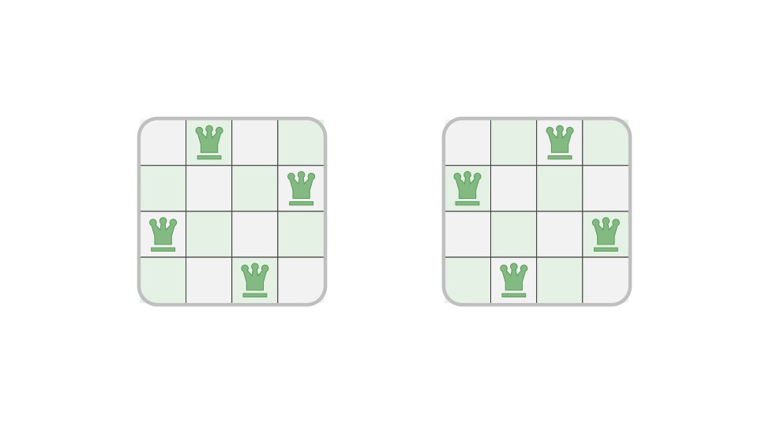
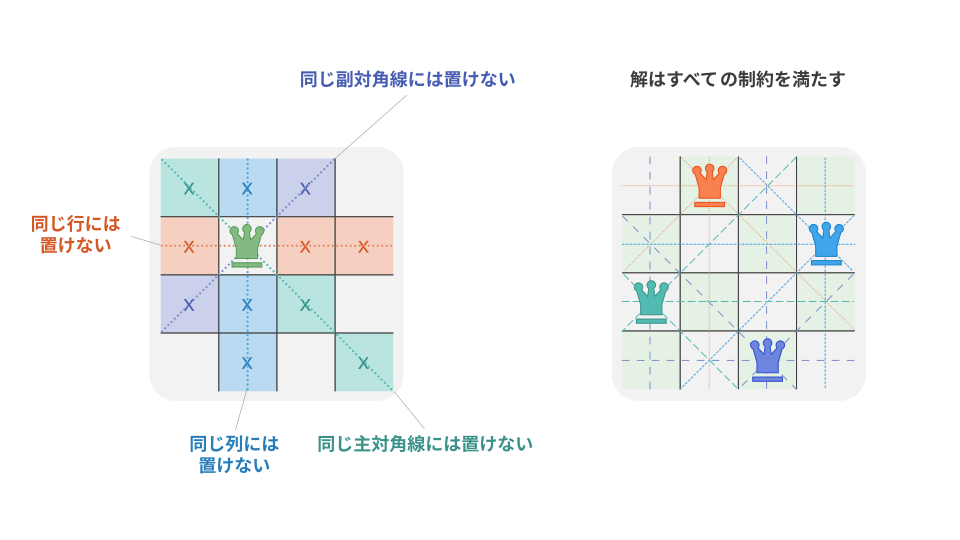
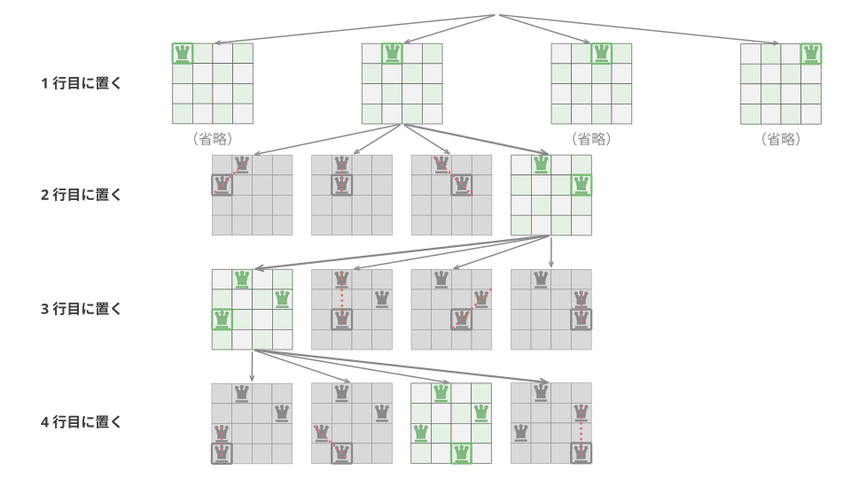
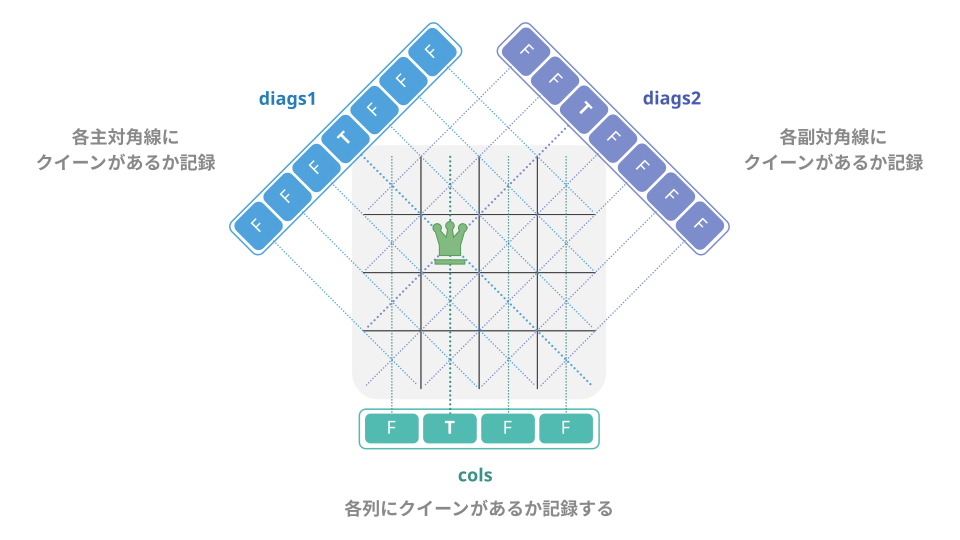

# 13.4 &nbsp; n クイーン問題

!!! question "問題"

    チェスのクイーンは、同じ行、列、または対角線にある駒を攻撃できます。$n$ 個のクイーンと $n \times n$ の盤面が与えられたとき、どのクイーンも互いに攻撃できない配置を求めます。

図 13-15 のように、$n = 4$ のときの解は 2 通りです。バックトラッキングの観点では、$n \times n$ の盤面にある $n^2$ 個のマスが選択肢 `choices` の全体を表します。クイーンを一つ置くたびに盤面は変化し、各時点の盤面が状態 `state` に当たります。

{ class="animation-figure" }

<p align="center"> 図 13-15 &nbsp; 4 クイーン問題の解 </p>

図 13-16 は三つの制約を示しています。**複数のクイーンを同じ行、同じ列、同じ対角線に置くことはできません**。対角線には、主対角線 `\` と副対角線 `/` の 2 種類があることに注意してください。

{ class="animation-figure" }

<p align="center"> 図 13-16 &nbsp; n クイーン問題の制約 </p>

### 1. &nbsp; 行ごとに置く方法

クイーンの数と盤面の行数はどちらも $n$ です。したがって、**各行にはクイーンをちょうど一つずつ置く必要があります**。

そこで、最初の行から最後の行まで、各行に一つずつクイーンを置いていきます。

図 13-17 は、4 クイーン問題で行ごとに置く過程です。紙幅の都合で、最初の行の選択肢のうち一つの枝だけを展開しています。列または対角線の制約を満たさない配置は枝刈りしています。

{ class="animation-figure" }

<p align="center"> 図 13-17 &nbsp; 行ごとに置く方法 </p>

実は、**行ごとに置く方法そのものが枝刈りになっています**。同じ行に複数のクイーンを置く枝をすべて省けるからです。

### 2. &nbsp; 列と対角線に基づく枝刈り

列の制約を満たすには、長さ $n$ のブール配列 `cols` に、各列にクイーンがあるかを記録します。置く前に `cols` を調べてすでにクイーンのある列を除き、バックトラッキングの各段階で `cols` の状態を更新します。

!!! tip "ヒント"

    行列の原点は左上で、行のインデックスは下へ、列のインデックスは右へ進むほど大きくなります。

対角線の制約はどう扱えばよいでしょうか。マスの行と列のインデックスを $(row, col)$ とします。ある主対角線に注目すると、どのマスでも行のインデックスから列のインデックスを引いた値が等しくなります。**つまり、同じ主対角線上では $row - col$ が一定です**。

したがって、二つのマスが $row_1 - col_1 = row_2 - col_2$ を満たせば、必ず同じ主対角線上にあります。この性質を利用して、図 13-18 の配列 `diags1` に各主対角線にクイーンがあるかを記録できます。

同様に、**同じ副対角線上のマスでは $row + col$ が一定です**。そこで、配列 `diags2` を使って副対角線の制約を扱えます。

{ class="animation-figure" }

<p align="center"> 図 13-18 &nbsp; 列と対角線の制約を扱う方法 </p>

### 3. &nbsp; 実装

$n$ 次の正方行列では、$row - col$ の範囲は $[-n + 1, n - 1]$、$row + col$ の範囲は $[0, 2n - 2]$ です。そのため、主対角線も副対角線も $2n - 1$ 本あり、配列 `diags1` と `diags2` の長さはいずれも $2n - 1$ です。

=== "Python"

    ```python title="n_queens.py"
    def backtrack(
        row: int,
        n: int,
        state: list[list[str]],
        res: list[list[list[str]]],
        cols: list[bool],
        diags1: list[bool],
        diags2: list[bool],
    ):
        """バックトラッキングによる n クイーン問題"""
        # すべての行に置いたら解を記録する
        if row == n:
            res.append([list(row) for row in state])
            return
        # すべての列を調べる
        for col in range(n):
            # このマスを通る主対角線と副対角線を求める
            diag1 = row - col + n - 1
            diag2 = row + col
            # 枝刈り：このマスと同じ列、主対角線、副対角線にクイーンがあってはならない
            if not cols[col] and not diags1[diag1] and not diags2[diag2]:
                # 試行：このマスにクイーンを置く
                state[row][col] = "Q"
                cols[col] = diags1[diag1] = diags2[diag2] = True
                # 次の行に置く
                backtrack(row + 1, n, state, res, cols, diags1, diags2)
                # 後戻り：このマスを空きに戻す
                state[row][col] = "#"
                cols[col] = diags1[diag1] = diags2[diag2] = False

    def n_queens(n: int) -> list[list[list[str]]]:
        """n クイーン問題を解く"""
        # n*n の盤面を初期化する。'Q' はクイーン、'#' は空きマスを表す
        state = [["#" for _ in range(n)] for _ in range(n)]
        cols = [False] * n  # 各列にクイーンがあるか記録する
        diags1 = [False] * (2 * n - 1)  # 各主対角線にクイーンがあるか記録する
        diags2 = [False] * (2 * n - 1)  # 各副対角線にクイーンがあるか記録する
        res = []
        backtrack(0, n, state, res, cols, diags1, diags2)

        return res
    ```

=== "C++"

    ```cpp title="n_queens.cpp"
    /* バックトラッキングによる n クイーン問題 */
    void backtrack(int row, int n, vector<vector<string>> &state, vector<vector<vector<string>>> &res, vector<bool> &cols,
                   vector<bool> &diags1, vector<bool> &diags2) {
        // すべての行に置いたら解を記録する
        if (row == n) {
            res.push_back(state);
            return;
        }
        // すべての列を調べる
        for (int col = 0; col < n; col++) {
            // このマスを通る主対角線と副対角線を求める
            int diag1 = row - col + n - 1;
            int diag2 = row + col;
            // 枝刈り：このマスと同じ列、主対角線、副対角線にクイーンがあってはならない
            if (!cols[col] && !diags1[diag1] && !diags2[diag2]) {
                // 試行：このマスにクイーンを置く
                state[row][col] = "Q";
                cols[col] = diags1[diag1] = diags2[diag2] = true;
                // 次の行に置く
                backtrack(row + 1, n, state, res, cols, diags1, diags2);
                // 後戻り：このマスを空きに戻す
                state[row][col] = "#";
                cols[col] = diags1[diag1] = diags2[diag2] = false;
            }
        }
    }

    /* n クイーン問題を解く */
    vector<vector<vector<string>>> nQueens(int n) {
        // n*n の盤面を初期化する。'Q' はクイーン、'#' は空きマスを表す
        vector<vector<string>> state(n, vector<string>(n, "#"));
        vector<bool> cols(n, false);           // 各列にクイーンがあるか記録する
        vector<bool> diags1(2 * n - 1, false); // 各主対角線にクイーンがあるか記録する
        vector<bool> diags2(2 * n - 1, false); // 各副対角線にクイーンがあるか記録する
        vector<vector<vector<string>>> res;

        backtrack(0, n, state, res, cols, diags1, diags2);

        return res;
    }
    ```

=== "Java"

    ```java title="n_queens.java"
    /* バックトラッキングによる n クイーン問題 */
    void backtrack(int row, int n, List<List<String>> state, List<List<List<String>>> res,
            boolean[] cols, boolean[] diags1, boolean[] diags2) {
        // すべての行に置いたら解を記録する
        if (row == n) {
            List<List<String>> copyState = new ArrayList<>();
            for (List<String> sRow : state) {
                copyState.add(new ArrayList<>(sRow));
            }
            res.add(copyState);
            return;
        }
        // すべての列を調べる
        for (int col = 0; col < n; col++) {
            // このマスを通る主対角線と副対角線を求める
            int diag1 = row - col + n - 1;
            int diag2 = row + col;
            // 枝刈り：このマスと同じ列、主対角線、副対角線にクイーンがあってはならない
            if (!cols[col] && !diags1[diag1] && !diags2[diag2]) {
                // 試行：このマスにクイーンを置く
                state.get(row).set(col, "Q");
                cols[col] = diags1[diag1] = diags2[diag2] = true;
                // 次の行に置く
                backtrack(row + 1, n, state, res, cols, diags1, diags2);
                // 後戻り：このマスを空きに戻す
                state.get(row).set(col, "#");
                cols[col] = diags1[diag1] = diags2[diag2] = false;
            }
        }
    }

    /* n クイーン問題を解く */
    List<List<List<String>>> nQueens(int n) {
        // n*n の盤面を初期化する。'Q' はクイーン、'#' は空きマスを表す
        List<List<String>> state = new ArrayList<>();
        for (int i = 0; i < n; i++) {
            List<String> row = new ArrayList<>();
            for (int j = 0; j < n; j++) {
                row.add("#");
            }
            state.add(row);
        }
        boolean[] cols = new boolean[n]; // 各列にクイーンがあるか記録する
        boolean[] diags1 = new boolean[2 * n - 1]; // 各主対角線にクイーンがあるか記録する
        boolean[] diags2 = new boolean[2 * n - 1]; // 各副対角線にクイーンがあるか記録する
        List<List<List<String>>> res = new ArrayList<>();

        backtrack(0, n, state, res, cols, diags1, diags2);

        return res;
    }
    ```

=== "C#"

    ```csharp title="n_queens.cs"
    /* バックトラッキングによる n クイーン問題 */
    void Backtrack(int row, int n, List<List<string>> state, List<List<List<string>>> res,
            bool[] cols, bool[] diags1, bool[] diags2) {
        // すべての行に置いたら解を記録する
        if (row == n) {
            List<List<string>> copyState = [];
            foreach (List<string> sRow in state) {
                copyState.Add(new List<string>(sRow));
            }
            res.Add(copyState);
            return;
        }
        // すべての列を調べる
        for (int col = 0; col < n; col++) {
            // このマスを通る主対角線と副対角線を求める
            int diag1 = row - col + n - 1;
            int diag2 = row + col;
            // 枝刈り：このマスと同じ列、主対角線、副対角線にクイーンがあってはならない
            if (!cols[col] && !diags1[diag1] && !diags2[diag2]) {
                // 試行：このマスにクイーンを置く
                state[row][col] = "Q";
                cols[col] = diags1[diag1] = diags2[diag2] = true;
                // 次の行に置く
                Backtrack(row + 1, n, state, res, cols, diags1, diags2);
                // 後戻り：このマスを空きに戻す
                state[row][col] = "#";
                cols[col] = diags1[diag1] = diags2[diag2] = false;
            }
        }
    }

    /* n クイーン問題を解く */
    List<List<List<string>>> NQueens(int n) {
        // n*n の盤面を初期化する。'Q' はクイーン、'#' は空きマスを表す
        List<List<string>> state = [];
        for (int i = 0; i < n; i++) {
            List<string> row = [];
            for (int j = 0; j < n; j++) {
                row.Add("#");
            }
            state.Add(row);
        }
        bool[] cols = new bool[n]; // 各列にクイーンがあるか記録する
        bool[] diags1 = new bool[2 * n - 1]; // 各主対角線にクイーンがあるか記録する
        bool[] diags2 = new bool[2 * n - 1]; // 各副対角線にクイーンがあるか記録する
        List<List<List<string>>> res = [];

        Backtrack(0, n, state, res, cols, diags1, diags2);

        return res;
    }
    ```

=== "Go"

    ```go title="n_queens.go"
    /* バックトラッキングによる n クイーン問題 */
    func backtrack(row, n int, state *[][]string, res *[][][]string, cols, diags1, diags2 *[]bool) {
        // すべての行に置いたら解を記録する
        if row == n {
            newState := make([][]string, len(*state))
            for i, _ := range newState {
                newState[i] = make([]string, len((*state)[0]))
                copy(newState[i], (*state)[i])

            }
            *res = append(*res, newState)
            return
        }
        // すべての列を調べる
        for col := 0; col < n; col++ {
            // このマスを通る主対角線と副対角線を求める
            diag1 := row - col + n - 1
            diag2 := row + col
            // 枝刈り：このマスと同じ列、主対角線、副対角線にクイーンがあってはならない
            if !(*cols)[col] && !(*diags1)[diag1] && !(*diags2)[diag2] {
                // 試行：このマスにクイーンを置く
                (*state)[row][col] = "Q"
                (*cols)[col], (*diags1)[diag1], (*diags2)[diag2] = true, true, true
                // 次の行に置く
                backtrack(row+1, n, state, res, cols, diags1, diags2)
                // 後戻り：このマスを空きに戻す
                (*state)[row][col] = "#"
                (*cols)[col], (*diags1)[diag1], (*diags2)[diag2] = false, false, false
            }
        }
    }

    /* n クイーン問題を解く */
    func nQueens(n int) [][][]string {
        // n*n の盤面を初期化する。'Q' はクイーン、'#' は空きマスを表す
        state := make([][]string, n)
        for i := 0; i < n; i++ {
            row := make([]string, n)
            for i := 0; i < n; i++ {
                row[i] = "#"
            }
            state[i] = row
        }
        // 各列にクイーンがあるか記録する
        cols := make([]bool, n)
        diags1 := make([]bool, 2*n-1)
        diags2 := make([]bool, 2*n-1)
        res := make([][][]string, 0)
        backtrack(0, n, &state, &res, &cols, &diags1, &diags2)
        return res
    }
    ```

=== "Swift"

    ```swift title="n_queens.swift"
    /* バックトラッキングによる n クイーン問題 */
    func backtrack(row: Int, n: Int, state: inout [[String]], res: inout [[[String]]], cols: inout [Bool], diags1: inout [Bool], diags2: inout [Bool]) {
        // すべての行に置いたら解を記録する
        if row == n {
            res.append(state)
            return
        }
        // すべての列を調べる
        for col in 0 ..< n {
            // このマスを通る主対角線と副対角線を求める
            let diag1 = row - col + n - 1
            let diag2 = row + col
            // 枝刈り：このマスと同じ列、主対角線、副対角線にクイーンがあってはならない
            if !cols[col] && !diags1[diag1] && !diags2[diag2] {
                // 試行：このマスにクイーンを置く
                state[row][col] = "Q"
                cols[col] = true
                diags1[diag1] = true
                diags2[diag2] = true
                // 次の行に置く
                backtrack(row: row + 1, n: n, state: &state, res: &res, cols: &cols, diags1: &diags1, diags2: &diags2)
                // 後戻り：このマスを空きに戻す
                state[row][col] = "#"
                cols[col] = false
                diags1[diag1] = false
                diags2[diag2] = false
            }
        }
    }

    /* n クイーン問題を解く */
    func nQueens(n: Int) -> [[[String]]] {
        // n*n の盤面を初期化する。'Q' はクイーン、'#' は空きマスを表す
        var state = Array(repeating: Array(repeating: "#", count: n), count: n)
        var cols = Array(repeating: false, count: n) // 各列にクイーンがあるか記録する
        var diags1 = Array(repeating: false, count: 2 * n - 1) // 各主対角線にクイーンがあるか記録する
        var diags2 = Array(repeating: false, count: 2 * n - 1) // 各副対角線にクイーンがあるか記録する
        var res: [[[String]]] = []

        backtrack(row: 0, n: n, state: &state, res: &res, cols: &cols, diags1: &diags1, diags2: &diags2)

        return res
    }
    ```

=== "JS"

    ```javascript title="n_queens.js"
    /* バックトラッキングによる n クイーン問題 */
    function backtrack(row, n, state, res, cols, diags1, diags2) {
        // すべての行に置いたら解を記録する
        if (row === n) {
            res.push(state.map((row) => row.slice()));
            return;
        }
        // すべての列を調べる
        for (let col = 0; col < n; col++) {
            // このマスを通る主対角線と副対角線を求める
            const diag1 = row - col + n - 1;
            const diag2 = row + col;
            // 枝刈り：このマスと同じ列、主対角線、副対角線にクイーンがあってはならない
            if (!cols[col] && !diags1[diag1] && !diags2[diag2]) {
                // 試行：このマスにクイーンを置く
                state[row][col] = 'Q';
                cols[col] = diags1[diag1] = diags2[diag2] = true;
                // 次の行に置く
                backtrack(row + 1, n, state, res, cols, diags1, diags2);
                // 後戻り：このマスを空きに戻す
                state[row][col] = '#';
                cols[col] = diags1[diag1] = diags2[diag2] = false;
            }
        }
    }

    /* n クイーン問題を解く */
    function nQueens(n) {
        // n*n の盤面を初期化する。'Q' はクイーン、'#' は空きマスを表す
        const state = Array.from({ length: n }, () => Array(n).fill('#'));
        const cols = Array(n).fill(false); // 各列にクイーンがあるか記録する
        const diags1 = Array(2 * n - 1).fill(false); // 各主対角線にクイーンがあるか記録する
        const diags2 = Array(2 * n - 1).fill(false); // 各副対角線にクイーンがあるか記録する
        const res = [];

        backtrack(0, n, state, res, cols, diags1, diags2);
        return res;
    }
    ```

=== "TS"

    ```typescript title="n_queens.ts"
    /* バックトラッキングによる n クイーン問題 */
    function backtrack(
        row: number,
        n: number,
        state: string[][],
        res: string[][][],
        cols: boolean[],
        diags1: boolean[],
        diags2: boolean[]
    ): void {
        // すべての行に置いたら解を記録する
        if (row === n) {
            res.push(state.map((row) => row.slice()));
            return;
        }
        // すべての列を調べる
        for (let col = 0; col < n; col++) {
            // このマスを通る主対角線と副対角線を求める
            const diag1 = row - col + n - 1;
            const diag2 = row + col;
            // 枝刈り：このマスと同じ列、主対角線、副対角線にクイーンがあってはならない
            if (!cols[col] && !diags1[diag1] && !diags2[diag2]) {
                // 試行：このマスにクイーンを置く
                state[row][col] = 'Q';
                cols[col] = diags1[diag1] = diags2[diag2] = true;
                // 次の行に置く
                backtrack(row + 1, n, state, res, cols, diags1, diags2);
                // 後戻り：このマスを空きに戻す
                state[row][col] = '#';
                cols[col] = diags1[diag1] = diags2[diag2] = false;
            }
        }
    }

    /* n クイーン問題を解く */
    function nQueens(n: number): string[][][] {
        // n*n の盤面を初期化する。'Q' はクイーン、'#' は空きマスを表す
        const state = Array.from({ length: n }, () => Array(n).fill('#'));
        const cols = Array(n).fill(false); // 各列にクイーンがあるか記録する
        const diags1 = Array(2 * n - 1).fill(false); // 各主対角線にクイーンがあるか記録する
        const diags2 = Array(2 * n - 1).fill(false); // 各副対角線にクイーンがあるか記録する
        const res: string[][][] = [];

        backtrack(0, n, state, res, cols, diags1, diags2);
        return res;
    }
    ```

=== "Dart"

    ```dart title="n_queens.dart"
    /* バックトラッキングによる n クイーン問題 */
    void backtrack(
      int row,
      int n,
      List<List<String>> state,
      List<List<List<String>>> res,
      List<bool> cols,
      List<bool> diags1,
      List<bool> diags2,
    ) {
      // すべての行に置いたら解を記録する
      if (row == n) {
        List<List<String>> copyState = [];
        for (List<String> sRow in state) {
          copyState.add(List.from(sRow));
        }
        res.add(copyState);
        return;
      }
      // すべての列を調べる
      for (int col = 0; col < n; col++) {
        // このマスを通る主対角線と副対角線を求める
        int diag1 = row - col + n - 1;
        int diag2 = row + col;
        // 枝刈り：このマスと同じ列、主対角線、副対角線にクイーンがあってはならない
        if (!cols[col] && !diags1[diag1] && !diags2[diag2]) {
          // 試行：このマスにクイーンを置く
          state[row][col] = "Q";
          cols[col] = true;
          diags1[diag1] = true;
          diags2[diag2] = true;
          // 次の行に置く
          backtrack(row + 1, n, state, res, cols, diags1, diags2);
          // 後戻り：このマスを空きに戻す
          state[row][col] = "#";
          cols[col] = false;
          diags1[diag1] = false;
          diags2[diag2] = false;
        }
      }
    }

    /* n クイーン問題を解く */
    List<List<List<String>>> nQueens(int n) {
      // n*n の盤面を初期化する。'Q' はクイーン、'#' は空きマスを表す
      List<List<String>> state = List.generate(n, (index) => List.filled(n, "#"));
      List<bool> cols = List.filled(n, false); // 各列にクイーンがあるか記録する
      List<bool> diags1 = List.filled(2 * n - 1, false); // 各主対角線にクイーンがあるか記録する
      List<bool> diags2 = List.filled(2 * n - 1, false); // 各副対角線にクイーンがあるか記録する
      List<List<List<String>>> res = [];

      backtrack(0, n, state, res, cols, diags1, diags2);

      return res;
    }
    ```

=== "Rust"

    ```rust title="n_queens.rs"
    /* バックトラッキングによる n クイーン問題 */
    fn backtrack(
        row: usize,
        n: usize,
        state: &mut Vec<Vec<String>>,
        res: &mut Vec<Vec<Vec<String>>>,
        cols: &mut [bool],
        diags1: &mut [bool],
        diags2: &mut [bool],
    ) {
        // すべての行に置いたら解を記録する
        if row == n {
            res.push(state.clone());
            return;
        }
        // すべての列を調べる
        for col in 0..n {
            // このマスを通る主対角線と副対角線を求める
            let diag1 = row + n - 1 - col;
            let diag2 = row + col;
            // 枝刈り：このマスと同じ列、主対角線、副対角線にクイーンがあってはならない
            if !cols[col] && !diags1[diag1] && !diags2[diag2] {
                // 試行：このマスにクイーンを置く
                state[row][col] = "Q".into();
                (cols[col], diags1[diag1], diags2[diag2]) = (true, true, true);
                // 次の行に置く
                backtrack(row + 1, n, state, res, cols, diags1, diags2);
                // 後戻り：このマスを空きに戻す
                state[row][col] = "#".into();
                (cols[col], diags1[diag1], diags2[diag2]) = (false, false, false);
            }
        }
    }

    /* n クイーン問題を解く */
    fn n_queens(n: usize) -> Vec<Vec<Vec<String>>> {
        // n*n の盤面を初期化する。'Q' はクイーン、'#' は空きマスを表す
        let mut state: Vec<Vec<String>> = vec![vec!["#".to_string(); n]; n];
        let mut cols = vec![false; n]; // 各列にクイーンがあるか記録する
        let mut diags1 = vec![false; 2 * n - 1]; // 各主対角線にクイーンがあるか記録する
        let mut diags2 = vec![false; 2 * n - 1]; // 各副対角線にクイーンがあるか記録する
        let mut res: Vec<Vec<Vec<String>>> = Vec::new();

        backtrack(
            0,
            n,
            &mut state,
            &mut res,
            &mut cols,
            &mut diags1,
            &mut diags2,
        );

        res
    }
    ```

=== "C"

    ```c title="n_queens.c"
    /* バックトラッキングによる n クイーン問題 */
    void backtrack(int row, int n, char state[MAX_SIZE][MAX_SIZE], char ***res, int *resSize, bool cols[MAX_SIZE],
                   bool diags1[2 * MAX_SIZE - 1], bool diags2[2 * MAX_SIZE - 1]) {
        // すべての行に置いたら解を記録する
        if (row == n) {
            res[*resSize] = (char **)malloc(sizeof(char *) * n);
            for (int i = 0; i < n; ++i) {
                res[*resSize][i] = (char *)malloc(sizeof(char) * (n + 1));
                strcpy(res[*resSize][i], state[i]);
            }
            (*resSize)++;
            return;
        }
        // すべての列を調べる
        for (int col = 0; col < n; col++) {
            // このマスを通る主対角線と副対角線を求める
            int diag1 = row - col + n - 1;
            int diag2 = row + col;
            // 枝刈り：このマスと同じ列、主対角線、副対角線にクイーンがあってはならない
            if (!cols[col] && !diags1[diag1] && !diags2[diag2]) {
                // 試行：このマスにクイーンを置く
                state[row][col] = 'Q';
                cols[col] = diags1[diag1] = diags2[diag2] = true;
                // 次の行に置く
                backtrack(row + 1, n, state, res, resSize, cols, diags1, diags2);
                // 後戻り：このマスを空きに戻す
                state[row][col] = '#';
                cols[col] = diags1[diag1] = diags2[diag2] = false;
            }
        }
    }

    /* n クイーン問題を解く */
    char ***nQueens(int n, int *returnSize) {
        char state[MAX_SIZE][MAX_SIZE];
        // n*n の盤面を初期化する。'Q' はクイーン、'#' は空きマスを表す
        for (int i = 0; i < n; ++i) {
            for (int j = 0; j < n; ++j) {
                state[i][j] = '#';
            }
            state[i][n] = '\0';
        }
        bool cols[MAX_SIZE] = {false};           // 各列にクイーンがあるか記録する
        bool diags1[2 * MAX_SIZE - 1] = {false}; // 各主対角線にクイーンがあるか記録する
        bool diags2[2 * MAX_SIZE - 1] = {false}; // 各副対角線にクイーンがあるか記録する

        char ***res = (char ***)malloc(sizeof(char **) * MAX_SIZE);
        *returnSize = 0;
        backtrack(0, n, state, res, returnSize, cols, diags1, diags2);
        return res;
    }
    ```

=== "Kotlin"

    ```kotlin title="n_queens.kt"
    /* バックトラッキングによる n クイーン問題 */
    fun backtrack(
        row: Int,
        n: Int,
        state: MutableList<MutableList<String>>,
        res: MutableList<MutableList<MutableList<String>>?>,
        cols: BooleanArray,
        diags1: BooleanArray,
        diags2: BooleanArray
    ) {
        // すべての行に置いたら解を記録する
        if (row == n) {
            val copyState = mutableListOf<MutableList<String>>()
            for (sRow in state) {
                copyState.add(sRow.toMutableList())
            }
            res.add(copyState)
            return
        }
        // すべての列を調べる
        for (col in 0..<n) {
            // このマスを通る主対角線と副対角線を求める
            val diag1 = row - col + n - 1
            val diag2 = row + col
            // 枝刈り：このマスと同じ列、主対角線、副対角線にクイーンがあってはならない
            if (!cols[col] && !diags1[diag1] && !diags2[diag2]) {
                // 試行：このマスにクイーンを置く
                state[row][col] = "Q"
                diags2[diag2] = true
                diags1[diag1] = diags2[diag2]
                cols[col] = diags1[diag1]
                // 次の行に置く
                backtrack(row + 1, n, state, res, cols, diags1, diags2)
                // 後戻り：このマスを空きに戻す
                state[row][col] = "#"
                diags2[diag2] = false
                diags1[diag1] = diags2[diag2]
                cols[col] = diags1[diag1]
            }
        }
    }

    /* n クイーン問題を解く */
    fun nQueens(n: Int): MutableList<MutableList<MutableList<String>>?> {
        // n*n の盤面を初期化する。'Q' はクイーン、'#' は空きマスを表す
        val state = mutableListOf<MutableList<String>>()
        for (i in 0..<n) {
            val row = mutableListOf<String>()
            for (j in 0..<n) {
                row.add("#")
            }
            state.add(row)
        }
        val cols = BooleanArray(n) // 各列にクイーンがあるか記録する
        val diags1 = BooleanArray(2 * n - 1) // 各主対角線にクイーンがあるか記録する
        val diags2 = BooleanArray(2 * n - 1) // 各副対角線にクイーンがあるか記録する
        val res = mutableListOf<MutableList<MutableList<String>>?>()

        backtrack(0, n, state, res, cols, diags1, diags2)

        return res
    }
    ```

=== "Ruby"

    ```ruby title="n_queens.rb"
    ### バックトラッキングによる n クイーン問題 ###
    def backtrack(row, n, state, res, cols, diags1, diags2)
      # すべての行に置いたら解を記録する
      if row == n
        res << state.map { |row| row.dup }
        return
      end

      # すべての列を調べる
      for col in 0...n
        # このマスを通る主対角線と副対角線を求める
        diag1 = row - col + n - 1
        diag2 = row + col
        # 枝刈り：このマスと同じ列、主対角線、副対角線にクイーンがあってはならない
        if !cols[col] && !diags1[diag1] && !diags2[diag2]
          # 試行：このマスにクイーンを置く
          state[row][col] = "Q"
          cols[col] = diags1[diag1] = diags2[diag2] = true
          # 次の行に置く
          backtrack(row + 1, n, state, res, cols, diags1, diags2)
          # 後戻り：このマスを空きに戻す
          state[row][col] = "#"
          cols[col] = diags1[diag1] = diags2[diag2] = false
        end
      end
    end

    ### n クイーン問題を解く ###
    def n_queens(n)
      # n*n の盤面を初期化する。'Q' はクイーン、'#' は空きマスを表す
      state = Array.new(n) { Array.new(n, "#") }
      cols = Array.new(n, false) # 各列にクイーンがあるか記録する
      diags1 = Array.new(2 * n - 1, false) # 各主対角線にクイーンがあるか記録する
      diags2 = Array.new(2 * n - 1, false) # 各副対角線にクイーンがあるか記録する
      res = []
      backtrack(0, n, state, res, cols, diags1, diags2)

      res
    end
    ```

??? pythontutor "実行の様子を見る"

    <div style="height: 549px; width: 100%;"><iframe class="pythontutor-iframe" title="実行の様子を見る" src="https://pythontutor.com/iframe-embed.html#code=def%20backtrack%28%0A%20%20%20%20row%3A%20int,%0A%20%20%20%20n%3A%20int,%0A%20%20%20%20state%3A%20list%5Blist%5Bstr%5D%5D,%0A%20%20%20%20res%3A%20list%5Blist%5Blist%5Bstr%5D%5D%5D,%0A%20%20%20%20cols%3A%20list%5Bbool%5D,%0A%20%20%20%20diags1%3A%20list%5Bbool%5D,%0A%20%20%20%20diags2%3A%20list%5Bbool%5D,%0A%29%3A%0A%20%20%20%20%22%22%22%E3%83%90%E3%83%83%E3%82%AF%E3%83%88%E3%83%A9%E3%83%83%E3%82%AD%E3%83%B3%E3%82%B0%E3%81%AB%E3%82%88%E3%82%8B%20N%20%E3%82%AF%E3%82%A4%E3%83%BC%E3%83%B3%E5%95%8F%E9%A1%8C%22%22%22%0A%20%20%20%20%23%20%E3%81%99%E3%81%B9%E3%81%A6%E3%81%AE%E8%A1%8C%E3%81%AB%E7%BD%AE%E3%81%84%E3%81%9F%E3%82%89%E8%A7%A3%E3%82%92%E8%A8%98%E9%8C%B2%E3%81%99%E3%82%8B%0A%20%20%20%20if%20row%20%3D%3D%20n%3A%0A%20%20%20%20%20%20%20%20res.append%28%5Blist%28row%29%20for%20row%20in%20state%5D%29%0A%20%20%20%20%20%20%20%20return%0A%20%20%20%20%23%20%E3%81%99%E3%81%B9%E3%81%A6%E3%81%AE%E5%88%97%E3%82%92%E8%AA%BF%E3%81%B9%E3%82%8B%0A%20%20%20%20for%20col%20in%20range%28n%29%3A%0A%20%20%20%20%20%20%20%20%23%20%E3%81%93%E3%81%AE%E3%83%9E%E3%82%B9%E3%82%92%E9%80%9A%E3%82%8B%E4%B8%BB%E5%AF%BE%E8%A7%92%E7%B7%9A%E3%81%A8%E5%89%AF%E5%AF%BE%E8%A7%92%E7%B7%9A%E3%82%92%E6%B1%82%E3%82%81%E3%82%8B%0A%20%20%20%20%20%20%20%20diag1%20%3D%20row%20-%20col%20%2B%20n%20-%201%0A%20%20%20%20%20%20%20%20diag2%20%3D%20row%20%2B%20col%0A%20%20%20%20%20%20%20%20%23%20%E6%9E%9D%E5%88%88%E3%82%8A%EF%BC%9A%E3%81%93%E3%81%AE%E3%83%9E%E3%82%B9%E3%81%A8%E5%90%8C%E3%81%98%E5%88%97%E3%80%81%E4%B8%BB%E5%AF%BE%E8%A7%92%E7%B7%9A%E3%80%81%E5%89%AF%E5%AF%BE%E8%A7%92%E7%B7%9A%E3%81%AB%E3%82%AF%E3%82%A4%E3%83%BC%E3%83%B3%E3%81%8C%E3%81%82%E3%81%A3%E3%81%A6%E3%81%AF%E3%81%AA%E3%82%89%E3%81%AA%E3%81%84%0A%20%20%20%20%20%20%20%20if%20not%20cols%5Bcol%5D%20and%20not%20diags1%5Bdiag1%5D%20and%20not%20diags2%5Bdiag2%5D%3A%0A%20%20%20%20%20%20%20%20%20%20%20%20%23%20%E8%A9%A6%E8%A1%8C%EF%BC%9A%E3%81%93%E3%81%AE%E3%83%9E%E3%82%B9%E3%81%AB%E3%82%AF%E3%82%A4%E3%83%BC%E3%83%B3%E3%82%92%E7%BD%AE%E3%81%8F%0A%20%20%20%20%20%20%20%20%20%20%20%20state%5Brow%5D%5Bcol%5D%20%3D%20%22Q%22%0A%20%20%20%20%20%20%20%20%20%20%20%20cols%5Bcol%5D%20%3D%20diags1%5Bdiag1%5D%20%3D%20diags2%5Bdiag2%5D%20%3D%20True%0A%20%20%20%20%20%20%20%20%20%20%20%20%23%20%E6%AC%A1%E3%81%AE%E8%A1%8C%E3%81%AB%E7%BD%AE%E3%81%8F%0A%20%20%20%20%20%20%20%20%20%20%20%20backtrack%28row%20%2B%201,%20n,%20state,%20res,%20cols,%20diags1,%20diags2%29%0A%20%20%20%20%20%20%20%20%20%20%20%20%23%20%E5%BE%8C%E6%88%BB%E3%82%8A%EF%BC%9A%E3%81%93%E3%81%AE%E3%83%9E%E3%82%B9%E3%82%92%E7%A9%BA%E3%81%8D%E3%81%AB%E6%88%BB%E3%81%99%0A%20%20%20%20%20%20%20%20%20%20%20%20state%5Brow%5D%5Bcol%5D%20%3D%20%22%23%22%0A%20%20%20%20%20%20%20%20%20%20%20%20cols%5Bcol%5D%20%3D%20diags1%5Bdiag1%5D%20%3D%20diags2%5Bdiag2%5D%20%3D%20False%0A%0A%0Adef%20n_queens%28n%3A%20int%29%20-%3E%20list%5Blist%5Blist%5Bstr%5D%5D%5D%3A%0A%20%20%20%20%22%22%22N%20%E3%82%AF%E3%82%A4%E3%83%BC%E3%83%B3%E5%95%8F%E9%A1%8C%E3%82%92%E8%A7%A3%E3%81%8F%22%22%22%0A%20%20%20%20%23%20n%2An%20%E3%81%AE%E7%9B%A4%E9%9D%A2%E3%82%92%E5%88%9D%E6%9C%9F%E5%8C%96%E3%81%99%E3%82%8B%E3%80%82%27Q%27%20%E3%81%AF%E3%82%AF%E3%82%A4%E3%83%BC%E3%83%B3%E3%80%81%27%23%27%20%E3%81%AF%E7%A9%BA%E3%81%8D%E3%83%9E%E3%82%B9%E3%82%92%E8%A1%A8%E3%81%99%0A%20%20%20%20state%20%3D%20%5B%5B%22%23%22%20for%20_%20in%20range%28n%29%5D%20for%20_%20in%20range%28n%29%5D%0A%20%20%20%20cols%20%3D%20%5BFalse%5D%20%2A%20n%20%20%23%20%E5%90%84%E5%88%97%E3%81%AB%E3%82%AF%E3%82%A4%E3%83%BC%E3%83%B3%E3%81%8C%E3%81%82%E3%82%8B%E3%81%8B%E8%A8%98%E9%8C%B2%E3%81%99%E3%82%8B%0A%20%20%20%20diags1%20%3D%20%5BFalse%5D%20%2A%20%282%20%2A%20n%20-%201%29%20%20%23%20%E5%90%84%E4%B8%BB%E5%AF%BE%E8%A7%92%E7%B7%9A%E3%81%AB%E3%82%AF%E3%82%A4%E3%83%BC%E3%83%B3%E3%81%8C%E3%81%82%E3%82%8B%E3%81%8B%E8%A8%98%E9%8C%B2%E3%81%99%E3%82%8B%0A%20%20%20%20diags2%20%3D%20%5BFalse%5D%20%2A%20%282%20%2A%20n%20-%201%29%20%20%23%20%E5%90%84%E5%89%AF%E5%AF%BE%E8%A7%92%E7%B7%9A%E3%81%AB%E3%82%AF%E3%82%A4%E3%83%BC%E3%83%B3%E3%81%8C%E3%81%82%E3%82%8B%E3%81%8B%E8%A8%98%E9%8C%B2%E3%81%99%E3%82%8B%0A%20%20%20%20res%20%3D%20%5B%5D%0A%20%20%20%20backtrack%280,%20n,%20state,%20res,%20cols,%20diags1,%20diags2%29%0A%0A%20%20%20%20return%20res%0A%0A%0A%22%22%22Driver%20Code%22%22%22%0Aif%20__name__%20%3D%3D%20%22__main__%22%3A%0A%20%20%20%20n%20%3D%204%0A%20%20%20%20res%20%3D%20n_queens%28n%29%0A%0A%20%20%20%20print%28f%22%E7%9B%A4%E9%9D%A2%E3%81%AE%E4%B8%80%E8%BE%BA%E3%81%AE%E9%95%B7%E3%81%95%EF%BC%9A%7Bn%7D%22%29%0A%20%20%20%20print%28f%22%E3%82%AF%E3%82%A4%E3%83%BC%E3%83%B3%E3%81%AE%E9%85%8D%E7%BD%AE%E3%81%AF%E5%85%A8%E9%83%A8%E3%81%A7%20%7Blen%28res%29%7D%20%E9%80%9A%E3%82%8A%22%29%0A%20%20%20%20for%20state%20in%20res%3A%0A%20%20%20%20%20%20%20%20print%28%22--------------------%22%29%0A%20%20%20%20%20%20%20%20for%20row%20in%20state%3A%0A%20%20%20%20%20%20%20%20%20%20%20%20print%28row%29&codeDivHeight=472&codeDivWidth=350&cumulative=false&curInstr=61&heapPrimitives=nevernest&origin=opt-frontend.js&py=311&rawInputLstJSON=%5B%5D&textReferences=false"> </iframe></div>
    <div style="margin-top: 5px;"><a href="https://pythontutor.com/iframe-embed.html#code=def%20backtrack%28%0A%20%20%20%20row%3A%20int,%0A%20%20%20%20n%3A%20int,%0A%20%20%20%20state%3A%20list%5Blist%5Bstr%5D%5D,%0A%20%20%20%20res%3A%20list%5Blist%5Blist%5Bstr%5D%5D%5D,%0A%20%20%20%20cols%3A%20list%5Bbool%5D,%0A%20%20%20%20diags1%3A%20list%5Bbool%5D,%0A%20%20%20%20diags2%3A%20list%5Bbool%5D,%0A%29%3A%0A%20%20%20%20%22%22%22%E3%83%90%E3%83%83%E3%82%AF%E3%83%88%E3%83%A9%E3%83%83%E3%82%AD%E3%83%B3%E3%82%B0%E3%81%AB%E3%82%88%E3%82%8B%20N%20%E3%82%AF%E3%82%A4%E3%83%BC%E3%83%B3%E5%95%8F%E9%A1%8C%22%22%22%0A%20%20%20%20%23%20%E3%81%99%E3%81%B9%E3%81%A6%E3%81%AE%E8%A1%8C%E3%81%AB%E7%BD%AE%E3%81%84%E3%81%9F%E3%82%89%E8%A7%A3%E3%82%92%E8%A8%98%E9%8C%B2%E3%81%99%E3%82%8B%0A%20%20%20%20if%20row%20%3D%3D%20n%3A%0A%20%20%20%20%20%20%20%20res.append%28%5Blist%28row%29%20for%20row%20in%20state%5D%29%0A%20%20%20%20%20%20%20%20return%0A%20%20%20%20%23%20%E3%81%99%E3%81%B9%E3%81%A6%E3%81%AE%E5%88%97%E3%82%92%E8%AA%BF%E3%81%B9%E3%82%8B%0A%20%20%20%20for%20col%20in%20range%28n%29%3A%0A%20%20%20%20%20%20%20%20%23%20%E3%81%93%E3%81%AE%E3%83%9E%E3%82%B9%E3%82%92%E9%80%9A%E3%82%8B%E4%B8%BB%E5%AF%BE%E8%A7%92%E7%B7%9A%E3%81%A8%E5%89%AF%E5%AF%BE%E8%A7%92%E7%B7%9A%E3%82%92%E6%B1%82%E3%82%81%E3%82%8B%0A%20%20%20%20%20%20%20%20diag1%20%3D%20row%20-%20col%20%2B%20n%20-%201%0A%20%20%20%20%20%20%20%20diag2%20%3D%20row%20%2B%20col%0A%20%20%20%20%20%20%20%20%23%20%E6%9E%9D%E5%88%88%E3%82%8A%EF%BC%9A%E3%81%93%E3%81%AE%E3%83%9E%E3%82%B9%E3%81%A8%E5%90%8C%E3%81%98%E5%88%97%E3%80%81%E4%B8%BB%E5%AF%BE%E8%A7%92%E7%B7%9A%E3%80%81%E5%89%AF%E5%AF%BE%E8%A7%92%E7%B7%9A%E3%81%AB%E3%82%AF%E3%82%A4%E3%83%BC%E3%83%B3%E3%81%8C%E3%81%82%E3%81%A3%E3%81%A6%E3%81%AF%E3%81%AA%E3%82%89%E3%81%AA%E3%81%84%0A%20%20%20%20%20%20%20%20if%20not%20cols%5Bcol%5D%20and%20not%20diags1%5Bdiag1%5D%20and%20not%20diags2%5Bdiag2%5D%3A%0A%20%20%20%20%20%20%20%20%20%20%20%20%23%20%E8%A9%A6%E8%A1%8C%EF%BC%9A%E3%81%93%E3%81%AE%E3%83%9E%E3%82%B9%E3%81%AB%E3%82%AF%E3%82%A4%E3%83%BC%E3%83%B3%E3%82%92%E7%BD%AE%E3%81%8F%0A%20%20%20%20%20%20%20%20%20%20%20%20state%5Brow%5D%5Bcol%5D%20%3D%20%22Q%22%0A%20%20%20%20%20%20%20%20%20%20%20%20cols%5Bcol%5D%20%3D%20diags1%5Bdiag1%5D%20%3D%20diags2%5Bdiag2%5D%20%3D%20True%0A%20%20%20%20%20%20%20%20%20%20%20%20%23%20%E6%AC%A1%E3%81%AE%E8%A1%8C%E3%81%AB%E7%BD%AE%E3%81%8F%0A%20%20%20%20%20%20%20%20%20%20%20%20backtrack%28row%20%2B%201,%20n,%20state,%20res,%20cols,%20diags1,%20diags2%29%0A%20%20%20%20%20%20%20%20%20%20%20%20%23%20%E5%BE%8C%E6%88%BB%E3%82%8A%EF%BC%9A%E3%81%93%E3%81%AE%E3%83%9E%E3%82%B9%E3%82%92%E7%A9%BA%E3%81%8D%E3%81%AB%E6%88%BB%E3%81%99%0A%20%20%20%20%20%20%20%20%20%20%20%20state%5Brow%5D%5Bcol%5D%20%3D%20%22%23%22%0A%20%20%20%20%20%20%20%20%20%20%20%20cols%5Bcol%5D%20%3D%20diags1%5Bdiag1%5D%20%3D%20diags2%5Bdiag2%5D%20%3D%20False%0A%0A%0Adef%20n_queens%28n%3A%20int%29%20-%3E%20list%5Blist%5Blist%5Bstr%5D%5D%5D%3A%0A%20%20%20%20%22%22%22N%20%E3%82%AF%E3%82%A4%E3%83%BC%E3%83%B3%E5%95%8F%E9%A1%8C%E3%82%92%E8%A7%A3%E3%81%8F%22%22%22%0A%20%20%20%20%23%20n%2An%20%E3%81%AE%E7%9B%A4%E9%9D%A2%E3%82%92%E5%88%9D%E6%9C%9F%E5%8C%96%E3%81%99%E3%82%8B%E3%80%82%27Q%27%20%E3%81%AF%E3%82%AF%E3%82%A4%E3%83%BC%E3%83%B3%E3%80%81%27%23%27%20%E3%81%AF%E7%A9%BA%E3%81%8D%E3%83%9E%E3%82%B9%E3%82%92%E8%A1%A8%E3%81%99%0A%20%20%20%20state%20%3D%20%5B%5B%22%23%22%20for%20_%20in%20range%28n%29%5D%20for%20_%20in%20range%28n%29%5D%0A%20%20%20%20cols%20%3D%20%5BFalse%5D%20%2A%20n%20%20%23%20%E5%90%84%E5%88%97%E3%81%AB%E3%82%AF%E3%82%A4%E3%83%BC%E3%83%B3%E3%81%8C%E3%81%82%E3%82%8B%E3%81%8B%E8%A8%98%E9%8C%B2%E3%81%99%E3%82%8B%0A%20%20%20%20diags1%20%3D%20%5BFalse%5D%20%2A%20%282%20%2A%20n%20-%201%29%20%20%23%20%E5%90%84%E4%B8%BB%E5%AF%BE%E8%A7%92%E7%B7%9A%E3%81%AB%E3%82%AF%E3%82%A4%E3%83%BC%E3%83%B3%E3%81%8C%E3%81%82%E3%82%8B%E3%81%8B%E8%A8%98%E9%8C%B2%E3%81%99%E3%82%8B%0A%20%20%20%20diags2%20%3D%20%5BFalse%5D%20%2A%20%282%20%2A%20n%20-%201%29%20%20%23%20%E5%90%84%E5%89%AF%E5%AF%BE%E8%A7%92%E7%B7%9A%E3%81%AB%E3%82%AF%E3%82%A4%E3%83%BC%E3%83%B3%E3%81%8C%E3%81%82%E3%82%8B%E3%81%8B%E8%A8%98%E9%8C%B2%E3%81%99%E3%82%8B%0A%20%20%20%20res%20%3D%20%5B%5D%0A%20%20%20%20backtrack%280,%20n,%20state,%20res,%20cols,%20diags1,%20diags2%29%0A%0A%20%20%20%20return%20res%0A%0A%0A%22%22%22Driver%20Code%22%22%22%0Aif%20__name__%20%3D%3D%20%22__main__%22%3A%0A%20%20%20%20n%20%3D%204%0A%20%20%20%20res%20%3D%20n_queens%28n%29%0A%0A%20%20%20%20print%28f%22%E7%9B%A4%E9%9D%A2%E3%81%AE%E4%B8%80%E8%BE%BA%E3%81%AE%E9%95%B7%E3%81%95%EF%BC%9A%7Bn%7D%22%29%0A%20%20%20%20print%28f%22%E3%82%AF%E3%82%A4%E3%83%BC%E3%83%B3%E3%81%AE%E9%85%8D%E7%BD%AE%E3%81%AF%E5%85%A8%E9%83%A8%E3%81%A7%20%7Blen%28res%29%7D%20%E9%80%9A%E3%82%8A%22%29%0A%20%20%20%20for%20state%20in%20res%3A%0A%20%20%20%20%20%20%20%20print%28%22--------------------%22%29%0A%20%20%20%20%20%20%20%20for%20row%20in%20state%3A%0A%20%20%20%20%20%20%20%20%20%20%20%20print%28row%29&codeDivHeight=800&codeDivWidth=600&cumulative=false&curInstr=61&heapPrimitives=nevernest&origin=opt-frontend.js&py=311&rawInputLstJSON=%5B%5D&textReferences=false" target="_blank" rel="noopener noreferrer">全画面で表示 ></a></div>

行ごとに $n$ 回配置します。列の制約を考えると、最初の行から最後の行までの選択肢の数は順に $n$、$n-1$、$\dots$、$2$、$1$ となり、$O(n!)$ の時間がかかります。解を記録するときは行列 `state` をコピーして `res` に加えるため、コピーに $O(n^2)$ の時間がかかります。したがって、**全体の時間計算量は $O(n! \cdot n^2)$ です**。実際には、対角線に基づく枝刈りでも探索空間が大幅に小さくなるため、この計算量から予想するより効率よく探索できることがよくあります。

配列 `state` が使う空間は $O(n^2)$ で、配列 `cols`、`diags1`、`diags2` はそれぞれ $O(n)$ の空間を使います。再帰の最大の深さは $n$ で、スタックフレームに $O(n)$ の空間を使います。したがって、**空間計算量は $O(n^2)$ です**。
