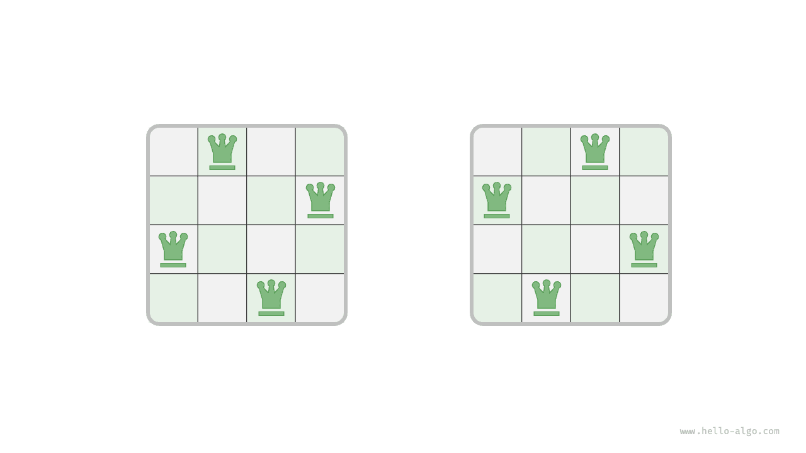

# 13.4 &nbsp; n クイーン問題

!!! question "問題"

    チェスの規則では、クイーンは同じ行、列、斜めの線上にある駒を攻撃できます。$n$ 個のクイーンと $n \times n$ の盤面が与えられたとき、どのクイーン同士も攻撃できない配置を求めてください。

図 13-15 のように、$n = 4$ の場合は二つの解があります。バックトラッキングの観点では、$n \times n$ の盤面の $n^2$ 個のマスが、すべての選択肢 `choices` です。クイーンを一つずつ置くたびに盤面が変わり、その時々の盤面が状態 `state` になります。

{ class="animation-figure" }

<p align="center"> 図 13-15 &nbsp; 4 クイーン問題の解 </p>

図 13-16 に、三つの制約条件を示します。**同じ行、同じ列、同じ対角線上に複数のクイーンを置いてはいけません**。対角線には、主対角線方向 `\` と副対角線方向 `/` の 2 種類があることに注意してください。

{ class="animation-figure" }

<p align="center"> 図 13-16 &nbsp; n クイーン問題の制約条件 </p>

### 1. &nbsp; 行ごとに配置する戦略

クイーンの個数と盤面の行数はどちらも $n$ なので、**各行にはクイーンをちょうど一つずつ置かなければならない**ことがわかります。

そこで、先頭行から最後の行まで、各行に一つずつ配置する戦略を取れます。

図 13-17 に、4 クイーン問題で行ごとに配置する過程を示します。図の大きさの都合で、先頭行の探索分岐は一つだけを展開し、列と対角線の制約を満たさない配置は枝刈りしています。

{ class="animation-figure" }

<p align="center"> 図 13-17 &nbsp; 行ごとに配置する戦略 </p>

本質的には、**行ごとの配置も枝刈りとして働き**、同じ行に複数のクイーンを置くすべての探索分岐を避けています。

### 2. &nbsp; 列と対角線による枝刈り

列の制約を満たすため、長さ $n$ のブール配列 `cols` で、各列にクイーンがあるかを記録します。配置する前に `cols` を調べ、すでにクイーンがある列を枝刈りします。バックトラッキング中は、`cols` の状態を動的に更新します。

!!! tip "ヒント"

    行列の原点は左上にあり、行インデックスは上から下へ、列インデックスは左から右へ増えることに注意してください。

では、対角線の制約はどう扱えばよいでしょうか。あるマスの行・列インデックスを $(row, col)$ とします。主対角線方向の線を一つ選ぶと、その線上のすべてのマスでは行インデックスから列インデックスを引いた値が等しく、**$row - col$ が一定です**。

つまり、二つのマスが $row_1 - col_1 = row_2 - col_2$ を満たせば、同じ主対角線方向の線上にあります。この性質を使い、図 13-18 の配列 `diags1` に、各線上にクイーンがあるかを記録できます。

同様に、**副対角線方向の線上では、すべてのマスの $row + col$ が一定です**。配列 `diags2` を使って、この方向の制約も扱えます。

{ class="animation-figure" }

<p align="center"> 図 13-18 &nbsp; 列と対角線の制約の処理 </p>

### 3. &nbsp; コードの実装

$n$ 次の正方行列では、$row - col$ の範囲は $[-n + 1, n - 1]$、$row + col$ の範囲は $[0, 2n - 2]$ です。したがって、どちらの方向の対角線も $2n - 1$ 本あり、配列 `diags1` と `diags2` の長さはいずれも $2n - 1$ です。

=== "Python"

    ```python title="n_queens.py"
    def backtrack(
        row: int,
        n: int,
        state: list[list[str]],
        res: list[list[list[str]]],
        cols: list[bool],
        diags1: list[bool],
        diags2: list[bool],
    ):
        """バックトラッキング：n クイーン"""
        # すべての行への配置が終わったら、解を記録する
        if row == n:
            res.append([list(row) for row in state])
            return
        # すべての列を走査する
        for col in range(n):
            # このマスに対応する主対角線と副対角線を求める
            diag1 = row - col + n - 1
            diag2 = row + col
            # 枝刈り：このマスと同じ列、主対角線、副対角線にクイーンがあってはならない
            if not cols[col] and not diags1[diag1] and not diags2[diag2]:
                # 試行：このマスにクイーンを配置する
                state[row][col] = "Q"
                cols[col] = diags1[diag1] = diags2[diag2] = True
                # 次の行に配置する
                backtrack(row + 1, n, state, res, cols, diags1, diags2)
                # 復元：このマスを空きマスに戻す
                state[row][col] = "#"
                cols[col] = diags1[diag1] = diags2[diag2] = False

    def n_queens(n: int) -> list[list[list[str]]]:
        """n クイーン問題を解く"""
        # n*n の盤面を初期化する。'Q' はクイーン、'#' は空きマスを表す
        state = [["#" for _ in range(n)] for _ in range(n)]
        cols = [False] * n  # 列にクイーンがあるかどうかを記録する
        diags1 = [False] * (2 * n - 1)  # 主対角線にクイーンがあるかどうかを記録する
        diags2 = [False] * (2 * n - 1)  # 副対角線にクイーンがあるかどうかを記録する
        res = []
        backtrack(0, n, state, res, cols, diags1, diags2)

        return res
    ```

=== "C++"

    ```cpp title="n_queens.cpp"
    /* バックトラッキング：n クイーン */
    void backtrack(int row, int n, vector<vector<string>> &state, vector<vector<vector<string>>> &res, vector<bool> &cols,
                   vector<bool> &diags1, vector<bool> &diags2) {
        // すべての行への配置が終わったら、解を記録する
        if (row == n) {
            res.push_back(state);
            return;
        }
        // すべての列を走査する
        for (int col = 0; col < n; col++) {
            // このマスに対応する主対角線と副対角線を求める
            int diag1 = row - col + n - 1;
            int diag2 = row + col;
            // 枝刈り：このマスと同じ列、主対角線、副対角線にクイーンがあってはならない
            if (!cols[col] && !diags1[diag1] && !diags2[diag2]) {
                // 試行：このマスにクイーンを配置する
                state[row][col] = "Q";
                cols[col] = diags1[diag1] = diags2[diag2] = true;
                // 次の行に配置する
                backtrack(row + 1, n, state, res, cols, diags1, diags2);
                // 復元：このマスを空きマスに戻す
                state[row][col] = "#";
                cols[col] = diags1[diag1] = diags2[diag2] = false;
            }
        }
    }

    /* n クイーン問題を解く */
    vector<vector<vector<string>>> nQueens(int n) {
        // n*n の盤面を初期化する。'Q' はクイーン、'#' は空きマスを表す
        vector<vector<string>> state(n, vector<string>(n, "#"));
        vector<bool> cols(n, false);           // 列にクイーンがあるかどうかを記録する
        vector<bool> diags1(2 * n - 1, false); // 主対角線にクイーンがあるかどうかを記録する
        vector<bool> diags2(2 * n - 1, false); // 副対角線にクイーンがあるかどうかを記録する
        vector<vector<vector<string>>> res;

        backtrack(0, n, state, res, cols, diags1, diags2);

        return res;
    }
    ```

=== "Java"

    ```java title="n_queens.java"
    /* バックトラッキング：n クイーン */
    void backtrack(int row, int n, List<List<String>> state, List<List<List<String>>> res,
            boolean[] cols, boolean[] diags1, boolean[] diags2) {
        // すべての行への配置が終わったら、解を記録する
        if (row == n) {
            List<List<String>> copyState = new ArrayList<>();
            for (List<String> sRow : state) {
                copyState.add(new ArrayList<>(sRow));
            }
            res.add(copyState);
            return;
        }
        // すべての列を走査する
        for (int col = 0; col < n; col++) {
            // このマスに対応する主対角線と副対角線を求める
            int diag1 = row - col + n - 1;
            int diag2 = row + col;
            // 枝刈り：このマスと同じ列、主対角線、副対角線にクイーンがあってはならない
            if (!cols[col] && !diags1[diag1] && !diags2[diag2]) {
                // 試行：このマスにクイーンを配置する
                state.get(row).set(col, "Q");
                cols[col] = diags1[diag1] = diags2[diag2] = true;
                // 次の行に配置する
                backtrack(row + 1, n, state, res, cols, diags1, diags2);
                // 復元：このマスを空きマスに戻す
                state.get(row).set(col, "#");
                cols[col] = diags1[diag1] = diags2[diag2] = false;
            }
        }
    }

    /* n クイーン問題を解く */
    List<List<List<String>>> nQueens(int n) {
        // n*n の盤面を初期化する。'Q' はクイーン、'#' は空きマスを表す
        List<List<String>> state = new ArrayList<>();
        for (int i = 0; i < n; i++) {
            List<String> row = new ArrayList<>();
            for (int j = 0; j < n; j++) {
                row.add("#");
            }
            state.add(row);
        }
        boolean[] cols = new boolean[n]; // 列にクイーンがあるかどうかを記録する
        boolean[] diags1 = new boolean[2 * n - 1]; // 主対角線にクイーンがあるかどうかを記録する
        boolean[] diags2 = new boolean[2 * n - 1]; // 副対角線にクイーンがあるかどうかを記録する
        List<List<List<String>>> res = new ArrayList<>();

        backtrack(0, n, state, res, cols, diags1, diags2);

        return res;
    }
    ```

=== "C#"

    ```csharp title="n_queens.cs"
    /* バックトラッキング：n クイーン */
    void Backtrack(int row, int n, List<List<string>> state, List<List<List<string>>> res,
            bool[] cols, bool[] diags1, bool[] diags2) {
        // すべての行への配置が終わったら、解を記録する
        if (row == n) {
            List<List<string>> copyState = [];
            foreach (List<string> sRow in state) {
                copyState.Add(new List<string>(sRow));
            }
            res.Add(copyState);
            return;
        }
        // すべての列を走査する
        for (int col = 0; col < n; col++) {
            // このマスに対応する主対角線と副対角線を求める
            int diag1 = row - col + n - 1;
            int diag2 = row + col;
            // 枝刈り：このマスと同じ列、主対角線、副対角線にクイーンがあってはならない
            if (!cols[col] && !diags1[diag1] && !diags2[diag2]) {
                // 試行：このマスにクイーンを配置する
                state[row][col] = "Q";
                cols[col] = diags1[diag1] = diags2[diag2] = true;
                // 次の行に配置する
                Backtrack(row + 1, n, state, res, cols, diags1, diags2);
                // 復元：このマスを空きマスに戻す
                state[row][col] = "#";
                cols[col] = diags1[diag1] = diags2[diag2] = false;
            }
        }
    }

    /* n クイーン問題を解く */
    List<List<List<string>>> NQueens(int n) {
        // n*n の盤面を初期化する。'Q' はクイーン、'#' は空きマスを表す
        List<List<string>> state = [];
        for (int i = 0; i < n; i++) {
            List<string> row = [];
            for (int j = 0; j < n; j++) {
                row.Add("#");
            }
            state.Add(row);
        }
        bool[] cols = new bool[n]; // 列にクイーンがあるかどうかを記録する
        bool[] diags1 = new bool[2 * n - 1]; // 主対角線にクイーンがあるかどうかを記録する
        bool[] diags2 = new bool[2 * n - 1]; // 副対角線にクイーンがあるかどうかを記録する
        List<List<List<string>>> res = [];

        Backtrack(0, n, state, res, cols, diags1, diags2);

        return res;
    }
    ```

=== "Go"

    ```go title="n_queens.go"
    /* バックトラッキング：n クイーン */
    func backtrack(row, n int, state *[][]string, res *[][][]string, cols, diags1, diags2 *[]bool) {
        // すべての行への配置が終わったら、解を記録する
        if row == n {
            newState := make([][]string, len(*state))
            for i, _ := range newState {
                newState[i] = make([]string, len((*state)[0]))
                copy(newState[i], (*state)[i])

            }
            *res = append(*res, newState)
            return
        }
        // すべての列を走査する
        for col := 0; col < n; col++ {
            // このマスに対応する主対角線と副対角線を求める
            diag1 := row - col + n - 1
            diag2 := row + col
            // 枝刈り：このマスと同じ列、主対角線、副対角線にクイーンがあってはならない
            if !(*cols)[col] && !(*diags1)[diag1] && !(*diags2)[diag2] {
                // 試行：このマスにクイーンを配置する
                (*state)[row][col] = "Q"
                (*cols)[col], (*diags1)[diag1], (*diags2)[diag2] = true, true, true
                // 次の行に配置する
                backtrack(row+1, n, state, res, cols, diags1, diags2)
                // 復元：このマスを空きマスに戻す
                (*state)[row][col] = "#"
                (*cols)[col], (*diags1)[diag1], (*diags2)[diag2] = false, false, false
            }
        }
    }

    /* n クイーン問題を解く */
    func nQueens(n int) [][][]string {
        // n*n の盤面を初期化する。'Q' はクイーン、'#' は空きマスを表す
        state := make([][]string, n)
        for i := 0; i < n; i++ {
            row := make([]string, n)
            for i := 0; i < n; i++ {
                row[i] = "#"
            }
            state[i] = row
        }
        // 列にクイーンがあるかどうかを記録する
        cols := make([]bool, n)
        diags1 := make([]bool, 2*n-1)
        diags2 := make([]bool, 2*n-1)
        res := make([][][]string, 0)
        backtrack(0, n, &state, &res, &cols, &diags1, &diags2)
        return res
    }
    ```

=== "Swift"

    ```swift title="n_queens.swift"
    /* バックトラッキング：n クイーン */
    func backtrack(row: Int, n: Int, state: inout [[String]], res: inout [[[String]]], cols: inout [Bool], diags1: inout [Bool], diags2: inout [Bool]) {
        // すべての行への配置が終わったら、解を記録する
        if row == n {
            res.append(state)
            return
        }
        // すべての列を走査する
        for col in 0 ..< n {
            // このマスに対応する主対角線と副対角線を求める
            let diag1 = row - col + n - 1
            let diag2 = row + col
            // 枝刈り：このマスと同じ列、主対角線、副対角線にクイーンがあってはならない
            if !cols[col] && !diags1[diag1] && !diags2[diag2] {
                // 試行：このマスにクイーンを配置する
                state[row][col] = "Q"
                cols[col] = true
                diags1[diag1] = true
                diags2[diag2] = true
                // 次の行に配置する
                backtrack(row: row + 1, n: n, state: &state, res: &res, cols: &cols, diags1: &diags1, diags2: &diags2)
                // 復元：このマスを空きマスに戻す
                state[row][col] = "#"
                cols[col] = false
                diags1[diag1] = false
                diags2[diag2] = false
            }
        }
    }

    /* n クイーン問題を解く */
    func nQueens(n: Int) -> [[[String]]] {
        // n*n の盤面を初期化する。'Q' はクイーン、'#' は空きマスを表す
        var state = Array(repeating: Array(repeating: "#", count: n), count: n)
        var cols = Array(repeating: false, count: n) // 列にクイーンがあるかどうかを記録する
        var diags1 = Array(repeating: false, count: 2 * n - 1) // 主対角線にクイーンがあるかどうかを記録する
        var diags2 = Array(repeating: false, count: 2 * n - 1) // 副対角線にクイーンがあるかどうかを記録する
        var res: [[[String]]] = []

        backtrack(row: 0, n: n, state: &state, res: &res, cols: &cols, diags1: &diags1, diags2: &diags2)

        return res
    }
    ```

=== "JS"

    ```javascript title="n_queens.js"
    /* バックトラッキング：n クイーン */
    function backtrack(row, n, state, res, cols, diags1, diags2) {
        // すべての行への配置が終わったら、解を記録する
        if (row === n) {
            res.push(state.map((row) => row.slice()));
            return;
        }
        // すべての列を走査する
        for (let col = 0; col < n; col++) {
            // このマスに対応する主対角線と副対角線を求める
            const diag1 = row - col + n - 1;
            const diag2 = row + col;
            // 枝刈り：このマスと同じ列、主対角線、副対角線にクイーンがあってはならない
            if (!cols[col] && !diags1[diag1] && !diags2[diag2]) {
                // 試行：このマスにクイーンを配置する
                state[row][col] = 'Q';
                cols[col] = diags1[diag1] = diags2[diag2] = true;
                // 次の行に配置する
                backtrack(row + 1, n, state, res, cols, diags1, diags2);
                // 復元：このマスを空きマスに戻す
                state[row][col] = '#';
                cols[col] = diags1[diag1] = diags2[diag2] = false;
            }
        }
    }

    /* n クイーン問題を解く */
    function nQueens(n) {
        // n*n の盤面を初期化する。'Q' はクイーン、'#' は空きマスを表す
        const state = Array.from({ length: n }, () => Array(n).fill('#'));
        const cols = Array(n).fill(false); // 列にクイーンがあるかどうかを記録する
        const diags1 = Array(2 * n - 1).fill(false); // 主対角線にクイーンがあるかどうかを記録する
        const diags2 = Array(2 * n - 1).fill(false); // 副対角線にクイーンがあるかどうかを記録する
        const res = [];

        backtrack(0, n, state, res, cols, diags1, diags2);
        return res;
    }
    ```

=== "TS"

    ```typescript title="n_queens.ts"
    /* バックトラッキング：n クイーン */
    function backtrack(
        row: number,
        n: number,
        state: string[][],
        res: string[][][],
        cols: boolean[],
        diags1: boolean[],
        diags2: boolean[]
    ): void {
        // すべての行への配置が終わったら、解を記録する
        if (row === n) {
            res.push(state.map((row) => row.slice()));
            return;
        }
        // すべての列を走査する
        for (let col = 0; col < n; col++) {
            // このマスに対応する主対角線と副対角線を求める
            const diag1 = row - col + n - 1;
            const diag2 = row + col;
            // 枝刈り：このマスと同じ列、主対角線、副対角線にクイーンがあってはならない
            if (!cols[col] && !diags1[diag1] && !diags2[diag2]) {
                // 試行：このマスにクイーンを配置する
                state[row][col] = 'Q';
                cols[col] = diags1[diag1] = diags2[diag2] = true;
                // 次の行に配置する
                backtrack(row + 1, n, state, res, cols, diags1, diags2);
                // 復元：このマスを空きマスに戻す
                state[row][col] = '#';
                cols[col] = diags1[diag1] = diags2[diag2] = false;
            }
        }
    }

    /* n クイーン問題を解く */
    function nQueens(n: number): string[][][] {
        // n*n の盤面を初期化する。'Q' はクイーン、'#' は空きマスを表す
        const state = Array.from({ length: n }, () => Array(n).fill('#'));
        const cols = Array(n).fill(false); // 列にクイーンがあるかどうかを記録する
        const diags1 = Array(2 * n - 1).fill(false); // 主対角線にクイーンがあるかどうかを記録する
        const diags2 = Array(2 * n - 1).fill(false); // 副対角線にクイーンがあるかどうかを記録する
        const res: string[][][] = [];

        backtrack(0, n, state, res, cols, diags1, diags2);
        return res;
    }
    ```

=== "Dart"

    ```dart title="n_queens.dart"
    /* バックトラッキング：n クイーン */
    void backtrack(
      int row,
      int n,
      List<List<String>> state,
      List<List<List<String>>> res,
      List<bool> cols,
      List<bool> diags1,
      List<bool> diags2,
    ) {
      // すべての行への配置が終わったら、解を記録する
      if (row == n) {
        List<List<String>> copyState = [];
        for (List<String> sRow in state) {
          copyState.add(List.from(sRow));
        }
        res.add(copyState);
        return;
      }
      // すべての列を走査する
      for (int col = 0; col < n; col++) {
        // このマスに対応する主対角線と副対角線を求める
        int diag1 = row - col + n - 1;
        int diag2 = row + col;
        // 枝刈り：このマスと同じ列、主対角線、副対角線にクイーンがあってはならない
        if (!cols[col] && !diags1[diag1] && !diags2[diag2]) {
          // 試行：このマスにクイーンを配置する
          state[row][col] = "Q";
          cols[col] = true;
          diags1[diag1] = true;
          diags2[diag2] = true;
          // 次の行に配置する
          backtrack(row + 1, n, state, res, cols, diags1, diags2);
          // 復元：このマスを空きマスに戻す
          state[row][col] = "#";
          cols[col] = false;
          diags1[diag1] = false;
          diags2[diag2] = false;
        }
      }
    }

    /* n クイーン問題を解く */
    List<List<List<String>>> nQueens(int n) {
      // n*n の盤面を初期化する。'Q' はクイーン、'#' は空きマスを表す
      List<List<String>> state = List.generate(n, (index) => List.filled(n, "#"));
      List<bool> cols = List.filled(n, false); // 列にクイーンがあるかどうかを記録する
      List<bool> diags1 = List.filled(2 * n - 1, false); // 主対角線にクイーンがあるかどうかを記録する
      List<bool> diags2 = List.filled(2 * n - 1, false); // 副対角線にクイーンがあるかどうかを記録する
      List<List<List<String>>> res = [];

      backtrack(0, n, state, res, cols, diags1, diags2);

      return res;
    }
    ```

=== "Rust"

    ```rust title="n_queens.rs"
    /* バックトラッキング：n クイーン */
    fn backtrack(
        row: usize,
        n: usize,
        state: &mut Vec<Vec<String>>,
        res: &mut Vec<Vec<Vec<String>>>,
        cols: &mut [bool],
        diags1: &mut [bool],
        diags2: &mut [bool],
    ) {
        // すべての行への配置が終わったら、解を記録する
        if row == n {
            res.push(state.clone());
            return;
        }
        // すべての列を走査する
        for col in 0..n {
            // このマスに対応する主対角線と副対角線を求める
            let diag1 = row + n - 1 - col;
            let diag2 = row + col;
            // 枝刈り：このマスと同じ列、主対角線、副対角線にクイーンがあってはならない
            if !cols[col] && !diags1[diag1] && !diags2[diag2] {
                // 試行：このマスにクイーンを配置する
                state[row][col] = "Q".into();
                (cols[col], diags1[diag1], diags2[diag2]) = (true, true, true);
                // 次の行に配置する
                backtrack(row + 1, n, state, res, cols, diags1, diags2);
                // 復元：このマスを空きマスに戻す
                state[row][col] = "#".into();
                (cols[col], diags1[diag1], diags2[diag2]) = (false, false, false);
            }
        }
    }

    /* n クイーン問題を解く */
    fn n_queens(n: usize) -> Vec<Vec<Vec<String>>> {
        // n*n の盤面を初期化する。'Q' はクイーン、'#' は空きマスを表す
        let mut state: Vec<Vec<String>> = vec![vec!["#".to_string(); n]; n];
        let mut cols = vec![false; n]; // 列にクイーンがあるかどうかを記録する
        let mut diags1 = vec![false; 2 * n - 1]; // 主対角線にクイーンがあるかどうかを記録する
        let mut diags2 = vec![false; 2 * n - 1]; // 副対角線にクイーンがあるかどうかを記録する
        let mut res: Vec<Vec<Vec<String>>> = Vec::new();

        backtrack(
            0,
            n,
            &mut state,
            &mut res,
            &mut cols,
            &mut diags1,
            &mut diags2,
        );

        res
    }
    ```

=== "C"

    ```c title="n_queens.c"
    /* バックトラッキング：n クイーン */
    void backtrack(int row, int n, char state[MAX_SIZE][MAX_SIZE], char ***res, int *resSize, bool cols[MAX_SIZE],
                   bool diags1[2 * MAX_SIZE - 1], bool diags2[2 * MAX_SIZE - 1]) {
        // すべての行への配置が終わったら、解を記録する
        if (row == n) {
            res[*resSize] = (char **)malloc(sizeof(char *) * n);
            for (int i = 0; i < n; ++i) {
                res[*resSize][i] = (char *)malloc(sizeof(char) * (n + 1));
                strcpy(res[*resSize][i], state[i]);
            }
            (*resSize)++;
            return;
        }
        // すべての列を走査する
        for (int col = 0; col < n; col++) {
            // このマスに対応する主対角線と副対角線を求める
            int diag1 = row - col + n - 1;
            int diag2 = row + col;
            // 枝刈り：このマスと同じ列、主対角線、副対角線にクイーンがあってはならない
            if (!cols[col] && !diags1[diag1] && !diags2[diag2]) {
                // 試行：このマスにクイーンを配置する
                state[row][col] = 'Q';
                cols[col] = diags1[diag1] = diags2[diag2] = true;
                // 次の行に配置する
                backtrack(row + 1, n, state, res, resSize, cols, diags1, diags2);
                // 復元：このマスを空きマスに戻す
                state[row][col] = '#';
                cols[col] = diags1[diag1] = diags2[diag2] = false;
            }
        }
    }

    /* n クイーン問題を解く */
    char ***nQueens(int n, int *returnSize) {
        char state[MAX_SIZE][MAX_SIZE];
        // n*n の盤面を初期化する。'Q' はクイーン、'#' は空きマスを表す
        for (int i = 0; i < n; ++i) {
            for (int j = 0; j < n; ++j) {
                state[i][j] = '#';
            }
            state[i][n] = '\0';
        }
        bool cols[MAX_SIZE] = {false};           // 列にクイーンがあるかどうかを記録する
        bool diags1[2 * MAX_SIZE - 1] = {false}; // 主対角線にクイーンがあるかどうかを記録する
        bool diags2[2 * MAX_SIZE - 1] = {false}; // 副対角線にクイーンがあるかどうかを記録する

        char ***res = (char ***)malloc(sizeof(char **) * MAX_SIZE);
        *returnSize = 0;
        backtrack(0, n, state, res, returnSize, cols, diags1, diags2);
        return res;
    }
    ```

=== "Kotlin"

    ```kotlin title="n_queens.kt"
    /* バックトラッキング：n クイーン */
    fun backtrack(
        row: Int,
        n: Int,
        state: MutableList<MutableList<String>>,
        res: MutableList<MutableList<MutableList<String>>?>,
        cols: BooleanArray,
        diags1: BooleanArray,
        diags2: BooleanArray
    ) {
        // すべての行への配置が終わったら、解を記録する
        if (row == n) {
            val copyState = mutableListOf<MutableList<String>>()
            for (sRow in state) {
                copyState.add(sRow.toMutableList())
            }
            res.add(copyState)
            return
        }
        // すべての列を走査する
        for (col in 0..<n) {
            // このマスに対応する主対角線と副対角線を求める
            val diag1 = row - col + n - 1
            val diag2 = row + col
            // 枝刈り：このマスと同じ列、主対角線、副対角線にクイーンがあってはならない
            if (!cols[col] && !diags1[diag1] && !diags2[diag2]) {
                // 試行：このマスにクイーンを配置する
                state[row][col] = "Q"
                diags2[diag2] = true
                diags1[diag1] = diags2[diag2]
                cols[col] = diags1[diag1]
                // 次の行に配置する
                backtrack(row + 1, n, state, res, cols, diags1, diags2)
                // 復元：このマスを空きマスに戻す
                state[row][col] = "#"
                diags2[diag2] = false
                diags1[diag1] = diags2[diag2]
                cols[col] = diags1[diag1]
            }
        }
    }

    /* n クイーン問題を解く */
    fun nQueens(n: Int): MutableList<MutableList<MutableList<String>>?> {
        // n*n の盤面を初期化する。'Q' はクイーン、'#' は空きマスを表す
        val state = mutableListOf<MutableList<String>>()
        for (i in 0..<n) {
            val row = mutableListOf<String>()
            for (j in 0..<n) {
                row.add("#")
            }
            state.add(row)
        }
        val cols = BooleanArray(n) // 列にクイーンがあるかどうかを記録する
        val diags1 = BooleanArray(2 * n - 1) // 主対角線にクイーンがあるかどうかを記録する
        val diags2 = BooleanArray(2 * n - 1) // 副対角線にクイーンがあるかどうかを記録する
        val res = mutableListOf<MutableList<MutableList<String>>?>()

        backtrack(0, n, state, res, cols, diags1, diags2)

        return res
    }
    ```

=== "Ruby"

    ```ruby title="n_queens.rb"
    ### バックトラッキング：n クイーン ###
    def backtrack(row, n, state, res, cols, diags1, diags2)
      # すべての行への配置が終わったら、解を記録する
      if row == n
        res << state.map { |row| row.dup }
        return
      end

      # すべての列を走査する
      for col in 0...n
        # このマスに対応する主対角線と副対角線を求める
        diag1 = row - col + n - 1
        diag2 = row + col
        # 枝刈り：このマスと同じ列、主対角線、副対角線にクイーンがあってはならない
        if !cols[col] && !diags1[diag1] && !diags2[diag2]
          # 試行：このマスにクイーンを配置する
          state[row][col] = "Q"
          cols[col] = diags1[diag1] = diags2[diag2] = true
          # 次の行に配置する
          backtrack(row + 1, n, state, res, cols, diags1, diags2)
          # 復元：このマスを空きマスに戻す
          state[row][col] = "#"
          cols[col] = diags1[diag1] = diags2[diag2] = false
        end
      end
    end

    ### n クイーン問題を解く ###
    def n_queens(n)
      # n*n の盤面を初期化する。'Q' はクイーン、'#' は空きマスを表す
      state = Array.new(n) { Array.new(n, "#") }
      cols = Array.new(n, false) # 列にクイーンがあるかどうかを記録する
      diags1 = Array.new(2 * n - 1, false) # 主対角線にクイーンがあるかどうかを記録する
      diags2 = Array.new(2 * n - 1, false) # 副対角線にクイーンがあるかどうかを記録する
      res = []
      backtrack(0, n, state, res, cols, diags1, diags2)

      res
    end
    ```

??? pythontutor "実行の可視化"

    <div style="height: 549px; width: 100%;"><iframe class="pythontutor-iframe" title="実行の可視化" src="https://pythontutor.com/iframe-embed.html#code=def%20backtrack%28%0A%20%20%20%20row%3A%20int,%0A%20%20%20%20n%3A%20int,%0A%20%20%20%20state%3A%20list%5Blist%5Bstr%5D%5D,%0A%20%20%20%20res%3A%20list%5Blist%5Blist%5Bstr%5D%5D%5D,%0A%20%20%20%20cols%3A%20list%5Bbool%5D,%0A%20%20%20%20diags1%3A%20list%5Bbool%5D,%0A%20%20%20%20diags2%3A%20list%5Bbool%5D,%0A%29%3A%0A%20%20%20%20%22%22%22%E3%83%90%E3%83%83%E3%82%AF%E3%83%88%E3%83%A9%E3%83%83%E3%82%AD%E3%83%B3%E3%82%B0%EF%BC%9AN%20%E3%82%AF%E3%82%A4%E3%83%BC%E3%83%B3%22%22%22%0A%20%20%20%20%23%20%E3%81%99%E3%81%B9%E3%81%A6%E3%81%AE%E8%A1%8C%E3%81%B8%E3%81%AE%E9%85%8D%E7%BD%AE%E3%81%8C%E7%B5%82%E3%82%8F%E3%81%A3%E3%81%9F%E3%82%89%E3%80%81%E8%A7%A3%E3%82%92%E8%A8%98%E9%8C%B2%E3%81%99%E3%82%8B%0A%20%20%20%20if%20row%20%3D%3D%20n%3A%0A%20%20%20%20%20%20%20%20res.append%28%5Blist%28row%29%20for%20row%20in%20state%5D%29%0A%20%20%20%20%20%20%20%20return%0A%20%20%20%20%23%20%E3%81%99%E3%81%B9%E3%81%A6%E3%81%AE%E5%88%97%E3%82%92%E8%B5%B0%E6%9F%BB%E3%81%99%E3%82%8B%0A%20%20%20%20for%20col%20in%20range%28n%29%3A%0A%20%20%20%20%20%20%20%20%23%20%E3%81%93%E3%81%AE%E3%83%9E%E3%82%B9%E3%81%AB%E5%AF%BE%E5%BF%9C%E3%81%99%E3%82%8B%E4%B8%BB%E5%AF%BE%E8%A7%92%E7%B7%9A%E3%81%A8%E5%89%AF%E5%AF%BE%E8%A7%92%E7%B7%9A%E3%82%92%E6%B1%82%E3%82%81%E3%82%8B%0A%20%20%20%20%20%20%20%20diag1%20%3D%20row%20-%20col%20%2B%20n%20-%201%0A%20%20%20%20%20%20%20%20diag2%20%3D%20row%20%2B%20col%0A%20%20%20%20%20%20%20%20%23%20%E6%9E%9D%E5%88%88%E3%82%8A%EF%BC%9A%E3%81%93%E3%81%AE%E3%83%9E%E3%82%B9%E3%81%A8%E5%90%8C%E3%81%98%E5%88%97%E3%80%81%E4%B8%BB%E5%AF%BE%E8%A7%92%E7%B7%9A%E3%80%81%E5%89%AF%E5%AF%BE%E8%A7%92%E7%B7%9A%E3%81%AB%E3%82%AF%E3%82%A4%E3%83%BC%E3%83%B3%E3%81%8C%E3%81%82%E3%81%A3%E3%81%A6%E3%81%AF%E3%81%AA%E3%82%89%E3%81%AA%E3%81%84%0A%20%20%20%20%20%20%20%20if%20not%20cols%5Bcol%5D%20and%20not%20diags1%5Bdiag1%5D%20and%20not%20diags2%5Bdiag2%5D%3A%0A%20%20%20%20%20%20%20%20%20%20%20%20%23%20%E8%A9%A6%E8%A1%8C%EF%BC%9A%E3%81%93%E3%81%AE%E3%83%9E%E3%82%B9%E3%81%AB%E3%82%AF%E3%82%A4%E3%83%BC%E3%83%B3%E3%82%92%E9%85%8D%E7%BD%AE%E3%81%99%E3%82%8B%0A%20%20%20%20%20%20%20%20%20%20%20%20state%5Brow%5D%5Bcol%5D%20%3D%20%22Q%22%0A%20%20%20%20%20%20%20%20%20%20%20%20cols%5Bcol%5D%20%3D%20diags1%5Bdiag1%5D%20%3D%20diags2%5Bdiag2%5D%20%3D%20True%0A%20%20%20%20%20%20%20%20%20%20%20%20%23%20%E6%AC%A1%E3%81%AE%E8%A1%8C%E3%81%AB%E9%85%8D%E7%BD%AE%E3%81%99%E3%82%8B%0A%20%20%20%20%20%20%20%20%20%20%20%20backtrack%28row%20%2B%201,%20n,%20state,%20res,%20cols,%20diags1,%20diags2%29%0A%20%20%20%20%20%20%20%20%20%20%20%20%23%20%E5%BE%A9%E5%85%83%EF%BC%9A%E3%81%93%E3%81%AE%E3%83%9E%E3%82%B9%E3%82%92%E7%A9%BA%E3%81%8D%E3%83%9E%E3%82%B9%E3%81%AB%E6%88%BB%E3%81%99%0A%20%20%20%20%20%20%20%20%20%20%20%20state%5Brow%5D%5Bcol%5D%20%3D%20%22%23%22%0A%20%20%20%20%20%20%20%20%20%20%20%20cols%5Bcol%5D%20%3D%20diags1%5Bdiag1%5D%20%3D%20diags2%5Bdiag2%5D%20%3D%20False%0A%0A%0Adef%20n_queens%28n%3A%20int%29%20-%3E%20list%5Blist%5Blist%5Bstr%5D%5D%5D%3A%0A%20%20%20%20%22%22%22N%20%E3%82%AF%E3%82%A4%E3%83%BC%E3%83%B3%E5%95%8F%E9%A1%8C%E3%82%92%E8%A7%A3%E3%81%8F%22%22%22%0A%20%20%20%20%23%20n%2An%20%E3%81%AE%E7%9B%A4%E9%9D%A2%E3%82%92%E5%88%9D%E6%9C%9F%E5%8C%96%E3%81%99%E3%82%8B%E3%80%82%27Q%27%20%E3%81%AF%E3%82%AF%E3%82%A4%E3%83%BC%E3%83%B3%E3%80%81%27%23%27%20%E3%81%AF%E7%A9%BA%E3%81%8D%E3%83%9E%E3%82%B9%E3%82%92%E8%A1%A8%E3%81%99%0A%20%20%20%20state%20%3D%20%5B%5B%22%23%22%20for%20_%20in%20range%28n%29%5D%20for%20_%20in%20range%28n%29%5D%0A%20%20%20%20cols%20%3D%20%5BFalse%5D%20%2A%20n%20%20%23%20%E5%88%97%E3%81%AB%E3%82%AF%E3%82%A4%E3%83%BC%E3%83%B3%E3%81%8C%E3%81%82%E3%82%8B%E3%81%8B%E3%81%A9%E3%81%86%E3%81%8B%E3%82%92%E8%A8%98%E9%8C%B2%E3%81%99%E3%82%8B%0A%20%20%20%20diags1%20%3D%20%5BFalse%5D%20%2A%20%282%20%2A%20n%20-%201%29%20%20%23%20%E4%B8%BB%E5%AF%BE%E8%A7%92%E7%B7%9A%E3%81%AB%E3%82%AF%E3%82%A4%E3%83%BC%E3%83%B3%E3%81%8C%E3%81%82%E3%82%8B%E3%81%8B%E3%81%A9%E3%81%86%E3%81%8B%E3%82%92%E8%A8%98%E9%8C%B2%E3%81%99%E3%82%8B%0A%20%20%20%20diags2%20%3D%20%5BFalse%5D%20%2A%20%282%20%2A%20n%20-%201%29%20%20%23%20%E5%89%AF%E5%AF%BE%E8%A7%92%E7%B7%9A%E3%81%AB%E3%82%AF%E3%82%A4%E3%83%BC%E3%83%B3%E3%81%8C%E3%81%82%E3%82%8B%E3%81%8B%E3%81%A9%E3%81%86%E3%81%8B%E3%82%92%E8%A8%98%E9%8C%B2%E3%81%99%E3%82%8B%0A%20%20%20%20res%20%3D%20%5B%5D%0A%20%20%20%20backtrack%280,%20n,%20state,%20res,%20cols,%20diags1,%20diags2%29%0A%0A%20%20%20%20return%20res%0A%0A%0A%22%22%22%E5%AE%9F%E8%A1%8C%E7%94%A8%E3%82%B3%E3%83%BC%E3%83%89%22%22%22%0Aif%20__name__%20%3D%3D%20%22__main__%22%3A%0A%20%20%20%20n%20%3D%204%0A%20%20%20%20res%20%3D%20n_queens%28n%29%0A%0A%20%20%20%20print%28f%22%E5%85%A5%E5%8A%9B%E3%81%97%E3%81%9F%E7%9B%A4%E9%9D%A2%E3%81%AE%E7%B8%A6%E6%A8%AA%E3%81%AE%E9%95%B7%E3%81%95%E3%81%AF%20%7Bn%7D%22%29%0A%20%20%20%20print%28f%22%E3%82%AF%E3%82%A4%E3%83%BC%E3%83%B3%E3%81%AE%E9%85%8D%E7%BD%AE%E6%96%B9%E6%B3%95%E3%81%AF%E5%85%A8%E9%83%A8%E3%81%A7%20%7Blen%28res%29%7D%20%E9%80%9A%E3%82%8A%22%29%0A%20%20%20%20for%20state%20in%20res%3A%0A%20%20%20%20%20%20%20%20print%28%22--------------------%22%29%0A%20%20%20%20%20%20%20%20for%20row%20in%20state%3A%0A%20%20%20%20%20%20%20%20%20%20%20%20print%28row%29&codeDivHeight=472&codeDivWidth=350&cumulative=false&curInstr=61&heapPrimitives=nevernest&origin=opt-frontend.js&py=311&rawInputLstJSON=%5B%5D&textReferences=false"> </iframe></div>
    <div style="margin-top: 5px;"><a href="https://pythontutor.com/iframe-embed.html#code=def%20backtrack%28%0A%20%20%20%20row%3A%20int,%0A%20%20%20%20n%3A%20int,%0A%20%20%20%20state%3A%20list%5Blist%5Bstr%5D%5D,%0A%20%20%20%20res%3A%20list%5Blist%5Blist%5Bstr%5D%5D%5D,%0A%20%20%20%20cols%3A%20list%5Bbool%5D,%0A%20%20%20%20diags1%3A%20list%5Bbool%5D,%0A%20%20%20%20diags2%3A%20list%5Bbool%5D,%0A%29%3A%0A%20%20%20%20%22%22%22%E3%83%90%E3%83%83%E3%82%AF%E3%83%88%E3%83%A9%E3%83%83%E3%82%AD%E3%83%B3%E3%82%B0%EF%BC%9AN%20%E3%82%AF%E3%82%A4%E3%83%BC%E3%83%B3%22%22%22%0A%20%20%20%20%23%20%E3%81%99%E3%81%B9%E3%81%A6%E3%81%AE%E8%A1%8C%E3%81%B8%E3%81%AE%E9%85%8D%E7%BD%AE%E3%81%8C%E7%B5%82%E3%82%8F%E3%81%A3%E3%81%9F%E3%82%89%E3%80%81%E8%A7%A3%E3%82%92%E8%A8%98%E9%8C%B2%E3%81%99%E3%82%8B%0A%20%20%20%20if%20row%20%3D%3D%20n%3A%0A%20%20%20%20%20%20%20%20res.append%28%5Blist%28row%29%20for%20row%20in%20state%5D%29%0A%20%20%20%20%20%20%20%20return%0A%20%20%20%20%23%20%E3%81%99%E3%81%B9%E3%81%A6%E3%81%AE%E5%88%97%E3%82%92%E8%B5%B0%E6%9F%BB%E3%81%99%E3%82%8B%0A%20%20%20%20for%20col%20in%20range%28n%29%3A%0A%20%20%20%20%20%20%20%20%23%20%E3%81%93%E3%81%AE%E3%83%9E%E3%82%B9%E3%81%AB%E5%AF%BE%E5%BF%9C%E3%81%99%E3%82%8B%E4%B8%BB%E5%AF%BE%E8%A7%92%E7%B7%9A%E3%81%A8%E5%89%AF%E5%AF%BE%E8%A7%92%E7%B7%9A%E3%82%92%E6%B1%82%E3%82%81%E3%82%8B%0A%20%20%20%20%20%20%20%20diag1%20%3D%20row%20-%20col%20%2B%20n%20-%201%0A%20%20%20%20%20%20%20%20diag2%20%3D%20row%20%2B%20col%0A%20%20%20%20%20%20%20%20%23%20%E6%9E%9D%E5%88%88%E3%82%8A%EF%BC%9A%E3%81%93%E3%81%AE%E3%83%9E%E3%82%B9%E3%81%A8%E5%90%8C%E3%81%98%E5%88%97%E3%80%81%E4%B8%BB%E5%AF%BE%E8%A7%92%E7%B7%9A%E3%80%81%E5%89%AF%E5%AF%BE%E8%A7%92%E7%B7%9A%E3%81%AB%E3%82%AF%E3%82%A4%E3%83%BC%E3%83%B3%E3%81%8C%E3%81%82%E3%81%A3%E3%81%A6%E3%81%AF%E3%81%AA%E3%82%89%E3%81%AA%E3%81%84%0A%20%20%20%20%20%20%20%20if%20not%20cols%5Bcol%5D%20and%20not%20diags1%5Bdiag1%5D%20and%20not%20diags2%5Bdiag2%5D%3A%0A%20%20%20%20%20%20%20%20%20%20%20%20%23%20%E8%A9%A6%E8%A1%8C%EF%BC%9A%E3%81%93%E3%81%AE%E3%83%9E%E3%82%B9%E3%81%AB%E3%82%AF%E3%82%A4%E3%83%BC%E3%83%B3%E3%82%92%E9%85%8D%E7%BD%AE%E3%81%99%E3%82%8B%0A%20%20%20%20%20%20%20%20%20%20%20%20state%5Brow%5D%5Bcol%5D%20%3D%20%22Q%22%0A%20%20%20%20%20%20%20%20%20%20%20%20cols%5Bcol%5D%20%3D%20diags1%5Bdiag1%5D%20%3D%20diags2%5Bdiag2%5D%20%3D%20True%0A%20%20%20%20%20%20%20%20%20%20%20%20%23%20%E6%AC%A1%E3%81%AE%E8%A1%8C%E3%81%AB%E9%85%8D%E7%BD%AE%E3%81%99%E3%82%8B%0A%20%20%20%20%20%20%20%20%20%20%20%20backtrack%28row%20%2B%201,%20n,%20state,%20res,%20cols,%20diags1,%20diags2%29%0A%20%20%20%20%20%20%20%20%20%20%20%20%23%20%E5%BE%A9%E5%85%83%EF%BC%9A%E3%81%93%E3%81%AE%E3%83%9E%E3%82%B9%E3%82%92%E7%A9%BA%E3%81%8D%E3%83%9E%E3%82%B9%E3%81%AB%E6%88%BB%E3%81%99%0A%20%20%20%20%20%20%20%20%20%20%20%20state%5Brow%5D%5Bcol%5D%20%3D%20%22%23%22%0A%20%20%20%20%20%20%20%20%20%20%20%20cols%5Bcol%5D%20%3D%20diags1%5Bdiag1%5D%20%3D%20diags2%5Bdiag2%5D%20%3D%20False%0A%0A%0Adef%20n_queens%28n%3A%20int%29%20-%3E%20list%5Blist%5Blist%5Bstr%5D%5D%5D%3A%0A%20%20%20%20%22%22%22N%20%E3%82%AF%E3%82%A4%E3%83%BC%E3%83%B3%E5%95%8F%E9%A1%8C%E3%82%92%E8%A7%A3%E3%81%8F%22%22%22%0A%20%20%20%20%23%20n%2An%20%E3%81%AE%E7%9B%A4%E9%9D%A2%E3%82%92%E5%88%9D%E6%9C%9F%E5%8C%96%E3%81%99%E3%82%8B%E3%80%82%27Q%27%20%E3%81%AF%E3%82%AF%E3%82%A4%E3%83%BC%E3%83%B3%E3%80%81%27%23%27%20%E3%81%AF%E7%A9%BA%E3%81%8D%E3%83%9E%E3%82%B9%E3%82%92%E8%A1%A8%E3%81%99%0A%20%20%20%20state%20%3D%20%5B%5B%22%23%22%20for%20_%20in%20range%28n%29%5D%20for%20_%20in%20range%28n%29%5D%0A%20%20%20%20cols%20%3D%20%5BFalse%5D%20%2A%20n%20%20%23%20%E5%88%97%E3%81%AB%E3%82%AF%E3%82%A4%E3%83%BC%E3%83%B3%E3%81%8C%E3%81%82%E3%82%8B%E3%81%8B%E3%81%A9%E3%81%86%E3%81%8B%E3%82%92%E8%A8%98%E9%8C%B2%E3%81%99%E3%82%8B%0A%20%20%20%20diags1%20%3D%20%5BFalse%5D%20%2A%20%282%20%2A%20n%20-%201%29%20%20%23%20%E4%B8%BB%E5%AF%BE%E8%A7%92%E7%B7%9A%E3%81%AB%E3%82%AF%E3%82%A4%E3%83%BC%E3%83%B3%E3%81%8C%E3%81%82%E3%82%8B%E3%81%8B%E3%81%A9%E3%81%86%E3%81%8B%E3%82%92%E8%A8%98%E9%8C%B2%E3%81%99%E3%82%8B%0A%20%20%20%20diags2%20%3D%20%5BFalse%5D%20%2A%20%282%20%2A%20n%20-%201%29%20%20%23%20%E5%89%AF%E5%AF%BE%E8%A7%92%E7%B7%9A%E3%81%AB%E3%82%AF%E3%82%A4%E3%83%BC%E3%83%B3%E3%81%8C%E3%81%82%E3%82%8B%E3%81%8B%E3%81%A9%E3%81%86%E3%81%8B%E3%82%92%E8%A8%98%E9%8C%B2%E3%81%99%E3%82%8B%0A%20%20%20%20res%20%3D%20%5B%5D%0A%20%20%20%20backtrack%280,%20n,%20state,%20res,%20cols,%20diags1,%20diags2%29%0A%0A%20%20%20%20return%20res%0A%0A%0A%22%22%22%E5%AE%9F%E8%A1%8C%E7%94%A8%E3%82%B3%E3%83%BC%E3%83%89%22%22%22%0Aif%20__name__%20%3D%3D%20%22__main__%22%3A%0A%20%20%20%20n%20%3D%204%0A%20%20%20%20res%20%3D%20n_queens%28n%29%0A%0A%20%20%20%20print%28f%22%E5%85%A5%E5%8A%9B%E3%81%97%E3%81%9F%E7%9B%A4%E9%9D%A2%E3%81%AE%E7%B8%A6%E6%A8%AA%E3%81%AE%E9%95%B7%E3%81%95%E3%81%AF%20%7Bn%7D%22%29%0A%20%20%20%20print%28f%22%E3%82%AF%E3%82%A4%E3%83%BC%E3%83%B3%E3%81%AE%E9%85%8D%E7%BD%AE%E6%96%B9%E6%B3%95%E3%81%AF%E5%85%A8%E9%83%A8%E3%81%A7%20%7Blen%28res%29%7D%20%E9%80%9A%E3%82%8A%22%29%0A%20%20%20%20for%20state%20in%20res%3A%0A%20%20%20%20%20%20%20%20print%28%22--------------------%22%29%0A%20%20%20%20%20%20%20%20for%20row%20in%20state%3A%0A%20%20%20%20%20%20%20%20%20%20%20%20print%28row%29&codeDivHeight=800&codeDivWidth=600&cumulative=false&curInstr=61&heapPrimitives=nevernest&origin=opt-frontend.js&py=311&rawInputLstJSON=%5B%5D&textReferences=false" target="_blank" rel="noopener noreferrer">全画面で表示 ></a></div>

行ごとの配置を $n$ 回行います。列の制約を考慮すると、先頭行から最後の行までの選択肢は $n$、$n-1$、$\dots$、$2$、$1$ 個なので、$O(n!)$ 時間かかります。解を記録するときは行列 `state` をコピーして `res` に追加し、コピーには $O(n^2)$ 時間かかります。したがって、**全体の時間計算量は $O(n! \cdot n^2)$ です**。実際には、対角線の制約による枝刈りでも探索空間が大きく減るため、この計算量から想定されるより効率よく探索できることが多くなります。

配列 `state` は $O(n^2)$、配列 `cols`、`diags1`、`diags2` はそれぞれ $O(n)$ の空間を使います。最大再帰深度は $n$ なので、スタックフレームに $O(n)$ の空間を使います。したがって、**空間計算量は $O(n^2)$ です**。
