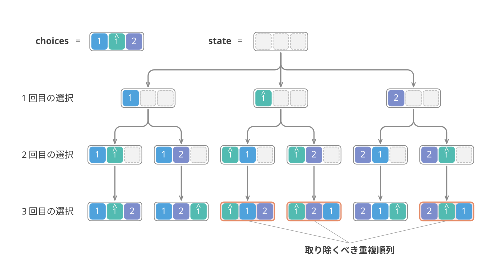
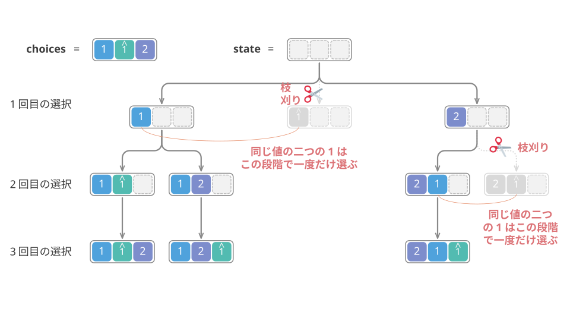

# 全順列問題

全順列問題はバックトラッキングの代表的な応用です。配列や文字列などとして要素の集まりが与えられたとき、それらを並べる順序をすべて求めます。

次の表に、入力配列と、それぞれから得られるすべての順列の例を示します。

<p align="center"> 表 <id> &nbsp; 全順列の例 </p>

| 入力配列    | すべての順列                                                           |
| :---------- | :----------------------------------------------------------------- |
| $[1]$       | $[1]$                                                              |
| $[1, 2]$    | $[1, 2], [2, 1]$                                                   |
| $[1, 2, 3]$ | $[1, 2, 3], [1, 3, 2], [2, 1, 3], [2, 3, 1], [3, 1, 2], [3, 2, 1]$ |

## 要素の値に重複がない場合

!!! question

    要素の値に重複がない整数配列が与えられます。可能な順列をすべて返してください。

バックトラッキングの観点では、**順列は、一連の選択を重ねた結果と考えられます**。入力配列が $[1, 2, 3]$ のとき、最初に $1$、次に $3$、最後に $2$ を選べば、順列 $[1, 3, 2]$ が得られます。後戻りでは一つの選択を取り消して、別の選択肢を試します。

バックトラッキングのコードで見ると、候補集合 `choices` は入力配列のすべての要素、状態 `state` はここまでに選んだ要素です。各要素は一度しか選べないので、**`state` に含まれる要素に重複があってはいけません**。

次の図のように、探索過程は再帰木として展開できます。各ノードは現在の状態 `state` を表します。根から 3 回選択すると葉に達し、各葉が一つの順列に対応します。


### 同じ要素を繰り返し選ぶ枝の枝刈り

各要素を一度だけ選ぶため、ブール配列 `selected` を用意します。`selected[i]` は `choices[i]` が選択済みかどうかを表します。これを使って次のように枝刈りします。

- `choices[i]` を選んだら、`selected[i]` に $\text{True}$ を代入し、選択済みの印を付けます。
- 選択肢のリスト `choices` を調べるとき、選択済みのノードをすべて飛ばします。これが枝刈りです。

次の図のように、1 回目に 1、2 回目に 3、3 回目に 2 を選ぶとします。2 回目には要素 1 の枝を、3 回目には要素 1 と 3 の枝を刈ります。


図を見ると、この枝刈りで探索空間の大きさが $O(n^n)$ から $O(n!)$ に減ることが分かります。

### 実装

ここまで整理できれば、基本形の空欄を埋めるようにコードを書けます。コードを短くするため、基本形の各関数は個別に定義せず、`backtrack()` 関数の中に直接記述します。

```src
[file]{permutations_i}-[class]{}-[func]{permutations_i}
```

## 値の等しい要素がある場合

!!! question

    整数配列が与えられます。**配列には値の等しい要素が含まれる場合があります**。異なる順列をすべて返してください。

入力配列を $[1, 1, 2]$ とします。値が $1$ の二つの要素を区別するため、二つ目の $1$ を $\hat{1}$ と表します。

次の図のように、先ほどの方法で生成した順列の半分は重複しています。



重複を除くにはどうすればよいでしょうか。すぐに思いつく方法は、ハッシュ集合を使って結果から重複を取り除くことです。しかし、もっとよい方法があります。**重複する順列を生成する枝は探索する必要がないので、事前に見分けて枝刈りします**。こうすれば効率がさらに上がります。

### 等しい値を試す枝の枝刈り

次の図の 1 回目の選択では、$1$ を選んでも $\hat{1}$ を選んでも同じです。それぞれの枝から得られる順列はすべて重複するので、$\hat{1}$ の枝を刈ります。

同様に、1 回目に $2$ を選んだ場合、2 回目の $1$ と $\hat{1}$ の枝も重複するので、2 回目の $\hat{1}$ の枝を刈ります。

つまり、**一つの段階では、値の等しい要素をまとめて一度だけ試すことが目的です**。



### 実装

先ほどのコードに手を加え、選択の段階ごとにハッシュ集合 `duplicated` を用意します。その段階ですでに試した値を記録し、同じ値の枝を刈ります。

```src
[file]{permutations_ii}-[class]{}-[func]{permutations_ii}
```

要素の値がすべて異なる場合、$n$ 個の要素の順列は $n!$ 通り（階乗）です。結果を一つ記録するたびに長さ $n$ のリストをコピーするため、$O(n)$ の時間がかかります。**したがって、時間計算量は $O(n!n)$ です**。

再帰の最大の深さは $n$ で、スタックフレームに $O(n)$ の空間を使います。`selected` は $O(n)$ の空間を使います。同時に存在する `duplicated` は最大 $n$ 個で、$O(n^2)$ の空間を使います。**したがって、空間計算量は $O(n^2)$ です**。

### 二つの枝刈りの違い

`selected` と `duplicated` はどちらも枝刈りに使いますが、目的が異なります。

- **同じ要素の再選択を防ぐ枝刈り**：探索全体で一つの `selected` を使います。現在の状態にどの要素が含まれるかを記録し、同じ要素が `state` に二度現れるのを防ぎます。
- **等しい値を試す枝の枝刈り**：選択の各段階（`backtrack` 関数の各呼び出し）で、一つの `duplicated` を使います。この段階の走査（`for` ループ）ですでに試した要素を記録し、等しい値を一度だけ試すようにします。

次の図は二つの枝刈り条件が働く範囲を示しています。木の各ノードは一つの選択を表し、根から葉までの経路に沿ったノードが一つの順列を作ります。


