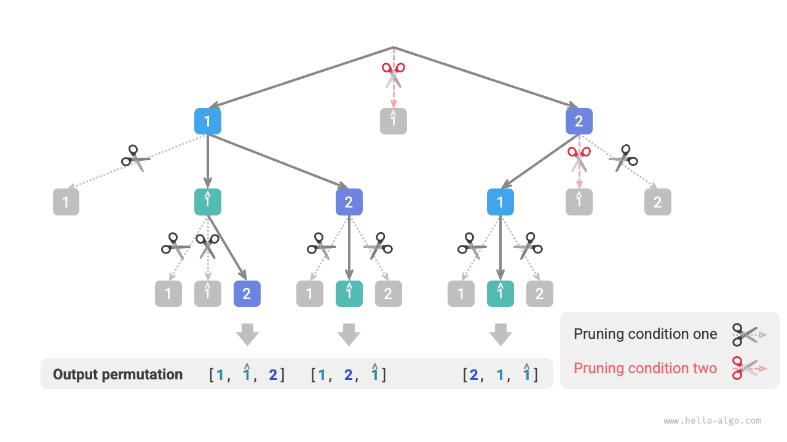

# 順列列挙問題

順列列挙問題は、バックトラッキングの典型的な応用です。配列や文字列などの集合が与えられ、その要素の可能な並べ方をすべて求める問題です。

下表に、入力配列と、それに対応するすべての順列の例を示します。

<p align="center"> 表 <id> &nbsp; 順列列挙の例 </p>

| 入力配列    | すべての順列                                                           |
| :---------- | :----------------------------------------------------------------- |
| $[1]$       | $[1]$                                                              |
| $[1, 2]$    | $[1, 2], [2, 1]$                                                   |
| $[1, 2, 3]$ | $[1, 2, 3], [1, 3, 2], [2, 1, 3], [2, 3, 1], [3, 1, 2], [3, 2, 1]$ |

## 同じ値の要素がない場合

!!! question

    重複した要素を含まない整数配列が与えられます。可能な順列をすべて返してください。

バックトラッキングの観点からは、**順列を作る過程を、一連の選択の結果と捉えられます**。入力が $[1, 2, 3]$ なら、最初に $1$、次に $3$、最後に $2$ を選ぶと、順列 $[1, 3, 2]$ になります。後戻りでは一つの選択を取り消し、ほかの選択肢を試します。

コード上では、候補集合 `choices` は入力配列の全要素、状態 `state` は現在までに選んだ要素です。各要素は一度しか選べないため、**`state` 内の要素は重複してはいけません**。

下図のように、探索過程を再帰木として展開でき、各ノードが現在の状態 `state` を表します。根から 3 回選択すると葉に達し、各葉が一つの順列に対応します。


### 同じ要素を再選択する分岐の枝刈り

各要素を一度だけ選ぶため、ブール配列 `selected` を使います。`selected[i]` は `choices[i]` が選択済みかを表し、次のように枝刈りします。

- `choices[i]` を選んだら、`selected[i]` を $\text{True}$ にして選択済みとします。
- 選択肢 `choices` を走査するとき、選択済みのノードをすべて飛ばし、枝刈りします。

下図のように、1 回目に 1、2 回目に 3、3 回目に 2 を選ぶ場合、2 回目には要素 1 の分岐を、3 回目には要素 1 と 3 の分岐を刈り取ります。


この枝刈りにより、探索空間の大きさは $O(n^n)$ から $O(n!)$ に小さくなります。

### コードの実装

以上を整理できれば、基本形のコードを「穴埋め」できます。コード全体を短くするため、基本形の各関数を別々には定義せず、`backtrack()` 内に展開します。

```src
[file]{permutations_i}-[class]{}-[func]{permutations_i}
```

## 同じ値の要素がある場合

!!! question

    整数配列が与えられます。**配列には重複した要素が含まれる場合があります**。重複しない順列をすべて返してください。

入力が $[1, 1, 2]$ だとします。二つの $1$ を区別するため、2 番目の $1$ を $\hat{1}$ と書きます。

下図のように、先ほどの方法で生成した順列の半分は重複しています。


重複を除くには、結果をハッシュ集合に入れる方法がすぐに思い浮かびます。しかし、あまり洗練された方法ではありません。**同じ順列を生成する分岐は不要なので、事前に見分けて枝刈りすべきです**。そうすれば、効率をさらに高められます。

### 同じ値の要素による分岐の枝刈り

下図では、1 回目に $1$ を選ぶ場合と $\hat{1}$ を選ぶ場合は同等で、その下でできるすべての順列が重複します。したがって、$\hat{1}$ の分岐を枝刈りします。

同様に、1 回目に $2$ を選んだ場合も、2 回目の $1$ と $\hat{1}$ は重複する分岐を作るため、2 回目の $\hat{1}$ を枝刈りします。

本質的な目標は、**ある回の選択において、同じ値を持つ複数の要素を一度だけ選ぶようにすること**です。


### コードの実装

前の問題のコードをもとに、各回の選択でハッシュ集合 `duplicated` を作ります。その回にすでに試した要素を記録し、重複する要素を枝刈りします。

```src
[file]{permutations_ii}-[class]{}-[func]{permutations_ii}
```

要素がすべて異なるとすると、$n$ 個の要素には $n!$ 通り（階乗）の順列があります。結果の記録には長さ $n$ のリストのコピーが必要で、$O(n)$ 時間かかります。**したがって、時間計算量は $O(n!n)$ です**。

最大再帰深度は $n$ で、スタックフレームに $O(n)$ の空間を使います。`selected` は $O(n)$、同時に最大 $n$ 個存在する `duplicated` は $O(n^2)$ の空間を使います。**したがって、空間計算量は $O(n^2)$ です**。

### 二つの枝刈りの比較

`selected` と `duplicated` はどちらも枝刈りに使いますが、目的は異なります。

- **同じ要素の再選択を防ぐ枝刈り**：探索全体で `selected` は一つだけです。現在の状態に含まれる要素を記録し、`state` に同じ要素が繰り返し入るのを防ぎます。
- **同じ値の要素による分岐を防ぐ枝刈り**：各回の選択（各 `backtrack` 呼び出し）が、それぞれ `duplicated` を持ちます。その回の走査（`for` ループ）ですでに選んだ要素を記録し、同じ値を一度だけ選ぶようにします。

下図に、二つの枝刈り条件の作用範囲を示します。木の各ノードは一つの選択を表し、根から葉までの経路上のノードが一つの順列を構成していることに注意してください。


