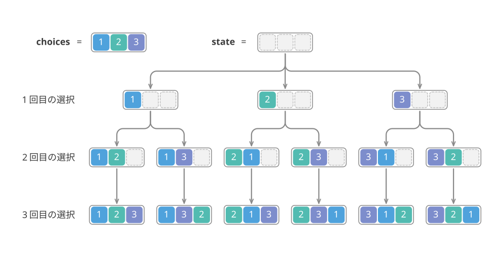
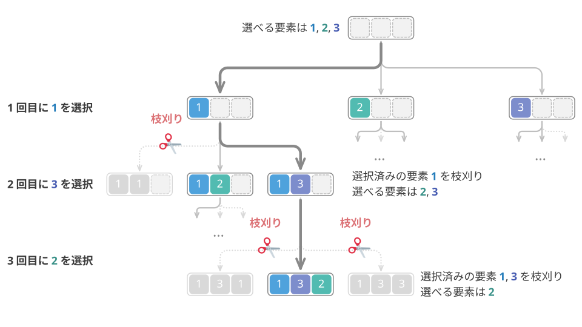
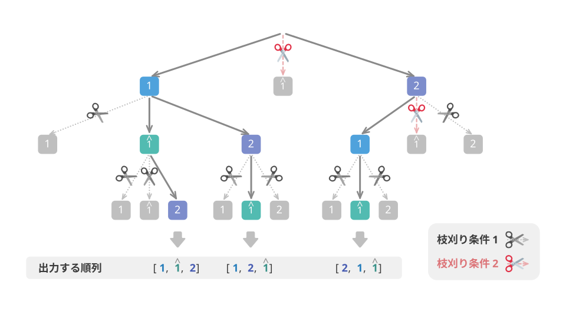

# 13.2 &nbsp; 全順列問題

全順列問題はバックトラッキングの代表的な応用です。配列や文字列などとして要素の集まりが与えられたとき、それらを並べる順序をすべて求めます。

表 13-2 に、入力配列と、それぞれから得られるすべての順列の例を示します。

<p align="center"> 表 13-2 &nbsp; 全順列の例 </p>

<div class="center-table" markdown>

| 入力配列    | すべての順列                                                           |
| :---------- | :----------------------------------------------------------------- |
| $[1]$       | $[1]$                                                              |
| $[1, 2]$    | $[1, 2], [2, 1]$                                                   |
| $[1, 2, 3]$ | $[1, 2, 3], [1, 3, 2], [2, 1, 3], [2, 3, 1], [3, 1, 2], [3, 2, 1]$ |

</div>

## 13.2.1 &nbsp; 要素の値に重複がない場合

!!! question "問題"

    要素の値に重複がない整数配列が与えられます。可能な順列をすべて返してください。

バックトラッキングの観点では、**順列は、一連の選択を重ねた結果と考えられます**。入力配列が $[1, 2, 3]$ のとき、最初に $1$、次に $3$、最後に $2$ を選べば、順列 $[1, 3, 2]$ が得られます。後戻りでは一つの選択を取り消して、別の選択肢を試します。

バックトラッキングのコードで見ると、候補集合 `choices` は入力配列のすべての要素、状態 `state` はここまでに選んだ要素です。各要素は一度しか選べないので、**`state` に含まれる要素に重複があってはいけません**。

図 13-5 のように、探索過程は再帰木として展開できます。各ノードは現在の状態 `state` を表します。根から 3 回選択すると葉に達し、各葉が一つの順列に対応します。

{ class="animation-figure" }

<p align="center"> 図 13-5 &nbsp; 全順列の再帰木 </p>

### 1. &nbsp; 同じ要素を繰り返し選ぶ枝の枝刈り

各要素を一度だけ選ぶため、ブール配列 `selected` を用意します。`selected[i]` は `choices[i]` が選択済みかどうかを表します。これを使って次のように枝刈りします。

- `choices[i]` を選んだら、`selected[i]` に $\text{True}$ を代入し、選択済みの印を付けます。
- 選択肢のリスト `choices` を調べるとき、選択済みのノードをすべて飛ばします。これが枝刈りです。

図 13-6 のように、1 回目に 1、2 回目に 3、3 回目に 2 を選ぶとします。2 回目には要素 1 の枝を、3 回目には要素 1 と 3 の枝を刈ります。

{ class="animation-figure" }

<p align="center"> 図 13-6 &nbsp; 全順列の枝刈りの例 </p>

図を見ると、この枝刈りで探索空間の大きさが $O(n^n)$ から $O(n!)$ に減ることが分かります。

### 2. &nbsp; 実装

ここまで整理できれば、基本形の空欄を埋めるようにコードを書けます。コードを短くするため、基本形の各関数は個別に定義せず、`backtrack()` 関数の中に直接記述します。

=== "Python"

    ```python title="permutations_i.py"
    def backtrack(
        state: list[int], choices: list[int], selected: list[bool], res: list[list[int]]
    ):
        """バックトラッキングによる全順列 I"""
        # 状態の長さが要素数に達したら解を記録する
        if len(state) == len(choices):
            res.append(list(state))
            return
        # すべての選択肢を調べる
        for i, choice in enumerate(choices):
            # 枝刈り：同じ要素は二度選ばない
            if not selected[i]:
                # 試行：選択して状態を更新する
                selected[i] = True
                state.append(choice)
                # 次の選択に進む
                backtrack(state, choices, selected, res)
                # 後戻り：選択を取り消し、元の状態に戻す
                selected[i] = False
                state.pop()

    def permutations_i(nums: list[int]) -> list[list[int]]:
        """全順列 I"""
        res = []
        backtrack(state=[], choices=nums, selected=[False] * len(nums), res=res)
        return res
    ```

=== "C++"

    ```cpp title="permutations_i.cpp"
    /* バックトラッキングによる全順列 I */
    void backtrack(vector<int> &state, const vector<int> &choices, vector<bool> &selected, vector<vector<int>> &res) {
        // 状態の長さが要素数に達したら解を記録する
        if (state.size() == choices.size()) {
            res.push_back(state);
            return;
        }
        // すべての選択肢を調べる
        for (int i = 0; i < choices.size(); i++) {
            int choice = choices[i];
            // 枝刈り：同じ要素は二度選ばない
            if (!selected[i]) {
                // 試行：選択して状態を更新する
                selected[i] = true;
                state.push_back(choice);
                // 次の選択に進む
                backtrack(state, choices, selected, res);
                // 後戻り：選択を取り消し、元の状態に戻す
                selected[i] = false;
                state.pop_back();
            }
        }
    }

    /* 全順列 I */
    vector<vector<int>> permutationsI(vector<int> nums) {
        vector<int> state;
        vector<bool> selected(nums.size(), false);
        vector<vector<int>> res;
        backtrack(state, nums, selected, res);
        return res;
    }
    ```

=== "Java"

    ```java title="permutations_i.java"
    /* バックトラッキングによる全順列 I */
    void backtrack(List<Integer> state, int[] choices, boolean[] selected, List<List<Integer>> res) {
        // 状態の長さが要素数に達したら解を記録する
        if (state.size() == choices.length) {
            res.add(new ArrayList<Integer>(state));
            return;
        }
        // すべての選択肢を調べる
        for (int i = 0; i < choices.length; i++) {
            int choice = choices[i];
            // 枝刈り：同じ要素は二度選ばない
            if (!selected[i]) {
                // 試行：選択して状態を更新する
                selected[i] = true;
                state.add(choice);
                // 次の選択に進む
                backtrack(state, choices, selected, res);
                // 後戻り：選択を取り消し、元の状態に戻す
                selected[i] = false;
                state.remove(state.size() - 1);
            }
        }
    }

    /* 全順列 I */
    List<List<Integer>> permutationsI(int[] nums) {
        List<List<Integer>> res = new ArrayList<List<Integer>>();
        backtrack(new ArrayList<Integer>(), nums, new boolean[nums.length], res);
        return res;
    }
    ```

=== "C#"

    ```csharp title="permutations_i.cs"
    /* バックトラッキングによる全順列 I */
    void Backtrack(List<int> state, int[] choices, bool[] selected, List<List<int>> res) {
        // 状態の長さが要素数に達したら解を記録する
        if (state.Count == choices.Length) {
            res.Add(new List<int>(state));
            return;
        }
        // すべての選択肢を調べる
        for (int i = 0; i < choices.Length; i++) {
            int choice = choices[i];
            // 枝刈り：同じ要素は二度選ばない
            if (!selected[i]) {
                // 試行：選択して状態を更新する
                selected[i] = true;
                state.Add(choice);
                // 次の選択に進む
                Backtrack(state, choices, selected, res);
                // 後戻り：選択を取り消し、元の状態に戻す
                selected[i] = false;
                state.RemoveAt(state.Count - 1);
            }
        }
    }

    /* 全順列 I */
    List<List<int>> PermutationsI(int[] nums) {
        List<List<int>> res = [];
        Backtrack([], nums, new bool[nums.Length], res);
        return res;
    }
    ```

=== "Go"

    ```go title="permutations_i.go"
    /* バックトラッキングによる全順列 I */
    func backtrackI(state *[]int, choices *[]int, selected *[]bool, res *[][]int) {
        // 状態の長さが要素数に達したら解を記録する
        if len(*state) == len(*choices) {
            newState := append([]int{}, *state...)
            *res = append(*res, newState)
        }
        // すべての選択肢を調べる
        for i := 0; i < len(*choices); i++ {
            choice := (*choices)[i]
            // 枝刈り：同じ要素は二度選ばない
            if !(*selected)[i] {
                // 試行：選択して状態を更新する
                (*selected)[i] = true
                *state = append(*state, choice)
                // 次の選択に進む
                backtrackI(state, choices, selected, res)
                // 後戻り：選択を取り消し、元の状態に戻す
                (*selected)[i] = false
                *state = (*state)[:len(*state)-1]
            }
        }
    }

    /* 全順列 I */
    func permutationsI(nums []int) [][]int {
        res := make([][]int, 0)
        state := make([]int, 0)
        selected := make([]bool, len(nums))
        backtrackI(&state, &nums, &selected, &res)
        return res
    }
    ```

=== "Swift"

    ```swift title="permutations_i.swift"
    /* バックトラッキングによる全順列 I */
    func backtrack(state: inout [Int], choices: [Int], selected: inout [Bool], res: inout [[Int]]) {
        // 状態の長さが要素数に達したら解を記録する
        if state.count == choices.count {
            res.append(state)
            return
        }
        // すべての選択肢を調べる
        for (i, choice) in choices.enumerated() {
            // 枝刈り：同じ要素は二度選ばない
            if !selected[i] {
                // 試行：選択して状態を更新する
                selected[i] = true
                state.append(choice)
                // 次の選択に進む
                backtrack(state: &state, choices: choices, selected: &selected, res: &res)
                // 後戻り：選択を取り消し、元の状態に戻す
                selected[i] = false
                state.removeLast()
            }
        }
    }

    /* 全順列 I */
    func permutationsI(nums: [Int]) -> [[Int]] {
        var state: [Int] = []
        var selected = Array(repeating: false, count: nums.count)
        var res: [[Int]] = []
        backtrack(state: &state, choices: nums, selected: &selected, res: &res)
        return res
    }
    ```

=== "JS"

    ```javascript title="permutations_i.js"
    /* バックトラッキングによる全順列 I */
    function backtrack(state, choices, selected, res) {
        // 状態の長さが要素数に達したら解を記録する
        if (state.length === choices.length) {
            res.push([...state]);
            return;
        }
        // すべての選択肢を調べる
        choices.forEach((choice, i) => {
            // 枝刈り：同じ要素は二度選ばない
            if (!selected[i]) {
                // 試行：選択して状態を更新する
                selected[i] = true;
                state.push(choice);
                // 次の選択に進む
                backtrack(state, choices, selected, res);
                // 後戻り：選択を取り消し、元の状態に戻す
                selected[i] = false;
                state.pop();
            }
        });
    }

    /* 全順列 I */
    function permutationsI(nums) {
        const res = [];
        backtrack([], nums, Array(nums.length).fill(false), res);
        return res;
    }
    ```

=== "TS"

    ```typescript title="permutations_i.ts"
    /* バックトラッキングによる全順列 I */
    function backtrack(
        state: number[],
        choices: number[],
        selected: boolean[],
        res: number[][]
    ): void {
        // 状態の長さが要素数に達したら解を記録する
        if (state.length === choices.length) {
            res.push([...state]);
            return;
        }
        // すべての選択肢を調べる
        choices.forEach((choice, i) => {
            // 枝刈り：同じ要素は二度選ばない
            if (!selected[i]) {
                // 試行：選択して状態を更新する
                selected[i] = true;
                state.push(choice);
                // 次の選択に進む
                backtrack(state, choices, selected, res);
                // 後戻り：選択を取り消し、元の状態に戻す
                selected[i] = false;
                state.pop();
            }
        });
    }

    /* 全順列 I */
    function permutationsI(nums: number[]): number[][] {
        const res: number[][] = [];
        backtrack([], nums, Array(nums.length).fill(false), res);
        return res;
    }
    ```

=== "Dart"

    ```dart title="permutations_i.dart"
    /* バックトラッキングによる全順列 I */
    void backtrack(
      List<int> state,
      List<int> choices,
      List<bool> selected,
      List<List<int>> res,
    ) {
      // 状態の長さが要素数に達したら解を記録する
      if (state.length == choices.length) {
        res.add(List.from(state));
        return;
      }
      // すべての選択肢を調べる
      for (int i = 0; i < choices.length; i++) {
        int choice = choices[i];
        // 枝刈り：同じ要素は二度選ばない
        if (!selected[i]) {
          // 試行：選択して状態を更新する
          selected[i] = true;
          state.add(choice);
          // 次の選択に進む
          backtrack(state, choices, selected, res);
          // 後戻り：選択を取り消し、元の状態に戻す
          selected[i] = false;
          state.removeLast();
        }
      }
    }

    /* 全順列 I */
    List<List<int>> permutationsI(List<int> nums) {
      List<List<int>> res = [];
      backtrack([], nums, List.filled(nums.length, false), res);
      return res;
    }
    ```

=== "Rust"

    ```rust title="permutations_i.rs"
    /* バックトラッキングによる全順列 I */
    fn backtrack(mut state: Vec<i32>, choices: &[i32], selected: &mut [bool], res: &mut Vec<Vec<i32>>) {
        // 状態の長さが要素数に達したら解を記録する
        if state.len() == choices.len() {
            res.push(state);
            return;
        }
        // すべての選択肢を調べる
        for i in 0..choices.len() {
            let choice = choices[i];
            // 枝刈り：同じ要素は二度選ばない
            if !selected[i] {
                // 試行：選択して状態を更新する
                selected[i] = true;
                state.push(choice);
                // 次の選択に進む
                backtrack(state.clone(), choices, selected, res);
                // 後戻り：選択を取り消し、元の状態に戻す
                selected[i] = false;
                state.pop();
            }
        }
    }

    /* 全順列 I */
    fn permutations_i(nums: &mut [i32]) -> Vec<Vec<i32>> {
        let mut res = Vec::new(); // 状態（部分集合）
        backtrack(Vec::new(), nums, &mut vec![false; nums.len()], &mut res);
        res
    }
    ```

=== "C"

    ```c title="permutations_i.c"
    /* バックトラッキングによる全順列 I */
    void backtrack(int *state, int stateSize, int *choices, int choicesSize, bool *selected, int **res, int *resSize) {
        // 状態の長さが要素数に達したら解を記録する
        if (stateSize == choicesSize) {
            res[*resSize] = (int *)malloc(choicesSize * sizeof(int));
            for (int i = 0; i < choicesSize; i++) {
                res[*resSize][i] = state[i];
            }
            (*resSize)++;
            return;
        }
        // すべての選択肢を調べる
        for (int i = 0; i < choicesSize; i++) {
            int choice = choices[i];
            // 枝刈り：同じ要素は二度選ばない
            if (!selected[i]) {
                // 試行：選択して状態を更新する
                selected[i] = true;
                state[stateSize] = choice;
                // 次の選択に進む
                backtrack(state, stateSize + 1, choices, choicesSize, selected, res, resSize);
                // 後戻り：選択を取り消し、元の状態に戻す
                selected[i] = false;
            }
        }
    }

    /* 全順列 I */
    int **permutationsI(int *nums, int numsSize, int *returnSize) {
        int *state = (int *)malloc(numsSize * sizeof(int));
        bool *selected = (bool *)malloc(numsSize * sizeof(bool));
        for (int i = 0; i < numsSize; i++) {
            selected[i] = false;
        }
        int **res = (int **)malloc(MAX_SIZE * sizeof(int *));
        *returnSize = 0;

        backtrack(state, 0, nums, numsSize, selected, res, returnSize);

        free(state);
        free(selected);

        return res;
    }
    ```

=== "Kotlin"

    ```kotlin title="permutations_i.kt"
    /* バックトラッキングによる全順列 I */
    fun backtrack(
        state: MutableList<Int>,
        choices: IntArray,
        selected: BooleanArray,
        res: MutableList<MutableList<Int>?>
    ) {
        // 状態の長さが要素数に達したら解を記録する
        if (state.size == choices.size) {
            res.add(state.toMutableList())
            return
        }
        // すべての選択肢を調べる
        for (i in choices.indices) {
            val choice = choices[i]
            // 枝刈り：同じ要素は二度選ばない
            if (!selected[i]) {
                // 試行：選択して状態を更新する
                selected[i] = true
                state.add(choice)
                // 次の選択に進む
                backtrack(state, choices, selected, res)
                // 後戻り：選択を取り消し、元の状態に戻す
                selected[i] = false
                state.removeAt(state.size - 1)
            }
        }
    }

    /* 全順列 I */
    fun permutationsI(nums: IntArray): MutableList<MutableList<Int>?> {
        val res = mutableListOf<MutableList<Int>?>()
        backtrack(mutableListOf(), nums, BooleanArray(nums.size), res)
        return res
    }
    ```

=== "Ruby"

    ```ruby title="permutations_i.rb"
    ### バックトラッキングによる全順列 I ###
    def backtrack(state, choices, selected, res)
      # 状態の長さが要素数に達したら解を記録する
      if state.length == choices.length
        res << state.dup
        return
      end

      # すべての選択肢を調べる
      choices.each_with_index do |choice, i|
        # 枝刈り：同じ要素は二度選ばない
        unless selected[i]
          # 試行：選択して状態を更新する
          selected[i] = true
          state << choice
          # 次の選択に進む
          backtrack(state, choices, selected, res)
          # 後戻り：選択を取り消し、元の状態に戻す
          selected[i] = false
          state.pop
        end
      end
    end

    ### 全順列 I ###
    def permutations_i(nums)
      res = []
      backtrack([], nums, Array.new(nums.length, false), res)
      res
    end
    ```

??? pythontutor "実行の様子を見る"

    <div style="height: 549px; width: 100%;"><iframe class="pythontutor-iframe" title="実行の様子を見る" src="https://pythontutor.com/iframe-embed.html#code=def%20backtrack%28%0A%20%20%20%20state%3A%20list%5Bint%5D,%20choices%3A%20list%5Bint%5D,%20selected%3A%20list%5Bbool%5D,%20res%3A%20list%5Blist%5Bint%5D%5D%0A%29%3A%0A%20%20%20%20%22%22%22%E3%83%90%E3%83%83%E3%82%AF%E3%83%88%E3%83%A9%E3%83%83%E3%82%AD%E3%83%B3%E3%82%B0%E3%81%AB%E3%82%88%E3%82%8B%E5%85%A8%E9%A0%86%E5%88%97%20I%22%22%22%0A%20%20%20%20%23%20%E7%8A%B6%E6%85%8B%E3%81%AE%E9%95%B7%E3%81%95%E3%81%8C%E8%A6%81%E7%B4%A0%E6%95%B0%E3%81%AB%E9%81%94%E3%81%97%E3%81%9F%E3%82%89%E8%A7%A3%E3%82%92%E8%A8%98%E9%8C%B2%E3%81%99%E3%82%8B%0A%20%20%20%20if%20len%28state%29%20%3D%3D%20len%28choices%29%3A%0A%20%20%20%20%20%20%20%20res.append%28list%28state%29%29%0A%20%20%20%20%20%20%20%20return%0A%20%20%20%20%23%20%E3%81%99%E3%81%B9%E3%81%A6%E3%81%AE%E9%81%B8%E6%8A%9E%E8%82%A2%E3%82%92%E8%AA%BF%E3%81%B9%E3%82%8B%0A%20%20%20%20for%20i,%20choice%20in%20enumerate%28choices%29%3A%0A%20%20%20%20%20%20%20%20%23%20%E6%9E%9D%E5%88%88%E3%82%8A%EF%BC%9A%E5%90%8C%E3%81%98%E8%A6%81%E7%B4%A0%E3%81%AF%E4%BA%8C%E5%BA%A6%E9%81%B8%E3%81%B0%E3%81%AA%E3%81%84%0A%20%20%20%20%20%20%20%20if%20not%20selected%5Bi%5D%3A%0A%20%20%20%20%20%20%20%20%20%20%20%20%23%20%E8%A9%A6%E8%A1%8C%EF%BC%9A%E9%81%B8%E6%8A%9E%E3%81%97%E3%81%A6%E7%8A%B6%E6%85%8B%E3%82%92%E6%9B%B4%E6%96%B0%E3%81%99%E3%82%8B%0A%20%20%20%20%20%20%20%20%20%20%20%20selected%5Bi%5D%20%3D%20True%0A%20%20%20%20%20%20%20%20%20%20%20%20state.append%28choice%29%0A%20%20%20%20%20%20%20%20%20%20%20%20%23%20%E6%AC%A1%E3%81%AE%E9%81%B8%E6%8A%9E%E3%81%AB%E9%80%B2%E3%82%80%0A%20%20%20%20%20%20%20%20%20%20%20%20backtrack%28state,%20choices,%20selected,%20res%29%0A%20%20%20%20%20%20%20%20%20%20%20%20%23%20%E5%BE%8C%E6%88%BB%E3%82%8A%EF%BC%9A%E9%81%B8%E6%8A%9E%E3%82%92%E5%8F%96%E3%82%8A%E6%B6%88%E3%81%97%E3%80%81%E5%85%83%E3%81%AE%E7%8A%B6%E6%85%8B%E3%81%AB%E6%88%BB%E3%81%99%0A%20%20%20%20%20%20%20%20%20%20%20%20selected%5Bi%5D%20%3D%20False%0A%20%20%20%20%20%20%20%20%20%20%20%20state.pop%28%29%0A%0A%0Adef%20permutations_i%28nums%3A%20list%5Bint%5D%29%20-%3E%20list%5Blist%5Bint%5D%5D%3A%0A%20%20%20%20%22%22%22%E5%85%A8%E9%A0%86%E5%88%97%20I%22%22%22%0A%20%20%20%20res%20%3D%20%5B%5D%0A%20%20%20%20backtrack%28state%3D%5B%5D,%20choices%3Dnums,%20selected%3D%5BFalse%5D%20%2A%20len%28nums%29,%20res%3Dres%29%0A%20%20%20%20return%20res%0A%0A%0A%22%22%22Driver%20Code%22%22%22%0Aif%20__name__%20%3D%3D%20%22__main__%22%3A%0A%20%20%20%20nums%20%3D%20%5B1,%202,%203%5D%0A%0A%20%20%20%20res%20%3D%20permutations_i%28nums%29%0A%0A%20%20%20%20print%28f%22%E5%85%A5%E5%8A%9B%E9%85%8D%E5%88%97%20nums%20%3D%20%7Bnums%7D%22%29%0A%20%20%20%20print%28f%22%E3%81%99%E3%81%B9%E3%81%A6%E3%81%AE%E9%A0%86%E5%88%97%20res%20%3D%20%7Bres%7D%22%29&codeDivHeight=472&codeDivWidth=350&cumulative=false&curInstr=13&heapPrimitives=nevernest&origin=opt-frontend.js&py=311&rawInputLstJSON=%5B%5D&textReferences=false"> </iframe></div>
    <div style="margin-top: 5px;"><a href="https://pythontutor.com/iframe-embed.html#code=def%20backtrack%28%0A%20%20%20%20state%3A%20list%5Bint%5D,%20choices%3A%20list%5Bint%5D,%20selected%3A%20list%5Bbool%5D,%20res%3A%20list%5Blist%5Bint%5D%5D%0A%29%3A%0A%20%20%20%20%22%22%22%E3%83%90%E3%83%83%E3%82%AF%E3%83%88%E3%83%A9%E3%83%83%E3%82%AD%E3%83%B3%E3%82%B0%E3%81%AB%E3%82%88%E3%82%8B%E5%85%A8%E9%A0%86%E5%88%97%20I%22%22%22%0A%20%20%20%20%23%20%E7%8A%B6%E6%85%8B%E3%81%AE%E9%95%B7%E3%81%95%E3%81%8C%E8%A6%81%E7%B4%A0%E6%95%B0%E3%81%AB%E9%81%94%E3%81%97%E3%81%9F%E3%82%89%E8%A7%A3%E3%82%92%E8%A8%98%E9%8C%B2%E3%81%99%E3%82%8B%0A%20%20%20%20if%20len%28state%29%20%3D%3D%20len%28choices%29%3A%0A%20%20%20%20%20%20%20%20res.append%28list%28state%29%29%0A%20%20%20%20%20%20%20%20return%0A%20%20%20%20%23%20%E3%81%99%E3%81%B9%E3%81%A6%E3%81%AE%E9%81%B8%E6%8A%9E%E8%82%A2%E3%82%92%E8%AA%BF%E3%81%B9%E3%82%8B%0A%20%20%20%20for%20i,%20choice%20in%20enumerate%28choices%29%3A%0A%20%20%20%20%20%20%20%20%23%20%E6%9E%9D%E5%88%88%E3%82%8A%EF%BC%9A%E5%90%8C%E3%81%98%E8%A6%81%E7%B4%A0%E3%81%AF%E4%BA%8C%E5%BA%A6%E9%81%B8%E3%81%B0%E3%81%AA%E3%81%84%0A%20%20%20%20%20%20%20%20if%20not%20selected%5Bi%5D%3A%0A%20%20%20%20%20%20%20%20%20%20%20%20%23%20%E8%A9%A6%E8%A1%8C%EF%BC%9A%E9%81%B8%E6%8A%9E%E3%81%97%E3%81%A6%E7%8A%B6%E6%85%8B%E3%82%92%E6%9B%B4%E6%96%B0%E3%81%99%E3%82%8B%0A%20%20%20%20%20%20%20%20%20%20%20%20selected%5Bi%5D%20%3D%20True%0A%20%20%20%20%20%20%20%20%20%20%20%20state.append%28choice%29%0A%20%20%20%20%20%20%20%20%20%20%20%20%23%20%E6%AC%A1%E3%81%AE%E9%81%B8%E6%8A%9E%E3%81%AB%E9%80%B2%E3%82%80%0A%20%20%20%20%20%20%20%20%20%20%20%20backtrack%28state,%20choices,%20selected,%20res%29%0A%20%20%20%20%20%20%20%20%20%20%20%20%23%20%E5%BE%8C%E6%88%BB%E3%82%8A%EF%BC%9A%E9%81%B8%E6%8A%9E%E3%82%92%E5%8F%96%E3%82%8A%E6%B6%88%E3%81%97%E3%80%81%E5%85%83%E3%81%AE%E7%8A%B6%E6%85%8B%E3%81%AB%E6%88%BB%E3%81%99%0A%20%20%20%20%20%20%20%20%20%20%20%20selected%5Bi%5D%20%3D%20False%0A%20%20%20%20%20%20%20%20%20%20%20%20state.pop%28%29%0A%0A%0Adef%20permutations_i%28nums%3A%20list%5Bint%5D%29%20-%3E%20list%5Blist%5Bint%5D%5D%3A%0A%20%20%20%20%22%22%22%E5%85%A8%E9%A0%86%E5%88%97%20I%22%22%22%0A%20%20%20%20res%20%3D%20%5B%5D%0A%20%20%20%20backtrack%28state%3D%5B%5D,%20choices%3Dnums,%20selected%3D%5BFalse%5D%20%2A%20len%28nums%29,%20res%3Dres%29%0A%20%20%20%20return%20res%0A%0A%0A%22%22%22Driver%20Code%22%22%22%0Aif%20__name__%20%3D%3D%20%22__main__%22%3A%0A%20%20%20%20nums%20%3D%20%5B1,%202,%203%5D%0A%0A%20%20%20%20res%20%3D%20permutations_i%28nums%29%0A%0A%20%20%20%20print%28f%22%E5%85%A5%E5%8A%9B%E9%85%8D%E5%88%97%20nums%20%3D%20%7Bnums%7D%22%29%0A%20%20%20%20print%28f%22%E3%81%99%E3%81%B9%E3%81%A6%E3%81%AE%E9%A0%86%E5%88%97%20res%20%3D%20%7Bres%7D%22%29&codeDivHeight=800&codeDivWidth=600&cumulative=false&curInstr=13&heapPrimitives=nevernest&origin=opt-frontend.js&py=311&rawInputLstJSON=%5B%5D&textReferences=false" target="_blank" rel="noopener noreferrer">全画面で表示 ></a></div>

## 13.2.2 &nbsp; 値の等しい要素がある場合

!!! question "問題"

    整数配列が与えられます。**配列には値の等しい要素が含まれる場合があります**。異なる順列をすべて返してください。

入力配列を $[1, 1, 2]$ とします。値が $1$ の二つの要素を区別するため、二つ目の $1$ を $\hat{1}$ と表します。

図 13-7 のように、先ほどの方法で生成した順列の半分は重複しています。

{ class="animation-figure" }

<p align="center"> 図 13-7 &nbsp; 重複する順列 </p>

重複を除くにはどうすればよいでしょうか。すぐに思いつく方法は、ハッシュ集合を使って結果から重複を取り除くことです。しかし、もっとよい方法があります。**重複する順列を生成する枝は探索する必要がないので、事前に見分けて枝刈りします**。こうすれば効率がさらに上がります。

### 1. &nbsp; 等しい値を試す枝の枝刈り

図 13-8 の 1 回目の選択では、$1$ を選んでも $\hat{1}$ を選んでも同じです。それぞれの枝から得られる順列はすべて重複するので、$\hat{1}$ の枝を刈ります。

同様に、1 回目に $2$ を選んだ場合、2 回目の $1$ と $\hat{1}$ の枝も重複するので、2 回目の $\hat{1}$ の枝を刈ります。

つまり、**一つの段階では、値の等しい要素をまとめて一度だけ試すことが目的です**。

{ class="animation-figure" }

<p align="center"> 図 13-8 &nbsp; 重複する順列の枝刈り </p>

### 2. &nbsp; 実装

先ほどのコードに手を加え、選択の段階ごとにハッシュ集合 `duplicated` を用意します。その段階ですでに試した値を記録し、同じ値の枝を刈ります。

=== "Python"

    ```python title="permutations_ii.py"
    def backtrack(
        state: list[int], choices: list[int], selected: list[bool], res: list[list[int]]
    ):
        """バックトラッキングによる全順列 II"""
        # 状態の長さが要素数に達したら解を記録する
        if len(state) == len(choices):
            res.append(list(state))
            return
        # すべての選択肢を調べる
        duplicated = set[int]()
        for i, choice in enumerate(choices):
            # 枝刈り：同じ要素は二度選ばず、この段階で同じ値の要素も繰り返し試さない
            if not selected[i] and choice not in duplicated:
                # 試行：選択して状態を更新する
                duplicated.add(choice)  # 選んだ要素の値を記録する
                selected[i] = True
                state.append(choice)
                # 次の選択に進む
                backtrack(state, choices, selected, res)
                # 後戻り：選択を取り消し、元の状態に戻す
                selected[i] = False
                state.pop()

    def permutations_ii(nums: list[int]) -> list[list[int]]:
        """全順列 II"""
        res = []
        backtrack(state=[], choices=nums, selected=[False] * len(nums), res=res)
        return res
    ```

=== "C++"

    ```cpp title="permutations_ii.cpp"
    /* バックトラッキングによる全順列 II */
    void backtrack(vector<int> &state, const vector<int> &choices, vector<bool> &selected, vector<vector<int>> &res) {
        // 状態の長さが要素数に達したら解を記録する
        if (state.size() == choices.size()) {
            res.push_back(state);
            return;
        }
        // すべての選択肢を調べる
        unordered_set<int> duplicated;
        for (int i = 0; i < choices.size(); i++) {
            int choice = choices[i];
            // 枝刈り：同じ要素は二度選ばず、この段階で同じ値の要素も繰り返し試さない
            if (!selected[i] && duplicated.find(choice) == duplicated.end()) {
                // 試行：選択して状態を更新する
                duplicated.emplace(choice); // 選んだ要素の値を記録する
                selected[i] = true;
                state.push_back(choice);
                // 次の選択に進む
                backtrack(state, choices, selected, res);
                // 後戻り：選択を取り消し、元の状態に戻す
                selected[i] = false;
                state.pop_back();
            }
        }
    }

    /* 全順列 II */
    vector<vector<int>> permutationsII(vector<int> nums) {
        vector<int> state;
        vector<bool> selected(nums.size(), false);
        vector<vector<int>> res;
        backtrack(state, nums, selected, res);
        return res;
    }
    ```

=== "Java"

    ```java title="permutations_ii.java"
    /* バックトラッキングによる全順列 II */
    void backtrack(List<Integer> state, int[] choices, boolean[] selected, List<List<Integer>> res) {
        // 状態の長さが要素数に達したら解を記録する
        if (state.size() == choices.length) {
            res.add(new ArrayList<Integer>(state));
            return;
        }
        // すべての選択肢を調べる
        Set<Integer> duplicated = new HashSet<Integer>();
        for (int i = 0; i < choices.length; i++) {
            int choice = choices[i];
            // 枝刈り：同じ要素は二度選ばず、この段階で同じ値の要素も繰り返し試さない
            if (!selected[i] && !duplicated.contains(choice)) {
                // 試行：選択して状態を更新する
                duplicated.add(choice); // 選んだ要素の値を記録する
                selected[i] = true;
                state.add(choice);
                // 次の選択に進む
                backtrack(state, choices, selected, res);
                // 後戻り：選択を取り消し、元の状態に戻す
                selected[i] = false;
                state.remove(state.size() - 1);
            }
        }
    }

    /* 全順列 II */
    List<List<Integer>> permutationsII(int[] nums) {
        List<List<Integer>> res = new ArrayList<List<Integer>>();
        backtrack(new ArrayList<Integer>(), nums, new boolean[nums.length], res);
        return res;
    }
    ```

=== "C#"

    ```csharp title="permutations_ii.cs"
    /* バックトラッキングによる全順列 II */
    void Backtrack(List<int> state, int[] choices, bool[] selected, List<List<int>> res) {
        // 状態の長さが要素数に達したら解を記録する
        if (state.Count == choices.Length) {
            res.Add(new List<int>(state));
            return;
        }
        // すべての選択肢を調べる
        HashSet<int> duplicated = [];
        for (int i = 0; i < choices.Length; i++) {
            int choice = choices[i];
            // 枝刈り：同じ要素は二度選ばず、この段階で同じ値の要素も繰り返し試さない
            if (!selected[i] && !duplicated.Contains(choice)) {
                // 試行：選択して状態を更新する
                duplicated.Add(choice); // 選んだ要素の値を記録する
                selected[i] = true;
                state.Add(choice);
                // 次の選択に進む
                Backtrack(state, choices, selected, res);
                // 後戻り：選択を取り消し、元の状態に戻す
                selected[i] = false;
                state.RemoveAt(state.Count - 1);
            }
        }
    }

    /* 全順列 II */
    List<List<int>> PermutationsII(int[] nums) {
        List<List<int>> res = [];
        Backtrack([], nums, new bool[nums.Length], res);
        return res;
    }
    ```

=== "Go"

    ```go title="permutations_ii.go"
    /* バックトラッキングによる全順列 II */
    func backtrackII(state *[]int, choices *[]int, selected *[]bool, res *[][]int) {
        // 状態の長さが要素数に達したら解を記録する
        if len(*state) == len(*choices) {
            newState := append([]int{}, *state...)
            *res = append(*res, newState)
        }
        // すべての選択肢を調べる
        duplicated := make(map[int]struct{}, 0)
        for i := 0; i < len(*choices); i++ {
            choice := (*choices)[i]
            // 枝刈り：同じ要素は二度選ばず、この段階で同じ値の要素も繰り返し試さない
            if _, ok := duplicated[choice]; !ok && !(*selected)[i] {
                // 試行：選択して状態を更新する
                // 選んだ要素の値を記録する
                duplicated[choice] = struct{}{}
                (*selected)[i] = true
                *state = append(*state, choice)
                // 次の選択に進む
                backtrackII(state, choices, selected, res)
                // 後戻り：選択を取り消し、元の状態に戻す
                (*selected)[i] = false
                *state = (*state)[:len(*state)-1]
            }
        }
    }

    /* 全順列 II */
    func permutationsII(nums []int) [][]int {
        res := make([][]int, 0)
        state := make([]int, 0)
        selected := make([]bool, len(nums))
        backtrackII(&state, &nums, &selected, &res)
        return res
    }
    ```

=== "Swift"

    ```swift title="permutations_ii.swift"
    /* バックトラッキングによる全順列 II */
    func backtrack(state: inout [Int], choices: [Int], selected: inout [Bool], res: inout [[Int]]) {
        // 状態の長さが要素数に達したら解を記録する
        if state.count == choices.count {
            res.append(state)
            return
        }
        // すべての選択肢を調べる
        var duplicated: Set<Int> = []
        for (i, choice) in choices.enumerated() {
            // 枝刈り：同じ要素は二度選ばず、この段階で同じ値の要素も繰り返し試さない
            if !selected[i], !duplicated.contains(choice) {
                // 試行：選択して状態を更新する
                duplicated.insert(choice) // 選んだ要素の値を記録する
                selected[i] = true
                state.append(choice)
                // 次の選択に進む
                backtrack(state: &state, choices: choices, selected: &selected, res: &res)
                // 後戻り：選択を取り消し、元の状態に戻す
                selected[i] = false
                state.removeLast()
            }
        }
    }

    /* 全順列 II */
    func permutationsII(nums: [Int]) -> [[Int]] {
        var state: [Int] = []
        var selected = Array(repeating: false, count: nums.count)
        var res: [[Int]] = []
        backtrack(state: &state, choices: nums, selected: &selected, res: &res)
        return res
    }
    ```

=== "JS"

    ```javascript title="permutations_ii.js"
    /* バックトラッキングによる全順列 II */
    function backtrack(state, choices, selected, res) {
        // 状態の長さが要素数に達したら解を記録する
        if (state.length === choices.length) {
            res.push([...state]);
            return;
        }
        // すべての選択肢を調べる
        const duplicated = new Set();
        choices.forEach((choice, i) => {
            // 枝刈り：同じ要素は二度選ばず、この段階で同じ値の要素も繰り返し試さない
            if (!selected[i] && !duplicated.has(choice)) {
                // 試行：選択して状態を更新する
                duplicated.add(choice); // 選んだ要素の値を記録する
                selected[i] = true;
                state.push(choice);
                // 次の選択に進む
                backtrack(state, choices, selected, res);
                // 後戻り：選択を取り消し、元の状態に戻す
                selected[i] = false;
                state.pop();
            }
        });
    }

    /* 全順列 II */
    function permutationsII(nums) {
        const res = [];
        backtrack([], nums, Array(nums.length).fill(false), res);
        return res;
    }
    ```

=== "TS"

    ```typescript title="permutations_ii.ts"
    /* バックトラッキングによる全順列 II */
    function backtrack(
        state: number[],
        choices: number[],
        selected: boolean[],
        res: number[][]
    ): void {
        // 状態の長さが要素数に達したら解を記録する
        if (state.length === choices.length) {
            res.push([...state]);
            return;
        }
        // すべての選択肢を調べる
        const duplicated = new Set();
        choices.forEach((choice, i) => {
            // 枝刈り：同じ要素は二度選ばず、この段階で同じ値の要素も繰り返し試さない
            if (!selected[i] && !duplicated.has(choice)) {
                // 試行：選択して状態を更新する
                duplicated.add(choice); // 選んだ要素の値を記録する
                selected[i] = true;
                state.push(choice);
                // 次の選択に進む
                backtrack(state, choices, selected, res);
                // 後戻り：選択を取り消し、元の状態に戻す
                selected[i] = false;
                state.pop();
            }
        });
    }

    /* 全順列 II */
    function permutationsII(nums: number[]): number[][] {
        const res: number[][] = [];
        backtrack([], nums, Array(nums.length).fill(false), res);
        return res;
    }
    ```

=== "Dart"

    ```dart title="permutations_ii.dart"
    /* バックトラッキングによる全順列 II */
    void backtrack(
      List<int> state,
      List<int> choices,
      List<bool> selected,
      List<List<int>> res,
    ) {
      // 状態の長さが要素数に達したら解を記録する
      if (state.length == choices.length) {
        res.add(List.from(state));
        return;
      }
      // すべての選択肢を調べる
      Set<int> duplicated = {};
      for (int i = 0; i < choices.length; i++) {
        int choice = choices[i];
        // 枝刈り：同じ要素は二度選ばず、この段階で同じ値の要素も繰り返し試さない
        if (!selected[i] && !duplicated.contains(choice)) {
          // 試行：選択して状態を更新する
          duplicated.add(choice); // 選んだ要素の値を記録する
          selected[i] = true;
          state.add(choice);
          // 次の選択に進む
          backtrack(state, choices, selected, res);
          // 後戻り：選択を取り消し、元の状態に戻す
          selected[i] = false;
          state.removeLast();
        }
      }
    }

    /* 全順列 II */
    List<List<int>> permutationsII(List<int> nums) {
      List<List<int>> res = [];
      backtrack([], nums, List.filled(nums.length, false), res);
      return res;
    }
    ```

=== "Rust"

    ```rust title="permutations_ii.rs"
    /* バックトラッキングによる全順列 II */
    fn backtrack(mut state: Vec<i32>, choices: &[i32], selected: &mut [bool], res: &mut Vec<Vec<i32>>) {
        // 状態の長さが要素数に達したら解を記録する
        if state.len() == choices.len() {
            res.push(state);
            return;
        }
        // すべての選択肢を調べる
        let mut duplicated = HashSet::<i32>::new();
        for i in 0..choices.len() {
            let choice = choices[i];
            // 枝刈り：同じ要素は二度選ばず、この段階で同じ値の要素も繰り返し試さない
            if !selected[i] && !duplicated.contains(&choice) {
                // 試行：選択して状態を更新する
                duplicated.insert(choice); // 選んだ要素の値を記録する
                selected[i] = true;
                state.push(choice);
                // 次の選択に進む
                backtrack(state.clone(), choices, selected, res);
                // 後戻り：選択を取り消し、元の状態に戻す
                selected[i] = false;
                state.pop();
            }
        }
    }

    /* 全順列 II */
    fn permutations_ii(nums: &mut [i32]) -> Vec<Vec<i32>> {
        let mut res = Vec::new();
        backtrack(Vec::new(), nums, &mut vec![false; nums.len()], &mut res);
        res
    }
    ```

=== "C"

    ```c title="permutations_ii.c"
    /* バックトラッキングによる全順列 II */
    void backtrack(int *state, int stateSize, int *choices, int choicesSize, bool *selected, int **res, int *resSize) {
        // 状態の長さが要素数に達したら解を記録する
        if (stateSize == choicesSize) {
            res[*resSize] = (int *)malloc(choicesSize * sizeof(int));
            for (int i = 0; i < choicesSize; i++) {
                res[*resSize][i] = state[i];
            }
            (*resSize)++;
            return;
        }
        // すべての選択肢を調べる
        bool duplicated[MAX_SIZE] = {false};
        for (int i = 0; i < choicesSize; i++) {
            int choice = choices[i];
            // 枝刈り：同じ要素は二度選ばず、この段階で同じ値の要素も繰り返し試さない
            if (!selected[i] && !duplicated[choice]) {
                // 試行：選択して状態を更新する
                duplicated[choice] = true; // 選んだ要素の値を記録する
                selected[i] = true;
                state[stateSize] = choice;
                // 次の選択に進む
                backtrack(state, stateSize + 1, choices, choicesSize, selected, res, resSize);
                // 後戻り：選択を取り消し、元の状態に戻す
                selected[i] = false;
            }
        }
    }

    /* 全順列 II */
    int **permutationsII(int *nums, int numsSize, int *returnSize) {
        int *state = (int *)malloc(numsSize * sizeof(int));
        bool *selected = (bool *)malloc(numsSize * sizeof(bool));
        for (int i = 0; i < numsSize; i++) {
            selected[i] = false;
        }
        int **res = (int **)malloc(MAX_SIZE * sizeof(int *));
        *returnSize = 0;

        backtrack(state, 0, nums, numsSize, selected, res, returnSize);

        free(state);
        free(selected);

        return res;
    }
    ```

=== "Kotlin"

    ```kotlin title="permutations_ii.kt"
    /* バックトラッキングによる全順列 II */
    fun backtrack(
        state: MutableList<Int>,
        choices: IntArray,
        selected: BooleanArray,
        res: MutableList<MutableList<Int>?>
    ) {
        // 状態の長さが要素数に達したら解を記録する
        if (state.size == choices.size) {
            res.add(state.toMutableList())
            return
        }
        // すべての選択肢を調べる
        val duplicated = HashSet<Int>()
        for (i in choices.indices) {
            val choice = choices[i]
            // 枝刈り：同じ要素は二度選ばず、この段階で同じ値の要素も繰り返し試さない
            if (!selected[i] && !duplicated.contains(choice)) {
                // 試行：選択して状態を更新する
                duplicated.add(choice) // 選んだ要素の値を記録する
                selected[i] = true
                state.add(choice)
                // 次の選択に進む
                backtrack(state, choices, selected, res)
                // 後戻り：選択を取り消し、元の状態に戻す
                selected[i] = false
                state.removeAt(state.size - 1)
            }
        }
    }

    /* 全順列 II */
    fun permutationsII(nums: IntArray): MutableList<MutableList<Int>?> {
        val res = mutableListOf<MutableList<Int>?>()
        backtrack(mutableListOf(), nums, BooleanArray(nums.size), res)
        return res
    }
    ```

=== "Ruby"

    ```ruby title="permutations_ii.rb"
    ### バックトラッキングによる全順列 II ###
    def backtrack(state, choices, selected, res)
      # 状態の長さが要素数に達したら解を記録する
      if state.length == choices.length
        res << state.dup
        return
      end

      # すべての選択肢を調べる
      duplicated = Set.new
      choices.each_with_index do |choice, i|
        # 枝刈り：同じ要素は二度選ばず、この段階で同じ値の要素も繰り返し試さない
        if !selected[i] && !duplicated.include?(choice)
          # 試行：選択して状態を更新する
          duplicated.add(choice)
          selected[i] = true
          state << choice
          # 次の選択に進む
          backtrack(state, choices, selected, res)
          # 後戻り：選択を取り消し、元の状態に戻す
          selected[i] = false
          state.pop
        end
      end
    end

    ### 全順列 II ###
    def permutations_ii(nums)
      res = []
      backtrack([], nums, Array.new(nums.length, false), res)
      res
    end
    ```

??? pythontutor "実行の様子を見る"

    <div style="height: 549px; width: 100%;"><iframe class="pythontutor-iframe" title="実行の様子を見る" src="https://pythontutor.com/iframe-embed.html#code=def%20backtrack%28%0A%20%20%20%20state%3A%20list%5Bint%5D,%20choices%3A%20list%5Bint%5D,%20selected%3A%20list%5Bbool%5D,%20res%3A%20list%5Blist%5Bint%5D%5D%0A%29%3A%0A%20%20%20%20%22%22%22%E3%83%90%E3%83%83%E3%82%AF%E3%83%88%E3%83%A9%E3%83%83%E3%82%AD%E3%83%B3%E3%82%B0%E3%81%AB%E3%82%88%E3%82%8B%E5%85%A8%E9%A0%86%E5%88%97%20II%22%22%22%0A%20%20%20%20%23%20%E7%8A%B6%E6%85%8B%E3%81%AE%E9%95%B7%E3%81%95%E3%81%8C%E8%A6%81%E7%B4%A0%E6%95%B0%E3%81%AB%E9%81%94%E3%81%97%E3%81%9F%E3%82%89%E8%A7%A3%E3%82%92%E8%A8%98%E9%8C%B2%E3%81%99%E3%82%8B%0A%20%20%20%20if%20len%28state%29%20%3D%3D%20len%28choices%29%3A%0A%20%20%20%20%20%20%20%20res.append%28list%28state%29%29%0A%20%20%20%20%20%20%20%20return%0A%20%20%20%20%23%20%E3%81%99%E3%81%B9%E3%81%A6%E3%81%AE%E9%81%B8%E6%8A%9E%E8%82%A2%E3%82%92%E8%AA%BF%E3%81%B9%E3%82%8B%0A%20%20%20%20duplicated%20%3D%20set%5Bint%5D%28%29%0A%20%20%20%20for%20i,%20choice%20in%20enumerate%28choices%29%3A%0A%20%20%20%20%20%20%20%20%23%20%E6%9E%9D%E5%88%88%E3%82%8A%EF%BC%9A%E5%90%8C%E3%81%98%E8%A6%81%E7%B4%A0%E3%81%AF%E4%BA%8C%E5%BA%A6%E9%81%B8%E3%81%B0%E3%81%9A%E3%80%81%E3%81%93%E3%81%AE%E6%AE%B5%E9%9A%8E%E3%81%A7%E5%90%8C%E3%81%98%E5%80%A4%E3%81%AE%E8%A6%81%E7%B4%A0%E3%82%82%E7%B9%B0%E3%82%8A%E8%BF%94%E3%81%97%E8%A9%A6%E3%81%95%E3%81%AA%E3%81%84%0A%20%20%20%20%20%20%20%20if%20not%20selected%5Bi%5D%20and%20choice%20not%20in%20duplicated%3A%0A%20%20%20%20%20%20%20%20%20%20%20%20%23%20%E8%A9%A6%E8%A1%8C%EF%BC%9A%E9%81%B8%E6%8A%9E%E3%81%97%E3%81%A6%E7%8A%B6%E6%85%8B%E3%82%92%E6%9B%B4%E6%96%B0%E3%81%99%E3%82%8B%0A%20%20%20%20%20%20%20%20%20%20%20%20duplicated.add%28choice%29%20%20%23%20%E9%81%B8%E3%82%93%E3%81%A0%E8%A6%81%E7%B4%A0%E3%81%AE%E5%80%A4%E3%82%92%E8%A8%98%E9%8C%B2%E3%81%99%E3%82%8B%0A%20%20%20%20%20%20%20%20%20%20%20%20selected%5Bi%5D%20%3D%20True%0A%20%20%20%20%20%20%20%20%20%20%20%20state.append%28choice%29%0A%20%20%20%20%20%20%20%20%20%20%20%20%23%20%E6%AC%A1%E3%81%AE%E9%81%B8%E6%8A%9E%E3%81%AB%E9%80%B2%E3%82%80%0A%20%20%20%20%20%20%20%20%20%20%20%20backtrack%28state,%20choices,%20selected,%20res%29%0A%20%20%20%20%20%20%20%20%20%20%20%20%23%20%E5%BE%8C%E6%88%BB%E3%82%8A%EF%BC%9A%E9%81%B8%E6%8A%9E%E3%82%92%E5%8F%96%E3%82%8A%E6%B6%88%E3%81%97%E3%80%81%E5%85%83%E3%81%AE%E7%8A%B6%E6%85%8B%E3%81%AB%E6%88%BB%E3%81%99%0A%20%20%20%20%20%20%20%20%20%20%20%20selected%5Bi%5D%20%3D%20False%0A%20%20%20%20%20%20%20%20%20%20%20%20state.pop%28%29%0A%0A%0Adef%20permutations_ii%28nums%3A%20list%5Bint%5D%29%20-%3E%20list%5Blist%5Bint%5D%5D%3A%0A%20%20%20%20%22%22%22%E5%85%A8%E9%A0%86%E5%88%97%20II%22%22%22%0A%20%20%20%20res%20%3D%20%5B%5D%0A%20%20%20%20backtrack%28state%3D%5B%5D,%20choices%3Dnums,%20selected%3D%5BFalse%5D%20%2A%20len%28nums%29,%20res%3Dres%29%0A%20%20%20%20return%20res%0A%0A%0A%22%22%22Driver%20Code%22%22%22%0Aif%20__name__%20%3D%3D%20%22__main__%22%3A%0A%20%20%20%20nums%20%3D%20%5B1,%202,%202%5D%0A%0A%20%20%20%20res%20%3D%20permutations_ii%28nums%29%0A%0A%20%20%20%20print%28f%22%E5%85%A5%E5%8A%9B%E9%85%8D%E5%88%97%20nums%20%3D%20%7Bnums%7D%22%29%0A%20%20%20%20print%28f%22%E3%81%99%E3%81%B9%E3%81%A6%E3%81%AE%E9%A0%86%E5%88%97%20res%20%3D%20%7Bres%7D%22%29&codeDivHeight=472&codeDivWidth=350&cumulative=false&curInstr=13&heapPrimitives=nevernest&origin=opt-frontend.js&py=311&rawInputLstJSON=%5B%5D&textReferences=false"> </iframe></div>
    <div style="margin-top: 5px;"><a href="https://pythontutor.com/iframe-embed.html#code=def%20backtrack%28%0A%20%20%20%20state%3A%20list%5Bint%5D,%20choices%3A%20list%5Bint%5D,%20selected%3A%20list%5Bbool%5D,%20res%3A%20list%5Blist%5Bint%5D%5D%0A%29%3A%0A%20%20%20%20%22%22%22%E3%83%90%E3%83%83%E3%82%AF%E3%83%88%E3%83%A9%E3%83%83%E3%82%AD%E3%83%B3%E3%82%B0%E3%81%AB%E3%82%88%E3%82%8B%E5%85%A8%E9%A0%86%E5%88%97%20II%22%22%22%0A%20%20%20%20%23%20%E7%8A%B6%E6%85%8B%E3%81%AE%E9%95%B7%E3%81%95%E3%81%8C%E8%A6%81%E7%B4%A0%E6%95%B0%E3%81%AB%E9%81%94%E3%81%97%E3%81%9F%E3%82%89%E8%A7%A3%E3%82%92%E8%A8%98%E9%8C%B2%E3%81%99%E3%82%8B%0A%20%20%20%20if%20len%28state%29%20%3D%3D%20len%28choices%29%3A%0A%20%20%20%20%20%20%20%20res.append%28list%28state%29%29%0A%20%20%20%20%20%20%20%20return%0A%20%20%20%20%23%20%E3%81%99%E3%81%B9%E3%81%A6%E3%81%AE%E9%81%B8%E6%8A%9E%E8%82%A2%E3%82%92%E8%AA%BF%E3%81%B9%E3%82%8B%0A%20%20%20%20duplicated%20%3D%20set%5Bint%5D%28%29%0A%20%20%20%20for%20i,%20choice%20in%20enumerate%28choices%29%3A%0A%20%20%20%20%20%20%20%20%23%20%E6%9E%9D%E5%88%88%E3%82%8A%EF%BC%9A%E5%90%8C%E3%81%98%E8%A6%81%E7%B4%A0%E3%81%AF%E4%BA%8C%E5%BA%A6%E9%81%B8%E3%81%B0%E3%81%9A%E3%80%81%E3%81%93%E3%81%AE%E6%AE%B5%E9%9A%8E%E3%81%A7%E5%90%8C%E3%81%98%E5%80%A4%E3%81%AE%E8%A6%81%E7%B4%A0%E3%82%82%E7%B9%B0%E3%82%8A%E8%BF%94%E3%81%97%E8%A9%A6%E3%81%95%E3%81%AA%E3%81%84%0A%20%20%20%20%20%20%20%20if%20not%20selected%5Bi%5D%20and%20choice%20not%20in%20duplicated%3A%0A%20%20%20%20%20%20%20%20%20%20%20%20%23%20%E8%A9%A6%E8%A1%8C%EF%BC%9A%E9%81%B8%E6%8A%9E%E3%81%97%E3%81%A6%E7%8A%B6%E6%85%8B%E3%82%92%E6%9B%B4%E6%96%B0%E3%81%99%E3%82%8B%0A%20%20%20%20%20%20%20%20%20%20%20%20duplicated.add%28choice%29%20%20%23%20%E9%81%B8%E3%82%93%E3%81%A0%E8%A6%81%E7%B4%A0%E3%81%AE%E5%80%A4%E3%82%92%E8%A8%98%E9%8C%B2%E3%81%99%E3%82%8B%0A%20%20%20%20%20%20%20%20%20%20%20%20selected%5Bi%5D%20%3D%20True%0A%20%20%20%20%20%20%20%20%20%20%20%20state.append%28choice%29%0A%20%20%20%20%20%20%20%20%20%20%20%20%23%20%E6%AC%A1%E3%81%AE%E9%81%B8%E6%8A%9E%E3%81%AB%E9%80%B2%E3%82%80%0A%20%20%20%20%20%20%20%20%20%20%20%20backtrack%28state,%20choices,%20selected,%20res%29%0A%20%20%20%20%20%20%20%20%20%20%20%20%23%20%E5%BE%8C%E6%88%BB%E3%82%8A%EF%BC%9A%E9%81%B8%E6%8A%9E%E3%82%92%E5%8F%96%E3%82%8A%E6%B6%88%E3%81%97%E3%80%81%E5%85%83%E3%81%AE%E7%8A%B6%E6%85%8B%E3%81%AB%E6%88%BB%E3%81%99%0A%20%20%20%20%20%20%20%20%20%20%20%20selected%5Bi%5D%20%3D%20False%0A%20%20%20%20%20%20%20%20%20%20%20%20state.pop%28%29%0A%0A%0Adef%20permutations_ii%28nums%3A%20list%5Bint%5D%29%20-%3E%20list%5Blist%5Bint%5D%5D%3A%0A%20%20%20%20%22%22%22%E5%85%A8%E9%A0%86%E5%88%97%20II%22%22%22%0A%20%20%20%20res%20%3D%20%5B%5D%0A%20%20%20%20backtrack%28state%3D%5B%5D,%20choices%3Dnums,%20selected%3D%5BFalse%5D%20%2A%20len%28nums%29,%20res%3Dres%29%0A%20%20%20%20return%20res%0A%0A%0A%22%22%22Driver%20Code%22%22%22%0Aif%20__name__%20%3D%3D%20%22__main__%22%3A%0A%20%20%20%20nums%20%3D%20%5B1,%202,%202%5D%0A%0A%20%20%20%20res%20%3D%20permutations_ii%28nums%29%0A%0A%20%20%20%20print%28f%22%E5%85%A5%E5%8A%9B%E9%85%8D%E5%88%97%20nums%20%3D%20%7Bnums%7D%22%29%0A%20%20%20%20print%28f%22%E3%81%99%E3%81%B9%E3%81%A6%E3%81%AE%E9%A0%86%E5%88%97%20res%20%3D%20%7Bres%7D%22%29&codeDivHeight=800&codeDivWidth=600&cumulative=false&curInstr=13&heapPrimitives=nevernest&origin=opt-frontend.js&py=311&rawInputLstJSON=%5B%5D&textReferences=false" target="_blank" rel="noopener noreferrer">全画面で表示 ></a></div>

要素の値がすべて異なる場合、$n$ 個の要素の順列は $n!$ 通り（階乗）です。結果を一つ記録するたびに長さ $n$ のリストをコピーするため、$O(n)$ の時間がかかります。**したがって、時間計算量は $O(n!n)$ です**。

再帰の最大の深さは $n$ で、スタックフレームに $O(n)$ の空間を使います。`selected` は $O(n)$ の空間を使います。同時に存在する `duplicated` は最大 $n$ 個で、$O(n^2)$ の空間を使います。**したがって、空間計算量は $O(n^2)$ です**。

### 3. &nbsp; 二つの枝刈りの違い

`selected` と `duplicated` はどちらも枝刈りに使いますが、目的が異なります。

- **同じ要素の再選択を防ぐ枝刈り**：探索全体で一つの `selected` を使います。現在の状態にどの要素が含まれるかを記録し、同じ要素が `state` に二度現れるのを防ぎます。
- **等しい値を試す枝の枝刈り**：選択の各段階（`backtrack` 関数の各呼び出し）で、一つの `duplicated` を使います。この段階の走査（`for` ループ）ですでに試した要素を記録し、等しい値を一度だけ試すようにします。

図 13-9 は二つの枝刈り条件が働く範囲を示しています。木の各ノードは一つの選択を表し、根から葉までの経路に沿ったノードが一つの順列を作ります。

{ class="animation-figure" }

<p align="center"> 図 13-9 &nbsp; 二つの枝刈り条件の適用範囲 </p>
