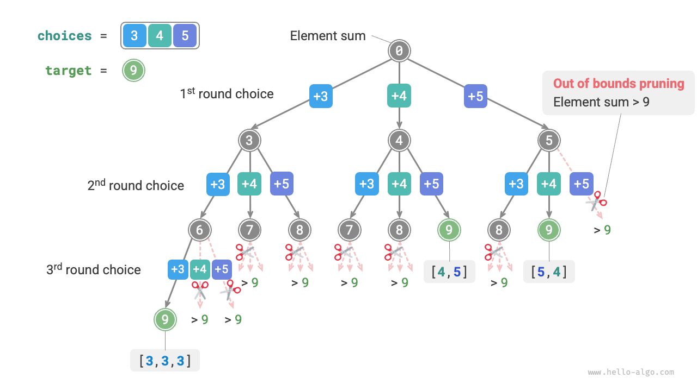
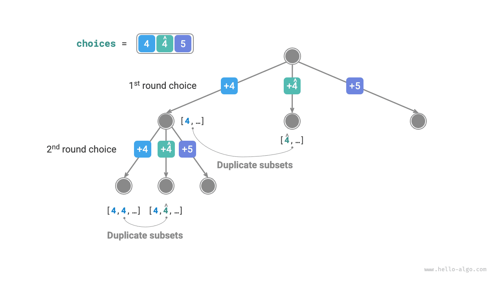

# 部分集合和問題

## 重複した要素がない場合

!!! question

    正の整数の配列 `nums` と、目標となる正の整数 `target` が与えられます。要素の和が `target` になるすべての組み合わせを求めてください。配列に重複した要素はなく、各要素は何度でも選べます。組み合わせをリストで返し、重複した組み合わせは含めないでください。

たとえば、入力集合が $\{3, 4, 5\}$、目標が $9$ なら、解は $\{3, 3, 3\}, \{4, 5\}$ です。次の 2 点に注意してください。

- 入力集合の要素は、回数の制限なく繰り返し選べます。
- 部分集合では要素の順序を区別しません。たとえば、$\{4, 5\}$ と $\{5, 4\}$ は同じ部分集合です。

### 順列列挙の解法を参考にする

順列列挙と同様に、部分集合を作る過程を一連の選択と考えられます。選ぶたびに「要素の和」を更新し、`target` と等しくなったら、その部分集合を結果リストに記録します。

順列列挙と違い、**この問題では同じ要素を何度でも選べる**ため、ブールリスト `selected` で選択済みかを記録する必要はありません。順列列挙のコードを少し修正すると、まず次の解法が得られます。

```src
[file]{subset_sum_i_naive}-[class]{}-[func]{subset_sum_i_naive}
```

このコードに配列 $[3, 4, 5]$ と目標 $9$ を渡すと、結果は $[3, 3, 3], [4, 5], [5, 4]$ になります。**和が $9$ の部分集合はすべて見つかりましたが、$[4, 5]$ と $[5, 4]$ が重複しています**。

探索では選択順を区別する一方、部分集合では区別しないためです。下図のように、$4$ の後に $5$ を選ぶ場合と、$5$ の後に $4$ を選ぶ場合は、探索上は別の分岐でも、同じ部分集合になります。



重複した部分集合を除くため、**結果リストから重複を取り除く方法が考えられます**。しかし、次の二つの理由で非効率です。

- 配列の要素が多いとき、特に `target` が大きいときは、探索中に大量の重複した部分集合が生成されます。
- 部分集合（配列）が同じかを比べるには、まずソートし、その後、各要素を比較する必要があり、時間がかかります。

### 重複する部分集合の枝刈り

**探索中の枝刈りで重複を除くことを考えます**。下図のように、重複は配列の要素を異なる順で選ぶことで生じます。たとえば、次のような場合です。

1. 1 回目と 2 回目に $3$ と $4$ を選ぶと、この二つを含むすべての部分集合 $[3, 4, \dots]$ が生成されます。
2. その後、1 回目に $4$ を選ぶ場合は、**2 回目の $3$ を飛ばす必要があります**。ここでできる $[4, 3, \dots]$ は、手順 `1.` で生成した部分集合と完全に重複するためです。

探索では各段階の選択肢を左から右へ順に試すため、右側の分岐ほど多く枝刈りされます。

1. 最初の 2 回で $3$ と $5$ を選び、部分集合 $[3, 5, \dots]$ を生成します。
2. 最初の 2 回で $4$ と $5$ を選び、部分集合 $[4, 5, \dots]$ を生成します。
3. 1 回目に $5$ を選ぶ場合は、**2 回目の $3$ と $4$ を飛ばす必要があります**。$[5, 3, \dots]$ と $[5, 4, \dots]$ は、手順 `1.` と `2.` の部分集合と完全に重複するためです。


まとめると、入力配列を $[x_1, x_2, \dots, x_n]$、選択の列を $[x_{i_1}, x_{i_2}, \dots, x_{i_m}]$ としたとき、$i_1 \leq i_2 \leq \dots \leq i_m$ を満たす必要があります。**この条件を満たさない選択の列は重複を生むため、枝刈りすべきです**。

### コードの実装

この枝刈りのため、走査の開始位置を表す変数 `start` を用意します。**$x_{i}$ を選んだら、次の回はインデックス $i$ から走査を始めます**。これで選択の列が $i_1 \leq i_2 \leq \dots \leq i_m$ を満たし、部分集合の重複を防げます。

さらに、コードに次の二つの改善を加えます。

- 探索前に配列 `nums` をソートします。選択肢を走査するとき、**部分集合の和が `target` を超えたら、ループをその場で終了します**。後ろの要素はさらに大きいため、それらを選んでも和が必ず `target` を超えるからです。
- 和を表す変数 `total` をなくし、**`target` から減算することで和を管理します**。`target` が $0$ になったら解を記録します。

```src
[file]{subset_sum_i}-[class]{}-[func]{subset_sum_i}
```

下図に、配列 $[3, 4, 5]$ と目標 $9$ を入力したときの、バックトラッキング全体の流れを示します。


## 重複した要素がある場合

!!! question

    正の整数の配列 `nums` と、目標となる正の整数 `target` が与えられます。要素の和が `target` になるすべての組み合わせを求めてください。**配列には重複した要素が含まれる場合があり、各要素は一度だけ選べます**。組み合わせをリストで返し、重複した組み合わせは含めないでください。

前の問題と異なり、**入力配列に重複した要素が含まれる場合があり**、新たな問題が生じます。たとえば配列 $[4, \hat{4}, 5]$ と目標 $9$ に対し、現在のコードは $[4, 5], [\hat{4}, 5]$ を返し、部分集合が重複します。

**この重複は、ある回の選択で同じ値の要素を何度も選ぶことが原因です**。下図の 1 回目には三つの選択肢があり、そのうち二つが $4$ なので、重複した探索分岐から同じ部分集合が生成されます。同様に、2 回目の二つの $4$ も重複を生みます。



### 同じ値の要素による分岐の枝刈り

これを防ぐには、**同じ値の要素を、各回の選択で一度だけ選ぶようにします**。配列はソート済みなので、同じ値は隣り合っています。そこで、ある回の選択で現在の要素が左隣と同じなら、その値はすでに選んだとわかるため、現在の要素を飛ばします。

また、**この問題では配列の各要素を一度しか選べません**。この制約も `start` で満たせます。$x_{i}$ を選んだら、次の回はインデックス $i + 1$ から後ろを走査します。これで部分集合の重複を除くと同時に、同じ要素の再選択も防げます。

### コードの実装

```src
[file]{subset_sum_ii}-[class]{}-[func]{subset_sum_ii}
```

下図に、配列 $[4, 4, 5]$ と目標 $9$ のバックトラッキングを示します。4 種類の枝刈りが含まれています。図とコードの注釈を照らし合わせ、探索全体の流れと、それぞれの枝刈りの働きを理解してください。


