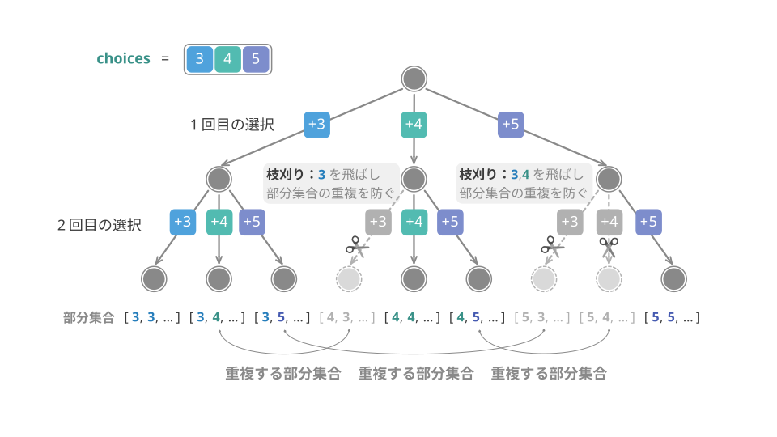

# 部分和問題

## 重複する要素がない場合

!!! question

    正の整数の配列 `nums` と、目標となる正の整数 `target` が与えられます。要素の和が `target` になる組み合わせをすべて求めてください。配列の値に重複はなく、各要素は何度でも選べます。組み合わせはリストとして返し、重複する組み合わせを含めないでください。

たとえば、入力集合が $\{3, 4, 5\}$、目標値が $9$ のとき、解は $\{3, 3, 3\}, \{4, 5\}$ です。次の 2 点に注意しましょう。

- 入力集合の各要素は、回数に制限なく選べます。
- 部分集合では要素の順序を区別しません。たとえば $\{4, 5\}$ と $\{5, 4\}$ は同じ部分集合です。

### 全順列問題の解法を利用する

全順列問題と同じように、部分集合も一連の選択の結果と考えられます。選択のたびに要素の和を更新し、和が `target` に等しくなったら、部分集合を結果のリストに記録します。

全順列問題と異なり、**この問題では集合の各要素を何度でも選べます**。そのため、選択済みかどうかをブールリスト `selected` に記録する必要はありません。全順列のコードを少し変更して、まずは次のように実装できます。

```src
[file]{subset_sum_i_naive}-[class]{}-[func]{subset_sum_i_naive}
```

このコードに配列 $[3, 4, 5]$ と目標値 $9$ を入力すると、結果は $[3, 3, 3], [4, 5], [5, 4]$ です。**和が $9$ になる部分集合はすべて見つかりましたが、$[4, 5]$ と $[5, 4]$ は重複しています**。

探索では選択の順序を区別しますが、部分集合では区別しないためです。次の図で、$4$、$5$ の順に選ぶ枝と、$5$、$4$ の順に選ぶ枝は別ですが、同じ部分集合に対応します。


重複する部分集合を除くには、**結果のリストから重複を取り除く方法**がすぐに思い浮かびます。ただし、次の二つの理由で効率がよくありません。

- 配列の要素が多いとき、特に `target` が大きいときは、探索中に重複する部分集合が大量に生じます。
- 部分集合（配列）が同じかどうかを調べるには、先に配列をソートし、各要素が一致するか比べる必要があり、時間がかかります。

### 重複する部分集合の枝刈り

**探索中に枝刈りして重複を防ぐ方法を考えます**。次の図のように、配列の要素を異なる順序で選ぶと、部分集合が重複します。具体的に見てみましょう。

1. 1 回目に $3$、2 回目に $4$ を選ぶと、この二つの要素を含むすべての部分集合が生成されます。これらを $[3, 4, \dots]$ と表します。
2. その後、1 回目に $4$ を選んだら、**2 回目は $3$ を飛ばします**。ここで生じる部分集合 $[4, 3, \dots]$ は、手順 `1.` の部分集合と完全に重複するからです。

各階層では選択肢を左から右へ順に試すため、右に行くほど多くの枝が刈られます。

1. 最初の 2 回で $3$、$5$ を選ぶと、部分集合 $[3, 5, \dots]$ が生成されます。
2. 最初の 2 回で $4$、$5$ を選ぶと、部分集合 $[4, 5, \dots]$ が生成されます。
3. 1 回目に $5$ を選んだら、**2 回目は $3$ と $4$ を飛ばします**。部分集合 $[5, 3, \dots]$ と $[5, 4, \dots]$ は、手順 `1.` と手順 `2.` の部分集合と完全に重複するからです。



まとめると、入力配列を $[x_1, x_2, \dots, x_n]$、探索で選んだ列を $[x_{i_1}, x_{i_2}, \dots, x_{i_m}]$ とすると、この列は $i_1 \leq i_2 \leq \dots \leq i_m$ を満たす必要があります。**この条件を満たさない列は重複を生むので、枝刈りします**。

### 実装

走査の開始位置を表す変数 `start` を初期化します。**$x_{i}$ を選んだら、次の段階の走査をインデックス $i$ から始めます**。これで選択列が $i_1 \leq i_2 \leq \dots \leq i_m$ を満たし、部分集合が重複しなくなります。

さらに、コードを次の 2 点で改善します。

- 探索を始める前に配列 `nums` をソートします。選択肢を調べるとき、**部分集合の和が `target` を超えたら、そこでループを終了します**。後の要素はさらに大きく、どれを選んでも和が `target` を超えるからです。
- 要素の和を表す変数 `total` を省き、**`target` から順に要素を引いて和を管理します**。`target` が $0$ になったら解を記録します。

```src
[file]{subset_sum_i}-[class]{}-[func]{subset_sum_i}
```

次の図は、配列 $[3, 4, 5]$ と目標値 $9$ をこのコードに入力したときのバックトラッキングの全過程です。


## 重複する要素がある場合

!!! question

    正の整数の配列 `nums` と、目標となる正の整数 `target` が与えられます。要素の和が `target` になる組み合わせをすべて求めてください。**配列には値の等しい要素が含まれる場合があり、各要素を選べるのは一度だけです**。組み合わせはリストとして返し、重複する組み合わせを含めないでください。

前の問題とは異なり、**入力配列に値の等しい要素が含まれる場合があります**。これが新たな問題を引き起こします。たとえば、配列 $[4, \hat{4}, 5]$ と目標値 $9$ をこれまでのコードに入力すると、結果は $[4, 5], [\hat{4}, 5]$ となり、部分集合が重複します。

**重複の原因は、同じ段階で等しい値を繰り返し選ぶことです**。次の図では、1 回目の三つの選択肢のうち二つが $4$ です。この二つの探索の枝が重複し、同じ部分集合が出力されます。同様に、2 回目の二つの $4$ も重複を生みます。


### 等しい値を試す枝の枝刈り

重複を防ぐには、**各段階で等しい値を一度だけ試すようにします**。ここでソート済みの配列では等しい値が隣り合うことを利用します。その段階で、今調べている要素が直前に調べた要素と等しければ、その値はすでに試しているので飛ばします。

また、**この問題では配列の各要素を一度しか選べません**。この制約も変数 `start` で扱えます。$x_{i}$ を選んだら、次の段階ではインデックス $i + 1$ から先を調べます。こうすれば、部分集合の重複と同じ要素の再選択をどちらも防げます。

### 実装

```src
[file]{subset_sum_ii}-[class]{}-[func]{subset_sum_ii}
```

次の図は配列 $[4, 4, 5]$ と目標値 $9$ を使ったバックトラッキングの過程で、4 種類の枝刈りが含まれます。図とコードのコメントを照らし合わせ、探索の流れとそれぞれの枝刈りの働きを確認しましょう。


