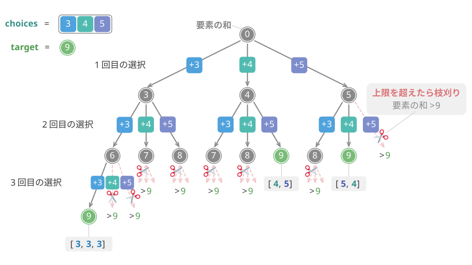
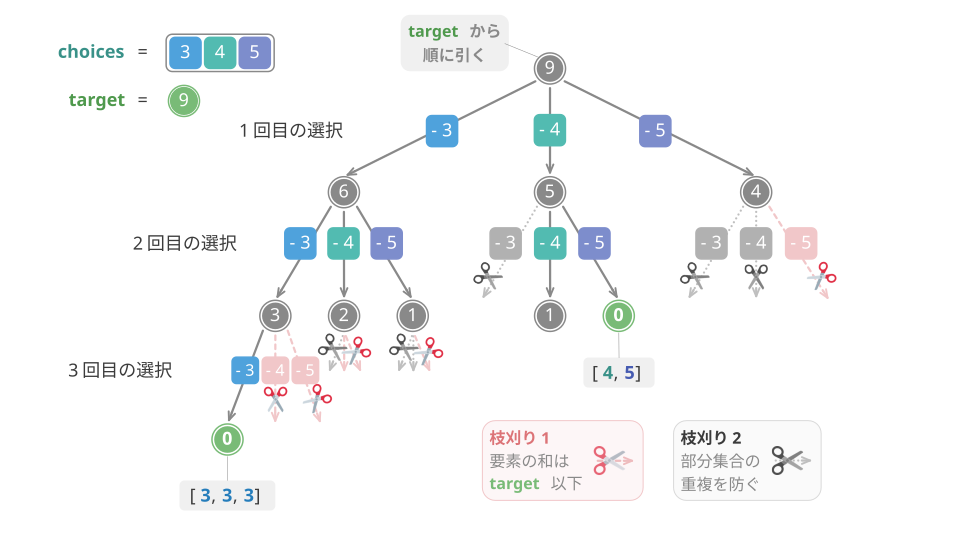
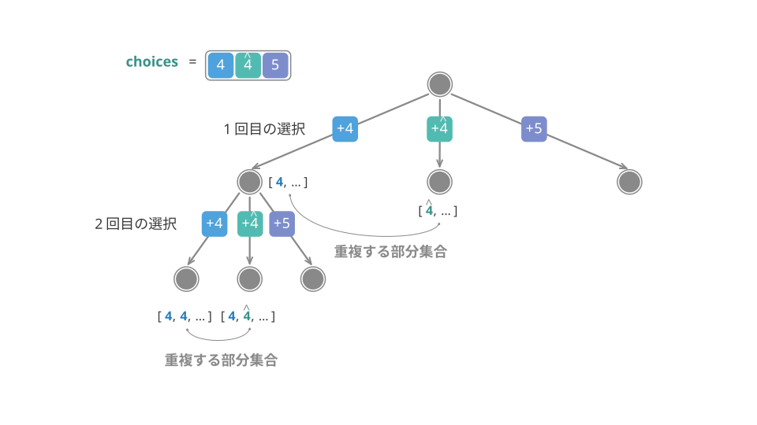
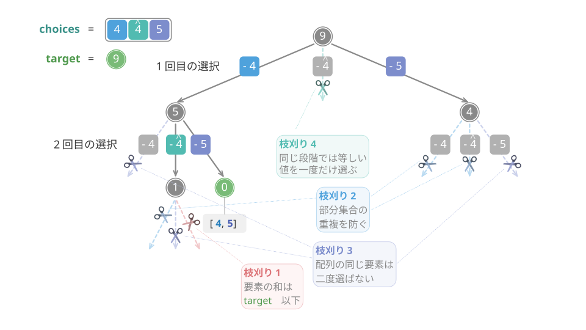

# 13.3 &nbsp; 部分和問題

## 13.3.1 &nbsp; 重複する要素がない場合

!!! question "問題"

    正の整数の配列 `nums` と、目標となる正の整数 `target` が与えられます。要素の和が `target` になる組み合わせをすべて求めてください。配列の値に重複はなく、各要素は何度でも選べます。組み合わせはリストとして返し、重複する組み合わせを含めないでください。

たとえば、入力集合が $\{3, 4, 5\}$、目標値が $9$ のとき、解は $\{3, 3, 3\}, \{4, 5\}$ です。次の 2 点に注意しましょう。

- 入力集合の各要素は、回数に制限なく選べます。
- 部分集合では要素の順序を区別しません。たとえば $\{4, 5\}$ と $\{5, 4\}$ は同じ部分集合です。

### 1. &nbsp; 全順列問題の解法を利用する

全順列問題と同じように、部分集合も一連の選択の結果と考えられます。選択のたびに要素の和を更新し、和が `target` に等しくなったら、部分集合を結果のリストに記録します。

全順列問題と異なり、**この問題では集合の各要素を何度でも選べます**。そのため、選択済みかどうかをブールリスト `selected` に記録する必要はありません。全順列のコードを少し変更して、まずは次のように実装できます。

=== "Python"

    ```python title="subset_sum_i_naive.py"
    def backtrack(
        state: list[int],
        target: int,
        total: int,
        choices: list[int],
        res: list[list[int]],
    ):
        """バックトラッキングによる部分和問題 I"""
        # 部分集合の要素の和が target に等しくなったら解を記録する
        if total == target:
            res.append(list(state))
            return
        # すべての選択肢を調べる
        for i in range(len(choices)):
            # 枝刈り：部分集合の要素の和が target を超えるなら、その選択を飛ばす
            if total + choices[i] > target:
                continue
            # 試行：選択して要素の和 total を更新する
            state.append(choices[i])
            # 次の選択に進む
            backtrack(state, target, total + choices[i], choices, res)
            # 後戻り：選択を取り消し、元の状態に戻す
            state.pop()

    def subset_sum_i_naive(nums: list[int], target: int) -> list[list[int]]:
        """部分和問題 I を解く（重複する部分集合を含む）"""
        state = []  # 状態（部分集合）
        total = 0  # 部分和
        res = []  # 結果のリスト（部分集合のリスト）
        backtrack(state, target, total, nums, res)
        return res
    ```

=== "C++"

    ```cpp title="subset_sum_i_naive.cpp"
    /* バックトラッキングによる部分和問題 I */
    void backtrack(vector<int> &state, int target, int total, vector<int> &choices, vector<vector<int>> &res) {
        // 部分集合の要素の和が target に等しくなったら解を記録する
        if (total == target) {
            res.push_back(state);
            return;
        }
        // すべての選択肢を調べる
        for (size_t i = 0; i < choices.size(); i++) {
            // 枝刈り：部分集合の要素の和が target を超えるなら、その選択を飛ばす
            if (total + choices[i] > target) {
                continue;
            }
            // 試行：選択して要素の和 total を更新する
            state.push_back(choices[i]);
            // 次の選択に進む
            backtrack(state, target, total + choices[i], choices, res);
            // 後戻り：選択を取り消し、元の状態に戻す
            state.pop_back();
        }
    }

    /* 部分和問題 I を解く（重複する部分集合を含む） */
    vector<vector<int>> subsetSumINaive(vector<int> &nums, int target) {
        vector<int> state;       // 状態（部分集合）
        int total = 0;           // 部分和
        vector<vector<int>> res; // 結果のリスト（部分集合のリスト）
        backtrack(state, target, total, nums, res);
        return res;
    }
    ```

=== "Java"

    ```java title="subset_sum_i_naive.java"
    /* バックトラッキングによる部分和問題 I */
    void backtrack(List<Integer> state, int target, int total, int[] choices, List<List<Integer>> res) {
        // 部分集合の要素の和が target に等しくなったら解を記録する
        if (total == target) {
            res.add(new ArrayList<>(state));
            return;
        }
        // すべての選択肢を調べる
        for (int i = 0; i < choices.length; i++) {
            // 枝刈り：部分集合の要素の和が target を超えるなら、その選択を飛ばす
            if (total + choices[i] > target) {
                continue;
            }
            // 試行：選択して要素の和 total を更新する
            state.add(choices[i]);
            // 次の選択に進む
            backtrack(state, target, total + choices[i], choices, res);
            // 後戻り：選択を取り消し、元の状態に戻す
            state.remove(state.size() - 1);
        }
    }

    /* 部分和問題 I を解く（重複する部分集合を含む） */
    List<List<Integer>> subsetSumINaive(int[] nums, int target) {
        List<Integer> state = new ArrayList<>(); // 状態（部分集合）
        int total = 0; // 部分和
        List<List<Integer>> res = new ArrayList<>(); // 結果のリスト（部分集合のリスト）
        backtrack(state, target, total, nums, res);
        return res;
    }
    ```

=== "C#"

    ```csharp title="subset_sum_i_naive.cs"
    /* バックトラッキングによる部分和問題 I */
    void Backtrack(List<int> state, int target, int total, int[] choices, List<List<int>> res) {
        // 部分集合の要素の和が target に等しくなったら解を記録する
        if (total == target) {
            res.Add(new List<int>(state));
            return;
        }
        // すべての選択肢を調べる
        for (int i = 0; i < choices.Length; i++) {
            // 枝刈り：部分集合の要素の和が target を超えるなら、その選択を飛ばす
            if (total + choices[i] > target) {
                continue;
            }
            // 試行：選択して要素の和 total を更新する
            state.Add(choices[i]);
            // 次の選択に進む
            Backtrack(state, target, total + choices[i], choices, res);
            // 後戻り：選択を取り消し、元の状態に戻す
            state.RemoveAt(state.Count - 1);
        }
    }

    /* 部分和問題 I を解く（重複する部分集合を含む） */
    List<List<int>> SubsetSumINaive(int[] nums, int target) {
        List<int> state = []; // 状態（部分集合）
        int total = 0; // 部分和
        List<List<int>> res = []; // 結果のリスト（部分集合のリスト）
        Backtrack(state, target, total, nums, res);
        return res;
    }
    ```

=== "Go"

    ```go title="subset_sum_i_naive.go"
    /* バックトラッキングによる部分和問題 I */
    func backtrackSubsetSumINaive(total, target int, state, choices *[]int, res *[][]int) {
        // 部分集合の要素の和が target に等しくなったら解を記録する
        if target == total {
            newState := append([]int{}, *state...)
            *res = append(*res, newState)
            return
        }
        // すべての選択肢を調べる
        for i := 0; i < len(*choices); i++ {
            // 枝刈り：部分集合の要素の和が target を超えるなら、その選択を飛ばす
            if total+(*choices)[i] > target {
                continue
            }
            // 試行：選択して要素の和 total を更新する
            *state = append(*state, (*choices)[i])
            // 次の選択に進む
            backtrackSubsetSumINaive(total+(*choices)[i], target, state, choices, res)
            // 後戻り：選択を取り消し、元の状態に戻す
            *state = (*state)[:len(*state)-1]
        }
    }

    /* 部分和問題 I を解く（重複する部分集合を含む） */
    func subsetSumINaive(nums []int, target int) [][]int {
        state := make([]int, 0) // 状態（部分集合）
        total := 0              // 部分和
        res := make([][]int, 0) // 結果のリスト（部分集合のリスト）
        backtrackSubsetSumINaive(total, target, &state, &nums, &res)
        return res
    }
    ```

=== "Swift"

    ```swift title="subset_sum_i_naive.swift"
    /* バックトラッキングによる部分和問題 I */
    func backtrack(state: inout [Int], target: Int, total: Int, choices: [Int], res: inout [[Int]]) {
        // 部分集合の要素の和が target に等しくなったら解を記録する
        if total == target {
            res.append(state)
            return
        }
        // すべての選択肢を調べる
        for i in choices.indices {
            // 枝刈り：部分集合の要素の和が target を超えるなら、その選択を飛ばす
            if total + choices[i] > target {
                continue
            }
            // 試行：選択して要素の和 total を更新する
            state.append(choices[i])
            // 次の選択に進む
            backtrack(state: &state, target: target, total: total + choices[i], choices: choices, res: &res)
            // 後戻り：選択を取り消し、元の状態に戻す
            state.removeLast()
        }
    }

    /* 部分和問題 I を解く（重複する部分集合を含む） */
    func subsetSumINaive(nums: [Int], target: Int) -> [[Int]] {
        var state: [Int] = [] // 状態（部分集合）
        let total = 0 // 部分和
        var res: [[Int]] = [] // 結果のリスト（部分集合のリスト）
        backtrack(state: &state, target: target, total: total, choices: nums, res: &res)
        return res
    }
    ```

=== "JS"

    ```javascript title="subset_sum_i_naive.js"
    /* バックトラッキングによる部分和問題 I */
    function backtrack(state, target, total, choices, res) {
        // 部分集合の要素の和が target に等しくなったら解を記録する
        if (total === target) {
            res.push([...state]);
            return;
        }
        // すべての選択肢を調べる
        for (let i = 0; i < choices.length; i++) {
            // 枝刈り：部分集合の要素の和が target を超えるなら、その選択を飛ばす
            if (total + choices[i] > target) {
                continue;
            }
            // 試行：選択して要素の和 total を更新する
            state.push(choices[i]);
            // 次の選択に進む
            backtrack(state, target, total + choices[i], choices, res);
            // 後戻り：選択を取り消し、元の状態に戻す
            state.pop();
        }
    }

    /* 部分和問題 I を解く（重複する部分集合を含む） */
    function subsetSumINaive(nums, target) {
        const state = []; // 状態（部分集合）
        const total = 0; // 部分和
        const res = []; // 結果のリスト（部分集合のリスト）
        backtrack(state, target, total, nums, res);
        return res;
    }
    ```

=== "TS"

    ```typescript title="subset_sum_i_naive.ts"
    /* バックトラッキングによる部分和問題 I */
    function backtrack(
        state: number[],
        target: number,
        total: number,
        choices: number[],
        res: number[][]
    ): void {
        // 部分集合の要素の和が target に等しくなったら解を記録する
        if (total === target) {
            res.push([...state]);
            return;
        }
        // すべての選択肢を調べる
        for (let i = 0; i < choices.length; i++) {
            // 枝刈り：部分集合の要素の和が target を超えるなら、その選択を飛ばす
            if (total + choices[i] > target) {
                continue;
            }
            // 試行：選択して要素の和 total を更新する
            state.push(choices[i]);
            // 次の選択に進む
            backtrack(state, target, total + choices[i], choices, res);
            // 後戻り：選択を取り消し、元の状態に戻す
            state.pop();
        }
    }

    /* 部分和問題 I を解く（重複する部分集合を含む） */
    function subsetSumINaive(nums: number[], target: number): number[][] {
        const state = []; // 状態（部分集合）
        const total = 0; // 部分和
        const res = []; // 結果のリスト（部分集合のリスト）
        backtrack(state, target, total, nums, res);
        return res;
    }
    ```

=== "Dart"

    ```dart title="subset_sum_i_naive.dart"
    /* バックトラッキングによる部分和問題 I */
    void backtrack(
      List<int> state,
      int target,
      int total,
      List<int> choices,
      List<List<int>> res,
    ) {
      // 部分集合の要素の和が target に等しくなったら解を記録する
      if (total == target) {
        res.add(List.from(state));
        return;
      }
      // すべての選択肢を調べる
      for (int i = 0; i < choices.length; i++) {
        // 枝刈り：部分集合の要素の和が target を超えるなら、その選択を飛ばす
        if (total + choices[i] > target) {
          continue;
        }
        // 試行：選択して要素の和 total を更新する
        state.add(choices[i]);
        // 次の選択に進む
        backtrack(state, target, total + choices[i], choices, res);
        // 後戻り：選択を取り消し、元の状態に戻す
        state.removeLast();
      }
    }

    /* 部分和問題 I を解く（重複する部分集合を含む） */
    List<List<int>> subsetSumINaive(List<int> nums, int target) {
      List<int> state = []; // 状態（部分集合）
      int total = 0; // 要素の和
      List<List<int>> res = []; // 結果のリスト（部分集合のリスト）
      backtrack(state, target, total, nums, res);
      return res;
    }
    ```

=== "Rust"

    ```rust title="subset_sum_i_naive.rs"
    /* バックトラッキングによる部分和問題 I */
    fn backtrack(
        state: &mut Vec<i32>,
        target: i32,
        total: i32,
        choices: &[i32],
        res: &mut Vec<Vec<i32>>,
    ) {
        // 部分集合の要素の和が target に等しくなったら解を記録する
        if total == target {
            res.push(state.clone());
            return;
        }
        // すべての選択肢を調べる
        for i in 0..choices.len() {
            // 枝刈り：部分集合の要素の和が target を超えるなら、その選択を飛ばす
            if total + choices[i] > target {
                continue;
            }
            // 試行：選択して要素の和 total を更新する
            state.push(choices[i]);
            // 次の選択に進む
            backtrack(state, target, total + choices[i], choices, res);
            // 後戻り：選択を取り消し、元の状態に戻す
            state.pop();
        }
    }

    /* 部分和問題 I を解く（重複する部分集合を含む） */
    fn subset_sum_i_naive(nums: &[i32], target: i32) -> Vec<Vec<i32>> {
        let mut state = Vec::new(); // 状態（部分集合）
        let total = 0; // 部分和
        let mut res = Vec::new(); // 結果のリスト（部分集合のリスト）
        backtrack(&mut state, target, total, nums, &mut res);
        res
    }
    ```

=== "C"

    ```c title="subset_sum_i_naive.c"
    /* バックトラッキングによる部分和問題 I */
    void backtrack(int target, int total, int *choices, int choicesSize) {
        // 部分集合の要素の和が target に等しくなったら解を記録する
        if (total == target) {
            for (int i = 0; i < stateSize; i++) {
                res[resSize][i] = state[i];
            }
            resColSizes[resSize++] = stateSize;
            return;
        }
        // すべての選択肢を調べる
        for (int i = 0; i < choicesSize; i++) {
            // 枝刈り：部分集合の要素の和が target を超えるなら、その選択を飛ばす
            if (total + choices[i] > target) {
                continue;
            }
            // 試行：選択して要素の和 total を更新する
            state[stateSize++] = choices[i];
            // 次の選択に進む
            backtrack(target, total + choices[i], choices, choicesSize);
            // 後戻り：選択を取り消し、元の状態に戻す
            stateSize--;
        }
    }

    /* 部分和問題 I を解く（重複する部分集合を含む） */
    void subsetSumINaive(int *nums, int numsSize, int target) {
        resSize = 0; // 解の個数を 0 に初期化する
        backtrack(target, 0, nums, numsSize);
    }
    ```

=== "Kotlin"

    ```kotlin title="subset_sum_i_naive.kt"
    /* バックトラッキングによる部分和問題 I */
    fun backtrack(
        state: MutableList<Int>,
        target: Int,
        total: Int,
        choices: IntArray,
        res: MutableList<MutableList<Int>?>
    ) {
        // 部分集合の要素の和が target に等しくなったら解を記録する
        if (total == target) {
            res.add(state.toMutableList())
            return
        }
        // すべての選択肢を調べる
        for (i in choices.indices) {
            // 枝刈り：部分集合の要素の和が target を超えるなら、その選択を飛ばす
            if (total + choices[i] > target) {
                continue
            }
            // 試行：選択して要素の和 total を更新する
            state.add(choices[i])
            // 次の選択に進む
            backtrack(state, target, total + choices[i], choices, res)
            // 後戻り：選択を取り消し、元の状態に戻す
            state.removeAt(state.size - 1)
        }
    }

    /* 部分和問題 I を解く（重複する部分集合を含む） */
    fun subsetSumINaive(nums: IntArray, target: Int): MutableList<MutableList<Int>?> {
        val state = mutableListOf<Int>() // 状態（部分集合）
        val total = 0 // 部分和
        val res = mutableListOf<MutableList<Int>?>() // 結果のリスト（部分集合のリスト）
        backtrack(state, target, total, nums, res)
        return res
    }
    ```

=== "Ruby"

    ```ruby title="subset_sum_i_naive.rb"
    ### バックトラッキングによる部分和問題 I ###
    def backtrack(state, target, total, choices, res)
      # 部分集合の要素の和が target に等しくなったら解を記録する
      if total == target
        res << state.dup
        return
      end

      # すべての選択肢を調べる
      for i in 0...choices.length
        # 枝刈り：部分集合の要素の和が target を超えるなら、その選択を飛ばす
        next if total + choices[i] > target
        # 試行：選択して要素の和 total を更新する
        state << choices[i]
        # 次の選択に進む
        backtrack(state, target, total + choices[i], choices, res)
        # 後戻り：選択を取り消し、元の状態に戻す
        state.pop
      end
    end

    ### 部分和問題 I を解く（重複する部分集合を含む）###
    def subset_sum_i_naive(nums, target)
      state = [] # 状態（部分集合）
      total = 0 # 部分和
      res = [] # 結果のリスト（部分集合のリスト）
      backtrack(state, target, total, nums, res)
      res
    end
    ```

??? pythontutor "実行の様子を見る"

    <div style="height: 549px; width: 100%;"><iframe class="pythontutor-iframe" title="実行の様子を見る" src="https://pythontutor.com/iframe-embed.html#code=def%20backtrack%28%0A%20%20%20%20state%3A%20list%5Bint%5D,%0A%20%20%20%20target%3A%20int,%0A%20%20%20%20total%3A%20int,%0A%20%20%20%20choices%3A%20list%5Bint%5D,%0A%20%20%20%20res%3A%20list%5Blist%5Bint%5D%5D,%0A%29%3A%0A%20%20%20%20%22%22%22%E3%83%90%E3%83%83%E3%82%AF%E3%83%88%E3%83%A9%E3%83%83%E3%82%AD%E3%83%B3%E3%82%B0%E3%81%AB%E3%82%88%E3%82%8B%E9%83%A8%E5%88%86%E5%92%8C%E5%95%8F%E9%A1%8C%20I%22%22%22%0A%20%20%20%20%23%20%E9%83%A8%E5%88%86%E9%9B%86%E5%90%88%E3%81%AE%E8%A6%81%E7%B4%A0%E3%81%AE%E5%92%8C%E3%81%8C%20target%20%E3%81%AB%E7%AD%89%E3%81%97%E3%81%8F%E3%81%AA%E3%81%A3%E3%81%9F%E3%82%89%E8%A7%A3%E3%82%92%E8%A8%98%E9%8C%B2%E3%81%99%E3%82%8B%0A%20%20%20%20if%20total%20%3D%3D%20target%3A%0A%20%20%20%20%20%20%20%20res.append%28list%28state%29%29%0A%20%20%20%20%20%20%20%20return%0A%20%20%20%20%23%20%E3%81%99%E3%81%B9%E3%81%A6%E3%81%AE%E9%81%B8%E6%8A%9E%E8%82%A2%E3%82%92%E8%AA%BF%E3%81%B9%E3%82%8B%0A%20%20%20%20for%20i%20in%20range%28len%28choices%29%29%3A%0A%20%20%20%20%20%20%20%20%23%20%E6%9E%9D%E5%88%88%E3%82%8A%EF%BC%9A%E9%83%A8%E5%88%86%E9%9B%86%E5%90%88%E3%81%AE%E8%A6%81%E7%B4%A0%E3%81%AE%E5%92%8C%E3%81%8C%20target%20%E3%82%92%E8%B6%85%E3%81%88%E3%82%8B%E3%81%AA%E3%82%89%E3%80%81%E3%81%9D%E3%81%AE%E9%81%B8%E6%8A%9E%E3%82%92%E9%A3%9B%E3%81%B0%E3%81%99%0A%20%20%20%20%20%20%20%20if%20total%20%2B%20choices%5Bi%5D%20%3E%20target%3A%0A%20%20%20%20%20%20%20%20%20%20%20%20continue%0A%20%20%20%20%20%20%20%20%23%20%E8%A9%A6%E8%A1%8C%EF%BC%9A%E9%81%B8%E6%8A%9E%E3%81%97%E3%81%A6%E8%A6%81%E7%B4%A0%E3%81%AE%E5%92%8C%20total%20%E3%82%92%E6%9B%B4%E6%96%B0%E3%81%99%E3%82%8B%0A%20%20%20%20%20%20%20%20state.append%28choices%5Bi%5D%29%0A%20%20%20%20%20%20%20%20%23%20%E6%AC%A1%E3%81%AE%E9%81%B8%E6%8A%9E%E3%81%AB%E9%80%B2%E3%82%80%0A%20%20%20%20%20%20%20%20backtrack%28state,%20target,%20total%20%2B%20choices%5Bi%5D,%20choices,%20res%29%0A%20%20%20%20%20%20%20%20%23%20%E5%BE%8C%E6%88%BB%E3%82%8A%EF%BC%9A%E9%81%B8%E6%8A%9E%E3%82%92%E5%8F%96%E3%82%8A%E6%B6%88%E3%81%97%E3%80%81%E5%85%83%E3%81%AE%E7%8A%B6%E6%85%8B%E3%81%AB%E6%88%BB%E3%81%99%0A%20%20%20%20%20%20%20%20state.pop%28%29%0A%0A%0Adef%20subset_sum_i_naive%28nums%3A%20list%5Bint%5D,%20target%3A%20int%29%20-%3E%20list%5Blist%5Bint%5D%5D%3A%0A%20%20%20%20%22%22%22%E9%83%A8%E5%88%86%E5%92%8C%E5%95%8F%E9%A1%8C%20I%20%E3%82%92%E8%A7%A3%E3%81%8F%EF%BC%88%E9%87%8D%E8%A4%87%E3%81%99%E3%82%8B%E9%83%A8%E5%88%86%E9%9B%86%E5%90%88%E3%82%92%E5%90%AB%E3%82%80%EF%BC%89%22%22%22%0A%20%20%20%20state%20%3D%20%5B%5D%20%20%23%20%E7%8A%B6%E6%85%8B%EF%BC%88%E9%83%A8%E5%88%86%E9%9B%86%E5%90%88%EF%BC%89%0A%20%20%20%20total%20%3D%200%20%20%23%20%E9%83%A8%E5%88%86%E5%92%8C%0A%20%20%20%20res%20%3D%20%5B%5D%20%20%23%20%E7%B5%90%E6%9E%9C%E3%81%AE%E3%83%AA%E3%82%B9%E3%83%88%EF%BC%88%E9%83%A8%E5%88%86%E9%9B%86%E5%90%88%E3%81%AE%E3%83%AA%E3%82%B9%E3%83%88%EF%BC%89%0A%20%20%20%20backtrack%28state,%20target,%20total,%20nums,%20res%29%0A%20%20%20%20return%20res%0A%0A%0A%22%22%22Driver%20Code%22%22%22%0Aif%20__name__%20%3D%3D%20%22__main__%22%3A%0A%20%20%20%20nums%20%3D%20%5B3,%204,%205%5D%0A%20%20%20%20target%20%3D%209%0A%20%20%20%20res%20%3D%20subset_sum_i_naive%28nums,%20target%29%0A%0A%20%20%20%20print%28f%22%E5%85%A5%E5%8A%9B%E9%85%8D%E5%88%97%20nums%20%3D%20%7Bnums%7D,%20target%20%3D%20%7Btarget%7D%22%29%0A%20%20%20%20print%28f%22%E8%A6%81%E7%B4%A0%E3%81%AE%E5%92%8C%E3%81%8C%20%7Btarget%7D%20%E3%81%A8%E3%81%AA%E3%82%8B%E3%81%99%E3%81%B9%E3%81%A6%E3%81%AE%E9%83%A8%E5%88%86%E9%9B%86%E5%90%88%20res%20%3D%20%7Bres%7D%22%29%0A%20%20%20%20print%28f%22%E3%81%93%E3%81%AE%E6%96%B9%E6%B3%95%E3%81%AE%E5%87%BA%E5%8A%9B%E3%81%AB%E3%81%AF%E9%87%8D%E8%A4%87%E3%81%99%E3%82%8B%E9%9B%86%E5%90%88%E3%81%8C%E5%90%AB%E3%81%BE%E3%82%8C%E3%82%8B%E7%82%B9%E3%81%AB%E6%B3%A8%E6%84%8F%22%29&codeDivHeight=472&codeDivWidth=350&cumulative=false&curInstr=16&heapPrimitives=nevernest&origin=opt-frontend.js&py=311&rawInputLstJSON=%5B%5D&textReferences=false"> </iframe></div>
    <div style="margin-top: 5px;"><a href="https://pythontutor.com/iframe-embed.html#code=def%20backtrack%28%0A%20%20%20%20state%3A%20list%5Bint%5D,%0A%20%20%20%20target%3A%20int,%0A%20%20%20%20total%3A%20int,%0A%20%20%20%20choices%3A%20list%5Bint%5D,%0A%20%20%20%20res%3A%20list%5Blist%5Bint%5D%5D,%0A%29%3A%0A%20%20%20%20%22%22%22%E3%83%90%E3%83%83%E3%82%AF%E3%83%88%E3%83%A9%E3%83%83%E3%82%AD%E3%83%B3%E3%82%B0%E3%81%AB%E3%82%88%E3%82%8B%E9%83%A8%E5%88%86%E5%92%8C%E5%95%8F%E9%A1%8C%20I%22%22%22%0A%20%20%20%20%23%20%E9%83%A8%E5%88%86%E9%9B%86%E5%90%88%E3%81%AE%E8%A6%81%E7%B4%A0%E3%81%AE%E5%92%8C%E3%81%8C%20target%20%E3%81%AB%E7%AD%89%E3%81%97%E3%81%8F%E3%81%AA%E3%81%A3%E3%81%9F%E3%82%89%E8%A7%A3%E3%82%92%E8%A8%98%E9%8C%B2%E3%81%99%E3%82%8B%0A%20%20%20%20if%20total%20%3D%3D%20target%3A%0A%20%20%20%20%20%20%20%20res.append%28list%28state%29%29%0A%20%20%20%20%20%20%20%20return%0A%20%20%20%20%23%20%E3%81%99%E3%81%B9%E3%81%A6%E3%81%AE%E9%81%B8%E6%8A%9E%E8%82%A2%E3%82%92%E8%AA%BF%E3%81%B9%E3%82%8B%0A%20%20%20%20for%20i%20in%20range%28len%28choices%29%29%3A%0A%20%20%20%20%20%20%20%20%23%20%E6%9E%9D%E5%88%88%E3%82%8A%EF%BC%9A%E9%83%A8%E5%88%86%E9%9B%86%E5%90%88%E3%81%AE%E8%A6%81%E7%B4%A0%E3%81%AE%E5%92%8C%E3%81%8C%20target%20%E3%82%92%E8%B6%85%E3%81%88%E3%82%8B%E3%81%AA%E3%82%89%E3%80%81%E3%81%9D%E3%81%AE%E9%81%B8%E6%8A%9E%E3%82%92%E9%A3%9B%E3%81%B0%E3%81%99%0A%20%20%20%20%20%20%20%20if%20total%20%2B%20choices%5Bi%5D%20%3E%20target%3A%0A%20%20%20%20%20%20%20%20%20%20%20%20continue%0A%20%20%20%20%20%20%20%20%23%20%E8%A9%A6%E8%A1%8C%EF%BC%9A%E9%81%B8%E6%8A%9E%E3%81%97%E3%81%A6%E8%A6%81%E7%B4%A0%E3%81%AE%E5%92%8C%20total%20%E3%82%92%E6%9B%B4%E6%96%B0%E3%81%99%E3%82%8B%0A%20%20%20%20%20%20%20%20state.append%28choices%5Bi%5D%29%0A%20%20%20%20%20%20%20%20%23%20%E6%AC%A1%E3%81%AE%E9%81%B8%E6%8A%9E%E3%81%AB%E9%80%B2%E3%82%80%0A%20%20%20%20%20%20%20%20backtrack%28state,%20target,%20total%20%2B%20choices%5Bi%5D,%20choices,%20res%29%0A%20%20%20%20%20%20%20%20%23%20%E5%BE%8C%E6%88%BB%E3%82%8A%EF%BC%9A%E9%81%B8%E6%8A%9E%E3%82%92%E5%8F%96%E3%82%8A%E6%B6%88%E3%81%97%E3%80%81%E5%85%83%E3%81%AE%E7%8A%B6%E6%85%8B%E3%81%AB%E6%88%BB%E3%81%99%0A%20%20%20%20%20%20%20%20state.pop%28%29%0A%0A%0Adef%20subset_sum_i_naive%28nums%3A%20list%5Bint%5D,%20target%3A%20int%29%20-%3E%20list%5Blist%5Bint%5D%5D%3A%0A%20%20%20%20%22%22%22%E9%83%A8%E5%88%86%E5%92%8C%E5%95%8F%E9%A1%8C%20I%20%E3%82%92%E8%A7%A3%E3%81%8F%EF%BC%88%E9%87%8D%E8%A4%87%E3%81%99%E3%82%8B%E9%83%A8%E5%88%86%E9%9B%86%E5%90%88%E3%82%92%E5%90%AB%E3%82%80%EF%BC%89%22%22%22%0A%20%20%20%20state%20%3D%20%5B%5D%20%20%23%20%E7%8A%B6%E6%85%8B%EF%BC%88%E9%83%A8%E5%88%86%E9%9B%86%E5%90%88%EF%BC%89%0A%20%20%20%20total%20%3D%200%20%20%23%20%E9%83%A8%E5%88%86%E5%92%8C%0A%20%20%20%20res%20%3D%20%5B%5D%20%20%23%20%E7%B5%90%E6%9E%9C%E3%81%AE%E3%83%AA%E3%82%B9%E3%83%88%EF%BC%88%E9%83%A8%E5%88%86%E9%9B%86%E5%90%88%E3%81%AE%E3%83%AA%E3%82%B9%E3%83%88%EF%BC%89%0A%20%20%20%20backtrack%28state,%20target,%20total,%20nums,%20res%29%0A%20%20%20%20return%20res%0A%0A%0A%22%22%22Driver%20Code%22%22%22%0Aif%20__name__%20%3D%3D%20%22__main__%22%3A%0A%20%20%20%20nums%20%3D%20%5B3,%204,%205%5D%0A%20%20%20%20target%20%3D%209%0A%20%20%20%20res%20%3D%20subset_sum_i_naive%28nums,%20target%29%0A%0A%20%20%20%20print%28f%22%E5%85%A5%E5%8A%9B%E9%85%8D%E5%88%97%20nums%20%3D%20%7Bnums%7D,%20target%20%3D%20%7Btarget%7D%22%29%0A%20%20%20%20print%28f%22%E8%A6%81%E7%B4%A0%E3%81%AE%E5%92%8C%E3%81%8C%20%7Btarget%7D%20%E3%81%A8%E3%81%AA%E3%82%8B%E3%81%99%E3%81%B9%E3%81%A6%E3%81%AE%E9%83%A8%E5%88%86%E9%9B%86%E5%90%88%20res%20%3D%20%7Bres%7D%22%29%0A%20%20%20%20print%28f%22%E3%81%93%E3%81%AE%E6%96%B9%E6%B3%95%E3%81%AE%E5%87%BA%E5%8A%9B%E3%81%AB%E3%81%AF%E9%87%8D%E8%A4%87%E3%81%99%E3%82%8B%E9%9B%86%E5%90%88%E3%81%8C%E5%90%AB%E3%81%BE%E3%82%8C%E3%82%8B%E7%82%B9%E3%81%AB%E6%B3%A8%E6%84%8F%22%29&codeDivHeight=800&codeDivWidth=600&cumulative=false&curInstr=16&heapPrimitives=nevernest&origin=opt-frontend.js&py=311&rawInputLstJSON=%5B%5D&textReferences=false" target="_blank" rel="noopener noreferrer">全画面で表示 ></a></div>

このコードに配列 $[3, 4, 5]$ と目標値 $9$ を入力すると、結果は $[3, 3, 3], [4, 5], [5, 4]$ です。**和が $9$ になる部分集合はすべて見つかりましたが、$[4, 5]$ と $[5, 4]$ は重複しています**。

探索では選択の順序を区別しますが、部分集合では区別しないためです。図 13-10 で、$4$、$5$ の順に選ぶ枝と、$5$、$4$ の順に選ぶ枝は別ですが、同じ部分集合に対応します。

{ class="animation-figure" }

<p align="center"> 図 13-10 &nbsp; 部分集合の探索と上限を超えた枝の枝刈り </p>

重複する部分集合を除くには、**結果のリストから重複を取り除く方法**がすぐに思い浮かびます。ただし、次の二つの理由で効率がよくありません。

- 配列の要素が多いとき、特に `target` が大きいときは、探索中に重複する部分集合が大量に生じます。
- 部分集合（配列）が同じかどうかを調べるには、先に配列をソートし、各要素が一致するか比べる必要があり、時間がかかります。

### 2. &nbsp; 重複する部分集合の枝刈り

**探索中に枝刈りして重複を防ぐ方法を考えます**。図 13-11 のように、配列の要素を異なる順序で選ぶと、部分集合が重複します。具体的に見てみましょう。

1. 1 回目に $3$、2 回目に $4$ を選ぶと、この二つの要素を含むすべての部分集合が生成されます。これらを $[3, 4, \dots]$ と表します。
2. その後、1 回目に $4$ を選んだら、**2 回目は $3$ を飛ばします**。ここで生じる部分集合 $[4, 3, \dots]$ は、手順 `1.` の部分集合と完全に重複するからです。

各階層では選択肢を左から右へ順に試すため、右に行くほど多くの枝が刈られます。

1. 最初の 2 回で $3$、$5$ を選ぶと、部分集合 $[3, 5, \dots]$ が生成されます。
2. 最初の 2 回で $4$、$5$ を選ぶと、部分集合 $[4, 5, \dots]$ が生成されます。
3. 1 回目に $5$ を選んだら、**2 回目は $3$ と $4$ を飛ばします**。部分集合 $[5, 3, \dots]$ と $[5, 4, \dots]$ は、手順 `1.` と手順 `2.` の部分集合と完全に重複するからです。

{ class="animation-figure" }

<p align="center"> 図 13-11 &nbsp; 選択順の違いによる部分集合の重複 </p>

まとめると、入力配列を $[x_1, x_2, \dots, x_n]$、探索で選んだ列を $[x_{i_1}, x_{i_2}, \dots, x_{i_m}]$ とすると、この列は $i_1 \leq i_2 \leq \dots \leq i_m$ を満たす必要があります。**この条件を満たさない列は重複を生むので、枝刈りします**。

### 3. &nbsp; 実装

走査の開始位置を表す変数 `start` を初期化します。**$x_{i}$ を選んだら、次の段階の走査をインデックス $i$ から始めます**。これで選択列が $i_1 \leq i_2 \leq \dots \leq i_m$ を満たし、部分集合が重複しなくなります。

さらに、コードを次の 2 点で改善します。

- 探索を始める前に配列 `nums` をソートします。選択肢を調べるとき、**部分集合の和が `target` を超えたら、そこでループを終了します**。後の要素はさらに大きく、どれを選んでも和が `target` を超えるからです。
- 要素の和を表す変数 `total` を省き、**`target` から順に要素を引いて和を管理します**。`target` が $0$ になったら解を記録します。

=== "Python"

    ```python title="subset_sum_i.py"
    def backtrack(
        state: list[int], target: int, choices: list[int], start: int, res: list[list[int]]
    ):
        """バックトラッキングによる部分和問題 I"""
        # 部分集合の要素の和が target に等しくなったら解を記録する
        if target == 0:
            res.append(list(state))
            return
        # すべての選択肢を調べる
        # 枝刈り 2：start から調べて部分集合の重複を防ぐ
        for i in range(start, len(choices)):
            # 枝刈り 1：部分集合の要素の和が target を超えたらループを終了する
            # 配列はソート済みで、後の要素ほど大きく、和は必ず target を超えるため
            if target - choices[i] < 0:
                break
            # 試行：選択して target と start を更新する
            state.append(choices[i])
            # 次の選択に進む
            backtrack(state, target - choices[i], choices, i, res)
            # 後戻り：選択を取り消し、元の状態に戻す
            state.pop()

    def subset_sum_i(nums: list[int], target: int) -> list[list[int]]:
        """部分和問題 I を解く"""
        state = []  # 状態（部分集合）
        nums.sort()  # nums をソートする
        start = 0  # 走査の開始位置
        res = []  # 結果のリスト（部分集合のリスト）
        backtrack(state, target, nums, start, res)
        return res
    ```

=== "C++"

    ```cpp title="subset_sum_i.cpp"
    /* バックトラッキングによる部分和問題 I */
    void backtrack(vector<int> &state, int target, vector<int> &choices, int start, vector<vector<int>> &res) {
        // 部分集合の要素の和が target に等しくなったら解を記録する
        if (target == 0) {
            res.push_back(state);
            return;
        }
        // すべての選択肢を調べる
        // 枝刈り 2：start から調べて部分集合の重複を防ぐ
        for (int i = start; i < choices.size(); i++) {
            // 枝刈り 1：部分集合の要素の和が target を超えたらループを終了する
            // 配列はソート済みで、後の要素ほど大きく、和は必ず target を超えるため
            if (target - choices[i] < 0) {
                break;
            }
            // 試行：選択して target と start を更新する
            state.push_back(choices[i]);
            // 次の選択に進む
            backtrack(state, target - choices[i], choices, i, res);
            // 後戻り：選択を取り消し、元の状態に戻す
            state.pop_back();
        }
    }

    /* 部分和問題 I を解く */
    vector<vector<int>> subsetSumI(vector<int> &nums, int target) {
        vector<int> state;              // 状態（部分集合）
        sort(nums.begin(), nums.end()); // nums をソートする
        int start = 0;                  // 走査の開始位置
        vector<vector<int>> res;        // 結果のリスト（部分集合のリスト）
        backtrack(state, target, nums, start, res);
        return res;
    }
    ```

=== "Java"

    ```java title="subset_sum_i.java"
    /* バックトラッキングによる部分和問題 I */
    void backtrack(List<Integer> state, int target, int[] choices, int start, List<List<Integer>> res) {
        // 部分集合の要素の和が target に等しくなったら解を記録する
        if (target == 0) {
            res.add(new ArrayList<>(state));
            return;
        }
        // すべての選択肢を調べる
        // 枝刈り 2：start から調べて部分集合の重複を防ぐ
        for (int i = start; i < choices.length; i++) {
            // 枝刈り 1：部分集合の要素の和が target を超えたらループを終了する
            // 配列はソート済みで、後の要素ほど大きく、和は必ず target を超えるため
            if (target - choices[i] < 0) {
                break;
            }
            // 試行：選択して target と start を更新する
            state.add(choices[i]);
            // 次の選択に進む
            backtrack(state, target - choices[i], choices, i, res);
            // 後戻り：選択を取り消し、元の状態に戻す
            state.remove(state.size() - 1);
        }
    }

    /* 部分和問題 I を解く */
    List<List<Integer>> subsetSumI(int[] nums, int target) {
        List<Integer> state = new ArrayList<>(); // 状態（部分集合）
        Arrays.sort(nums); // nums をソートする
        int start = 0; // 走査の開始位置
        List<List<Integer>> res = new ArrayList<>(); // 結果のリスト（部分集合のリスト）
        backtrack(state, target, nums, start, res);
        return res;
    }
    ```

=== "C#"

    ```csharp title="subset_sum_i.cs"
    /* バックトラッキングによる部分和問題 I */
    void Backtrack(List<int> state, int target, int[] choices, int start, List<List<int>> res) {
        // 部分集合の要素の和が target に等しくなったら解を記録する
        if (target == 0) {
            res.Add(new List<int>(state));
            return;
        }
        // すべての選択肢を調べる
        // 枝刈り 2：start から調べて部分集合の重複を防ぐ
        for (int i = start; i < choices.Length; i++) {
            // 枝刈り 1：部分集合の要素の和が target を超えたらループを終了する
            // 配列はソート済みで、後の要素ほど大きく、和は必ず target を超えるため
            if (target - choices[i] < 0) {
                break;
            }
            // 試行：選択して target と start を更新する
            state.Add(choices[i]);
            // 次の選択に進む
            Backtrack(state, target - choices[i], choices, i, res);
            // 後戻り：選択を取り消し、元の状態に戻す
            state.RemoveAt(state.Count - 1);
        }
    }

    /* 部分和問題 I を解く */
    List<List<int>> SubsetSumI(int[] nums, int target) {
        List<int> state = []; // 状態（部分集合）
        Array.Sort(nums); // nums をソートする
        int start = 0; // 走査の開始位置
        List<List<int>> res = []; // 結果のリスト（部分集合のリスト）
        Backtrack(state, target, nums, start, res);
        return res;
    }
    ```

=== "Go"

    ```go title="subset_sum_i.go"
    /* バックトラッキングによる部分和問題 I */
    func backtrackSubsetSumI(start, target int, state, choices *[]int, res *[][]int) {
        // 部分集合の要素の和が target に等しくなったら解を記録する
        if target == 0 {
            newState := append([]int{}, *state...)
            *res = append(*res, newState)
            return
        }
        // すべての選択肢を調べる
        // 枝刈り 2：start から調べて部分集合の重複を防ぐ
        for i := start; i < len(*choices); i++ {
            // 枝刈り 1：部分集合の要素の和が target を超えたらループを終了する
            // 配列はソート済みで、後の要素ほど大きく、和は必ず target を超えるため
            if target-(*choices)[i] < 0 {
                break
            }
            // 試行：選択して target と start を更新する
            *state = append(*state, (*choices)[i])
            // 次の選択に進む
            backtrackSubsetSumI(i, target-(*choices)[i], state, choices, res)
            // 後戻り：選択を取り消し、元の状態に戻す
            *state = (*state)[:len(*state)-1]
        }
    }

    /* 部分和問題 I を解く */
    func subsetSumI(nums []int, target int) [][]int {
        state := make([]int, 0) // 状態（部分集合）
        sort.Ints(nums)         // nums をソートする
        start := 0              // 走査の開始位置
        res := make([][]int, 0) // 結果のリスト（部分集合のリスト）
        backtrackSubsetSumI(start, target, &state, &nums, &res)
        return res
    }
    ```

=== "Swift"

    ```swift title="subset_sum_i.swift"
    /* バックトラッキングによる部分和問題 I */
    func backtrack(state: inout [Int], target: Int, choices: [Int], start: Int, res: inout [[Int]]) {
        // 部分集合の要素の和が target に等しくなったら解を記録する
        if target == 0 {
            res.append(state)
            return
        }
        // すべての選択肢を調べる
        // 枝刈り 2：start から調べて部分集合の重複を防ぐ
        for i in choices.indices.dropFirst(start) {
            // 枝刈り 1：部分集合の要素の和が target を超えたらループを終了する
            // 配列はソート済みで、後の要素ほど大きく、和は必ず target を超えるため
            if target - choices[i] < 0 {
                break
            }
            // 試行：選択して target と start を更新する
            state.append(choices[i])
            // 次の選択に進む
            backtrack(state: &state, target: target - choices[i], choices: choices, start: i, res: &res)
            // 後戻り：選択を取り消し、元の状態に戻す
            state.removeLast()
        }
    }

    /* 部分和問題 I を解く */
    func subsetSumI(nums: [Int], target: Int) -> [[Int]] {
        var state: [Int] = [] // 状態（部分集合）
        let nums = nums.sorted() // nums をソートする
        let start = 0 // 走査の開始位置
        var res: [[Int]] = [] // 結果のリスト（部分集合のリスト）
        backtrack(state: &state, target: target, choices: nums, start: start, res: &res)
        return res
    }
    ```

=== "JS"

    ```javascript title="subset_sum_i.js"
    /* バックトラッキングによる部分和問題 I */
    function backtrack(state, target, choices, start, res) {
        // 部分集合の要素の和が target に等しくなったら解を記録する
        if (target === 0) {
            res.push([...state]);
            return;
        }
        // すべての選択肢を調べる
        // 枝刈り 2：start から調べて部分集合の重複を防ぐ
        for (let i = start; i < choices.length; i++) {
            // 枝刈り 1：部分集合の要素の和が target を超えたらループを終了する
            // 配列はソート済みで、後の要素ほど大きく、和は必ず target を超えるため
            if (target - choices[i] < 0) {
                break;
            }
            // 試行：選択して target と start を更新する
            state.push(choices[i]);
            // 次の選択に進む
            backtrack(state, target - choices[i], choices, i, res);
            // 後戻り：選択を取り消し、元の状態に戻す
            state.pop();
        }
    }

    /* 部分和問題 I を解く */
    function subsetSumI(nums, target) {
        const state = []; // 状態（部分集合）
        nums.sort((a, b) => a - b); // nums をソートする
        const start = 0; // 走査の開始位置
        const res = []; // 結果のリスト（部分集合のリスト）
        backtrack(state, target, nums, start, res);
        return res;
    }
    ```

=== "TS"

    ```typescript title="subset_sum_i.ts"
    /* バックトラッキングによる部分和問題 I */
    function backtrack(
        state: number[],
        target: number,
        choices: number[],
        start: number,
        res: number[][]
    ): void {
        // 部分集合の要素の和が target に等しくなったら解を記録する
        if (target === 0) {
            res.push([...state]);
            return;
        }
        // すべての選択肢を調べる
        // 枝刈り 2：start から調べて部分集合の重複を防ぐ
        for (let i = start; i < choices.length; i++) {
            // 枝刈り 1：部分集合の要素の和が target を超えたらループを終了する
            // 配列はソート済みで、後の要素ほど大きく、和は必ず target を超えるため
            if (target - choices[i] < 0) {
                break;
            }
            // 試行：選択して target と start を更新する
            state.push(choices[i]);
            // 次の選択に進む
            backtrack(state, target - choices[i], choices, i, res);
            // 後戻り：選択を取り消し、元の状態に戻す
            state.pop();
        }
    }

    /* 部分和問題 I を解く */
    function subsetSumI(nums: number[], target: number): number[][] {
        const state = []; // 状態（部分集合）
        nums.sort((a, b) => a - b); // nums をソートする
        const start = 0; // 走査の開始位置
        const res = []; // 結果のリスト（部分集合のリスト）
        backtrack(state, target, nums, start, res);
        return res;
    }
    ```

=== "Dart"

    ```dart title="subset_sum_i.dart"
    /* バックトラッキングによる部分和問題 I */
    void backtrack(
      List<int> state,
      int target,
      List<int> choices,
      int start,
      List<List<int>> res,
    ) {
      // 部分集合の要素の和が target に等しくなったら解を記録する
      if (target == 0) {
        res.add(List.from(state));
        return;
      }
      // すべての選択肢を調べる
      // 枝刈り 2：start から調べて部分集合の重複を防ぐ
      for (int i = start; i < choices.length; i++) {
        // 枝刈り 1：部分集合の要素の和が target を超えたらループを終了する
        // 配列はソート済みで、後の要素ほど大きく、和は必ず target を超えるため
        if (target - choices[i] < 0) {
          break;
        }
        // 試行：選択して target と start を更新する
        state.add(choices[i]);
        // 次の選択に進む
        backtrack(state, target - choices[i], choices, i, res);
        // 後戻り：選択を取り消し、元の状態に戻す
        state.removeLast();
      }
    }

    /* 部分和問題 I を解く */
    List<List<int>> subsetSumI(List<int> nums, int target) {
      List<int> state = []; // 状態（部分集合）
      nums.sort(); // nums をソートする
      int start = 0; // 走査の開始位置
      List<List<int>> res = []; // 結果のリスト（部分集合のリスト）
      backtrack(state, target, nums, start, res);
      return res;
    }
    ```

=== "Rust"

    ```rust title="subset_sum_i.rs"
    /* バックトラッキングによる部分和問題 I */
    fn backtrack(
        state: &mut Vec<i32>,
        target: i32,
        choices: &[i32],
        start: usize,
        res: &mut Vec<Vec<i32>>,
    ) {
        // 部分集合の要素の和が target に等しくなったら解を記録する
        if target == 0 {
            res.push(state.clone());
            return;
        }
        // すべての選択肢を調べる
        // 枝刈り 2：start から調べて部分集合の重複を防ぐ
        for i in start..choices.len() {
            // 枝刈り 1：部分集合の要素の和が target を超えたらループを終了する
            // 配列はソート済みで、後の要素ほど大きく、和は必ず target を超えるため
            if target - choices[i] < 0 {
                break;
            }
            // 試行：選択して target と start を更新する
            state.push(choices[i]);
            // 次の選択に進む
            backtrack(state, target - choices[i], choices, i, res);
            // 後戻り：選択を取り消し、元の状態に戻す
            state.pop();
        }
    }

    /* 部分和問題 I を解く */
    fn subset_sum_i(nums: &mut [i32], target: i32) -> Vec<Vec<i32>> {
        let mut state = Vec::new(); // 状態（部分集合）
        nums.sort(); // nums をソートする
        let start = 0; // 走査の開始位置
        let mut res = Vec::new(); // 結果のリスト（部分集合のリスト）
        backtrack(&mut state, target, nums, start, &mut res);
        res
    }
    ```

=== "C"

    ```c title="subset_sum_i.c"
    /* バックトラッキングによる部分和問題 I */
    void backtrack(int target, int *choices, int choicesSize, int start) {
        // 部分集合の要素の和が target に等しくなったら解を記録する
        if (target == 0) {
            for (int i = 0; i < stateSize; ++i) {
                res[resSize][i] = state[i];
            }
            resColSizes[resSize++] = stateSize;
            return;
        }
        // すべての選択肢を調べる
        // 枝刈り 2：start から調べて部分集合の重複を防ぐ
        for (int i = start; i < choicesSize; i++) {
            // 枝刈り 1：部分集合の要素の和が target を超えたらループを終了する
            // 配列はソート済みで、後の要素ほど大きく、和は必ず target を超えるため
            if (target - choices[i] < 0) {
                break;
            }
            // 試行：選択して target と start を更新する
            state[stateSize] = choices[i];
            stateSize++;
            // 次の選択に進む
            backtrack(target - choices[i], choices, choicesSize, i);
            // 後戻り：選択を取り消し、元の状態に戻す
            stateSize--;
        }
    }

    /* 部分和問題 I を解く */
    void subsetSumI(int *nums, int numsSize, int target) {
        qsort(nums, numsSize, sizeof(int), cmp); // nums をソートする
        int start = 0;                           // 走査の開始位置
        backtrack(target, nums, numsSize, start);
    }
    ```

=== "Kotlin"

    ```kotlin title="subset_sum_i.kt"
    /* バックトラッキングによる部分和問題 I */
    fun backtrack(
        state: MutableList<Int>,
        target: Int,
        choices: IntArray,
        start: Int,
        res: MutableList<MutableList<Int>?>
    ) {
        // 部分集合の要素の和が target に等しくなったら解を記録する
        if (target == 0) {
            res.add(state.toMutableList())
            return
        }
        // すべての選択肢を調べる
        // 枝刈り 2：start から調べて部分集合の重複を防ぐ
        for (i in start..<choices.size) {
            // 枝刈り 1：部分集合の要素の和が target を超えたらループを終了する
            // 配列はソート済みで、後の要素ほど大きく、和は必ず target を超えるため
            if (target - choices[i] < 0) {
                break
            }
            // 試行：選択して target と start を更新する
            state.add(choices[i])
            // 次の選択に進む
            backtrack(state, target - choices[i], choices, i, res)
            // 後戻り：選択を取り消し、元の状態に戻す
            state.removeAt(state.size - 1)
        }
    }

    /* 部分和問題 I を解く */
    fun subsetSumI(nums: IntArray, target: Int): MutableList<MutableList<Int>?> {
        val state = mutableListOf<Int>() // 状態（部分集合）
        nums.sort() // nums をソートする
        val start = 0 // 走査の開始位置
        val res = mutableListOf<MutableList<Int>?>() // 結果のリスト（部分集合のリスト）
        backtrack(state, target, nums, start, res)
        return res
    }
    ```

=== "Ruby"

    ```ruby title="subset_sum_i.rb"
    ### バックトラッキングによる部分和問題 I ###
    def backtrack(state, target, choices, start, res)
      # 部分集合の要素の和が target に等しくなったら解を記録する
      if target.zero?
        res << state.dup
        return
      end
      # すべての選択肢を調べる
      # 枝刈り 2：start から調べて部分集合の重複を防ぐ
      for i in start...choices.length
        # 枝刈り 1：部分集合の要素の和が target を超えたらループを終了する
        # 配列はソート済みで、後の要素ほど大きく、和は必ず target を超えるため
        break if target - choices[i] < 0
        # 試行：選択して target と start を更新する
        state << choices[i]
        # 次の選択に進む
        backtrack(state, target - choices[i], choices, i, res)
        # 後戻り：選択を取り消し、元の状態に戻す
        state.pop
      end
    end

    ### 部分和問題 I を解く ###
    def subset_sum_i(nums, target)
      state = [] # 状態（部分集合）
      nums.sort! # nums をソートする
      start = 0 # 走査の開始位置
      res = [] # 結果のリスト（部分集合のリスト）
      backtrack(state, target, nums, start, res)
      res
    end
    ```

??? pythontutor "実行の様子を見る"

    <div style="height: 549px; width: 100%;"><iframe class="pythontutor-iframe" title="実行の様子を見る" src="https://pythontutor.com/iframe-embed.html#code=def%20backtrack%28%0A%20%20%20%20state%3A%20list%5Bint%5D,%20target%3A%20int,%20choices%3A%20list%5Bint%5D,%20start%3A%20int,%20res%3A%20list%5Blist%5Bint%5D%5D%0A%29%3A%0A%20%20%20%20%22%22%22%E3%83%90%E3%83%83%E3%82%AF%E3%83%88%E3%83%A9%E3%83%83%E3%82%AD%E3%83%B3%E3%82%B0%E3%81%AB%E3%82%88%E3%82%8B%E9%83%A8%E5%88%86%E5%92%8C%E5%95%8F%E9%A1%8C%20I%22%22%22%0A%20%20%20%20%23%20%E9%83%A8%E5%88%86%E9%9B%86%E5%90%88%E3%81%AE%E8%A6%81%E7%B4%A0%E3%81%AE%E5%92%8C%E3%81%8C%20target%20%E3%81%AB%E7%AD%89%E3%81%97%E3%81%8F%E3%81%AA%E3%81%A3%E3%81%9F%E3%82%89%E8%A7%A3%E3%82%92%E8%A8%98%E9%8C%B2%E3%81%99%E3%82%8B%0A%20%20%20%20if%20target%20%3D%3D%200%3A%0A%20%20%20%20%20%20%20%20res.append%28list%28state%29%29%0A%20%20%20%20%20%20%20%20return%0A%20%20%20%20%23%20%E3%81%99%E3%81%B9%E3%81%A6%E3%81%AE%E9%81%B8%E6%8A%9E%E8%82%A2%E3%82%92%E8%AA%BF%E3%81%B9%E3%82%8B%0A%20%20%20%20%23%20%E6%9E%9D%E5%88%88%E3%82%8A%202%EF%BC%9Astart%20%E3%81%8B%E3%82%89%E8%AA%BF%E3%81%B9%E3%81%A6%E9%83%A8%E5%88%86%E9%9B%86%E5%90%88%E3%81%AE%E9%87%8D%E8%A4%87%E3%82%92%E9%98%B2%E3%81%90%0A%20%20%20%20for%20i%20in%20range%28start,%20len%28choices%29%29%3A%0A%20%20%20%20%20%20%20%20%23%20%E6%9E%9D%E5%88%88%E3%82%8A%201%EF%BC%9A%E9%83%A8%E5%88%86%E9%9B%86%E5%90%88%E3%81%AE%E8%A6%81%E7%B4%A0%E3%81%AE%E5%92%8C%E3%81%8C%20target%20%E3%82%92%E8%B6%85%E3%81%88%E3%81%9F%E3%82%89%E3%83%AB%E3%83%BC%E3%83%97%E3%82%92%E7%B5%82%E4%BA%86%E3%81%99%E3%82%8B%0A%20%20%20%20%20%20%20%20%23%20%E9%85%8D%E5%88%97%E3%81%AF%E3%82%BD%E3%83%BC%E3%83%88%E6%B8%88%E3%81%BF%E3%81%A7%E3%80%81%E5%BE%8C%E3%81%AE%E8%A6%81%E7%B4%A0%E3%81%BB%E3%81%A9%E5%A4%A7%E3%81%8D%E3%81%8F%E3%80%81%E5%92%8C%E3%81%AF%E5%BF%85%E3%81%9A%20target%20%E3%82%92%E8%B6%85%E3%81%88%E3%82%8B%E3%81%9F%E3%82%81%0A%20%20%20%20%20%20%20%20if%20target%20-%20choices%5Bi%5D%20%3C%200%3A%0A%20%20%20%20%20%20%20%20%20%20%20%20break%0A%20%20%20%20%20%20%20%20%23%20%E8%A9%A6%E8%A1%8C%EF%BC%9A%E9%81%B8%E6%8A%9E%E3%81%97%E3%81%A6%20target%20%E3%81%A8%20start%20%E3%82%92%E6%9B%B4%E6%96%B0%E3%81%99%E3%82%8B%0A%20%20%20%20%20%20%20%20state.append%28choices%5Bi%5D%29%0A%20%20%20%20%20%20%20%20%23%20%E6%AC%A1%E3%81%AE%E9%81%B8%E6%8A%9E%E3%81%AB%E9%80%B2%E3%82%80%0A%20%20%20%20%20%20%20%20backtrack%28state,%20target%20-%20choices%5Bi%5D,%20choices,%20i,%20res%29%0A%20%20%20%20%20%20%20%20%23%20%E5%BE%8C%E6%88%BB%E3%82%8A%EF%BC%9A%E9%81%B8%E6%8A%9E%E3%82%92%E5%8F%96%E3%82%8A%E6%B6%88%E3%81%97%E3%80%81%E5%85%83%E3%81%AE%E7%8A%B6%E6%85%8B%E3%81%AB%E6%88%BB%E3%81%99%0A%20%20%20%20%20%20%20%20state.pop%28%29%0A%0A%0Adef%20subset_sum_i%28nums%3A%20list%5Bint%5D,%20target%3A%20int%29%20-%3E%20list%5Blist%5Bint%5D%5D%3A%0A%20%20%20%20%22%22%22%E9%83%A8%E5%88%86%E5%92%8C%E5%95%8F%E9%A1%8C%20I%20%E3%82%92%E8%A7%A3%E3%81%8F%22%22%22%0A%20%20%20%20state%20%3D%20%5B%5D%20%20%23%20%E7%8A%B6%E6%85%8B%EF%BC%88%E9%83%A8%E5%88%86%E9%9B%86%E5%90%88%EF%BC%89%0A%20%20%20%20nums.sort%28%29%20%20%23%20nums%20%E3%82%92%E3%82%BD%E3%83%BC%E3%83%88%E3%81%99%E3%82%8B%0A%20%20%20%20start%20%3D%200%20%20%23%20%E8%B5%B0%E6%9F%BB%E3%81%AE%E9%96%8B%E5%A7%8B%E4%BD%8D%E7%BD%AE%0A%20%20%20%20res%20%3D%20%5B%5D%20%20%23%20%E7%B5%90%E6%9E%9C%E3%81%AE%E3%83%AA%E3%82%B9%E3%83%88%EF%BC%88%E9%83%A8%E5%88%86%E9%9B%86%E5%90%88%E3%81%AE%E3%83%AA%E3%82%B9%E3%83%88%EF%BC%89%0A%20%20%20%20backtrack%28state,%20target,%20nums,%20start,%20res%29%0A%20%20%20%20return%20res%0A%0A%0A%22%22%22Driver%20Code%22%22%22%0Aif%20__name__%20%3D%3D%20%22__main__%22%3A%0A%20%20%20%20nums%20%3D%20%5B3,%204,%205%5D%0A%20%20%20%20target%20%3D%209%0A%20%20%20%20res%20%3D%20subset_sum_i%28nums,%20target%29%0A%0A%20%20%20%20print%28f%22%E5%85%A5%E5%8A%9B%E9%85%8D%E5%88%97%20nums%20%3D%20%7Bnums%7D,%20target%20%3D%20%7Btarget%7D%22%29%0A%20%20%20%20print%28f%22%E8%A6%81%E7%B4%A0%E3%81%AE%E5%92%8C%E3%81%8C%20%7Btarget%7D%20%E3%81%A8%E3%81%AA%E3%82%8B%E3%81%99%E3%81%B9%E3%81%A6%E3%81%AE%E9%83%A8%E5%88%86%E9%9B%86%E5%90%88%20res%20%3D%20%7Bres%7D%22%29&codeDivHeight=472&codeDivWidth=350&cumulative=false&curInstr=16&heapPrimitives=nevernest&origin=opt-frontend.js&py=311&rawInputLstJSON=%5B%5D&textReferences=false"> </iframe></div>
    <div style="margin-top: 5px;"><a href="https://pythontutor.com/iframe-embed.html#code=def%20backtrack%28%0A%20%20%20%20state%3A%20list%5Bint%5D,%20target%3A%20int,%20choices%3A%20list%5Bint%5D,%20start%3A%20int,%20res%3A%20list%5Blist%5Bint%5D%5D%0A%29%3A%0A%20%20%20%20%22%22%22%E3%83%90%E3%83%83%E3%82%AF%E3%83%88%E3%83%A9%E3%83%83%E3%82%AD%E3%83%B3%E3%82%B0%E3%81%AB%E3%82%88%E3%82%8B%E9%83%A8%E5%88%86%E5%92%8C%E5%95%8F%E9%A1%8C%20I%22%22%22%0A%20%20%20%20%23%20%E9%83%A8%E5%88%86%E9%9B%86%E5%90%88%E3%81%AE%E8%A6%81%E7%B4%A0%E3%81%AE%E5%92%8C%E3%81%8C%20target%20%E3%81%AB%E7%AD%89%E3%81%97%E3%81%8F%E3%81%AA%E3%81%A3%E3%81%9F%E3%82%89%E8%A7%A3%E3%82%92%E8%A8%98%E9%8C%B2%E3%81%99%E3%82%8B%0A%20%20%20%20if%20target%20%3D%3D%200%3A%0A%20%20%20%20%20%20%20%20res.append%28list%28state%29%29%0A%20%20%20%20%20%20%20%20return%0A%20%20%20%20%23%20%E3%81%99%E3%81%B9%E3%81%A6%E3%81%AE%E9%81%B8%E6%8A%9E%E8%82%A2%E3%82%92%E8%AA%BF%E3%81%B9%E3%82%8B%0A%20%20%20%20%23%20%E6%9E%9D%E5%88%88%E3%82%8A%202%EF%BC%9Astart%20%E3%81%8B%E3%82%89%E8%AA%BF%E3%81%B9%E3%81%A6%E9%83%A8%E5%88%86%E9%9B%86%E5%90%88%E3%81%AE%E9%87%8D%E8%A4%87%E3%82%92%E9%98%B2%E3%81%90%0A%20%20%20%20for%20i%20in%20range%28start,%20len%28choices%29%29%3A%0A%20%20%20%20%20%20%20%20%23%20%E6%9E%9D%E5%88%88%E3%82%8A%201%EF%BC%9A%E9%83%A8%E5%88%86%E9%9B%86%E5%90%88%E3%81%AE%E8%A6%81%E7%B4%A0%E3%81%AE%E5%92%8C%E3%81%8C%20target%20%E3%82%92%E8%B6%85%E3%81%88%E3%81%9F%E3%82%89%E3%83%AB%E3%83%BC%E3%83%97%E3%82%92%E7%B5%82%E4%BA%86%E3%81%99%E3%82%8B%0A%20%20%20%20%20%20%20%20%23%20%E9%85%8D%E5%88%97%E3%81%AF%E3%82%BD%E3%83%BC%E3%83%88%E6%B8%88%E3%81%BF%E3%81%A7%E3%80%81%E5%BE%8C%E3%81%AE%E8%A6%81%E7%B4%A0%E3%81%BB%E3%81%A9%E5%A4%A7%E3%81%8D%E3%81%8F%E3%80%81%E5%92%8C%E3%81%AF%E5%BF%85%E3%81%9A%20target%20%E3%82%92%E8%B6%85%E3%81%88%E3%82%8B%E3%81%9F%E3%82%81%0A%20%20%20%20%20%20%20%20if%20target%20-%20choices%5Bi%5D%20%3C%200%3A%0A%20%20%20%20%20%20%20%20%20%20%20%20break%0A%20%20%20%20%20%20%20%20%23%20%E8%A9%A6%E8%A1%8C%EF%BC%9A%E9%81%B8%E6%8A%9E%E3%81%97%E3%81%A6%20target%20%E3%81%A8%20start%20%E3%82%92%E6%9B%B4%E6%96%B0%E3%81%99%E3%82%8B%0A%20%20%20%20%20%20%20%20state.append%28choices%5Bi%5D%29%0A%20%20%20%20%20%20%20%20%23%20%E6%AC%A1%E3%81%AE%E9%81%B8%E6%8A%9E%E3%81%AB%E9%80%B2%E3%82%80%0A%20%20%20%20%20%20%20%20backtrack%28state,%20target%20-%20choices%5Bi%5D,%20choices,%20i,%20res%29%0A%20%20%20%20%20%20%20%20%23%20%E5%BE%8C%E6%88%BB%E3%82%8A%EF%BC%9A%E9%81%B8%E6%8A%9E%E3%82%92%E5%8F%96%E3%82%8A%E6%B6%88%E3%81%97%E3%80%81%E5%85%83%E3%81%AE%E7%8A%B6%E6%85%8B%E3%81%AB%E6%88%BB%E3%81%99%0A%20%20%20%20%20%20%20%20state.pop%28%29%0A%0A%0Adef%20subset_sum_i%28nums%3A%20list%5Bint%5D,%20target%3A%20int%29%20-%3E%20list%5Blist%5Bint%5D%5D%3A%0A%20%20%20%20%22%22%22%E9%83%A8%E5%88%86%E5%92%8C%E5%95%8F%E9%A1%8C%20I%20%E3%82%92%E8%A7%A3%E3%81%8F%22%22%22%0A%20%20%20%20state%20%3D%20%5B%5D%20%20%23%20%E7%8A%B6%E6%85%8B%EF%BC%88%E9%83%A8%E5%88%86%E9%9B%86%E5%90%88%EF%BC%89%0A%20%20%20%20nums.sort%28%29%20%20%23%20nums%20%E3%82%92%E3%82%BD%E3%83%BC%E3%83%88%E3%81%99%E3%82%8B%0A%20%20%20%20start%20%3D%200%20%20%23%20%E8%B5%B0%E6%9F%BB%E3%81%AE%E9%96%8B%E5%A7%8B%E4%BD%8D%E7%BD%AE%0A%20%20%20%20res%20%3D%20%5B%5D%20%20%23%20%E7%B5%90%E6%9E%9C%E3%81%AE%E3%83%AA%E3%82%B9%E3%83%88%EF%BC%88%E9%83%A8%E5%88%86%E9%9B%86%E5%90%88%E3%81%AE%E3%83%AA%E3%82%B9%E3%83%88%EF%BC%89%0A%20%20%20%20backtrack%28state,%20target,%20nums,%20start,%20res%29%0A%20%20%20%20return%20res%0A%0A%0A%22%22%22Driver%20Code%22%22%22%0Aif%20__name__%20%3D%3D%20%22__main__%22%3A%0A%20%20%20%20nums%20%3D%20%5B3,%204,%205%5D%0A%20%20%20%20target%20%3D%209%0A%20%20%20%20res%20%3D%20subset_sum_i%28nums,%20target%29%0A%0A%20%20%20%20print%28f%22%E5%85%A5%E5%8A%9B%E9%85%8D%E5%88%97%20nums%20%3D%20%7Bnums%7D,%20target%20%3D%20%7Btarget%7D%22%29%0A%20%20%20%20print%28f%22%E8%A6%81%E7%B4%A0%E3%81%AE%E5%92%8C%E3%81%8C%20%7Btarget%7D%20%E3%81%A8%E3%81%AA%E3%82%8B%E3%81%99%E3%81%B9%E3%81%A6%E3%81%AE%E9%83%A8%E5%88%86%E9%9B%86%E5%90%88%20res%20%3D%20%7Bres%7D%22%29&codeDivHeight=800&codeDivWidth=600&cumulative=false&curInstr=16&heapPrimitives=nevernest&origin=opt-frontend.js&py=311&rawInputLstJSON=%5B%5D&textReferences=false" target="_blank" rel="noopener noreferrer">全画面で表示 ></a></div>

図 13-12 は、配列 $[3, 4, 5]$ と目標値 $9$ をこのコードに入力したときのバックトラッキングの全過程です。

{ class="animation-figure" }

<p align="center"> 図 13-12 &nbsp; 部分和問題 I のバックトラッキング </p>

## 13.3.2 &nbsp; 重複する要素がある場合

!!! question "問題"

    正の整数の配列 `nums` と、目標となる正の整数 `target` が与えられます。要素の和が `target` になる組み合わせをすべて求めてください。**配列には値の等しい要素が含まれる場合があり、各要素を選べるのは一度だけです**。組み合わせはリストとして返し、重複する組み合わせを含めないでください。

前の問題とは異なり、**入力配列に値の等しい要素が含まれる場合があります**。これが新たな問題を引き起こします。たとえば、配列 $[4, \hat{4}, 5]$ と目標値 $9$ をこれまでのコードに入力すると、結果は $[4, 5], [\hat{4}, 5]$ となり、部分集合が重複します。

**重複の原因は、同じ段階で等しい値を繰り返し選ぶことです**。図 13-13 では、1 回目の三つの選択肢のうち二つが $4$ です。この二つの探索の枝が重複し、同じ部分集合が出力されます。同様に、2 回目の二つの $4$ も重複を生みます。

{ class="animation-figure" }

<p align="center"> 図 13-13 &nbsp; 等しい値の要素による部分集合の重複 </p>

### 1. &nbsp; 等しい値を試す枝の枝刈り

重複を防ぐには、**各段階で等しい値を一度だけ試すようにします**。ここでソート済みの配列では等しい値が隣り合うことを利用します。その段階で、今調べている要素が直前に調べた要素と等しければ、その値はすでに試しているので飛ばします。

また、**この問題では配列の各要素を一度しか選べません**。この制約も変数 `start` で扱えます。$x_{i}$ を選んだら、次の段階ではインデックス $i + 1$ から先を調べます。こうすれば、部分集合の重複と同じ要素の再選択をどちらも防げます。

### 2. &nbsp; 実装

=== "Python"

    ```python title="subset_sum_ii.py"
    def backtrack(
        state: list[int], target: int, choices: list[int], start: int, res: list[list[int]]
    ):
        """バックトラッキングによる部分和問題 II"""
        # 部分集合の要素の和が target に等しくなったら解を記録する
        if target == 0:
            res.append(list(state))
            return
        # すべての選択肢を調べる
        # 枝刈り 2：start から調べて部分集合の重複を防ぐ
        # 枝刈り 3：start から調べて同じ要素を二度選ばないようにする
        for i in range(start, len(choices)):
            # 枝刈り 1：部分集合の要素の和が target を超えたらループを終了する
            # 配列はソート済みで、後の要素ほど大きく、和は必ず target を超えるため
            if target - choices[i] < 0:
                break
            # 枝刈り 4：左隣の要素と値が等しければ、探索の枝が重複するので飛ばす
            if i > start and choices[i] == choices[i - 1]:
                continue
            # 試行：選択して target と start を更新する
            state.append(choices[i])
            # 次の選択に進む
            backtrack(state, target - choices[i], choices, i + 1, res)
            # 後戻り：選択を取り消し、元の状態に戻す
            state.pop()

    def subset_sum_ii(nums: list[int], target: int) -> list[list[int]]:
        """部分和問題 II を解く"""
        state = []  # 状態（部分集合）
        nums.sort()  # nums をソートする
        start = 0  # 走査の開始位置
        res = []  # 結果のリスト（部分集合のリスト）
        backtrack(state, target, nums, start, res)
        return res
    ```

=== "C++"

    ```cpp title="subset_sum_ii.cpp"
    /* バックトラッキングによる部分和問題 II */
    void backtrack(vector<int> &state, int target, vector<int> &choices, int start, vector<vector<int>> &res) {
        // 部分集合の要素の和が target に等しくなったら解を記録する
        if (target == 0) {
            res.push_back(state);
            return;
        }
        // すべての選択肢を調べる
        // 枝刈り 2：start から調べて部分集合の重複を防ぐ
        // 枝刈り 3：start から調べて同じ要素を二度選ばないようにする
        for (int i = start; i < choices.size(); i++) {
            // 枝刈り 1：部分集合の要素の和が target を超えたらループを終了する
            // 配列はソート済みで、後の要素ほど大きく、和は必ず target を超えるため
            if (target - choices[i] < 0) {
                break;
            }
            // 枝刈り 4：左隣の要素と値が等しければ、探索の枝が重複するので飛ばす
            if (i > start && choices[i] == choices[i - 1]) {
                continue;
            }
            // 試行：選択して target と start を更新する
            state.push_back(choices[i]);
            // 次の選択に進む
            backtrack(state, target - choices[i], choices, i + 1, res);
            // 後戻り：選択を取り消し、元の状態に戻す
            state.pop_back();
        }
    }

    /* 部分和問題 II を解く */
    vector<vector<int>> subsetSumII(vector<int> &nums, int target) {
        vector<int> state;              // 状態（部分集合）
        sort(nums.begin(), nums.end()); // nums をソートする
        int start = 0;                  // 走査の開始位置
        vector<vector<int>> res;        // 結果のリスト（部分集合のリスト）
        backtrack(state, target, nums, start, res);
        return res;
    }
    ```

=== "Java"

    ```java title="subset_sum_ii.java"
    /* バックトラッキングによる部分和問題 II */
    void backtrack(List<Integer> state, int target, int[] choices, int start, List<List<Integer>> res) {
        // 部分集合の要素の和が target に等しくなったら解を記録する
        if (target == 0) {
            res.add(new ArrayList<>(state));
            return;
        }
        // すべての選択肢を調べる
        // 枝刈り 2：start から調べて部分集合の重複を防ぐ
        // 枝刈り 3：start から調べて同じ要素を二度選ばないようにする
        for (int i = start; i < choices.length; i++) {
            // 枝刈り 1：部分集合の要素の和が target を超えたらループを終了する
            // 配列はソート済みで、後の要素ほど大きく、和は必ず target を超えるため
            if (target - choices[i] < 0) {
                break;
            }
            // 枝刈り 4：左隣の要素と値が等しければ、探索の枝が重複するので飛ばす
            if (i > start && choices[i] == choices[i - 1]) {
                continue;
            }
            // 試行：選択して target と start を更新する
            state.add(choices[i]);
            // 次の選択に進む
            backtrack(state, target - choices[i], choices, i + 1, res);
            // 後戻り：選択を取り消し、元の状態に戻す
            state.remove(state.size() - 1);
        }
    }

    /* 部分和問題 II を解く */
    List<List<Integer>> subsetSumII(int[] nums, int target) {
        List<Integer> state = new ArrayList<>(); // 状態（部分集合）
        Arrays.sort(nums); // nums をソートする
        int start = 0; // 走査の開始位置
        List<List<Integer>> res = new ArrayList<>(); // 結果のリスト（部分集合のリスト）
        backtrack(state, target, nums, start, res);
        return res;
    }
    ```

=== "C#"

    ```csharp title="subset_sum_ii.cs"
    /* バックトラッキングによる部分和問題 II */
    void Backtrack(List<int> state, int target, int[] choices, int start, List<List<int>> res) {
        // 部分集合の要素の和が target に等しくなったら解を記録する
        if (target == 0) {
            res.Add(new List<int>(state));
            return;
        }
        // すべての選択肢を調べる
        // 枝刈り 2：start から調べて部分集合の重複を防ぐ
        // 枝刈り 3：start から調べて同じ要素を二度選ばないようにする
        for (int i = start; i < choices.Length; i++) {
            // 枝刈り 1：部分集合の要素の和が target を超えたらループを終了する
            // 配列はソート済みで、後の要素ほど大きく、和は必ず target を超えるため
            if (target - choices[i] < 0) {
                break;
            }
            // 枝刈り 4：左隣の要素と値が等しければ、探索の枝が重複するので飛ばす
            if (i > start && choices[i] == choices[i - 1]) {
                continue;
            }
            // 試行：選択して target と start を更新する
            state.Add(choices[i]);
            // 次の選択に進む
            Backtrack(state, target - choices[i], choices, i + 1, res);
            // 後戻り：選択を取り消し、元の状態に戻す
            state.RemoveAt(state.Count - 1);
        }
    }

    /* 部分和問題 II を解く */
    List<List<int>> SubsetSumII(int[] nums, int target) {
        List<int> state = []; // 状態（部分集合）
        Array.Sort(nums); // nums をソートする
        int start = 0; // 走査の開始位置
        List<List<int>> res = []; // 結果のリスト（部分集合のリスト）
        Backtrack(state, target, nums, start, res);
        return res;
    }
    ```

=== "Go"

    ```go title="subset_sum_ii.go"
    /* バックトラッキングによる部分和問題 II */
    func backtrackSubsetSumII(start, target int, state, choices *[]int, res *[][]int) {
        // 部分集合の要素の和が target に等しくなったら解を記録する
        if target == 0 {
            newState := append([]int{}, *state...)
            *res = append(*res, newState)
            return
        }
        // すべての選択肢を調べる
        // 枝刈り 2：start から調べて部分集合の重複を防ぐ
        // 枝刈り 3：start から調べて同じ要素を二度選ばないようにする
        for i := start; i < len(*choices); i++ {
            // 枝刈り 1：部分集合の要素の和が target を超えたらループを終了する
            // 配列はソート済みで、後の要素ほど大きく、和は必ず target を超えるため
            if target-(*choices)[i] < 0 {
                break
            }
            // 枝刈り 4：左隣の要素と値が等しければ、探索の枝が重複するので飛ばす
            if i > start && (*choices)[i] == (*choices)[i-1] {
                continue
            }
            // 試行：選択して target と start を更新する
            *state = append(*state, (*choices)[i])
            // 次の選択に進む
            backtrackSubsetSumII(i+1, target-(*choices)[i], state, choices, res)
            // 後戻り：選択を取り消し、元の状態に戻す
            *state = (*state)[:len(*state)-1]
        }
    }

    /* 部分和問題 II を解く */
    func subsetSumII(nums []int, target int) [][]int {
        state := make([]int, 0) // 状態（部分集合）
        sort.Ints(nums)         // nums をソートする
        start := 0              // 走査の開始位置
        res := make([][]int, 0) // 結果のリスト（部分集合のリスト）
        backtrackSubsetSumII(start, target, &state, &nums, &res)
        return res
    }
    ```

=== "Swift"

    ```swift title="subset_sum_ii.swift"
    /* バックトラッキングによる部分和問題 II */
    func backtrack(state: inout [Int], target: Int, choices: [Int], start: Int, res: inout [[Int]]) {
        // 部分集合の要素の和が target に等しくなったら解を記録する
        if target == 0 {
            res.append(state)
            return
        }
        // すべての選択肢を調べる
        // 枝刈り 2：start から調べて部分集合の重複を防ぐ
        // 枝刈り 3：start から調べて同じ要素を二度選ばないようにする
        for i in choices.indices.dropFirst(start) {
            // 枝刈り 1：部分集合の要素の和が target を超えたらループを終了する
            // 配列はソート済みで、後の要素ほど大きく、和は必ず target を超えるため
            if target - choices[i] < 0 {
                break
            }
            // 枝刈り 4：左隣の要素と値が等しければ、探索の枝が重複するので飛ばす
            if i > start, choices[i] == choices[i - 1] {
                continue
            }
            // 試行：選択して target と start を更新する
            state.append(choices[i])
            // 次の選択に進む
            backtrack(state: &state, target: target - choices[i], choices: choices, start: i + 1, res: &res)
            // 後戻り：選択を取り消し、元の状態に戻す
            state.removeLast()
        }
    }

    /* 部分和問題 II を解く */
    func subsetSumII(nums: [Int], target: Int) -> [[Int]] {
        var state: [Int] = [] // 状態（部分集合）
        let nums = nums.sorted() // nums をソートする
        let start = 0 // 走査の開始位置
        var res: [[Int]] = [] // 結果のリスト（部分集合のリスト）
        backtrack(state: &state, target: target, choices: nums, start: start, res: &res)
        return res
    }
    ```

=== "JS"

    ```javascript title="subset_sum_ii.js"
    /* バックトラッキングによる部分和問題 II */
    function backtrack(state, target, choices, start, res) {
        // 部分集合の要素の和が target に等しくなったら解を記録する
        if (target === 0) {
            res.push([...state]);
            return;
        }
        // すべての選択肢を調べる
        // 枝刈り 2：start から調べて部分集合の重複を防ぐ
        // 枝刈り 3：start から調べて同じ要素を二度選ばないようにする
        for (let i = start; i < choices.length; i++) {
            // 枝刈り 1：部分集合の要素の和が target を超えたらループを終了する
            // 配列はソート済みで、後の要素ほど大きく、和は必ず target を超えるため
            if (target - choices[i] < 0) {
                break;
            }
            // 枝刈り 4：左隣の要素と値が等しければ、探索の枝が重複するので飛ばす
            if (i > start && choices[i] === choices[i - 1]) {
                continue;
            }
            // 試行：選択して target と start を更新する
            state.push(choices[i]);
            // 次の選択に進む
            backtrack(state, target - choices[i], choices, i + 1, res);
            // 後戻り：選択を取り消し、元の状態に戻す
            state.pop();
        }
    }

    /* 部分和問題 II を解く */
    function subsetSumII(nums, target) {
        const state = []; // 状態（部分集合）
        nums.sort((a, b) => a - b); // nums をソートする
        const start = 0; // 走査の開始位置
        const res = []; // 結果のリスト（部分集合のリスト）
        backtrack(state, target, nums, start, res);
        return res;
    }
    ```

=== "TS"

    ```typescript title="subset_sum_ii.ts"
    /* バックトラッキングによる部分和問題 II */
    function backtrack(
        state: number[],
        target: number,
        choices: number[],
        start: number,
        res: number[][]
    ): void {
        // 部分集合の要素の和が target に等しくなったら解を記録する
        if (target === 0) {
            res.push([...state]);
            return;
        }
        // すべての選択肢を調べる
        // 枝刈り 2：start から調べて部分集合の重複を防ぐ
        // 枝刈り 3：start から調べて同じ要素を二度選ばないようにする
        for (let i = start; i < choices.length; i++) {
            // 枝刈り 1：部分集合の要素の和が target を超えたらループを終了する
            // 配列はソート済みで、後の要素ほど大きく、和は必ず target を超えるため
            if (target - choices[i] < 0) {
                break;
            }
            // 枝刈り 4：左隣の要素と値が等しければ、探索の枝が重複するので飛ばす
            if (i > start && choices[i] === choices[i - 1]) {
                continue;
            }
            // 試行：選択して target と start を更新する
            state.push(choices[i]);
            // 次の選択に進む
            backtrack(state, target - choices[i], choices, i + 1, res);
            // 後戻り：選択を取り消し、元の状態に戻す
            state.pop();
        }
    }

    /* 部分和問題 II を解く */
    function subsetSumII(nums: number[], target: number): number[][] {
        const state = []; // 状態（部分集合）
        nums.sort((a, b) => a - b); // nums をソートする
        const start = 0; // 走査の開始位置
        const res = []; // 結果のリスト（部分集合のリスト）
        backtrack(state, target, nums, start, res);
        return res;
    }
    ```

=== "Dart"

    ```dart title="subset_sum_ii.dart"
    /* バックトラッキングによる部分和問題 II */
    void backtrack(
      List<int> state,
      int target,
      List<int> choices,
      int start,
      List<List<int>> res,
    ) {
      // 部分集合の要素の和が target に等しくなったら解を記録する
      if (target == 0) {
        res.add(List.from(state));
        return;
      }
      // すべての選択肢を調べる
      // 枝刈り 2：start から調べて部分集合の重複を防ぐ
      // 枝刈り 3：start から調べて同じ要素を二度選ばないようにする
      for (int i = start; i < choices.length; i++) {
        // 枝刈り 1：部分集合の要素の和が target を超えたらループを終了する
        // 配列はソート済みで、後の要素ほど大きく、和は必ず target を超えるため
        if (target - choices[i] < 0) {
          break;
        }
        // 枝刈り 4：左隣の要素と値が等しければ、探索の枝が重複するので飛ばす
        if (i > start && choices[i] == choices[i - 1]) {
          continue;
        }
        // 試行：選択して target と start を更新する
        state.add(choices[i]);
        // 次の選択に進む
        backtrack(state, target - choices[i], choices, i + 1, res);
        // 後戻り：選択を取り消し、元の状態に戻す
        state.removeLast();
      }
    }

    /* 部分和問題 II を解く */
    List<List<int>> subsetSumII(List<int> nums, int target) {
      List<int> state = []; // 状態（部分集合）
      nums.sort(); // nums をソートする
      int start = 0; // 走査の開始位置
      List<List<int>> res = []; // 結果のリスト（部分集合のリスト）
      backtrack(state, target, nums, start, res);
      return res;
    }
    ```

=== "Rust"

    ```rust title="subset_sum_ii.rs"
    /* バックトラッキングによる部分和問題 II */
    fn backtrack(
        state: &mut Vec<i32>,
        target: i32,
        choices: &[i32],
        start: usize,
        res: &mut Vec<Vec<i32>>,
    ) {
        // 部分集合の要素の和が target に等しくなったら解を記録する
        if target == 0 {
            res.push(state.clone());
            return;
        }
        // すべての選択肢を調べる
        // 枝刈り 2：start から調べて部分集合の重複を防ぐ
        // 枝刈り 3：start から調べて同じ要素を二度選ばないようにする
        for i in start..choices.len() {
            // 枝刈り 1：部分集合の要素の和が target を超えたらループを終了する
            // 配列はソート済みで、後の要素ほど大きく、和は必ず target を超えるため
            if target - choices[i] < 0 {
                break;
            }
            // 枝刈り 4：左隣の要素と値が等しければ、探索の枝が重複するので飛ばす
            if i > start && choices[i] == choices[i - 1] {
                continue;
            }
            // 試行：選択して target と start を更新する
            state.push(choices[i]);
            // 次の選択に進む
            backtrack(state, target - choices[i], choices, i + 1, res);
            // 後戻り：選択を取り消し、元の状態に戻す
            state.pop();
        }
    }

    /* 部分和問題 II を解く */
    fn subset_sum_ii(nums: &mut [i32], target: i32) -> Vec<Vec<i32>> {
        let mut state = Vec::new(); // 状態（部分集合）
        nums.sort(); // nums をソートする
        let start = 0; // 走査の開始位置
        let mut res = Vec::new(); // 結果のリスト（部分集合のリスト）
        backtrack(&mut state, target, nums, start, &mut res);
        res
    }
    ```

=== "C"

    ```c title="subset_sum_ii.c"
    /* バックトラッキングによる部分和問題 II */
    void backtrack(int target, int *choices, int choicesSize, int start) {
        // 部分集合の要素の和が target に等しくなったら解を記録する
        if (target == 0) {
            for (int i = 0; i < stateSize; i++) {
                res[resSize][i] = state[i];
            }
            resColSizes[resSize++] = stateSize;
            return;
        }
        // すべての選択肢を調べる
        // 枝刈り 2：start から調べて部分集合の重複を防ぐ
        // 枝刈り 3：start から調べて同じ要素を二度選ばないようにする
        for (int i = start; i < choicesSize; i++) {
            // 枝刈り 1：部分集合の要素の和が target を超えるなら飛ばす
            if (target - choices[i] < 0) {
                continue;
            }
            // 枝刈り 4：左隣の要素と値が等しければ、探索の枝が重複するので飛ばす
            if (i > start && choices[i] == choices[i - 1]) {
                continue;
            }
            // 試行：選択して target と start を更新する
            state[stateSize] = choices[i];
            stateSize++;
            // 次の選択に進む
            backtrack(target - choices[i], choices, choicesSize, i + 1);
            // 後戻り：選択を取り消し、元の状態に戻す
            stateSize--;
        }
    }

    /* 部分和問題 II を解く */
    void subsetSumII(int *nums, int numsSize, int target) {
        // nums をソートする
        qsort(nums, numsSize, sizeof(int), cmp);
        // バックトラッキングを開始する
        backtrack(target, nums, numsSize, 0);
    }
    ```

=== "Kotlin"

    ```kotlin title="subset_sum_ii.kt"
    /* バックトラッキングによる部分和問題 II */
    fun backtrack(
        state: MutableList<Int>,
        target: Int,
        choices: IntArray,
        start: Int,
        res: MutableList<MutableList<Int>?>
    ) {
        // 部分集合の要素の和が target に等しくなったら解を記録する
        if (target == 0) {
            res.add(state.toMutableList())
            return
        }
        // すべての選択肢を調べる
        // 枝刈り 2：start から調べて部分集合の重複を防ぐ
        // 枝刈り 3：start から調べて同じ要素を二度選ばないようにする
        for (i in start..<choices.size) {
            // 枝刈り 1：部分集合の要素の和が target を超えたらループを終了する
            // 配列はソート済みで、後の要素ほど大きく、和は必ず target を超えるため
            if (target - choices[i] < 0) {
                break
            }
            // 枝刈り 4：左隣の要素と値が等しければ、探索の枝が重複するので飛ばす
            if (i > start && choices[i] == choices[i - 1]) {
                continue
            }
            // 試行：選択して target と start を更新する
            state.add(choices[i])
            // 次の選択に進む
            backtrack(state, target - choices[i], choices, i + 1, res)
            // 後戻り：選択を取り消し、元の状態に戻す
            state.removeAt(state.size - 1)
        }
    }

    /* 部分和問題 II を解く */
    fun subsetSumII(nums: IntArray, target: Int): MutableList<MutableList<Int>?> {
        val state = mutableListOf<Int>() // 状態（部分集合）
        nums.sort() // nums をソートする
        val start = 0 // 走査の開始位置
        val res = mutableListOf<MutableList<Int>?>() // 結果のリスト（部分集合のリスト）
        backtrack(state, target, nums, start, res)
        return res
    }
    ```

=== "Ruby"

    ```ruby title="subset_sum_ii.rb"
    ### バックトラッキングによる部分和問題 II ###
    def backtrack(state, target, choices, start, res)
      # 部分集合の要素の和が target に等しくなったら解を記録する
      if target.zero?
        res << state.dup
        return
      end

      # すべての選択肢を調べる
      # 枝刈り 2：start から調べて部分集合の重複を防ぐ
      # 枝刈り 3：start から調べて同じ要素を二度選ばないようにする
      for i in start...choices.length
        # 枝刈り 1：部分集合の要素の和が target を超えたらループを終了する
        # 配列はソート済みで、後の要素ほど大きく、和は必ず target を超えるため
        break if target - choices[i] < 0
        # 枝刈り 4：左隣の要素と値が等しければ、探索の枝が重複するので飛ばす
        next if i > start && choices[i] == choices[i - 1]
        # 試行：選択して target と start を更新する
        state << choices[i]
        # 次の選択に進む
        backtrack(state, target - choices[i], choices, i + 1, res)
        # 後戻り：選択を取り消し、元の状態に戻す
        state.pop
      end
    end

    ### 部分和問題 II を解く ###
    def subset_sum_ii(nums, target)
      state = [] # 状態（部分集合）
      nums.sort! # nums をソートする
      start = 0 # 走査の開始位置
      res = [] # 結果のリスト（部分集合のリスト）
      backtrack(state, target, nums, start, res)
      res
    end
    ```

??? pythontutor "実行の様子を見る"

    <div style="height: 549px; width: 100%;"><iframe class="pythontutor-iframe" title="実行の様子を見る" src="https://pythontutor.com/iframe-embed.html#code=def%20backtrack%28%0A%20%20%20%20state%3A%20list%5Bint%5D,%20target%3A%20int,%20choices%3A%20list%5Bint%5D,%20start%3A%20int,%20res%3A%20list%5Blist%5Bint%5D%5D%0A%29%3A%0A%20%20%20%20%22%22%22%E3%83%90%E3%83%83%E3%82%AF%E3%83%88%E3%83%A9%E3%83%83%E3%82%AD%E3%83%B3%E3%82%B0%E3%81%AB%E3%82%88%E3%82%8B%E9%83%A8%E5%88%86%E5%92%8C%E5%95%8F%E9%A1%8C%20II%22%22%22%0A%20%20%20%20%23%20%E9%83%A8%E5%88%86%E9%9B%86%E5%90%88%E3%81%AE%E8%A6%81%E7%B4%A0%E3%81%AE%E5%92%8C%E3%81%8C%20target%20%E3%81%AB%E7%AD%89%E3%81%97%E3%81%8F%E3%81%AA%E3%81%A3%E3%81%9F%E3%82%89%E8%A7%A3%E3%82%92%E8%A8%98%E9%8C%B2%E3%81%99%E3%82%8B%0A%20%20%20%20if%20target%20%3D%3D%200%3A%0A%20%20%20%20%20%20%20%20res.append%28list%28state%29%29%0A%20%20%20%20%20%20%20%20return%0A%20%20%20%20%23%20%E3%81%99%E3%81%B9%E3%81%A6%E3%81%AE%E9%81%B8%E6%8A%9E%E8%82%A2%E3%82%92%E8%AA%BF%E3%81%B9%E3%82%8B%0A%20%20%20%20%23%20%E6%9E%9D%E5%88%88%E3%82%8A%202%EF%BC%9Astart%20%E3%81%8B%E3%82%89%E8%AA%BF%E3%81%B9%E3%81%A6%E9%83%A8%E5%88%86%E9%9B%86%E5%90%88%E3%81%AE%E9%87%8D%E8%A4%87%E3%82%92%E9%98%B2%E3%81%90%0A%20%20%20%20%23%20%E6%9E%9D%E5%88%88%E3%82%8A%203%EF%BC%9Astart%20%E3%81%8B%E3%82%89%E8%AA%BF%E3%81%B9%E3%81%A6%E5%90%8C%E3%81%98%E8%A6%81%E7%B4%A0%E3%82%92%E4%BA%8C%E5%BA%A6%E9%81%B8%E3%81%B0%E3%81%AA%E3%81%84%E3%82%88%E3%81%86%E3%81%AB%E3%81%99%E3%82%8B%0A%20%20%20%20for%20i%20in%20range%28start,%20len%28choices%29%29%3A%0A%20%20%20%20%20%20%20%20%23%20%E6%9E%9D%E5%88%88%E3%82%8A%201%EF%BC%9A%E9%83%A8%E5%88%86%E9%9B%86%E5%90%88%E3%81%AE%E8%A6%81%E7%B4%A0%E3%81%AE%E5%92%8C%E3%81%8C%20target%20%E3%82%92%E8%B6%85%E3%81%88%E3%81%9F%E3%82%89%E3%83%AB%E3%83%BC%E3%83%97%E3%82%92%E7%B5%82%E4%BA%86%E3%81%99%E3%82%8B%0A%20%20%20%20%20%20%20%20%23%20%E9%85%8D%E5%88%97%E3%81%AF%E3%82%BD%E3%83%BC%E3%83%88%E6%B8%88%E3%81%BF%E3%81%A7%E3%80%81%E5%BE%8C%E3%81%AE%E8%A6%81%E7%B4%A0%E3%81%BB%E3%81%A9%E5%A4%A7%E3%81%8D%E3%81%8F%E3%80%81%E5%92%8C%E3%81%AF%E5%BF%85%E3%81%9A%20target%20%E3%82%92%E8%B6%85%E3%81%88%E3%82%8B%E3%81%9F%E3%82%81%0A%20%20%20%20%20%20%20%20if%20target%20-%20choices%5Bi%5D%20%3C%200%3A%0A%20%20%20%20%20%20%20%20%20%20%20%20break%0A%20%20%20%20%20%20%20%20%23%20%E6%9E%9D%E5%88%88%E3%82%8A%204%EF%BC%9A%E5%B7%A6%E9%9A%A3%E3%81%AE%E8%A6%81%E7%B4%A0%E3%81%A8%E5%80%A4%E3%81%8C%E7%AD%89%E3%81%97%E3%81%91%E3%82%8C%E3%81%B0%E3%80%81%E6%8E%A2%E7%B4%A2%E3%81%AE%E6%9E%9D%E3%81%8C%E9%87%8D%E8%A4%87%E3%81%99%E3%82%8B%E3%81%AE%E3%81%A7%E9%A3%9B%E3%81%B0%E3%81%99%0A%20%20%20%20%20%20%20%20if%20i%20%3E%20start%20and%20choices%5Bi%5D%20%3D%3D%20choices%5Bi%20-%201%5D%3A%0A%20%20%20%20%20%20%20%20%20%20%20%20continue%0A%20%20%20%20%20%20%20%20%23%20%E8%A9%A6%E8%A1%8C%EF%BC%9A%E9%81%B8%E6%8A%9E%E3%81%97%E3%81%A6%20target%20%E3%81%A8%20start%20%E3%82%92%E6%9B%B4%E6%96%B0%E3%81%99%E3%82%8B%0A%20%20%20%20%20%20%20%20state.append%28choices%5Bi%5D%29%0A%20%20%20%20%20%20%20%20%23%20%E6%AC%A1%E3%81%AE%E9%81%B8%E6%8A%9E%E3%81%AB%E9%80%B2%E3%82%80%0A%20%20%20%20%20%20%20%20backtrack%28state,%20target%20-%20choices%5Bi%5D,%20choices,%20i%20%2B%201,%20res%29%0A%20%20%20%20%20%20%20%20%23%20%E5%BE%8C%E6%88%BB%E3%82%8A%EF%BC%9A%E9%81%B8%E6%8A%9E%E3%82%92%E5%8F%96%E3%82%8A%E6%B6%88%E3%81%97%E3%80%81%E5%85%83%E3%81%AE%E7%8A%B6%E6%85%8B%E3%81%AB%E6%88%BB%E3%81%99%0A%20%20%20%20%20%20%20%20state.pop%28%29%0A%0A%0Adef%20subset_sum_ii%28nums%3A%20list%5Bint%5D,%20target%3A%20int%29%20-%3E%20list%5Blist%5Bint%5D%5D%3A%0A%20%20%20%20%22%22%22%E9%83%A8%E5%88%86%E5%92%8C%E5%95%8F%E9%A1%8C%20II%20%E3%82%92%E8%A7%A3%E3%81%8F%22%22%22%0A%20%20%20%20state%20%3D%20%5B%5D%20%20%23%20%E7%8A%B6%E6%85%8B%EF%BC%88%E9%83%A8%E5%88%86%E9%9B%86%E5%90%88%EF%BC%89%0A%20%20%20%20nums.sort%28%29%20%20%23%20nums%20%E3%82%92%E3%82%BD%E3%83%BC%E3%83%88%E3%81%99%E3%82%8B%0A%20%20%20%20start%20%3D%200%20%20%23%20%E8%B5%B0%E6%9F%BB%E3%81%AE%E9%96%8B%E5%A7%8B%E4%BD%8D%E7%BD%AE%0A%20%20%20%20res%20%3D%20%5B%5D%20%20%23%20%E7%B5%90%E6%9E%9C%E3%81%AE%E3%83%AA%E3%82%B9%E3%83%88%EF%BC%88%E9%83%A8%E5%88%86%E9%9B%86%E5%90%88%E3%81%AE%E3%83%AA%E3%82%B9%E3%83%88%EF%BC%89%0A%20%20%20%20backtrack%28state,%20target,%20nums,%20start,%20res%29%0A%20%20%20%20return%20res%0A%0A%0A%22%22%22Driver%20Code%22%22%22%0Aif%20__name__%20%3D%3D%20%22__main__%22%3A%0A%20%20%20%20nums%20%3D%20%5B4,%204,%205%5D%0A%20%20%20%20target%20%3D%209%0A%20%20%20%20res%20%3D%20subset_sum_ii%28nums,%20target%29%0A%0A%20%20%20%20print%28f%22%E5%85%A5%E5%8A%9B%E9%85%8D%E5%88%97%20nums%20%3D%20%7Bnums%7D,%20target%20%3D%20%7Btarget%7D%22%29%0A%20%20%20%20print%28f%22%E8%A6%81%E7%B4%A0%E3%81%AE%E5%92%8C%E3%81%8C%20%7Btarget%7D%20%E3%81%A8%E3%81%AA%E3%82%8B%E3%81%99%E3%81%B9%E3%81%A6%E3%81%AE%E9%83%A8%E5%88%86%E9%9B%86%E5%90%88%20res%20%3D%20%7Bres%7D%22%29&codeDivHeight=472&codeDivWidth=350&cumulative=false&curInstr=16&heapPrimitives=nevernest&origin=opt-frontend.js&py=311&rawInputLstJSON=%5B%5D&textReferences=false"> </iframe></div>
    <div style="margin-top: 5px;"><a href="https://pythontutor.com/iframe-embed.html#code=def%20backtrack%28%0A%20%20%20%20state%3A%20list%5Bint%5D,%20target%3A%20int,%20choices%3A%20list%5Bint%5D,%20start%3A%20int,%20res%3A%20list%5Blist%5Bint%5D%5D%0A%29%3A%0A%20%20%20%20%22%22%22%E3%83%90%E3%83%83%E3%82%AF%E3%83%88%E3%83%A9%E3%83%83%E3%82%AD%E3%83%B3%E3%82%B0%E3%81%AB%E3%82%88%E3%82%8B%E9%83%A8%E5%88%86%E5%92%8C%E5%95%8F%E9%A1%8C%20II%22%22%22%0A%20%20%20%20%23%20%E9%83%A8%E5%88%86%E9%9B%86%E5%90%88%E3%81%AE%E8%A6%81%E7%B4%A0%E3%81%AE%E5%92%8C%E3%81%8C%20target%20%E3%81%AB%E7%AD%89%E3%81%97%E3%81%8F%E3%81%AA%E3%81%A3%E3%81%9F%E3%82%89%E8%A7%A3%E3%82%92%E8%A8%98%E9%8C%B2%E3%81%99%E3%82%8B%0A%20%20%20%20if%20target%20%3D%3D%200%3A%0A%20%20%20%20%20%20%20%20res.append%28list%28state%29%29%0A%20%20%20%20%20%20%20%20return%0A%20%20%20%20%23%20%E3%81%99%E3%81%B9%E3%81%A6%E3%81%AE%E9%81%B8%E6%8A%9E%E8%82%A2%E3%82%92%E8%AA%BF%E3%81%B9%E3%82%8B%0A%20%20%20%20%23%20%E6%9E%9D%E5%88%88%E3%82%8A%202%EF%BC%9Astart%20%E3%81%8B%E3%82%89%E8%AA%BF%E3%81%B9%E3%81%A6%E9%83%A8%E5%88%86%E9%9B%86%E5%90%88%E3%81%AE%E9%87%8D%E8%A4%87%E3%82%92%E9%98%B2%E3%81%90%0A%20%20%20%20%23%20%E6%9E%9D%E5%88%88%E3%82%8A%203%EF%BC%9Astart%20%E3%81%8B%E3%82%89%E8%AA%BF%E3%81%B9%E3%81%A6%E5%90%8C%E3%81%98%E8%A6%81%E7%B4%A0%E3%82%92%E4%BA%8C%E5%BA%A6%E9%81%B8%E3%81%B0%E3%81%AA%E3%81%84%E3%82%88%E3%81%86%E3%81%AB%E3%81%99%E3%82%8B%0A%20%20%20%20for%20i%20in%20range%28start,%20len%28choices%29%29%3A%0A%20%20%20%20%20%20%20%20%23%20%E6%9E%9D%E5%88%88%E3%82%8A%201%EF%BC%9A%E9%83%A8%E5%88%86%E9%9B%86%E5%90%88%E3%81%AE%E8%A6%81%E7%B4%A0%E3%81%AE%E5%92%8C%E3%81%8C%20target%20%E3%82%92%E8%B6%85%E3%81%88%E3%81%9F%E3%82%89%E3%83%AB%E3%83%BC%E3%83%97%E3%82%92%E7%B5%82%E4%BA%86%E3%81%99%E3%82%8B%0A%20%20%20%20%20%20%20%20%23%20%E9%85%8D%E5%88%97%E3%81%AF%E3%82%BD%E3%83%BC%E3%83%88%E6%B8%88%E3%81%BF%E3%81%A7%E3%80%81%E5%BE%8C%E3%81%AE%E8%A6%81%E7%B4%A0%E3%81%BB%E3%81%A9%E5%A4%A7%E3%81%8D%E3%81%8F%E3%80%81%E5%92%8C%E3%81%AF%E5%BF%85%E3%81%9A%20target%20%E3%82%92%E8%B6%85%E3%81%88%E3%82%8B%E3%81%9F%E3%82%81%0A%20%20%20%20%20%20%20%20if%20target%20-%20choices%5Bi%5D%20%3C%200%3A%0A%20%20%20%20%20%20%20%20%20%20%20%20break%0A%20%20%20%20%20%20%20%20%23%20%E6%9E%9D%E5%88%88%E3%82%8A%204%EF%BC%9A%E5%B7%A6%E9%9A%A3%E3%81%AE%E8%A6%81%E7%B4%A0%E3%81%A8%E5%80%A4%E3%81%8C%E7%AD%89%E3%81%97%E3%81%91%E3%82%8C%E3%81%B0%E3%80%81%E6%8E%A2%E7%B4%A2%E3%81%AE%E6%9E%9D%E3%81%8C%E9%87%8D%E8%A4%87%E3%81%99%E3%82%8B%E3%81%AE%E3%81%A7%E9%A3%9B%E3%81%B0%E3%81%99%0A%20%20%20%20%20%20%20%20if%20i%20%3E%20start%20and%20choices%5Bi%5D%20%3D%3D%20choices%5Bi%20-%201%5D%3A%0A%20%20%20%20%20%20%20%20%20%20%20%20continue%0A%20%20%20%20%20%20%20%20%23%20%E8%A9%A6%E8%A1%8C%EF%BC%9A%E9%81%B8%E6%8A%9E%E3%81%97%E3%81%A6%20target%20%E3%81%A8%20start%20%E3%82%92%E6%9B%B4%E6%96%B0%E3%81%99%E3%82%8B%0A%20%20%20%20%20%20%20%20state.append%28choices%5Bi%5D%29%0A%20%20%20%20%20%20%20%20%23%20%E6%AC%A1%E3%81%AE%E9%81%B8%E6%8A%9E%E3%81%AB%E9%80%B2%E3%82%80%0A%20%20%20%20%20%20%20%20backtrack%28state,%20target%20-%20choices%5Bi%5D,%20choices,%20i%20%2B%201,%20res%29%0A%20%20%20%20%20%20%20%20%23%20%E5%BE%8C%E6%88%BB%E3%82%8A%EF%BC%9A%E9%81%B8%E6%8A%9E%E3%82%92%E5%8F%96%E3%82%8A%E6%B6%88%E3%81%97%E3%80%81%E5%85%83%E3%81%AE%E7%8A%B6%E6%85%8B%E3%81%AB%E6%88%BB%E3%81%99%0A%20%20%20%20%20%20%20%20state.pop%28%29%0A%0A%0Adef%20subset_sum_ii%28nums%3A%20list%5Bint%5D,%20target%3A%20int%29%20-%3E%20list%5Blist%5Bint%5D%5D%3A%0A%20%20%20%20%22%22%22%E9%83%A8%E5%88%86%E5%92%8C%E5%95%8F%E9%A1%8C%20II%20%E3%82%92%E8%A7%A3%E3%81%8F%22%22%22%0A%20%20%20%20state%20%3D%20%5B%5D%20%20%23%20%E7%8A%B6%E6%85%8B%EF%BC%88%E9%83%A8%E5%88%86%E9%9B%86%E5%90%88%EF%BC%89%0A%20%20%20%20nums.sort%28%29%20%20%23%20nums%20%E3%82%92%E3%82%BD%E3%83%BC%E3%83%88%E3%81%99%E3%82%8B%0A%20%20%20%20start%20%3D%200%20%20%23%20%E8%B5%B0%E6%9F%BB%E3%81%AE%E9%96%8B%E5%A7%8B%E4%BD%8D%E7%BD%AE%0A%20%20%20%20res%20%3D%20%5B%5D%20%20%23%20%E7%B5%90%E6%9E%9C%E3%81%AE%E3%83%AA%E3%82%B9%E3%83%88%EF%BC%88%E9%83%A8%E5%88%86%E9%9B%86%E5%90%88%E3%81%AE%E3%83%AA%E3%82%B9%E3%83%88%EF%BC%89%0A%20%20%20%20backtrack%28state,%20target,%20nums,%20start,%20res%29%0A%20%20%20%20return%20res%0A%0A%0A%22%22%22Driver%20Code%22%22%22%0Aif%20__name__%20%3D%3D%20%22__main__%22%3A%0A%20%20%20%20nums%20%3D%20%5B4,%204,%205%5D%0A%20%20%20%20target%20%3D%209%0A%20%20%20%20res%20%3D%20subset_sum_ii%28nums,%20target%29%0A%0A%20%20%20%20print%28f%22%E5%85%A5%E5%8A%9B%E9%85%8D%E5%88%97%20nums%20%3D%20%7Bnums%7D,%20target%20%3D%20%7Btarget%7D%22%29%0A%20%20%20%20print%28f%22%E8%A6%81%E7%B4%A0%E3%81%AE%E5%92%8C%E3%81%8C%20%7Btarget%7D%20%E3%81%A8%E3%81%AA%E3%82%8B%E3%81%99%E3%81%B9%E3%81%A6%E3%81%AE%E9%83%A8%E5%88%86%E9%9B%86%E5%90%88%20res%20%3D%20%7Bres%7D%22%29&codeDivHeight=800&codeDivWidth=600&cumulative=false&curInstr=16&heapPrimitives=nevernest&origin=opt-frontend.js&py=311&rawInputLstJSON=%5B%5D&textReferences=false" target="_blank" rel="noopener noreferrer">全画面で表示 ></a></div>

図 13-14 は配列 $[4, 4, 5]$ と目標値 $9$ を使ったバックトラッキングの過程で、4 種類の枝刈りが含まれます。図とコードのコメントを照らし合わせ、探索の流れとそれぞれの枝刈りの働きを確認しましょう。

{ class="animation-figure" }

<p align="center"> 図 13-14 &nbsp; 部分和問題 II のバックトラッキング </p>
