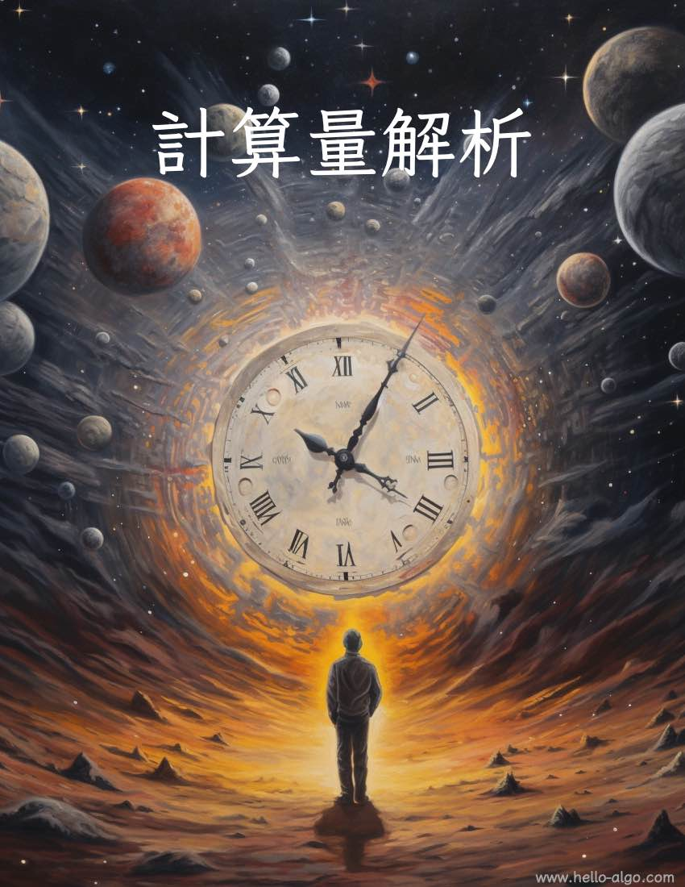

# 第 2 章 &nbsp; 計算量の解析

{ class="cover-image" }

!!! abstract "概要"

    計算量の解析は、広大なアルゴリズムの宇宙で時空を案内するガイドのようです。
    
    時間と空間という二つの次元を深く探り、より洗練された解法を見つける手助けをしてくれます。

## この章の内容

- [2.1 &nbsp; アルゴリズムの効率の評価](performance_evaluation.md)
- [2.2 &nbsp; 反復と再帰](iteration_and_recursion.md)
- [2.3 &nbsp; 時間計算量](time_complexity.md)
- [2.4 &nbsp; 空間計算量](space_complexity.md)
- [2.5 &nbsp; まとめ](summary.md)
- [2.6 &nbsp; 練習問題](exercises.md)
