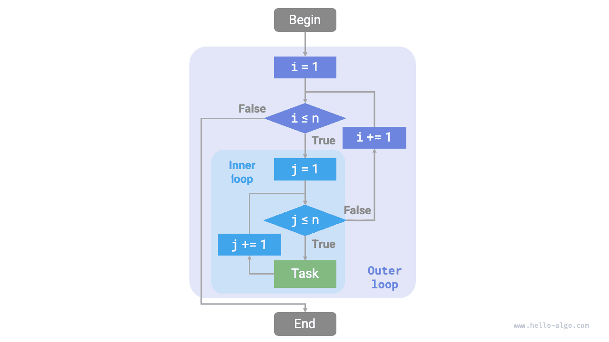

# 反復と再帰

アルゴリズムでは、同じ処理を繰り返すことがよくあり、計算量の解析とも密接に関わります。そこで時間計算量と空間計算量を説明する前に、繰り返しを実現する二つの基本的な制御構造、反復と再帰を学びます。

## 反復

<u>反復（iteration）</u>は、ある処理を繰り返し実行する制御構造です。一定の条件を満たす間、同じコードを実行し続け、条件を満たさなくなったら終了します。

### for ループ

`for` ループは最も一般的な反復の形の一つで、**繰り返し回数があらかじめわかっている場合に適しています**。

次の関数は、`for` ループで $1 + 2 + \dots + n$ を計算し、結果を変数 `res` に記録します。Python の `range(a, b)` は左端を含み右端を含まない区間なので、走査する範囲は $a, a + 1, \dots, b-1$ です。

```src
[file]{iteration}-[class]{}-[func]{for_loop}
```

下図に、この合計を求める関数のフローチャートを示します。


この関数の操作回数は入力の大きさ $n$ に比例し、「線形の関係」にあります。実際、**時間計算量が記述するのは、この「線形の関係」です**。詳しくは次の節で説明します。

### while ループ

`for` と同様に、`while` ループも反復を実現する方法です。毎回、最初に条件を調べ、真なら処理を続け、偽ならループを終了します。

`while` ループで $1 + 2 + \dots + n$ を計算してみましょう。

```src
[file]{iteration}-[class]{}-[func]{while_loop}
```

**`while` ループは `for` ループより自由度が高く**、条件変数の初期化と更新の手順を自由に設計できます。

たとえば次のコードでは、条件変数 $i$ を各回で 2 回更新します。このような処理は、`for` ループではやや書きにくくなります。

```src
[file]{iteration}-[class]{}-[func]{while_loop_ii}
```

全体として、**`for` はコードが簡潔で、`while` は柔軟です**。どちらも反復を実現でき、問題の要件に応じて選びます。

### 入れ子のループ

ループの中に別のループを入れられます。`for` の例を示します。

```src
[file]{iteration}-[class]{}-[func]{nested_for_loop}
```

下図に、この入れ子のループのフローチャートを示します。



この場合、操作回数は $n^2$ に比例します。言い換えると、実行時間は入力の大きさ $n$ と「二乗の関係」にあります。

さらにループを入れ子にすると、そのたびに「次元が上がり」、時間計算量は「三乗」「四乗」というように増えていきます。

## 再帰

 <u>再帰（recursion）</u>は、関数が自分自身を呼び出して問題を解くアルゴリズム戦略です。主に二つの段階があります。

1. **呼び出しを進める**：通常は小さく、または単純になった引数を渡して自分自身を呼び出し続け、「終了条件」に到達するまで深く進みます。
2. **戻る**：「終了条件」に達したら、最も深い再帰関数から順に戻り、各段階の結果を集めます。

実装の観点では、再帰のコードは主に三つの要素からなります。

1. **終了条件**：呼び出しを進める段階から、戻る段階へ切り替える時点を決めます。
2. **再帰呼び出し**：関数が自分自身を呼び出し、通常は小さく、または単純になった引数を渡します。
3. **結果の返却**：現在の再帰段階の結果を、一つ上の段階へ返します。

次のコードでは、`recur(n)` を呼び出すだけで $1 + 2 + \dots + n$ を計算できます。

```src
[file]{recursion}-[class]{}-[func]{recur}
```

下図に、この関数の再帰の流れを示します。


計算結果は反復でも再帰でも同じですが、**考え方と問題の解き方はまったく異なります**。

- **反復**：「下から上へ」解きます。最も基本的な手順から始め、それを繰り返したり積み重ねたりして、処理を完了します。
- **再帰**：「上から下へ」解きます。元の問題を同じ形の小さな部分問題に分解し、さらに小さくしていき、解が既知の基本ケースに達したら止めます。

先ほどの合計を例に、問題を $f(n) = 1 + 2 + \dots + n$ とします。

- **反復**：$1$ から $n$ までループし、毎回加算することで、$f(n)$ を求めます。
- **再帰**：問題を $f(n) = n + f(n-1)$ に分解し、基本ケース $f(1) = 1$ まで再帰的に分解し続けます。

### 呼び出しスタック

再帰関数が自分自身を呼ぶたびに、システムは新しい呼び出し用のメモリを確保し、ローカル変数、呼び出しアドレスなどを保存します。これにより、二つの影響が生じます。

- 関数の実行に必要な情報は「スタックフレーム」と呼ぶメモリ領域に保存され、関数から戻るまで解放されません。そのため、**再帰は通常、反復より多くのメモリを使います**。
- 再帰呼び出しには追加のコストがかかります。**そのため、再帰は通常、ループより時間効率が低くなります**。

下図のように、終了条件に到達する直前には、まだ戻っていない再帰関数が $n$ 個あり、**再帰の深さは $n$ です**。


実際には、言語が許す再帰の深さには通常、制限があります。深すぎる再帰はスタックオーバーフローを引き起こす可能性があります。

### 末尾再帰

興味深いことに、**関数が戻る直前の最後の処理として再帰呼び出しを行う場合**、コンパイラやインタプリタは、空間効率が反復と同程度になるよう最適化できます。これを<u>末尾再帰（tail recursion）</u>と呼びます。

- **通常の再帰**：一つ上の関数に戻った後も処理を続けるため、前の呼び出しの実行状態を保存する必要があります。
- **末尾再帰**：再帰呼び出しが戻る直前の最後の操作なので、一つ上に戻った後に実行する処理はありません。そのため、前の関数の実行状態を保存する必要がありません。

$1 + 2 + \dots + n$ の計算では、結果の変数 `res` を関数の引数にすれば、末尾再帰にできます。

```src
[file]{recursion}-[class]{}-[func]{tail_recur}
```

下図に末尾再帰の流れを示します。通常の再帰とは、加算を行うタイミングが異なります。

- **通常の再帰**：戻る段階で加算し、各呼び出しから戻った後に 1 回ずつ加算します。
- **末尾再帰**：呼び出しを進める段階で加算し、戻る段階では順に戻るだけです。


!!! tip

    多くのコンパイラやインタプリタは末尾再帰最適化に対応していないことに注意してください。たとえば Python は標準では対応していないため、末尾再帰の形でもスタックオーバーフローが起こる可能性があります。

### 再帰木

分割統治に関わる問題では、反復より再帰の方が直感的で、読みやすいコードになることがよくあります。「フィボナッチ数列」を例に考えます。

!!! question

    フィボナッチ数列 $0, 1, 1, 2, 3, 5, 8, 13, \dots$ の、第 $n$ 番目の数を求めてください。

第 $n$ 番目の数を $f(n)$ とすると、二つのことがわかります。

- 最初の二つの数は、$f(1) = 0$ と $f(2) = 1$ です。
- 各数は直前の二つの数の和であり、$f(n) = f(n - 1) + f(n - 2)$ です。

この漸化式に従って再帰呼び出しを行い、最初の二つの数を終了条件にすれば、再帰のコードを書けます。`fib(n)` を呼ぶと、第 $n$ 番目の数が得られます。

```src
[file]{recursion}-[class]{}-[func]{fib}
```

このコードでは、関数内で再帰呼び出しを 2 回行い、**一つの呼び出しから二つの分岐が生じます**。下図のように呼び出しを繰り返すと、最終的に $n$ 層の<u>再帰木（recursion tree）</u>ができます。


本質的に、再帰は「問題を小さな部分問題に分解する」という考え方を表しており、この分割統治戦略は非常に重要です。

- アルゴリズムの面では、探索、ソート、バックトラッキング、分割統治、動的計画法など、多くの重要な戦略が直接または間接的にこの考え方を使っています。
- データ構造の面では、連結リスト、木、グラフの問題は分割統治で分析しやすいため、再帰が自然に適しています。

## 反復と再帰の比較

ここまでの内容をまとめると、下表のように実装、性能、用途に違いがあります。

<p align="center"> 表 <id> &nbsp; 反復と再帰の特徴の比較 </p>

|          | 反復                                   | 再帰                                                         |
| -------- | -------------------------------------- | ------------------------------------------------------------ |
| 実装方法 | ループ構造                               | 関数が自分自身を呼び出す                                                 |
| 時間効率 | 通常は高く、関数呼び出しのコストがない           | 各関数呼び出しにコストがかかる                                     |
| メモリ使用量 | 通常は一定量のメモリを使う             | 呼び出しの積み重ねで大量のスタックフレームを使う場合がある                           |
| 適した問題 | 単純な繰り返し処理に適し、コードが直感的で読みやすい | 木、グラフ、分割統治、バックトラッキングなど、部分問題への分解に適し、コード構造が簡潔で明快 |

!!! tip

    以下の内容が難しく感じられたら、「スタック」の章を読んでから復習してください。

では、反復と再帰にはどのような関係があるのでしょうか。先ほどの再帰関数では、戻る段階で加算します。つまり、最初に呼ばれた関数が、最後に加算を終えます。**この仕組みは、スタックの「先入れ後出し」の原則と共通しています**。

実際、「呼び出しスタック」や「スタックフレーム」という用語自体が、再帰とスタックの密接な関係を示しています。

1. **呼び出しを進める**：関数を呼ぶと、システムは「呼び出しスタック」に新しいフレームを確保し、ローカル変数、引数、戻り先アドレスなどを保存します。
2. **戻る**：関数の実行が終わって戻ると、対応するフレームを「呼び出しスタック」から取り除き、前の関数の実行環境を復元します。

したがって、**明示的なスタックで呼び出しスタックの動作を模倣すれば**、再帰を反復に変換できます。

```src
[file]{recursion}-[class]{}-[func]{for_loop_recur}
```

このコードでは、反復に変換したことで複雑になっています。反復と再帰は多くの場合、相互に変換できますが、必ずしもそうする価値があるとは限りません。理由は二つあります。

- 変換後のコードの方が理解しにくく、可読性が下がる可能性があります。
- 複雑な問題では、システムの呼び出しスタックの動作を模倣すること自体が非常に難しい場合があります。

**反復と再帰のどちらを選ぶかは、問題の性質によって決まります**。実際のプログラミングでは、両者の利点と欠点を比較し、状況に合った方法を選ぶことが大切です。
