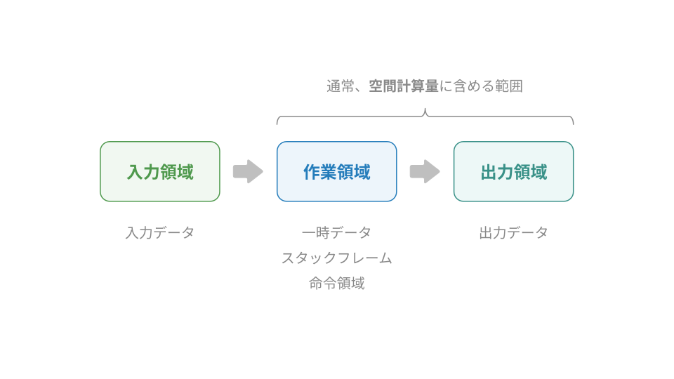
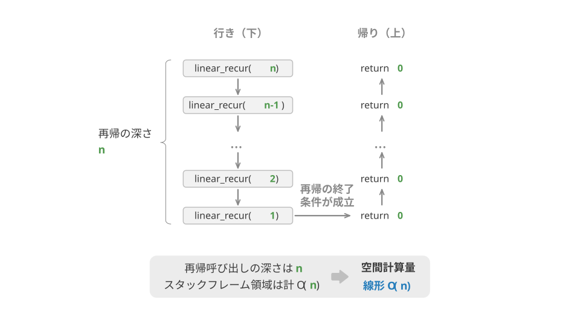
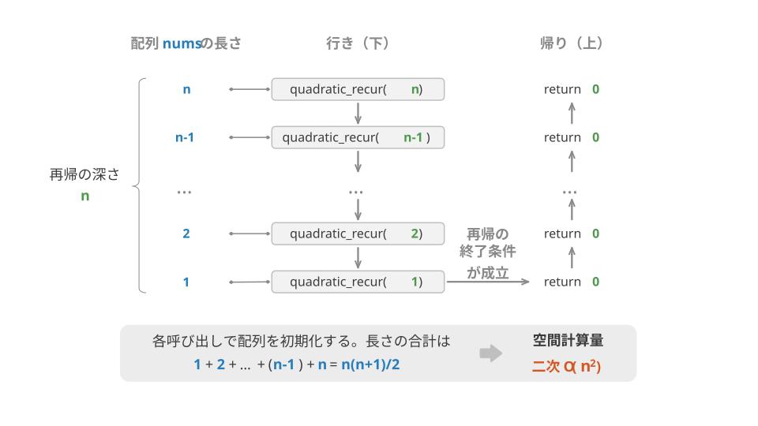
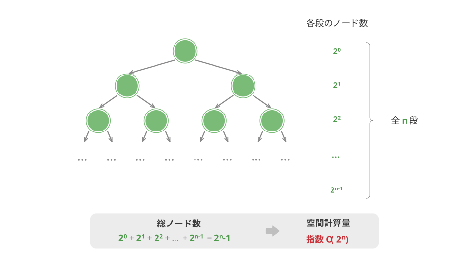

# 空間計算量

<u>空間計算量（space complexity）</u>は、データ量が大きくなるにつれて、アルゴリズムが使うメモリ領域がどのように増えるかを表します。時間計算量とよく似た概念で、「実行時間」を「メモリ使用量」に置き換えたものです。

## アルゴリズムが使う領域

アルゴリズムの実行中に使うメモリ領域は、主に次のように分けられます。

- **入力領域**：アルゴリズムに入力するデータを格納します。
- **作業領域**：実行中の変数、オブジェクト、関数の実行状態などを格納します。
- **出力領域**：アルゴリズムが出力するデータを格納します。

通常、空間計算量に含めるのは「作業領域」と「出力領域」の合計です。

作業領域は、さらに 3 つに分けられます。

- **一時データ**：実行中に使う定数、変数、オブジェクトなどを保持します。
- **スタックフレーム領域**：呼び出した関数の実行状態を保持します。システムは関数を呼び出すたびにスタックの先頭にフレームを作り、関数が戻るとその領域を解放します。
- **命令領域**：コンパイル後のプログラムの命令を格納します。実際に計算量を求める際は通常無視します。

次の図のように、プログラムの空間計算量を分析するときは、**通常、一時データ、スタックフレーム領域、出力データの 3 つを数えます**。



対応するコードを示します。

```snippet
space_categories
```

## 計算量の求め方

空間計算量の求め方は時間計算量とほぼ同じです。数える対象を「操作回数」から「使用する領域の大きさ」に変えます。

時間計算量と違い、**空間計算量は通常、最悪の場合だけに着目します**。必要なメモリを確保できることは実行の必須条件であり、どのような入力にも十分な領域を用意しておく必要があるからです。

次のコードを見ると、最悪空間計算量の「最悪」には 2 つの意味があることがわかります。

1. **最悪の入力を基準にする**：$n < 10$ では空間計算量は $O(1)$ ですが、$n > 10$ では初期化した配列 `nums` が $O(n)$ の領域を使います。したがって最悪空間計算量は $O(n)$ です。
2. **実行中のメモリ使用量の最大値を基準にする**：例えば、最後の行を実行する前の使用量は $O(1)$ ですが、配列 `nums` を初期化すると $O(n)$ になります。したがって最悪空間計算量は $O(n)$ です。

```snippet
worst_case_space
```

**再帰関数では、スタックフレーム領域を数え忘れないようにします**。次のコードを見てください。

```snippet
loop_vs_recursion_space
```

関数 `loop()` と `recur()` の時間計算量はいずれも $O(n)$ ですが、空間計算量は異なります。

- `loop()` はループ中に `function()` を $n$ 回呼び出します。毎回 `function()` が戻ってスタックフレーム領域が解放されるため、空間計算量は $O(1)$ のままです。
- 再帰関数 `recur()` では、実行中にまだ戻っていない `recur()` の呼び出しが同時に $n$ 個あり、$O(n)$ のスタックフレーム領域を使います。

## 代表的な計算量

入力データのサイズを $n$ とします。次の図に代表的な空間計算量を小さい順に示します。

$$
\begin{aligned}
& O(1) < O(\log n) < O(n) < O(n^2) < O(2^n) \newline
& \text{定数オーダー} < \text{対数オーダー} < \text{線形オーダー} < \text{二次オーダー} < \text{指数オーダー}
\end{aligned}
$$


### 定数オーダー $O(1)$

定数、変数、オブジェクトなどの個数が入力サイズ $n$ に依存しない場合には、定数オーダーがよく現れます。

ループ内で変数を初期化したり関数を呼び出したりして使用したメモリは、次の反復に移ると解放されます。使用量は累積せず、空間計算量は $O(1)$ のままです。

```src
[file]{space_complexity}-[class]{}-[func]{constant}
```

### 線形オーダー $O(n)$

配列、連結リスト、スタック、キューなどの要素数が $n$ に比例する場合には、線形オーダーがよく現れます。

```src
[file]{space_complexity}-[class]{}-[func]{linear}
```

次の図のように、この関数の再帰の深さは $n$ です。つまり、まだ戻っていない `linear_recur()` の呼び出しが同時に $n$ 個あり、$O(n)$ のスタックフレーム領域を使います。

```src
[file]{space_complexity}-[class]{}-[func]{linear_recur}
```



### 二次オーダー $O(n^2)$

行列やグラフなどで要素数が $n$ の二乗に比例する場合には、二次オーダーがよく現れます。

```src
[file]{space_complexity}-[class]{}-[func]{quadratic}
```

次の図のように、この関数の再帰の深さは $n$ です。各段で配列を初期化し、その長さは順に $n$、$n-1$、$\dots$、$2$、$1$ です。平均の長さは $n / 2$ なので、全体で $O(n^2)$ の領域を使います。

```src
[file]{space_complexity}-[class]{}-[func]{quadratic_recur}
```



### 指数オーダー $O(2^n)$

二分木では指数オーダーがよく現れます。次の図のように、$n$ 段すべてが埋まった完全二分木のノード数は $2^n - 1$ で、$O(2^n)$ の領域を使います。

```src
[file]{space_complexity}-[class]{}-[func]{build_tree}
```



### 対数オーダー $O(\log n)$

分割統治法では対数オーダーがよく現れます。例えばマージソートでは、長さ $n$ の配列を入力し、再帰のたびに中央で半分に分けます。再帰木の高さは $\log n$ となり、スタックフレーム領域は $O(\log n)$ です。

数値を文字列に変換する場合も例に挙げられます。入力が正整数 $n$ なら桁数は $\lfloor \log_{10} n \rfloor + 1$ なので、対応する文字列の長さは $\lfloor \log_{10} n \rfloor + 1$ です。したがって空間計算量は $O(\log_{10} n + 1) = O(\log n)$ です。

## 時間と空間のトレードオフ

理想は、アルゴリズムの時間計算量と空間計算量をともに最良にすることです。しかし実際には、両方を同時に最適化することはたいてい困難です。

**時間計算量を小さくするには空間計算量の増加を受け入れる必要があることが多く、その逆も同様です**。メモリを多く使って実行を速める考え方を「空間を使って時間を節約する」といい、その逆を「時間を使って空間を節約する」といいます。

どちらを選ぶかは、何を重視するかによります。多くの場合、メモリより時間が貴重なので、空間を使って時間を節約するほうが一般的です。もちろん、データ量が非常に大きいときは、空間計算量を抑えることも重要です。
