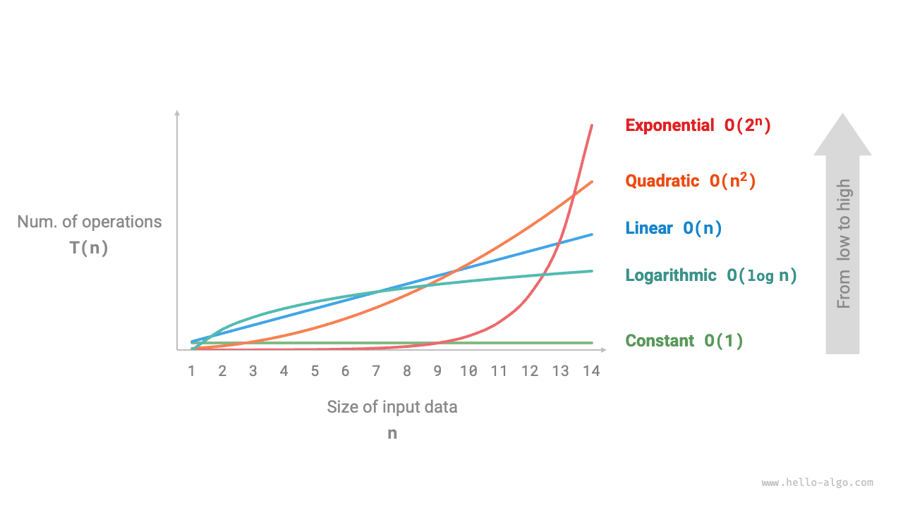
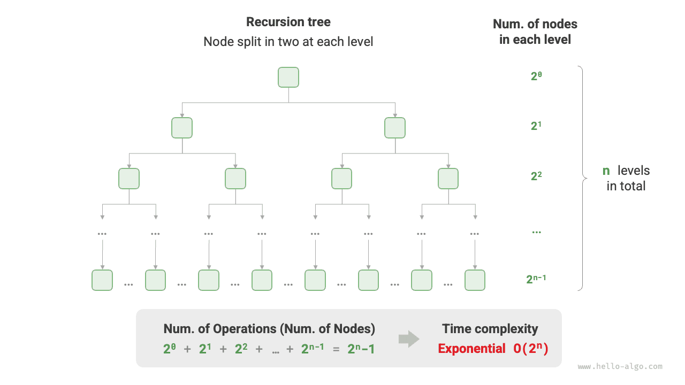
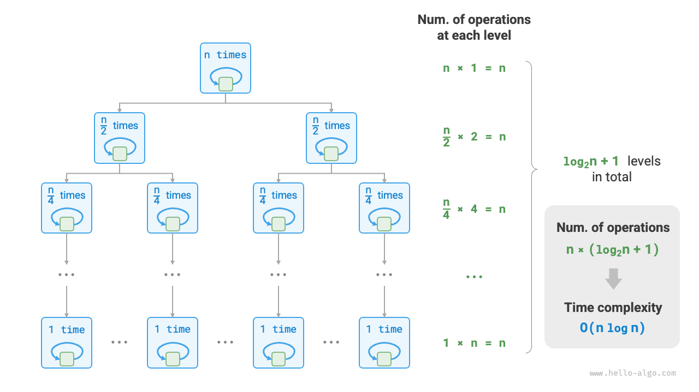

# 時間計算量

実行時間は、アルゴリズムの効率を直感的かつ正確に表します。コードの実行時間を正確に見積もるには、どうすればよいでしょうか。

1. **実行環境を決めます**。ハードウェア構成、プログラミング言語、システム環境などは、いずれも実行効率に影響します。
2. **各計算操作にかかる時間を見積もります**。たとえば、加算 `+` は 1 ns、乗算 `*` は 10 ns、出力 `print()` は 5 ns などです。
3. **コード内のすべての計算操作を数え**、その実行時間を合計して、全体の実行時間を求めます。

たとえば、次のコードで入力の大きさを $n$ とします。

=== "Python"

    ```python title=""
    # ある実行環境において
    def algorithm(n: int):
        a = 2      # 1 ns
        a = a + 1  # 1 ns
        a = a * 2  # 10 ns
        # n 回繰り返す
        for _ in range(n):  # 1 ns
            print(0)        # 5 ns
    ```

=== "C++"

    ```cpp title=""
    // ある実行環境において
    void algorithm(int n) {
        int a = 2;  // 1 ns
        a = a + 1;  // 1 ns
        a = a * 2;  // 10 ns
        // n 回繰り返す
        for (int i = 0; i < n; i++) {  // 1 ns
            cout << 0 << endl;         // 5 ns
        }
    }
    ```

=== "Java"

    ```java title=""
    // ある実行環境において
    void algorithm(int n) {
        int a = 2;  // 1 ns
        a = a + 1;  // 1 ns
        a = a * 2;  // 10 ns
        // n 回繰り返す
        for (int i = 0; i < n; i++) {  // 1 ns
            System.out.println(0);     // 5 ns
        }
    }
    ```

=== "C#"

    ```csharp title=""
    // ある実行環境において
    void Algorithm(int n) {
        int a = 2;  // 1 ns
        a = a + 1;  // 1 ns
        a = a * 2;  // 10 ns
        // n 回繰り返す
        for (int i = 0; i < n; i++) {  // 1 ns
            Console.WriteLine(0);      // 5 ns
        }
    }
    ```

=== "Go"

    ```go title=""
    // ある実行環境において
    func algorithm(n int) {
        a := 2     // 1 ns
        a = a + 1  // 1 ns
        a = a * 2  // 10 ns
        // n 回繰り返す
        for i := 0; i < n; i++ {  // 1 ns
            fmt.Println(a)        // 5 ns
        }
    }
    ```

=== "Swift"

    ```swift title=""
    // ある実行環境において
    func algorithm(n: Int) {
        var a = 2 // 1 ns
        a = a + 1 // 1 ns
        a = a * 2 // 10 ns
        // n 回繰り返す
        for _ in 0 ..< n { // 1 ns
            print(0) // 5 ns
        }
    }
    ```

=== "JS"

    ```javascript title=""
    // ある実行環境において
    function algorithm(n) {
        var a = 2; // 1 ns
        a = a + 1; // 1 ns
        a = a * 2; // 10 ns
        // n 回繰り返す
        for(let i = 0; i < n; i++) { // 1 ns
            console.log(0); // 5 ns
        }
    }
    ```

=== "TS"

    ```typescript title=""
    // ある実行環境において
    function algorithm(n: number): void {
        var a: number = 2; // 1 ns
        a = a + 1; // 1 ns
        a = a * 2; // 10 ns
        // n 回繰り返す
        for(let i = 0; i < n; i++) { // 1 ns
            console.log(0); // 5 ns
        }
    }
    ```

=== "Dart"

    ```dart title=""
    // ある実行環境において
    void algorithm(int n) {
      int a = 2; // 1 ns
      a = a + 1; // 1 ns
      a = a * 2; // 10 ns
      // n 回繰り返す
      for (int i = 0; i < n; i++) { // 1 ns
        print(0); // 5 ns
      }
    }
    ```

=== "Rust"

    ```rust title=""
    // ある実行環境において
    fn algorithm(n: i32) {
        let mut a = 2;      // 1 ns
        a = a + 1;          // 1 ns
        a = a * 2;          // 10 ns
        // n 回繰り返す
        for _ in 0..n {     // 1 ns
            println!("{}", 0);  // 5 ns
        }
    }
    ```

=== "C"

    ```c title=""
    // ある実行環境において
    void algorithm(int n) {
        int a = 2;  // 1 ns
        a = a + 1;  // 1 ns
        a = a * 2;  // 10 ns
        // n 回繰り返す
        for (int i = 0; i < n; i++) {   // 1 ns
            printf("%d", 0);            // 5 ns
        }
    }
    ```

=== "Kotlin"

    ```kotlin title=""
    // ある実行環境において
    fun algorithm(n: Int) {
        var a = 2 // 1 ns
        a = a + 1 // 1 ns
        a = a * 2 // 10 ns
        // n 回繰り返す
        for (i in 0..<n) {  // 1 ns
            println(0)      // 5 ns
        }
    }
    ```

=== "Ruby"

    ```ruby title=""
    # ある実行環境において
    def algorithm(n)
        a = 2       # 1 ns
        a = a + 1   # 1 ns
        a = a * 2   # 10 ns
        # n 回繰り返す
        (0...n).each do # 1 ns
            puts 0      # 5 ns
        end
    end
    ```

この方法では、実行時間は $(6n + 12)$ ns になります。

$$
1 + 1 + 10 + (1 + 5) \times n = 6n + 12
$$

しかし実際には、**このように実行時間を積み上げる方法は、適切でも現実的でもありません**。まず、アルゴリズムはさまざまな環境で動くため、見積もりを特定の環境に結び付けたくありません。また、各操作の実行時間を知るのは難しく、見積もり自体が非常に困難になります。

## 時間の増え方を調べる

時間計算量の解析で調べるのは、実行時間そのものではなく、**データ量が増えるにつれて実行時間がどのように増えるかです**。

「時間の増え方」は抽象的なので、例で理解しましょう。入力の大きさを $n$ とし、三つのアルゴリズム `A`、`B`、`C` を考えます。

=== "Python"

    ```python title=""
    # アルゴリズム A の時間計算量：定数のオーダー
    def algorithm_A(n: int):
        print(0)
    # アルゴリズム B の時間計算量：線形のオーダー
    def algorithm_B(n: int):
        for _ in range(n):
            print(0)
    # アルゴリズム C の時間計算量：定数のオーダー
    def algorithm_C(n: int):
        for _ in range(1000000):
            print(0)
    ```

=== "C++"

    ```cpp title=""
    // アルゴリズム A の時間計算量：定数のオーダー
    void algorithm_A(int n) {
        cout << 0 << endl;
    }
    // アルゴリズム B の時間計算量：線形のオーダー
    void algorithm_B(int n) {
        for (int i = 0; i < n; i++) {
            cout << 0 << endl;
        }
    }
    // アルゴリズム C の時間計算量：定数のオーダー
    void algorithm_C(int n) {
        for (int i = 0; i < 1000000; i++) {
            cout << 0 << endl;
        }
    }
    ```

=== "Java"

    ```java title=""
    // アルゴリズム A の時間計算量：定数のオーダー
    void algorithm_A(int n) {
        System.out.println(0);
    }
    // アルゴリズム B の時間計算量：線形のオーダー
    void algorithm_B(int n) {
        for (int i = 0; i < n; i++) {
            System.out.println(0);
        }
    }
    // アルゴリズム C の時間計算量：定数のオーダー
    void algorithm_C(int n) {
        for (int i = 0; i < 1000000; i++) {
            System.out.println(0);
        }
    }
    ```

=== "C#"

    ```csharp title=""
    // アルゴリズム A の時間計算量：定数のオーダー
    void AlgorithmA(int n) {
        Console.WriteLine(0);
    }
    // アルゴリズム B の時間計算量：線形のオーダー
    void AlgorithmB(int n) {
        for (int i = 0; i < n; i++) {
            Console.WriteLine(0);
        }
    }
    // アルゴリズム C の時間計算量：定数のオーダー
    void AlgorithmC(int n) {
        for (int i = 0; i < 1000000; i++) {
            Console.WriteLine(0);
        }
    }
    ```

=== "Go"

    ```go title=""
    // アルゴリズム A の時間計算量：定数のオーダー
    func algorithm_A(n int) {
        fmt.Println(0)
    }
    // アルゴリズム B の時間計算量：線形のオーダー
    func algorithm_B(n int) {
        for i := 0; i < n; i++ {
            fmt.Println(0)
        }
    }
    // アルゴリズム C の時間計算量：定数のオーダー
    func algorithm_C(n int) {
        for i := 0; i < 1000000; i++ {
            fmt.Println(0)
        }
    }
    ```

=== "Swift"

    ```swift title=""
    // アルゴリズム A の時間計算量：定数のオーダー
    func algorithmA(n: Int) {
        print(0)
    }

    // アルゴリズム B の時間計算量：線形のオーダー
    func algorithmB(n: Int) {
        for _ in 0 ..< n {
            print(0)
        }
    }

    // アルゴリズム C の時間計算量：定数のオーダー
    func algorithmC(n: Int) {
        for _ in 0 ..< 1_000_000 {
            print(0)
        }
    }
    ```

=== "JS"

    ```javascript title=""
    // アルゴリズム A の時間計算量：定数のオーダー
    function algorithm_A(n) {
        console.log(0);
    }
    // アルゴリズム B の時間計算量：線形のオーダー
    function algorithm_B(n) {
        for (let i = 0; i < n; i++) {
            console.log(0);
        }
    }
    // アルゴリズム C の時間計算量：定数のオーダー
    function algorithm_C(n) {
        for (let i = 0; i < 1000000; i++) {
            console.log(0);
        }
    }

    ```

=== "TS"

    ```typescript title=""
    // アルゴリズム A の時間計算量：定数のオーダー
    function algorithm_A(n: number): void {
        console.log(0);
    }
    // アルゴリズム B の時間計算量：線形のオーダー
    function algorithm_B(n: number): void {
        for (let i = 0; i < n; i++) {
            console.log(0);
        }
    }
    // アルゴリズム C の時間計算量：定数のオーダー
    function algorithm_C(n: number): void {
        for (let i = 0; i < 1000000; i++) {
            console.log(0);
        }
    }
    ```

=== "Dart"

    ```dart title=""
    // アルゴリズム A の時間計算量：定数のオーダー
    void algorithmA(int n) {
      print(0);
    }
    // アルゴリズム B の時間計算量：線形のオーダー
    void algorithmB(int n) {
      for (int i = 0; i < n; i++) {
        print(0);
      }
    }
    // アルゴリズム C の時間計算量：定数のオーダー
    void algorithmC(int n) {
      for (int i = 0; i < 1000000; i++) {
        print(0);
      }
    }
    ```

=== "Rust"

    ```rust title=""
    // アルゴリズム A の時間計算量：定数のオーダー
    fn algorithm_A(n: i32) {
        println!("{}", 0);
    }
    // アルゴリズム B の時間計算量：線形のオーダー
    fn algorithm_B(n: i32) {
        for _ in 0..n {
            println!("{}", 0);
        }
    }
    // アルゴリズム C の時間計算量：定数のオーダー
    fn algorithm_C(n: i32) {
        for _ in 0..1000000 {
            println!("{}", 0);
        }
    }
    ```

=== "C"

    ```c title=""
    // アルゴリズム A の時間計算量：定数のオーダー
    void algorithm_A(int n) {
        printf("%d", 0);
    }
    // アルゴリズム B の時間計算量：線形のオーダー
    void algorithm_B(int n) {
        for (int i = 0; i < n; i++) {
            printf("%d", 0);
        }
    }
    // アルゴリズム C の時間計算量：定数のオーダー
    void algorithm_C(int n) {
        for (int i = 0; i < 1000000; i++) {
            printf("%d", 0);
        }
    }
    ```

=== "Kotlin"

    ```kotlin title=""
    // アルゴリズム A の時間計算量：定数のオーダー
    fun algoritm_A(n: Int) {
        println(0)
    }
    // アルゴリズム B の時間計算量：線形のオーダー
    fun algorithm_B(n: Int) {
        for (i in 0..<n){
            println(0)
        }
    }
    // アルゴリズム C の時間計算量：定数のオーダー
    fun algorithm_C(n: Int) {
        for (i in 0..<1000000) {
            println(0)
        }
    }
    ```

=== "Ruby"

    ```ruby title=""
    # アルゴリズム A の時間計算量：定数のオーダー
    def algorithm_A(n)
        puts 0
    end

    # アルゴリズム B の時間計算量：線形のオーダー
    def algorithm_B(n)
        (0...n).each { puts 0 }
    end

    # アルゴリズム C の時間計算量：定数のオーダー
    def algorithm_C(n)
        (0...1_000_000).each { puts 0 }
    end
    ```

下図に、この三つのアルゴリズムの時間計算量を示します。

- `A` には出力操作が $1$ 回だけあり、$n$ が増えても実行時間は増えません。この時間計算量を「定数のオーダー」と呼びます。
- `B` は出力を $n$ 回繰り返し、$n$ の増加に対して実行時間が線形に増えます。この時間計算量を「線形のオーダー」と呼びます。
- `C` は出力を $1000000$ 回繰り返します。実行時間は長いものの、入力の大きさ $n$ とは無関係です。そのため、`C` の時間計算量は `A` と同じ「定数のオーダー」です。


実行時間を直接数える方法と比べ、時間計算量の解析にはどのような特徴があるでしょうか。

- **効率を有効に評価できます**。たとえば `B` は線形に時間が増え、$n > 1$ では `A` より、$n > 1000000$ では `C` より遅くなります。入力の大きさ $n$ が十分に大きければ、定数のオーダーのアルゴリズムは線形のオーダーより必ず有利になります。これが時間の増え方という意味です。
- **見積もり方が簡単です**。実行環境や計算操作の種類は、実行時間の増え方には関係しません。そのため、各操作の時間を同じ「単位時間」とみなし、「操作にかかる時間の集計」を「操作回数の集計」に置き換えられ、見積もりが大幅に簡単になります。
- **一定の限界もあります**。`A` と `C` は同じ時間計算量でも、実際の時間は大きく異なります。また、`B` は `C` より計算量が大きくても、入力の大きさ $n$ が小さければ、明らかに `C` より速くなります。このような場合、計算量だけでは効率を判断しにくくなります。それでも計算量の解析は、効率を評価する最も有効で一般的な方法です。

## 関数の漸近上界

入力の大きさが $n$ の関数を考えます。

=== "Python"

    ```python title=""
    def algorithm(n: int):
        a = 1      # +1
        a = a + 1  # +1
        a = a * 2  # +1
        # n 回繰り返す
        for i in range(n):  # +1
            print(0)        # +1
    ```

=== "C++"

    ```cpp title=""
    void algorithm(int n) {
        int a = 1;  // +1
        a = a + 1;  // +1
        a = a * 2;  // +1
        // n 回繰り返す
        for (int i = 0; i < n; i++) { // +1（毎回 i ++ を実行）
            cout << 0 << endl;    // +1
        }
    }
    ```

=== "Java"

    ```java title=""
    void algorithm(int n) {
        int a = 1;  // +1
        a = a + 1;  // +1
        a = a * 2;  // +1
        // n 回繰り返す
        for (int i = 0; i < n; i++) { // +1（毎回 i ++ を実行）
            System.out.println(0);    // +1
        }
    }
    ```

=== "C#"

    ```csharp title=""
    void Algorithm(int n) {
        int a = 1;  // +1
        a = a + 1;  // +1
        a = a * 2;  // +1
        // n 回繰り返す
        for (int i = 0; i < n; i++) {   // +1（毎回 i ++ を実行）
            Console.WriteLine(0);   // +1
        }
    }
    ```

=== "Go"

    ```go title=""
    func algorithm(n int) {
        a := 1      // +1
        a = a + 1   // +1
        a = a * 2   // +1
        // n 回繰り返す
        for i := 0; i < n; i++ {   // +1
            fmt.Println(a)         // +1
        }
    }
    ```

=== "Swift"

    ```swift title=""
    func algorithm(n: Int) {
        var a = 1 // +1
        a = a + 1 // +1
        a = a * 2 // +1
        // n 回繰り返す
        for _ in 0 ..< n { // +1
            print(0) // +1
        }
    }
    ```

=== "JS"

    ```javascript title=""
    function algorithm(n) {
        var a = 1; // +1
        a += 1; // +1
        a *= 2; // +1
        // n 回繰り返す
        for(let i = 0; i < n; i++){ // +1（毎回 i ++ を実行）
            console.log(0); // +1
        }
    }
    ```

=== "TS"

    ```typescript title=""
    function algorithm(n: number): void{
        var a: number = 1; // +1
        a += 1; // +1
        a *= 2; // +1
        // n 回繰り返す
        for(let i = 0; i < n; i++){ // +1（毎回 i ++ を実行）
            console.log(0); // +1
        }
    }
    ```

=== "Dart"

    ```dart title=""
    void algorithm(int n) {
      int a = 1; // +1
      a = a + 1; // +1
      a = a * 2; // +1
      // n 回繰り返す
      for (int i = 0; i < n; i++) { // +1（毎回 i ++ を実行）
        print(0); // +1
      }
    }
    ```

=== "Rust"

    ```rust title=""
    fn algorithm(n: i32) {
        let mut a = 1;   // +1
        a = a + 1;      // +1
        a = a * 2;      // +1

        // n 回繰り返す
        for _ in 0..n { // +1（毎回 i ++ を実行）
            println!("{}", 0); // +1
        }
    }
    ```

=== "C"

    ```c title=""
    void algorithm(int n) {
        int a = 1;  // +1
        a = a + 1;  // +1
        a = a * 2;  // +1
        // n 回繰り返す
        for (int i = 0; i < n; i++) {   // +1（毎回 i ++ を実行）
            printf("%d", 0);            // +1
        }
    }
    ```

=== "Kotlin"

    ```kotlin title=""
    fun algorithm(n: Int) {
        var a = 1 // +1
        a = a + 1 // +1
        a = a * 2 // +1
        // n 回繰り返す
        for (i in 0..<n) { // +1（毎回 i ++ を実行）
            println(0) // +1
        }
    }
    ```

=== "Ruby"

    ```ruby title=""
    def algorithm(n)
        a = 1       # +1
        a = a + 1   # +1
        a = a * 2   # +1
        # n 回繰り返す
        (0...n).each do # +1
            puts 0      # +1
        end
    end
    ```

操作回数を入力の大きさ $n$ の関数 $T(n)$ とすると、上の関数では次のようになります。

$$
T(n) = 3 + 2n
$$

$T(n)$ は一次関数なので、実行時間は線形に増え、時間計算量は線形のオーダーです。

線形の時間計算量を $O(n)$ と書きます。この数学記号を<u>ビッグ $O$ 記法（big-$O$ notation）</u>といい、関数 $T(n)$ の<u>漸近上界（asymptotic upper bound）</u>を表します。

時間計算量の解析は、本質的には「操作回数 $T(n)$」の漸近上界を求めることで、明確な数学的定義があります。

!!! note "関数の漸近上界"

    正の実数 $c$ と実数 $n_0$ が存在し、すべての $n > n_0$ に対して $T(n) \leq c \cdot f(n)$ が成り立つとき、$f(n)$ は $T(n)$ の漸近上界を与えるといい、$T(n) = O(f(n))$ と書きます。

下図のように、漸近上界を求めるとは、$n$ が無限大に近づくとき、$T(n)$ と $f(n)$ が同じ増加のオーダーとなり、定数係数 $c$ だけ異なるような関数 $f(n)$ を探すことです。


## 見積もり方

漸近上界は数学的なので、完全に理解できなくても心配はいりません。まず見積もり方を身に付け、実践しながら数学的な意味を理解していきましょう。

定義によれば、$f(n)$ が決まれば時間計算量 $O(f(n))$ が得られます。では、漸近上界 $f(n)$ はどう決めるのでしょうか。大きく二つの手順、操作回数の集計と漸近上界の判定で行います。

### 手順 1：操作回数を数える

コードを上から下へ、行ごとに数えれば求められます。ただし、$c \cdot f(n)$ の定数係数 $c$ は任意の大きさにできるため、**操作回数 $T(n)$ の係数や定数項は無視できます**。この原則から、数え方を簡単にする次の工夫が得られます。

1. **$T(n)$ の定数を無視します**。定数は $n$ と無関係なので、時間計算量に影響しません。
2. **すべての係数を省略します**。たとえば $2n$ 回や $5n + 1$ 回のループは、$n$ 回と簡略化できます。$n$ の前の係数は時間計算量に影響しないためです。
3. **入れ子のループでは掛け算を使います**。総操作回数は、外側と内側の操作回数の積です。各ループには、それぞれ手順 `1.` と `2.` の工夫を適用できます。

これらの工夫を使って、次の関数の操作回数を数えます。

=== "Python"

    ```python title=""
    def algorithm(n: int):
        a = 1      # +0（工夫 1）
        a = a + n  # +0（工夫 1）
        # +n（工夫 2）
        for i in range(5 * n + 1):
            print(0)
        # +n*n（工夫 3）
        for i in range(2 * n):
            for j in range(n + 1):
                print(0)
    ```

=== "C++"

    ```cpp title=""
    void algorithm(int n) {
        int a = 1;  // +0（工夫 1）
        a = a + n;  // +0（工夫 1）
        // +n（工夫 2）
        for (int i = 0; i < 5 * n + 1; i++) {
            cout << 0 << endl;
        }
        // +n*n（工夫 3）
        for (int i = 0; i < 2 * n; i++) {
            for (int j = 0; j < n + 1; j++) {
                cout << 0 << endl;
            }
        }
    }
    ```

=== "Java"

    ```java title=""
    void algorithm(int n) {
        int a = 1;  // +0（工夫 1）
        a = a + n;  // +0（工夫 1）
        // +n（工夫 2）
        for (int i = 0; i < 5 * n + 1; i++) {
            System.out.println(0);
        }
        // +n*n（工夫 3）
        for (int i = 0; i < 2 * n; i++) {
            for (int j = 0; j < n + 1; j++) {
                System.out.println(0);
            }
        }
    }
    ```

=== "C#"

    ```csharp title=""
    void Algorithm(int n) {
        int a = 1;  // +0（工夫 1）
        a = a + n;  // +0（工夫 1）
        // +n（工夫 2）
        for (int i = 0; i < 5 * n + 1; i++) {
            Console.WriteLine(0);
        }
        // +n*n（工夫 3）
        for (int i = 0; i < 2 * n; i++) {
            for (int j = 0; j < n + 1; j++) {
                Console.WriteLine(0);
            }
        }
    }
    ```

=== "Go"

    ```go title=""
    func algorithm(n int) {
        a := 1     // +0（工夫 1）
        a = a + n  // +0（工夫 1）
        // +n（工夫 2）
        for i := 0; i < 5 * n + 1; i++ {
            fmt.Println(0)
        }
        // +n*n（工夫 3）
        for i := 0; i < 2 * n; i++ {
            for j := 0; j < n + 1; j++ {
                fmt.Println(0)
            }
        }
    }
    ```

=== "Swift"

    ```swift title=""
    func algorithm(n: Int) {
        var a = 1 // +0（工夫 1）
        a = a + n // +0（工夫 1）
        // +n（工夫 2）
        for _ in 0 ..< (5 * n + 1) {
            print(0)
        }
        // +n*n（工夫 3）
        for _ in 0 ..< (2 * n) {
            for _ in 0 ..< (n + 1) {
                print(0)
            }
        }
    }
    ```

=== "JS"

    ```javascript title=""
    function algorithm(n) {
        let a = 1;  // +0（工夫 1）
        a = a + n;  // +0（工夫 1）
        // +n（工夫 2）
        for (let i = 0; i < 5 * n + 1; i++) {
            console.log(0);
        }
        // +n*n（工夫 3）
        for (let i = 0; i < 2 * n; i++) {
            for (let j = 0; j < n + 1; j++) {
                console.log(0);
            }
        }
    }
    ```

=== "TS"

    ```typescript title=""
    function algorithm(n: number): void {
        let a = 1;  // +0（工夫 1）
        a = a + n;  // +0（工夫 1）
        // +n（工夫 2）
        for (let i = 0; i < 5 * n + 1; i++) {
            console.log(0);
        }
        // +n*n（工夫 3）
        for (let i = 0; i < 2 * n; i++) {
            for (let j = 0; j < n + 1; j++) {
                console.log(0);
            }
        }
    }
    ```

=== "Dart"

    ```dart title=""
    void algorithm(int n) {
      int a = 1; // +0（工夫 1）
      a = a + n; // +0（工夫 1）
      // +n（工夫 2）
      for (int i = 0; i < 5 * n + 1; i++) {
        print(0);
      }
      // +n*n（工夫 3）
      for (int i = 0; i < 2 * n; i++) {
        for (int j = 0; j < n + 1; j++) {
          print(0);
        }
      }
    }
    ```

=== "Rust"

    ```rust title=""
    fn algorithm(n: i32) {
        let mut a = 1;     // +0（工夫 1）
        a = a + n;        // +0（工夫 1）

        // +n（工夫 2）
        for i in 0..(5 * n + 1) {
            println!("{}", 0);
        }

        // +n*n（工夫 3）
        for i in 0..(2 * n) {
            for j in 0..(n + 1) {
                println!("{}", 0);
            }
        }
    }
    ```

=== "C"

    ```c title=""
    void algorithm(int n) {
        int a = 1;  // +0（工夫 1）
        a = a + n;  // +0（工夫 1）
        // +n（工夫 2）
        for (int i = 0; i < 5 * n + 1; i++) {
            printf("%d", 0);
        }
        // +n*n（工夫 3）
        for (int i = 0; i < 2 * n; i++) {
            for (int j = 0; j < n + 1; j++) {
                printf("%d", 0);
            }
        }
    }
    ```

=== "Kotlin"

    ```kotlin title=""
    fun algorithm(n: Int) {
        var a = 1   // +0（工夫 1）
        a = a + n   // +0（工夫 1）
        // +n（工夫 2）
        for (i in 0..<5 * n + 1) {
            println(0)
        }
        // +n*n（工夫 3）
        for (i in 0..<2 * n) {
            for (j in 0..<n + 1) {
                println(0)
            }
        }
    }
    ```

=== "Ruby"

    ```ruby title=""
    def algorithm(n)
        a = 1       # +0（工夫 1）
        a = a + n   # +0（工夫 1）
        # +n（工夫 2）
        (0...(5 * n + 1)).each do { puts 0 }
        # +n*n（工夫 3）
        (0...(2 * n)).each do
            (0...(n + 1)).each do { puts 0 }
        end
    end
    ```

次の式は、工夫を使う前と後の集計結果です。どちらからも、時間計算量 $O(n^2)$ が得られます。

$$
\begin{aligned}
T(n) & = 2n(n + 1) + (5n + 1) + 2 & \text{すべて数える (-.-|||)} \newline
& = 2n^2 + 7n + 3 \newline
T(n) & = n^2 + n & \text{手間を省いて数える (o.O)}
\end{aligned}
$$

### 手順 2：漸近上界を求める

**時間計算量は、$T(n)$ の最も高い次数の項で決まります**。$n$ が無限大に近づくと、その項が支配的になり、ほかの項の影響を無視できるためです。

下表にいくつかの例を示します。一部の大きな値は、「係数はオーダーを変えられない」ことを強調するためです。$n$ が無限大に近づくと、これらの定数は重要でなくなります。

<p align="center"> 表 <id> &nbsp; 操作回数と時間計算量の対応 </p>

| 操作回数 $T(n)$        | 時間計算量 $O(f(n))$ |
| ---------------------- | -------------------- |
| $100000$               | $O(1)$               |
| $3n + 2$               | $O(n)$               |
| $2n^2 + 3n + 2$        | $O(n^2)$             |
| $n^3 + 10000n^2$       | $O(n^3)$             |
| $2^n + 10000n^{10000}$ | $O(2^n)$             |

## 代表的な種類

入力の大きさを $n$ とすると、代表的な時間計算量は下図のとおりです。小さい順に並べています。

$$
\begin{aligned}
& O(1) < O(\log n) < O(n) < O(n \log n) < O(n^2) < O(2^n) < O(n!) \newline
& \text{定数} < \text{対数} < \text{線形} < \text{線形対数} < \text{二乗} < \text{指数} < \text{階乗}
\end{aligned}
$$



### 定数のオーダー $O(1)$

定数のオーダーでは、操作回数は入力の大きさ $n$ に依存せず、$n$ が変わっても変化しません。

次の関数では、操作回数 `size` が大きくても、入力の大きさ $n$ と無関係なので、時間計算量は $O(1)$ です。

```src
[file]{time_complexity}-[class]{}-[func]{constant}
```

### 線形のオーダー $O(n)$

線形のオーダーでは、操作回数は入力の大きさ $n$ に対して線形に増えます。通常、1 重のループで現れます。

```src
[file]{time_complexity}-[class]{}-[func]{linear}
```

配列や連結リストの走査も、時間計算量は $O(n)$ です。ここで $n$ は配列や連結リストの長さです。

```src
[file]{time_complexity}-[class]{}-[func]{array_traversal}
```

**入力の大きさ $n$ が何を表すかは、入力の種類に応じて決める必要があります**。最初の例では変数 $n$ 自体が入力の大きさで、2 番目の例では配列の長さ $n$ が入力の大きさです。

### 二乗のオーダー $O(n^2)$

二乗のオーダーでは、操作回数は入力の大きさ $n$ の二乗に比例して増えます。入れ子のループでよく現れ、外側と内側がそれぞれ $O(n)$ なら、全体は $O(n^2)$ です。

```src
[file]{time_complexity}-[class]{}-[func]{quadratic}
```

下図で、定数、線形、二乗の三つの時間計算量を比較します。


バブルソートでは、外側のループが $n - 1$ 回、内側が $n-1$、$n-2$、$\dots$、$2$、$1$ 回、平均 $n / 2$ 回実行されます。したがって、時間計算量は $O((n - 1) n / 2) = O(n^2)$ です。

```src
[file]{time_complexity}-[class]{}-[func]{bubble_sort}
```

### 指数のオーダー $O(2^n)$

生物の「細胞分裂」は、指数的な増加の典型例です。最初に $1$ 個の細胞があり、1 回分裂すると $2$ 個、2 回では $4$ 個となり、$n$ 回後には $2^n$ 個になります。

下図と次のコードは細胞分裂を模擬しており、時間計算量は $O(2^n)$ です。入力 $n$ は分裂するラウンド数、戻り値 `count` は分裂の総回数を表します。

```src
[file]{time_complexity}-[class]{}-[func]{exponential}
```



実際のアルゴリズムでは、指数のオーダーは再帰関数によく現れます。次のコードは、再帰的に二つに分かれ、$n$ 回分岐したら止まります。

```src
[file]{time_complexity}-[class]{}-[func]{exp_recur}
```

指数のオーダーは非常に速く増え、全探索やバックトラッキングなどの総当たり法によく現れます。大規模な問題では許容できないため、通常は動的計画法や貪欲法などを使う必要があります。

### 対数のオーダー $O(\log n)$

指数とは逆に、対数のオーダーは「毎回半分に縮む」場合を表します。入力の大きさを $n$ とすると、毎回半分になるため、ループ回数は $\log_2 n$、すなわち $2^n$ の逆関数になります。

下図と次のコードは「毎回半分にする」過程を模擬しています。時間計算量は $O(\log_2 n)$、略して $O(\log n)$ です。

```src
[file]{time_complexity}-[class]{}-[func]{logarithmic}
```


指数と同様、対数のオーダーも再帰関数によく現れます。次のコードは、高さ $\log_2 n$ の再帰木を作ります。

```src
[file]{time_complexity}-[class]{}-[func]{log_recur}
```

対数のオーダーは、分割統治のアルゴリズムによく現れ、「一つを複数に分ける」「複雑なものを単純にする」という考え方を表します。増加が遅く、定数のオーダーに次いで理想的な時間計算量です。

!!! tip "$O(\log n)$ の底は何ですか？"

    厳密には、「$m$ 分の 1 にする」場合の時間計算量は $O(\log_m n)$ です。底の変換公式を使えば、異なる底でも同じ時間計算量になることがわかります。

    $$
    O(\log_m n) = O(\log_k n / \log_k m) = O(\log_k n)
    $$

    つまり、底 $m$ は計算量を変えずに変換できます。そのため通常は底 $m$ を省き、対数のオーダーを $O(\log n)$ と書きます。

### 線形対数のオーダー $O(n \log n)$

線形対数のオーダーは、二つのループの時間計算量がそれぞれ $O(\log n)$ と $O(n)$ の入れ子の処理によく現れます。関連するコードを次に示します。

```src
[file]{time_complexity}-[class]{}-[func]{linear_log_recur}
```

下図に、線形対数のオーダーが生じる仕組みを示します。二分木の各層の総操作回数は $n$ で、層数は $\log_2 n + 1$ なので、時間計算量は $O(n \log n)$ です。



クイックソート、マージソート、ヒープソートなど、主要なソートの時間計算量は通常 $O(n \log n)$ です。

### 階乗のオーダー $O(n!)$

階乗のオーダーは、数学の「順列列挙」問題に対応します。互いに異なる $n$ 個の要素のすべての並べ方を求めると、その数は次のようになります。

$$
n! = n \times (n - 1) \times (n - 2) \times \dots \times 2 \times 1
$$

階乗のオーダーの処理は、通常、再帰で実装します。下図と次のコードでは、最初の層で $n$ 個、次の層で $n - 1$ 個に分岐し、これを第 $n$ 層まで続けます。

```src
[file]{time_complexity}-[class]{}-[func]{factorial_recur}
```


$n \geq 4$ なら常に $n! > 2^n$ なので、階乗は指数より速く増えます。したがって、$n$ が大きい場合には、これも許容できません。

## 最悪・最良・平均時間計算量

**アルゴリズムの時間効率は一定とは限らず、入力データの分布によって変わります**。長さ $n$ の配列 `nums` に、$1$ から $n$ の数が一つずつ、ランダムな順に入っているとします。要素 $1$ のインデックスを返す問題を考えると、次のことがわかります。

- `nums = [?, ?, ..., 1]`、つまり末尾が $1$ なら、配列全体を走査するため、**最悪時間計算量 $O(n)$ になります**。
- `nums = [1, ?, ?, ...]`、つまり先頭が $1$ なら、配列がどれほど長くても、それ以上走査する必要がなく、**最良時間計算量 $\Omega(1)$ になります**。

「最悪時間計算量」は関数の漸近上界に対応し、ビッグ $O$ 記法で表します。対応する「最良時間計算量」は漸近下界で、$\Omega$ 記法を使います。

```src
[file]{worst_best_time_complexity}-[class]{}-[func]{find_one}
```

実際には、最良時間計算量はあまり使いません。通常、ごく低い確率でしか起こらず、誤解を招くことがあるためです。**最悪時間計算量の方が実用的であり、効率の安全な目安を与えてくれる**ので、安心してアルゴリズムを使えます。

上の例から、最悪と最良は「特殊なデータ分布」でしか現れず、その確率が低い場合は実際の効率を十分に反映しないとわかります。一方、**平均時間計算量は、ランダムな入力での実行効率を表し**、$\Theta$ 記法を使います。

一部のアルゴリズムでは、ランダムな分布での平均を簡単に求められます。上の例では配列がランダムに並んでおり、$1$ がどの位置にある確率も等しいので、平均ループ回数は配列の長さの半分 $n / 2$ です。平均時間計算量は $\Theta(n / 2) = \Theta(n)$ になります。

複雑なアルゴリズムでは、データの分布全体での期待値を求めにくく、平均時間計算量の計算は難しくなります。その場合は通常、最悪時間計算量を効率の基準にします。

!!! question "$\Theta$ 記号をあまり見かけないのはなぜですか？"

    $O$ 記号が広く親しまれているためか、平均時間計算量にもよく使われます。ただし、厳密にはこの使い方は正式なものではありません。本書やほかの資料で「平均時間計算量 $O(n)$」という表現を見たら、$\Theta(n)$ と読み替えてください。
