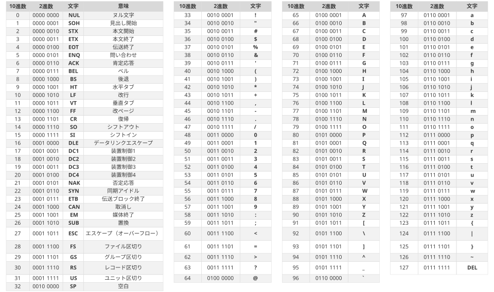
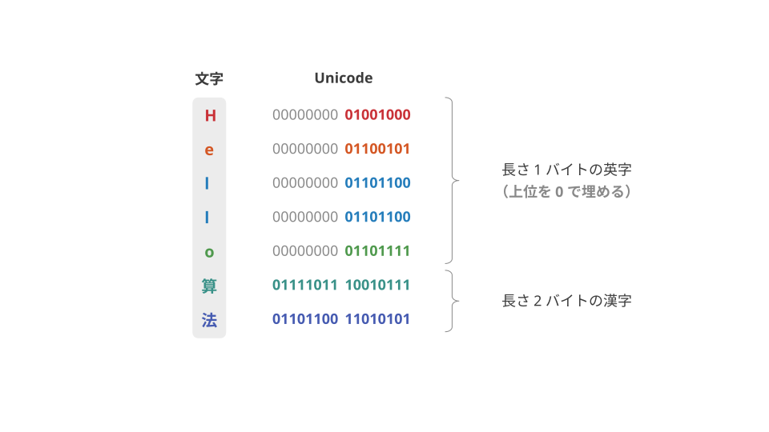
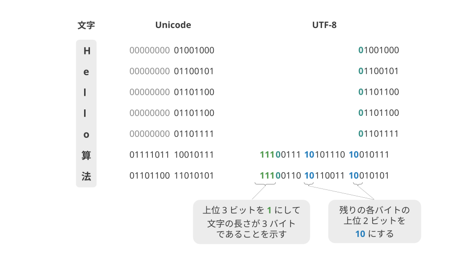

# 文字エンコーディング *

コンピュータ内ではすべてのデータが二進数として格納され、文字 `char` も例外ではありません。文字を表すには、各文字と二進数を一対一に対応付ける「文字集合」を定めます。するとコンピュータは、対応表を引いて二進数を文字に変換できます。

## ASCII 文字集合

<u>ASCII コード</u>は最も早く登場した文字集合で、正式名は American Standard Code for Information Interchange（情報交換用米国標準コード）です。7 ビットの二進数（1 バイトの下位 7 ビット）で 1 文字を表し、最大 128 種類の文字を表せます。次の図のように、英字の大文字と小文字、数字の 0～9、一部の句読点や記号、改行やタブといった制御文字が含まれます。

しかし、**ASCII コードで表せるのは英語だけです**。コンピュータが世界に広まるにつれ、より多くの言語を表せる <u>EASCII</u> という文字集合が生まれました。ASCII の 7 ビットを 8 ビットに拡張し、256 種類の文字を表せます。

やがて、各地域の言語に合わせた EASCII 文字集合が世界各地で登場しました。どの文字集合でも最初の 128 文字は ASCII と共通で、残りの 128 文字は言語の要件に合わせて個別に定義されています。

## GBK 文字集合

その後、**EASCII でも多くの言語に必要な文字数をまかなえない**ことがわかりました。たとえば漢字は 10 万字近くあり、日常で使うものだけでも数千字あります。中国の国家標準総局は 1980 年、6,763 字の漢字を収録した <u>GB2312</u> 文字集合を発表し、コンピュータで漢字を扱う基本的な要件を満たしました。

ただし GB2312 では、一部の珍しい漢字や繁体字を扱えません。<u>GBK</u> は GB2312 を拡張した文字集合で、合計 21,886 字の漢字を収録しています。GBK では ASCII の文字を 1 バイト、漢字を 2 バイトで表します。

## Unicode 文字集合

コンピュータ技術の発展に伴い、多様な文字集合や符号化規格が登場しましたが、同時に問題も生じました。まず、多くの文字集合は特定の言語の文字だけを定義するため、多言語環境ではうまく機能しません。また、同じ言語にも複数の規格があり、2 台のコンピュータが異なる符号化規格を使っていると、情報をやり取りする際に文字化けが起こります。

当時の研究者は、**世界中のあらゆる言語の文字や記号を網羅した文字集合を作れば、多言語環境での問題や文字化けを解決できるのではないか**と考えました。この発想から、幅広い文字を網羅する Unicode が誕生しました。

<u>Unicode</u> は中国語で「统一码」と呼ばれ、理論上は 100 万を超える文字を収容できます。世界中の文字を共通の文字集合にまとめ、さまざまな言語の文字を処理・表示できるようにすることで、符号化規格の違いによる文字化けを減らすことを目指しています。1991 年の公開以来、対応する言語や文字は増え続け、2022 年 9 月時点で各言語の文字、記号、絵文字など 149,186 文字が収録されています。

共通の文字集合としての Unicode の役割は、各文字に一意の「コードポイント」（文字番号）を割り当てることです。U+0000 から U+10FFFF までが、すべての文字に共通する番号の範囲です。ただし、**Unicode のコードポイントだけでは、コンピュータ内での格納方法は決まりません**。長さの異なるコードポイントが同じテキストに現れたら、システムはどうやって文字を読み分けるのでしょうか。たとえば 2 バイトのデータを受け取ったとき、2 バイトの文字 1 つなのか、1 バイトの文字 2 つなのかをどう判断すればよいでしょうか。

**単純な解決策の 1 つは、すべての文字を同じ長さに符号化して格納することです**。次の図では、「Hello」の各文字が 1 バイト、「算法」の各文字が 2 バイトを占めます。上位ビットを 0 で埋めれば、「Hello 算法」のどの文字も 2 バイトで表せます。これならシステムは 2 バイトごとに 1 文字を読み取り、元の語句を復元できます。

しかし、ASCII コードで見たように、英字を符号化するには 1 バイトで十分です。上の方法では英語のテキストが ASCII の 2 倍の領域を占め、多くのメモリが無駄になります。そこで、Unicode の文字をもっと効率よく符号化する方法が必要です。

## UTF-8 エンコーディング

現在、Unicode の符号化方式として世界で最も広く使われているのが UTF-8 です。**UTF-8 は可変長の符号化方式で**、文字に応じて 1～4 バイトを使います。ASCII の文字は 1 バイト、それ以外のラテン文字やギリシャ文字は 2 バイト、よく使う漢字は 3 バイト、一部の珍しい文字は 4 バイトで表します。

UTF-8 の符号化規則は複雑ではありません。次の 2 つの場合に分けて考えます。

- 1 バイトの文字では、最上位ビットを $0$ とし、残りの 7 ビットに Unicode コードポイントを入れます。Unicode の最初の 128 個のコードポイントは ASCII の文字です。そのため、**UTF-8 は ASCII に対して後方互換性があります**。古い ASCII テキストも UTF-8 として読み取れます。
- $n$ バイトの文字（$n > 1$）では、先頭バイトの上位 $n$ ビットをすべて $1$ にし、上から $n + 1$ ビット目を $0$ にします。2 バイト目以降は各バイトの上位 2 ビットを $10$ にします。残ったすべてのビットに、その文字の Unicode コードポイントを入れます。

次の図は「Hello算法」の UTF-8 エンコーディングです。複数バイトの文字では先頭の上位 $n$ ビットがすべて $1$ なので、上位から連続する $1$ の数を数えれば、文字の長さが $n$ バイトだとわかります。

では、後に続くすべてのバイトの上位 2 ビットを $10$ にするのはなぜでしょうか。この $10$ は誤りを見分ける目印になります。誤ったバイト位置からテキストを読み始めても、バイトの先頭に $10$ があれば、システムはすぐに異常に気づけます。

$10$ が目印になるのは、UTF-8 では文字の先頭の 2 ビットが $10$ になることはないからです。背理法で確かめましょう。ある文字の先頭の 2 ビットが $10$ だとすると、先頭に並ぶ 1 の数から、その文字の長さは $1$ バイトで ASCII に相当します。しかし ASCII の最上位ビットは $0$ のはずなので、仮定と矛盾します。

UTF-8 のほかに、次の 2 つの符号化方式もよく使われます。

- **UTF-16**：1 文字を 2 バイトまたは 4 バイトで表します。ASCII のすべての文字と英語以外でよく使われる文字は 2 バイトで表し、一部の文字には 4 バイトを使います。2 バイトの場合、UTF-16 の符号値は Unicode コードポイントと一致します。
- **UTF-32**：どの文字も 4 バイトで表します。そのため、特に ASCII の文字が多いテキストでは、UTF-8 や UTF-16 よりも多くの領域を使います。

格納領域を考えると、英字は UTF-8 なら 1 バイトで済み、非常に効率的です。一方、漢字など英語以外の一部の文字は、UTF-8 では 3 バイトかかるところを UTF-16 なら 2 バイトで表せるため、UTF-16 のほうが効率的です。

互換性の面では UTF-8 の汎用性が最も高く、多くのツールやライブラリが UTF-8 を優先的にサポートしています。

## プログラミング言語の文字エンコーディング

従来、多くのプログラミング言語では、実行中の文字列に UTF-16 や UTF-32 のように一定幅の単位を使う方式を採用してきました。単位の幅が一定なら文字列を配列のように扱えるので、次の利点があります。

- **ランダムアクセス**：UTF-16 の文字列ではランダムアクセスが容易です。UTF-8 は可変長なので、$i$ 番目の文字を見つけるには先頭から $i$ 番目までたどる必要があり、$O(n)$ の時間がかかります。
- **文字数の計算**：ランダムアクセスと同じように、UTF-16 の文字列の長さを求めるのも $O(1)$ の操作です。一方、UTF-8 で文字数を求めるには文字列全体を走査する必要があります。
- **文字列操作**：UTF-16 の文字列では、分割、連結、挿入、削除など多くの操作を容易に行えます。UTF-8 の文字列で同じ操作を行う場合、不正な UTF-8 の並びを作らないように、通常は追加の計算が必要です。

プログラミング言語の文字エンコーディングをどう設計するかは、多くの要因が絡む興味深い話題です。

- Java の `String` 型は UTF-16 を使い、文字を 2 バイト単位で格納します。Java が設計された当初は、16 ビットあればあらゆる文字を表せると考えられていました。しかし、この見積もりは正しくありませんでした。その後 Unicode の範囲が 16 ビットを超えたため、現在の Java では 1 文字を 2 つの 16 ビット値の組（「サロゲートペア」）で表すことがあります。
- JavaScript と TypeScript の文字列が UTF-16 を使う理由も Java と似ています。Netscape 社が 1995 年に JavaScript を発表した当時、Unicode はまだ初期段階で、すべての Unicode 文字を 16 ビットで表せました。
- C# が UTF-16 を使う主な理由は、.NET を設計した Microsoft が、Windows をはじめとする多くの技術で UTF-16 を広く使っていることです。

これらの言語は必要な文字数を少なく見積もっていたため、16 ビットを超える Unicode 文字を「サロゲートペア」で表すという、やむを得ない選択をしました。サロゲートペアを含む文字列では、1 文字が 2 バイトの場合と 4 バイトの場合があり、固定長の利点が失われます。また、ペアを処理するコードを追加する必要があり、プログラミングもデバッグも複雑になります。

こうした理由から、別の方式を採用した言語もあります。

- Python の `str` は Unicode を使い、文字列中の最大のコードポイントに合わせて各文字の格納幅を選ぶ柔軟な表現を採用しています。すべてが ASCII の文字なら 1 文字 1 バイトです。ASCII の範囲を超える文字があっても、すべてが基本多言語面（BMP）内なら 1 文字 2 バイト、BMP を超える文字があれば 1 文字 4 バイトです。
- Go の `string` 型の内部表現は UTF-8 です。また、単一の Unicode コードポイントを表す `rune` 型も用意されています。
- Rust の `str` 型と `String` 型は、内部で UTF-8 を使います。単一の Unicode コードポイントを表す `char` 型もあります。

ここまで取り上げたのは、プログラミング言語が文字列を内部でどう保持するかです。**文字列をファイルに格納したり、ネットワークで送信したりするときの表現は別の問題です**。ファイルへの保存やネットワークでの転送には、互換性と空間効率を高めるため、通常は UTF-8 を使います。
