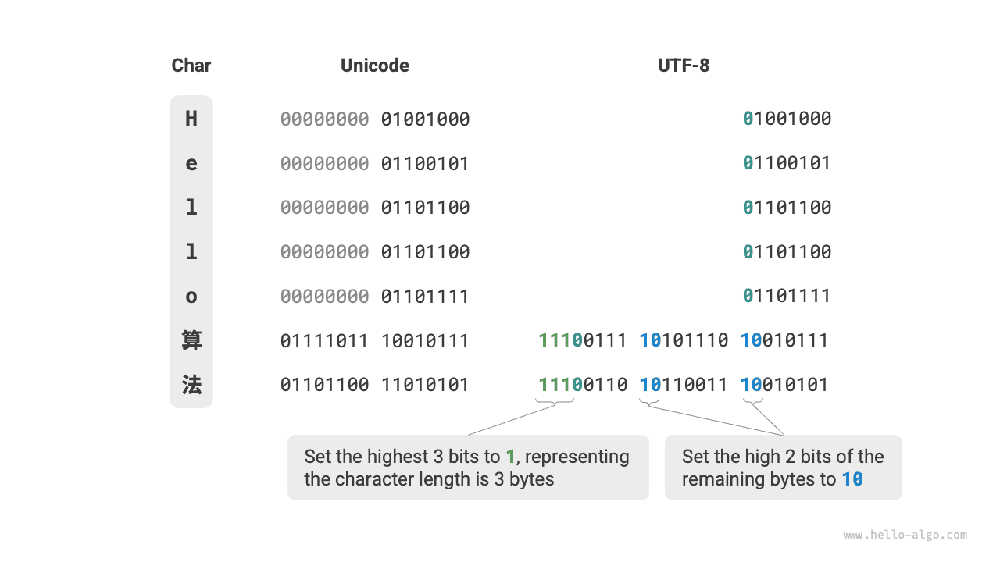

# 3.4 &nbsp; 文字エンコーディング *

コンピュータでは、すべてのデータが二進数の形で保存されており、文字 `char` も例外ではありません。文字を表すには、それぞれの文字と二進数の一対一の対応を定めた「文字集合」を用意する必要があります。文字集合があれば、コンピュータは対応表を参照して二進数を文字に変換できます。

## 3.4.1 &nbsp; ASCII 文字集合

<u>ASCII コード</u>は最初期の文字集合で、正式名称は American Standard Code for Information Interchange（情報交換用米国標準コード）です。7 ビットの二進数（1 バイトの下位 7 ビット）で 1 文字を表し、最大 128 種類の文字を表現できます。図 3-6 のように、ASCII コードには英字の大文字と小文字、数字の 0 ～ 9、一部の句読点や記号、改行やタブなどの制御文字が含まれています。

{ class="animation-figure" }

 図 3-6 &nbsp; ASCII コード 

しかし、**ASCII コードで表せるのは英語だけです**。コンピュータの利用が世界に広がるにつれて、より多くの言語を表現できる <u>EASCII</u> 文字集合が生まれました。ASCII の 7 ビットを 8 ビットに拡張したもので、256 種類の文字を表現できます。

世界各地では、それぞれの地域に適した EASCII 文字集合が次々に登場しました。いずれも先頭の 128 文字は ASCII コードと共通ですが、後半の 128 文字は各言語の需要に合わせて異なる定義になっています。

## 3.4.2 &nbsp; GBK 文字集合

その後、**EASCII コードでも、多くの言語が必要とする文字数には対応できない**ことがわかりました。例えば漢字は 10 万字近くあり、日常的に使うものだけでも数千字に上ります。中国の国家標準総局は 1980 年に <u>GB2312</u> 文字集合を発表しました。6763 字の漢字を収録し、コンピュータによる漢字処理の基本的な需要を満たすものでした。

ただし、GB2312 では一部のまれな漢字や繁体字を扱えません。<u>GBK</u> 文字集合は GB2312 を拡張したもので、合計 21886 字の漢字を収録しています。GBK の符号化方式では、ASCII 文字を 1 バイト、漢字を 2 バイトで表します。

## 3.4.3 &nbsp; Unicode 文字集合

コンピュータ技術の急速な発展とともに、多種多様な文字集合や符号化規格が生まれましたが、それに伴って多くの問題も生じました。一つは、これらの文字集合が通常は特定の言語の文字しか定義しておらず、多言語環境では正しく動作しないことです。もう一つは、同じ言語にも複数の文字集合の規格があり、2 台のコンピュータが異なる符号化規格を使っていると、情報のやり取りで文字化けが起こることです。

当時の研究者たちは、**世界中のあらゆる言語や記号を収録する、十分に網羅的な文字集合を作れば、多言語環境や文字化けの問題を解決できるのではないか**と考えました。この発想から、大規模で網羅的な文字集合 Unicode が誕生しました。

<u>Unicode</u> は中国語では「统一码」と呼ばれ、理論上は 100 万以上の文字を収容できます。世界中の文字を統一された文字集合に取り込み、さまざまな言語の文字を処理・表示するための共通の文字集合を提供することで、符号化規格の違いによる文字化けを減らすことを目指しています。1991 年の公開以来、新しい言語や文字が継続的に追加されています。2022 年 9 月時点では、各言語の文字、記号、さらには絵文字など、149186 文字が収録されています。

共通の文字集合である Unicode は、本質的には各文字に一意の「コードポイント」（文字番号）を割り当てるものです。その範囲は U+0000 から U+10FFFF で、統一された文字番号の空間を構成しています。ただし、**Unicode はこれらの文字のコードポイントをコンピュータにどのように保存するかを定めていません**。ここで、長さの異なる Unicode コードポイントが一つのテキストに混在するとき、システムはどのように文字を読み取るのかという疑問が生じます。例えば、長さが 2 バイトの符号が与えられたとき、それが 2 バイトの 1 文字なのか、1 バイトの 2 文字なのかを、どう判断するのでしょうか。

この問題に対する**直接的な解決策は、すべての文字を同じ長さの符号で保存することです**。図 3-7 では、「Hello」の各文字は 1 バイト、「算法」の各文字は 2 バイトを占めています。上位ビットを 0 で埋めれば、「Hello 算法」のすべての文字を 2 バイトの長さに符号化できます。これにより、システムは 2 バイトごとに 1 文字を読み取り、元の語句を復元できます。

{ class="animation-figure" }

 図 3-7 &nbsp; Unicode の符号化例 

しかし、ASCII コードからわかるように、英語の符号化に必要なのは 1 バイトだけです。上記の方式では、英語のテキストが占める容量は ASCII の場合の 2 倍となり、多くのメモリを無駄にします。そのため、より効率的な Unicode の符号化方式が必要です。

## 3.4.4 &nbsp; UTF-8 エンコーディング

現在、UTF-8 は世界で最も広く使われている Unicode の符号化方式です。**可変長の符号化方式であり**、文字の複雑さに応じて 1 文字を 1 ～ 4 バイトで表します。ASCII 文字は 1 バイト、ラテン文字やギリシャ文字は 2 バイト、よく使われる中国語の文字は 3 バイト、その他の一部のまれな文字は 4 バイトを必要とします。

UTF-8 の符号化規則は複雑ではなく、次の二つの場合に分かれます。

- 長さが 1 バイトの文字では、最上位ビットを $0$ にし、残りの 7 ビットに Unicode コードポイントを設定します。ASCII 文字は Unicode 文字集合の先頭の 128 コードポイントを占めています。つまり、**UTF-8 は ASCII コードとの後方互換性を備えています**。そのため、古い ASCII のテキストも UTF-8 として読み取れます。
- 長さが $n$ バイトの文字（$n > 1$）では、最初のバイトの上位 $n$ ビットをすべて $1$ にし、上位から $n + 1$ 番目のビットを $0$ にします。2 バイト目以降は各バイトの上位 2 ビットを $10$ にし、残りのすべてのビットに文字の Unicode コードポイントを埋め込みます。

図 3-8 は「Hello算法」に対応する UTF-8 の符号化を示しています。上位 $n$ ビットがすべて $1$ なので、システムは先頭から連続する $1$ の数を読み取ることで、文字の長さが $n$ バイトであると判断できます。

では、後続のすべてのバイトの上位 2 ビットを $10$ にするのはなぜでしょうか。実は、この $10$ は検査用の印として機能します。誤ったバイト位置からテキストを読み取り始めた場合でも、バイトの先頭にある $10$ によって、システムはすぐに異常を検出できます。

$10$ を検査用の印にできるのは、UTF-8 の符号化規則では、文字の先頭の 2 ビットが $10$ になることはないからです。これは背理法で証明できます。ある文字の先頭の 2 ビットが $10$ だと仮定すると、その文字の長さは $1$ バイトであり、ASCII コードに対応することになります。しかし、ASCII コードの最上位ビットは $0$ であるはずなので、仮定と矛盾します。

{ class="animation-figure" }

 図 3-8 &nbsp; UTF-8 の符号化例 

UTF-8 のほかにも、次の二つの符号化方式がよく使われます。

- **UTF-16 エンコーディング**：1 文字を 2 バイトまたは 4 バイトで表します。すべての ASCII 文字と、よく使われる英語以外の文字は 2 バイトで表し、一部の文字には 4 バイトが必要です。2 バイトで表す文字では、UTF-16 の符号値は Unicode コードポイントと等しくなります。
- **UTF-32 エンコーディング**：すべての文字を 4 バイトで表します。そのため、UTF-32 は UTF-8 や UTF-16 より多くの容量を使い、特に ASCII 文字の割合が高いテキストではその差が大きくなります。

保存容量の面では、UTF-8 は英語の文字をわずか 1 バイトで表せるため、非常に効率的です。一方、中国語などの一部の英語以外の文字は、UTF-16 なら 2 バイトで済むのに対し、UTF-8 では 3 バイト必要になることがあるため、UTF-16 の方が効率的です。

互換性の面では、UTF-8 が最も汎用性が高く、多くのツールやライブラリが UTF-8 を優先的にサポートしています。

## 3.4.5 &nbsp; プログラミング言語の文字エンコーディング

従来の多くのプログラミング言語では、プログラム実行中の文字列に、UTF-16 や UTF-32 のような固定長の符号化方式を使っていました。固定長なら文字列を配列として扱うことができ、次のような利点があります。

- **ランダムアクセス**：UTF-16 で符号化された文字列には、容易にランダムアクセスできます。UTF-8 は可変長なので、第 $i$ 文字を見つけるには、文字列の先頭から第 $i$ 文字まで走査する必要があり、$O(n)$ の時間がかかります。
- **文字数の取得**：ランダムアクセスと同様に、UTF-16 で符号化された文字列の長さを求める操作も $O(1)$ です。一方、UTF-8 で符号化された文字列の長さを求めるには、文字列全体を走査する必要があります。
- **文字列操作**：UTF-16 で符号化された文字列では、分割、連結、挿入、削除など、多くの操作を行いやすくなります。UTF-8 で符号化された文字列でこれらの操作を行う場合は、不正な UTF-8 の符号を生じさせないようにするため、通常は追加の計算が必要です。

実際、プログラミング言語の文字エンコーディングの設計は、さまざまな要因が関わる興味深いテーマです。

- Java の `String` 型は UTF-16 を使い、各文字が 2 バイトを占めます。これは、Java の設計当初、16 ビットであらゆる文字を表現できると考えられていたためです。しかし、その判断は誤りでした。その後、Unicode の規格が 16 ビットの範囲を超えて拡張されたため、現在の Java では、文字が「サロゲートペア」と呼ばれる二つの 16 ビット値の組で表されることがあります。
- JavaScript と TypeScript の文字列が UTF-16 を使う理由も Java と同様です。Netscape が 1995 年に JavaScript を初めて公開したとき、Unicode はまだ発展の初期段階にあり、16 ビットの符号ですべての Unicode 文字を表現できました。
- C# が UTF-16 を使う主な理由は、.NET プラットフォームを設計した Microsoft の多くの技術で、Windows を含めて UTF-16 が広く使われているためです。

これらのプログラミング言語は文字数を少なく見積もったため、16 ビットを超える Unicode 文字を「サロゲートペア」で表さざるを得なくなりました。これはやむを得ない対応でした。一方では、サロゲートペアを含む文字列では 1 文字が 2 バイトにも 4 バイトにもなり、固定長という利点が失われます。他方では、サロゲートペアを扱うために追加のコードが必要となり、プログラミングが複雑になってデバッグも難しくなります。

こうした理由から、異なる符号化方式を採用しているプログラミング言語もあります。

- Python の `str` は Unicode を使い、柔軟な文字列表現を採用しています。保存時の文字の長さは、文字列中の最大の Unicode コードポイントによって決まります。すべてが ASCII 文字なら各文字は 1 バイト、ASCII の範囲外の文字があってもすべてが基本多言語面（BMP）内なら各文字は 2 バイト、BMP の範囲外の文字がある場合は各文字が 4 バイトを占めます。
- Go の `string` 型は、内部で UTF-8 を使います。また、単一の Unicode コードポイントを表す `rune` 型も用意されています。
- Rust の `str` 型と `String` 型は、内部で UTF-8 を使います。また、単一の Unicode コードポイントを表す `char` 型も用意されています。

ここまでの説明は、いずれもプログラミング言語内部での文字列の保存方法に関するものです。**ファイルへの保存方法やネットワークでの転送方法とは、別の問題である**ことに注意してください。ファイルに保存したりネットワークで転送したりするときは、通常、互換性と容量効率を最適にするために、文字列を UTF-8 形式に符号化します。
