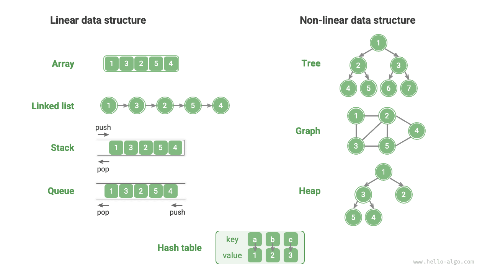
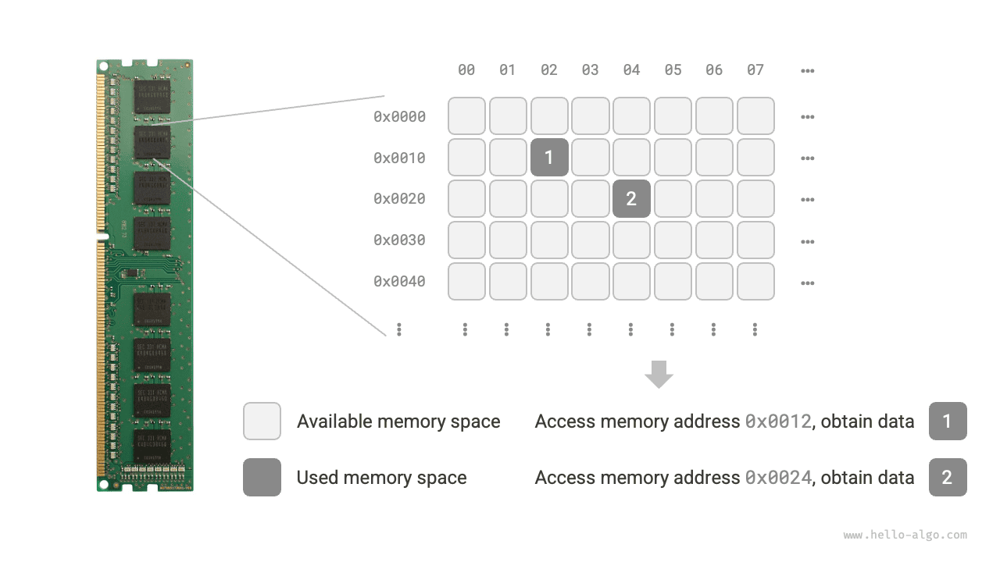
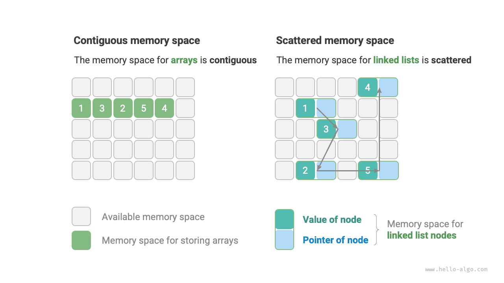

# 3.1 &nbsp; データ構造の分類

代表的なデータ構造には、配列、連結リスト、スタック、キュー、ハッシュテーブル、木、ヒープ、グラフがあります。これらは「論理構造」と「物理構造」の二つの観点で分類できます。

## 3.1.1 &nbsp; 論理構造：線形と非線形

**論理構造は、データ要素同士の論理的な関係を表します**。配列や連結リストでは一定の順に並び、線形の関係を表します。木では上から下へ階層的に並び、「祖先」から「子孫」へ派生する関係を表します。グラフはノードと辺からなり、複雑なネットワーク関係を表します。

図 3-1 のように、論理構造は「線形」と「非線形」に大別できます。線形構造は直感的に理解しやすく、要素が論理的に一列に並びます。非線形構造では、そのような一列の並びにはなりません。

- **線形データ構造**：配列、連結リスト、スタック、キュー、ハッシュテーブル。要素間には一対一の順序関係があります。
- **非線形データ構造**：木、ヒープ、グラフ、ハッシュテーブル。

非線形データ構造は、さらに木構造とネットワーク構造に分けられます。

- **木構造**：木、ヒープ、ハッシュテーブル。要素間は一対多の関係です。
- **ネットワーク構造**：グラフ。要素間は多対多の関係です。

{ class="animation-figure" }

 図 3-1 &nbsp; 線形データ構造と非線形データ構造 

## 3.1.2 &nbsp; 物理構造：連続と分散

**アルゴリズムの実行中、処理対象のデータは主にメモリに保存されます**。図 3-2 はメモリモジュールで、黒いチップのそれぞれにメモリ空間があります。メモリは巨大な Excel の表のように考えられ、各セルに一定量のデータを格納できます。

**システムはメモリアドレスを使って、目的の位置のデータにアクセスします**。図 3-2 のように、各セルには規則に従った番号が割り当てられ、各メモリ領域が一意のアドレスを持ちます。このアドレスにより、プログラムはデータにアクセスできます。

{ class="animation-figure" }

 図 3-2 &nbsp; メモリモジュール、メモリ空間、メモリアドレス 

!!! tip "ヒント"

    Excel の表は単純化したたとえです。実際のメモリの仕組みはもっと複雑で、アドレス空間、メモリ管理、キャッシュ、仮想メモリ、物理メモリなどが関わります。

メモリはすべてのプログラムが利用する資源ですが、ある領域を一つのプログラムが使っていると、通常はほかのプログラムが同時に使うことはできません。**そのため、データ構造とアルゴリズムの設計では、メモリ資源が重要な検討事項です**。たとえば最大使用量がシステムの空きメモリを超えないようにし、大きな連続領域がなければ、分散した領域に格納できるデータ構造を選ぶ必要があります。

図 3-3 のように、**物理構造は、コンピュータのメモリ内での格納方法を表し**、連続した領域への格納（配列）と、分散した領域への格納（連結リスト）に分けられます。アクセス、更新、追加、削除などの方法を根本から決めるもので、二つの構造は時間効率と空間効率の面で互いを補い合います。

{ class="animation-figure" }

 図 3-3 &nbsp; 連続した領域への格納と分散した領域への格納 

**すべてのデータ構造は、配列、連結リスト、またはその組み合わせで実装されます**。たとえばスタックとキューはどちらでも実装でき、ハッシュテーブルでは両方を使うことがあります。

- **配列で実装できるもの**：スタック、キュー、ハッシュテーブル、木、ヒープ、グラフ、行列、テンソル（次元が $\geq 3$ の配列）など。
- **連結リストで実装できるもの**：スタック、キュー、ハッシュテーブル、木、ヒープ、グラフなど。

連結リストは初期化後も実行中に長さを変えられるため、「動的データ構造」とも呼ばれます。配列は初期化後に長さを変えられないため、「静的データ構造」とも呼ばれます。ただし、配列もメモリを再確保すれば長さを変えられ、一定の「動的な性質」を持たせられます。

!!! tip "ヒント"

    物理構造がわかりにくければ、次の章を読んでから、この節を振り返ってみてください。
