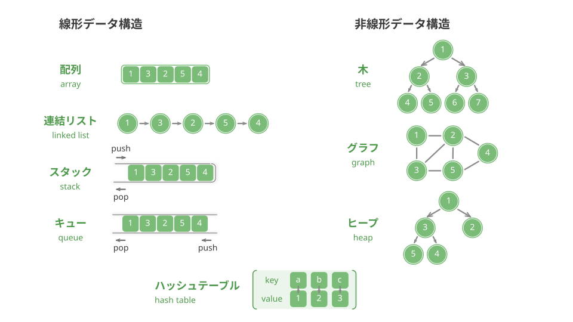
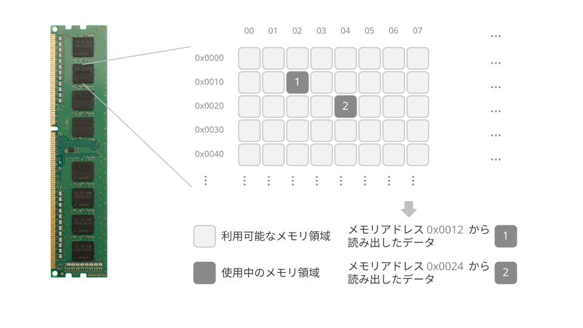
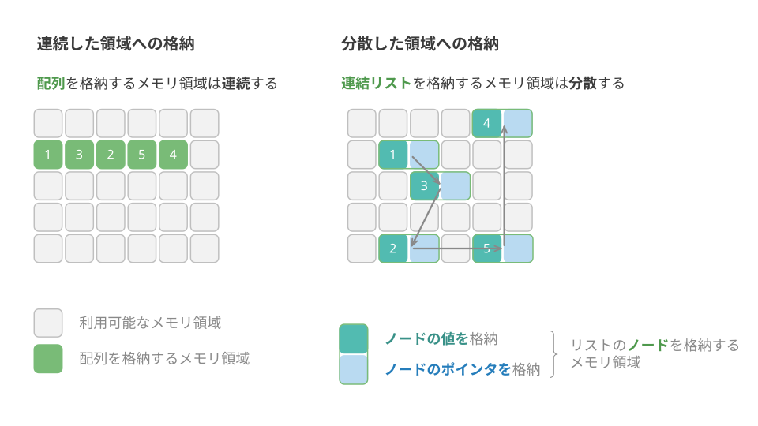

# データ構造の分類

代表的なデータ構造には配列、連結リスト、スタック、キュー、ハッシュテーブル、木、ヒープ、グラフがあります。これらは「論理構造」と「物理構造」という 2 つの観点から分類できます。

## 論理構造：線形と非線形

**論理構造が示すのは、データ要素どうしの論理的な関係です**。配列や連結リストではデータが一定の順に並び、線形の関係を表します。木ではデータが上から下へ階層をなし、「祖先」から「子孫」が枝分かれする関係を表します。グラフはノードと辺から成り、複雑なネットワークの関係を表します。

次の図のように、論理構造は「線形」と「非線形」に大別できます。線形構造は直感的で、データが論理的に一列に並びます。非線形構造では、データの関係は一列には並びません。

- **線形データ構造**：配列、連結リスト、スタック、キュー。要素は一対一の前後関係を持ちます。
- **非線形データ構造**：木、ヒープ、グラフ。

代表的な非線形構造には、木構造とネットワーク構造があります。

- **木構造**：木、ヒープ。要素は一対多の関係を持ちます。
- **ネットワーク構造**：グラフ。要素は多対多の関係を持ちます。

ハッシュテーブルはキーを使って値を探します。図ではこの対応関係を別に示しています。

## 物理構造：連続と分散

**アルゴリズムを実装したプログラムの実行中、処理対象のデータは主にメモリに格納されます**。次の図はコンピュータのメモリモジュールで、黒い長方形のそれぞれがメモリ領域を持っています。メモリを巨大な Excel の表に見立てると、各セルには一定の大きさのデータが入ります。

**システムはメモリアドレスを使って目的の位置にあるデータにアクセスします**。次の図のように、コンピュータは一定の規則に従って表の各セルに番号を割り当て、それぞれの領域に一意のアドレスを与えます。プログラムはこのアドレスを使ってメモリ内のデータにアクセスできます。

!!! tip

    Excel の表にたとえたのは、メモリを理解しやすくするためです。実際の仕組みはもっと複雑で、アドレス空間、メモリ管理、キャッシュ、仮想メモリ、物理メモリなどの概念が関わります。

メモリはすべてのプログラムが利用する資源です。ある領域を 1 つのプログラムが使っている間は、通常ほかのプログラムは同時にその領域を使えません。**そのため、メモリ資源はデータ構造やアルゴリズムを設計するうえで重要な考慮事項です**。たとえば、アルゴリズムの最大メモリ使用量がシステムの空きメモリを超えないようにします。また、十分に大きな連続領域がなければ、分散した領域に格納できるデータ構造を選ぶ必要があります。

次の図のように、**物理構造はコンピュータのメモリ内でのデータの格納方法を表します**。連続した領域への格納（配列）と、分散した領域への格納（連結リスト）に分類できます。物理構造はデータへのアクセス、更新、追加、削除などの方法を基礎から決めます。この 2 つの物理構造は、時間効率と空間効率の面で互いを補う特徴を持ちます。

**どのデータ構造も、配列、連結リスト、またはその組み合わせを基に実装されます**。たとえば、スタックとキューは配列でも連結リストでも実装できます。ハッシュテーブルでは配列と連結リストの両方を使うことがあります。

- **配列を基に実装できる構造**：スタック、キュー、ハッシュテーブル、木、ヒープ、グラフ、行列、テンソル（次元数が $\geq 3$ の配列）など。
- **連結リストを基に実装できる構造**：スタック、キュー、ハッシュテーブル、木、ヒープ、グラフなど。

連結リストは初期化後もプログラムの実行中に長さを変えられるため、「動的データ構造」とも呼ばれます。配列は初期化後に長さが変わらないため、「静的データ構造」とも呼ばれます。ただし、配列もメモリを確保し直せば長さを変えられるので、ある程度の「動的」な性質を持たせられます。

!!! tip

    物理構造がまだつかみにくければ、先に次の章を読んでから、この節に戻ってみてください。
