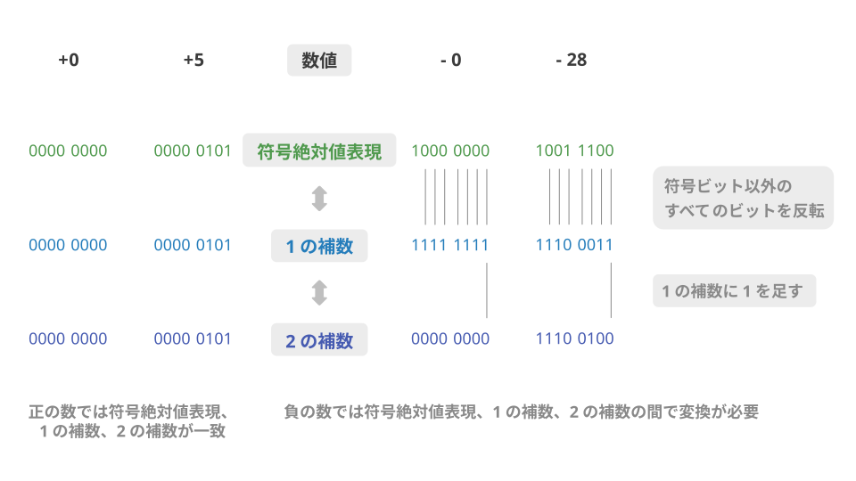
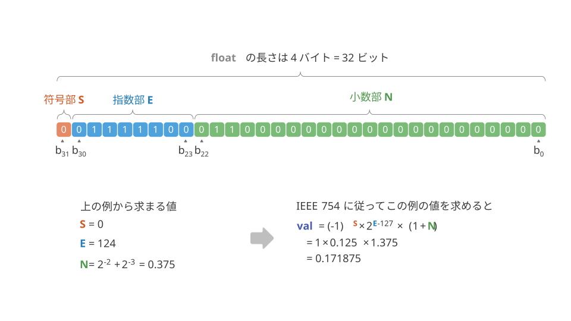

# 3.3 &nbsp; 数値の符号化 *

!!! tip "ヒント"

    本書では、見出しに * が付いた節は発展的な内容です。時間がない場合や難しく感じた場合は、いったん飛ばし、必読の節を学び終えてから改めて取り組んでください。

## 3.3.1 &nbsp; 符号絶対値表現、1 の補数、2 の補数

前節の表では、どの整数型も、表現できる負の数が正の数より 1 つ多くなっていました。たとえば `byte` の範囲は $[-128, 127]$ です。直感に反するように見えるこの特徴を理解するには、符号絶対値表現、1 の補数、2 の補数を知る必要があります。

まず、**コンピュータでは整数を「2 の補数」で格納します**。その理由を考える前に、3 つの表現を定義しましょう。

- **符号絶対値表現**：二進表現の最上位ビットを符号ビットとし、$0$ で正、$1$ で負を表します。残りのビットは数の大きさを表します。
- **1 の補数**：正の数では符号絶対値表現と同じです。負の数では符号絶対値表現の符号ビット以外をすべて反転します。
- **2 の補数**：正の数では符号絶対値表現と同じです。負の数では 1 の補数に $1$ を足します。

図 3-4 に、符号絶対値表現、1 の補数、2 の補数の間で変換する方法を示します。

{ class="animation-figure" }

 図 3-4 &nbsp; 符号絶対値表現、1 の補数、2 の補数の相互変換 

<u>符号絶対値表現（sign-magnitude）</u>は最も直感的ですが、いくつか制約があります。まず、**負の数の符号絶対値表現をそのまま使って演算することはできません**。たとえば符号絶対値表現のまま $1 + (-2)$ を計算すると結果は $-3$ となり、明らかに正しくありません。

$$
\begin{aligned}
& 1 + (-2) \newline
& \rightarrow 0000 \; 0001 + 1000 \; 0010 \newline
& = 1000 \; 0011 \newline
& \rightarrow -3
\end{aligned}
$$

この問題を解決するために導入されたのが<u>1 の補数（1's complement）</u>です。符号絶対値表現を 1 の補数に変換して $1 + (-2)$ を計算し、結果を符号絶対値表現に戻せば、正しい値 $-1$ が得られます。

$$
\begin{aligned}
& 1 + (-2) \newline
& \rightarrow 0000 \; 0001 \; \text{(符号絶対値表現)} + 1000 \; 0010 \; \text{(符号絶対値表現)} \newline
& = 0000 \; 0001 \; \text{(1 の補数)} + 1111  \; 1101 \; \text{(1 の補数)} \newline
& = 1111 \; 1110 \; \text{(1 の補数)} \newline
& = 1000 \; 0001 \; \text{(符号絶対値表現)} \newline
& \rightarrow -1
\end{aligned}
$$

もう一つの制約は、**符号絶対値表現ではゼロに $+0$ と $-0$ という 2 通りの表現がある**ことです。同じゼロに異なる 2 つのビット列が対応するため、曖昧さが生じます。たとえば、条件判定で正のゼロと負のゼロを考慮しないと、結果を誤ることがあります。曖昧さを解消するには判定を追加する必要があり、演算効率が下がる可能性があります。

$$
\begin{aligned}
+0 & \rightarrow 0000 \; 0000 \newline
-0 & \rightarrow 1000 \; 0000
\end{aligned}
$$

1 の補数にも、符号絶対値表現と同じく正負のゼロの曖昧さがあります。そこでさらに導入されたのが<u>2 の補数（2's complement）</u>です。まず、負のゼロを符号絶対値表現から 1 の補数、2 の補数へと変換してみましょう。

$$
\begin{aligned}
-0 \rightarrow \; & 1000 \; 0000 \; \text{(符号絶対値表現)} \newline
= \; & 1111 \; 1111 \; \text{(1 の補数)} \newline
= 1 \; & 0000 \; 0000 \; \text{(2 の補数)} \newline
\end{aligned}
$$

負のゼロの 1 の補数に $1$ を足すと繰り上がりが生じますが、`byte` 型は 8 ビットしかないため、9 ビット目にはみ出した $1$ は捨てられます。つまり、**負のゼロの 2 の補数は $0000 \; 0000$ で、正のゼロの 2 の補数と一致します**。2 の補数表現ではゼロが 1 つだけになり、正負のゼロの曖昧さが解消されます。

最後に疑問が 1 つ残ります。`byte` 型の範囲は $[-128, 127]$ ですが、余分な負の数 $-128$ はどこから来るのでしょうか。$[-127, +127]$ に含まれるすべての整数には符号絶対値表現、1 の補数、2 の補数があり、符号絶対値表現と 2 の補数は相互に変換できます。

ところが、**2 の補数 $1000 \; 0000$ だけは例外で、対応する符号絶対値表現がありません**。先ほどの方法でこの 2 の補数を変換すると、符号絶対値表現は $0000 \; 0000$ になります。これは数値 $0$ の表現で、その 2 の補数は同じビット列になるはずなので、矛盾します。コンピュータでは、この特別な 2 の補数 $1000 \; 0000$ が $-128$ を表すと定めています。実際、2 の補数で $(-1) + (-127)$ を計算した結果は $-128$ です。

$$
\begin{aligned}
& (-127) + (-1) \newline
& \rightarrow 1111 \; 1111 \; \text{(符号絶対値表現)} + 1000 \; 0001 \; \text{(符号絶対値表現)} \newline
& = 1000 \; 0000 \; \text{(1 の補数)} + 1111  \; 1110 \; \text{(1 の補数)} \newline
& = 1000 \; 0001 \; \text{(2 の補数)} + 1111  \; 1111 \; \text{(2 の補数)} \newline
& = 1000 \; 0000 \; \text{(2 の補数)} \newline
& \rightarrow -128
\end{aligned}
$$

ここまでの計算はすべて足し算です。ここには重要な事実が隠れています。**コンピュータ内部のハードウェア回路は、主に加算を基に設計されています**。加算は乗算、除算、減算などに比べてハードウェアで実装しやすく、並列化も容易で、演算が速いからです。

もちろん、コンピュータでできるのが足し算だけという意味ではありません。**加算と基本的な論理演算を組み合わせると、さまざまな数学的演算を実現できます**。たとえば減算 $a - b$ は加算 $a + (-b)$ に置き換えられます。乗算や除算も、加算や減算を繰り返す計算に置き換えられます。

これで、コンピュータが 2 の補数を使う理由がわかります。2 の補数表現なら、正の数と負の数の加算を同じ回路と操作で処理できます。減算専用の特別な回路を設計したり、正負のゼロを区別する処理を加えたりする必要がありません。こうしてハードウェアの設計が大幅に簡単になり、演算効率も高まります。

2 の補数はよく工夫された表現です。紙幅の都合でここまでとしますが、興味があればさらに詳しく調べてみてください。

## 3.3.2 &nbsp; 浮動小数点数の符号化

`int` と `float` はどちらも 4 バイトです。それなのに、なぜ `float` が表せる範囲は `int` よりはるかに広いのでしょうか。`float` は小数まで表す必要があるので、むしろ範囲が狭くなるはずだと思うかもしれません。

実は、**浮動小数点数 `float` では数値の表し方が異なるからです**。32 ビットの二進数を次のように書きます。

$$
b_{31} b_{30} b_{29} \ldots b_2 b_1 b_0
$$

IEEE 754 規格では、32 ビットの `float` を次の 3 つの部分に分けます。

- 符号部 $\mathrm{S}$：1 ビットで、$b_{31}$ に対応します。
- 指数部 $\mathrm{E}$：8 ビットで、$b_{30} b_{29} \ldots b_{23}$ に対応します。
- 小数部 $\mathrm{N}$：23 ビットで、$b_{22} b_{21} \ldots b_0$ に対応します。

この二進表現が表す `float` の値は、次のように計算します。

$$
\text {val} = (-1)^{b_{31}} \times 2^{\left(b_{30} b_{29} \ldots b_{23}\right)_2-127} \times\left(1 . b_{22} b_{21} \ldots b_0\right)_2
$$

十進数で書いた計算式は次のとおりです。

$$
\text {val}=(-1)^{\mathrm{S}} \times 2^{\mathrm{E} -127} \times (1 + \mathrm{N})
$$

各項の取り得る範囲は次のとおりです。

$$
\begin{aligned}
\mathrm{S} \in & \{ 0, 1\}, \quad \mathrm{E} \in \{ 1, 2, \dots, 254 \} \newline
(1 + \mathrm{N}) = & (1 + \sum_{i=1}^{23} b_{23-i} 2^{-i}) \subset [1, 2 - 2^{-23}]
\end{aligned}
$$

{ class="animation-figure" }

 図 3-5 &nbsp; IEEE 754 に従った float の値の計算例 

図 3-5 の例では $\mathrm{S} = 0$、$\mathrm{E} = 124$、$\mathrm{N} = 2^{-2} + 2^{-3} = 0.375$ なので、次のように計算できます。

$$
\text { val } = (-1)^0 \times 2^{124 - 127} \times (1 + 0.375) = 0.171875
$$

これで最初の疑問に答えられます。**`float` の表現には指数部があるため、その値の範囲は `int` よりはるかに広いのです**。上の計算から、`float` が表せる最大の正の数は $2^{254 - 127} \times (2 - 2^{-23}) \approx 3.4 \times 10^{38}$ です。符号ビットを切り替えれば、最も小さい負の数が得られます。

**浮動小数点数 `float` は表せる範囲を広げる代わりに、精度を犠牲にしています**。整数型 `int` は全 32 ビットで整数を表し、表せる数は等間隔に並びます。一方、浮動小数点型 `float` は指数部を持つため、数が大きくなるにつれて、隣り合う表現可能な数の差も大きくなる傾向があります。

表 3-2 のように、指数部の $\mathrm{E} = 0$ と $\mathrm{E} = 255$ には特別な意味があり、**ゼロ、無限大、$\mathrm{NaN}$ などの表現に使われます**。

 表 3-2 &nbsp; 指数部の意味 

| 指数部 E           | 小数部 $\mathrm{N} = 0$ | 小数部 $\mathrm{N} \ne 0$ | 計算式                                                               |
| ------------------ | ----------------------- | ------------------------- | ---------------------------------------------------------------------- |
| $0$                | $\pm 0$                 | 非正規化数                  | $(-1)^{\mathrm{S}} \times 2^{-126} \times (0.\mathrm{N})$              |
| $1, 2, \dots, 254$ | 正規化数                  | 正規化数                    | $(-1)^{\mathrm{S}} \times 2^{(\mathrm{E} -127)} \times (1.\mathrm{N})$ |
| $255$              | $\pm \infty$            | $\mathrm{NaN}$            |                                                                        |

非正規化数によって、ゼロの近くでは浮動小数点数をより細かく表せます。最小の正の正規化数は $2^{-126}$、最小の正の非正規化数は $2^{-126} \times 2^{-23}$ です。

倍精度の `double` も `float` と同様の表現を使うので、ここでは詳しい説明を省きます。
