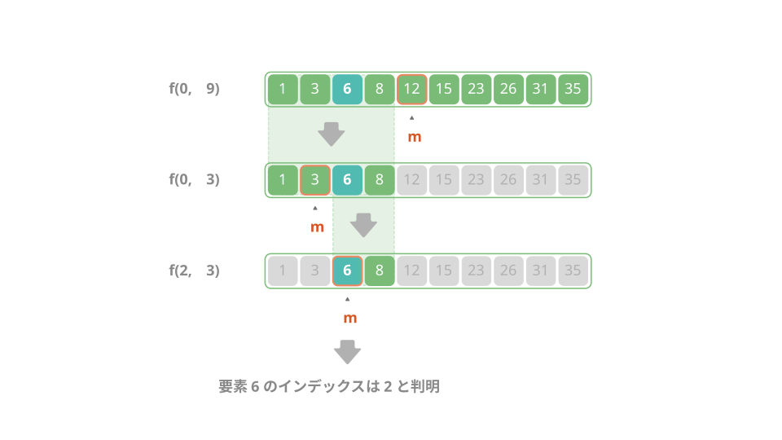

# 分割統治法による探索

これまでに学んだ探索アルゴリズムは、大きく二つに分類できます。

- **総当たり探索**：データ構造全体をたどる方法で、時間計算量は $O(n)$ です。
- **適応的探索**：データの特有の構造や事前に分かっている情報を利用し、時間計算量を $O(\log n)$ や、場合によっては $O(1)$ にまで減らせます。

実際、**時間計算量が $O(\log n)$ の探索アルゴリズムには、分割統治の考え方を使うものが多くあります**。二分探索や木を使った探索がその例です。

- 二分探索では、各段階で「配列内の目的の要素を探す」という問題を「配列の半分で目的の要素を探す」という小さな問題に分けます。配列が空になるか、目的の要素が見つかるまでこれを繰り返します。
- 木は分割統治の考え方をよく表しています。二分探索木、AVL 木、ヒープなどでは、さまざまな操作を $O(\log n)$ の時間で実行できます。

二分探索における分割統治の考え方を整理します。

- **問題を分割できる**：中央の要素と目的の要素を比較し、配列での探索という元の問題を、その半分での探索という部分問題に再帰的に分けます。
- **部分問題が独立している**：各段階で扱う部分問題は一つだけで、ほかの部分問題の影響を受けません。
- **部分問題の解をまとめる必要がない**：二分探索の目的は特定の要素を見つけることなので、解をまとめる必要はありません。部分問題が解けた時点で、元の問題も解けています。

総当たり探索では一度に一つの候補しか除けませんが、**分割統治による探索では一度に候補の半分を除けます**。これが探索効率が上がる理由です。

### 分割統治法による二分探索の実装

以前の章では二分探索を反復で実装しました。ここでは分割統治法を使い、再帰で実装します。

!!! question

    長さ $n$ のソート済み配列 `nums` が与えられ、すべての値は異なります。要素 `target` を探してください。

分割統治の観点から、探索区間 $[i, j]$ に対応する部分問題を $f(i, j)$ と表します。

元の問題 $f(0, n-1)$ を出発点として、次の手順で二分探索を行います。

1. 探索区間 $[i, j]$ の中央 $m$ を求め、これを使って探索区間の半分を除外します。
2. 規模が半分になった部分問題を再帰的に解きます。対象は $f(i, m-1)$ または $f(m+1, j)$ です。
3. 手順 `1.` と手順 `2.` を繰り返し、`target` が見つかるか区間が空になったら戻ります。

次の図は、配列内の要素 $6$ を二分探索する際の分割統治の過程です。



実装では、問題 $f(i, j)$ を解く再帰関数 `dfs()` を定義します。

```src
[file]{binary_search_recur}-[class]{}-[func]{binary_search}
```
