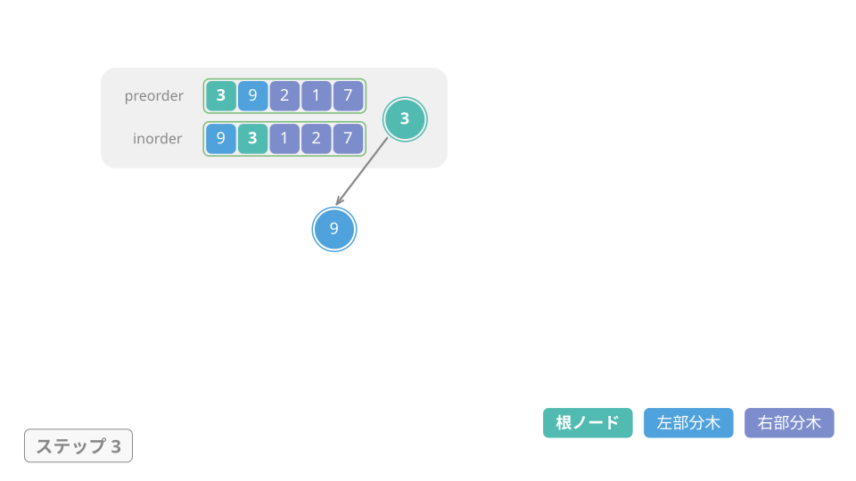
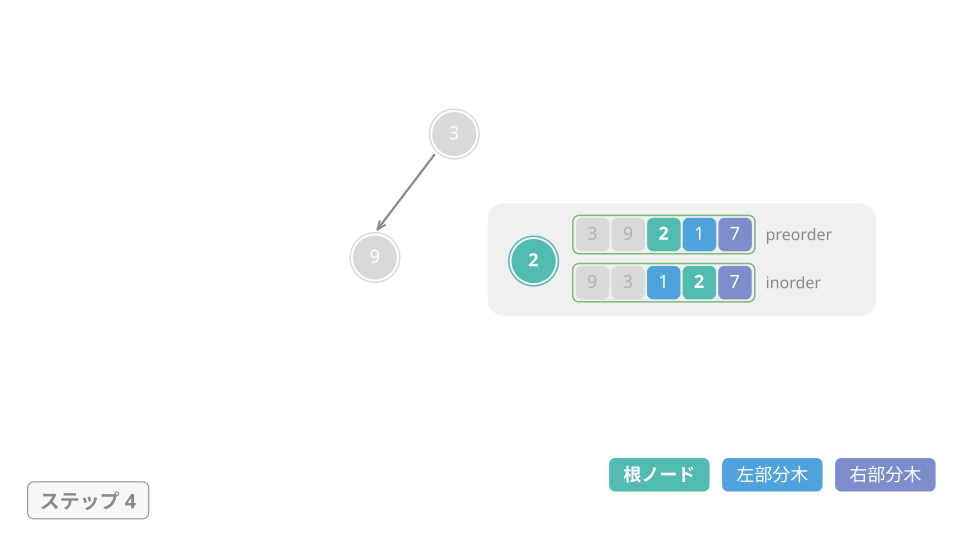
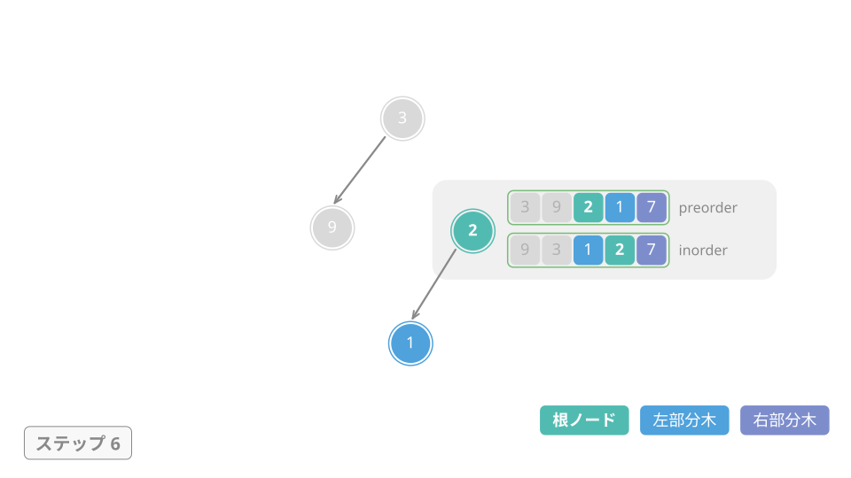
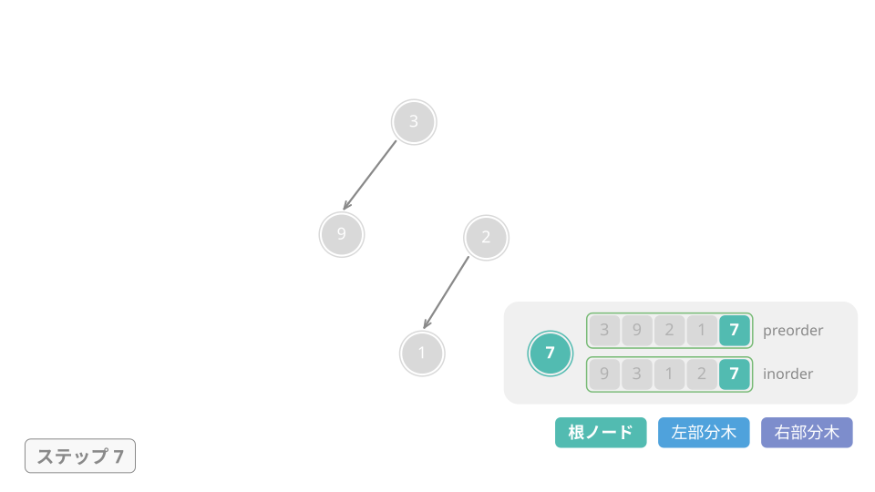
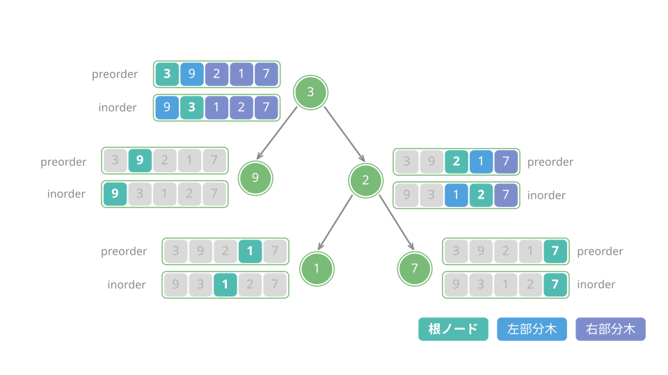

# 12.3 &nbsp; 二分木を構築する問題

!!! question "問題"

    二分木の行きがけ順の走査列 `preorder` と通りがけ順の走査列 `inorder` が与えられます。この二つから二分木を構築し、根ノードを返してください。図 12-5 のように、木に値の等しいノードはないものとします。

{ class="animation-figure" }

<p align="center"> 図 12-5 &nbsp; 二分木の構築に使うデータ例 </p>

### 1. &nbsp; 分割統治法で解けるかを判断する

元の問題は `preorder` と `inorder` から二分木を構築することで、分割統治法が使える典型的な問題です。

- **問題を分割できる**：元の問題は、根ノードを初期化する操作と、「左部分木を構築する」「右部分木を構築する」という二つの部分問題に分けられます。各部分木も同じ方法でさらに小さい部分木に分けられ、最小の部分問題である空の部分木に達したら終了します。
- **部分問題が独立している**：左部分木と右部分木に共通のノードはなく、互いに独立です。左部分木を構築する際は、通りがけ順と行きがけ順の列のうち左部分木に対応する部分だけを見れば十分です。右部分木も同様です。
- **部分問題の解をまとめられる**：左部分木と右部分木という部分問題の解が得られたら、それぞれを根につなぐことで元の問題の解になります。

### 2. &nbsp; 部分木の分け方

この問題に分割統治法が使えることが分かりました。では、**行きがけ順 `preorder` と通りがけ順 `inorder` の走査列を、どうやって左部分木と右部分木に分ければよいのでしょうか**。

定義から、`preorder` と `inorder` はどちらも三つの部分に分けられます。

- 行きがけ順：`[ 根 | 左部分木 | 右部分木 ]`。たとえば図 12-5 の木では `[ 3 | 9 | 2 1 7 ]` です。
- 通りがけ順：`[ 左部分木 | 根 | 右部分木 ]`。たとえば図 12-5 の木では `[ 9 | 3 | 1 2 7 ]` です。

上の図のデータを例に、図 12-6 の手順で実際に分けてみます。

1. 行きがけ順の先頭要素 3 が根の値です。
2. `inorder` で根 3 のインデックスを探します。これを使って `inorder` を `[ 9 | 3 | 1 2 7 ]` と分けられます。
3. `inorder` を分けた結果から、左部分木のノードは 1 個、右部分木のノードは 3 個と分かります。したがって `preorder` を `[ 3 | 9 | 2 1 7 ]` と分けられます。

{ class="animation-figure" }

<p align="center"> 図 12-6 &nbsp; 行きがけ順と通りがけ順の走査列を部分木に分ける </p>

### 3. &nbsp; 変数を使って部分木の区間を表す

この分け方により、**根、左部分木、右部分木が `preorder` と `inorder` のどのインデックス区間に対応するか**が分かりました。いくつかの位置を示す変数でこれらの区間を表しましょう。

- 現在の木の根が `preorder` に現れるインデックスを $i$ とします。
- 現在の木の根が `inorder` に現れるインデックスを $m$ とします。
- 現在の木が `inorder` で占めるインデックス区間を $[l, r]$ とします。

表 12-1 のように、これらの変数を使うと、`preorder` での根のインデックスと、`inorder` での部分木のインデックス区間を表せます。

<p align="center"> 表 12-1 &nbsp; 行きがけ順と通りがけ順における根と部分木のインデックス </p>

<div class="center-table" markdown>

|        | `preorder` における根のインデックス | `inorder` における部分木のインデックス区間 |
| ------ | ---------------------------- | ----------------------------- |
| 現在の木 | $i$                          | $[l, r]$                      |
| 左部分木 | $i + 1$                      | $[l, m-1]$                    |
| 右部分木 | $i + 1 + (m - l)$            | $[m+1, r]$                    |

</div>

右部分木の根のインデックスを求める式で、$(m-l)$ は「左部分木のノード数」を表します。図 12-7 と照らし合わせてみてください。

{ class="animation-figure" }

<p align="center"> 図 12-7 &nbsp; 根と左右の部分木をインデックス区間で表す </p>

### 4. &nbsp; 実装

$m$ を効率よく求めるため、ハッシュ表 `hmap` に、配列 `inorder` の各要素とそのインデックスの対応を格納します。

=== "Python"

    ```python title="build_tree.py"
    def dfs(
        preorder: list[int],
        inorder_map: dict[int, int],
        i: int,
        l: int,
        r: int,
    ) -> TreeNode | None:
        """二分木の構築：分割統治法"""
        # 部分木の区間が空なら終了する
        if r - l < 0:
            return None
        # 根ノードを初期化する
        root = TreeNode(preorder[i])
        # m を調べて左右の部分木を分ける
        m = inorder_map[preorder[i]]
        # 部分問題：左部分木を構築する
        root.left = dfs(preorder, inorder_map, i + 1, l, m - 1)
        # 部分問題：右部分木を構築する
        root.right = dfs(preorder, inorder_map, i + 1 + m - l, m + 1, r)
        # 根ノードを返す
        return root

    def build_tree(preorder: list[int], inorder: list[int]) -> TreeNode | None:
        """二分木の構築"""
        # ハッシュ表を初期化し、inorder の各要素に対応するインデックスを格納する
        inorder_map = {val: i for i, val in enumerate(inorder)}
        root = dfs(preorder, inorder_map, 0, 0, len(inorder) - 1)
        return root
    ```

=== "C++"

    ```cpp title="build_tree.cpp"
    /* 二分木の構築：分割統治法 */
    TreeNode *dfs(vector<int> &preorder, unordered_map<int, int> &inorderMap, int i, int l, int r) {
        // 部分木の区間が空なら終了する
        if (r - l < 0)
            return NULL;
        // 根ノードを初期化する
        TreeNode *root = new TreeNode(preorder[i]);
        // m を調べて左右の部分木を分ける
        int m = inorderMap[preorder[i]];
        // 部分問題：左部分木を構築する
        root->left = dfs(preorder, inorderMap, i + 1, l, m - 1);
        // 部分問題：右部分木を構築する
        root->right = dfs(preorder, inorderMap, i + 1 + m - l, m + 1, r);
        // 根ノードを返す
        return root;
    }

    /* 二分木の構築 */
    TreeNode *buildTree(vector<int> &preorder, vector<int> &inorder) {
        // ハッシュ表を初期化し、inorder の各要素に対応するインデックスを格納する
        unordered_map<int, int> inorderMap;
        for (int i = 0; i < inorder.size(); i++) {
            inorderMap[inorder[i]] = i;
        }
        TreeNode *root = dfs(preorder, inorderMap, 0, 0, inorder.size() - 1);
        return root;
    }
    ```

=== "Java"

    ```java title="build_tree.java"
    /* 二分木の構築：分割統治法 */
    TreeNode dfs(int[] preorder, Map<Integer, Integer> inorderMap, int i, int l, int r) {
        // 部分木の区間が空なら終了する
        if (r - l < 0)
            return null;
        // 根ノードを初期化する
        TreeNode root = new TreeNode(preorder[i]);
        // m を調べて左右の部分木を分ける
        int m = inorderMap.get(preorder[i]);
        // 部分問題：左部分木を構築する
        root.left = dfs(preorder, inorderMap, i + 1, l, m - 1);
        // 部分問題：右部分木を構築する
        root.right = dfs(preorder, inorderMap, i + 1 + m - l, m + 1, r);
        // 根ノードを返す
        return root;
    }

    /* 二分木の構築 */
    TreeNode buildTree(int[] preorder, int[] inorder) {
        // ハッシュ表を初期化し、inorder の各要素に対応するインデックスを格納する
        Map<Integer, Integer> inorderMap = new HashMap<>();
        for (int i = 0; i < inorder.length; i++) {
            inorderMap.put(inorder[i], i);
        }
        TreeNode root = dfs(preorder, inorderMap, 0, 0, inorder.length - 1);
        return root;
    }
    ```

=== "C#"

    ```csharp title="build_tree.cs"
    /* 二分木の構築：分割統治法 */
    TreeNode? DFS(int[] preorder, Dictionary<int, int> inorderMap, int i, int l, int r) {
        // 部分木の区間が空なら終了する
        if (r - l < 0)
            return null;
        // 根ノードを初期化する
        TreeNode root = new(preorder[i]);
        // m を調べて左右の部分木を分ける
        int m = inorderMap[preorder[i]];
        // 部分問題：左部分木を構築する
        root.left = DFS(preorder, inorderMap, i + 1, l, m - 1);
        // 部分問題：右部分木を構築する
        root.right = DFS(preorder, inorderMap, i + 1 + m - l, m + 1, r);
        // 根ノードを返す
        return root;
    }

    /* 二分木の構築 */
    TreeNode? BuildTree(int[] preorder, int[] inorder) {
        // ハッシュ表を初期化し、inorder の各要素に対応するインデックスを格納する
        Dictionary<int, int> inorderMap = [];
        for (int i = 0; i < inorder.Length; i++) {
            inorderMap.TryAdd(inorder[i], i);
        }
        TreeNode? root = DFS(preorder, inorderMap, 0, 0, inorder.Length - 1);
        return root;
    }
    ```

=== "Go"

    ```go title="build_tree.go"
    /* 二分木の構築：分割統治法 */
    func dfsBuildTree(preorder []int, inorderMap map[int]int, i, l, r int) *TreeNode {
        // 部分木の区間が空なら終了する
        if r-l < 0 {
            return nil
        }
        // 根ノードを初期化する
        root := NewTreeNode(preorder[i])
        // m を調べて左右の部分木を分ける
        m := inorderMap[preorder[i]]
        // 部分問題：左部分木を構築する
        root.Left = dfsBuildTree(preorder, inorderMap, i+1, l, m-1)
        // 部分問題：右部分木を構築する
        root.Right = dfsBuildTree(preorder, inorderMap, i+1+m-l, m+1, r)
        // 根ノードを返す
        return root
    }

    /* 二分木の構築 */
    func buildTree(preorder, inorder []int) *TreeNode {
        // ハッシュ表を初期化し、inorder の各要素に対応するインデックスを格納する
        inorderMap := make(map[int]int, len(inorder))
        for i := 0; i < len(inorder); i++ {
            inorderMap[inorder[i]] = i
        }

        root := dfsBuildTree(preorder, inorderMap, 0, 0, len(inorder)-1)
        return root
    }
    ```

=== "Swift"

    ```swift title="build_tree.swift"
    /* 二分木の構築：分割統治法 */
    func dfs(preorder: [Int], inorderMap: [Int: Int], i: Int, l: Int, r: Int) -> TreeNode? {
        // 部分木の区間が空なら終了する
        if r - l < 0 {
            return nil
        }
        // 根ノードを初期化する
        let root = TreeNode(x: preorder[i])
        // m を調べて左右の部分木を分ける
        let m = inorderMap[preorder[i]]!
        // 部分問題：左部分木を構築する
        root.left = dfs(preorder: preorder, inorderMap: inorderMap, i: i + 1, l: l, r: m - 1)
        // 部分問題：右部分木を構築する
        root.right = dfs(preorder: preorder, inorderMap: inorderMap, i: i + 1 + m - l, l: m + 1, r: r)
        // 根ノードを返す
        return root
    }

    /* 二分木の構築 */
    func buildTree(preorder: [Int], inorder: [Int]) -> TreeNode? {
        // ハッシュ表を初期化し、inorder の各要素に対応するインデックスを格納する
        let inorderMap = inorder.enumerated().reduce(into: [:]) { $0[$1.element] = $1.offset }
        return dfs(preorder: preorder, inorderMap: inorderMap, i: inorder.startIndex, l: inorder.startIndex, r: inorder.endIndex - 1)
    }
    ```

=== "JS"

    ```javascript title="build_tree.js"
    /* 二分木の構築：分割統治法 */
    function dfs(preorder, inorderMap, i, l, r) {
        // 部分木の区間が空なら終了する
        if (r - l < 0) return null;
        // 根ノードを初期化する
        const root = new TreeNode(preorder[i]);
        // m を調べて左右の部分木を分ける
        const m = inorderMap.get(preorder[i]);
        // 部分問題：左部分木を構築する
        root.left = dfs(preorder, inorderMap, i + 1, l, m - 1);
        // 部分問題：右部分木を構築する
        root.right = dfs(preorder, inorderMap, i + 1 + m - l, m + 1, r);
        // 根ノードを返す
        return root;
    }

    /* 二分木の構築 */
    function buildTree(preorder, inorder) {
        // ハッシュ表を初期化し、inorder の各要素に対応するインデックスを格納する
        let inorderMap = new Map();
        for (let i = 0; i < inorder.length; i++) {
            inorderMap.set(inorder[i], i);
        }
        const root = dfs(preorder, inorderMap, 0, 0, inorder.length - 1);
        return root;
    }
    ```

=== "TS"

    ```typescript title="build_tree.ts"
    /* 二分木の構築：分割統治法 */
    function dfs(
        preorder: number[],
        inorderMap: Map<number, number>,
        i: number,
        l: number,
        r: number
    ): TreeNode | null {
        // 部分木の区間が空なら終了する
        if (r - l < 0) return null;
        // 根ノードを初期化する
        const root: TreeNode = new TreeNode(preorder[i]);
        // m を調べて左右の部分木を分ける
        const m = inorderMap.get(preorder[i]);
        // 部分問題：左部分木を構築する
        root.left = dfs(preorder, inorderMap, i + 1, l, m - 1);
        // 部分問題：右部分木を構築する
        root.right = dfs(preorder, inorderMap, i + 1 + m - l, m + 1, r);
        // 根ノードを返す
        return root;
    }

    /* 二分木の構築 */
    function buildTree(preorder: number[], inorder: number[]): TreeNode | null {
        // ハッシュ表を初期化し、inorder の各要素に対応するインデックスを格納する
        let inorderMap = new Map<number, number>();
        for (let i = 0; i < inorder.length; i++) {
            inorderMap.set(inorder[i], i);
        }
        const root = dfs(preorder, inorderMap, 0, 0, inorder.length - 1);
        return root;
    }
    ```

=== "Dart"

    ```dart title="build_tree.dart"
    /* 二分木の構築：分割統治法 */
    TreeNode? dfs(
      List<int> preorder,
      Map<int, int> inorderMap,
      int i,
      int l,
      int r,
    ) {
      // 部分木の区間が空なら終了する
      if (r - l < 0) {
        return null;
      }
      // 根ノードを初期化する
      TreeNode? root = TreeNode(preorder[i]);
      // m を調べて左右の部分木を分ける
      int m = inorderMap[preorder[i]]!;
      // 部分問題：左部分木を構築する
      root.left = dfs(preorder, inorderMap, i + 1, l, m - 1);
      // 部分問題：右部分木を構築する
      root.right = dfs(preorder, inorderMap, i + 1 + m - l, m + 1, r);
      // 根ノードを返す
      return root;
    }

    /* 二分木の構築 */
    TreeNode? buildTree(List<int> preorder, List<int> inorder) {
      // ハッシュ表を初期化し、inorder の各要素に対応するインデックスを格納する
      Map<int, int> inorderMap = {};
      for (int i = 0; i < inorder.length; i++) {
        inorderMap[inorder[i]] = i;
      }
      TreeNode? root = dfs(preorder, inorderMap, 0, 0, inorder.length - 1);
      return root;
    }
    ```

=== "Rust"

    ```rust title="build_tree.rs"
    /* 二分木の構築：分割統治法 */
    fn dfs(
        preorder: &[i32],
        inorder_map: &HashMap<i32, i32>,
        i: i32,
        l: i32,
        r: i32,
    ) -> Option<Rc<RefCell<TreeNode>>> {
        // 部分木の区間が空なら終了する
        if r - l < 0 {
            return None;
        }
        // 根ノードを初期化する
        let root = TreeNode::new(preorder[i as usize]);
        // m を調べて左右の部分木を分ける
        let m = inorder_map.get(&preorder[i as usize]).unwrap();
        // 部分問題：左部分木を構築する
        root.borrow_mut().left = dfs(preorder, inorder_map, i + 1, l, m - 1);
        // 部分問題：右部分木を構築する
        root.borrow_mut().right = dfs(preorder, inorder_map, i + 1 + m - l, m + 1, r);
        // 根ノードを返す
        Some(root)
    }

    /* 二分木の構築 */
    fn build_tree(preorder: &[i32], inorder: &[i32]) -> Option<Rc<RefCell<TreeNode>>> {
        // ハッシュ表を初期化し、inorder の各要素に対応するインデックスを格納する
        let mut inorder_map: HashMap<i32, i32> = HashMap::new();
        for i in 0..inorder.len() {
            inorder_map.insert(inorder[i], i as i32);
        }
        let root = dfs(preorder, &inorder_map, 0, 0, inorder.len() as i32 - 1);
        root
    }
    ```

=== "C"

    ```c title="build_tree.c"
    /* 二分木の構築：分割統治法 */
    TreeNode *dfs(int *preorder, int *inorderMap, int i, int l, int r, int size) {
        // 部分木の区間が空なら終了する
        if (r - l < 0)
            return NULL;
        // 根ノードを初期化する
        TreeNode *root = (TreeNode *)malloc(sizeof(TreeNode));
        root->val = preorder[i];
        root->left = NULL;
        root->right = NULL;
        // m を調べて左右の部分木を分ける
        int m = inorderMap[preorder[i]];
        // 部分問題：左部分木を構築する
        root->left = dfs(preorder, inorderMap, i + 1, l, m - 1, size);
        // 部分問題：右部分木を構築する
        root->right = dfs(preorder, inorderMap, i + 1 + m - l, m + 1, r, size);
        // 根ノードを返す
        return root;
    }

    /* 二分木の構築 */
    TreeNode *buildTree(int *preorder, int preorderSize, int *inorder, int inorderSize) {
        // ハッシュ表を初期化し、inorder の各要素に対応するインデックスを格納する
        int *inorderMap = (int *)malloc(sizeof(int) * MAX_SIZE);
        for (int i = 0; i < inorderSize; i++) {
            inorderMap[inorder[i]] = i;
        }
        TreeNode *root = dfs(preorder, inorderMap, 0, 0, inorderSize - 1, inorderSize);
        free(inorderMap);
        return root;
    }
    ```

=== "Kotlin"

    ```kotlin title="build_tree.kt"
    /* 二分木の構築：分割統治法 */
    fun dfs(
        preorder: IntArray,
        inorderMap: Map<Int?, Int?>,
        i: Int,
        l: Int,
        r: Int
    ): TreeNode? {
        // 部分木の区間が空なら終了する
        if (r - l < 0) return null
        // 根ノードを初期化する
        val root = TreeNode(preorder[i])
        // m を調べて左右の部分木を分ける
        val m = inorderMap[preorder[i]]!!
        // 部分問題：左部分木を構築する
        root.left = dfs(preorder, inorderMap, i + 1, l, m - 1)
        // 部分問題：右部分木を構築する
        root.right = dfs(preorder, inorderMap, i + 1 + m - l, m + 1, r)
        // 根ノードを返す
        return root
    }

    /* 二分木の構築 */
    fun buildTree(preorder: IntArray, inorder: IntArray): TreeNode? {
        // ハッシュ表を初期化し、inorder の各要素に対応するインデックスを格納する
        val inorderMap = HashMap<Int?, Int?>()
        for (i in inorder.indices) {
            inorderMap[inorder[i]] = i
        }
        val root = dfs(preorder, inorderMap, 0, 0, inorder.size - 1)
        return root
    }
    ```

=== "Ruby"

    ```ruby title="build_tree.rb"
    ### 二分木の構築：分割統治法 ###
    def dfs(preorder, inorder_map, i, l, r)
      # 部分木の区間が空なら終了する
      return if r - l < 0

      # 根ノードを初期化する
      root = TreeNode.new(preorder[i])
      # m を調べて左右の部分木を分ける
      m = inorder_map[preorder[i]]
      # 部分問題：左部分木を構築する
      root.left = dfs(preorder, inorder_map, i + 1, l, m - 1)
      # 部分問題：右部分木を構築する
      root.right = dfs(preorder, inorder_map, i + 1 + m - l, m + 1, r)

      # 根ノードを返す
      root
    end

    ### 二分木の構築 ###
    def build_tree(preorder, inorder)
      # ハッシュ表を初期化し、inorder の各要素に対応するインデックスを格納する
      inorder_map = {}
      inorder.each_with_index { |val, i| inorder_map[val] = i }
      dfs(preorder, inorder_map, 0, 0, inorder.length - 1)
    end
    ```

??? pythontutor "実行の様子を見る"

    <div style="height: 549px; width: 100%;"><iframe class="pythontutor-iframe" title="実行の様子を見る" src="https://pythontutor.com/iframe-embed.html#code=class%20TreeNode%3A%0A%20%20%20%20%22%22%22%E4%BA%8C%E5%88%86%E6%9C%A8%E3%81%AE%E3%83%8E%E3%83%BC%E3%83%89%E3%82%92%E8%A1%A8%E3%81%99%E3%82%AF%E3%83%A9%E3%82%B9%22%22%22%0A%20%20%20%20def%20__init__%28self,%20val%3A%20int%20%3D%200%29%3A%0A%20%20%20%20%20%20%20%20self.val%3A%20int%20%3D%20val%20%20%23%20%E3%83%8E%E3%83%BC%E3%83%89%E3%81%AE%E5%80%A4%0A%20%20%20%20%20%20%20%20self.left%3A%20TreeNode%20%7C%20None%20%3D%20None%20%20%23%20%E5%B7%A6%E3%81%AE%E5%AD%90%E3%81%B8%E3%81%AE%E5%8F%82%E7%85%A7%0A%20%20%20%20%20%20%20%20self.right%3A%20TreeNode%20%7C%20None%20%3D%20None%20%20%23%20%E5%8F%B3%E3%81%AE%E5%AD%90%E3%81%B8%E3%81%AE%E5%8F%82%E7%85%A7%0A%0Adef%20dfs%28%0A%20%20%20%20preorder%3A%20list%5Bint%5D,%0A%20%20%20%20inorder_map%3A%20dict%5Bint,%20int%5D,%0A%20%20%20%20i%3A%20int,%0A%20%20%20%20l%3A%20int,%0A%20%20%20%20r%3A%20int,%0A%29%20-%3E%20TreeNode%20%7C%20None%3A%0A%20%20%20%20%22%22%22%E4%BA%8C%E5%88%86%E6%9C%A8%E3%81%AE%E6%A7%8B%E7%AF%89%EF%BC%9A%E5%88%86%E5%89%B2%E7%B5%B1%E6%B2%BB%E6%B3%95%22%22%22%0A%20%20%20%20%23%20%E9%83%A8%E5%88%86%E6%9C%A8%E3%81%AE%E5%8C%BA%E9%96%93%E3%81%8C%E7%A9%BA%E3%81%AA%E3%82%89%E7%B5%82%E4%BA%86%E3%81%99%E3%82%8B%0A%20%20%20%20if%20r%20-%20l%20%3C%200%3A%0A%20%20%20%20%20%20%20%20return%20None%0A%20%20%20%20%23%20%E6%A0%B9%E3%83%8E%E3%83%BC%E3%83%89%E3%82%92%E5%88%9D%E6%9C%9F%E5%8C%96%E3%81%99%E3%82%8B%0A%20%20%20%20root%20%3D%20TreeNode%28preorder%5Bi%5D%29%0A%20%20%20%20%23%20m%20%E3%82%92%E8%AA%BF%E3%81%B9%E3%81%A6%E5%B7%A6%E5%8F%B3%E3%81%AE%E9%83%A8%E5%88%86%E6%9C%A8%E3%82%92%E5%88%86%E3%81%91%E3%82%8B%0A%20%20%20%20m%20%3D%20inorder_map%5Bpreorder%5Bi%5D%5D%0A%20%20%20%20%23%20%E9%83%A8%E5%88%86%E5%95%8F%E9%A1%8C%EF%BC%9A%E5%B7%A6%E9%83%A8%E5%88%86%E6%9C%A8%E3%82%92%E6%A7%8B%E7%AF%89%E3%81%99%E3%82%8B%0A%20%20%20%20root.left%20%3D%20dfs%28preorder,%20inorder_map,%20i%20%2B%201,%20l,%20m%20-%201%29%0A%20%20%20%20%23%20%E9%83%A8%E5%88%86%E5%95%8F%E9%A1%8C%EF%BC%9A%E5%8F%B3%E9%83%A8%E5%88%86%E6%9C%A8%E3%82%92%E6%A7%8B%E7%AF%89%E3%81%99%E3%82%8B%0A%20%20%20%20root.right%20%3D%20dfs%28preorder,%20inorder_map,%20i%20%2B%201%20%2B%20m%20-%20l,%20m%20%2B%201,%20r%29%0A%20%20%20%20%23%20%E6%A0%B9%E3%83%8E%E3%83%BC%E3%83%89%E3%82%92%E8%BF%94%E3%81%99%0A%20%20%20%20return%20root%0A%0A%0Adef%20build_tree%28preorder%3A%20list%5Bint%5D,%20inorder%3A%20list%5Bint%5D%29%20-%3E%20TreeNode%20%7C%20None%3A%0A%20%20%20%20%22%22%22%E4%BA%8C%E5%88%86%E6%9C%A8%E3%81%AE%E6%A7%8B%E7%AF%89%22%22%22%0A%20%20%20%20%23%20%E3%83%8F%E3%83%83%E3%82%B7%E3%83%A5%E8%A1%A8%E3%82%92%E5%88%9D%E6%9C%9F%E5%8C%96%E3%81%97%E3%80%81inorder%20%E3%81%AE%E5%90%84%E8%A6%81%E7%B4%A0%E3%81%AB%E5%AF%BE%E5%BF%9C%E3%81%99%E3%82%8B%E3%82%A4%E3%83%B3%E3%83%87%E3%83%83%E3%82%AF%E3%82%B9%E3%82%92%E6%A0%BC%E7%B4%8D%E3%81%99%E3%82%8B%0A%20%20%20%20inorder_map%20%3D%20%7Bval%3A%20i%20for%20i,%20val%20in%20enumerate%28inorder%29%7D%0A%20%20%20%20root%20%3D%20dfs%28preorder,%20inorder_map,%200,%200,%20len%28inorder%29%20-%201%29%0A%20%20%20%20return%20root%0A%0A%0A%22%22%22Driver%20Code%22%22%22%0Aif%20__name__%20%3D%3D%20%22__main__%22%3A%0A%20%20%20%20preorder%20%3D%20%5B3,%209,%202,%201,%207%5D%0A%20%20%20%20inorder%20%3D%20%5B9,%203,%201,%202,%207%5D%0A%20%20%20%20print%28f%22%E8%A1%8C%E3%81%8D%E3%81%8C%E3%81%91%E9%A0%86%20%3D%20%7Bpreorder%7D%22%29%0A%20%20%20%20print%28f%22%E9%80%9A%E3%82%8A%E3%81%8C%E3%81%91%E9%A0%86%20%3D%20%7Binorder%7D%22%29%0A%20%20%20%20root%20%3D%20build_tree%28preorder,%20inorder%29&codeDivHeight=472&codeDivWidth=350&cumulative=false&curInstr=21&heapPrimitives=nevernest&origin=opt-frontend.js&py=311&rawInputLstJSON=%5B%5D&textReferences=false"> </iframe></div>
    <div style="margin-top: 5px;"><a href="https://pythontutor.com/iframe-embed.html#code=class%20TreeNode%3A%0A%20%20%20%20%22%22%22%E4%BA%8C%E5%88%86%E6%9C%A8%E3%81%AE%E3%83%8E%E3%83%BC%E3%83%89%E3%82%92%E8%A1%A8%E3%81%99%E3%82%AF%E3%83%A9%E3%82%B9%22%22%22%0A%20%20%20%20def%20__init__%28self,%20val%3A%20int%20%3D%200%29%3A%0A%20%20%20%20%20%20%20%20self.val%3A%20int%20%3D%20val%20%20%23%20%E3%83%8E%E3%83%BC%E3%83%89%E3%81%AE%E5%80%A4%0A%20%20%20%20%20%20%20%20self.left%3A%20TreeNode%20%7C%20None%20%3D%20None%20%20%23%20%E5%B7%A6%E3%81%AE%E5%AD%90%E3%81%B8%E3%81%AE%E5%8F%82%E7%85%A7%0A%20%20%20%20%20%20%20%20self.right%3A%20TreeNode%20%7C%20None%20%3D%20None%20%20%23%20%E5%8F%B3%E3%81%AE%E5%AD%90%E3%81%B8%E3%81%AE%E5%8F%82%E7%85%A7%0A%0Adef%20dfs%28%0A%20%20%20%20preorder%3A%20list%5Bint%5D,%0A%20%20%20%20inorder_map%3A%20dict%5Bint,%20int%5D,%0A%20%20%20%20i%3A%20int,%0A%20%20%20%20l%3A%20int,%0A%20%20%20%20r%3A%20int,%0A%29%20-%3E%20TreeNode%20%7C%20None%3A%0A%20%20%20%20%22%22%22%E4%BA%8C%E5%88%86%E6%9C%A8%E3%81%AE%E6%A7%8B%E7%AF%89%EF%BC%9A%E5%88%86%E5%89%B2%E7%B5%B1%E6%B2%BB%E6%B3%95%22%22%22%0A%20%20%20%20%23%20%E9%83%A8%E5%88%86%E6%9C%A8%E3%81%AE%E5%8C%BA%E9%96%93%E3%81%8C%E7%A9%BA%E3%81%AA%E3%82%89%E7%B5%82%E4%BA%86%E3%81%99%E3%82%8B%0A%20%20%20%20if%20r%20-%20l%20%3C%200%3A%0A%20%20%20%20%20%20%20%20return%20None%0A%20%20%20%20%23%20%E6%A0%B9%E3%83%8E%E3%83%BC%E3%83%89%E3%82%92%E5%88%9D%E6%9C%9F%E5%8C%96%E3%81%99%E3%82%8B%0A%20%20%20%20root%20%3D%20TreeNode%28preorder%5Bi%5D%29%0A%20%20%20%20%23%20m%20%E3%82%92%E8%AA%BF%E3%81%B9%E3%81%A6%E5%B7%A6%E5%8F%B3%E3%81%AE%E9%83%A8%E5%88%86%E6%9C%A8%E3%82%92%E5%88%86%E3%81%91%E3%82%8B%0A%20%20%20%20m%20%3D%20inorder_map%5Bpreorder%5Bi%5D%5D%0A%20%20%20%20%23%20%E9%83%A8%E5%88%86%E5%95%8F%E9%A1%8C%EF%BC%9A%E5%B7%A6%E9%83%A8%E5%88%86%E6%9C%A8%E3%82%92%E6%A7%8B%E7%AF%89%E3%81%99%E3%82%8B%0A%20%20%20%20root.left%20%3D%20dfs%28preorder,%20inorder_map,%20i%20%2B%201,%20l,%20m%20-%201%29%0A%20%20%20%20%23%20%E9%83%A8%E5%88%86%E5%95%8F%E9%A1%8C%EF%BC%9A%E5%8F%B3%E9%83%A8%E5%88%86%E6%9C%A8%E3%82%92%E6%A7%8B%E7%AF%89%E3%81%99%E3%82%8B%0A%20%20%20%20root.right%20%3D%20dfs%28preorder,%20inorder_map,%20i%20%2B%201%20%2B%20m%20-%20l,%20m%20%2B%201,%20r%29%0A%20%20%20%20%23%20%E6%A0%B9%E3%83%8E%E3%83%BC%E3%83%89%E3%82%92%E8%BF%94%E3%81%99%0A%20%20%20%20return%20root%0A%0A%0Adef%20build_tree%28preorder%3A%20list%5Bint%5D,%20inorder%3A%20list%5Bint%5D%29%20-%3E%20TreeNode%20%7C%20None%3A%0A%20%20%20%20%22%22%22%E4%BA%8C%E5%88%86%E6%9C%A8%E3%81%AE%E6%A7%8B%E7%AF%89%22%22%22%0A%20%20%20%20%23%20%E3%83%8F%E3%83%83%E3%82%B7%E3%83%A5%E8%A1%A8%E3%82%92%E5%88%9D%E6%9C%9F%E5%8C%96%E3%81%97%E3%80%81inorder%20%E3%81%AE%E5%90%84%E8%A6%81%E7%B4%A0%E3%81%AB%E5%AF%BE%E5%BF%9C%E3%81%99%E3%82%8B%E3%82%A4%E3%83%B3%E3%83%87%E3%83%83%E3%82%AF%E3%82%B9%E3%82%92%E6%A0%BC%E7%B4%8D%E3%81%99%E3%82%8B%0A%20%20%20%20inorder_map%20%3D%20%7Bval%3A%20i%20for%20i,%20val%20in%20enumerate%28inorder%29%7D%0A%20%20%20%20root%20%3D%20dfs%28preorder,%20inorder_map,%200,%200,%20len%28inorder%29%20-%201%29%0A%20%20%20%20return%20root%0A%0A%0A%22%22%22Driver%20Code%22%22%22%0Aif%20__name__%20%3D%3D%20%22__main__%22%3A%0A%20%20%20%20preorder%20%3D%20%5B3,%209,%202,%201,%207%5D%0A%20%20%20%20inorder%20%3D%20%5B9,%203,%201,%202,%207%5D%0A%20%20%20%20print%28f%22%E8%A1%8C%E3%81%8D%E3%81%8C%E3%81%91%E9%A0%86%20%3D%20%7Bpreorder%7D%22%29%0A%20%20%20%20print%28f%22%E9%80%9A%E3%82%8A%E3%81%8C%E3%81%91%E9%A0%86%20%3D%20%7Binorder%7D%22%29%0A%20%20%20%20root%20%3D%20build_tree%28preorder,%20inorder%29&codeDivHeight=800&codeDivWidth=600&cumulative=false&curInstr=21&heapPrimitives=nevernest&origin=opt-frontend.js&py=311&rawInputLstJSON=%5B%5D&textReferences=false" target="_blank" rel="noopener noreferrer">全画面で表示 ></a></div>

図 12-8 は、二分木を再帰的に構築する過程です。ノードは再帰呼び出しで下へ進むときに作り、辺（参照）は呼び出しから上へ戻るときにつなぎます。

=== "<1>"
    { class="animation-figure" }

=== "<2>"
    { class="animation-figure" }

=== "<3>"
    { class="animation-figure" }

=== "<4>"
    { class="animation-figure" }

=== "<5>"
    { class="animation-figure" }

=== "<6>"
    { class="animation-figure" }

=== "<7>"
    { class="animation-figure" }

=== "<8>"
    { class="animation-figure" }

=== "<9>"
    { class="animation-figure" }

<p align="center"> 図 12-8 &nbsp; 二分木を再帰的に構築する過程 </p>

各再帰呼び出しで行きがけ順の列 `preorder` と通りがけ順の列 `inorder` を分けた結果を、図 12-9 に示します。

{ class="animation-figure" }

<p align="center"> 図 12-9 &nbsp; 各再帰呼び出しでの分割結果 </p>

木のノード数を $n$ とします。各ノードの初期化（再帰関数 `dfs()` の 1 回の処理）には $O(1)$ の時間がかかります。**したがって全体の時間計算量は $O(n)$ です**。

ハッシュ表には `inorder` の要素とインデックスの対応を格納するので、空間計算量は $O(n)$ です。最悪の場合、つまり二分木が連結リストの形に偏ると、再帰の深さは $n$ に達し、スタックフレームに $O(n)$ の空間を使います。**したがって全体の空間計算量は $O(n)$ です**。
