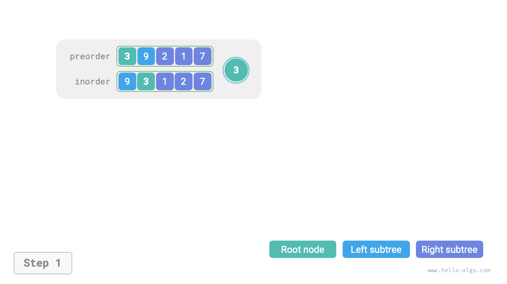
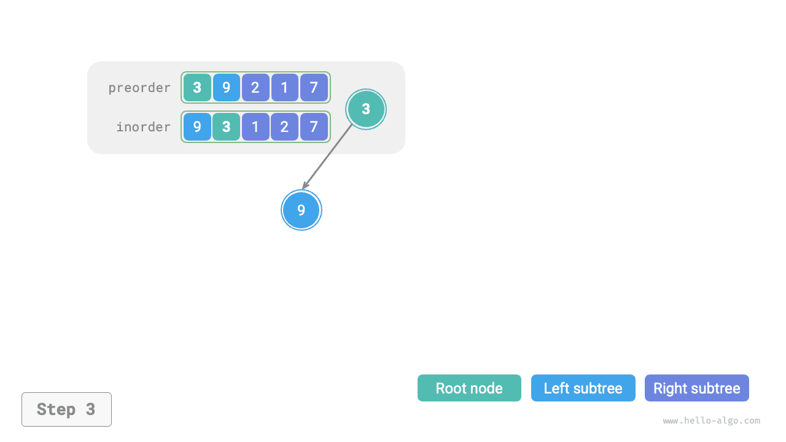
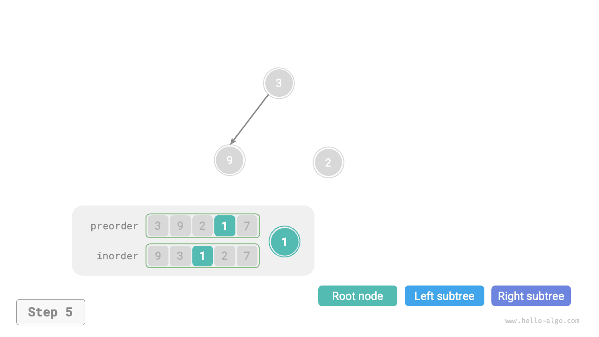

# 二分木の構築問題

!!! question

    二分木の行きがけ順走査 `preorder` と通りがけ順走査 `inorder` が与えられます。これらから二分木を構築し、根ノードを返してください。二分木には同じ値を持つノードがないものとします（下図参照）。


### 分割統治で解ける問題かどうかを判断する

元の問題は、`preorder` と `inorder` から二分木を構築することであり、典型的な分割統治の問題です。

- **問題を分解できる**：分割統治の観点から、元の問題を「左部分木を構築する」「右部分木を構築する」という二つの部分問題と、「根ノードを初期化する」という一つの操作に分けられます。各部分木（部分問題）も同じ方法でさらに小さな部分木（部分問題）へ分割でき、最小の部分問題（空の部分木）に到達したら終了します。
- **部分問題が独立している**：左部分木と右部分木は互いに独立しており、重なりません。左部分木を構築するときは、通りがけ順走査と行きがけ順走査のうち、左部分木に対応する部分だけに注目すれば十分です。右部分木も同様です。
- **部分問題の解を統合できる**：左部分木と右部分木（部分問題の解）が得られたら、それらを根ノードにつなぐことで、元の問題の解を得られます。

### 部分木をどのように分割するか

以上から、この問題は分割統治で解けます。**では、行きがけ順走査 `preorder` と通りがけ順走査 `inorder` から、どのように左部分木と右部分木を切り分ければよいのでしょうか**。

定義によれば、`preorder` と `inorder` はいずれも三つの部分に分けられます。

- 行きがけ順走査：`[ 根ノード | 左部分木 | 右部分木 ]`。たとえば上図の木では `[ 3 | 9 | 2 1 7 ]` です。
- 通りがけ順走査：`[ 左部分木 | 根ノード | 右部分木 ]`。たとえば上図の木では `[ 9 | 3 | 1 2 7 ]` です。

上図のデータを例に、下図の手順で分割できます。

1. 行きがけ順走査の先頭要素 3 が根ノードの値です。
2. 根ノード 3 の `inorder` 内のインデックスを探します。そのインデックスを使うと、`inorder` を `[ 9 | 3 | 1 2 7 ]` に分割できます。
3. `inorder` の分割結果から、左部分木と右部分木のノード数がそれぞれ 1 と 3 であることがわかります。そのため、`preorder` を `[ 3 | 9 | 2 1 7 ]` に分割できます。


### 変数を使って部分木の区間を表す

この分割方法により、**`preorder` と `inorder` の中で、根ノード、左部分木、右部分木に対応するインデックスの区間がわかりました**。これらの区間を表すため、いくつかのポインタ変数を使います。

- 現在の木の根ノードが `preorder` 内にあるインデックスを $i$ とします。
- 現在の木の根ノードが `inorder` 内にあるインデックスを $m$ とします。
- 現在の木に対応する `inorder` 内のインデックス区間を $[l, r]$ とします。

下表のように、これらの変数を使って、根ノードの `preorder` 内のインデックスと、部分木の `inorder` 内のインデックス区間を表せます。

<p align="center"> 表 <id> &nbsp; 行きがけ順走査と通りがけ順走査における根ノードと部分木のインデックス </p>

|        | 根ノードの `preorder` 内のインデックス | 部分木の `inorder` 内のインデックス区間 |
| ------ | ---------------------------- | ----------------------------- |
| 現在の木 | $i$                          | $[l, r]$                      |
| 左部分木 | $i + 1$                      | $[l, m-1]$                    |
| 右部分木 | $i + 1 + (m - l)$            | $[m+1, r]$                    |

右部分木の根ノードのインデックスに含まれる $(m-l)$ は、「左部分木のノード数」を表すことに注意してください。下図とあわせて考えると理解しやすくなります。


### コードの実装

$m$ を効率よく調べられるよう、ハッシュテーブル `hmap` に、配列 `inorder` の要素からインデックスへの対応を保存します。

```src
[file]{build_tree}-[class]{}-[func]{build_tree}
```

下図に、二分木を構築する再帰の流れを示します。各ノードは再帰呼び出しを下に進める過程で作られ、各辺（参照）は上に戻る過程で作られます。

=== "<1>"
    

=== "<2>"
    

=== "<3>"
    

=== "<4>"
    

=== "<5>"
    

=== "<6>"
    

=== "<7>"
    

=== "<8>"
    

=== "<9>"
    

各再帰関数内での行きがけ順走査 `preorder` と通りがけ順走査 `inorder` の分割結果を下図に示します。


木のノード数を $n$ とすると、各ノードの初期化（再帰関数 `dfs()` の 1 回の実行）には $O(1)$ 時間かかります。**したがって、全体の時間計算量は $O(n)$ です**。

ハッシュテーブルには `inorder` の要素からインデックスへの対応を保存するため、空間計算量は $O(n)$ です。最悪の場合、つまり二分木が連結リストに退化した場合は、再帰の深さが $n$ となり、スタックフレームに $O(n)$ の空間を使います。**したがって、全体の空間計算量は $O(n)$ です**。
