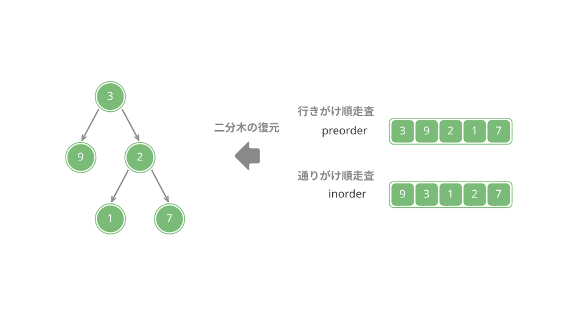
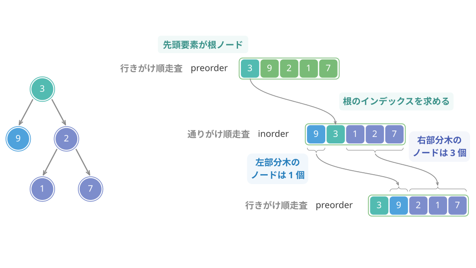
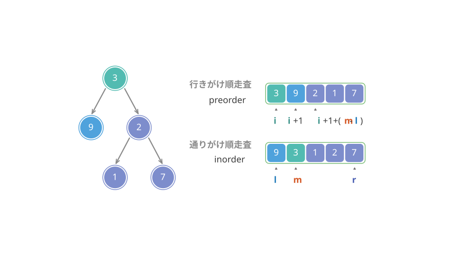
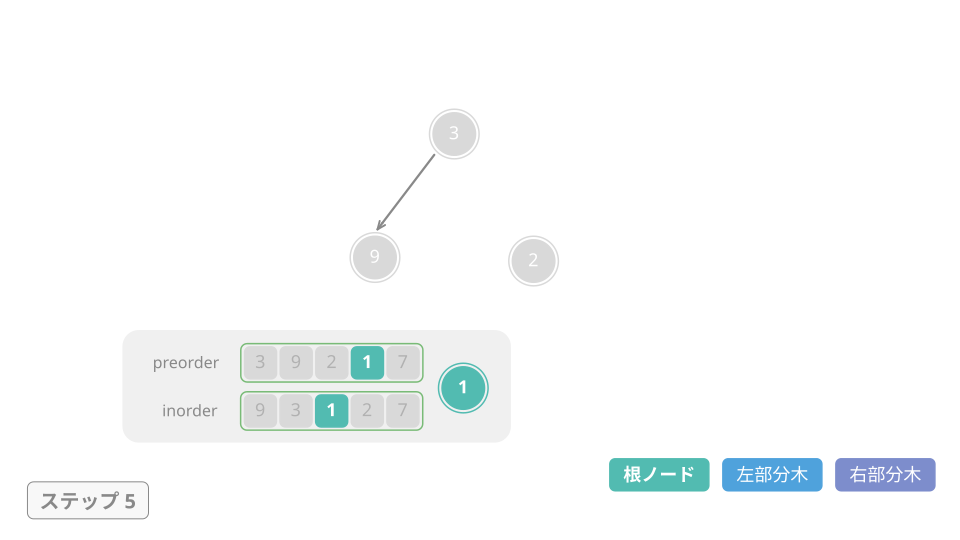
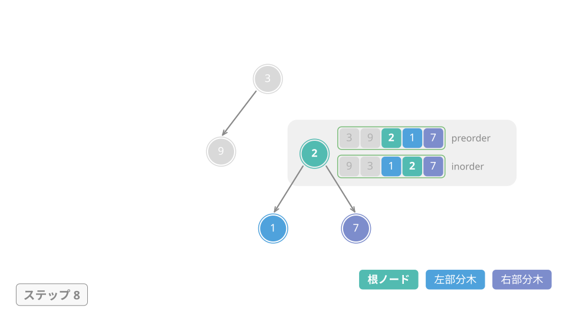
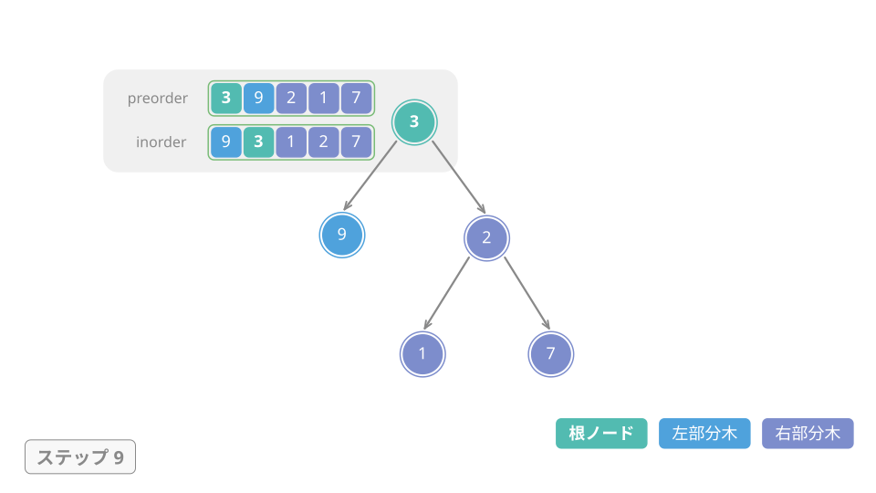

# 二分木を構築する問題

!!! question

    二分木の行きがけ順の走査列 `preorder` と通りがけ順の走査列 `inorder` が与えられます。この二つから二分木を構築し、根ノードを返してください。次の図のように、木に値の等しいノードはないものとします。



### 分割統治法で解けるかを判断する

元の問題は `preorder` と `inorder` から二分木を構築することで、分割統治法が使える典型的な問題です。

- **問題を分割できる**：元の問題は、根ノードを初期化する操作と、「左部分木を構築する」「右部分木を構築する」という二つの部分問題に分けられます。各部分木も同じ方法でさらに小さい部分木に分けられ、最小の部分問題である空の部分木に達したら終了します。
- **部分問題が独立している**：左部分木と右部分木に共通のノードはなく、互いに独立です。左部分木を構築する際は、通りがけ順と行きがけ順の列のうち左部分木に対応する部分だけを見れば十分です。右部分木も同様です。
- **部分問題の解をまとめられる**：左部分木と右部分木という部分問題の解が得られたら、それぞれを根につなぐことで元の問題の解になります。

### 部分木の分け方

この問題に分割統治法が使えることが分かりました。では、**行きがけ順 `preorder` と通りがけ順 `inorder` の走査列を、どうやって左部分木と右部分木に分ければよいのでしょうか**。

定義から、`preorder` と `inorder` はどちらも三つの部分に分けられます。

- 行きがけ順：`[ 根 | 左部分木 | 右部分木 ]`。たとえば上の図の木では `[ 3 | 9 | 2 1 7 ]` です。
- 通りがけ順：`[ 左部分木 | 根 | 右部分木 ]`。たとえば上の図の木では `[ 9 | 3 | 1 2 7 ]` です。

上の図のデータを例に、次の図の手順で実際に分けてみます。

1. 行きがけ順の先頭要素 3 が根の値です。
2. `inorder` で根 3 のインデックスを探します。これを使って `inorder` を `[ 9 | 3 | 1 2 7 ]` と分けられます。
3. `inorder` を分けた結果から、左部分木のノードは 1 個、右部分木のノードは 3 個と分かります。したがって `preorder` を `[ 3 | 9 | 2 1 7 ]` と分けられます。



### 変数を使って部分木の区間を表す

この分け方により、**根、左部分木、右部分木が `preorder` と `inorder` のどのインデックス区間に対応するか**が分かりました。いくつかの位置を示す変数でこれらの区間を表しましょう。

- 現在の木の根が `preorder` に現れるインデックスを $i$ とします。
- 現在の木の根が `inorder` に現れるインデックスを $m$ とします。
- 現在の木が `inorder` で占めるインデックス区間を $[l, r]$ とします。

次の表のように、これらの変数を使うと、`preorder` での根のインデックスと、`inorder` での部分木のインデックス区間を表せます。

<p align="center"> 表 <id> &nbsp; 行きがけ順と通りがけ順における根と部分木のインデックス </p>

|        | `preorder` における根のインデックス | `inorder` における部分木のインデックス区間 |
| ------ | ---------------------------- | ----------------------------- |
| 現在の木 | $i$                          | $[l, r]$                      |
| 左部分木 | $i + 1$                      | $[l, m-1]$                    |
| 右部分木 | $i + 1 + (m - l)$            | $[m+1, r]$                    |

右部分木の根のインデックスを求める式で、$(m-l)$ は「左部分木のノード数」を表します。次の図と照らし合わせてみてください。



### 実装

$m$ を効率よく求めるため、ハッシュ表 `hmap` に、配列 `inorder` の各要素とそのインデックスの対応を格納します。

```src
[file]{build_tree}-[class]{}-[func]{build_tree}
```

次の図は、二分木を再帰的に構築する過程です。ノードは再帰呼び出しで下へ進むときに作り、辺（参照）は呼び出しから上へ戻るときにつなぎます。

=== "<1>"
    

=== "<2>"
    

=== "<3>"
    

=== "<4>"
    

=== "<5>"
    

=== "<6>"
    

=== "<7>"
    

=== "<8>"
    

=== "<9>"
    

各再帰呼び出しで行きがけ順の列 `preorder` と通りがけ順の列 `inorder` を分けた結果を、次の図に示します。


木のノード数を $n$ とします。各ノードの初期化（再帰関数 `dfs()` の 1 回の処理）には $O(1)$ の時間がかかります。**したがって全体の時間計算量は $O(n)$ です**。

ハッシュ表には `inorder` の要素とインデックスの対応を格納するので、空間計算量は $O(n)$ です。最悪の場合、つまり二分木が連結リストの形に偏ると、再帰の深さは $n$ に達し、スタックフレームに $O(n)$ の空間を使います。**したがって全体の空間計算量は $O(n)$ です**。
