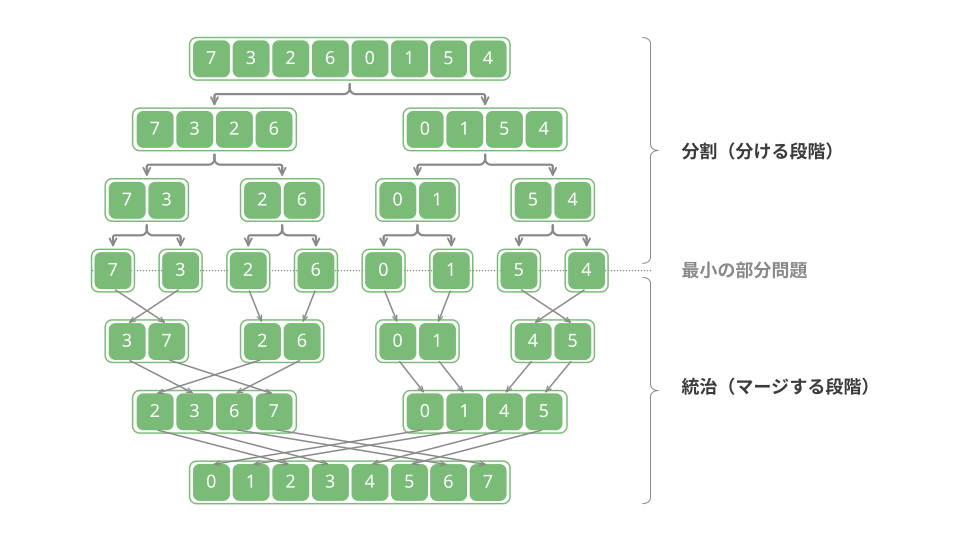
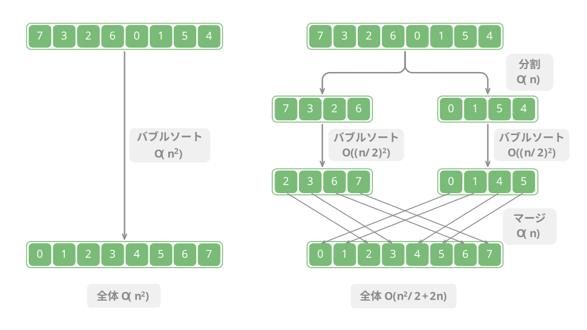
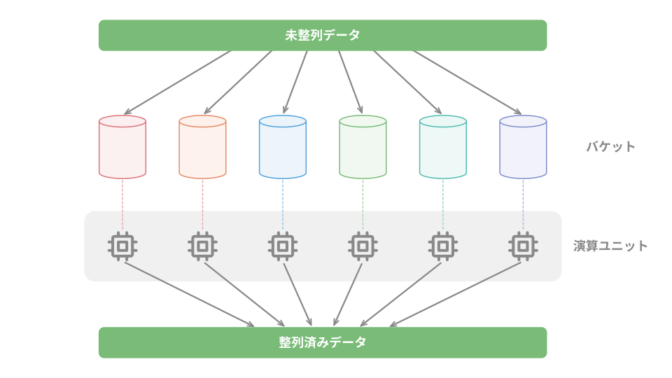

# 分割統治法のアルゴリズム

<u>分割統治法（divide and conquer）</u>は、文字どおり「分けて解く」という、重要で広く使われるアルゴリズム設計の考え方です。通常は再帰で実装し、「分割」と「統治」の二つの段階を踏みます。

1. **分割（分ける段階）**：元の問題を二つ以上の部分問題に再帰的に分け、最小の部分問題に達したところで分割を終えます。
2. **統治（まとめる段階）**：解が分かっている最小の部分問題から出発し、下から上へ部分問題の解をまとめて、元の問題の解を組み立てます。

次の図のマージソートは、分割統治法の代表例です。

1. **分割**：元の配列（元の問題）を二つの部分配列（部分問題）に再帰的に分け、部分配列の要素が一つになるまで続けます（最小の部分問題）。
2. **統治**：ソート済みの部分配列（部分問題の解）を下から上へマージし、元の配列全体をソートした結果（元の問題の解）を得ます。

## 分割統治法に向く問題の見分け方

分割統治法が適しているかどうかは、通常、次の点から判断できます。

1. **問題を分割できる**：元の問題を同じ形の小さな部分問題に分けられ、同じ方法で再帰的に分割できます。
2. **部分問題が独立している**：部分問題は互いに重ならず、依存関係もないので、独立に解けます。
3. **部分問題の解をまとめられる**：部分問題の解をまとめて元の問題の解を得られます。

マージソートはこの三つの条件をすべて満たします。

1. **問題を分割できる**：配列（元の問題）を二つの部分配列（部分問題）に再帰的に分けます。
2. **部分問題が独立している**：各部分配列を独立にソートできます（部分問題を独立に解けます）。
3. **部分問題の解をまとめられる**：ソート済みの二つの部分配列（部分問題の解）をマージして、一つのソート済み配列（元の問題の解）を作れます。

## 分割統治法で効率を高める

**分割統治法は問題を解くのに役立つだけでなく、アルゴリズムの効率も高めることがよくあります**。ソートでは、クイックソート、マージソート、ヒープソートが選択ソート、バブルソート、挿入ソートより速いのは、分割統治の考え方を利用しているためです。

では、**なぜ分割統治法で効率が上がるのでしょうか。その仕組みは何でしょうか**。大きな問題を部分問題に分け、それぞれを解いて結果をまとめるほうが、元の問題を直接解くより効率がよい理由を、操作回数と並列計算の二つの面から考えます。

### 操作回数を減らす

たとえば、バブルソートで長さ $n$ の配列を処理するには $O(n^2)$ の時間がかかります。次の図のように、中央で二つの部分配列に分けるとします。分割に $O(n)$、各部分配列のソートに $O((n / 2)^2)$、両者のマージに $O(n)$ の時間がかかるので、全体の時間計算量は次のようになります。

$$
O(n + (\frac{n}{2})^2 \times 2 + n) = O(\frac{n^2}{2} + 2n)
$$

次の不等式を解いてみましょう。左辺は分割前の、右辺は分割後の操作の総数です。

$$
\begin{aligned}
n^2 & > \frac{n^2}{2} + 2n \newline
n^2 - \frac{n^2}{2} - 2n & > 0 \newline
n(n - 4) & > 0
\end{aligned}
$$

**$n > 4$ のとき、分割後のほうが操作回数が少なく、効率よくソートできると考えられます**。ただし、分割後も時間計算量は二次の $O(n^2)$ のままで、定数係数が小さくなっただけです。

さらに、**各部分配列を中央で二つに分ける操作を繰り返し**、要素が一つになったところで分割を止めたらどうでしょうか。これはまさにマージソートの考え方で、時間計算量は $O(n \log n)$ です。

では、**分割点を増やして**、元の配列を $k$ 個の部分配列に均等に分けたらどうでしょうか。これはバケットソートによく似ています。バケットソートは大量のデータの整列に適しており、理論上は $O(n + k)$ の時間計算量を達成できます。

### 並列計算を利用する

分割統治で得られる部分問題は互いに独立しているので、**通常は並列に解けます**。つまり、分割統治は時間計算量を減らせるだけでなく、**OS による並列処理の最適化にも適しています**。

並列化は、複数のコアやプロセッサがある環境で特に効果的です。複数の部分問題を同時に処理して計算資源をより有効に使えるので、全体の実行時間を大きく短縮できます。

たとえば、次の図のバケットソートでは、大量のデータを各バケットに均等に振り分けます。各バケットのソートを別々の演算ユニットに割り当て、処理が終わったら結果をまとめられます。

## 分割統治法の主な応用

分割統治法は、多くの古典的なアルゴリズム問題に使えます。

- **最近点対の探索**：点の集合を二つに分け、それぞれの中で距離が最も短い点対を求め、最後に両方の領域にまたがる最近点対を探します。
- **多倍長整数の乗算**：たとえば Karatsuba 法は、大きな整数の乗算を、より小さな整数の乗算と加算に分けます。
- **行列の乗算**：たとえば Strassen 法は、大きな行列の乗算を、小さな行列の乗算と加算に分けます。
- **ハノイの塔**：ハノイの塔は再帰で解くことができ、分割統治法の代表的な応用です。
- **逆転対を求める問題**：ある数列で前にある数が後ろにある数より大きいとき、その二つを逆転対と呼びます。逆転対を求める問題は、分割統治の考え方に基づき、マージソートを利用して解けます。

また、分割統治の考え方は、アルゴリズムやデータ構造の設計にも広く使われています。

- **二分探索**：ソート済みの配列を中央のインデックスで二つに分けます。目的の値と中央の要素を比較してどちらの半分を除くか決め、残った区間を同じように二分します。
- **マージソート**：この節の冒頭で取り上げたとおりです。
- **クイックソート**：基準値を一つ選び、値がそれより小さい要素と大きい要素を二つの部分配列に分けます。各部分配列に同じ分割操作を適用し、要素が一つになるまで続けます。
- **バケットソート**：データを複数のバケットに振り分け、各バケット内でソートします。最後にバケットの順に要素を取り出すと、ソート済みの配列が得られます。
- **木**：二分探索木、AVL 木、赤黒木、B 木、B+ 木などで行う探索、挿入、削除といった操作は、いずれも分割統治の応用と見ることができます。
- **ヒープ**：ヒープは特殊な完全二分木です。挿入、削除、ヒープ化などのさまざまな操作にも、分割統治の考え方が含まれています。
- **ハッシュ表**：ハッシュ表自体は分割統治を直接使いませんが、衝突の解決に間接的に利用する場合があります。たとえばチェイン法では、探索を速くするため、長くなった連結リストを赤黒木に変換することがあります。

このように、**分割統治の考え方は、目立たないところにまで浸透し**、さまざまなアルゴリズムやデータ構造を支えています。
