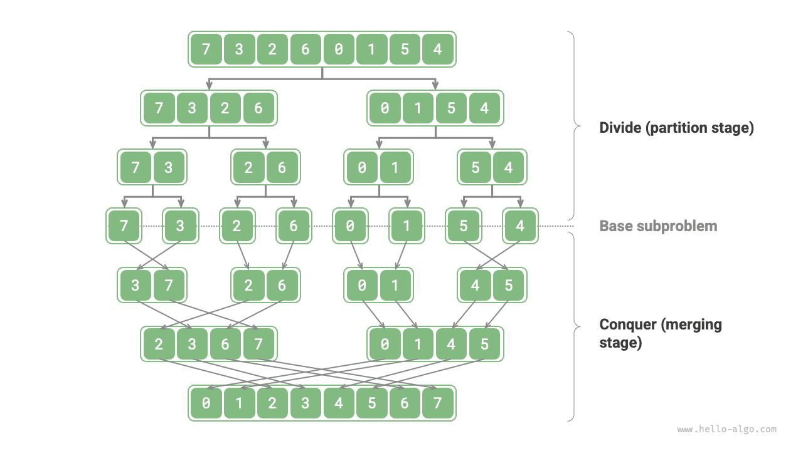

# 12.1 &nbsp; 分割統治アルゴリズム

<u>分割統治（divide and conquer）</u>とは、文字どおり「分けて解く」ことであり、非常に重要で広く使われるアルゴリズム戦略です。通常は再帰で実装し、「分割」と「統合」の二つの段階からなります。

1. **分割の段階**：元の問題を二つ以上の部分問題に再帰的に分解し、最小の部分問題に到達したら終了します。
2. **統合の段階**：解がわかっている最小の部分問題から始め、部分問題の解を下から上へと統合して、元の問題の解を組み立てます。

図 12-1 の「マージソート」は、分割統治戦略の典型的な応用例です。

1. **分割**：元の配列（元の問題）を二つの部分配列（部分問題）に再帰的に分割し、部分配列の要素が一つ（最小の部分問題）になるまで続けます。
2. **統合**：ソート済みの部分配列（部分問題の解）を下から上へと統合し、元の配列をソートした結果（元の問題の解）を得ます。

{ class="animation-figure" }

 図 12-1 &nbsp; マージソートの分割統治戦略 

## 12.1.1 &nbsp; 分割統治で解ける問題の見分け方

ある問題が分割統治に適しているかどうかは、通常、次の点を基準に判断できます。

1. **問題を分解できる**：元の問題を、同じような形のより小さな部分問題に分解でき、同じ方法で再帰的に分割できます。
2. **部分問題が独立している**：部分問題同士が重ならず、互いに依存せず、独立に解けます。
3. **部分問題の解を統合できる**：部分問題の解を統合することで、元の問題の解が得られます。

マージソートがこの三つの基準を満たすことは明らかです。

1. **問題を分解できる**：配列（元の問題）を二つの部分配列（部分問題）へ再帰的に分割します。
2. **部分問題が独立している**：各部分配列は独立にソートできます（部分問題を独立に解けます）。
3. **部分問題の解を統合できる**：二つのソート済み部分配列（部分問題の解）を、一つのソート済み配列（元の問題の解）に統合できます。

## 12.1.2 &nbsp; 分割統治による効率の向上

**分割統治はアルゴリズムの問題を解くうえで有効なだけでなく、効率も高められることがよくあります**。ソートアルゴリズムのうち、クイックソート、マージソート、ヒープソートが、選択ソート、バブルソート、挿入ソートより高速なのは、分割統治戦略を利用しているためです。

ここで、**分割統治がアルゴリズムを効率化できるのはなぜか、その根本的な理由は何か**、という疑問が湧きます。言い換えると、大きな問題を複数の部分問題に分解し、それらを解き、解を統合するという手順が、元の問題を直接解くより効率的なのはなぜでしょうか。操作回数と並列計算という二つの面から考えてみましょう。

### 1. &nbsp; 操作回数の削減

「バブルソート」を例にすると、長さ $n$ の配列の処理には $O(n^2)$ 時間かかります。図 12-2 のように、配列を中央で二つの部分配列に分けるとします。分割に $O(n)$ 時間、各部分配列のソートに $O((n / 2)^2)$ 時間、二つの部分配列の統合に $O(n)$ 時間かかるので、全体の時間計算量は次のようになります。

$$
O(n + (\frac{n}{2})^2 \times 2 + n) = O(\frac{n^2}{2} + 2n)
$$

{ class="animation-figure" }

 図 12-2 &nbsp; 配列を分割する前と後のバブルソート 

次の不等式を計算してみます。左辺と右辺はそれぞれ、分割前と分割後の総操作回数です。

$$
\begin{aligned}
n^2 & > \frac{n^2}{2} + 2n \newline
n^2 - \frac{n^2}{2} - 2n & > 0 \newline
n(n - 4) & > 0
\end{aligned}
$$

**つまり、$n > 4$ のときは分割後の操作回数が少なくなり、ソートの効率が上がると考えられます**。ただし、分割後の時間計算量も依然として二乗のオーダー $O(n^2)$ であり、計算量の定数部分が小さくなっただけです。

さらに、**部分配列を中央で二つに分ける操作を繰り返し**、要素が一つになるまで続けたらどうなるでしょうか。これはまさに「マージソート」の考え方であり、時間計算量は $O(n \log n)$ になります。

では、**分割点をもっと増やして**、元の配列を $k$ 個の部分配列に均等に分けたらどうでしょうか。これは「バケットソート」によく似ています。大量のデータのソートに適しており、理論上は時間計算量を $O(n + k)$ にできます。

### 2. &nbsp; 並列計算による効率化

分割統治でできる部分問題は互いに独立しているため、**通常は並列に解けます**。つまり、分割統治はアルゴリズムの時間計算量を減らすだけでなく、**OS による並列化にも適しています**。

並列化は、複数のコアやプロセッサを持つ環境で特に効果を発揮します。システムが複数の部分問題を同時に処理し、計算資源をより十分に利用できるため、全体の実行時間を大幅に短縮できます。

たとえば図 12-3 の「バケットソート」では、大量のデータを各バケットに均等に分配します。各バケットのソートをそれぞれの計算ユニットに割り当て、完了後に結果を統合できます。

{ class="animation-figure" }

 図 12-3 &nbsp; バケットソートの並列計算 

## 12.1.3 &nbsp; 分割統治の主な用途

分割統治は、多くの古典的なアルゴリズムの問題を解くために使えます。

- **最近点対の探索**：まず点の集合を二つに分け、それぞれの中で最も近い点のペアを求め、最後に二つの集合にまたがる最も近い点のペアを求めます。
- **大きな整数の乗算**：たとえば Karatsuba 法は、大きな整数同士の乗算を、より小さな整数の乗算と加算に分解します。
- **行列の乗算**：たとえば Strassen 法は、大きな行列の乗算を、複数の小さな行列の乗算と加算に分解します。
- **ハノイの塔の問題**：再帰で解くことができ、分割統治戦略の典型的な応用です。
- **転倒対の計数**：数列で前の数が後ろの数より大きいとき、その二つの数は転倒対をなします。転倒対を求める問題は、分割統治の考え方を使い、マージソートを利用して解けます。

また、分割統治はアルゴリズムとデータ構造の設計にも広く使われています。

- **二分探索**：ソート済み配列を中央のインデックスで二つに分け、目的の値と中央の要素を比較して、どちらの半分を除外するか決めます。残った区間に対して同じ二分操作を行います。
- **マージソート**：この節の冒頭で説明したため、ここでは繰り返しません。
- **クイックソート**：ピボットを一つ選び、それより小さい要素の部分配列と、大きい要素の部分配列に分けます。それぞれに同じ分割操作を行い、部分配列の要素が一つになるまで続けます。
- **バケットソート**：データを複数のバケットに分配し、各バケット内の要素をソートしてから、バケットごとに順に取り出して、ソート済み配列を得ます。
- **木**：二分探索木、AVL 木、赤黒木、B 木、B+ 木などでは、探索・挿入・削除などの操作を、分割統治戦略の応用として捉えられます。
- **ヒープ**：ヒープは特殊な完全二分木です。挿入、削除、ヒープ化などの各種操作には、分割統治の考え方が内在しています。
- **ハッシュテーブル**：分割統治を直接使うわけではありませんが、ハッシュ衝突の解決方法には間接的に使うものがあります。たとえば、チェイン法では長い連結リストを赤黒木に変換し、探索効率を高めます。

このように、**分割統治はさまざまなアルゴリズムやデータ構造に自然に溶け込んでいる考え方**なのです。
