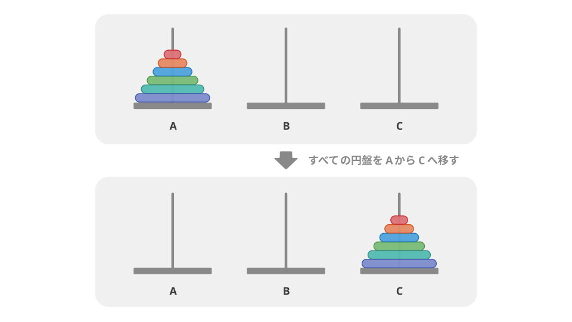
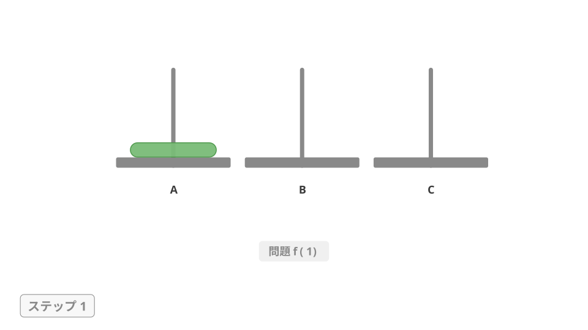
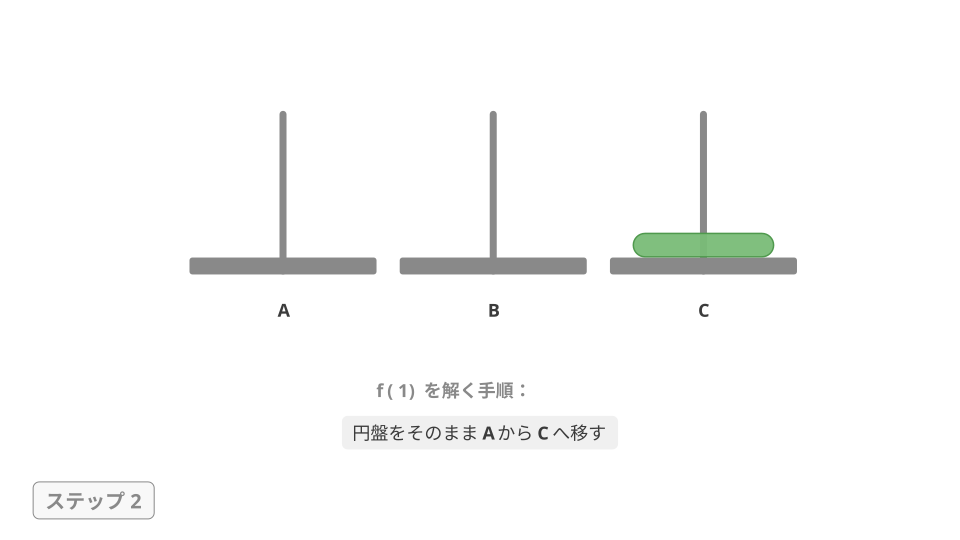
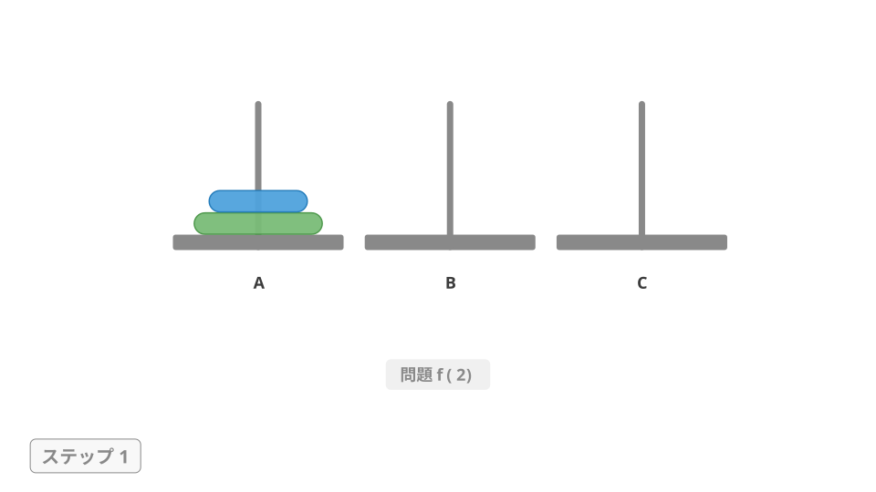
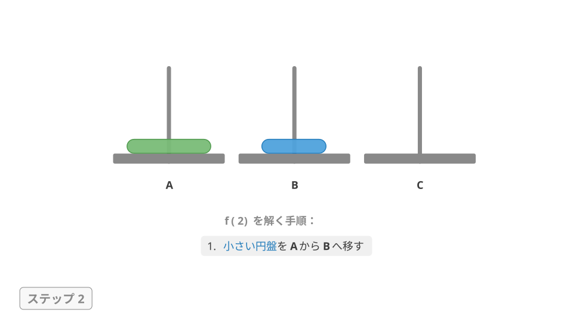
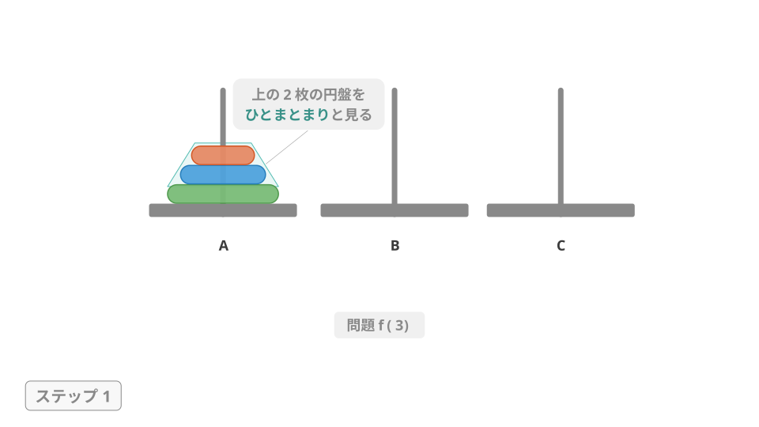
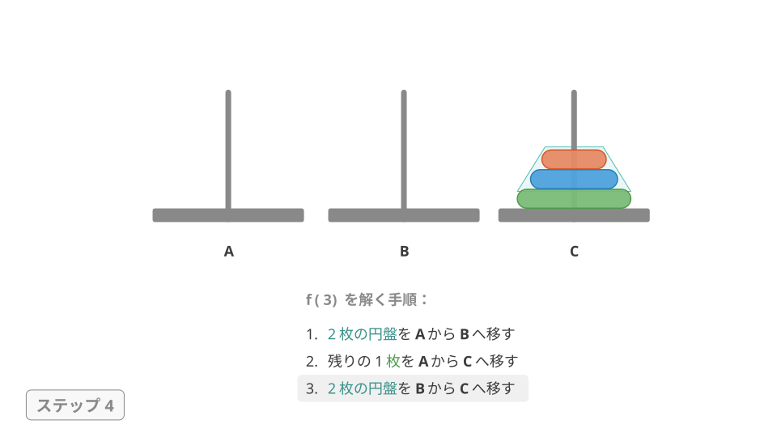

# ハノイの塔

マージソートと二分木の構築では、元の問題を半分の規模の二つの部分問題に分けてきました。ハノイの塔では、これとは異なる分け方を使います。

!!! question

    `A`、`B`、`C` の 3 本の棒があります。最初、棒 `A` には $n$ 枚の円盤が、上から小さい順に重なっています。次の図のように、$n$ 枚すべてを元の順序のまま棒 `C` に移すのが課題です。円盤を移すときは、次の規則に従います。
    
    1. 円盤は棒の一番上から取り、別の棒の一番上に置きます。
    2. 一度に移せる円盤は 1 枚だけです。
    3. 円盤を重ねるときは、常に小さい円盤を大きい円盤の上に置きます。



**規模 $i$ のハノイの塔の問題を $f(i)$ と表します**。たとえば $f(3)$ は、$3$ 枚の円盤を `A` から `C` に移す問題です。

### 基本の場合を考える

次の図の問題 $f(1)$、つまり円盤が 1 枚だけの場合は、そのまま `A` から `C` に移せば完了です。

=== "<1>"
    

=== "<2>"
    

次の図の問題 $f(2)$ では、円盤が 2 枚あります。**大きい円盤の上に小さい円盤が載る順序を常に守るため、`B` を一時置き場に使います**。

1. まず、上の小さい円盤を `A` から `B` に移します。
2. 次に、大きい円盤を `A` から `C` に移します。
3. 最後に、小さい円盤を `B` から `C` に移します。

=== "<1>"
    

=== "<2>"
    

=== "<3>"
    

=== "<4>"
    

問題 $f(2)$ の手順は、**`B` を一時置き場として、2 枚の円盤を `A` から `C` に移す**とまとめられます。ここで `C` を移動先の棒、`B` を作業用の棒と呼びます。

### 部分問題への分割

問題 $f(3)$、つまり円盤が 3 枚の場合は、少し複雑になります。

$f(1)$ と $f(2)$ の解はすでに分かっています。そこで分割統治の考え方を使い、**`A` の上の 2 枚をひとまとまりと見て**、次の図の手順を実行します。こうして 3 枚とも `A` から `C` に移せます。

1. `B` を移動先、`C` を作業用の棒として、2 枚の円盤を `A` から `B` に移します。
2. `A` に残った 1 枚を、`A` から `C` に直接移します。
3. `C` を移動先、`A` を作業用の棒として、2 枚の円盤を `B` から `C` に移します。

=== "<1>"
    

=== "<2>"
    

=== "<3>"
    

=== "<4>"
    

ここでは、**問題 $f(3)$ を二つの部分問題 $f(2)$ と一つの部分問題 $f(1)$ に分けました**。この三つを順に解けば元の問題も解けます。これは、部分問題が独立していて、それぞれの解をまとめられることを示しています。

以上から、ハノイの塔を解く分割統治法を次の図のようにまとめられます。元の問題 $f(n)$ を二つの部分問題 $f(n-1)$ と一つの部分問題 $f(1)$ に分け、次の順序で解きます。

1. $n-1$ 枚の円盤を、`C` を作業用の棒として `A` から `B` に移します。
2. 残りの $1$ 枚を `A` から `C` に直接移します。
3. $n-1$ 枚の円盤を、`A` を作業用の棒として `B` から `C` に移します。

二つの部分問題 $f(n-1)$ は、**同じ方法で再帰的に分割でき**、やがて最小の部分問題 $f(1)$ に達します。$f(1)$ の解はすでに分かっており、1 回移すだけです。


### 実装

コードでは再帰関数 `dfs(i, src, buf, tar)` を定義します。棒 `src` の上から $i$ 枚の円盤を、作業用の棒 `buf` を使って移動先の棒 `tar` に移す関数です。

```src
[file]{hanota}-[class]{}-[func]{solve_hanota}
```

次の図のように、ハノイの塔の問題は高さ $n$ の再帰木を作ります。各ノードは部分問題を表し、`dfs()` 関数の 1 回の呼び出しに対応します。**したがって時間計算量は $O(2^n)$、空間計算量は $O(n)$ です**。


!!! quote

    ハノイの塔には古い伝説があります。古代インドのある寺院には、ダイヤモンドでできた高い棒が 3 本と、大きさの異なる金の円盤が $64$ 枚ありました。僧たちは円盤を移し続け、最後の 1 枚を正しく置いた瞬間に世界が終わると信じていました。

    もっとも、僧たちが毎秒 1 枚移しても、全部で約 $2^{64} \approx 1.84×10^{19}$ 秒、年にして約 $5850$ 億年かかります。現在推定されている宇宙の年齢をはるかに超える長さです。伝説が本当でも、世界の終わりを心配せずに済みそうです。
