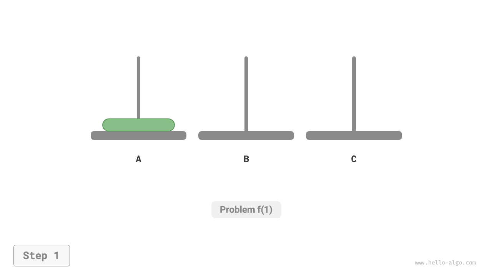
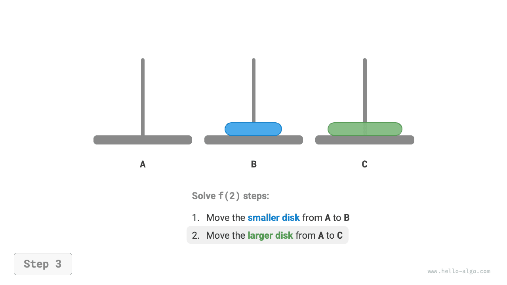
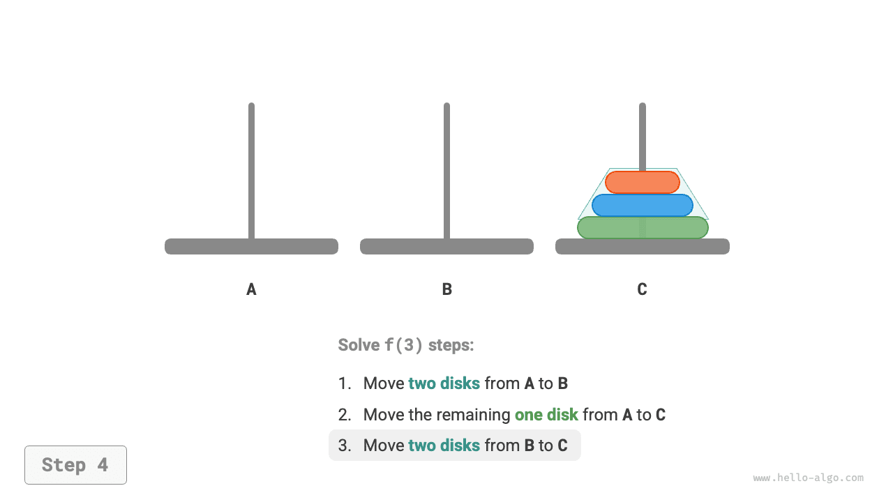
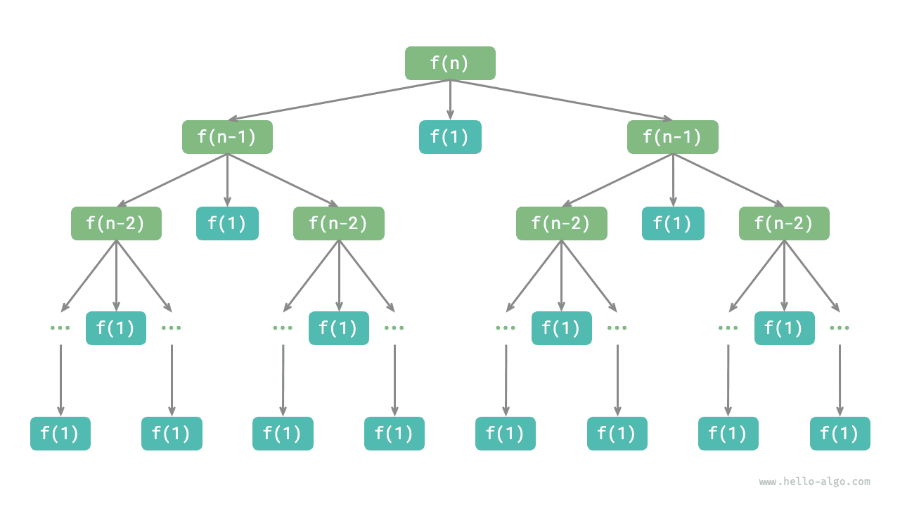

# 12.4 &nbsp; ハノイの塔の問題

マージソートと二分木の構築では、元の問題をそれぞれ半分の大きさの二つの部分問題に分解しました。一方、ハノイの塔の問題では、別の分解戦略を使います。

!!! question "問題"

    3 本の柱 `A`、`B`、`C` が与えられます。初期状態では、柱 `A` に $n$ 枚の円盤があり、上から下へ、小さい順に重なっています。この $n$ 枚を、元の順序を保ったまま柱 `C` に移してください（図 12-10 参照）。円盤を動かす際は、次の規則に従います。
    
    1. 円盤は柱の一番上から取り出し、別の柱の一番上に置くことしかできません。
    2. 一度に動かせる円盤は 1 枚だけです。
    3. 小さな円盤は、常に大きな円盤の上に置かなければなりません。

{ class="animation-figure" }

<p align="center"> 図 12-10 &nbsp; ハノイの塔の問題の例 </p>

**大きさ $i$ のハノイの塔の問題を $f(i)$ と表します**。たとえば $f(3)$ は、$3$ 枚の円盤を `A` から `C` に移す問題です。

### 1. &nbsp; 基本的な場合を考える

図 12-11 のように、問題 $f(1)$、つまり円盤が 1 枚だけの場合は、その円盤を `A` から `C` に直接移せば完了です。

=== "<1>"
    { class="animation-figure" }

=== "<2>"
    { class="animation-figure" }

<p align="center"> 図 12-11 &nbsp; 大きさ 1 の問題の解 </p>

図 12-12 のように、問題 $f(2)$、つまり円盤が 2 枚の場合は、**小さな円盤を常に大きな円盤の上に置くため、`B` を利用して移す必要があります**。

1. まず、上にある小さな円盤を `A` から `B` に移します。
2. 次に、大きな円盤を `A` から `C` に移します。
3. 最後に、小さな円盤を `B` から `C` に移します。

=== "<1>"
    { class="animation-figure" }

=== "<2>"
    { class="animation-figure" }

=== "<3>"
    { class="animation-figure" }

=== "<4>"
    { class="animation-figure" }

<p align="center"> 図 12-12 &nbsp; 大きさ 2 の問題の解 </p>

問題 $f(2)$ を解く手順は、**`B` を使って 2 枚の円盤を `A` から `C` に移すこと**とまとめられます。このとき、`C` を目的の柱、`B` を補助の柱と呼びます。

### 2. &nbsp; 部分問題への分解

問題 $f(3)$、つまり円盤が 3 枚の場合は、少し複雑になります。

$f(1)$ と $f(2)$ の解はわかっているので、分割統治の観点から、**`A` の上側の 2 枚を一つのまとまりとみなし**、図 12-13 の手順を実行します。これで 3 枚の円盤を `A` から `C` に移せます。

1. `B` を目的の柱、`C` を補助の柱として、2 枚の円盤を `A` から `B` に移します。
2. `A` に残った 1 枚を、`A` から `C` に直接移します。
3. `C` を目的の柱、`A` を補助の柱として、2 枚の円盤を `B` から `C` に移します。

=== "<1>"
    { class="animation-figure" }

=== "<2>"
    { class="animation-figure" }

=== "<3>"
    { class="animation-figure" }

=== "<4>"
    { class="animation-figure" }

<p align="center"> 図 12-13 &nbsp; 大きさ 3 の問題の解 </p>

本質的には、**問題 $f(3)$ を、二つの部分問題 $f(2)$ と、一つの部分問題 $f(1)$ に分割しています**。この三つを順に解けば、元の問題も解けます。部分問題は独立しており、解を統合できるということです。

ここまでの考察から、図 12-14 のように、ハノイの塔を解く分割統治戦略をまとめられます。元の問題 $f(n)$ を、二つの部分問題 $f(n-1)$ と一つの部分問題 $f(1)$ に分割し、次の順で解きます。

1. `C` を使って $n-1$ 枚の円盤を `A` から `B` に移します。
2. 残りの $1$ 枚を `A` から `C` に直接移します。
3. `A` を使って $n-1$ 枚の円盤を `B` から `C` に移します。

二つの部分問題 $f(n-1)$ は、**同じ方法で再帰的に分割でき**、最小の部分問題 $f(1)$ に到達するまで続けます。$f(1)$ の解はわかっており、1 回移動するだけです。

{ class="animation-figure" }

<p align="center"> 図 12-14 &nbsp; ハノイの塔を解く分割統治戦略 </p>

### 3. &nbsp; コードの実装

コードでは、再帰関数 `dfs(i, src, buf, tar)` を定義します。この関数は、柱 `src` の上側にある $i$ 枚の円盤を、補助の柱 `buf` を使って目的の柱 `tar` に移します。

=== "Python"

    ```python title="hanota.py"
    def move(src: list[int], tar: list[int]):
        """円盤を 1 枚移動する"""
        # src の一番上から円盤を 1 枚取り出す
        pan = src.pop()
        # tar の一番上に円盤を置く
        tar.append(pan)

    def dfs(i: int, src: list[int], buf: list[int], tar: list[int]):
        """ハノイの塔の問題 f(i) を解く"""
        # src に円盤が 1 枚だけ残っている場合、そのまま tar に移す
        if i == 1:
            move(src, tar)
            return
        # 部分問題 f(i-1) ：src の上から i-1 枚の円盤を、tar を使って buf に移す
        dfs(i - 1, src, tar, buf)
        # 部分問題 f(1) ：src に残った 1 枚の円盤を tar に移す
        move(src, tar)
        # 部分問題 f(i-1) ：buf の上から i-1 枚の円盤を、src を使って tar に移す
        dfs(i - 1, buf, src, tar)

    def solve_hanota(A: list[int], B: list[int], C: list[int]):
        """ハノイの塔の問題を解く"""
        n = len(A)
        # A の上から n 枚の円盤を、B を使って C に移す
        dfs(n, A, B, C)
    ```

=== "C++"

    ```cpp title="hanota.cpp"
    /* 円盤を 1 枚移動する */
    void move(vector<int> &src, vector<int> &tar) {
        // src の一番上から円盤を 1 枚取り出す
        int pan = src.back();
        src.pop_back();
        // tar の一番上に円盤を置く
        tar.push_back(pan);
    }

    /* ハノイの塔の問題 f(i) を解く */
    void dfs(int i, vector<int> &src, vector<int> &buf, vector<int> &tar) {
        // src に円盤が 1 枚だけ残っている場合、そのまま tar に移す
        if (i == 1) {
            move(src, tar);
            return;
        }
        // 部分問題 f(i-1) ：src の上から i-1 枚の円盤を、tar を使って buf に移す
        dfs(i - 1, src, tar, buf);
        // 部分問題 f(1) ：src に残った 1 枚の円盤を tar に移す
        move(src, tar);
        // 部分問題 f(i-1) ：buf の上から i-1 枚の円盤を、src を使って tar に移す
        dfs(i - 1, buf, src, tar);
    }

    /* ハノイの塔の問題を解く */
    void solveHanota(vector<int> &A, vector<int> &B, vector<int> &C) {
        int n = A.size();
        // A の上から n 枚の円盤を、B を使って C に移す
        dfs(n, A, B, C);
    }
    ```

=== "Java"

    ```java title="hanota.java"
    /* 円盤を 1 枚移動する */
    void move(List<Integer> src, List<Integer> tar) {
        // src の一番上から円盤を 1 枚取り出す
        Integer pan = src.remove(src.size() - 1);
        // tar の一番上に円盤を置く
        tar.add(pan);
    }

    /* ハノイの塔の問題 f(i) を解く */
    void dfs(int i, List<Integer> src, List<Integer> buf, List<Integer> tar) {
        // src に円盤が 1 枚だけ残っている場合、そのまま tar に移す
        if (i == 1) {
            move(src, tar);
            return;
        }
        // 部分問題 f(i-1) ：src の上から i-1 枚の円盤を、tar を使って buf に移す
        dfs(i - 1, src, tar, buf);
        // 部分問題 f(1) ：src に残った 1 枚の円盤を tar に移す
        move(src, tar);
        // 部分問題 f(i-1) ：buf の上から i-1 枚の円盤を、src を使って tar に移す
        dfs(i - 1, buf, src, tar);
    }

    /* ハノイの塔の問題を解く */
    void solveHanota(List<Integer> A, List<Integer> B, List<Integer> C) {
        int n = A.size();
        // A の上から n 枚の円盤を、B を使って C に移す
        dfs(n, A, B, C);
    }
    ```

=== "C#"

    ```csharp title="hanota.cs"
    /* 円盤を 1 枚移動する */
    void Move(List<int> src, List<int> tar) {
        // src の一番上から円盤を 1 枚取り出す
        int pan = src[^1];
        src.RemoveAt(src.Count - 1);
        // tar の一番上に円盤を置く
        tar.Add(pan);
    }

    /* ハノイの塔の問題 f(i) を解く */
    void DFS(int i, List<int> src, List<int> buf, List<int> tar) {
        // src に円盤が 1 枚だけ残っている場合、そのまま tar に移す
        if (i == 1) {
            Move(src, tar);
            return;
        }
        // 部分問題 f(i-1) ：src の上から i-1 枚の円盤を、tar を使って buf に移す
        DFS(i - 1, src, tar, buf);
        // 部分問題 f(1) ：src に残った 1 枚の円盤を tar に移す
        Move(src, tar);
        // 部分問題 f(i-1) ：buf の上から i-1 枚の円盤を、src を使って tar に移す
        DFS(i - 1, buf, src, tar);
    }

    /* ハノイの塔の問題を解く */
    void SolveHanota(List<int> A, List<int> B, List<int> C) {
        int n = A.Count;
        // A の上から n 枚の円盤を、B を使って C に移す
        DFS(n, A, B, C);
    }
    ```

=== "Go"

    ```go title="hanota.go"
    /* 円盤を 1 枚移動する */
    func move(src, tar *list.List) {
        // src の一番上から円盤を 1 枚取り出す
        pan := src.Back()
        // tar の一番上に円盤を置く
        tar.PushBack(pan.Value)
        // src の一番上の円盤を取り除く
        src.Remove(pan)
    }

    /* ハノイの塔の問題 f(i) を解く */
    func dfsHanota(i int, src, buf, tar *list.List) {
        // src に円盤が 1 枚だけ残っている場合、そのまま tar に移す
        if i == 1 {
            move(src, tar)
            return
        }
        // 部分問題 f(i-1) ：src の上から i-1 枚の円盤を、tar を使って buf に移す
        dfsHanota(i-1, src, tar, buf)
        // 部分問題 f(1) ：src に残った 1 枚の円盤を tar に移す
        move(src, tar)
        // 部分問題 f(i-1) ：buf の上から i-1 枚の円盤を、src を使って tar に移す
        dfsHanota(i-1, buf, src, tar)
    }

    /* ハノイの塔の問題を解く */
    func solveHanota(A, B, C *list.List) {
        n := A.Len()
        // A の上から n 枚の円盤を、B を使って C に移す
        dfsHanota(n, A, B, C)
    }
    ```

=== "Swift"

    ```swift title="hanota.swift"
    /* 円盤を 1 枚移動する */
    func move(src: inout [Int], tar: inout [Int]) {
        // src の一番上から円盤を 1 枚取り出す
        let pan = src.popLast()!
        // tar の一番上に円盤を置く
        tar.append(pan)
    }

    /* ハノイの塔の問題 f(i) を解く */
    func dfs(i: Int, src: inout [Int], buf: inout [Int], tar: inout [Int]) {
        // src に円盤が 1 枚だけ残っている場合、そのまま tar に移す
        if i == 1 {
            move(src: &src, tar: &tar)
            return
        }
        // 部分問題 f(i-1) ：src の上から i-1 枚の円盤を、tar を使って buf に移す
        dfs(i: i - 1, src: &src, buf: &tar, tar: &buf)
        // 部分問題 f(1) ：src に残った 1 枚の円盤を tar に移す
        move(src: &src, tar: &tar)
        // 部分問題 f(i-1) ：buf の上から i-1 枚の円盤を、src を使って tar に移す
        dfs(i: i - 1, src: &buf, buf: &src, tar: &tar)
    }

    /* ハノイの塔の問題を解く */
    func solveHanota(A: inout [Int], B: inout [Int], C: inout [Int]) {
        let n = A.count
        // リストの末尾が棒の一番上に対応する
        // src の上から n 枚の円盤を、B を使って C に移す
        dfs(i: n, src: &A, buf: &B, tar: &C)
    }
    ```

=== "JS"

    ```javascript title="hanota.js"
    /* 円盤を 1 枚移動する */
    function move(src, tar) {
        // src の一番上から円盤を 1 枚取り出す
        const pan = src.pop();
        // tar の一番上に円盤を置く
        tar.push(pan);
    }

    /* ハノイの塔の問題 f(i) を解く */
    function dfs(i, src, buf, tar) {
        // src に円盤が 1 枚だけ残っている場合、そのまま tar に移す
        if (i === 1) {
            move(src, tar);
            return;
        }
        // 部分問題 f(i-1) ：src の上から i-1 枚の円盤を、tar を使って buf に移す
        dfs(i - 1, src, tar, buf);
        // 部分問題 f(1) ：src に残った 1 枚の円盤を tar に移す
        move(src, tar);
        // 部分問題 f(i-1) ：buf の上から i-1 枚の円盤を、src を使って tar に移す
        dfs(i - 1, buf, src, tar);
    }

    /* ハノイの塔の問題を解く */
    function solveHanota(A, B, C) {
        const n = A.length;
        // A の上から n 枚の円盤を、B を使って C に移す
        dfs(n, A, B, C);
    }
    ```

=== "TS"

    ```typescript title="hanota.ts"
    /* 円盤を 1 枚移動する */
    function move(src: number[], tar: number[]): void {
        // src の一番上から円盤を 1 枚取り出す
        const pan = src.pop();
        // tar の一番上に円盤を置く
        tar.push(pan);
    }

    /* ハノイの塔の問題 f(i) を解く */
    function dfs(i: number, src: number[], buf: number[], tar: number[]): void {
        // src に円盤が 1 枚だけ残っている場合、そのまま tar に移す
        if (i === 1) {
            move(src, tar);
            return;
        }
        // 部分問題 f(i-1) ：src の上から i-1 枚の円盤を、tar を使って buf に移す
        dfs(i - 1, src, tar, buf);
        // 部分問題 f(1) ：src に残った 1 枚の円盤を tar に移す
        move(src, tar);
        // 部分問題 f(i-1) ：buf の上から i-1 枚の円盤を、src を使って tar に移す
        dfs(i - 1, buf, src, tar);
    }

    /* ハノイの塔の問題を解く */
    function solveHanota(A: number[], B: number[], C: number[]): void {
        const n = A.length;
        // A の上から n 枚の円盤を、B を使って C に移す
        dfs(n, A, B, C);
    }
    ```

=== "Dart"

    ```dart title="hanota.dart"
    /* 円盤を 1 枚移動する */
    void move(List<int> src, List<int> tar) {
      // src の一番上から円盤を 1 枚取り出す
      int pan = src.removeLast();
      // tar の一番上に円盤を置く
      tar.add(pan);
    }

    /* ハノイの塔の問題 f(i) を解く */
    void dfs(int i, List<int> src, List<int> buf, List<int> tar) {
      // src に円盤が 1 枚だけ残っている場合、そのまま tar に移す
      if (i == 1) {
        move(src, tar);
        return;
      }
      // 部分問題 f(i-1) ：src の上から i-1 枚の円盤を、tar を使って buf に移す
      dfs(i - 1, src, tar, buf);
      // 部分問題 f(1) ：src に残った 1 枚の円盤を tar に移す
      move(src, tar);
      // 部分問題 f(i-1) ：buf の上から i-1 枚の円盤を、src を使って tar に移す
      dfs(i - 1, buf, src, tar);
    }

    /* ハノイの塔の問題を解く */
    void solveHanota(List<int> A, List<int> B, List<int> C) {
      int n = A.length;
      // A の上から n 枚の円盤を、B を使って C に移す
      dfs(n, A, B, C);
    }
    ```

=== "Rust"

    ```rust title="hanota.rs"
    /* 円盤を 1 枚移動する */
    fn move_pan(src: &mut Vec<i32>, tar: &mut Vec<i32>) {
        // src の一番上から円盤を 1 枚取り出す
        let pan = src.pop().unwrap();
        // tar の一番上に円盤を置く
        tar.push(pan);
    }

    /* ハノイの塔の問題 f(i) を解く */
    fn dfs(i: i32, src: &mut Vec<i32>, buf: &mut Vec<i32>, tar: &mut Vec<i32>) {
        // src に円盤が 1 枚だけ残っている場合、そのまま tar に移す
        if i == 1 {
            move_pan(src, tar);
            return;
        }
        // 部分問題 f(i-1) ：src の上から i-1 枚の円盤を、tar を使って buf に移す
        dfs(i - 1, src, tar, buf);
        // 部分問題 f(1) ：src に残った 1 枚の円盤を tar に移す
        move_pan(src, tar);
        // 部分問題 f(i-1) ：buf の上から i-1 枚の円盤を、src を使って tar に移す
        dfs(i - 1, buf, src, tar);
    }

    /* ハノイの塔の問題を解く */
    fn solve_hanota(A: &mut Vec<i32>, B: &mut Vec<i32>, C: &mut Vec<i32>) {
        let n = A.len() as i32;
        // A の上から n 枚の円盤を、B を使って C に移す
        dfs(n, A, B, C);
    }
    ```

=== "C"

    ```c title="hanota.c"
    /* 円盤を 1 枚移動する */
    void move(int *src, int *srcSize, int *tar, int *tarSize) {
        // src の一番上から円盤を 1 枚取り出す
        int pan = src[*srcSize - 1];
        src[*srcSize - 1] = 0;
        (*srcSize)--;
        // tar の一番上に円盤を置く
        tar[*tarSize] = pan;
        (*tarSize)++;
    }

    /* ハノイの塔の問題 f(i) を解く */
    void dfs(int i, int *src, int *srcSize, int *buf, int *bufSize, int *tar, int *tarSize) {
        // src に円盤が 1 枚だけ残っている場合、そのまま tar に移す
        if (i == 1) {
            move(src, srcSize, tar, tarSize);
            return;
        }
        // 部分問題 f(i-1) ：src の上から i-1 枚の円盤を、tar を使って buf に移す
        dfs(i - 1, src, srcSize, tar, tarSize, buf, bufSize);
        // 部分問題 f(1) ：src に残った 1 枚の円盤を tar に移す
        move(src, srcSize, tar, tarSize);
        // 部分問題 f(i-1) ：buf の上から i-1 枚の円盤を、src を使って tar に移す
        dfs(i - 1, buf, bufSize, src, srcSize, tar, tarSize);
    }

    /* ハノイの塔の問題を解く */
    void solveHanota(int *A, int *ASize, int *B, int *BSize, int *C, int *CSize) {
        // A の上から n 枚の円盤を、B を使って C に移す
        dfs(*ASize, A, ASize, B, BSize, C, CSize);
    }
    ```

=== "Kotlin"

    ```kotlin title="hanota.kt"
    /* 円盤を 1 枚移動する */
    fun move(src: MutableList<Int>, tar: MutableList<Int>) {
        // src の一番上から円盤を 1 枚取り出す
        val pan = src.removeAt(src.size - 1)
        // tar の一番上に円盤を置く
        tar.add(pan)
    }

    /* ハノイの塔の問題 f(i) を解く */
    fun dfs(i: Int, src: MutableList<Int>, buf: MutableList<Int>, tar: MutableList<Int>) {
        // src に円盤が 1 枚だけ残っている場合、そのまま tar に移す
        if (i == 1) {
            move(src, tar)
            return
        }
        // 部分問題 f(i-1) ：src の上から i-1 枚の円盤を、tar を使って buf に移す
        dfs(i - 1, src, tar, buf)
        // 部分問題 f(1) ：src に残った 1 枚の円盤を tar に移す
        move(src, tar)
        // 部分問題 f(i-1) ：buf の上から i-1 枚の円盤を、src を使って tar に移す
        dfs(i - 1, buf, src, tar)
    }

    /* ハノイの塔の問題を解く */
    fun solveHanota(A: MutableList<Int>, B: MutableList<Int>, C: MutableList<Int>) {
        val n = A.size
        // A の上から n 枚の円盤を、B を使って C に移す
        dfs(n, A, B, C)
    }
    ```

=== "Ruby"

    ```ruby title="hanota.rb"
    ### 円盤を 1 枚移動する ###
    def move(src, tar)
      # src の一番上から円盤を 1 枚取り出す
      pan = src.pop
      # tar の一番上に円盤を置く
      tar << pan
    end

    ### ハノイの塔の問題 f(i) を解く ###
    def dfs(i, src, buf, tar)
      # src に円盤が 1 枚だけ残っている場合、そのまま tar に移す
      if i == 1
        move(src, tar)
        return
      end

      # 部分問題 f(i-1) ：src の上から i-1 枚の円盤を、tar を使って buf に移す
      dfs(i - 1, src, tar, buf)
      # 部分問題 f(1) ：src に残った 1 枚の円盤を tar に移す
      move(src, tar)
      # 部分問題 f(i-1) ：buf の上から i-1 枚の円盤を、src を使って tar に移す
      dfs(i - 1, buf, src, tar)
    end

    ### ハノイの塔の問題を解く ###
    def solve_hanota(_A, _B, _C)
      n = _A.length
      # A の上から n 枚の円盤を、B を使って C に移す
      dfs(n, _A, _B, _C)
    end
    ```

??? pythontutor "実行の可視化"

    <div style="height: 549px; width: 100%;"><iframe class="pythontutor-iframe" title="実行の可視化" src="https://pythontutor.com/iframe-embed.html#code=def%20move%28src%3A%20list%5Bint%5D,%20tar%3A%20list%5Bint%5D%29%3A%0A%20%20%20%20%22%22%22%E5%86%86%E7%9B%A4%E3%82%92%201%20%E6%9E%9A%E7%A7%BB%E5%8B%95%E3%81%99%E3%82%8B%22%22%22%0A%20%20%20%20%23%20src%20%E3%81%AE%E4%B8%80%E7%95%AA%E4%B8%8A%E3%81%8B%E3%82%89%E5%86%86%E7%9B%A4%E3%82%92%201%20%E6%9E%9A%E5%8F%96%E3%82%8A%E5%87%BA%E3%81%99%0A%20%20%20%20pan%20%3D%20src.pop%28%29%0A%20%20%20%20%23%20tar%20%E3%81%AE%E4%B8%80%E7%95%AA%E4%B8%8A%E3%81%AB%E5%86%86%E7%9B%A4%E3%82%92%E7%BD%AE%E3%81%8F%0A%20%20%20%20tar.append%28pan%29%0A%0A%0Adef%20dfs%28i%3A%20int,%20src%3A%20list%5Bint%5D,%20buf%3A%20list%5Bint%5D,%20tar%3A%20list%5Bint%5D%29%3A%0A%20%20%20%20%22%22%22%E3%83%8F%E3%83%8E%E3%82%A4%E3%81%AE%E5%A1%94%E3%81%AE%E5%95%8F%E9%A1%8C%20f%28i%29%20%E3%82%92%E8%A7%A3%E3%81%8F%22%22%22%0A%20%20%20%20%23%20src%20%E3%81%AB%E5%86%86%E7%9B%A4%E3%81%8C%201%20%E6%9E%9A%E3%81%A0%E3%81%91%E6%AE%8B%E3%81%A3%E3%81%A6%E3%81%84%E3%82%8B%E5%A0%B4%E5%90%88%E3%80%81%E3%81%9D%E3%81%AE%E3%81%BE%E3%81%BE%20tar%20%E3%81%AB%E7%A7%BB%E3%81%99%0A%20%20%20%20if%20i%20%3D%3D%201%3A%0A%20%20%20%20%20%20%20%20move%28src,%20tar%29%0A%20%20%20%20%20%20%20%20return%0A%20%20%20%20%23%20%E9%83%A8%E5%88%86%E5%95%8F%E9%A1%8C%20f%28i-1%29%20%EF%BC%9Asrc%20%E3%81%AE%E4%B8%8A%E3%81%8B%E3%82%89%20i-1%20%E6%9E%9A%E3%81%AE%E5%86%86%E7%9B%A4%E3%82%92%E3%80%81tar%20%E3%82%92%E4%BD%BF%E3%81%A3%E3%81%A6%20buf%20%E3%81%AB%E7%A7%BB%E3%81%99%0A%20%20%20%20dfs%28i%20-%201,%20src,%20tar,%20buf%29%0A%20%20%20%20%23%20%E9%83%A8%E5%88%86%E5%95%8F%E9%A1%8C%20f%281%29%20%EF%BC%9Asrc%20%E3%81%AB%E6%AE%8B%E3%81%A3%E3%81%9F%201%20%E6%9E%9A%E3%81%AE%E5%86%86%E7%9B%A4%E3%82%92%20tar%20%E3%81%AB%E7%A7%BB%E3%81%99%0A%20%20%20%20move%28src,%20tar%29%0A%20%20%20%20%23%20%E9%83%A8%E5%88%86%E5%95%8F%E9%A1%8C%20f%28i-1%29%20%EF%BC%9Abuf%20%E3%81%AE%E4%B8%8A%E3%81%8B%E3%82%89%20i-1%20%E6%9E%9A%E3%81%AE%E5%86%86%E7%9B%A4%E3%82%92%E3%80%81src%20%E3%82%92%E4%BD%BF%E3%81%A3%E3%81%A6%20tar%20%E3%81%AB%E7%A7%BB%E3%81%99%0A%20%20%20%20dfs%28i%20-%201,%20buf,%20src,%20tar%29%0A%0A%0Adef%20solve_hanota%28A%3A%20list%5Bint%5D,%20B%3A%20list%5Bint%5D,%20C%3A%20list%5Bint%5D%29%3A%0A%20%20%20%20%22%22%22%E3%83%8F%E3%83%8E%E3%82%A4%E3%81%AE%E5%A1%94%E3%81%AE%E5%95%8F%E9%A1%8C%E3%82%92%E8%A7%A3%E3%81%8F%22%22%22%0A%20%20%20%20n%20%3D%20len%28A%29%0A%20%20%20%20%23%20A%20%E3%81%AE%E4%B8%8A%E3%81%8B%E3%82%89%20n%20%E6%9E%9A%E3%81%AE%E5%86%86%E7%9B%A4%E3%82%92%E3%80%81B%20%E3%82%92%E4%BD%BF%E3%81%A3%E3%81%A6%20C%20%E3%81%AB%E7%A7%BB%E3%81%99%0A%20%20%20%20dfs%28n,%20A,%20B,%20C%29%0A%0A%0A%22%22%22%E5%AE%9F%E8%A1%8C%E7%94%A8%E3%82%B3%E3%83%BC%E3%83%89%22%22%22%0Aif%20__name__%20%3D%3D%20%22__main__%22%3A%0A%20%20%20%20%23%20%E3%83%AA%E3%82%B9%E3%83%88%E3%81%AE%E6%9C%AB%E5%B0%BE%E3%81%8C%E6%A3%92%E3%81%AE%E4%B8%80%E7%95%AA%E4%B8%8A%E3%81%AB%E5%AF%BE%E5%BF%9C%E3%81%99%E3%82%8B%0A%20%20%20%20A%20%3D%20%5B5,%204,%203,%202,%201%5D%0A%20%20%20%20B%20%3D%20%5B%5D%0A%20%20%20%20C%20%3D%20%5B%5D%0A%20%20%20%20print%28%22%E5%88%9D%E6%9C%9F%E7%8A%B6%E6%85%8B%EF%BC%9A%22%29%0A%20%20%20%20print%28f%22A%20%3D%20%7BA%7D%22%29%0A%20%20%20%20print%28f%22B%20%3D%20%7BB%7D%22%29%0A%20%20%20%20print%28f%22C%20%3D%20%7BC%7D%22%29%0A%0A%20%20%20%20solve_hanota%28A,%20B,%20C%29%0A%0A%20%20%20%20print%28%22%E5%86%86%E7%9B%A4%E3%81%AE%E7%A7%BB%E5%8B%95%E5%AE%8C%E4%BA%86%E5%BE%8C%EF%BC%9A%22%29%0A%20%20%20%20print%28f%22A%20%3D%20%7BA%7D%22%29%0A%20%20%20%20print%28f%22B%20%3D%20%7BB%7D%22%29%0A%20%20%20%20print%28f%22C%20%3D%20%7BC%7D%22%29&codeDivHeight=472&codeDivWidth=350&cumulative=false&curInstr=12&heapPrimitives=nevernest&origin=opt-frontend.js&py=311&rawInputLstJSON=%5B%5D&textReferences=false"> </iframe></div>
    <div style="margin-top: 5px;"><a href="https://pythontutor.com/iframe-embed.html#code=def%20move%28src%3A%20list%5Bint%5D,%20tar%3A%20list%5Bint%5D%29%3A%0A%20%20%20%20%22%22%22%E5%86%86%E7%9B%A4%E3%82%92%201%20%E6%9E%9A%E7%A7%BB%E5%8B%95%E3%81%99%E3%82%8B%22%22%22%0A%20%20%20%20%23%20src%20%E3%81%AE%E4%B8%80%E7%95%AA%E4%B8%8A%E3%81%8B%E3%82%89%E5%86%86%E7%9B%A4%E3%82%92%201%20%E6%9E%9A%E5%8F%96%E3%82%8A%E5%87%BA%E3%81%99%0A%20%20%20%20pan%20%3D%20src.pop%28%29%0A%20%20%20%20%23%20tar%20%E3%81%AE%E4%B8%80%E7%95%AA%E4%B8%8A%E3%81%AB%E5%86%86%E7%9B%A4%E3%82%92%E7%BD%AE%E3%81%8F%0A%20%20%20%20tar.append%28pan%29%0A%0A%0Adef%20dfs%28i%3A%20int,%20src%3A%20list%5Bint%5D,%20buf%3A%20list%5Bint%5D,%20tar%3A%20list%5Bint%5D%29%3A%0A%20%20%20%20%22%22%22%E3%83%8F%E3%83%8E%E3%82%A4%E3%81%AE%E5%A1%94%E3%81%AE%E5%95%8F%E9%A1%8C%20f%28i%29%20%E3%82%92%E8%A7%A3%E3%81%8F%22%22%22%0A%20%20%20%20%23%20src%20%E3%81%AB%E5%86%86%E7%9B%A4%E3%81%8C%201%20%E6%9E%9A%E3%81%A0%E3%81%91%E6%AE%8B%E3%81%A3%E3%81%A6%E3%81%84%E3%82%8B%E5%A0%B4%E5%90%88%E3%80%81%E3%81%9D%E3%81%AE%E3%81%BE%E3%81%BE%20tar%20%E3%81%AB%E7%A7%BB%E3%81%99%0A%20%20%20%20if%20i%20%3D%3D%201%3A%0A%20%20%20%20%20%20%20%20move%28src,%20tar%29%0A%20%20%20%20%20%20%20%20return%0A%20%20%20%20%23%20%E9%83%A8%E5%88%86%E5%95%8F%E9%A1%8C%20f%28i-1%29%20%EF%BC%9Asrc%20%E3%81%AE%E4%B8%8A%E3%81%8B%E3%82%89%20i-1%20%E6%9E%9A%E3%81%AE%E5%86%86%E7%9B%A4%E3%82%92%E3%80%81tar%20%E3%82%92%E4%BD%BF%E3%81%A3%E3%81%A6%20buf%20%E3%81%AB%E7%A7%BB%E3%81%99%0A%20%20%20%20dfs%28i%20-%201,%20src,%20tar,%20buf%29%0A%20%20%20%20%23%20%E9%83%A8%E5%88%86%E5%95%8F%E9%A1%8C%20f%281%29%20%EF%BC%9Asrc%20%E3%81%AB%E6%AE%8B%E3%81%A3%E3%81%9F%201%20%E6%9E%9A%E3%81%AE%E5%86%86%E7%9B%A4%E3%82%92%20tar%20%E3%81%AB%E7%A7%BB%E3%81%99%0A%20%20%20%20move%28src,%20tar%29%0A%20%20%20%20%23%20%E9%83%A8%E5%88%86%E5%95%8F%E9%A1%8C%20f%28i-1%29%20%EF%BC%9Abuf%20%E3%81%AE%E4%B8%8A%E3%81%8B%E3%82%89%20i-1%20%E6%9E%9A%E3%81%AE%E5%86%86%E7%9B%A4%E3%82%92%E3%80%81src%20%E3%82%92%E4%BD%BF%E3%81%A3%E3%81%A6%20tar%20%E3%81%AB%E7%A7%BB%E3%81%99%0A%20%20%20%20dfs%28i%20-%201,%20buf,%20src,%20tar%29%0A%0A%0Adef%20solve_hanota%28A%3A%20list%5Bint%5D,%20B%3A%20list%5Bint%5D,%20C%3A%20list%5Bint%5D%29%3A%0A%20%20%20%20%22%22%22%E3%83%8F%E3%83%8E%E3%82%A4%E3%81%AE%E5%A1%94%E3%81%AE%E5%95%8F%E9%A1%8C%E3%82%92%E8%A7%A3%E3%81%8F%22%22%22%0A%20%20%20%20n%20%3D%20len%28A%29%0A%20%20%20%20%23%20A%20%E3%81%AE%E4%B8%8A%E3%81%8B%E3%82%89%20n%20%E6%9E%9A%E3%81%AE%E5%86%86%E7%9B%A4%E3%82%92%E3%80%81B%20%E3%82%92%E4%BD%BF%E3%81%A3%E3%81%A6%20C%20%E3%81%AB%E7%A7%BB%E3%81%99%0A%20%20%20%20dfs%28n,%20A,%20B,%20C%29%0A%0A%0A%22%22%22%E5%AE%9F%E8%A1%8C%E7%94%A8%E3%82%B3%E3%83%BC%E3%83%89%22%22%22%0Aif%20__name__%20%3D%3D%20%22__main__%22%3A%0A%20%20%20%20%23%20%E3%83%AA%E3%82%B9%E3%83%88%E3%81%AE%E6%9C%AB%E5%B0%BE%E3%81%8C%E6%A3%92%E3%81%AE%E4%B8%80%E7%95%AA%E4%B8%8A%E3%81%AB%E5%AF%BE%E5%BF%9C%E3%81%99%E3%82%8B%0A%20%20%20%20A%20%3D%20%5B5,%204,%203,%202,%201%5D%0A%20%20%20%20B%20%3D%20%5B%5D%0A%20%20%20%20C%20%3D%20%5B%5D%0A%20%20%20%20print%28%22%E5%88%9D%E6%9C%9F%E7%8A%B6%E6%85%8B%EF%BC%9A%22%29%0A%20%20%20%20print%28f%22A%20%3D%20%7BA%7D%22%29%0A%20%20%20%20print%28f%22B%20%3D%20%7BB%7D%22%29%0A%20%20%20%20print%28f%22C%20%3D%20%7BC%7D%22%29%0A%0A%20%20%20%20solve_hanota%28A,%20B,%20C%29%0A%0A%20%20%20%20print%28%22%E5%86%86%E7%9B%A4%E3%81%AE%E7%A7%BB%E5%8B%95%E5%AE%8C%E4%BA%86%E5%BE%8C%EF%BC%9A%22%29%0A%20%20%20%20print%28f%22A%20%3D%20%7BA%7D%22%29%0A%20%20%20%20print%28f%22B%20%3D%20%7BB%7D%22%29%0A%20%20%20%20print%28f%22C%20%3D%20%7BC%7D%22%29&codeDivHeight=800&codeDivWidth=600&cumulative=false&curInstr=12&heapPrimitives=nevernest&origin=opt-frontend.js&py=311&rawInputLstJSON=%5B%5D&textReferences=false" target="_blank" rel="noopener noreferrer">全画面で表示 ></a></div>

図 12-15 のように、ハノイの塔の問題は高さ $n$ の再帰木をなします。各ノードは一つの部分問題を表し、1 回の `dfs()` の呼び出しに対応します。**したがって、時間計算量は $O(2^n)$、空間計算量は $O(n)$ です**。

{ class="animation-figure" }

<p align="center"> 図 12-15 &nbsp; ハノイの塔の問題の再帰木 </p>

!!! quote "引用"

    ハノイの塔の問題は、古い伝説に由来します。古代インドのある寺院に、3 本の高いダイヤモンドの柱と、大きさの異なる $64$ 枚の金の円盤がありました。僧侶たちは円盤を動かし続け、最後の円盤を正しい位置に置いた瞬間に、この世界が終わると信じていました。

    しかし、仮に毎秒 1 回ずつ動かしても、合計で約 $2^{64} \approx 1.84×10^{19}$ 秒、すなわち約 $5850$ 億年かかります。これは現在推定されている宇宙の年齢をはるかに超えます。したがって、この伝説が本当だとしても、世界の終わりを心配する必要はなさそうです。
