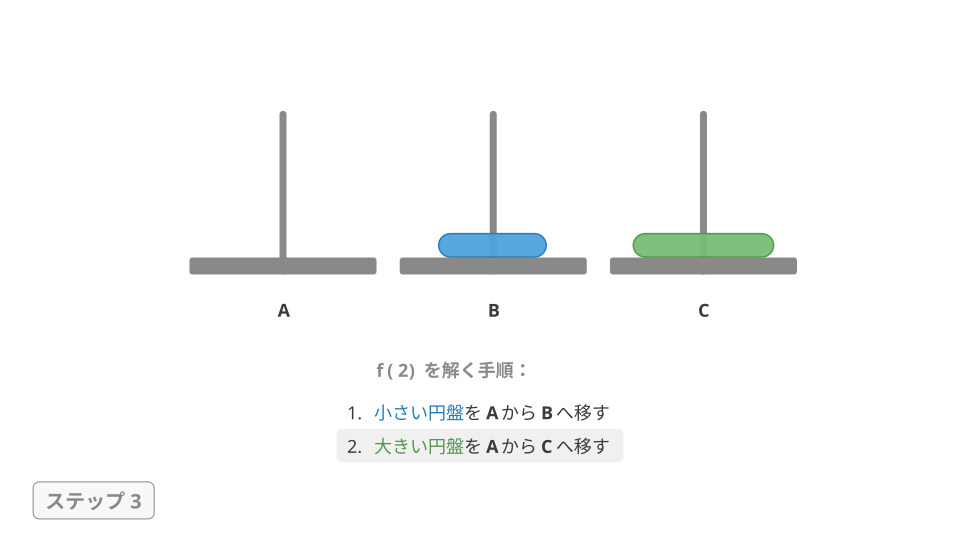
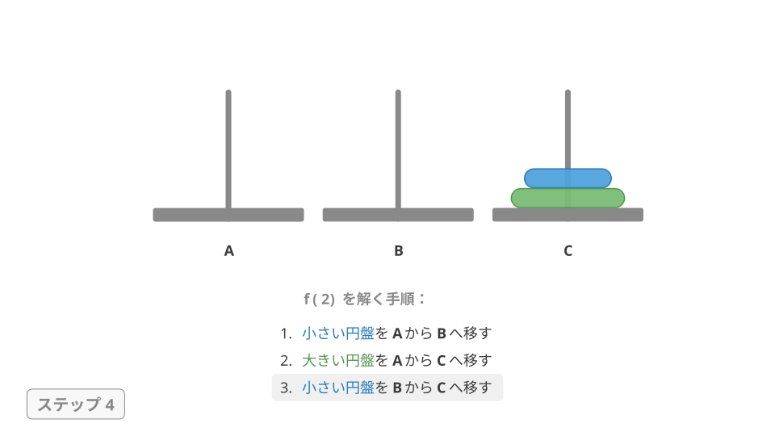
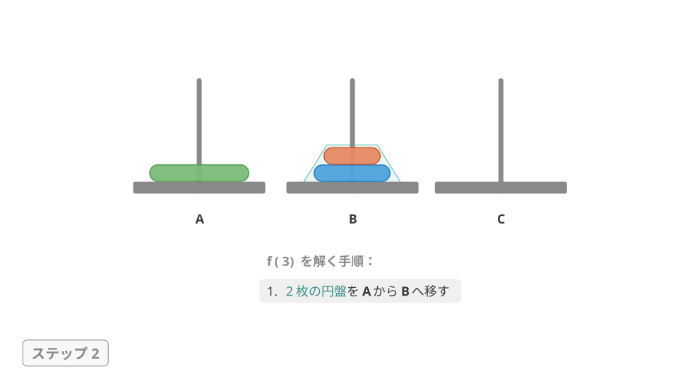
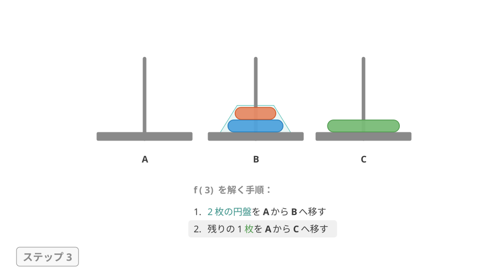
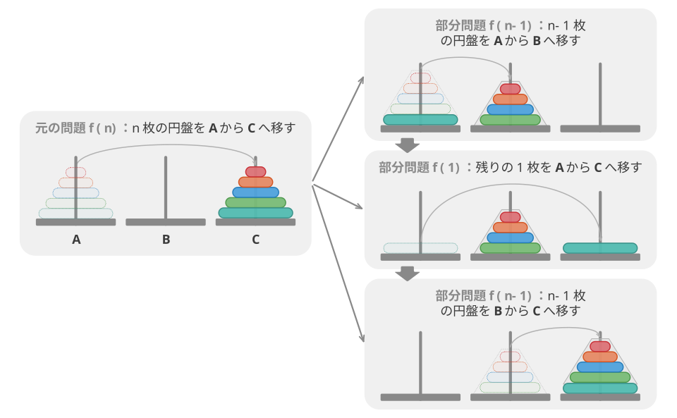
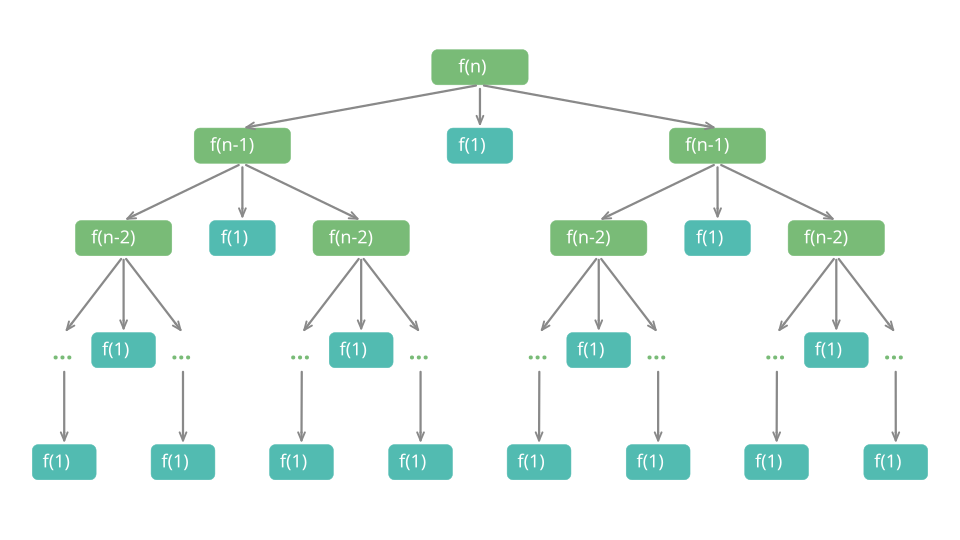

# 12.4 &nbsp; ハノイの塔

マージソートと二分木の構築では、元の問題を半分の規模の二つの部分問題に分けてきました。ハノイの塔では、これとは異なる分け方を使います。

!!! question "問題"

    `A`、`B`、`C` の 3 本の棒があります。最初、棒 `A` には $n$ 枚の円盤が、上から小さい順に重なっています。図 12-10 のように、$n$ 枚すべてを元の順序のまま棒 `C` に移すのが課題です。円盤を移すときは、次の規則に従います。
    
    1. 円盤は棒の一番上から取り、別の棒の一番上に置きます。
    2. 一度に移せる円盤は 1 枚だけです。
    3. 円盤を重ねるときは、常に小さい円盤を大きい円盤の上に置きます。

{ class="animation-figure" }

<p align="center"> 図 12-10 &nbsp; ハノイの塔の例 </p>

**規模 $i$ のハノイの塔の問題を $f(i)$ と表します**。たとえば $f(3)$ は、$3$ 枚の円盤を `A` から `C` に移す問題です。

### 1. &nbsp; 基本の場合を考える

図 12-11 の問題 $f(1)$、つまり円盤が 1 枚だけの場合は、そのまま `A` から `C` に移せば完了です。

=== "<1>"
    { class="animation-figure" }

=== "<2>"
    { class="animation-figure" }

<p align="center"> 図 12-11 &nbsp; 規模 1 の問題の解 </p>

図 12-12 の問題 $f(2)$ では、円盤が 2 枚あります。**大きい円盤の上に小さい円盤が載る順序を常に守るため、`B` を一時置き場に使います**。

1. まず、上の小さい円盤を `A` から `B` に移します。
2. 次に、大きい円盤を `A` から `C` に移します。
3. 最後に、小さい円盤を `B` から `C` に移します。

=== "<1>"
    { class="animation-figure" }

=== "<2>"
    { class="animation-figure" }

=== "<3>"
    { class="animation-figure" }

=== "<4>"
    { class="animation-figure" }

<p align="center"> 図 12-12 &nbsp; 規模 2 の問題の解 </p>

問題 $f(2)$ の手順は、**`B` を一時置き場として、2 枚の円盤を `A` から `C` に移す**とまとめられます。ここで `C` を移動先の棒、`B` を作業用の棒と呼びます。

### 2. &nbsp; 部分問題への分割

問題 $f(3)$、つまり円盤が 3 枚の場合は、少し複雑になります。

$f(1)$ と $f(2)$ の解はすでに分かっています。そこで分割統治の考え方を使い、**`A` の上の 2 枚をひとまとまりと見て**、図 12-13 の手順を実行します。こうして 3 枚とも `A` から `C` に移せます。

1. `B` を移動先、`C` を作業用の棒として、2 枚の円盤を `A` から `B` に移します。
2. `A` に残った 1 枚を、`A` から `C` に直接移します。
3. `C` を移動先、`A` を作業用の棒として、2 枚の円盤を `B` から `C` に移します。

=== "<1>"
    { class="animation-figure" }

=== "<2>"
    { class="animation-figure" }

=== "<3>"
    { class="animation-figure" }

=== "<4>"
    { class="animation-figure" }

<p align="center"> 図 12-13 &nbsp; 規模 3 の問題の解 </p>

ここでは、**問題 $f(3)$ を二つの部分問題 $f(2)$ と一つの部分問題 $f(1)$ に分けました**。この三つを順に解けば元の問題も解けます。これは、部分問題が独立していて、それぞれの解をまとめられることを示しています。

以上から、ハノイの塔を解く分割統治法を図 12-14 のようにまとめられます。元の問題 $f(n)$ を二つの部分問題 $f(n-1)$ と一つの部分問題 $f(1)$ に分け、次の順序で解きます。

1. $n-1$ 枚の円盤を、`C` を作業用の棒として `A` から `B` に移します。
2. 残りの $1$ 枚を `A` から `C` に直接移します。
3. $n-1$ 枚の円盤を、`A` を作業用の棒として `B` から `C` に移します。

二つの部分問題 $f(n-1)$ は、**同じ方法で再帰的に分割でき**、やがて最小の部分問題 $f(1)$ に達します。$f(1)$ の解はすでに分かっており、1 回移すだけです。

{ class="animation-figure" }

<p align="center"> 図 12-14 &nbsp; ハノイの塔を解く分割統治法 </p>

### 3. &nbsp; 実装

コードでは再帰関数 `dfs(i, src, buf, tar)` を定義します。棒 `src` の上から $i$ 枚の円盤を、作業用の棒 `buf` を使って移動先の棒 `tar` に移す関数です。

=== "Python"

    ```python title="hanota.py"
    def move(src: list[int], tar: list[int]):
        """円盤を 1 枚移す"""
        # src の一番上から円盤を 1 枚取り出す
        pan = src.pop()
        # 円盤を tar の一番上に置く
        tar.append(pan)

    def dfs(i: int, src: list[int], buf: list[int], tar: list[int]):
        """ハノイの塔の問題 f(i) を解く"""
        # src の円盤が残り 1 枚なら、そのまま tar に移す
        if i == 1:
            move(src, tar)
            return
        # 部分問題 f(i-1)：src の上から i-1 枚を tar を使って buf に移す
        dfs(i - 1, src, tar, buf)
        # 部分問題 f(1)：src に残った 1 枚を tar に移す
        move(src, tar)
        # 部分問題 f(i-1)：buf の上から i-1 枚を src を使って tar に移す
        dfs(i - 1, buf, src, tar)

    def solve_hanota(A: list[int], B: list[int], C: list[int]):
        """ハノイの塔を解く"""
        n = len(A)
        # A の上から n 枚の円盤を B を使って C に移す
        dfs(n, A, B, C)
    ```

=== "C++"

    ```cpp title="hanota.cpp"
    /* 円盤を 1 枚移す */
    void move(vector<int> &src, vector<int> &tar) {
        // src の一番上から円盤を 1 枚取り出す
        int pan = src.back();
        src.pop_back();
        // 円盤を tar の一番上に置く
        tar.push_back(pan);
    }

    /* ハノイの塔の問題 f(i) を解く */
    void dfs(int i, vector<int> &src, vector<int> &buf, vector<int> &tar) {
        // src の円盤が残り 1 枚なら、そのまま tar に移す
        if (i == 1) {
            move(src, tar);
            return;
        }
        // 部分問題 f(i-1)：src の上から i-1 枚を tar を使って buf に移す
        dfs(i - 1, src, tar, buf);
        // 部分問題 f(1)：src に残った 1 枚を tar に移す
        move(src, tar);
        // 部分問題 f(i-1)：buf の上から i-1 枚を src を使って tar に移す
        dfs(i - 1, buf, src, tar);
    }

    /* ハノイの塔を解く */
    void solveHanota(vector<int> &A, vector<int> &B, vector<int> &C) {
        int n = A.size();
        // A の上から n 枚の円盤を B を使って C に移す
        dfs(n, A, B, C);
    }
    ```

=== "Java"

    ```java title="hanota.java"
    /* 円盤を 1 枚移す */
    void move(List<Integer> src, List<Integer> tar) {
        // src の一番上から円盤を 1 枚取り出す
        Integer pan = src.remove(src.size() - 1);
        // 円盤を tar の一番上に置く
        tar.add(pan);
    }

    /* ハノイの塔の問題 f(i) を解く */
    void dfs(int i, List<Integer> src, List<Integer> buf, List<Integer> tar) {
        // src の円盤が残り 1 枚なら、そのまま tar に移す
        if (i == 1) {
            move(src, tar);
            return;
        }
        // 部分問題 f(i-1)：src の上から i-1 枚を tar を使って buf に移す
        dfs(i - 1, src, tar, buf);
        // 部分問題 f(1)：src に残った 1 枚を tar に移す
        move(src, tar);
        // 部分問題 f(i-1)：buf の上から i-1 枚を src を使って tar に移す
        dfs(i - 1, buf, src, tar);
    }

    /* ハノイの塔を解く */
    void solveHanota(List<Integer> A, List<Integer> B, List<Integer> C) {
        int n = A.size();
        // A の上から n 枚の円盤を B を使って C に移す
        dfs(n, A, B, C);
    }
    ```

=== "C#"

    ```csharp title="hanota.cs"
    /* 円盤を 1 枚移す */
    void Move(List<int> src, List<int> tar) {
        // src の一番上から円盤を 1 枚取り出す
        int pan = src[^1];
        src.RemoveAt(src.Count - 1);
        // 円盤を tar の一番上に置く
        tar.Add(pan);
    }

    /* ハノイの塔の問題 f(i) を解く */
    void DFS(int i, List<int> src, List<int> buf, List<int> tar) {
        // src の円盤が残り 1 枚なら、そのまま tar に移す
        if (i == 1) {
            Move(src, tar);
            return;
        }
        // 部分問題 f(i-1)：src の上から i-1 枚を tar を使って buf に移す
        DFS(i - 1, src, tar, buf);
        // 部分問題 f(1)：src に残った 1 枚を tar に移す
        Move(src, tar);
        // 部分問題 f(i-1)：buf の上から i-1 枚を src を使って tar に移す
        DFS(i - 1, buf, src, tar);
    }

    /* ハノイの塔を解く */
    void SolveHanota(List<int> A, List<int> B, List<int> C) {
        int n = A.Count;
        // A の上から n 枚の円盤を B を使って C に移す
        DFS(n, A, B, C);
    }
    ```

=== "Go"

    ```go title="hanota.go"
    /* 円盤を 1 枚移す */
    func move(src, tar *list.List) {
        // src の一番上から円盤を 1 枚取り出す
        pan := src.Back()
        // 円盤を tar の一番上に置く
        tar.PushBack(pan.Value)
        // src の一番上の円盤を取り出す
        src.Remove(pan)
    }

    /* ハノイの塔の問題 f(i) を解く */
    func dfsHanota(i int, src, buf, tar *list.List) {
        // src の円盤が残り 1 枚なら、そのまま tar に移す
        if i == 1 {
            move(src, tar)
            return
        }
        // 部分問題 f(i-1)：src の上から i-1 枚を tar を使って buf に移す
        dfsHanota(i-1, src, tar, buf)
        // 部分問題 f(1)：src に残った 1 枚を tar に移す
        move(src, tar)
        // 部分問題 f(i-1)：buf の上から i-1 枚を src を使って tar に移す
        dfsHanota(i-1, buf, src, tar)
    }

    /* ハノイの塔を解く */
    func solveHanota(A, B, C *list.List) {
        n := A.Len()
        // A の上から n 枚の円盤を B を使って C に移す
        dfsHanota(n, A, B, C)
    }
    ```

=== "Swift"

    ```swift title="hanota.swift"
    /* 円盤を 1 枚移す */
    func move(src: inout [Int], tar: inout [Int]) {
        // src の一番上から円盤を 1 枚取り出す
        let pan = src.popLast()!
        // 円盤を tar の一番上に置く
        tar.append(pan)
    }

    /* ハノイの塔の問題 f(i) を解く */
    func dfs(i: Int, src: inout [Int], buf: inout [Int], tar: inout [Int]) {
        // src の円盤が残り 1 枚なら、そのまま tar に移す
        if i == 1 {
            move(src: &src, tar: &tar)
            return
        }
        // 部分問題 f(i-1)：src の上から i-1 枚を tar を使って buf に移す
        dfs(i: i - 1, src: &src, buf: &tar, tar: &buf)
        // 部分問題 f(1)：src に残った 1 枚を tar に移す
        move(src: &src, tar: &tar)
        // 部分問題 f(i-1)：buf の上から i-1 枚を src を使って tar に移す
        dfs(i: i - 1, src: &buf, buf: &src, tar: &tar)
    }

    /* ハノイの塔を解く */
    func solveHanota(A: inout [Int], B: inout [Int], C: inout [Int]) {
        let n = A.count
        // リストの末尾が棒の一番上に対応する
        // src の上から n 枚の円盤を B を使って C に移す
        dfs(i: n, src: &A, buf: &B, tar: &C)
    }
    ```

=== "JS"

    ```javascript title="hanota.js"
    /* 円盤を 1 枚移す */
    function move(src, tar) {
        // src の一番上から円盤を 1 枚取り出す
        const pan = src.pop();
        // 円盤を tar の一番上に置く
        tar.push(pan);
    }

    /* ハノイの塔の問題 f(i) を解く */
    function dfs(i, src, buf, tar) {
        // src の円盤が残り 1 枚なら、そのまま tar に移す
        if (i === 1) {
            move(src, tar);
            return;
        }
        // 部分問題 f(i-1)：src の上から i-1 枚を tar を使って buf に移す
        dfs(i - 1, src, tar, buf);
        // 部分問題 f(1)：src に残った 1 枚を tar に移す
        move(src, tar);
        // 部分問題 f(i-1)：buf の上から i-1 枚を src を使って tar に移す
        dfs(i - 1, buf, src, tar);
    }

    /* ハノイの塔を解く */
    function solveHanota(A, B, C) {
        const n = A.length;
        // A の上から n 枚の円盤を B を使って C に移す
        dfs(n, A, B, C);
    }
    ```

=== "TS"

    ```typescript title="hanota.ts"
    /* 円盤を 1 枚移す */
    function move(src: number[], tar: number[]): void {
        // src の一番上から円盤を 1 枚取り出す
        const pan = src.pop();
        // 円盤を tar の一番上に置く
        tar.push(pan);
    }

    /* ハノイの塔の問題 f(i) を解く */
    function dfs(i: number, src: number[], buf: number[], tar: number[]): void {
        // src の円盤が残り 1 枚なら、そのまま tar に移す
        if (i === 1) {
            move(src, tar);
            return;
        }
        // 部分問題 f(i-1)：src の上から i-1 枚を tar を使って buf に移す
        dfs(i - 1, src, tar, buf);
        // 部分問題 f(1)：src に残った 1 枚を tar に移す
        move(src, tar);
        // 部分問題 f(i-1)：buf の上から i-1 枚を src を使って tar に移す
        dfs(i - 1, buf, src, tar);
    }

    /* ハノイの塔を解く */
    function solveHanota(A: number[], B: number[], C: number[]): void {
        const n = A.length;
        // A の上から n 枚の円盤を B を使って C に移す
        dfs(n, A, B, C);
    }
    ```

=== "Dart"

    ```dart title="hanota.dart"
    /* 円盤を 1 枚移す */
    void move(List<int> src, List<int> tar) {
      // src の一番上から円盤を 1 枚取り出す
      int pan = src.removeLast();
      // 円盤を tar の一番上に置く
      tar.add(pan);
    }

    /* ハノイの塔の問題 f(i) を解く */
    void dfs(int i, List<int> src, List<int> buf, List<int> tar) {
      // src の円盤が残り 1 枚なら、そのまま tar に移す
      if (i == 1) {
        move(src, tar);
        return;
      }
      // 部分問題 f(i-1)：src の上から i-1 枚を tar を使って buf に移す
      dfs(i - 1, src, tar, buf);
      // 部分問題 f(1)：src に残った 1 枚を tar に移す
      move(src, tar);
      // 部分問題 f(i-1)：buf の上から i-1 枚を src を使って tar に移す
      dfs(i - 1, buf, src, tar);
    }

    /* ハノイの塔を解く */
    void solveHanota(List<int> A, List<int> B, List<int> C) {
      int n = A.length;
      // A の上から n 枚の円盤を B を使って C に移す
      dfs(n, A, B, C);
    }
    ```

=== "Rust"

    ```rust title="hanota.rs"
    /* 円盤を 1 枚移す */
    fn move_pan(src: &mut Vec<i32>, tar: &mut Vec<i32>) {
        // src の一番上から円盤を 1 枚取り出す
        let pan = src.pop().unwrap();
        // 円盤を tar の一番上に置く
        tar.push(pan);
    }

    /* ハノイの塔の問題 f(i) を解く */
    fn dfs(i: i32, src: &mut Vec<i32>, buf: &mut Vec<i32>, tar: &mut Vec<i32>) {
        // src の円盤が残り 1 枚なら、そのまま tar に移す
        if i == 1 {
            move_pan(src, tar);
            return;
        }
        // 部分問題 f(i-1)：src の上から i-1 枚を tar を使って buf に移す
        dfs(i - 1, src, tar, buf);
        // 部分問題 f(1)：src に残った 1 枚を tar に移す
        move_pan(src, tar);
        // 部分問題 f(i-1)：buf の上から i-1 枚を src を使って tar に移す
        dfs(i - 1, buf, src, tar);
    }

    /* ハノイの塔を解く */
    fn solve_hanota(A: &mut Vec<i32>, B: &mut Vec<i32>, C: &mut Vec<i32>) {
        let n = A.len() as i32;
        // A の上から n 枚の円盤を B を使って C に移す
        dfs(n, A, B, C);
    }
    ```

=== "C"

    ```c title="hanota.c"
    /* 円盤を 1 枚移す */
    void move(int *src, int *srcSize, int *tar, int *tarSize) {
        // src の一番上から円盤を 1 枚取り出す
        int pan = src[*srcSize - 1];
        src[*srcSize - 1] = 0;
        (*srcSize)--;
        // 円盤を tar の一番上に置く
        tar[*tarSize] = pan;
        (*tarSize)++;
    }

    /* ハノイの塔の問題 f(i) を解く */
    void dfs(int i, int *src, int *srcSize, int *buf, int *bufSize, int *tar, int *tarSize) {
        // src の円盤が残り 1 枚なら、そのまま tar に移す
        if (i == 1) {
            move(src, srcSize, tar, tarSize);
            return;
        }
        // 部分問題 f(i-1)：src の上から i-1 枚を tar を使って buf に移す
        dfs(i - 1, src, srcSize, tar, tarSize, buf, bufSize);
        // 部分問題 f(1)：src に残った 1 枚を tar に移す
        move(src, srcSize, tar, tarSize);
        // 部分問題 f(i-1)：buf の上から i-1 枚を src を使って tar に移す
        dfs(i - 1, buf, bufSize, src, srcSize, tar, tarSize);
    }

    /* ハノイの塔を解く */
    void solveHanota(int *A, int *ASize, int *B, int *BSize, int *C, int *CSize) {
        // A の上から n 枚の円盤を B を使って C に移す
        dfs(*ASize, A, ASize, B, BSize, C, CSize);
    }
    ```

=== "Kotlin"

    ```kotlin title="hanota.kt"
    /* 円盤を 1 枚移す */
    fun move(src: MutableList<Int>, tar: MutableList<Int>) {
        // src の一番上から円盤を 1 枚取り出す
        val pan = src.removeAt(src.size - 1)
        // 円盤を tar の一番上に置く
        tar.add(pan)
    }

    /* ハノイの塔の問題 f(i) を解く */
    fun dfs(i: Int, src: MutableList<Int>, buf: MutableList<Int>, tar: MutableList<Int>) {
        // src の円盤が残り 1 枚なら、そのまま tar に移す
        if (i == 1) {
            move(src, tar)
            return
        }
        // 部分問題 f(i-1)：src の上から i-1 枚を tar を使って buf に移す
        dfs(i - 1, src, tar, buf)
        // 部分問題 f(1)：src に残った 1 枚を tar に移す
        move(src, tar)
        // 部分問題 f(i-1)：buf の上から i-1 枚を src を使って tar に移す
        dfs(i - 1, buf, src, tar)
    }

    /* ハノイの塔を解く */
    fun solveHanota(A: MutableList<Int>, B: MutableList<Int>, C: MutableList<Int>) {
        val n = A.size
        // A の上から n 枚の円盤を B を使って C に移す
        dfs(n, A, B, C)
    }
    ```

=== "Ruby"

    ```ruby title="hanota.rb"
    ### 円盤を 1 枚移す ###
    def move(src, tar)
      # src の一番上から円盤を 1 枚取り出す
      pan = src.pop
      # 円盤を tar の一番上に置く
      tar << pan
    end

    ### ハノイの塔の問題 f(i) を解く ###
    def dfs(i, src, buf, tar)
      # src の円盤が残り 1 枚なら、そのまま tar に移す
      if i == 1
        move(src, tar)
        return
      end

      # 部分問題 f(i-1)：src の上から i-1 枚を tar を使って buf に移す
      dfs(i - 1, src, tar, buf)
      # 部分問題 f(1)：src に残った 1 枚を tar に移す
      move(src, tar)
      # 部分問題 f(i-1)：buf の上から i-1 枚を src を使って tar に移す
      dfs(i - 1, buf, src, tar)
    end

    ### ハノイの塔を解く ###
    def solve_hanota(_A, _B, _C)
      n = _A.length
      # A の上から n 枚の円盤を B を使って C に移す
      dfs(n, _A, _B, _C)
    end
    ```

??? pythontutor "実行の様子を見る"

    <div style="height: 549px; width: 100%;"><iframe class="pythontutor-iframe" title="実行の様子を見る" src="https://pythontutor.com/iframe-embed.html#code=def%20move%28src%3A%20list%5Bint%5D,%20tar%3A%20list%5Bint%5D%29%3A%0A%20%20%20%20%22%22%22%E5%86%86%E7%9B%A4%E3%82%92%201%20%E6%9E%9A%E7%A7%BB%E3%81%99%22%22%22%0A%20%20%20%20%23%20src%20%E3%81%AE%E4%B8%80%E7%95%AA%E4%B8%8A%E3%81%8B%E3%82%89%E5%86%86%E7%9B%A4%E3%82%92%201%20%E6%9E%9A%E5%8F%96%E3%82%8A%E5%87%BA%E3%81%99%0A%20%20%20%20pan%20%3D%20src.pop%28%29%0A%20%20%20%20%23%20%E5%86%86%E7%9B%A4%E3%82%92%20tar%20%E3%81%AE%E4%B8%80%E7%95%AA%E4%B8%8A%E3%81%AB%E7%BD%AE%E3%81%8F%0A%20%20%20%20tar.append%28pan%29%0A%0A%0Adef%20dfs%28i%3A%20int,%20src%3A%20list%5Bint%5D,%20buf%3A%20list%5Bint%5D,%20tar%3A%20list%5Bint%5D%29%3A%0A%20%20%20%20%22%22%22%E3%83%8F%E3%83%8E%E3%82%A4%E3%81%AE%E5%A1%94%E3%81%AE%E5%95%8F%E9%A1%8C%20f%28i%29%20%E3%82%92%E8%A7%A3%E3%81%8F%22%22%22%0A%20%20%20%20%23%20src%20%E3%81%AE%E5%86%86%E7%9B%A4%E3%81%8C%E6%AE%8B%E3%82%8A%201%20%E6%9E%9A%E3%81%AA%E3%82%89%E3%80%81%E3%81%9D%E3%81%AE%E3%81%BE%E3%81%BE%20tar%20%E3%81%AB%E7%A7%BB%E3%81%99%0A%20%20%20%20if%20i%20%3D%3D%201%3A%0A%20%20%20%20%20%20%20%20move%28src,%20tar%29%0A%20%20%20%20%20%20%20%20return%0A%20%20%20%20%23%20%E9%83%A8%E5%88%86%E5%95%8F%E9%A1%8C%20f%28i-1%29%EF%BC%9Asrc%20%E3%81%AE%E4%B8%8A%E3%81%8B%E3%82%89%20i-1%20%E6%9E%9A%E3%82%92%20tar%20%E3%82%92%E4%BD%BF%E3%81%A3%E3%81%A6%20buf%20%E3%81%AB%E7%A7%BB%E3%81%99%0A%20%20%20%20dfs%28i%20-%201,%20src,%20tar,%20buf%29%0A%20%20%20%20%23%20%E9%83%A8%E5%88%86%E5%95%8F%E9%A1%8C%20f%281%29%EF%BC%9Asrc%20%E3%81%AB%E6%AE%8B%E3%81%A3%E3%81%9F%201%20%E6%9E%9A%E3%82%92%20tar%20%E3%81%AB%E7%A7%BB%E3%81%99%0A%20%20%20%20move%28src,%20tar%29%0A%20%20%20%20%23%20%E9%83%A8%E5%88%86%E5%95%8F%E9%A1%8C%20f%28i-1%29%EF%BC%9Abuf%20%E3%81%AE%E4%B8%8A%E3%81%8B%E3%82%89%20i-1%20%E6%9E%9A%E3%82%92%20src%20%E3%82%92%E4%BD%BF%E3%81%A3%E3%81%A6%20tar%20%E3%81%AB%E7%A7%BB%E3%81%99%0A%20%20%20%20dfs%28i%20-%201,%20buf,%20src,%20tar%29%0A%0A%0Adef%20solve_hanota%28A%3A%20list%5Bint%5D,%20B%3A%20list%5Bint%5D,%20C%3A%20list%5Bint%5D%29%3A%0A%20%20%20%20%22%22%22%E3%83%8F%E3%83%8E%E3%82%A4%E3%81%AE%E5%A1%94%E3%82%92%E8%A7%A3%E3%81%8F%22%22%22%0A%20%20%20%20n%20%3D%20len%28A%29%0A%20%20%20%20%23%20A%20%E3%81%AE%E4%B8%8A%E3%81%8B%E3%82%89%20n%20%E6%9E%9A%E3%81%AE%E5%86%86%E7%9B%A4%E3%82%92%20B%20%E3%82%92%E4%BD%BF%E3%81%A3%E3%81%A6%20C%20%E3%81%AB%E7%A7%BB%E3%81%99%0A%20%20%20%20dfs%28n,%20A,%20B,%20C%29%0A%0A%0A%22%22%22Driver%20Code%22%22%22%0Aif%20__name__%20%3D%3D%20%22__main__%22%3A%0A%20%20%20%20%23%20%E3%83%AA%E3%82%B9%E3%83%88%E3%81%AE%E6%9C%AB%E5%B0%BE%E3%81%8C%E6%A3%92%E3%81%AE%E4%B8%80%E7%95%AA%E4%B8%8A%E3%81%AB%E5%AF%BE%E5%BF%9C%E3%81%99%E3%82%8B%0A%20%20%20%20A%20%3D%20%5B5,%204,%203,%202,%201%5D%0A%20%20%20%20B%20%3D%20%5B%5D%0A%20%20%20%20C%20%3D%20%5B%5D%0A%20%20%20%20print%28%22%E5%88%9D%E6%9C%9F%E7%8A%B6%E6%85%8B%EF%BC%9A%22%29%0A%20%20%20%20print%28f%22A%20%3D%20%7BA%7D%22%29%0A%20%20%20%20print%28f%22B%20%3D%20%7BB%7D%22%29%0A%20%20%20%20print%28f%22C%20%3D%20%7BC%7D%22%29%0A%0A%20%20%20%20solve_hanota%28A,%20B,%20C%29%0A%0A%20%20%20%20print%28%22%E5%86%86%E7%9B%A4%E3%82%92%E3%81%99%E3%81%B9%E3%81%A6%E7%A7%BB%E3%81%97%E3%81%9F%E5%BE%8C%EF%BC%9A%22%29%0A%20%20%20%20print%28f%22A%20%3D%20%7BA%7D%22%29%0A%20%20%20%20print%28f%22B%20%3D%20%7BB%7D%22%29%0A%20%20%20%20print%28f%22C%20%3D%20%7BC%7D%22%29&codeDivHeight=472&codeDivWidth=350&cumulative=false&curInstr=12&heapPrimitives=nevernest&origin=opt-frontend.js&py=311&rawInputLstJSON=%5B%5D&textReferences=false"> </iframe></div>
    <div style="margin-top: 5px;"><a href="https://pythontutor.com/iframe-embed.html#code=def%20move%28src%3A%20list%5Bint%5D,%20tar%3A%20list%5Bint%5D%29%3A%0A%20%20%20%20%22%22%22%E5%86%86%E7%9B%A4%E3%82%92%201%20%E6%9E%9A%E7%A7%BB%E3%81%99%22%22%22%0A%20%20%20%20%23%20src%20%E3%81%AE%E4%B8%80%E7%95%AA%E4%B8%8A%E3%81%8B%E3%82%89%E5%86%86%E7%9B%A4%E3%82%92%201%20%E6%9E%9A%E5%8F%96%E3%82%8A%E5%87%BA%E3%81%99%0A%20%20%20%20pan%20%3D%20src.pop%28%29%0A%20%20%20%20%23%20%E5%86%86%E7%9B%A4%E3%82%92%20tar%20%E3%81%AE%E4%B8%80%E7%95%AA%E4%B8%8A%E3%81%AB%E7%BD%AE%E3%81%8F%0A%20%20%20%20tar.append%28pan%29%0A%0A%0Adef%20dfs%28i%3A%20int,%20src%3A%20list%5Bint%5D,%20buf%3A%20list%5Bint%5D,%20tar%3A%20list%5Bint%5D%29%3A%0A%20%20%20%20%22%22%22%E3%83%8F%E3%83%8E%E3%82%A4%E3%81%AE%E5%A1%94%E3%81%AE%E5%95%8F%E9%A1%8C%20f%28i%29%20%E3%82%92%E8%A7%A3%E3%81%8F%22%22%22%0A%20%20%20%20%23%20src%20%E3%81%AE%E5%86%86%E7%9B%A4%E3%81%8C%E6%AE%8B%E3%82%8A%201%20%E6%9E%9A%E3%81%AA%E3%82%89%E3%80%81%E3%81%9D%E3%81%AE%E3%81%BE%E3%81%BE%20tar%20%E3%81%AB%E7%A7%BB%E3%81%99%0A%20%20%20%20if%20i%20%3D%3D%201%3A%0A%20%20%20%20%20%20%20%20move%28src,%20tar%29%0A%20%20%20%20%20%20%20%20return%0A%20%20%20%20%23%20%E9%83%A8%E5%88%86%E5%95%8F%E9%A1%8C%20f%28i-1%29%EF%BC%9Asrc%20%E3%81%AE%E4%B8%8A%E3%81%8B%E3%82%89%20i-1%20%E6%9E%9A%E3%82%92%20tar%20%E3%82%92%E4%BD%BF%E3%81%A3%E3%81%A6%20buf%20%E3%81%AB%E7%A7%BB%E3%81%99%0A%20%20%20%20dfs%28i%20-%201,%20src,%20tar,%20buf%29%0A%20%20%20%20%23%20%E9%83%A8%E5%88%86%E5%95%8F%E9%A1%8C%20f%281%29%EF%BC%9Asrc%20%E3%81%AB%E6%AE%8B%E3%81%A3%E3%81%9F%201%20%E6%9E%9A%E3%82%92%20tar%20%E3%81%AB%E7%A7%BB%E3%81%99%0A%20%20%20%20move%28src,%20tar%29%0A%20%20%20%20%23%20%E9%83%A8%E5%88%86%E5%95%8F%E9%A1%8C%20f%28i-1%29%EF%BC%9Abuf%20%E3%81%AE%E4%B8%8A%E3%81%8B%E3%82%89%20i-1%20%E6%9E%9A%E3%82%92%20src%20%E3%82%92%E4%BD%BF%E3%81%A3%E3%81%A6%20tar%20%E3%81%AB%E7%A7%BB%E3%81%99%0A%20%20%20%20dfs%28i%20-%201,%20buf,%20src,%20tar%29%0A%0A%0Adef%20solve_hanota%28A%3A%20list%5Bint%5D,%20B%3A%20list%5Bint%5D,%20C%3A%20list%5Bint%5D%29%3A%0A%20%20%20%20%22%22%22%E3%83%8F%E3%83%8E%E3%82%A4%E3%81%AE%E5%A1%94%E3%82%92%E8%A7%A3%E3%81%8F%22%22%22%0A%20%20%20%20n%20%3D%20len%28A%29%0A%20%20%20%20%23%20A%20%E3%81%AE%E4%B8%8A%E3%81%8B%E3%82%89%20n%20%E6%9E%9A%E3%81%AE%E5%86%86%E7%9B%A4%E3%82%92%20B%20%E3%82%92%E4%BD%BF%E3%81%A3%E3%81%A6%20C%20%E3%81%AB%E7%A7%BB%E3%81%99%0A%20%20%20%20dfs%28n,%20A,%20B,%20C%29%0A%0A%0A%22%22%22Driver%20Code%22%22%22%0Aif%20__name__%20%3D%3D%20%22__main__%22%3A%0A%20%20%20%20%23%20%E3%83%AA%E3%82%B9%E3%83%88%E3%81%AE%E6%9C%AB%E5%B0%BE%E3%81%8C%E6%A3%92%E3%81%AE%E4%B8%80%E7%95%AA%E4%B8%8A%E3%81%AB%E5%AF%BE%E5%BF%9C%E3%81%99%E3%82%8B%0A%20%20%20%20A%20%3D%20%5B5,%204,%203,%202,%201%5D%0A%20%20%20%20B%20%3D%20%5B%5D%0A%20%20%20%20C%20%3D%20%5B%5D%0A%20%20%20%20print%28%22%E5%88%9D%E6%9C%9F%E7%8A%B6%E6%85%8B%EF%BC%9A%22%29%0A%20%20%20%20print%28f%22A%20%3D%20%7BA%7D%22%29%0A%20%20%20%20print%28f%22B%20%3D%20%7BB%7D%22%29%0A%20%20%20%20print%28f%22C%20%3D%20%7BC%7D%22%29%0A%0A%20%20%20%20solve_hanota%28A,%20B,%20C%29%0A%0A%20%20%20%20print%28%22%E5%86%86%E7%9B%A4%E3%82%92%E3%81%99%E3%81%B9%E3%81%A6%E7%A7%BB%E3%81%97%E3%81%9F%E5%BE%8C%EF%BC%9A%22%29%0A%20%20%20%20print%28f%22A%20%3D%20%7BA%7D%22%29%0A%20%20%20%20print%28f%22B%20%3D%20%7BB%7D%22%29%0A%20%20%20%20print%28f%22C%20%3D%20%7BC%7D%22%29&codeDivHeight=800&codeDivWidth=600&cumulative=false&curInstr=12&heapPrimitives=nevernest&origin=opt-frontend.js&py=311&rawInputLstJSON=%5B%5D&textReferences=false" target="_blank" rel="noopener noreferrer">全画面で表示 ></a></div>

図 12-15 のように、ハノイの塔の問題は高さ $n$ の再帰木を作ります。各ノードは部分問題を表し、`dfs()` 関数の 1 回の呼び出しに対応します。**したがって時間計算量は $O(2^n)$、空間計算量は $O(n)$ です**。

{ class="animation-figure" }

<p align="center"> 図 12-15 &nbsp; ハノイの塔の再帰木 </p>

!!! quote "引用"

    ハノイの塔には古い伝説があります。古代インドのある寺院には、ダイヤモンドでできた高い棒が 3 本と、大きさの異なる金の円盤が $64$ 枚ありました。僧たちは円盤を移し続け、最後の 1 枚を正しく置いた瞬間に世界が終わると信じていました。

    もっとも、僧たちが毎秒 1 枚移しても、全部で約 $2^{64} \approx 1.84×10^{19}$ 秒、年にして約 $5850$ 億年かかります。現在推定されている宇宙の年齢をはるかに超える長さです。伝説が本当でも、世界の終わりを心配せずに済みそうです。
