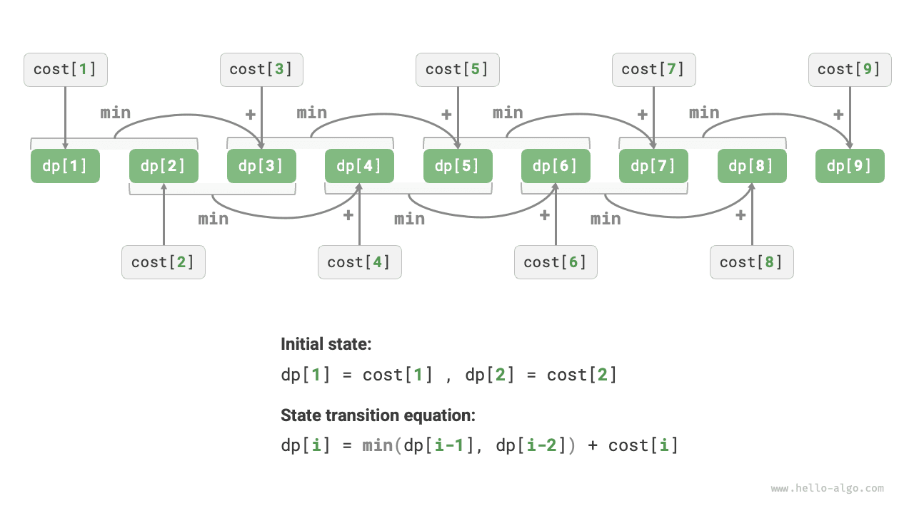
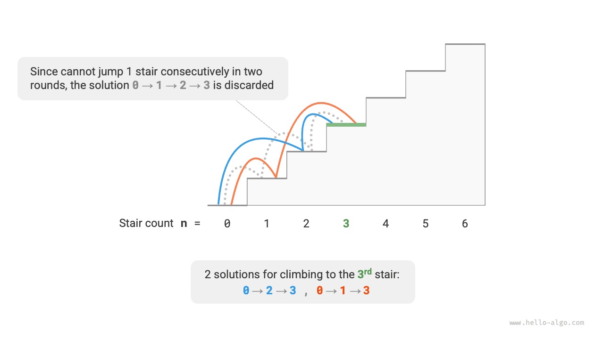

# 動的計画法の問題の特徴

前の節では、動的計画法が部分問題への分解によって元の問題を解く仕組みを学びました。部分問題への分解は汎用的な考え方ですが、分割統治、動的計画法、バックトラッキングでは重点が異なります。

- 分割統治は、元の問題を互いに独立した複数の部分問題へ再帰的に分割し、最小の部分問題まで進みます。その後、戻りながら解を統合し、元の問題の解を得ます。
- 動的計画法も問題を再帰的に分解します。分割統治との主な違いは、部分問題が互いに依存し、分解の過程で多くの重複した部分問題が現れることです。
- バックトラッキングは試行と後戻りを繰り返してすべての可能な解を列挙し、枝刈りで不要な探索分岐を避けます。元の問題の解は一連の判断で構成され、各判断の直前までの部分列を一つの部分問題と捉えられます。

実際、動的計画法は最適化問題を解くためによく使われます。そうした問題は部分問題の重複に加え、最適部分構造と、後続の判断が過去の経路に依存しない性質という二つの重要な特徴を持ちます。

## 最適部分構造

階段を上る問題を少し変えて、最適部分構造を説明しやすくしてみましょう。

!!! question "最小コストで階段を上る"

    階段があり、1 回で $1$ 段または $2$ 段上れます。各段には非負の整数が書かれており、その段で支払うコストを表します。非負整数の配列 $cost$ が与えられ、$cost[i]$ は $i$ 段目でのコスト、$cost[0]$ は地面（開始点）に対応します。一番上まで到達するための最小コストを求めてください。

下図のように、$1$、$2$、$3$ 段目のコストがそれぞれ $1$、$10$、$1$ なら、地面から $3$ 段目まで上る最小コストは $2$ です。


$i$ 段目までの累積コストを $dp[i]$ とします。$i$ 段目には $i - 1$ 段目か $i - 2$ 段目からしか来られないため、$dp[i]$ は $dp[i - 1] + cost[i]$ または $dp[i - 2] + cost[i]$ です。コストをできるだけ小さくするには、二つのうち小さい方を選びます。

$$
dp[i] = \min(dp[i-1], dp[i-2]) + cost[i]
$$

ここから、最適部分構造の意味がわかります。**元の問題の最適解は、部分問題の最適解から組み立てられる**ということです。

この問題には明らかに最適部分構造があります。二つの部分問題の最適解 $dp[i-1]$ と $dp[i-2]$ からよい方を選び、それを使って元の問題 $dp[i]$ の最適解を組み立てるからです。

では、前の節の階段の問題にも最適部分構造はあるのでしょうか。目的は方法の数を求めることで、一見すると数え上げの問題です。しかし「方法の数の最大値を求める」と言い換えると、**問題自体は同じなのに、最適部分構造が見えてきます**。$n$ 段目までの方法の最大数は、$n-1$ 段目と $n-2$ 段目までの方法の最大数の和です。このように、最適部分構造は柔軟に解釈でき、問題によって意味合いが異なります。

状態遷移式と、初期状態 $dp[1] = cost[1]$、$dp[2] = cost[2]$ から、動的計画法のコードが得られます。

```src
[file]{min_cost_climbing_stairs_dp}-[class]{}-[func]{min_cost_climbing_stairs_dp}
```

下図に、上のコードによる動的計画法の流れを示します。



この問題も、一次元を零次元に圧縮する空間最適化により、空間計算量を $O(n)$ から $O(1)$ に下げられます。

```src
[file]{min_cost_climbing_stairs_dp}-[class]{}-[func]{min_cost_climbing_stairs_dp_comp}
```

## 後続の判断が過去の経路に依存しない性質

動的計画法が問題を効率よく解くうえで重要なのが、後続の判断が過去の経路に依存しない性質です。これは、**ある状態が決まれば、その後の展開は現在の状態だけで決まり、そこまでに通ったすべての状態には依存しない**ことを意味します。

階段の問題では、状態 $i$ から状態 $i+1$ または $i+2$ に進めます。これは、それぞれ $1$ 段または $2$ 段上る選択です。どちらを選ぶときも、$i$ より前の状態を考慮する必要はなく、過去の状態は $i$ から先の展開に影響しません。

しかし、階段の問題に制約を一つ加えると、事情が変わります。

!!! question "制約付きの階段上り"

    $n$ 段の階段があります。1 回で $1$ 段または $2$ 段上れますが、**$1$ 段ずつ上ることを 2 回連続では行えません**。一番上まで上る方法は何通りありますか。

下図のように、$3$ 段目まで上る有効な方法は $2$ 通りだけになります。$1$ 段ずつ 3 回続けて上る方法は制約を満たさないため、除外されます。



この問題では、前回 $1$ 段上ったなら、次は必ず $2$ 段上る必要があります。つまり、**次の選択は現在の状態（現在の段数）だけでは決まらず、一つ前の状態（前回いた段数）にも依存します**。

この状態の定義では、過去の経路に依存しない性質が成り立たず、状態遷移式 $dp[i] = dp[i-1] + dp[i-2]$ も使えません。$dp[i-1]$ は今回 $1$ 段上る場合に対応しますが、その中には「前回も $1$ 段上った」方法が多数含まれます。制約を満たすためには、$dp[i-1]$ をそのまま $dp[i]$ に加えられません。

そこで状態の定義を拡張し、**状態 $[i, j]$ を、現在 $i$ 段目にいて、前回 $j$ 段上った状態**とします。ここで $j \in \{1, 2\}$ です。この定義なら、前回上ったのが $1$ 段か $2$ 段かを区別でき、現在の状態がどこから来たかを判断できます。

- 前回 $1$ 段上ったなら、その前は $2$ 段しか選べません。したがって、$dp[i, 1]$ には $dp[i-1, 2]$ からだけ遷移できます。
- 前回 $2$ 段上ったなら、その前は $1$ 段でも $2$ 段でもかまいません。したがって、$dp[i, 2]$ には $dp[i-2, 1]$ または $dp[i-2, 2]$ から遷移できます。

下図のように、$dp[i, j]$ を状態 $[i, j]$ に対応する方法の数とすると、状態遷移式は次のようになります。

$$
\begin{cases}
dp[i, 1] = dp[i-1, 2] \\
dp[i, 2] = dp[i-2, 1] + dp[i-2, 2]
\end{cases}
$$


最後に $dp[n, 1] + dp[n, 2]$ を返します。この和が、$n$ 段目まで上る方法の総数です。

```src
[file]{climbing_stairs_constraint_dp}-[class]{}-[func]{climbing_stairs_constraint_dp}
```

この例では、一つ前の状態を追加で考慮するだけなので、状態を拡張すれば、再び過去の経路に依存しない形にできます。しかし、「過去の経路への依存」が非常に強い問題もあります。

!!! question "階段を上ると障害物ができる問題"

    $n$ 段の階段があり、1 回で $1$ 段または $2$ 段上れます。**$i$ 段目に到達すると、システムが自動的に $2i$ 段目に障害物を置き、それ以降は $2i$ 段目に上れなくなる**ものとします。たとえば、最初の 2 回で $2$ 段目、$3$ 段目に上ったら、その後は $4$ 段目、$6$ 段目には上れません。一番上まで上る方法は何通りありますか。

この問題では、毎回の移動が上の段に障害物を置き、その後の移動に影響するため、次の移動は過去のすべての状態に依存します。この種の問題は、動的計画法では解くのが難しいことが多いです。

実際、多くの複雑な組合せ最適化問題（巡回セールスマン問題など）は、過去の経路に依存しない性質を満たしません。そのような問題には、ヒューリスティック探索、遺伝的アルゴリズム、強化学習などの別の方法を選び、限られた時間で利用可能な局所最適解を得ることが一般的です。
