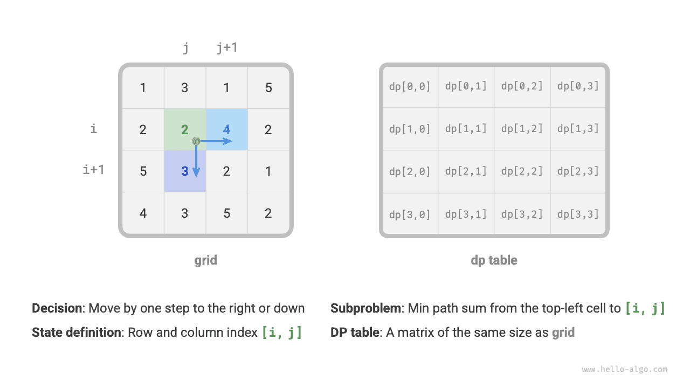
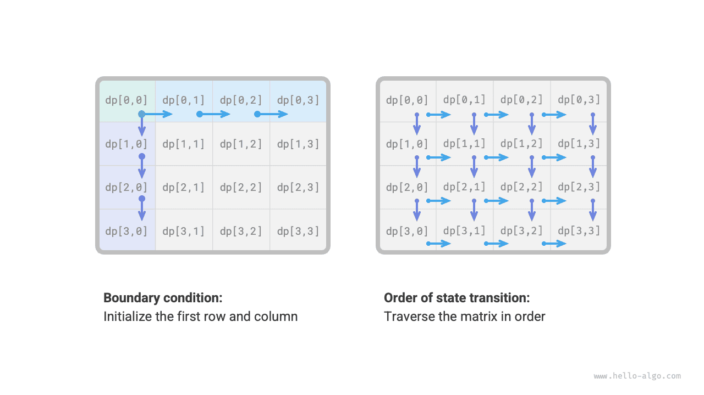
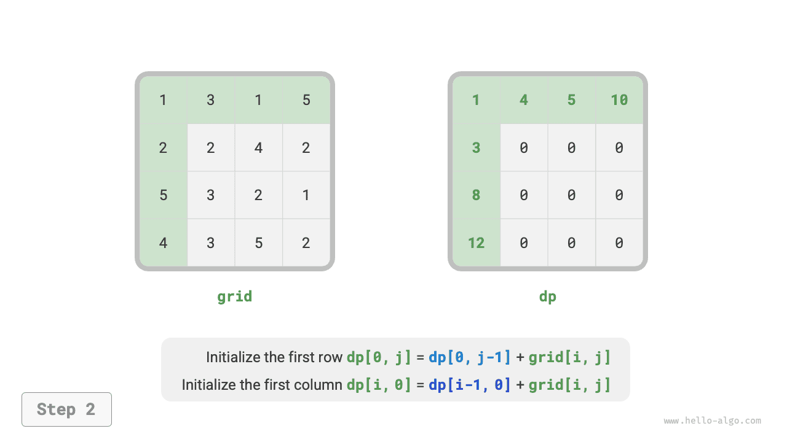
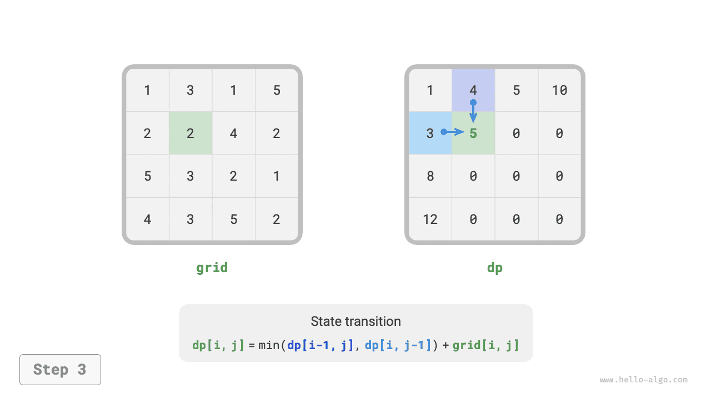
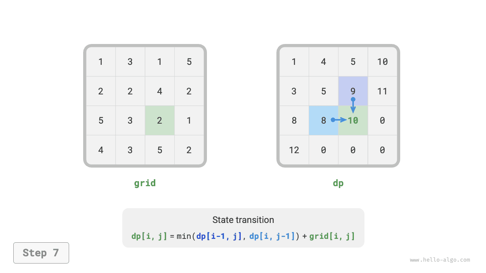
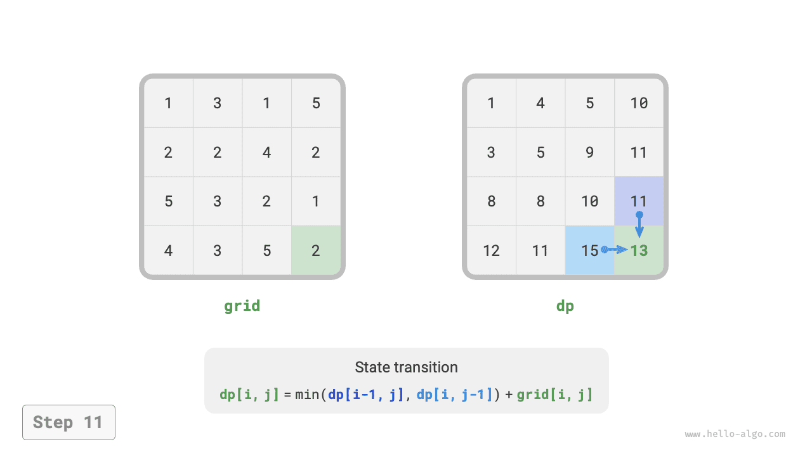

# 動的計画法の解き方

前の 2 節では、動的計画法の問題の主な特徴を説明しました。ここからは、より実践的な二つの疑問を考えていきます。

1. ある問題が動的計画法に適しているかどうかは、どのように判断するのでしょうか。
2. 動的計画法の問題は何から手を付け、どのような手順で解けばよいのでしょうか。

## 問題の見極め

一般に、部分問題の重複と最適部分構造があり、後続の判断が過去の経路に依存しない問題は、動的計画法に適しています。ただし、問題文からこれらの性質を直接見抜くのは難しいため、通常は条件を緩め、**まずバックトラッキング（総当たり）で解けそうかを考えます**。

**バックトラッキングに適した問題は、通常「決定木モデル」で表せます**。木構造で記述でき、各ノードが判断を、各経路が一連の判断を表す問題です。

言い換えると、明確な選択があり、その選択を順に行って解が得られるなら、決定木モデルに当てはまり、通常はバックトラッキングで解けます。

これに加え、動的計画法の問題らしいと判断する「プラス材料」があります。

- 最大・最小、最多・最少などの最適化を求めています。
- 状態をリスト、多次元行列、木などで表せ、ある状態とその周囲の状態の間に漸化式があります。

反対に、次のような「マイナス材料」もあります。

- 最適解ではなく、可能な解をすべて求めることが目標です。
- 順列や組合せの特徴が明らかで、具体的な複数の方法を返す必要があります。

決定木モデルに当てはまり、「プラス材料」もはっきりしているなら、動的計画法の問題と仮定して取り組み、解く過程で確かめていけます。

## 問題を解く手順

動的計画法の手順は問題の性質や難しさによって異なりますが、通常は、選択の記述、状態の定義、$dp$ テーブルの作成、状態遷移式の導出、境界条件の決定などの順で進めます。

手順を具体的に示すため、典型的な「経路和の最小化」問題を使います。

!!! question

    $n \times m$ の二次元グリッド `grid` が与えられます。各マスには、そのマスのコストを表す非負の整数があります。ロボットは左上のマスから出発し、毎回、下または右に 1 マスだけ進んで、右下のマスを目指します。左上から右下までの経路和の最小値を返してください。

下図のグリッドでは、経路和の最小値は $13$ です。


**第 1 段階：各回の選択を考えて状態を定義し、$dp$ テーブルを作る**

各回の選択は、現在のマスから下または右に 1 マス進むことです。現在の行と列のインデックスを $[i, j]$ とすると、移動後は $[i+1, j]$ または $[i, j+1]$ になります。したがって、状態は行と列の二つの変数を含む $[i, j]$ とします。

状態 $[i, j]$ に対応する部分問題は、開始点 $[0, 0]$ から $[i, j]$ までの経路和の最小値を求めることで、その解を $dp[i, j]$ とします。

これで、下図の二次元の $dp$ 行列が得られます。大きさは入力グリッド $grid$ と同じです。



!!! note

    動的計画法やバックトラッキングの過程は、一連の判断として表せます。状態はすべての判断変数で構成し、問題を解く過程の進み具合を表す変数をすべて含めます。次の状態を導くのに十分な情報を持たせる必要があります。
    
    各状態は一つの部分問題に対応し、$dp$ テーブルにすべての部分問題の解を保存します。状態の各独立変数が、$dp$ テーブルの一つの次元になります。本質的には、$dp$ テーブルは状態から部分問題の解への対応表です。

**第 2 段階：最適部分構造を見つけ、状態遷移式を導く**

状態 $[i, j]$ には、上のマス $[i-1, j]$ または左のマス $[i, j-1]$ からしか到達できません。したがって、最適部分構造は、$[i, j]$ までの経路和の最小値が、$[i, j-1]$ までの最小値と $[i-1, j]$ までの最小値のうち、小さい方で決まることです。

この分析から、下図の状態遷移式を導けます。

$$
dp[i, j] = \min(dp[i-1, j], dp[i, j-1]) + grid[i, j]
$$


!!! note

    定義した $dp$ テーブルをもとに、元の問題と部分問題の関係を考えます。部分問題の最適解から元の問題の最適解を組み立てる方法、すなわち最適部分構造を見つけます。

    最適部分構造が見つかれば、それを使って状態遷移式を組み立てられます。

**第 3 段階：境界条件と状態遷移の順序を決める**

この問題では、先頭行の状態には左からしか到達できず、先頭列の状態には上からしか到達できません。そのため、先頭行 $i = 0$ と先頭列 $j = 0$ が境界条件になります。

下図のように、各マスは左と上のマスから遷移するため、ループで行列を走査します。外側のループで行を、内側のループで列を走査します。



!!! note

    境界条件は、動的計画法では $dp$ テーブルの初期化に、探索では枝刈りに使います。
    
    状態遷移の順序で重要なのは、現在の問題の解を計算する時点で、依存するすべての小さな部分問題の解が正しく計算済みであることです。

ここまでの分析から、動的計画法のコードを直接書けます。ただし、部分問題への分解は上から下への考え方なので、「全探索 $\rightarrow$ メモ化探索 $\rightarrow$ 動的計画法」の順に実装する方が、自然な思考の流れに沿っています。

### 方法 1：全探索

状態 $[i, j]$ から探索を始め、より小さな状態 $[i-1, j]$ と $[i, j-1]$ へ分解していきます。再帰関数には、次の要素があります。

- **再帰の引数**：状態 $[i, j]$ です。
- **戻り値**：$[0, 0]$ から $[i, j]$ までの経路和の最小値 $dp[i, j]$ です。
- **終了条件**：$i = 0$ かつ $j = 0$ なら、コスト $grid[0, 0]$ を返します。
- **枝刈り**：$i < 0$ または $j < 0$ なら範囲外なので、到達不可能を表すコスト $+\infty$ を返します。

実装は次のとおりです。

```src
[file]{min_path_sum}-[class]{}-[func]{min_path_sum_dfs}
```

下図は、$dp[2, 1]$ を根とする再帰木です。部分問題の重複が含まれており、グリッド `grid` が大きくなると、その数は急激に増えます。

部分問題が重複する本質的な理由は、**左上からあるマスに到達する経路が複数あること**です。


各状態で下と右の二つの選択肢があり、左上から右下までは計 $m + n - 2$ 歩なので、最悪時間計算量は $O(2^{m + n})$ です。ここで $n$ と $m$ はそれぞれ行数と列数です。ただし、この計算ではグリッドの端付近を考慮していません。端に達すると選択肢は一つになるため、実際の経路数はこれより少なくなります。

### 方法 2：メモ化探索

グリッド `grid` と同じ大きさの記録用リスト `mem` を導入し、各部分問題の解を保存して、重複する部分問題を枝刈りします。

```src
[file]{min_path_sum}-[class]{}-[func]{min_path_sum_dfs_mem}
```

下図のように、メモ化すると各部分問題の解を 1 回だけ計算すれば済みます。そのため、時間計算量は状態の総数、すなわちグリッドの大きさ $O(nm)$ になります。


### 方法 3：動的計画法

反復による動的計画法の実装を次に示します。

```src
[file]{min_path_sum}-[class]{}-[func]{min_path_sum_dp}
```

下図に、経路和の最小化の状態遷移を示します。グリッド全体を走査するため、**時間計算量は $O(nm)$ です**。

配列 `dp` の大きさは $n \times m$ なので、**空間計算量は $O(nm)$ です**。

=== "<1>"
    

=== "<2>"
    

=== "<3>"
    

=== "<4>"
    

=== "<5>"
    

=== "<6>"
    

=== "<7>"
    

=== "<8>"
    

=== "<9>"
    

=== "<10>"
    

=== "<11>"
    

=== "<12>"
    

### 空間の最適化

各マスが依存するのは左と上のマスだけなので、1 行分の配列だけで $dp$ テーブルを実装できます。

配列 `dp` は 1 行分の状態しか表せないため、先頭列をあらかじめ初期化することはできません。各行を走査するときに、その先頭の状態を更新することに注意してください。

```src
[file]{min_path_sum}-[class]{}-[func]{min_path_sum_dp_comp}
```
