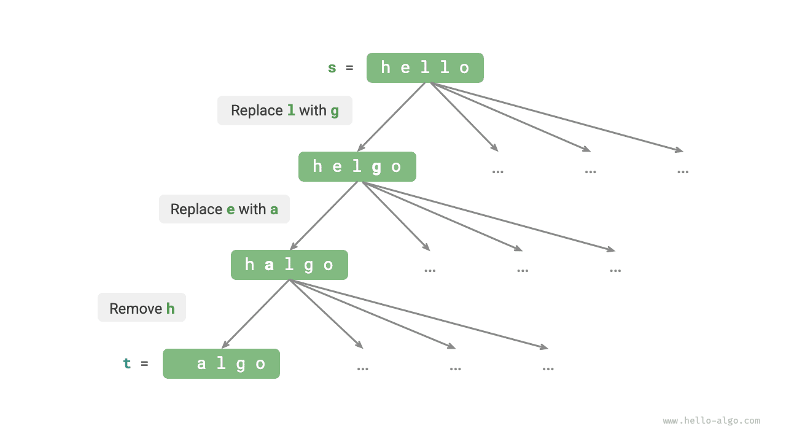
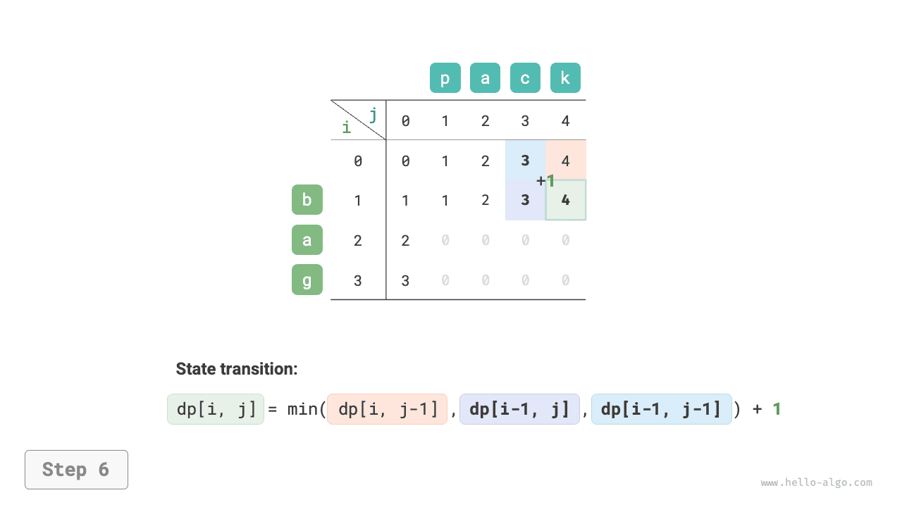
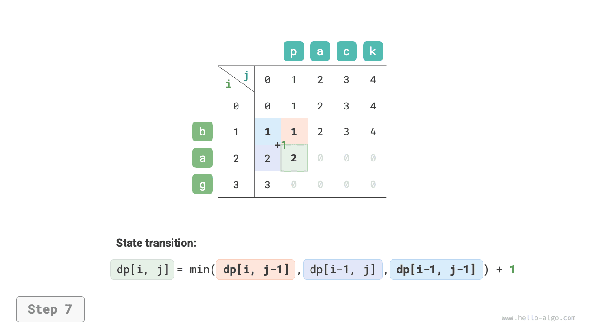
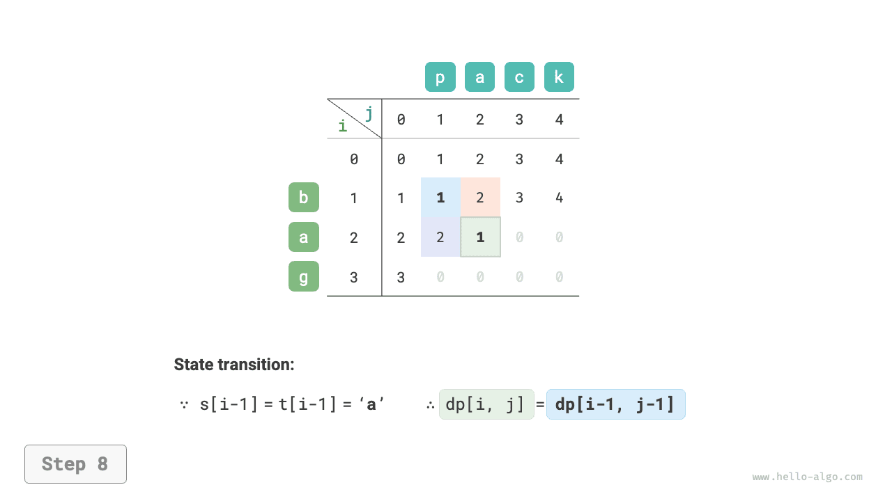
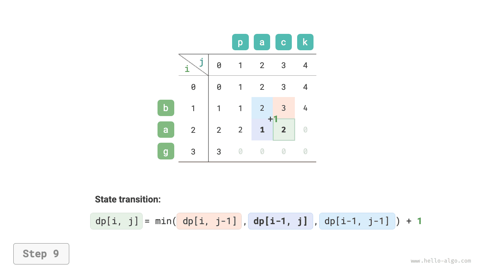
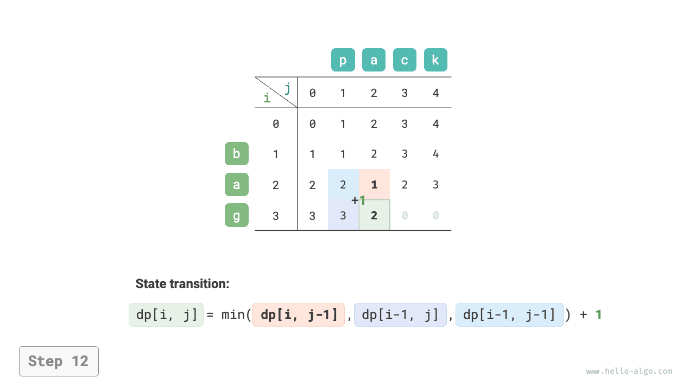
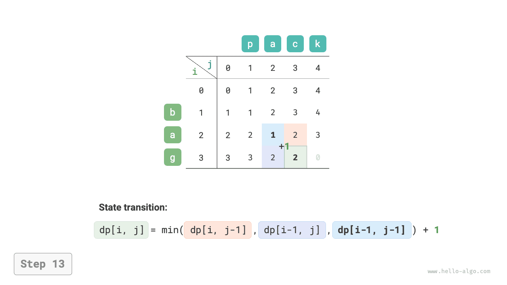

# 編集距離問題

編集距離は Levenshtein 距離とも呼ばれ、一方の文字列をもう一方に変換するために必要な最小の変更回数を表します。情報検索や自然言語処理で、二つの列の類似度を測るためによく使われます。

!!! question

    二つの文字列 $s$ と $t$ が与えられます。$s$ を $t$ に変換するための最小の編集回数を返してください。
    
    文字列には、文字を一つ挿入する、文字を一つ削除する、文字を任意の文字に置き換える、という 3 種類の編集操作を行えます。

下図のように、`kitten` を `sitting` に変換するには、置換 2 回と挿入 1 回の計 3 回が必要です。`hello` を `algo` に変換するには、置換 2 回と削除 1 回の計 3 回が必要です。


**編集距離問題は、決定木モデルで自然に説明できます**。文字列が木のノードに対応し、1 回の判断（編集操作）が辺に対応します。

下図のように、操作を制限しなければ各ノードから多くの辺が伸び、各辺が一つの操作に対応します。つまり、`hello` から `algo` への変換には、多くの経路が考えられます。

決定木の観点では、この問題の目標はノード `hello` とノード `algo` の間の最短経路を求めることです。



### 動的計画法の考え方

**第 1 段階：各回の選択を考えて状態を定義し、$dp$ テーブルを作る**

各回の選択は、文字列 $s$ に編集操作を 1 回行うことです。

部分問題を作るには、編集するたびに問題を小さくしていきたいところです。文字列 $s$ と $t$ の長さをそれぞれ $n$ と $m$ とし、まず末尾の文字 $s[n-1]$ と $t[m-1]$ を考えます。

- $s[n-1]$ と $t[m-1]$ が同じなら、それらを飛ばして $s[n-2]$ と $t[m-2]$ を考えられます。
- $s[n-1]$ と $t[m-1]$ が異なるなら、$s$ に編集（挿入、削除、置換）を 1 回行って末尾の文字を一致させ、それらを飛ばして、より小さな問題を考えます。

つまり、文字列 $s$ に対する各回の判断（編集操作）によって、$s$ と $t$ のまだ対応させていない文字が変わります。そこで、現在考えている $s$ の $i$ 番目と $t$ の $j$ 番目の文字を状態とし、$[i, j]$ と表します。

状態 $[i, j]$ の部分問題は、**$s$ の先頭 $i$ 文字を $t$ の先頭 $j$ 文字に変換するための最小編集回数**です。

これで、$(n+1) \times (m+1)$ の二次元の $dp$ テーブルが得られます。

**第 2 段階：最適部分構造を見つけ、状態遷移式を導く**

部分問題 $dp[i, j]$ に対応する二つの文字列の末尾は、$s[i-1]$ と $t[j-1]$ です。編集操作によって、下図の 3 通りに分けられます。

1. $s[i-1]$ の後ろに $t[j-1]$ を挿入すると、残る部分問題は $dp[i, j-1]$ です。
2. $s[i-1]$ を削除すると、残る部分問題は $dp[i-1, j]$ です。
3. $s[i-1]$ を $t[j-1]$ に置換すると、残る部分問題は $dp[i-1, j-1]$ です。


ここから最適部分構造が得られます。$dp[i, j]$ の最小編集回数は、$dp[i, j-1]$、$dp[i-1, j]$、$dp[i-1, j-1]$ の三つの最小編集回数のうち、最も小さいものに、今回の編集 $1$ 回を加えた値です。状態遷移式は次のようになります。

$$
dp[i, j] = \min(dp[i, j-1], dp[i-1, j], dp[i-1, j-1]) + 1
$$

**$s[i-1]$ と $t[j-1]$ が同じなら、その文字を編集する必要はありません**。この場合の状態遷移式は次のとおりです。

$$
dp[i, j] = dp[i-1, j-1]
$$

**第 3 段階：境界条件と状態遷移の順序を決める**

両方の文字列が空なら編集回数は $0$、すなわち $dp[0, 0] = 0$ です。$s$ が空で $t$ が空でないなら、最小編集回数は $t$ の長さなので、先頭行は $dp[0, j] = j$ です。$s$ が空でなく $t$ が空なら、最小編集回数は $s$ の長さなので、先頭列は $dp[i, 0] = i$ です。

状態遷移式から、解 $dp[i, j]$ は左、上、左上の解に依存します。したがって、二重ループで $dp$ テーブル全体を順方向に走査すれば十分です。

### コードの実装

```src
[file]{edit_distance}-[class]{}-[func]{edit_distance_dp}
```

下図のように、編集距離問題の状態遷移はナップサック問題によく似ており、どちらも二次元の表を埋める過程と捉えられます。

=== "<1>"
    

=== "<2>"
    

=== "<3>"
    

=== "<4>"
    

=== "<5>"
    

=== "<6>"
    

=== "<7>"
    

=== "<8>"
    

=== "<9>"
    

=== "<10>"
    

=== "<11>"
    

=== "<12>"
    

=== "<13>"
    

=== "<14>"
    

=== "<15>"
    

### 空間の最適化

$dp[i,j]$ は、上の $dp[i-1, j]$、左の $dp[i, j-1]$、左上の $dp[i-1, j-1]$ から遷移します。順方向に走査すると左上の $dp[i-1, j-1]$ が失われ、逆方向では $dp[i, j-1]$ を先に計算できません。そのため、どちらの順序もそのままでは使えません。

そこで、変数 `leftup` に左上の解 $dp[i-1, j-1]$ を一時保存すれば、左と上の解だけを考えればよくなります。これは個数制限なしナップサック問題と同じ状況なので、順方向に走査できます。コードを次に示します。

```src
[file]{edit_distance}-[class]{}-[func]{edit_distance_dp_comp}
```
