# 編集距離問題

編集距離はレーベンシュタイン距離（Levenshtein 距離）とも呼ばれ、一方の文字列をもう一方に変えるのに必要な最少の編集回数を指します。情報検索や自然言語処理では、2 つの列の類似度を測るためによく使われます。

!!! question

    2 つの文字列 $s$ と $t$ を受け取り、$s$ を $t$ に変換するのに必要な最少編集回数を返してください。
    
    文字列に対してできる編集操作は、1 文字の挿入、1 文字の削除、1 文字を任意の 1 文字に置き換える置換の 3 種類です。

下図のように、`kitten` から `sitting` への変換には置換 2 回と追加 1 回の計 3 回、`hello` から `algo` への変換には置換 2 回と削除 1 回の計 3 回の編集が必要です。

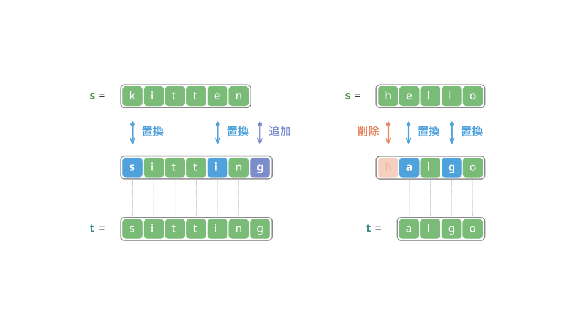

**編集距離問題は決定木で自然に表せます**。文字列が木のノードに、各段階の選択（1 回の編集操作）が木の辺に対応します。

下図のように、操作を制限しなければ、各ノードからは多数の辺が伸び、それぞれが 1 つの操作を表します。つまり、`hello` から `algo` に至る経路は数多くあります。

決定木の観点では、この問題の目標はノード `hello` とノード `algo` の間の最短経路を求めることです。

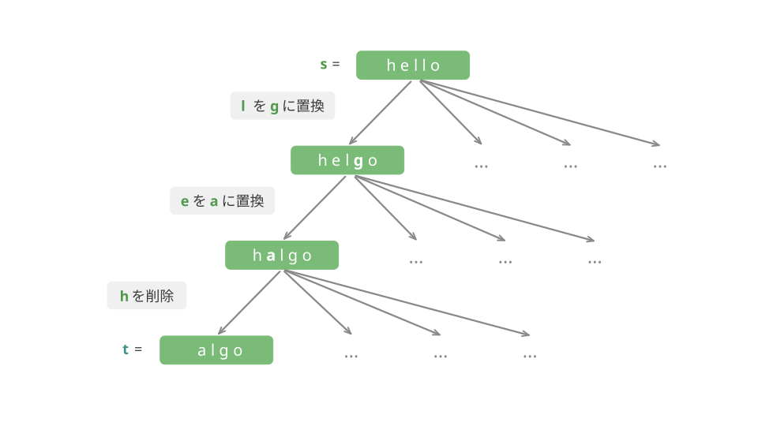

### 動的計画法の考え方

**手順 1：各段階の選択を考え、状態を定義して $dp$ テーブルを作る**

各段階で、文字列 $s$ に適用する編集操作を 1 つ選びます。

部分問題を作るには、編集に伴って問題が小さくなるように考えます。文字列 $s$ と $t$ の長さをそれぞれ $n$、$m$ とし、まず末尾の文字 $s[n-1]$ と $t[m-1]$ に注目します。

- $s[n-1]$ と $t[m-1]$ が同じなら、この 2 文字を飛ばして $s[n-2]$ と $t[m-2]$ を考えられます。
- $s[n-1]$ と $t[m-1]$ が異なるなら、$s$ に 1 回の編集（挿入、削除、置換）を施します。末尾を一致させれば、一致した文字を飛ばしてより小さな問題に進めます。

つまり、文字列 $s$ に対する各段階の選択（編集操作）によって、$s$ と $t$ でまだ照合が必要な文字が変わります。そこで状態を、現在 $s$ と $t$ で考えている $i$ 番目と $j$ 番目の文字に対応させ、$[i, j]$ と表します。

状態 $[i, j]$ の部分問題は、**$s$ の先頭 $i$ 文字を $t$ の先頭 $j$ 文字に変えるための最少編集回数を求めることです**。

これで、大きさ $(n+1) \times (m+1)$ の 2 次元の $dp$ テーブルが得られます。

**手順 2：最適部分構造を見つけ、状態遷移式を導く**

部分問題 $dp[i, j]$ に対応する 2 つの文字列の末尾は $s[i-1]$ と $t[j-1]$ です。編集操作に応じて、下図の 3 通りに分けられます。

1. $s[i-1]$ の直後に $t[j-1]$ を追加すると、残る部分問題は $dp[i, j-1]$ です。
2. $s[i-1]$ を削除すると、残る部分問題は $dp[i-1, j]$ です。
3. $s[i-1]$ を $t[j-1]$ に置換すると、残る部分問題は $dp[i-1, j-1]$ です。

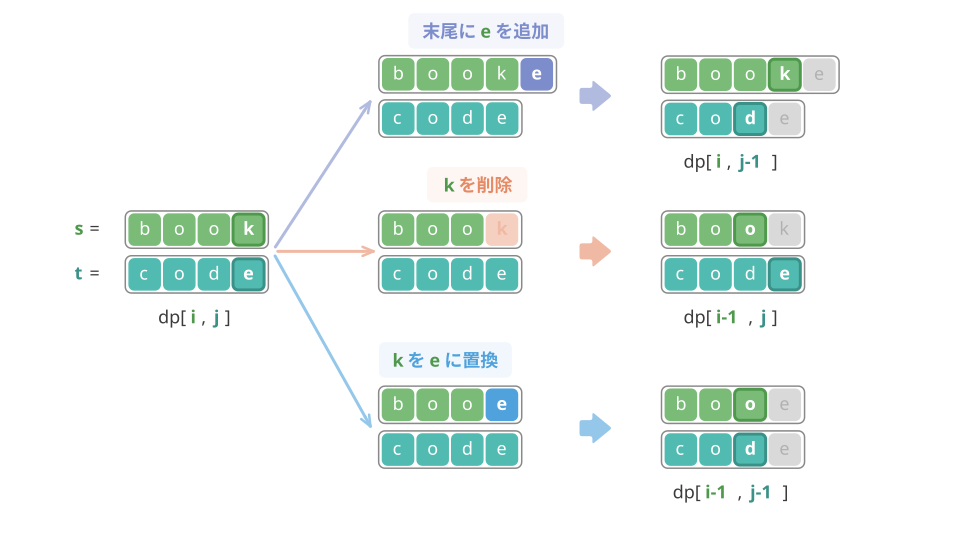

以上から最適部分構造がわかります。$dp[i, j]$ の最少編集回数は、$dp[i, j-1]$、$dp[i-1, j]$、$dp[i-1, j-1]$ の最少編集回数のうち最も小さい値に、今回の編集回数 $1$ を加えた値です。対応する状態遷移式は次のとおりです。

$$
dp[i, j] = \min(dp[i, j-1], dp[i-1, j], dp[i-1, j-1]) + 1
$$

ただし、**$s[i-1]$ と $t[j-1]$ が同じ場合は、この文字を編集する必要はありません**。この場合の状態遷移式は次のとおりです。

$$
dp[i, j] = dp[i-1, j-1]
$$

**手順 3：境界条件と状態遷移の順序を決める**

両方の文字列が空なら、編集回数は $0$、つまり $dp[0, 0] = 0$ です。$s$ が空で $t$ が空でなければ、最少編集回数は $t$ の長さに等しく、先頭行は $dp[0, j] = j$ となります。$s$ が空でなく $t$ が空なら、最少編集回数は $s$ の長さに等しく、先頭列は $dp[i, 0] = i$ となります。

状態遷移式を見ると、解 $dp[i, j]$ は左、上、左上の解に依存します。したがって、二重ループで $dp$ テーブル全体を先頭から順に走査すれば十分です。

### 実装

```src
[file]{edit_distance}-[class]{}-[func]{edit_distance_dp}
```

下図のように、編集距離の状態遷移はナップサック問題のものとよく似ています。どちらも 2 次元の表を埋める過程とみなせます。

=== "<1>"
    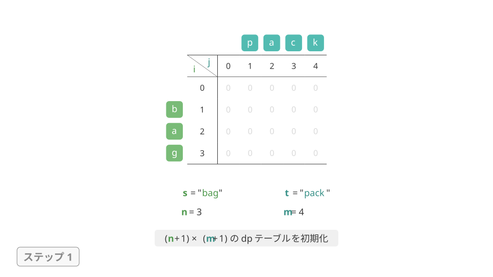

=== "<2>"
    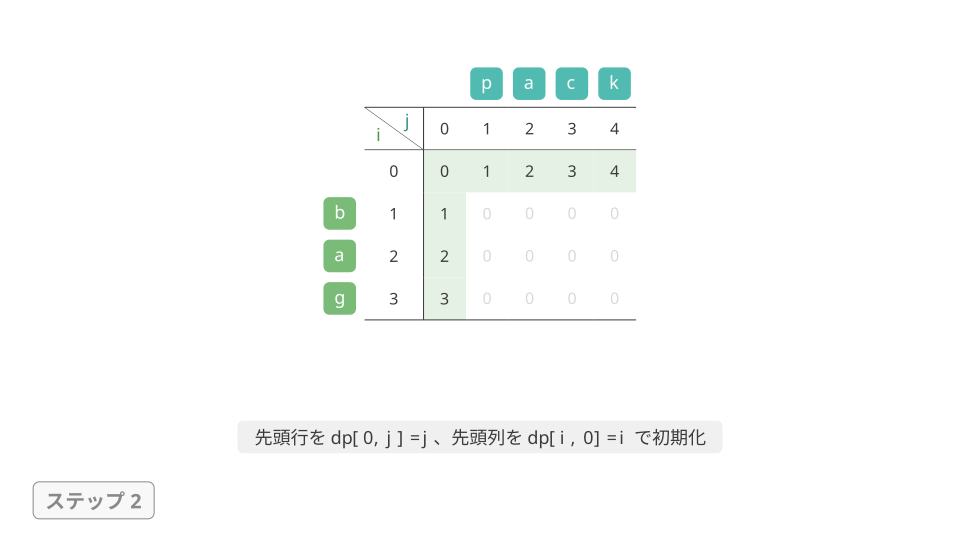

=== "<3>"
    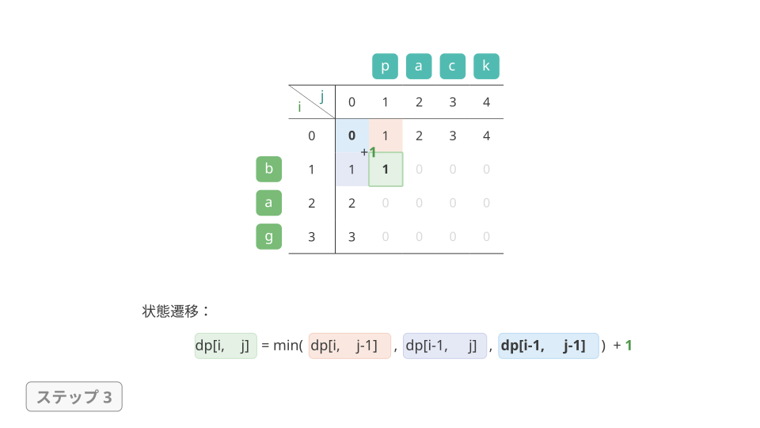

=== "<4>"
    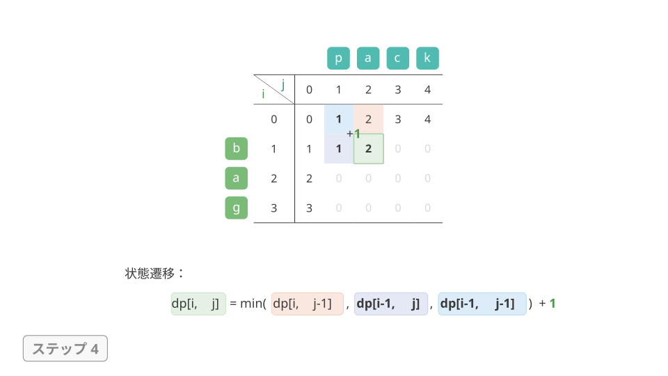

=== "<5>"
    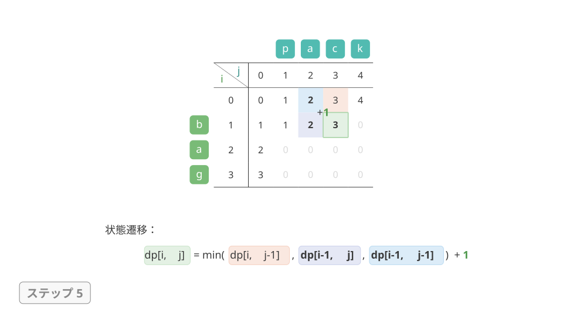

=== "<6>"
    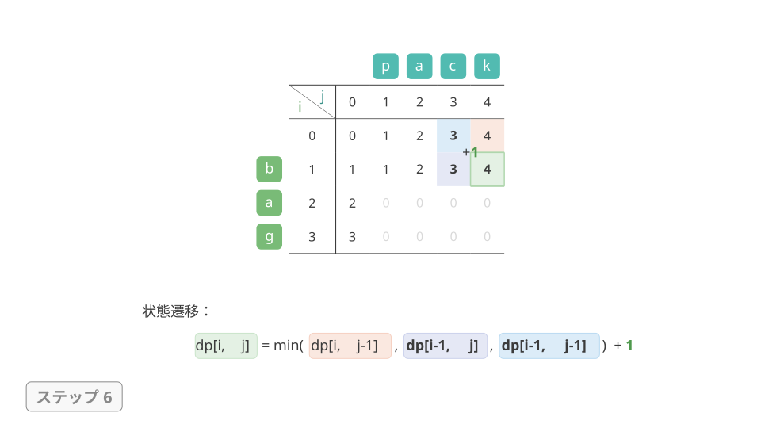

=== "<7>"
    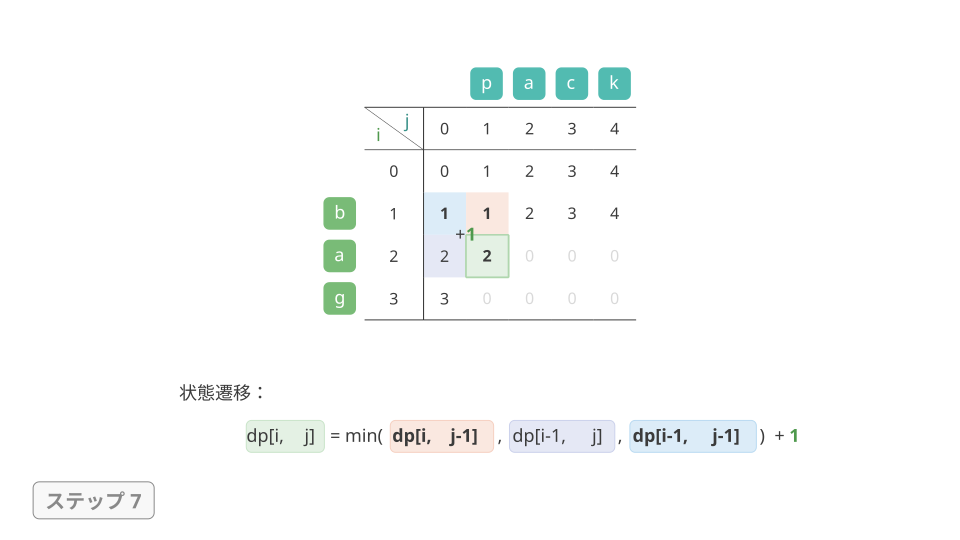

=== "<8>"
    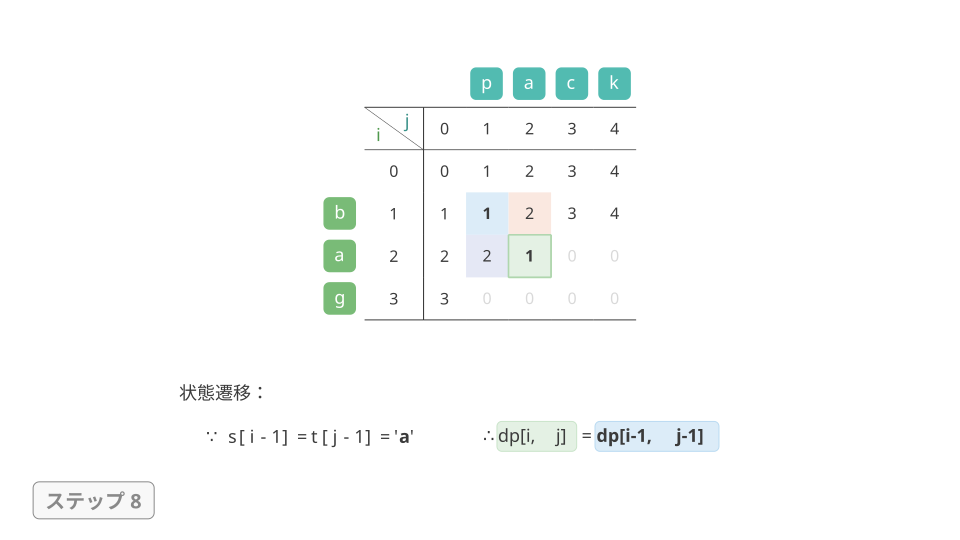

=== "<9>"
    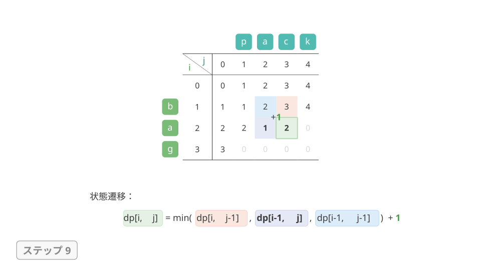

=== "<10>"
    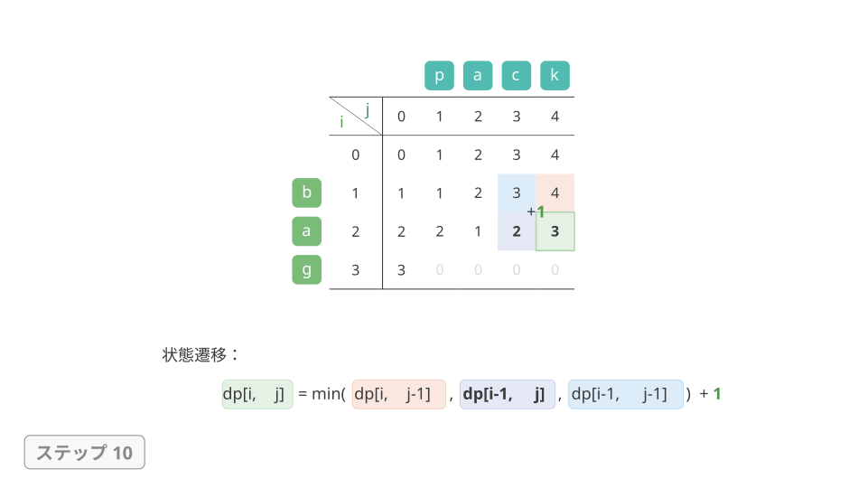

=== "<11>"
    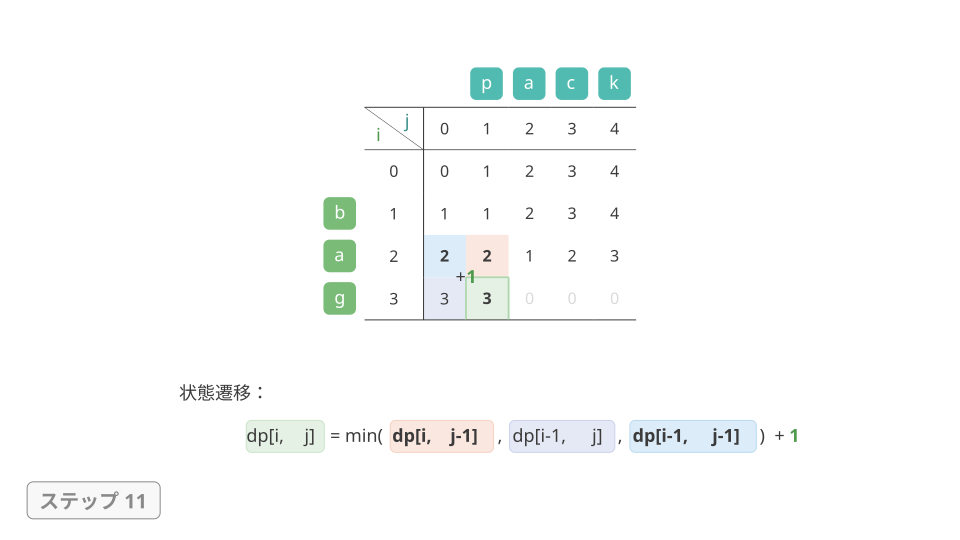

=== "<12>"
    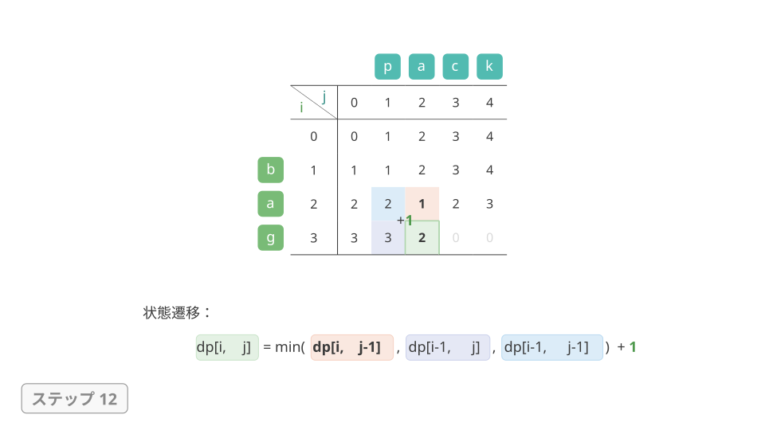

=== "<13>"
    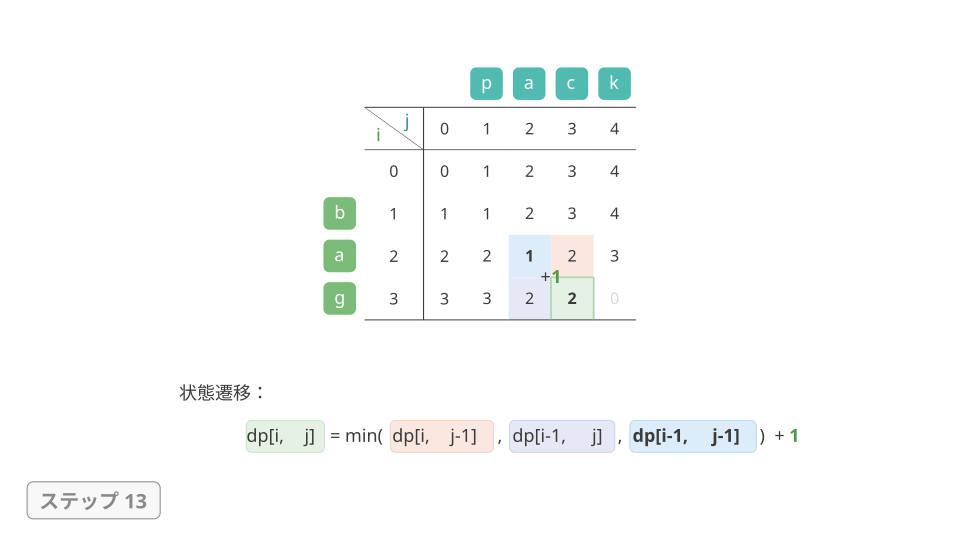

=== "<14>"
    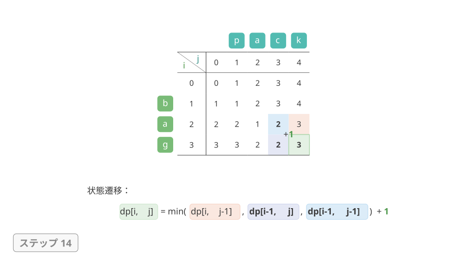

=== "<15>"
    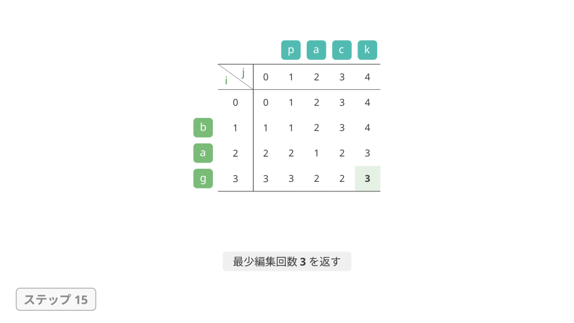

### 使用メモリの削減

$dp[i,j]$ は上の $dp[i-1, j]$、左の $dp[i, j-1]$、左上の $dp[i-1, j-1]$ から求めます。しかし、昇順に走査すると左上の $dp[i-1, j-1]$ が失われ、降順に走査すると $dp[i, j-1]$ を先に求められません。そのままではどちらの順序も使えません。

そこで変数 `leftup` に左上の解 $dp[i-1, j-1]$ を一時保存しておけば、あとは左と上の解だけを考えれば済みます。個数制限なしナップサック問題と同じ状況になり、昇順に走査できます。コードは次のとおりです。

```src
[file]{edit_distance}-[class]{}-[func]{edit_distance_dp_comp}
```
