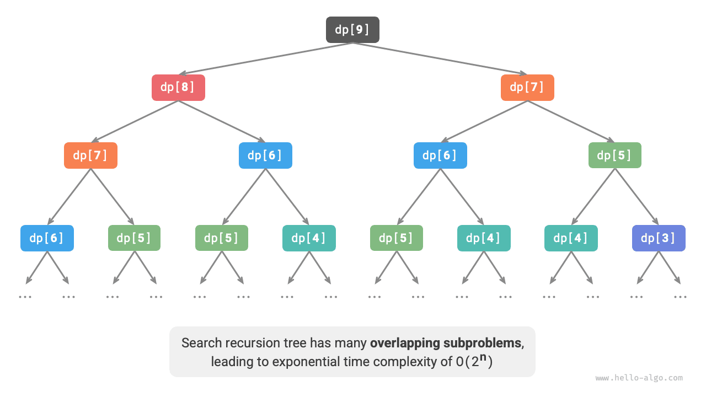
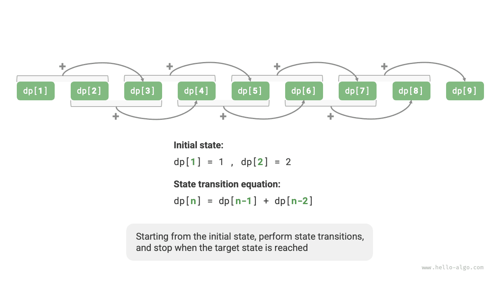

# 動的計画法への第一歩

<u>動的計画法（dynamic programming）</u>は、問題を一連の小さな部分問題に分解し、その解を保存することで重複した計算を避け、時間効率を大幅に高める重要なアルゴリズムの枠組みです。

この節では、古典的な問題を取り上げ、まず総当たりのバックトラッキングによる解法を示します。そこに含まれる部分問題の重複を確認し、より効率的な動的計画法へと段階的に発展させます。

!!! question "階段を上る"

    $n$ 段の階段があります。1 回で $1$ 段または $2$ 段上れるとき、一番上まで上る方法は何通りありますか。

下図のように、$3$ 段の階段を上る方法は $3$ 通りあります。


求めたいのは方法の数なので、**バックトラッキングですべての可能性を列挙することが考えられます**。具体的には、階段を上ることを選択の繰り返しと捉えます。地面から出発し、毎回 $1$ 段か $2$ 段かを選び、一番上に着くたびに方法の数を $1$ 増やします。一番上を超えた場合は枝刈りします。コードは次のとおりです。

```src
[file]{climbing_stairs_backtrack}-[class]{}-[func]{climbing_stairs_backtrack}
```

## 方法 1：全探索

バックトラッキングでは通常、問題を明示的に分解するのではなく、一連の意思決定として捉えます。試行と枝刈りを通じて、可能な解をすべて探索します。

この問題を、分解するという観点から考えてみましょう。$i$ 段目まで上る方法が $dp[i]$ 通りあるとすると、$dp[i]$ が元の問題であり、部分問題には次のものがあります。

$$
dp[i-1], dp[i-2], \dots, dp[2], dp[1]
$$

毎回 $1$ 段か $2$ 段しか上れないので、$i$ 段目にいるなら、その直前にいたのは $i - 1$ 段目か $i - 2$ 段目です。つまり、$i$ 段目には $i -1$ 段目または $i - 2$ 段目からしか来られません。

ここから、重要な結論が得られます。**$i - 1$ 段目まで上る方法の数と、$i - 2$ 段目まで上る方法の数の和が、$i$ 段目まで上る方法の数になります**。式で表すと、次のとおりです。

$$
dp[i] = dp[i-1] + dp[i-2]
$$

つまり、階段を上る問題では部分問題の間に漸化式があり、**部分問題の解から元の問題の解を組み立てられます**。下図に、この関係を示します。


この漸化式から、全探索による解法が得られます。$dp[n]$ から始め、**大きな問題を二つの小さな問題の和へ再帰的に分解し**、最小の部分問題 $dp[1]$ と $dp[2]$ に到達したら戻ります。その解は既知で、$dp[1] = 1$、$dp[2] = 2$ です。つまり、$1$ 段目と $2$ 段目まで上る方法は、それぞれ $1$ 通りと $2$ 通りです。

次のコードは、通常のバックトラッキングのコードと同じく深さ優先探索ですが、より簡潔です。

```src
[file]{climbing_stairs_dfs}-[class]{}-[func]{climbing_stairs_dfs}
```

下図に、全探索でできる再帰木を示します。問題 $dp[n]$ の再帰木の深さは $n$ で、時間計算量は $O(2^n)$ です。指数のオーダーは爆発的に増えるため、大きな $n$ を入力すると、長時間待つことになります。



上図から、**指数のオーダーの時間計算量は「部分問題の重複」によって生じている**ことがわかります。たとえば $dp[9]$ は $dp[8]$ と $dp[7]$ に分解され、$dp[8]$ は $dp[7]$ と $dp[6]$ に分解されます。どちらにも部分問題 $dp[7]$ が含まれます。

さらに、その部分問題にも小さな部分問題の重複が含まれ、同じことが次々に繰り返されます。計算資源の大部分が、こうした重複した部分問題に費やされています。

## 方法 2：メモ化探索

効率を高めるには、**重複する部分問題をそれぞれ 1 回だけ計算したい**ところです。そこで配列 `mem` に各部分問題の解を記録し、探索中に重複する部分問題を枝刈りします。

1. $dp[i]$ を初めて計算したら、後で使えるよう `mem[i]` に記録します。
2. 再び $dp[i]$ が必要になったら、`mem[i]` から直接取得し、同じ部分問題の再計算を避けます。

コードは次のとおりです。

```src
[file]{climbing_stairs_dfs_mem}-[class]{}-[func]{climbing_stairs_dfs_mem}
```

下図のように、**メモ化すると、重複する部分問題はすべて 1 回の計算で済み、時間計算量は $O(n)$ に改善されます**。これは大きな進歩です。


## 方法 3：動的計画法

**メモ化探索は「上から下へ」進む方法です**。元の問題（根ノード）から始め、大きな部分問題を小さな部分問題へ再帰的に分解し、解が既知の最小の部分問題（葉ノード）まで進みます。その後、戻りながら各段階の解を集め、元の問題の解を組み立てます。

対して、**動的計画法は「下から上へ」進む方法です**。最小の部分問題の解から始め、反復によってより大きな部分問題の解を組み立て、元の問題の解まで到達します。

動的計画法には引き返す過程がないため、再帰は不要で、ループによる反復だけで実装できます。次のコードでは、部分問題の解を保存する配列 `dp` を初期化します。これは、メモ化探索の配列 `mem` と同じ記録の役割を果たします。

```src
[file]{climbing_stairs_dp}-[class]{}-[func]{climbing_stairs_dp}
```

下図に、上のコードの実行過程を示します。



バックトラッキングと同様に、動的計画法でも「状態」を使って問題を解く途中の段階を表します。各状態は、一つの部分問題と、それに対応する局所的な最適解に対応します。たとえば階段を上る問題では、現在いる段数 $i$ を状態とします。

ここまでの内容から、動的計画法の主な用語をまとめられます。

- 配列 `dp` を <u>dp テーブル</u>と呼び、$dp[i]$ は状態 $i$ に対応する部分問題の解を表します。
- 最小の部分問題に対応する状態（$1$ 段目と $2$ 段目）を<u>初期状態</u>と呼びます。
- 漸化式 $dp[i] = dp[i-1] + dp[i-2]$ を<u>状態遷移式</u>と呼びます。

## 空間の最適化

注意深く見ると、**$dp[i]$ が依存するのは $dp[i-1]$ と $dp[i-2]$ だけなので、配列 `dp` にすべての部分問題の解を保存する必要はありません**。二つの変数を順に更新していけば十分です。コードは次のとおりです。

```src
[file]{climbing_stairs_dp}-[class]{}-[func]{climbing_stairs_dp_comp}
```

上のコードでは配列 `dp` が不要になったため、空間計算量は $O(n)$ から $O(1)$ に下がります。

動的計画法では、現在の状態が直前の限られた数の状態だけに依存することがよくあります。その場合、必要な状態だけを保持し、「次元を減らす」ことでメモリを節約できます。**この空間最適化の技法を「ローリング変数」または「ローリング配列」と呼びます**。
